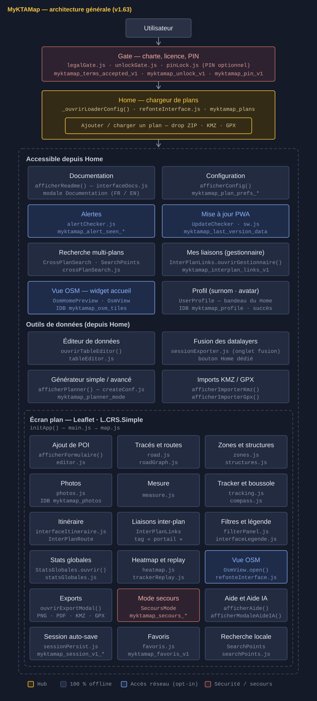

# 📘 MyKTAMap

**🟢 Application : [myktamap.fr](https://myktamap.fr) · 📖 Documentation : [doc.myktamap.fr](https://doc.myktamap.fr)** — guides utilisateur, installation, sécurité, comment chaque version est vérifiée. · Licence [CC BY-NC-SA 4.0](LICENSE) (usage commercial sur accord).

> Application web de **cartographie souterraine** — visualisation, annotation et déplacement simulé sur plan image (carrières, galeries, sites souterrains / industriels). **100 % hors-ligne**, sans GPS requis, sans framework.

> ⚠️ Les données présentes sur le site de démonstration sont fictives.

> 🧩 **Édition installation (backend)** — comptes, plans partagés en base, synchronisation entre appareils, Mode Secours
> partagé : elle se greffe sur cette application, qui reste **entièrement utilisable sans serveur**. Elle demande une
> **licence pro** (`Licence-pro.json`) et un **accès au dépôt backend** (privé), fournis **sur demande** : Instagram
> [@karma_kta](https://www.instagram.com/karma_kta/) ou [contact@myktamap.fr](mailto:contact@myktamap.fr).
> Présentation : [pro.myktamap.fr/presentation](https://pro.myktamap.fr/presentation/).

**🗺️ Architecture générale** (gate → home → écran plan, modules JS, clés de stockage — légende : 🟡 hub · ⬛ 100 % offline · 🔵 accès réseau opt-in · 🔴 sécurité/secours) :



## 📦 Version courante — `v2.18.0` (18/10/2026)

> 🤝 **v2.18.0 — Calques et export à plusieurs comptes** : sur une installation reliée, un calque ouvert à la modification ailleurs se recale à la synchro et sa restitution se propage (sans trace de suppression) ; export de session limité à ses propres ajouts sur le plan d'un autre compte (prise `exportAutorise` → `{ auteur }`) ; prise `outilHome` en liste (3 tuiles) et événements du Carnet ; schéma de l'outillage de l'IA (`docs/ia-architecture.svg`). Sans extension, rien ne change.

## 📑 Sommaire

1. [🧭 Introduction](#-introduction)
2. [🛠️ Fonctionnalités principales](#%EF%B8%8F-fonctionnalités-principales)
3. [🏗️ Structure du projet](#%EF%B8%8F-structure-du-projet)
4. [📦 Modules JS — référentiel (112 modules)](#-modules-js--référentiel-112-modules)
5. [📚 Documentation d'architecture](#-documentation-darchitecture)
6. [⚙️ Développement, conventions & release](#-développement-conventions--release)
7. [📋 Journal des versions](#-journal-des-versions)
8. [📄 Licence](#-licence)

---

## 🧭 Introduction

MyKTAMap est une application web permettant de **visualiser, annoter et exploiter un plan image** (carrière souterraine, bâtiment, site industriel…) à partir d'une image haute résolution.

L'outil repose sur **[Leaflet](https://leafletjs.com/)** en projection simple (`L.CRS.Simple`), ce qui permet de travailler sur une carte personnalisée **sans coordonnées GPS** — tout en supportant un calibrage GPS 2 points optionnel pour exporter/importer en KMZ géolocalisé et GPX (Google Earth, OsmAnd, TopoDroid, Strava…) et projeter le plan sur fond OpenStreetMap (opt-in réseau).

Conçue pour le terrain : **100 % hors-ligne** par défaut (Service Worker + IndexedDB), **zéro télémétrie**, **données locales** uniquement, **multi-langue FR/EN/ES**, **code ouvert** sous CC BY-NC-SA.

**PWA page unique** (`index.html`), stack **HTML/CSS/JS vanilla + Leaflet** — pas de framework, pas de bundler, pas de build : les sources sont servies telles quelles.

---

## 🛠️ Fonctionnalités principales

### 🗺️ Cartographie et annotations

| Fonctionnalité | Module(s) clé(s) |
|---|---|
| Affichage plan image haute résolution (tiling runtime V1, 5 presets) | `map.js`, `tiling.js`, `config.js` |
| **Tuiles V2** build-time type Google Maps (4 niveaux de zoom, WebP/PNG si source transparente) | `createConf.js > _genererTuilesV2`, `tiling.js` |
| **Multi-niveau (M-LVL)** : étages, jonctions interniveau, filtre de niveau | `interface.js`, `config.js` |
| Calques image (légende, surimpressions) + calibration 2 points | `map.js`, `imageLayerCalibration*.js` |
| Calques de données (`devmap-data` JSON) | `utils.js > ajouterPointsDepuisJSON` |
| Points d'intérêt : tags, notes, photos IDB (ré-encodées sans EXIF) | `editor.js`, `photos.js`, `photoViewer.js` |
| Tracés (Principal / Secondaire / Chemin / Jonction / Itinéraire) | `road.js` |
| Zones polygonales (eau / remblais / effondrement / inaccessible) | `zones.js` |
| Structures (pilier 1ère / 2e masse, mur, fronts) | `structures.js` |
| Mesure distance + surface (polygone shoelace) | `measure.js` |
| **Undo / Redo global** (Ctrl+Z / Ctrl+Y, 50 entrées FIFO) | `historyManager.js` |
| Heatmap densité d'activité | `heatmap.js` |
| **Légende personnalisable** (rename / hide / types customs dessinables) | `legendCustomization.js` |
| **Favoris** par plan + export/import JSON | `favoris.js` |
| Recherche unifiée (Ctrl/Cmd+K, tous calques + session) | `searchPoints.js` |
| Modale **Filtres unifiée** (tags / types, live update) | `filterPanel.js` |

### 🧭 Tracker et navigation

| Fonctionnalité | Module(s) clé(s) |
|---|---|
| Tracker PDR (capteurs mobile, expérimental) + timeline persistée par plan | `tracking.js`, `compass.js` |
| Recalage : clic carte, « 📍 Je suis ici », arrivée de portail | `tracking.js` |
| Itinéraire Dijkstra sur le réseau de tracés (waypoints, évitements par tag, pauses estimées) | `pathfinder.js`, `roadGraph.js`, `interfaceItineraire.js` |
| **Itinéraire vivant** : replanification au recalage + validation d'étapes au passage | `interfaceItineraire.js`, `tracking.js` |
| Replay session tracker (timeline + slider + export CSV) | `trackerReplay.js` |
| Boussole / heading + définition du nord du plan | `compass.js`, `northPicker.js` |
| ⛑️ **« Je suis perdu »** (isochrone Dijkstra) · 🚨 **Panique** · sortie d'urgence la plus proche | `lostMode.js`, `emergencyMode.js`, `sortieUrgence.js` |
| 🎤 Commandes vocales (BETA, push-to-talk, ~18 commandes FR) + synthèse vocale | `voiceCommand.js`, `voiceTts.js` |

### 🌀 Multi-plans et inter-plan

| Fonctionnalité | Module(s) clé(s) |
|---|---|
| **Registre multi-plans** (localStorage + ZIP IndexedDB, auto-discovery serveur `data/index.json`) | `planRegistry.js` |
| **Liaisons inter-plan « portails »** (bidirectionnelles, snapshots auto-rafraîchis, tag builtin portail) | `interPlanLinks.js` |
| Gestionnaire « 🌀 Mes liaisons » : liste + **vue graphe SVG** (plans = nœuds, portails = arêtes) | `interPlanLinks.js`, `planNetwork.js` |
| **Recherche multi-plans** (scan de la bibliothèque sans charger les plans) | `crossPlanSearch.js` |
| **Itinéraire inter-plan** (leg A → portail → leg B auto-tracé) + **multi-hop** (Dijkstra sur graphe de portails, ≤ 3 traversées) | `interPlanRoute.js` |
| Pile de navigation + bouton ↩️ Retour réductible après un saut | `interPlanLinks.js` |

### 📦 Import / Export

| Fonctionnalité | Module(s) clé(s) |
|---|---|
| Session JSON Full / Avancé + conversion session → calque de données | `sessionExporter.js`, `sessionPersist.js` |
| **Export anonymisé** (ids remappés, photos ré-encodées sans EXIF, fail-closed) | `sessionExporter.js` |
| **Générateur de plan ZIP** (Nouveau / Modifier, mode Simple / Avancé, tuiles V2, canvas vierge) | `createConf.js` |
| Import unifié ZIP / KMZ / GPX (drop zone home + générateur) | `homeLoader.js`, `kmzImport.js`, `gpxImport.js` |
| 🌍 **KMZ géolocalisé** export / import round-trip (Google Earth, OsmAnd, Avenza, Locus) | `kmzExport.js`, `kmzImport.js` |
| 📤 **GPX 1.1** export / import (TopoDroid, OsmAnd, Strava, Garmin) | `gpxIO.js`, `gpxImport.js` |
| 🖼️ Export PNG / JPG (Rapide / Avancé + légende dessinée) · 📄 PDF imprimable A0 → A4 | `exporter.js`, `pdfExport.js` |
| 📊 Éditeur de données du plan (tableau, 3 sources) | `tableEditor.js` |
| 📋 Rapport de sortie · 📈 stats globales + export PDF | `sessionReport.js`, `statsGlobales.js` |
| 💾 Backups multi-rotations sessions (10 FIFO IDB) | `sessionBackups.js` |
| 📔 **Le Carnet** : archive automatique des sorties (durée, distance, ajouts, tracé, note) + timeline multi-plans | `journal.js`, `journalUi.js` |
| 👤 Export / import de **profil utilisateur complet** | `profileExportImport.js` |

### 🆘 Mode Secours (coordination de recherche)

| Fonctionnalité | Module(s) clé(s) |
|---|---|
| Création de scénario : équipes (palette OTAN), parcours, zones de recherche, itinéraires Pathfinder, niveau M-LVL par équipe | `secoursMode.js` |
| Exécution terrain : 3 rôles live (👤 Opérateur / 🚨 Équipe step-by-step / 🚑 Secouriste libre), 7 statuts d'étape, timer avec pause | `secoursMode.js` |
| Photos terrain (store IDB dédié) + rapports 3 formats × 3 scopes | `secoursPhotos.js`, `secoursMode.js` |
| Partage scénario `.mkmsec.json` export / import avec preview | `secoursMode.js` |

### 🔒 Sécurité et confidentialité

| Fonctionnalité | Module(s) clé(s) |
|---|---|
| 🗝️ **UnlockGate** (barrière communautaire) · 🔐 **PinLock** (PIN 4-6 + biométrie) · verrouillage depuis la home | `unlockGate.js`, `pinLock.js` |
| ⚖️ **Gate CGU au boot** (avant la saisie du code) + séquenceur premier lancement | `legalGate.js`, `firstRunFlow.js` |
| 🕶️ **Mode incognito** (shim Storage + IDB, zéro trace locale) | `incognitoMode.js` |
| 🚫 Denylist de ZIP fuités (hash SHA-256, `denylist.json`) | `planDenylist.js` |
| 📊 Audit réseau exposé in-app + journal réseau du loader | `networkAudit.js`, `loaderNetAudit.js` |
| 🚨 Alertes publiques (incendie, fermeture, info — `alert.json`) | `alertChecker.js`, `interfaceAlerts.js` |

### 🌍 Vue OSM (opt-in réseau)

| Fonctionnalité | Module(s) clé(s) |
|---|---|
| Modale OSM : plan projeté sur fond OpenStreetMap via géoréférencement 2 points | `osmView.js` |
| Widget aperçu OSM sur la home | `osmHomePreview.js` |
| Cache de tuiles OSM (IndexedDB) | `osmTilesCache.js` |

### 🎨 UI / UX

| Fonctionnalité | Module(s) clé(s) |
|---|---|
| 🌍 **Multi-langue FR / EN / ES** (`window.I18n`, dicos `lang/*.json`, FR fallback universel) | `langManager.js` |
| ☀️ Thème **clair / sombre** global | `themeManager.js` |
| 🎬 Refonte interface : header bar + sidebars unifiées + status bar | `refonteInterface.js`, `interface.js` |
| 📱 **PWA installable** + mode hors-connexion (Service Worker précache) | `manifest.json`, `sw.js` |
| 🔁 UpdateChecker semver + force update sur mismatch de cache | `updateChecker.js`, `loaderSwModals.js` |
| 🎓 Tutoriel premier lancement (26 cards, FR/EN) | `tutorial.js` |
| 📖 Aide intégrée FR/EN + documentation in-app + contexte IA | `interfaceDocs.js` |
| ⌨️ Raccourcis clavier globaux + cheatsheet | `shortcuts.js`, `shortcutsCheatsheet.js` |
| 🎬 Mode présentation · 📜 Mode Histoire (récit de sortie) | `presentationMode.js`, `modeHistoire.js` |
| 👤 Profil utilisateur : gamification, rangs, hauts faits | `userProfile.js`, `profileGamification.js`, `profileAchievements.js` |

### ⚡ Performance et robustesse

| Fonctionnalité | Module(s) clé(s) |
|---|---|
| 🚀 **Perf ULTRA per-plan** (toggles opt-in par plan) | `perfUltra.js` |
| ⚙️ OOMGuard (détection kill mémoire) · 🪫 BatteryGuard (alertes 20/10/5 %) · 💡 WakeLock | `oomGuard.js`, `batteryGuard.js`, `wakeLock.js` |
| 📋 Crash reports auto (IDB) · 🧠 Inspecteur mémoire · 🔧 Inspecteur Service Worker | `crashReports.js`, `memInspector.js`, `swInspector.js` |
| 💾 Auto-save session per-plan (poller 1,5 s, teardown propre au plan switch) | `sessionPersist.js` |
| ⏳ Overlay générique « calcul en cours » | `computeLoader.js` |

---

## 🏗️ Structure du projet

```
index.html                      ← Page unique : home loader + carte Leaflet + modales (~101 Ko)
sw.js                           ← Service Worker (précache exhaustif, CACHE_NAME versionné)
manifest.json                   ← PWA (icônes, theme color, standalone)
version.json                    ← Source de vérité version (UpdateChecker) + notes user-friendly
alert.json                      ← (Optionnel) Diffusion d'alertes publiques
css/style.css                   ← Tous les styles (~19k lignes : dark base + thème clair + modales)

lang/                           ← Dictionnaires i18n (fr.json = fallback, en.json, es.json)

data/                           ← Plans serveur (DATA pure — auto-discovery via index.json)
  index.json                    ← (Optionnel) Liste des plans
  <plan>/plan-config.json       ← Config d'un plan + images + calques JSON

icon/                           ← Icônes des tags (PNG 50×50 transparents, 1 par tag builtin)

lib/                            ← Librairies locales (aucun CDN)
  leaflet/                      ← Leaflet 1.9.x + imageoverlay-rotated
  jszip.min.js                  ← JSZip (ZIP)
  jspdf.umd.min.js              ← jsPDF (PDF imprimable)
  html2canvas.min.js            ← html2canvas (rendus export)

js/                             ← 112 modules IIFE — voir section suivante
docs/                           ← Docs user (README_USER, AI_CONTEXT, NETWORK_AUDIT) + architecture/
scripts/                        ← Outillage dev : garde-fous check-*, smoke, merge-main
.githooks/                      ← Hooks pre-commit (anti-fuite pro + 12 garde-fous) et commit-msg (guard de release)
docker/                         ← Self-host (voir docs/architecture/docker-selfhost.md)
```

---

## 📦 Modules JS — référentiel (112 modules)

> Tous les modules sont en **IIFE** (`(function() { "use strict"; ... })()`) avec API publique exposée via `window.<NomDuModule>`. Pas de bundler, pas de transpiler. **L'ordre de chargement = l'ordre des `<script>` dans `index.html`** (source de vérité) — les groupes ci-dessous le suivent.

### 🎯 Socle transverse (chargé en premier)

| Module | Rôle |
|---|---|
| `copyright.js` | Bannière console + `__MKM__.build` (version côté JS) |
| `langManager.js` | `window.I18n` — dicos `lang/*.json`, FR fallback universel |
| `incognitoMode.js` | Mode incognito (shim Storage + IndexedDB, zéro trace) |
| `proLicense.js` | Check licence pro au boot (white-label) |
| `themeManager.js` | Thème clair / sombre global |
| `networkAudit.js` | Journal réseau in-app (📊 Logs) |
| `cssLazy.js` | Chargement CSS différé |
| `crashReports.js` | Rapports de crash auto en IndexedDB |
| `memInspector.js` | Inspecteur mémoire (rapport RAM / IDB) |
| `modalLifecycle.js` | Cycle de vie des modales (ouverture/fermeture/empilement) |
| `swInspector.js` | Inspection du Service Worker et des caches |
| `statsGlobales.js` | Stats globales du plan + export PDF |
| `tutorial.js` | Tutoriel premier lancement (cards) |
| `userProfile.js` | Profil utilisateur intégré au loader |
| `profileGamification.js` | Gamification (XP, rangs) |
| `profileAchievements.js` | Hauts faits / achievements |
| `profileExportImport.js` | Export / import complet du profil |
| `debug.js` | Panneau de logs debug persisté |
| `perfUltra.js` | Toggles perf ULTRA per-plan |

### 🔒 Gates et configuration

| Module | Rôle |
|---|---|
| `unlockGate.js` | Barrière d'accès communautaire |
| `pinLock.js` | PIN local 4-6 + biométrie (Face ID / Touch ID) |
| `config.js` | Chargement `plan-config.json` + état global du plan |

### 🧰 Noyau carte

| Module | Rôle |
|---|---|
| `utils.js` | Helpers transverses : `convertCoord`, `formatDistance`, popups, icônes, tuiles |
| `measure.js` | Mesure distance + surface |
| `tiling.js` | Tiling runtime V1 + consommation tuiles V2 |
| `imageLayerCalibration.js` | Calibration de calques image (2 points) |
| `imageLayerCalibrationPicker.js` | Picker UI de la calibration |
| `map.js` | Init Leaflet, icônes builtin (`TAGS_BUILTIN`), calques |
| `tracking.js` | Tracker PDR, recalage, timeline, hook `_onTrackerRecale` |

### ✏️ Annotations

| Module | Rôle |
|---|---|
| `editor.js` | Points de session (création, édition, suppression) |
| `road.js` | Tracés (5 types) |
| `zones.js` | Zones polygonales (4 types) |
| `structures.js` | Structures (5 sous-types) |
| `photos.js` | Photos POI (IndexedDB, ré-encodage sans EXIF) |
| `photoViewer.js` | Visionneuse photos |
| `historyManager.js` | Undo / Redo global (50 FIFO) |

### ⚡ Runtime plan

| Module | Rôle |
|---|---|
| `batteryGuard.js` | Alertes batterie graduelles (Chromium) |
| `trackerReplay.js` | Replay timeline tracker + export CSV |
| `heatmap.js` | Heatmap densité d'activité |
| `legendCustomization.js` | Légende personnalisable + types customs dessinables |
| `favoris.js` | Favoris points par plan |

### 💾 Sessions, recherche et exports

| Module | Rôle |
|---|---|
| `sessionBackups.js` | Backups multi-rotations (10 FIFO IDB) |
| `journal.js` | Le Carnet — archive des sorties (IDB `myktamap_journal`, hooks de cycle de vie) |
| `journalUi.js` | Le Carnet — modale timeline + fiche de sortie |
| `exporter.js` | Export PNG / JPG + légende dessinée |
| `pdfExport.js` | Export PDF imprimable (A0 → A4) |
| `tableEditor.js` | Éditeur JSON en tableau (calque ou session) |
| `searchPoints.js` | Recherche unifiée Ctrl+K |
| `sessionExporter.js` | Export session Full / Avancé / conversion / externe / anonymisé |
| `sessionReport.js` | Rapport de sortie (3 formats) |

### 🎤 Voix et urgence

| Module | Rôle |
|---|---|
| `voiceCommand.js` | Commandes vocales BETA (Web Speech API, push-to-talk) |
| `voiceTts.js` | Synthèse vocale |
| `sortieUrgence.js` | Itinéraire vers la sortie la plus proche (POIs sortie / entrée) |
| `mdParser.js` | Parseur markdown léger |
| `modeHistoire.js` | Mode Histoire (récit de sortie) |

### 🌍 Interop géo (KMZ / GPX / OSM)

| Module | Rôle |
|---|---|
| `kmzExport.js` | Export KMZ géolocalisé |
| `osmTilesCache.js` | Cache tuiles OSM (IndexedDB) |
| `osmView.js` | Vue OSM modale (plan projeté) |
| `osmHomePreview.js` | Widget aperçu OSM sur la home |
| `kmzImport.js` | Import KMZ → ZIP MyKTAMap (round-trip) |
| `gpxIO.js` | Export / import GPX 1.1 |
| `gpxImport.js` | Import GPX → ZIP MyKTAMap (canvas auto-calibré) |

### 🗄️ Plans, persistance et calcul

| Module | Rôle |
|---|---|
| `createConf.js` | Générateur de plan ZIP (Nouveau / Modifier) + tuiles V2 |
| `planRegistry.js` | Registre multi-plans (localStorage + blobs IDB) |
| `planDenylist.js` | Denylist de ZIP fuités (hash) |
| `sessionPersist.js` | Auto-save session per-plan + restore |
| `oomGuard.js` | Détection kill mémoire mobile |
| `computeLoader.js` | Overlay générique « calcul en cours » |
| `pathfinder.js` | Dijkstra chemin le plus court (+ `computeRouteOnRoads`) |
| `roadGraph.js` | Graphe des tracés (snapping, segments) |

### 🔄 Infra boot

| Module | Rôle |
|---|---|
| `updateChecker.js` | Check de version semver + badge + modale |
| `alertChecker.js` | Alertes publiques (`alert.json`) |
| `legalGate.js` | Gate CGU au boot |
| `firstRunFlow.js` | Séquenceur premier lancement (gates → tutoriel) |

### 🌀 Inter-plan

| Module | Rôle |
|---|---|
| `interPlanLinks.js` | Liaisons « portails », gestionnaire, pipeline `goTo`, pile Retour |
| `crossPlanSearch.js` | Recherche multi-plans (scan bibliothèque) |
| `interPlanRoute.js` | Itinéraire inter-plan + multi-hop (graphe de portails) |
| `planNetwork.js` | Vue graphe SVG des plans / portails |

### 🚨 Urgence plein écran

| Module | Rôle |
|---|---|
| `lostMode.js` | ⛑️ « Je suis perdu » (isochrone) |
| `emergencyMode.js` | 🚨 Panique / urgence (minimap, GPS) |
| `compass.js` | Boussole / heading |

### 🖥️ Interface écran plan

| Module | Rôle |
|---|---|
| `refonteInterface.js` | Header bar + sidebars unifiées + status bar |
| `interface.js` | Cœur UI plan (modes, calibrage, légende, niveaux) |
| `interfaceAlerts.js` | UI des alertes |
| `interfaceDistanceTotale.js` | Totalisateur de distance des tracés |
| `interfaceLegende.js` | Légende (labels, groupes) |
| `interfaceDocs.js` | Aide intégrée + documentation in-app |
| `interfaceImportExport.js` | UI import / export |
| `interfaceItineraire.js` | Modale itinéraire (waypoints, évitements, replan) |
| `interfaceMaintenance.js` | Maintenance (reset complet, purges) |
| `northPicker.js` | Définition du nord du plan |
| `interfaceConfig.js` | Modale ⚙️ Configuration du plan (géoref, niveaux) |
| `filterPanel.js` | Modale Filtres unifiée |

### 🆘 Secours et confort

| Module | Rôle |
|---|---|
| `secoursMode.js` | Mode Secours (scénarios, exécution live, exports) |
| `secoursPhotos.js` | Photos terrain (store IDB dédié) |
| `shortcuts.js` | Raccourcis clavier globaux |
| `shortcutsCheatsheet.js` | Cheatsheet des raccourcis |
| `presentationMode.js` | Mode présentation |
| `wakeLock.js` | Écran maintenu allumé |

### 🚀 Bootstrap final

| Module | Rôle |
|---|---|
| `main.js` | Orchestrateur : boot, chargement plans, plan switch, reset |
| `loaderNetAudit.js` | Journal réseau côté home |
| `loaderSwModals.js` | Modales Service Worker (force-update / kill SW) |
| `homeLoader.js` | Home : loader, import ZIP, liste des plans (ex-inline `index.html`) |
| `homeProfile.js` | Home : bandeau profil, rangs, stats, camemberts (ex-inline) |
| `homeConfig.js` | Home : modale Config ⚙️, flux PIN, badges (ex-inline) |

---

## 📚 Documentation d'architecture

> **`docs/architecture/` est la source de vérité technique.** Le README ne duplique plus le détail des sous-systèmes — lire le bon fichier avant de coder.

| Sujet | Référence |
|---|---|
| Vue d'ensemble visuelle (gate → home → plan, modules, clés LS/IDB) | `docs/architecture/overview.svg` |
| Rendu Leaflet, icônes, calques, splash | `docs/architecture/rendering-leaflet.md` |
| Plans : registre, loader, générateur | `docs/architecture/plans-loader.md` |
| Perf, mémoire, OOM, tiling V2, ULTRA, batterie | `docs/architecture/perf-memory.md` |
| Tracker, boussole, heading, navigation | `docs/architecture/tracking.md` |
| Multi-niveau, pathfinding, itinéraire (+ inter-plan) | `docs/architecture/multilevel-pathfinding.md` |
| Exports PNG/PDF/KMZ/GPX + légende | `docs/architecture/exports.md` |
| Refonte UI, thème, modales, filtres | `docs/architecture/ui.md` |
| Cycle de vie des modales | `docs/architecture/modal-lifecycle.md` |
| Multi-langue (i18n), dicos `lang/`, migration | `docs/architecture/i18n.md` |
| Session, photos, undo, recherche, stats, favoris | `docs/architecture/session-data.md` |
| Sécurité : gates, PIN, audit, légal, licence | `docs/architecture/security-legal.md` |
| Mode Secours (toutes phases) + urgence | `docs/architecture/secours.md` |
| Vue OSM modale + widget HOME | `docs/architecture/vue-osm.md` |
| Versioning, live-config, releases, DX, logs | `docs/architecture/infra-versioning.md` |
| Formats JSON (plan-config, point, session) | `docs/architecture/data-formats.md` |
| Self-host Docker | `docs/architecture/docker-selfhost.md` |
| Pièges connus & renommages | `docs/architecture/gotchas.md` |

Docs applicatives (in-app) : `docs/applications/README_USER.md` (+ `.en`) · `docs/applications/AI_CONTEXT.md` · `docs/applications/NETWORK_AUDIT.md` + `.html`. Contexte IA / règles projet : `CLAUDE.md`. **Méthode de travail avec l'IA** (rôles, hooks, garde-fous, porte de release, audits, doc, économie de tokens — guide transposable à un autre projet, lisible par un humain ou par son IA) : `docs/IA_POUR_LES_NULS.md`.

---

## ⚙️ Développement, conventions & release

### 🧪 Validation

- **Syntaxe JS** : `node -c fichier.js` — seul filet (pas de tests auto, pas de linter).
- **Pas de build** : les `<script src="js/…">` sont chargés dans l'ordre par `index.html`. Ajouter un module = l'ajouter à `index.html` **et** à `sw.js > ASSETS_TO_CACHE`.
- Vérifier les **régressions cross-module** avant d'affirmer qu'un fix marche.

### 🧭 Conventions

- **JS** : vanilla, globales via `window.x`, privées préfixe `_`, pas d'`import/export` ES6. Logs préfixés `[Module]`. 2 espaces, lignes < 120.
- **Coordonnées** : TOUJOURS `convertCoord(x, y)` = `[imageHeight - y, x]`. Jamais `[y, x]` direct.
- **Distances** : TOUJOURS `window.formatDistance(distM, dec)`. Jamais `toFixed() + " m"`.
- **Icônes** : résolution unique `window._iconMap[tag]` / `getIconUrlForPoint(point)`.
- **i18n** : textes user-facing via `window.I18n.t("module.section.element")`, appelé **au rendu** (jamais au load), FR = fallback. État de la migration : `docs/architecture/i18n.md`.
- **CSS** : charte dark (`#1a1f2e` → `#0a0d18`, texte `#e8eaf0`/`#c8d0e0`/`#8892a4`), accent `#f4c542`, interaction `#8cb4ff`. Préfixe `kta-`. Z-index : 1100 titre · 5000 loader · 9999 splash · 99999 modales · 100001 sous-modales.

### 🛡️ Garde-fous

- `data/**` = **DATA pure** — le moteur vit dans `js/`, `css/`, `index.html`, `sw.js`.
- **Frontière community ↔ pro** : ce repo est 100 % offline, gratuit, sans bridage. Le pro (cloud sync, backend, white-label…) vit dans le repo privé. Hook anti-fuite : `.githooks/pre-commit` + `scripts/check-no-pro-leak.js` (`git config core.hooksPath .githooks`).
- Jamais de `push main` direct / `push --force` / `reset --hard` (hooks bloquants côté IA).

### 🚀 Release

1. Bumper **ENSEMBLE** : `sw.js > CACHE_NAME` · `js/copyright.js > __MKM__.build` · `version.json > version`.
2. `version.json > notes` : **user-friendly, uniquement le dernier bump** (1-2 phrases, zéro jargon).
3. Sync docs 4 axes : 📱 in-app (`README_USER` fr/en, `interfaceDocs.js`, `AI_CONTEXT.md`) · 🔒 audit (`NETWORK_AUDIT.md` + `.html`) · 📖 ce README · 🤖 archi IA (`CLAUDE.md` + `docs/architecture/<sujet>.md`).
4. **Ce README à chaque bump** : remplacer le bloc **📦 Version courante** en tête + ajouter l'entrée détaillée **en tête du [journal](#-journal-des-versions)**.
5. Déploiement : **FTP manuel par KARMA** (prod). Détails : `docs/architecture/infra-versioning.md`.

> 🛡️ **Les points 1, 3 et 4 sont vérifiés au commit** (`.githooks/commit-msg`, depuis le 16/08/2026) : un bump de `version.json` est refusé si les 3 sources divergent (🔒 non dérogeable) ou si README / Audit réseau / `AI_CONTEXT.md` n'ont pas suivi (📄 dérogeable par une ligne `Docs-deroge: <motif · risque · rattrapage>` dans le message). Détails : `infra-versioning.md` §84.

---

## 📋 Journal des versions

> Journal complet, du plus récent au plus ancien — l'historique de référence avec les commits Git. À chaque release, la nouvelle entrée s'ajoute **en tête de cette section** (le reste du README reste stable).

### 🕐 Versions récentes — entrées détaillées (v1.85.3 → v1.26)

#### v2.18.0 (18/10/2026) — Calques et export à plusieurs comptes (branche `Karma_dev`)

- **Calques et installation reliée** : un calque ouvert à la modification sur un autre appareil se recale à la synchro (calque d'origine masqué, Exporter / Restituer proposés, plus de « rapatrier » en double ; les copies sont datées du rapatriement pour partir en entier, `7055cf5`) ; prise `exportAutorise` → `{ auteur }` = export de session limité à ses ajouts (« Créé par » imposé, copies de calque, traces et liaisons exclues ; conversion et export de calque refusés) — contrat dans `community-server-line.md` §3. La restitution d'un calque se propage aux autres appareils du plan, sans trace de suppression (`bf3a90c`).
- **Prise `outilHome` en liste** : une extension peut poser jusqu’à 3 tuiles dans 🧰 Outils (une tuile peut ouvrir sa propre fenêtre), la forme d’origine reste valable (`751eda3`). **Événements du Carnet** `mktm:journal-sortie-demarree` / `-cloturee` au démarrage et à la clôture manuels d’une sortie (`7d343af`). Sans extension, rien ne change — contrat dans `community-server-line.md`.
- **Service Worker, installation qui déclare des modules** : les pages et feuilles de style des dossiers de ces modules sont lues **réseau d’abord** (repli sur la dernière copie hors ligne, gardée sans sa requête) — une page modifiée sur le serveur n’attend plus le prochain changement de version de l’app ; `index.html` et l’app restent en cache d’abord. Sans module déclaré (myktamap.fr), rien ne change, aucune requête nouvelle. Contrat dans `community-server-line.md` §3, preuve `check-extensions.js` §8.
- **Docs** : `docs/IA_POUR_LES_NULS.md` §4.5 (schéma `docs/ia-architecture.svg` : ce que l'IA lit au démarrage, à chaque action, à la demande et en délégation), agents dédiés et skill d'intégration (§9.2, §9.3).
- **Alertes** : la date « Publié le » d'une alerte d'extension (horodatage ISO) s'affiche en date et heure locales au lieu du texte brut ; une date seule d'`alert.json` reste telle quelle (`interfaceAlerts.js > _dateLisible`).

#### v2.17.0 (17/10/2026) — Exports et ergonomie téléphone, code allégé (branche `Karma_dev`)

- **Exports** : lanceur à tuiles « ⬆️ Exporter » (`ec78279`) ; la tuile KMZ / GPX ne redemande plus le format (`9350e3e`) ; PDF d'un très grand plan (canvas plafonné, `165bb2b`) ; bloc « Ne garder que » à la charte (`3e390ca`) ; verrou de l'installation sur l'export de session seulement, refus toujours dit (`4db6357`) ; « Télécharger le ZIP » pour un plan de l'installation (`15274fb`) ; export image : « 📱 Max iPhone » quand aucune résolution ne tient sous 16,7 Mpx, taille affichée = taille produite, Échap/Annuler sans perte au calage KMZ et au placement de la légende (`18b530d`).
- **Audit ergonomie PC/mobile du 16/10** (`docs/audits/2026-10-16_audit-ergonomie-pc-mobile-v1.md`) : panneaux d'outils dans la bande utile entre barre du haut et footer, fond + croix 36-40 px en mode centré, fermeture au toucher sans sommet parasite (`2e67c04`, `dd78a42`, `97c098c`) ; croix 40 px au doigt (1re règle `pointer: coarse`), modales en `dvh` et centrage sûr (`e6ae00e`) ; liste de tags de l'Éditeur dans l'écran, plancher de dézoom anti-crash aussi en paysage téléphone via `ktaAppareilTactile()` (`45b5999`) ; toutes les modales couvrent les barres (décision M4, `704ad8d`). Reste G1 (primitive unique panneau/modale).
- **Divers** : option « ➕ Boutons de zoom +/− » (défaut OFF, `2ef3cee`) ; Secours : itinéraires d'équipe atténués hors niveau, « Y aller » prévient (`0e82bef`) ; jonction interniveau en légende seulement en multi-niveau (`a66b99a`) ; conversion depuis l'accueil limitée à « data layer → session » (`7e5d4ca`) ; plus de fausse alerte « arrêt brutal » quand l'app reste ouverte dans un autre onglet (`4371d81`).
- **Code** : nettoyage des commentaires (audit `2026-10-16_audit-commentaires-v1.md`) — 43 577 → 18 340 lignes de commentaire, code prouvé identique fichier par fichier ; convention dans `CLAUDE.md` ; `scripts/check-commentaires.js` (aucune version citée en commentaire, plafond 0) ; 16 garde-fous réancrés sur `// 🏷️ ancre:` et 2 faux verts réparés (`a3bfdb0`). Données réelles retirées de commentaires au passage.
- **Porte de release** : `scripts/smoke/checkup-panneaux-geometrie.js` (4 formats × centré/ancré × 4 panneaux).
- **Suivi** : la timeline restaurée au rechargement garde `src`, `tp`, `estM`, `estSrc` (recalages sur point, téléportations et distance estimée n'étaient plus comptés après un reload) — garde-fou `check-timeline-restore.js`.
- **Prise d'extension `pastilleHome`** : une pastille à côté de 📖 dans l'en-tête de l'accueil (lien https ouvert en nouvel onglet, rien sans extension) — contrat dans `community-server-line.md`.

#### v2.16.0 (15/10/2026) — Secteurs de secours, KMZ sur téléphone (branche `Karma_dev`)

Bump demandé par KARMA (« go bump »), après un merge `main` parti sans bump (code en prod sous l'étiquette v2.15.1, cache des téléphones non renouvelé, aucune release créée) : ce bump renouvelle le cache et crée la release.

- **Mode Secours — secteurs et balayage (lot C1 de l'audit Secours)** (`fbbfd3c`, `3edb588`, `dc0284e`, `3179980`) : moteur `js/secoursBalayage.js` (pièces de galerie, découpage équilibré et d'un seul tenant, parcours en circuit eulérien, enveloppe de zone) ; « 🧹 Découper en secteurs » ; mode « Parcours » par équipe (plus court chemin, balayage complet, ossature) ; guidage qui rejoint le circuit après un écart (progression notée pendant la marche) ; zone « tracés » dessinée en polygone, galeries plus foncées ; « ✨ POI de la zone » avec types à exclure gardés par scénario ; approche comptée à sa vitesse. Garde-fou `check-secours-balayage.js`. Mesuré sur un plan réel : 100 % de chaque secteur parcouru, ≤ 1 s par parcours.
- **Export KMZ** (`b9257ea`, `6e6e190`, `c087f77`, `8df3eee`) : `doc.kml` en premier, images non recompressées ; « Grandes images (Google Earth mobile) » : mosaïque d'images ≤ 4 096 px sans Region/Lod, netteté 1 / 4 / 16 images — les 2 177 tuiles du superoverlay ne s'affichaient pas sur iPhone ; tuiles nommées et rangées par niveau de détail.
- **Extensions** (`8940a11`, `61469a6`, `0c259bf`, `75662df`, `4dbe96a`, `edeac2a`, `adc7eb3`) : prises `profilJeu`, `alertes`, `profilStats`, présences (repère et couleur par personne, masquer une personne), `I18n.ajouter`.
- **Correctifs** : tuiles du tracker à trois états (`47226b3`) ; Générateur Simple / Avancé après « Charger un plan » (`bba32c0`) ; plan de l'installation via « Changer de plan » et les liaisons (`5bf82ea`, `3ef6560`) ; plan gardé illisible relu sur iOS (`1d9484b`) ; alerte arrivée pendant une autre (`1e5d151`) ; toast regroupé sans doublon (`3098c05`) ; vide sous « Prêt à déclencher » sur téléphone (`944da2e`) ; croix du plein écran OSM (`aa46031`).
- **Qualité** : échappeur unique `window.ktaEsc` (`41d144b`), dettes CSS et garde-fou du guidage (`698e6cc`), alertes Sonar du code nouveau (`20882f3`, `c3851c6`) ; splash sans « 2 » (`11ccd60`), gate sans phrase de licence (`1a5ed4f`).

#### v2.15.1 (12/10/2026) — Vue OSM sur iPhone, ajout par dossier (branche `Karma_dev`)

Bump demandé par KARMA (« go bump »), juste après la prod v2.15.0.

- **Vue OSM, iPhone** (`bd98638`) : le sous-calque des tuiles de chaque plan (qui porte l'opacité depuis le 08/10) était placé sous les tracés par un z-index négatif ; Safari iOS le repeignait derrière le fond OSM pendant le glissé (plan qui disparaît puis revient, même seul). Premier enfant du calque du plan, sans z-index, couche de composition propre. `check-tiling` refuse le retour du z-index négatif. Non reproduit au harnais (PC, émulation iPhone) ; **confirmé corrigé sur iPhone par KARMA** le 12/10/2026.
- **Vue OSM, noms de plans** (`ba51af4`) : avec une extension, la Vue OSM de l'accueil gardait les noms de la première lecture de la liste (pas encore traités) jusqu'à l'ouverture d'un plan ; elle suit désormais `mktm:plans-extension-changes`, comme « Mes plans ».
- **Ajout par dossier** (`c159675`) : menu « Ajouter un plan » de Plans & filtres OSM groupé par dossier de « Mes plans » ; « 📁 Ajouter tout le dossier (n) » passe par le lot des étiquettes (confirmation au-delà de 3 plans, chargements en série).
- **Image déposée** (`07605aa`) : .jpg/.png/.webp sur « Ajouter un plan » → Générateur, image posée, étape Nom préremplie.
- **Dépôt public** (`eb62a60`) : domaine de développement retiré du README, de la modale réseau et de l'audit ; `check-audit-domaine` le refuse.
- **Harnais et qualité** (`f2c4e5e`, `be3092b`, `33f0fb3`, `6de8481`, `700e20a`, `d977b90`, `2ee5706`) : attente sans `waitForFunction` (CSP), repli Edge des checkups, porte Sonar verte, multi-plans sans 404, emoji en double de l'éditeur, espagnol sur « mapa ».

#### v2.15.0 (12/10/2026) — Interface allégée (branche `Karma_dev`)

Bump demandé par KARMA pour livrer la refonte des textes de l'interface (règle « réglages Android » : un titre clair, au plus une ligne d'avertissement).

- **Allègement en deux passes** (`f69570f`…`f38953f`) : Configuration de l'accueil, Réglages du plan, Niveaux/Jonction, accueil, exports/imports, itinéraire, légende, heatmap, Mode Secours, Générateur, éditeur de données, inspecteurs, boussole, Aide IA, multi-plans, galerie, carnet, 6 fiches de l'Aide intégrée. ~60 % des textes retirés, 168 clés en moins par dico (FR/EN/ES alignés). Gardés : perte de données, irréversible, vie privée, plantage. Le Guide couvrait déjà l'information retirée (section « Nouveau plan » complétée).
- **Rubriques repliables** dans ⚙️ Configuration de l'accueil (`8348a14`) : même balisage que les Réglages du plan, `window.ktaGroupesRepliables`, mémoire séparée (`myktamap_home_cfg_groupes_v1`).
- **Libellés** : « 💾 Mémoriser les plans dans l'app » (ex-« Précharger le ZIP ») ; zone de dépôt réduite à une ligne d'extensions ; emoji en double retiré des cartes de l'éditeur de données ; espagnol : « mapa » partout (344 valeurs + Guide ES).
- **Photos** (`aaee28c`, `886da21`, `80448b0`) : réimport d'une session ZIP = fusion ; fiche du point dans le ZIP ; limite de 5 au rattachement ; analyse depuis l'accueil par lecture partielle de l'archive. **Export image** d'un plan tuilé composé depuis les tuiles déjà sur l'appareil (`6a829cd`).
- **Multi-plans** (`700e20a`) : un datalayer au chemin complet n'est plus précédé d'un 404.
- **Dépôt public** : nom du département, noms de plans réels, région et dimensions d'un vrai plan neutralisés ; `check-noms-reels.js` (empreintes). `guard-git.js` applique l'union des règles git à tous les dépôts.
- **Harnais** : `scripts/smoke/attendre.js` remplace `page.waitForFunction`, refusé par la CSP (faux rouge du smoke à l'étape 4) ; `scripts/smoke/navigateur.js` donne aux checkups le repli Edge du smoke.

#### v2.14.1 (11/10/2026) — Tuile d'outils d'une installation reliée (branche `Karma_dev`)

Petit bump avant le merge (KARMA), pour que les appareils déjà en v2.14.0 (dev, pro.myktamap.fr) reçoivent les
changements suivants (le cache ne se renouvelle qu'au changement de `CACHE_NAME`) : prise neutre `outilHome` —
une extension pose UNE tuile dans 🧰 Outils de l'accueil, qui ouvre une fenêtre avec la carte du compte et les actions
du lieu « outils » ; 👤 Mon profil garde la carte et un lien « Gérer » (`js/ktaExtensions.js`, `check-extensions` :
187 OK). Aide IA : le code source est public sur GitHub (contradiction levée). Rien ne change sans extension.

#### v2.14.0 (11/10/2026) — Release de prod : sessions sans plafond de 5 Mo, galerie des photos (branche `Karma_dev`)

Un seul bump pour tout ce qui part en prod depuis v2.11.0 : les entrées v2.12.0 → v2.13.2 ci-dessous, plus les commits
sans bump listés ici. Les notes de `version.json` décrivent l'écart avec la prod, pas avec v2.13.2.

- 💾 **Sessions en IndexedDB** (`0d1d003`, `8d6b585`) : `js/sessionStore.js` (`window.KtaSessionStore`, base
  `myktamap_sessions`) — lecture synchrone en mémoire, écriture en arrière-plan, tampon localStorage à la fermeture,
  migration copiée / relue / comparée (ancienne copie gardée 30 jours), repli localStorage en navigation privée ou
  incognito. Jauge sur le quota du site. Garde-fou `check-session-store.js`.
- 📸 **🧰 Outils › 📸 Mes photos** (`5476375`, `8c26ad5`) : galerie de toutes les photos, groupe « ⚠️ Sans point »,
  rattacher, recréer le point (même uid), enregistrer en ZIP, supprimer avec confirmation ; fiche du point gardée
  avec la photo ; prise neutre `photos` et événement `mktm:photos-changees`.
- 👤 **Profil** : export / import par les modales sans les plans d'une organisation (☁️) ni ce qui les touche
  (`2f1d375`) ; l'import n'écrit plus que les préférences de `PREF_KEYS` (`5beb70b`).
- 🧩 **Points d'extension neutres** (no-op sans extension) : prise `outilsDev` (`cd043d1`), prise `aide` — une
  rubrique dans l'Aide intégrée (`9f5d53a`), `actionsCompte` en rubriques / état / fin et carte de compte (`371d1eb`) ;
  le splash se termine avant la gate déléguée (`4bb1127`) ; lien « 💼 Découvrir ou renouveler la licence pro » sur
  l'écran de licence invalide (`3e12b67`).
- 📖 **Docs** : lien vers doc.myktamap.fr (`df0086a`), guides, Aide IA et docs publiques relus (`47d1a3f`, `dbdadc1`,
  `64d16e8`) ; pages d'audit réseau générées depuis leurs `.md` (`c0c3f3b`) ; CSP stricte servie sur dev et prod
  (`4aeff05`) ; alerte « documentation remise à neuf » retirée (`7109487`). Release : Aide intégrée (photos sans
  point, profil sans plans d'organisation) et guides ×3 (import de profil, lien licence) complétés.
- 🚦 **Outillage** : correctifs Sonar du nouveau code (`77cd586`) ; sonde d'intégrité horaire du code servi
  (`ef5f6d2`, `6a3e0a9`).
- 🔒 **Audit réseau** : aucune requête ni domaine nouveau ; « Stockage local » liste `myktamap_sessions`.

#### v2.13.2 (10/10/2026) — Sessions protégées : mémoire visible, plus de perte silencieuse (branche `Karma_dev`)

Retour d'un testeur en prod (v2.11.0) : points disparus « depuis la mise à jour » et invite de mise à jour à chaque ouverture. Cause probable commune : localStorage (~5 Mo par site, sessions dedans) plein.

- 💾 **Mémoire des sessions** (`984e55a`) : `window.ktaStockageLocal` (mesure, écriture protégée → `mktm:stockage-plein`) ; jauge dans 📊 Détails de la session, ⚠️ sur la tuile 💾 du profil ; alerte à ≥ 80 % au chargement d'un plan et dès qu'une écriture échoue.
- 🩸 **Invite de mise à jour en boucle** (`984e55a`) : `updateChecker.js` écrivait « version vue » et « Plus tard » sans protection — stockage plein → `QuotaExceededError`, invite à chaque ouverture. Reproduit puis corrigé.
- 🩸 **Session effacée en silence** (`163d9f3`) : nom de plan différent (comparaison stricte) → session écartée puis supprimée par l'autosauvegarde (carte vide). Comparaison tolérante, question « Session d'une autre version du plan » avec copie en 📦 Backups, et l'autosauvegarde ne supprime plus un slot qu'elle n'a pas chargé.
- 📦 **Backups d'une autre version du plan** (`47417af`) : copies sous un ancien identifiant (même nom) listées et restaurées dans le plan ouvert (`SessionBackups.restore(id, { versPlanId })`).
- 🔔 **Fenêtre de mise à jour** (`47417af`) : « 💥 Forcer un reset complet » retiré (renvoi vers 🆘 Dépannage) ; **badge ⏳** sans clignoter quand la mise à jour est acceptée mais l'ancien code encore chargé, clic = relancer la mise à jour douce.
- 🔒 **Audit réseau** : aucune requête ni domaine nouveau.

#### v2.13.1 (10/10/2026) — Dénivelé des jonctions, glissé, modale réseau en mode relié (branche `Karma_dev`)

- 🧭 **Pathfinder** (`b20de9c`) : une jonction découpée en N segments répartit son dénivelé au prorata de la longueur (garde-fou `check-guidage.js`).
- ⚡ **Rendu** (`632c334`) : marges de glissé élargies pour tous ; la case « 👁️ éléments visibles » disparaît (comportement inclus dans ULTRA) — docs utilisateur ×3 et Aide IA (`f0c2ab8`) suivies.
- 🚑 **Secours** (`f494d80`) : un seul emoji 🚑 pour le Mode Secours, raccourci « 🔆 Affichage XL ».
- 🔌 **Modale réseau en mode relié** (`aa2d343`) : connectée ou injoignable, le bloc d'état avertit que la suite ne décrit que l'app de base et propose la page de transparence déclarée (`serverConnection.transparence`, même règle que la pastille) ; état OFF inchangé. Testé : scénario pro « transparence » 8 OK, app seule (OFF) avertissement caché.
- 📄 **Frontière** (`782045a`) : `community-server-line.md` — plusieurs organisations à une même adresse = une active par appareil, fragment d'URL préservé au démarrage (`swRegister.js`).
- 🔒 **Audit réseau** : aucune requête ni domaine nouveau.

#### v2.13.0 (10/10/2026) — Travaux parallèles : Affichage XL, CSP stricte, lecture seule, Secours, audit des popups (branche `Karma_dev`)

- 🔒 **CSP stricte en vigueur** (`f311fff`) : `script-src 'self'` (image Docker, modèle nginx), plus de Report-Only ; smoke et `check-csp-inline` refusent un retour de `'unsafe-inline'`. Reste le nginx du VPS (KARMA).
- 🔆 **Affichage XL** (`d1d5e36`, décision KARMA) : « Mode urgence » XL renommé, icône 🔆 ; 🚨 = Sortie d'urgence seule. **🎤 masqué hors français**.
- 🚨 **Sortie d'urgence classique coupée** (`ae86c83`) : même alerte qu'en brancard au-delà de 10 m d'écart. **Secours** (`66ffede`) : libellés lisibles en sombre, étiquette OSM du briefing qui suit le thème, texte libre des PDF filtré (`ktaTextePdf`), replis refusés sans confirmation.
- 🧭 **Jonctions inter-plans** (`5967024`) : une étape calculée sur un autre plan prend les profondeurs et l'échelle de ce plan ; `getPlanProfondeurs` ne répond plus pour un autre plan avec le plan ouvert.
- 💬 **Audit des popups** (`f177ddd`, `48913d6`) : lecture seule étanche (import de session, Ctrl+Z/Y), export de calque raté → pas de restitution, Échap avec fenêtres empilées et double-clic corrigés, Échap qui cessait de marcher après une feuille de l'accueil, `ktaTextePdf` garde la lettre de base (« Łódź » → « Lódz »), garde-fou des popups étendu (formes déguisées, faux commentaire `image/*` qui cachait **20 popups natives**, migrées), contrôle XSS des appels `ktaConfirm`.
- 📋 **Presse-papier unique** (`c0cc1b3`, `66ffede`) ; « rien à exporter » en toast important (`30d1be5`) ; **code mort** retiré et glisser-déposer du thème clair réparé (`e35e6fd`).
- 🧩 `signaler("on")` lève l'indicateur « réseau coupé » quand le navigateur est en ligne (`7e6b534`).
- 🚦 **CI** (`35117ee`) : smoke Playwright lançable à la main sur GitHub, tableau de bord des garde-fous (non bloquant).
- 🔒 **Audit réseau** : aucune requête ni domaine nouveau ; la règle CSP en vigueur devient stricte.

#### v2.12.1 (10/10/2026) — Dépannage depuis la gate d'une installation reliée (branche `Karma_dev`)

- 🆘 **`window.ktaOuvrirDepannage()`** (`50c3bf4`, `homeConfig.js`) : point d'extension neutre, no-op sans extension — la fenêtre 🆘 Dépannage de l'accueil (mise à jour forcée, page de secours, tout réinitialiser) devient ouvrable depuis une gate déléguée. Côté pro (module `connexion.js` 0.10.7, pro 0.7.1) : 📖 et 🆘 en haut de la carte de connexion, état réel de la base sous la carte, vraie raison d'un refus du serveur, connexion qui n'est plus bloquée après un redémarrage du serveur. Retour KARMA : un compte bloqué à la connexion n'avait ni diagnostic ni issue.
- 🔒 **Audit réseau** : aucune requête nouvelle côté community.

#### v2.12.0 (09/10/2026) — Plus aucune popup native, PDF accentués, librairies à jour (branche `Karma_dev`)

- 💬 **Popups natives → fenêtres de l'app** (`abb7af2`, `dc01f6a`, `d408139`) : `window.ktaAlerte` (texte échappé, repli natif si l'interface ne peut pas s'afficher), `ktaConfirm` gagne `zIndex` et `texte` (fin de sortie du Carnet), Échap n'agit plus que sur la confirmation. Les 39 `confirm()` attendent la réponse ; les 153 `alert()` suivent la règle KARMA avec le réglage de notifications (à lire pour agir → fenêtre ; résultat invisible → toast warn ; confirmation → toast info ; doute → fenêtre). Corrigés en route : confirmation ouverte **derrière** l'éditeur de légende, Échap qui fermait aussi l'import de profil. `check-popups-natives.js` : cliquet, plafond 0.
- 🖨️ **PDF accentués** (`5614c9d`) : la police standard affiche tous les accents FR/ES (mesuré) ; libellés PDF réécrits avec accents (75 FR, 23 ES, briefing pompiers compris), texte libre filtré par `window.ktaTextePdf` (flèches → `->`, emojis retirés), espace après « : » rétabli dans le rapport de sortie ; `check-pdf-texte.js`.
- 🔒 **Librairies** (`4b3c51b`) : jsPDF 2.5.1 → 4.2.1 (dizaine d'avis, trois critiques), JSZip 3.10.2 — fichiers des paquets npm officiels, 5 PDF identiques avant/après ; veille Dependabot de `lib/` par manifeste déclaratif + `check-libs.js`.
- 🔒 **Lecture seule** (`70e2b0e`) : outils de dessin grisés sur un plan en droit « lire », un clic rappelle « Lecture seule ».
- 🐛 **Corrections** : Carnet — la fiche se rouvre après « Terminer la sortie » ; promesses dont l'échec n'était jamais vu ; accessibilité de l'accueil (`845faf2`) ; FR en dur restant migré (calibrage d'échelle, logs, chargement, favoris) et « Aucun fichier » reconnu en anglais au Générateur (`7d9cd1c`, `0327581`) ; écran de licence « absente, expirée ou invalide » (`03d106a`).
- 🐳 **Docker** (`ff527b8`) : une image construite sur le poste n'embarque plus les relevés réels (`.dockerignore` en liste blanche, index fictif suivi).
- 🔒 **Audit réseau** : aucune requête ni domaine nouveau ; page de transparence sans numéros de version, section « comment le code est contrôlé » (`1a3ab86`).

#### v2.11.0 (09/10/2026) — Licence refusée = installation fermée, plus d'import de licence, CD (branche `Karma_dev`)

- 🔏 **Sécurité — licence pro absente, expirée ou refusée** (retour KARMA) : sans module pro, l'app tombait sur la gate community souvent déjà franchie et s'ouvrait sur les plans et sessions du dernier utilisateur de l'appareil. Désormais `main.js` ferme l'installation (« Installation indisponible », motif licence) **avant** les modules et la gate ; une licence en cache **expirée** est purgée, hors ligne compris ; le module pro signale `KtaExtensions.signaler("licence", raison)` → pastille « Licence refusée par le serveur », plus « Base de données : injoignable » (`10f7287`).
- 👋 **Plus d'import de licence par l'utilisateur** (gate, profil) : il n'activait aucune fonction pro (règle E) ; « Continuer sans licence » devient « Continuer » ; la section Édition pro du profil n'apparaît qu'avec une licence serveur ; une licence locale ancienne est purgée. **Splash neutre** sur une installation reliée (`html.kta-instance-reliee`), licence valide ou non (`2367229`).
- 📚 **La doc interne n'est plus servie** : bibliothèque du mode Développeur retirée (`4495cb5`) ; `docs/` réduit à `docs/applications/` et plus de `README.md` racine sur les sites, dans l'image Docker et le ZIP (`58a22f9`, `check-livrables-docs.js`).
- 🔤 **Tri des listes** selon la langue (accents, casse) et duplication de lignes du tableau dans l'ordre (`3815924`, relevé Sonar — déjà en prod via `main`).
- 🚦 **CI/CD** : `etat-sites.ps1`, marque verte `refs/ci/verte/<branche>` lue par `merge-main` et par le déploiement automatique du VPS (sans jeton), audit CD (`docs/audits/2026-10-09_audit-cd-v1.md`), retour arrière dans `RELEASE_GATE.md`.
- 🔒 **Audit réseau** : aucune requête ni domaine nouveau ; en moins, les lectures de la doc technique par le mode Développeur.

#### v2.10.3 (08/10/2026) — Réseau perdu, Vue OSM, lecture seule (branche `Karma_dev`)

- 📶 **Réseau perdu sur l'accueil** (retour KARMA, iPhone) : `offline` → état « injoignable » aussitôt (la garde refuse, l'accueil rouvre la copie gardée), `online` → `mktm:reseau-retour` pour que le module sonde. Veilleur d'inactivité des téléchargements de plan (15 s sans réponse, puis 20 s sans octet → abandon ; rien tenté hors ligne), plans ZIP de l'index et plans ☁️ ; `chargerPlanExtension` transmet `opts.signal` (`bd68785`). Un échec réseau isolé ne passe plus en « down » — la règle bloquait les envois jusqu'à la sonde suivante (`d184385`).
- 🗺️ **Vue OSM / widget de l'accueil : zone plus sombre au milieu d'un plan** : l'opacité était posée tuile par tuile, deux tuiles superposées s'additionnaient (vue d'ensemble + tuiles nettes ; deux niveaux après une course de rendu). Tuiles opaques dans un calque qui porte l'opacité ; jeton de rendu dans la Vue OSM. Garde-fou `check-tiling` §19 (`96db43e`).
- 🔒 **Installation reliée, droit « lire »** : fenêtre « Plan en lecture seule » à l'ouverture ; les boutons Zone / Tracé / Structure ne s'allument plus quand le mode est refusé. **Ctrl+Z** : l'écho de ses propres envois (même uid, même `updatedAt`) ne vide plus l'historique d'annulation à chaque synchro (`7e480e6`).
- 🔒 **Audit réseau** : aucune requête ni domaine nouveau (les téléchargements existants peuvent seulement être annulés plus tôt).

#### v2.10.2 (07/10/2026) — Plans de l'index servis en ZIP (branche `Karma_dev`)

- 📦 **Un plan de `data/index.json` peut être déclaré par son ZIP** (`"zip": "data/x.zip"`, chemin relatif seulement) : téléchargé à l'ouverture avec progression, ouvert comme un ZIP importé, gardé en IndexedDB selon « Mémoriser » ; réouverture = requête conditionnelle (ETag / Last-Modified, 304 = copie), sans réseau = la copie. Il reste un plan « server » (l'index peut le retirer). Bouton de ligne 💾 / ✅ / ⬇️ ; le SW laisse passer les `.zip`. Liaisons, profil, aperçu OSM lisent la copie. ConfAdmin : colonne « Format · chemin » (ZIP par défaut), un index repris garde `zip` et `path`. Garde-fou `check-plan-offline` §4 bis (`5e575c8`).
- 📱 **Générateur, plan vierge sur iPhone / iPad** : au-delà de ~16,7 Mpx (limite de surface de Safari iOS), message clair avant d'essayer, au lieu de « Échec génération canvas (mémoire ?) » — cas déclenché par le préremplissage des dimensions d'un grand plan rechargé (`3398a7d`).
- 🔒 **Audit réseau** : nouvelle requête same-origin, seulement sur une installation qui déclare un plan ZIP — le téléchargement de l'archive (`GET`, conditionnel) et une sonde `HEAD` de fraîcheur à l'accueil. Aucun domaine nouveau, rien d'envoyé.

#### v2.10.1 (07/10/2026) — Fond sous le plan, bords propres, démarrage harmonisé (branche `Karma_dev`)

- 🎨 **Fond sous le plan, par plan** (⚙️ Réglages › Affichage) : Par défaut / Noir / Blanc / Gris neutre, sous les parties transparentes ; défaut = `plan.fondConseille` (Générateur), sinon le thème ; l'export image le reprend. Générateur : champ « Fond conseillé », plan vierge « 🫥 Transparent » (`23f8ee9`) ; un ZIP rechargé préremplit les dimensions du plan vierge — rendre transparent le fond d'un plan existant (import SIG/KML, GPX) = « Transparent » + régénérer, sans décalage. Sur iPhone / iPad, un fond de plus de 16 Mpx (limite de surface des canvas de Safari) est refusé AVANT d'essayer, avec la voie qui marche (ordinateur, jusqu'à 12 000 × 12 000) — avant : « Échec génération canvas (mémoire ?) ».
- 🧩 **Tuiles de bord** : leur remplissage (noir sur un plan opaque) n'est plus affiché — fini les carrés sombres autour d'un plan opaque en Vue OSM, et les bandes noires en fond blanc. Masque à l'affichage (`ktaRognerTuile`) sur la carte, la Vue OSM, le widget de l'accueil, le mode XL et les PDF : tous les plans existants en profitent (`d64579a`).

- 🎬 **Splash : une ligne d'arrivée** : « MyKTAMap » (0,45 s →), sous-titre (0,9 s →), KARMA (0,8 s →), crédit Claude, version, licence et librairies (1,2 s →) finissent tous à 2,2 s ; le « 2 » claque juste après (2,2 → 2,6 s), la boussole trouve le nord à 3,5 s. Avant : six fins de 1,45 à 3,5 s. Mesuré en navigateur (`43bbf81`).
- ✍️ **« Cartographie souterraine » se révèle comme « MyKTAMap »** (gauche → droite), au splash et dans l'en-tête, en finissant avec le titre (`653e9a2`, `43bbf81`).
- 🕵️ **Mode incognito** : dans 🧩 Fonctionnalités optionnelles (accueil et plan) ; `IncognitoMode.indisponible()` le grise sur une installation reliée — le serveur y enregistre ce qu'on fait, et le coffre / les plans gardés ont besoin d'IndexedDB ; `launch()` refuse (`43bbf81`).
- 🔒 **Audit réseau** : aucune requête ni domaine nouveau.

#### v2.10.0 (07/10/2026) — Plus aucun script inline, audit réseau réécrit (branche `Karma_dev`)

- 🔒 **CSP `script-src 'self'` prête** : les 11 gestionnaires inline deviennent des écouteurs (sortie d'urgence, configuration, étape au clic, pied de page, images manquantes via `data-kta-echec`) ; 5 liens `javascript:` → `#` ; blocs `<script>` → `js/homeDemarrage.js`, `js/swRegister.js`, `js/confadmin.js`, `docs/applications/audit-pied.js`. `killsw.html` garde le sien (page de secours du SW, bloc nginx dédié). Garde-fou `check-csp-inline` (pre-commit, bloquant). Règle stricte servie en `Content-Security-Policy-Report-Only` (image + modèles nginx) ; bascule au backlog (`46c0980`).
- 📄 **Audit réseau en deux pages** : `NETWORK_AUDIT` ne garde que l'état actuel (1 550 → 621 lignes en md) ; les notes par version, le journal Save Offline v1.43–v1.44 et la synthèse v1.21.4 passent dans `NETWORK_AUDIT_HISTORIQUE` (md + html). Corrigé au passage : la page disait la Vue OSM désactivée par défaut (faux depuis v1.90.2) ; elle l'annonce maintenant activée par défaut dans le corps. `script-src` expliqué (`03ec8df` + ce commit). Garde-fou de release : la note de version va dans l'historique.
- 🧪 **Smoke fiable** : il acquitte les alertes en cours d'`alert.json` (l'alerte active bloquait les clics, smoke rouge sans rapport avec le code), sert la CSP stricte en vigueur, se replie sur Edge.
- 🔒 **Audit réseau** : aucune requête ni domaine nouveau.

#### v2.9.9 (07/10/2026) — Cartes PDF nettes, déploiement par Git (branche `Karma_dev`)

- 🖨️ **Cartes PDF nettes sur un grand plan** (test terrain du 30/09) : chaque carte (fiche d'équipe, carte des accès, mini-carte du rapport) rend sa seule région, au niveau de tuiles qui suffit — `ktaDessinerRegionTuiles` (`tiling.js`), option `region` de l'export (`exporter.js`). Avant : plan entier sous 16 Mpx puis recadré (~20 % de la résolution). Mesuré : 1 px par unité de plan au lieu de 0,2, 0,15 s au lieu de 1,8 s par carte ; `check-tiling` § 18 (`fc6e458`).
- 📱 **Sous-titre de l'accueil sur mobile** : revenu sous « MyKTAMap », en petit, sans déplacer les icônes (il ne compte plus dans la largeur du titre) ; ellipse si un sous-titre d'installation est trop long (`e63ea1a`).
- 🚀 **Déploiement par Git** : dev.myktamap.fr et myktamap.fr se déploient avec deux scripts hors dépôt (clone hors du dossier web, `data/` jamais touché, `infra-versioning.md` §85) ; `scripts/deploy/` (FTP) et cinq outils jetables retirés (`256e499`).
- 📜 **En-tête de licence** sur les 24 scripts servis qui n'en avaient pas + garde-fou `check-entete-licence` (`09b3ff8`).
- 🔒 **Audit réseau** : aucune requête ni domaine nouveau (les cartes lisent les tuiles déjà sur l'appareil ou sur le serveur du plan).

#### v2.9.8 (06/10/2026) — Mode Secours sur le terrain, doc réseau exacte (branche `Karma_dev`)

- 🚑 **Options brancard pour « Évacuer »** (reste de l'audit Secours A3) : fenêtre avant le calcul (types de zones du plan, eau et remblais cochés ; zones inaccessibles levables en dernier recours, case décochée). Contraintes portées du classement des sorties au tracé et à ses recalculs (`road.evacuation`) ; les accès du scénario survivent au recalcul. Sortie atteinte seulement en traversant une zone évitée : classée après, et dit. **Correctif** : une sortie dont la galerie est coupée par une zone était calée sur une autre galerie et son chemin s'arrêtait court — l'écart compte désormais dans la distance (`a3af6b7`, `check-guidage` §12).
- 📥 **Fichier de secours déposé à l'accueil** : le contenu des `.json` est sondé (les messageries renomment) — un scénario ne part plus à la conversion SIG ; plan retrouvé (id, puis nom + version), chargé, aperçu → import (ids d'origine) → « 🚀 Lancer » avec « Équipe » présélectionné ; plan absent : message qui le nomme ; rapport : « à importer depuis le plan ouvert » (`0bf7d96`).
- 🔒 **Doc réseau exacte** : la liste « exhaustive » de la fenêtre réseau cite OpenStreetMap ; politique de sécurité décrite telle qu'elle est servie ; écran PIN temporaire dans `security-legal.md` (`5c7fac3`).
- 🌍 « Sauver la note » traduit, ES « Modo urgencia » partout (`e7248fc`) · 🎨 bouton reset de 🆘 Dépannage rouge en thème clair (`0012e08`).
- 🔒 **Audit réseau** : aucune requête ni domaine nouveau.

#### v2.9.7 (06/10/2026) — Effectif d'équipe automatique (branche `Karma_dev`)

- 👥 **Effectif d'une équipe Secours** : saisi s'il l'est, sinon le plus grand de « membres nommés » et « comptes reliés » (nouvelle prise neutre `secoursNbComptesEquipe`, 0 sans extension ou en erreur). Le champ propose la valeur calculée, une ligne dit d'où vient le chiffre, et alerte (orange) si la saisie est plus basse que ce qui est connu. Bilan, appel des remontés, rapport et PDF suivent le même effectif. Sans installation reliée : comportement d'avant (`dc388e3`).
- 🔒 **Audit réseau** : aucune requête ni domaine nouveau.

#### v2.9.6 (06/10/2026) — Secours relié aux comptes, multi-comptes étape 3 (branche `Karma_dev`)

- 🚑 **Prises Secours** (étude Secours, étapes 1-3 — logique côté installation) : `secoursActions` (boutons en-tête / carte d'équipe / vue Live), `secoursInfoEquipe`, `secoursPeutAvancer` (garde sur étape, départ, rentrée comptée, rappel ; prise en erreur = refus), `afficherAlerteSecours` / `retirerAlerteSecours` (bandeau rouge, son + vibration), événements `mktm:secours-etape-changee` / `-suivi-change`, `SecoursMode.appliquerEtapeDistante` / `appliquerSuiviDistant` / `rejoindre` (`6a50de9`) ; couleur facultative des présences (`c41751a`).
- 🧭 **Prise `appliquerItineraire`** : un itinéraire reçu (attribué par un chef d'équipe) devient l'itinéraire actif (`768c882`).
- 🩹 **Fiche d'équipe Secours** : chef, effectif et retour impératif sur trois lignes, champs nombre / heure au thème (retour KARMA, capture téléphone) (`e761fc2`).
- 🧹 Ménage : backlog soldée, audits du 05/10 archivés (`archive-docs-2026-10-06`), `secours.md` à jour sur le modèle de durée (`a95bf3b`).
- 🔒 **Audit réseau** : sur myktamap.fr, aucune requête ni domaine nouveau.

#### v2.9.5 (06/10/2026) — Secours à plusieurs appareils, export filtré, finitions (branche `Karma_dev`)

- 🔁 **Secours, étape 0** : le relais en direct importait le scénario reçu en « remplacer », qui effaçait l'intervention en cours (et ses photos) sur l'autre appareil. `importerScenario(…, { garderExecution })` → `_fusionnerExecutionDirect` : étape la plus récente (`majAt`, posé par `updateEtape`), sinon la plus grave ; main courante et notes libres unies ; rôle / équipe suivie propres à l'appareil. Garde-fou **`scripts/check-secours-relais.js`** (`3ea163f`).
- 🔎 **Export filtré** (onglets Complet et Avancé) : « Ne garder que » du / au (dernière modification) et « Créé par » (prise `auteurObjet`) ; agit dans `_compter()` sur les annotations (`88fd448`).
- 🎨 **Audit UI n° 8-12** : textes traduits, « hors base » à 390 px, badges de l'accueil mis à jour sur place (`ktaMajBadgesExtension`), publication du Générateur avec avancement et nom échappé, observateur des fiches regroupé par image (`ce4cc49`).
- 🧹 **Code mort soldé** : 9 symboles sans appelant + 1 clé i18n en double (`a6fe9ad`).
- 🔒 **Audit réseau** : aucune requête ni domaine nouveau.

#### v2.9.4 (05/10/2026) — Sécurité XSS, lecture seule, audits UI et code mort (branche `Karma_dev`)

- 🔒 **XSS** (prouvé par le test d'attaque du dépôt pro, concernait aussi myktamap.fr via un ZIP ou une session partagés) : fiche d'un point et section liaisons sans gestionnaire inline — `data-kta-act` + écouteur unique en capture `_ktaPopupAction` (`33e1c3e`) ; plan-config filtré à l'ouverture, ZIP comme site (`ktaAssainirPlanConfig`, `ktaCouleurSure`, `ktaTexteSur`, `ktaCheminIconePlausible` durci), légende personnalisée filtrée dans `_normalize`, sinks ponctuels échappés (`lostMode`, distance totale, tableur, recherche KMZ, infobulle Secours, modale « éviter », descriptions KMZ) ; garde-fou **`scripts/check-xss.js`** (pré-commit, bloquant) (`a8f1485`).
- 🧩 Régression du 1er correctif (audit UI n° 1) : le bouton « Lier » portait `data-kta-uid` → actions d'extension en double ; renommé `data-kta-point-uid`.
- 🔒 **Lecture seule** gardée au vrai bouton ✏️, au clic carte, à la fiche d'un tracé / zone / structure (mode lecture), à `KtaConvertir` et au Tableur — le contrôle vivait dans `toggleEdition()`, sans appelant (`93cbd23`).
- 👥 **Sortie de plan** : `KtaExtensions.quitterPlan` + événement `mktm:plan-ferme` — l'équipe de l'ancien plan n'est plus redessinée sur le nouveau, panneau fermé ; présences redessinées au changement de niveau. `sitePlansHiddenDefault` : cases resynchronisées après lecture de la config.
- 👥 Bouton 👥 Équipe juste sous ⭐ Favoris.
- 🧹 Code mort : 19 suppressions sûres (`822e900`). Audits du 05/10 (bugs UI v2, code mort JS) : soldés, archivés sous le tag `archive-docs-2026-10-06`.
- 🔒 **Audit réseau** : aucune requête ni domaine nouveau.

#### v2.9.3 (05/10/2026) — Itinéraire montré à l'équipe (branche `Karma_dev`)

- 🧭 **Prise `itineraire: { publie(), basculer() }`** : bouton « 🧭 Montrer mon itinéraire à l'équipe » dans la fenêtre Itinéraire (mode navigation), posé seulement si une extension le fournit. Lecture neutre `KtaExtensions.itineraireActuel()` (points + niveau, étapes ✓ sans l'origine tracker) ; affichage `afficherItineraires(liste)` dans `js/ktaPresences.js` (calque distinct, pointillés jaunes atténués hors niveau, étapes ○ / ✓, étiquette « 🧭 pseudo », rien de cliquable) ; actions `cadrerItineraire` / `masquerItineraire` pour un panneau (`884bb3e`).
- 🛡️ `check-extensions` §6 ter : no-op sans extension, extension en erreur = non publié, bouton conditionné à la prise.
- 🔒 **Audit réseau** : sur myktamap.fr, aucune requête ni domaine nouveau.

#### v2.9.2 (05/10/2026) — Panneau « Équipe », activité (branche `Karma_dev`)

- 🩹 **Tuile 📡 « Partager ma position sur ce plan »** : le bloc qui l'ajoute à la fenêtre Tracker était inséré dans l'action « Mode recalage » — elle n'apparaissait qu'après un recalage (`ce18230`, retour KARMA capture téléphone).
- 👥 **Prise `panneau`** : bouton à gauche sur la carte + fenêtre remplie par l'extension (ex. « 👥 Équipe »), posé seulement si une extension le fournit ; actions neutres `KtaPresences.centrer / suivre / masquerTrace` (`d82fb33`).
- 🏷️ **Prise `badgePlan`** : badge d'une installation sur la ligne d'un plan ☁️ à l'accueil (activité « 👥 N » / « ✏️ N ») ; événement `mktm:plans-badges-changes` (`f2d94df`).
- 📡 Messages du partage : « ta position sur le plan (celle de ton suivi, pas le GPS) » ×3 langues (`c74ad06`).
- 🔒 **Audit réseau** : sur myktamap.fr, aucune requête ni domaine nouveau.

#### v2.9.1 (05/10/2026) — Portails gardés ; plusieurs comptes sur un plan (branche `Karma_dev`)

- 🌀 **Visible sur myktamap.fr** : « Effacer la session » garde les points de session qui portent une liaison inter-plan — le point disparaissait, la liaison restait orpheline et invisible (`cc9c63d`). Message « N point(s) portail gardé(s) » (×3 langues).
- 🧩 **Plusieurs comptes sur un plan** (audit du 05/10, `dcd7fea`) — sans extension, rien ne change : l'historique d'annulation repart de zéro après une réception (⏪ effaçait chez tous les ajouts des autres) ; seules les familles touchées sont réécrites et le dessin en cours est repris par son uid ; fiche d'un point modifié ou supprimé par la synchro → « Garder ma version ? » ; prise `lectureSeule` (droit « lire » : ni ✏️ ni 🗑️, outils refusés) ; `exportAutorise` vaut pour l'export de session et l'export image (plan affiché) ; événement `mktm:session-cleared` (effacer, restaurer).
- 🔏 **« Tout réinitialiser »** ferme la session d'une installation reliée avant l'effacement (prise `avantReinitialisation`, 3 s ; hors ligne : marque « déconnexion en attente ») — l'appli ne se reconnecte plus seule (`67547b2`).
- 💾 **Service Worker** : modules d'une installation gardés dans un cache durable `myktamap-ext-modules`, préchargés à la lecture de l'index — plus d'« Installation indisponible » au 1er lancement hors ligne après une mise à jour (`3aaad1d`).
- ☁️ Plan ☁️ ouvert : nom et version de l'installation gardés (`a6bfbf4`) ; mode V2 / multi-niveau fourni par l'extension avant la 1re ouverture (`208e781`) ; prise `infoObjet` (« Créé par X · modifié par Y » dans la fiche, `f29b44d`) ; événement `mktm:secours-scenario-deleted` (`0031ae9`).
- 📖 README : édition installation sur demande (licence + accès au dépôt backend). Backlog : éléments affichés au relâcher pendant un déplacement (pertinence de « Ne rendre que les éléments visibles »).
- 🔒 **Audit réseau** : sur myktamap.fr, aucune requête ni domaine nouveau.

#### v2.9.0 (05/10/2026) — Installations reliées : publier, garder hors ligne, présence (branche `Karma_dev`)

- 📦 **Pourquoi ce bump** : v2.8.0 est déjà servie par myktamap.fr et dev ; les 13 commits suivants (sans bump, règle du 04/10) n'y seraient jamais arrivés (même `CACHE_NAME`).
- 💾 **Visible sur myktamap.fr** : un plan local **non mémorisé** (📁) porte un **💾** sur sa ligne : il redemande le ZIP, vérifie le nom du plan et range la copie, sans ouvrir le plan (`e41a0c5`). « 🌐 Afficher les plans serveur » devient **« 🌐 Afficher les plans du site »** (et « Ne pas charger les plans du site au démarrage ») ; la précision « (hors base de données) » ne s'affiche que sur une installation reliée. Liens « licence pro » → `pro.myktamap.fr/presentation/` (`5859a55`).
- 🏗️ **ConfAdmin** : `config.sitePlansHiddenDefault: true` — plans du site non chargés par défaut tant que l'utilisateur n'a pas choisi (installation où tout vit en base ; sans effet avec `serverPlansOnly`) (`14acdef`).
- 🧩 **Prises d'extension** (sans effet sans extension) : présence sur le plan ouvert — tuile « 📡 Partager ma position sur ce plan », `positionTracker()`, `afficherPresences()` (`js/ktaPresences.js`, `bd66550`) ; `serverConnection.transparence` — la pastille mène à la page de transparence de l'installation (`bd7026b`) ; `plans.ranger` (rangement d'un plan ☁️ diffusé) et `plans.horsLigne` (bouton de ligne : 💾 garder / ⬇️ nouvelle version / ✅ gardé) (`e8d8d52`) ; `actionsObjet(uid)` sur la fiche d'un objet (ex. historique, `0d66ceb`) ; un plan publié rejoint l'accueil tout de suite (`8a74a3c`).
- ☁️ **Publier un plan local** depuis sa fiche ℹ️ (`b8f75a5`), puis **remplacer la copie locale** par la version ☁️ : session (planId réécrit), photos, favoris, liaisons et calage transférés (`PlanRegistry.transferAssociatedData`), envoyés à la 1re ouverture par la synchro ; jamais d'écrasement (`e41a0c5`). Temps d'envoi affiché ; réponse perdue rattrapée par une vérification de 3 min (`7272557`). Un plan ☁️ ouvert respecte « Mémoriser le plan dans l'app » (une copie déjà gardée est toujours mise à jour).
- 🔏 **Licence hors ligne** (`d121f32`) : sans réseau, le SW répond 503 `X-Kta-Hors-Ligne` pour `/Licence-pro.json` et la licence de l'appareil n'est plus effacée (seulement sur 404/410) ; état « injoignable » et ouverture sur le dernier compte.
- 🔒 **Audit réseau** : sur myktamap.fr, aucune requête ni domaine nouveau. Backlog : XSS (audit fait, correction à faire) et « Tout réinitialiser » sans déconnexion d'une installation reliée.

#### v2.8.0 (04/10/2026) — Licences signées, installations reliées (branche `Karma_dev`)

- 📦 **Première version sous la règle « pas de bump par correctif »** (décision KARMA 04/10/2026, `CLAUDE.md`) : regroupe les commits livrés sans bump depuis v2.7.4. v2.7.4 a été mergée sur `main` avec ces commits mais sans bump : un appareil déjà en v2.7.4 ne les aurait jamais reçus (même `CACHE_NAME`) — d'où cette version.
- 🔏 **Licences pro signées** (`32af51e`) : `js/proLicense.js` n'accepte qu'une licence dont la `signature` ECDSA P-256 est valide pour la clé **publique** embarquée, non expirée (`valid_until`) et dont les `domaines` couvrent l'adresse ouverte (`*` = test). Vérifiée au fetch serveur, à l'import manuel (`license.err.signature` ×3) et au démarrage (licences mémorisées retirées si invalides). 🛡️ `check-licence.js` (nouveau, bloquant) exécute la vérification avec une clé d'essai ; `check-no-pro-leak.js` refuse désormais toute clé privée, `.pem` et l'outil de signature (`7e8c101`). Aucune licence n'était en circulation : pas d'effet de bord.
- 🗝️ **Gate sans mot de passe codé en dur** (`c24f158`) : une instance qui publie `config.accessHash` (myktamap.fr) garde son écran mot de passe ; sinon « Continuer sans licence » ou import d'une licence. L'ancien code en clair a disparu du code et de la doc (`security-legal.md` §36).
- 🧩 **Prises d'extension** : `appliquerChangements` (synchro entrante par uid, `2fffc5c`) ; `api` « même site » `/api/` (`5c86ee9`) ; progression de chargement d'un plan ☁️ (`26533bc`) ; `actionsCompte(lieu)` — actions en tête de « Mon profil » et dans ⚙️ Configuration (`05f25e4`, `ae62845`) ; `effacerDonneesExtension` purge aussi photos, sauvegardes et calage (`030d96b`) ; dossiers fournis par la source de plans (`233efaa`).
- 🩹 **Correctifs** : 1er lancement lent après réinitialisation — config et licence attendues, plus de gate community à tort (`eac64b4`) ; mini-carte XL : l'itinéraire suit « Je suis ici », un recalcul ou un effacement (`efd263d`) ; image Docker : `Referrer-Policy` alignée sur la prod, tuiles OSM débloquées (`263f9f4`).
- 🔒 **Audit réseau** : aucune requête ni domaine nouveau sur myktamap.fr ; `Referrer-Policy` de l'image Docker documentée.

#### v2.7.4 (04/10/2026) — Prise « compte » (branche `Karma_dev`, `karma_backend_dev` fusionnée)

- 🩸 **Origine** : test de la pile pro par KARMA — la carte profil affichait « Mon profil / Touriste » une fois connecté en admin. Un premier essai (module pro qui écrit le pseudo dans le surnom local, choix 1:a) effaçait le surnom de l'appareil et ne permettait ni le rôle ni le verrou : remplacé par une prise neutre (1:b, reco acceptée).
- 🔧 **`KtaExtensions.compte()`** (+ `notifierCompte()`, événement `mktm:compte-changed`) : la carte affiche `pseudo` à la place du surnom et `libelle` (rôle) à la place du rang ; la modale verrouille le pseudo (`home.profile.nicknameAccount` ×3). **Rien n'est écrit dans le profil local.** Sans extension : `null`, rien ne change (myktamap.fr).
- 🛡️ `check-extensions.js` : 8 contrôles de plus (compte absent sans extension, nettoyé, borné, erreur → `null`, jamais écrit dans le profil local, modale verrouillée).
- ✅ Mesuré sur la pile Docker pro : surnom local « Karma » intact pendant la connexion, carte « admin | Admin », modale verrouillée, « Karma » revient à la déconnexion.

#### v2.7.3 (04/10/2026) — Splash sans cadre, Docker depuis Windows (branche `karma_backend_dev`)

- 2️⃣ **Splash** : le cadre doré autour de l'écran est retiré (demande KARMA) ; le « 2 » reste. CSS `::before`, variantes tactile et claire, classe `kta-splash-majeure` supprimées.
- 🐳 **Docker** : sur un checkout Windows (`core.autocrlf=true`), `docker/entrypoint.sh` arrivait en CRLF dans l'image → `#!/bin/sh\r` introuvable, le conteneur ne démarrait pas (trouvé au premier lancement de la pile pro). Le `Dockerfile` convertit le script en fins de ligne Unix au build.
- 📝 **`version.json > notes`** réduites à deux sujets (consigne KARMA) : bases de données des installations indépendantes, documentation simplifiée.

#### v2.7.2 (04/10/2026) — Version des modules greffés (branche `karma_backend_dev`)

- 🩸 **Origine** : test du module de connexion du chantier 4 — le SW met en cache un module au premier chargement et le sert ensuite depuis ce cache (règle par défaut), et le connecteur refusait tout suffixe au chemin (`pro/connexion.js?v=0.2.0` → état « invalide »). Une nouvelle version d'un module n'arrivait donc qu'au bump suivant de `CACHE_NAME`.
- 🔧 **Correctif** (décision KARMA 1:a) : `serverConnection.modules` accepte un seul suffixe, `?v=<version>` (lettres, chiffres, `. _ -`, 32 max). Changer la version change l'URL, donc l'entrée de cache. ConfAdmin porte la même règle (copie, alignement vérifié par le garde-fou).
- 🛡️ `check-connexion-serveur.js` : 6 cas de plus (versionné accepté ; autre paramètre, version vide, deux paramètres, espace, suffixe avant `.js` refusés).

#### v2.7.1 (04/10/2026) — Requêtes de backend jamais en cache (branche `karma_backend_dev`)

- 🩸 **Origine** : en préparant le Docker du backend (proxy `/api` à la même adresse que l'app), constat que `sw.js` intercepte et met en cache **toutes** les requêtes GET, sans filtre d'origine : les réponses d'un backend (données de compte, synchro) auraient été gardées sur l'appareil et servies périmées.
- 🔧 **Correctif** : `KtaExtensions.requete` marque ses requêtes (`X-Kta-Ext: 1`, `cache: "no-store"`) ; le SW ne répond jamais à une requête marquée ou portant `Authorization` (le réseau seul décide). Sans effet sur myktamap.fr.
- 🛡️ `check-extensions.js` → 42 contrôles (marquage exécuté, règle du SW placée avant tout `respondWith`).

#### v2.7.0 (04/10/2026) — Points d'extension (chantier 3) — branche `karma_backend_dev`

- 🔍 **Origine** : `community-server-line.md` §3, chantier 3 — tout ce dont le module pro a besoin côté community, sans une ligne de pro dans ce repo. Fusionné depuis `Karma_dev` (v2.6.0) sur consigne KARMA.
- 🧩 **`js/ktaExtensions.js` — API v1** : `register({ nom, apiVersion: 1, gate, plans, importAutorise, exportAutorise, publierPlan })` (nom requis, version vérifiée, double déclaration refusée) ; `signaler("on"|"down")` (états `on` vert / `down` orange, jamais sur une instance OFF) ; `chargerModules()` (règle E : licence serveur ET « on », même origine, 8 s par script) ; `requete(chemin, opts)` (garde unique : origine de `api` seulement, refus hors « configurée / connectée », sondes en « injoignable ») ; permissions synchrones où **une erreur = refus** ; `gateDeleguee()` ; plans `listerPlansExtension` / `chargerPlanExtension` ; `publierPlan` ; `changementsDepuis(ts)` ; `effacerDonneesExtension(planIds)` (plans `ext` seulement) ; `secoursAppliquer`.
- 🔑 **Boot** : licence (si « on ») → modules → **gate déléguée** si une extension la fournit ; en échec, ou module de connexion introuvable → écran **« Installation indisponible »** (Réessayer) — **jamais** la gate community.
- 🔗 **Goulots** : import (`ktaKiosqueServeurSeul` consulte la prise), export de profil (archives filtrées), plans d'extension (`type: "ext"`, ☁️, ouverts via la prise, gardés sur l'appareil, type conservé à l'ouverture), Générateur (« Publier » si une extension sait publier), SW (caches `myktamap-ext-` gardés à l'activation).
- 🛡️ **Garde-fous** : `check-extensions.js` (nouveau, 40 contrôles, module exécuté avec faux fetch qui compte ; sabotages vérifiés) ; `check-connexion-serveur.js` : un seul fetch, dans le garde.
- ✅ **Test navigateur** avec faux module, licence et index servis par interception : gate déléguée appelée à la place de la gate community, état « connectée », plan ☁️ inscrit, import refusé par la prise ; module absent → « Installation indisponible », gate community jamais affichée ; myktamap.fr → aucun module demandé, état « off » ; aucune erreur JS.
- ⏭️ **Suite** : chantier 4 dans le repo pro — Docker par couche (API Node+Fastify, PostgreSQL, Caddy, SMTP de test), admin par défaut à mot de passe changé à la 1re connexion, gestion des utilisateurs.

#### v2.6.0 (04/10/2026) — Config d'instance lue une fois, avant les gates (chantier 2)

- 🔍 **Origine** : `community-server-line.md` §3, chantier 2 (QCM du 04/10/2026) — prérequis de la porte d'authentification (gate déléguée) : l'app doit connaître la config d'instance avant d'afficher la gate. Avant : la gate relisait `data/index.json` à chaque tentative, `main.js` le relisait après les gates (deux lectures qui pouvaient diverger), sans délai maximal, et une rotation du mot de passe d'instance attendait le démarrage suivant.
- 🏛️ **`js/ktaInstance.js`** (nouveau, précaché, avant `unlockGate.js`) : `charger()` lit l'index **une fois** (promesse mémorisée), délai **2 s** (AbortController), non-2xx (404 synthétique du SW hors ligne) = injoignable ; injoignable → dernière section `config` connue (`myktamap_instance_config_v1`), `repondu: false`.
- 🔑 **Boot** (`main.js > initApp`) : config d'instance → `revaliderInstance(…, true)` **seulement si l'index a répondu** → état de connexion → licence attendue (2 s) **seulement si `serverConnection.state === "on"`** → gates. Rotation du mot de passe d'instance **à effet immédiat**, jamais en pleine session ; une config de mémoire ne révoque rien.
- 🗝️ **Gate** : `_hashInstance()` lit la config partagée (repli fetch si module absent) — une requête de moins par tentative ; **hors ligne, une instance protégée garde son mot de passe** (avant, le fetch échouait et le code communautaire l'ouvrait). **Kiosque** : reprend la config mémorisée quand l'index est injoignable.
- 🛡️ **Garde-fous** : `check-gate-instance.js` réécrit (lecture unique, délai, mémoire `repondu: false`, ordre config → revalidation → gate, une seule revalidation) ; `check-connexion-serveur.js` (état connu avant la gate). Sabotages vérifiés.
- ✅ **Tests navigateur avec `index.json` simulé** (interception réseau, `data/` jamais touché) : myktamap.fr déverrouillé → 1 lecture, accueil direct ; instance protégée → gate, le mot de passe d'instance ouvre, **1 lecture au total** ; mot de passe changé → gate dès ce démarrage ; index injoignable + mémoire → aucune révocation, kiosque appliqué ; index lent (5 s) → démarrage sans attendre ; pastille « invalide » et « licence requise » vérifiées en vrai ; aucune erreur JS.
- ⏭️ **Suite** : chantier 3 — en commençant par la gate déléguée (porte d'authentification), sur `karma_backend_dev`.

#### v2.5.0 (04/10/2026) — Photos des ZIP de plan (chantier 1, lot C3) — chantier 1 terminé

- 🩸 **Perte de données corrigée** (relevée en préparant C3) : `startImportedPlan` (`js/main.js`) appelait `deletePhotosForPlan(planId)` à **chaque** ouverture d'un plan ZIP embarquant des photos (décision « 3:a », non documentée) — les photos prises par l'utilisateur sur ce plan et ses rattachements « c'est ce point » disparaissaient à la réouverture. Choix KARMA : plus d'effacement global — une photo du ZIP déjà présente est gardée telle quelle ; une absente est restaurée avec `meta.origine = "plan"` ; seules les photos d'origine « plan » disparues du nouvel index sont retirées ; une photo de l'utilisateur n'est jamais touchée (une photo restaurée avant v2.5.0, sans marque, reste aussi : au pire une photo périmée, jamais une perte). ⚠️ Non reproduit en navigateur (il faudrait un ZIP à photos) : lu dans le code et verrouillé par le garde-fou.
- 🗂️ **Index photos du Générateur** (`data/photos/_index.json`) : `pointId` = uid du point quand son nom n'est porté que par un seul point du plan généré (`_collecterPointsCalque` + `_clePhotoIndex`, `js/createConf.js`) ; nom ambigu ou point inconnu → clé inchangée. Le chargement lit uid puis nom : les anciens ZIP restent valables.
- 🛡️ **Garde-fou** : `check-uid.js` → 150 contrôles (fonctions du Générateur extraites et exécutées ; plus de `deletePhotosForPlan` au chargement ; seules les photos « plan » absentes de l'index retirées).
- 🏁 **Chantier 1 terminé** (v2.1.0 → v2.5.0) : identifiants stables, traces de suppression, fusion par uid, photos / favoris / liaisons / Secours rattachés à l'uid. Prochaine étape cadrée : chantier 2 (lecture unique de l'index avant les gates) puis la porte d'authentification.

#### v2.4.0 (04/10/2026) — Favoris, liaisons et Secours rattachés à l'uid (chantier 1, lot C2)

- 🔍 **Origine** : `docs/ETUDE_UID.md` décisions 11-12. 🩸 **Défaut corrigé au passage** : les liaisons inter-plan reconnaissaient un point par son NOM (`_pointKey` = `id:<nom>`) — supprimer un point effaçait aussi les liaisons de ses **homonymes** ; l'étoile favori marquait tous les homonymes.
- ⭐ **Favoris** (`js/favoris.js`) : champ `pointUid` (le `uid` d'un favori est SON identifiant `fav-…`) ; `isFav/findByPointId/remove` prennent `(nom, uid)` — l'uid d'abord, le nom pour un favori ancien ; `migrerVersUid(points)` : un seul point de ce nom, sinon l'homonyme du même calque à la même position (0,5 px), sinon rien. Popup : étoile et rafraîchissement par uid (`data-fav-pointuid`).
- 🌀 **Liaisons** (`js/interPlanLinks.js`) : `_coteDuPoint` (uid d'abord, puis nom / coordonnées) remplace la comparaison par clé dans la lecture, la popup, `onPointDeleted` et `onPointMoved` ; un lien neuf porte `pointUid` de ses deux côtés ; `migrerVersUid(planId, points)` (côtés du plan courant, homonymes départagés à 1 px).
- 🚑 **Secours** : `pointUid` voyage dans les 7 sites qui fabriquent une étape ; `_samePoint` et la couverture comparent l'uid d'abord.
- 🔄 **Migration** : même passe planifiée que les photos (après restauration et chaque calque).
- 🛡️ **Garde-fou** : `check-uid.js` → 138 contrôles (favoris.js exécuté ; `_coteDuPoint` extrait et exécuté : un côté rattaché ne désigne plus l'homonyme).
- ✅ **Test navigateur** (relevé fictif) : deux points « Puits », liaison sur le premier ; suppression réelle du second → la liaison du premier **survit** ; étoile favori sur le bon point seulement ; aucune erreur JS.

#### v2.3.0 (04/10/2026) — Photos rattachées à l'uid du point (chantier 1, lot C1)

- 🔍 **Origine** : `docs/ETUDE_UID.md` décisions 11-13. Le NOM du point servait de clé photo dans 11 endroits (éditeur, popups, exports, anonymisé, import, profil, ZIP de plan, stats, Carnet) : une bascule franche aurait perdu des photos au premier site oublié. Choix KARMA : **double lecture + migration douce**, lot C découpé en C1 / C2 / C3.
- 📸 **`js/photos.js`** : `getPhotosForPointRef(planId, {uid, id})` (uid PUIS nom, sans doublon, `_parNom` sur les secondes), `setPhotoPointId` (une photo, lecture/écriture dans les rappels IDB), `migrerPhotosPlan` (nom porté par UN seul point qui a un uid → uid ; ambigu ou sans uid → inchangé ; **jamais de suppression**).
- ✏️ **Éditeur** : en ajout, les photos sont rangées sous l'uid du FUTUR point (tiré à l'ouverture, posé à la validation — plus de clé `_temp_` ni de renommage) ; l'annulation ne supprime que cette clé, jamais celle d'un point existant ; en édition, double lecture, et rattachement nom → uid seulement sans homonyme (session + calques).
- 📌 **Popup** : double lecture ; une photo rangée par nom d'un point dont le nom est porté par plusieurs points porte un cadre orange pointillé et un bouton « 📌 Photo N : c'est ce point » (fr/en/es).
- 📤 **Exports / stats** : collecte des photos par uid ET nom, rattachement photo → point par uid puis nom, export anonymisé remappe aussi l'uid, stats photos affichent le nom pour un uid.
- 🔄 **Migration** planifiée 2 s après la restauration de session et après chaque calque chargé (pas de signal « tout chargé ») ; abandonnée si le plan a changé.
- 🛡️ **Garde-fou** : `check-uid.js` passe à 115 contrôles (migration sans suppression, rattachement seulement sans ambiguïté, garde d'annulation stricte, double lecture partout, textes 3 langues).
- ✅ **Test navigateur** (IndexedDB réelle, relevé fictif) : photo sous nom unique → uid ; sous nom porté par 2 points → inchangée ; photo neuve sous l'uid ; double lecture ; popup du point ambigu → badge + bouton, le clic la rattache au bon point ; 3 photos avant comme après ; aucune erreur JS.
- ⏭️ **Suite** : C2 (favoris, liaisons, Secours) ; C3 (photos des ZIP de plan : index du Générateur par uid).

#### v2.2.0 (04/10/2026) — Traces de suppression et fusion par uid (chantier 1, lot B)

- 🔍 **Origine** : `docs/ETUDE_UID.md` décisions 7-9 + Q1/Q2. Prérequis d'une synchro « le dernier gagne » (plusieurs personnes sur un même plan, un même utilisateur sur plusieurs appareils) : sans trace, un objet supprimé ici ressusciterait depuis une autre copie.
- 🪦 **Traces** `{ uid, deletedAt }` dans `js/ktaUid.js` (`tombstone`, `untombstone`, `getTombstones`, `setTombstones`, `purge` à 90 jours, `estTransitoire`). **Tenues à un seul endroit : `HistoryManager`** — à chaque `record()`, diff des uid sur l'union des catégories de l'instantané (une conversion n'est pas une suppression) ; `undo`/`redo` : réapparu → trace retirée + `touch`, modifié → `touch` (décision 9). Pas de trace pour l'itinéraire calculé ni pour un objet rendu à son calque.
- 💾 **Persistance** : traces dans le payload et l'état haché ; des traces seules comptent comme contenu (le slot n'est plus effacé quand tout est supprimé) ; vidées au changement de plan (même piège que la légende v1.76.0) et par « Effacer la session » (Q1) ; purge à chaque sauvegarde.
- 🔀 **Fusion** : `KtaUid.fusionnerCalques`, règle unique pour la fusion de sessions et celle du Générateur — même uid de deux fichiers = même objet, le plus récent gagne (à égalité : fichier le plus tardif) ; même uid dans un même fichier = deux objets (uid neuf au second) ; une trace postérieure à la dernière modification l'emporte ; un objet converti suit sa version gagnante. L'alerte « ids en double » ne signale plus que des NOMS en double.
- 📤 **Exports / imports** : export complet (et repli `telechargerSessionJSON`) emportent les traces (Q2), l'anonymisé les retire ; import par remplacement : identités préparées (repli = date d'export) et traces du fichier AVANT les setters.
- 🛡️ **Garde-fous** : `check-uid.js` passe à 90 contrôles (historyManager exécuté sur de faux tableaux : suppression, annulation, rétablissement, conversion, itinéraire, calque, purge, fusion) — sabotages vérifiés ; `check-export-anonyme.js` piège aussi les traces.
- ✅ **Test navigateur** (relevé fictif) : suppression réelle (`KtaConvertir.supprimer`) → trace ; sauvegarde → trace stockée ; rechargement → trace restituée ; annulation → objet revenu avec le même uid, trace retirée, daté de maintenant ; aucune erreur JS.
- ⏭️ **Lot suivant** : C (photos, favoris, liaisons, Secours rattachés par uid au lieu du nom).

#### v2.1.0 (04/10/2026) — Identifiants stables des objets (chantier 1, lot A)

- 🔍 **Origine** : prérequis de toute synchro (cadrage base de données, `docs/ETUDE_UID.md`). Avant : tracés, zones et structures sans identité (reconnus par référence mémoire), points identifiés par leur NOM (changeant, non unique).
- 🆔 **Module `js/ktaUid.js`** (nouveau, précaché, chargé avant `utils.js`) : `genUid(pt|rd|zn|st)` (date base 36 + 6 caractères `crypto.getRandomValues`), `touch` (`updatedAt` ms + `date_update` jour pour un point), `ensure` (pose sans jamais écraser), `ensureAll` (**régénère tout uid déjà vu** : migration de masse, copie d'une ancienne version), `cloneNeuf`, `sansIdentite`, `marquerCalqueTexte`.
- 🔄 **Migration** dans `sessionPersist._applyRestore`, avant les setters et le découpage en deux phases des tracés : `updatedAt` de repli = `savedAt` de la session ; **`VERSION` reste 1** (une ancienne app ignorerait une version inconnue). **Filet** dans les 4 setters (`setEditorPoints/Roads/Zones/Structures`).
- ✏️ **`touch` à chaque modification** : création / modification / repositionnement de point, sommets ajoutés et retirés (tracé, zone, structure), notes, conversion (l'uid suit), cellules et tags du tableur. **Tableur** : `uid`/`updatedAt` jamais en colonnes modifiables ; « Dupliquer » donne un **uid neuf** (une copie JSON l'aurait recopié).
- 🗂️ **Calques** : `getAllEmbedded*` gardent `uid`/`updatedAt` quand ils existent ; le Générateur et les imports KMZ/GPX/SIG les posent sur les nouveaux plans (uid existants gardés, fichier non JSON laissé intact).
- 🛡️ **Garde-fous** : `scripts/check-uid.js` (pré-commit, bloquant, 62 contrôles — module exécuté + câblage ; sabotages vérifiés : doublon, VERSION, setter, « Dupliquer ») ; `check-export-anonyme.js` vérifie en plus qu'aucun `uid`/`updatedAt` ne sort de l'export anonymisé.
- ✅ **Tests navigateur** (Edge headless, relevé fictif) : session ancienne injectée → uid posés sur les 5 objets, `updatedAt` = date de sauvegarde ; sauvegarde → uid stockés, version 1 ; rechargement → **mêmes uid**, horodatage d'un tracé modifié conservé ; aucune erreur JS.
- ⏭️ **Lots suivants** : B (traces de suppression, fusion par uid), C (références par nom → uid).

#### v2.0.1 (04/10/2026) — Export anonymisé : les liaisons inter-plan ne fuient plus

- 🔍 **Origine** : relevée pendant le cadrage du chantier 1 (identifiants stables). `_anonymiserSession` (`js/sessionExporter.js`) ne retirait pas `session.interPlanLinks`, ajoutée à l'export complet en v1.57.0 : chaque côté d'une liaison y porte un instantané `{ planName, pointNom, planId, pointId }`, soit les **vrais noms** du plan et du point. Un export « anonymisé » d'un plan avec liaisons les livrait.
- 🔒 **Correctif** : `delete session.interPlanLinks` dans l'anonymiseur. Une liaison n'a de sens qu'entre deux plans que le destinataire d'un export public n'a pas.
- 🛡️ **Garde-fou** `scripts/check-export-anonyme.js` (pré-commit, bloquant) : exécute la vraie fonction sur une session piégée dont chaque texte identifiant porte un marqueur, et cherche ce marqueur dans **tout** le JSON produit — une clé future oubliée échouera sans avoir à être listée. Sabotage vérifié (fuite retrouvée sans le correctif).
- 📄 **Docs** : NETWORK_AUDIT md+html, AI_CONTEXT, notes de version (prévient qu'un export anonymisé antérieur peut contenir ces noms).

#### v2.0.0 (04/10/2026) — Nouvelle frontière community/pro : le connecteur (chantier 0)

- 🔍 **Origine** : décision KARMA du 04/10/2026 — la frontière « zéro trace de pro » bridait le développement pro. Elle devient « zéro FICHIER pro » : le repo community peut porter des points d'extension neutres, myktamap.fr n'aura jamais de backend. Cadrage complet par QCM (gouvernance `community-server-line.md` §3, `docs/ETUDE_UID.md`), chantier 0 = l'interrupteur et sa pastille.
- 🔌 **Connecteur** (`js/ktaExtensions.js`, nouveau, précaché) : lit `config.serverConnection` dans l'index déjà chargé par `_chargerIndexServeur()` ; `valider()` pure → états **off / invalide / licence / configuree** (règle E : seule une licence de source `server` donne « configurée ») ; dernière config mémorisée (`myktamap_server_connection_v1`, hors export de profil) rejouée quand l'index est injoignable — un non-2xx compte comme injoignable, car le SW renvoie un 404 synthétique hors ligne ; recalcul à chaque `mktm:license-changed` ; événement `mktm:connexion-changed`. **Aucune requête**, l'API n'est jamais contactée.
- 🏷️ **Pastille** : à côté du badge de version (couleur `.kta-tx-*` par état + point `currentColor`, l'emoji ne prenant pas la couleur) ; clic → modale « Que fait l'app sur le réseau ? » avec un bloc d'état en tête ; icône seule sous 380 px et sur le pied de page replié (`homeLoader` la repose après réécriture du bouton). Clés `home.serveur.*` fr/en/es (`home.connexion.*` était déjà prise par le test de connexion).
- 🏗️ **ConfAdmin** : bloc 🔌 replié, même validation que l'app (corps recopié), champ écrit seulement si « activée », téléchargement et copie refusés tant qu'il est invalide.
- 2️⃣ **Splash** : identité de la série 2.x, sans changer la philosophie du splash ni ses 3,5 s — un « 2 » orange brûlé (`#e07b1a`, contraste voulu avec le doré du titre), de biais, qui mord légèrement sur le « p » de « MyKTAMap » et tampe après sa révélation, plus un cadre doré marqué autour de l'écran (filet 2 px, halo) et la version en haut à droite à l'accent charte ; écrit depuis la version majeure (une v3 affichera « 3 »). « -pro » ne s'affiche plus dans le splash, même en édition pro (il reste dans l'en-tête de l'accueil). Police embarquée : sous-ensemble Kalam 700 réduit aux chiffres (`lib/fonts/`, ~3,5 Ko, OFL), précaché. Vérifié à 600 et 800 px de haut, en mobile 390×844 et en édition pro, fr/en/es.
- 🛡️ **Garde-fou** `scripts/check-connexion-serveur.js` (pré-commit, bloquant, 82 contrôles) : exécute la validation de l'app ET de ConfAdmin sur 24 cas, table de vérité des états, règle B (mémoire rejouée, jamais effacée par une coupure), licence importée ≠ configurée, câblage main/homeLoader/index.html, précache, hors export de profil, aucune requête dans le module. Sabotages vérifiés (3/3 attrapés).
- 📄 **Docs** : NETWORK_AUDIT md+html (phrase « aucun POST/PUT… » bornée à myktamap.fr, entrée v2.0.0), 3 guides (puce 🔌 dans Confidentialité), Aide › Dépannage, AI_CONTEXT, SELFHOST, plans-loader, gouvernance (chantier 0 livré), CLAUDE.md.
- ✅ **Tests** : pré-commit vert ; Edge headless piloté en CDP — états off / invalide / licence, infobulle, bloc de la modale, icône du pied de page replié, mot masqué sous 380 px ; `checkup-home-scroll` et `checkup-langues` verts. ⚠️ Le smoke automatisé est rouge **à l'identique sur le commit précédent** : l'alerte publique en cours reste ouverte pendant le scénario (préexistant, hors de ce chantier). États « licence » et « configurée » en vrai déploiement : à tester par KARMA avec un index de test (`data/` interdit à Claude).

#### v1.99.8 (03/10/2026) — Tutoriel d’accueil refondu (v1.99.7 non publiée)

- 🔍 **Origine** : demande KARMA — même philosophie que le guide et l’Aide pour l’onboarding ; audit par agent (pertinence carte par carte, erreurs prouvées dans le code).
- 🎓 **Tutoriel** (`0d5752e`) : 27 → 11 cartes, 34 k → 4,2 k caractères FR — Bienvenue (données sur le téléphone) · Avant de descendre (installer, charger avec du réseau) · Charger un plan · Urgence · Se repérer · Chercher · Suivre sa position · Itinéraire et guidage · Annoter · Tes données · Réglages et aide. Retirés : carte « 100 % hors-ligne, 100 % privé », création de plan, légende, Mode Secours, multi-niveau, stats/heatmap. Erreurs disparues : « Mode panique », Sortie d’urgence « dans le menu Tracker », champ « État » inexistant, croisements « automatiques », commande vocale toujours présente et « aucun audio ne quitte ton appareil » (faux : service du navigateur), touche Espace.
- 🧱 **Mécanique** : clés nommées `tutorial.card.<cle>.*` (le rang ne fait plus la clé) ; les 64 clés `tutorial.cardNN.*` supprimées des 3 dicos ; `check-doc-vocabulaire` §3 ne lit plus une carte par son numéro.
- 📖 **Guide** (`258e7e7`, `d52e241`, `a65f9ef`) : deux phrases retirées du topo ; confidentialité : retour à l’introduction d’origine et à sa liste de risques.
- ✅ **Tests** : pré-commit vert ; navigateur fr/en/es — 11 cartes rendues dans l’ordre, aucun défilement sur mobile 390×844, aucune erreur JS.

#### v1.99.6 (03/10/2026) — Guide utilisateur et Aide intégrée réécrits

- 🔍 **Origine** : demande KARMA — « éviter l’indigestion de l’user » ; deux audits : `docs/audits/2026-10-03_audit-guide-utilisateur-v1.md` et `2026-10-03_audit-aide-integree-v1.md`.
- 📖 **Guide fr/en/es** (lots L0-L5, `670b0b0` → `fc26afc`) : 11 erreurs factuelles corrigées (dont 2 données réelles) ; restructuration par parcours (topo et remerciements en tête, 🆘 urgence avant la carte) ; chapitre « 🔭 Pour aller plus loin » (optionnel, Mode Secours réécrit selon le parcours de l’opérateur, créateurs de plans) ; passe bruit : 241 k → 122 k caractères FR. Le moteur Markdown rend les titres de niveau 5.
- ❓ **Aide intégrée** (lots A1-A3, `f51e63d` → `dc88d36`) : 8 catégories alignées sur le guide, 5 fiches nouvelles (Je suis perdu, Affichage XL, Itinéraire et guidage, Corriger, Multi-niveau), ❓ contextuel sur 20 fenêtres, 35 fiches réécrites (une vingtaine de faits faux, preuves dans le code) : 71 k → 36 k caractères FR.
- 🛡️ **Contrôles** : `check-aide-contextuelle` cherche l’en-tête dans le fichier qui crée la modale ; `checkup-langues` lit les titres des fiches dans les dicos.
- ✅ **Tests** : pré-commit vert ; navigateur fr/en/es (Documentation : titres, recherche, aucun Markdown brut ; Aide : chaque fiche rendue, recherche, ❓ contextuels) ; checkup-langues vert.

#### v1.99.5 (01/10/2026) — Plus de consigne fantôme à la suppression de l’itinéraire

- 🔍 **Origine** : retour KARMA — après « 🗑️ Supprimer l’itinéraire », le bandeau « Rejoindre le tracé » réapparaissait un très court instant.
- 🐛 **Cause / correctif** (`50ad807`) : le « Je suis ici » hors trajet avait affiché le bandeau sous la fenêtre de choix ; il restait jusqu’au battement suivant du guidage (1 s). `_effacerItineraireActif` appelle `ItiGuidage.rafraichir()` (vaut aussi pour « ❌ Effacer »).
- ✅ **Tests** : Playwright (bandeau masqué juste après le clic — échouait avant) ; check-guidage +1.

#### v1.99.4 (01/10/2026) — Inter-plans : la suite de l’itinéraire ne passe que par le portail

- 🔍 **Origine** : question KARMA après v1.99.3 — « l’itinéraire persiste sur l’autre plan alors que je ne prends pas le portail : une session se crée ? ». `_pendingChain` (RAM) n’était oubliée qu’au retour à l’accueil : ouvrir le plan suivant par le sélecteur y traçait l’étape, écrasait l’itinéraire de ce plan et l’enregistrait dans sa session.
- 🐛 **Correctif** (`0fce8eb`) : suite abandonnée à la suppression (`_effacerItineraireActif` → `InterPlanRoute.abandonnerSuite`), et au changement de plan si ce n’est pas une traversée physique (`InterPlanLinks.traverseePhysiqueEnCours`) ou si l’itinéraire du plan quitté a été remplacé (présent sans `suite`). Absent = clôturé au portail : la suite continue.
- ✅ **Tests** : check-guidage +3 (câblage) ; test Node chargeant le vrai `interPlanRoute.js` 7/7, et 4 échecs attendus contre le code d’avant (bug reproduit). ⚠️ Pas joué sur un vrai portail (un seul plan local). Un itinéraire déjà déposé par le bug sur un plan reste à effacer à la main.

#### v1.99.3 (01/10/2026) — « 🗑️ Supprimer l’itinéraire » dans la question de recalcul

- 🔍 **Origine** : demande KARMA — itinéraire en cours, « Je suis ici » sur un point hors du trajet : seulement Recalculer / Garder ; il fallait ouvrir la modale Itinéraire pour s’en débarrasser.
- 🗑️ **3e choix** (`08e0009`) : `ktaConfirm` accepte `opts.autre = {label, valeur}` (bouton `kta-btn-danger`, la Promise rend `valeur`, appelants existants inchangés) ; `_effacerItineraireActif()` extrait du bouton « ❌ Effacer l’itinéraire » et partagé. Texte de la question corrigé (il renvoyait à un bouton « Annuler » inexistant).
- ✅ **Tests** : Playwright à taille téléphone (3 choix, Garder conserve, Supprimer efface tracé + bandeau + toast, 0 erreur JS) ; tous les check-* du pré-commit.

#### v1.99.2 (01/10/2026) — Guidage des itinéraires inter-plans

- 🔍 **Origine** : backlog « Guidage, ce qui reste » — `interPlanRoute.js` perdait les `raccords` / `carrefours` que le pathfinder rend déjà ; sur un trajet par portail, le bandeau n’annonçait que l’arrivée. Puis question KARMA : « comment s’organise la feuille de route en inter-plans ? ».
- 🌀 **Champs transportés** (`f010f7c`) : chaque étape de la chaîne garde raccords + carrefours, `_tracerItinerary(leg)` les pose ; deux morceaux bout à bout sur un même plan ne gardent que le départ du premier et l’arrivée du dernier. Distances d’étape avec raccords (décision K).
- 📏 **Échelle du plan cible** : l’étape d’un autre plan est calculée depuis le plan ouvert ; la détection des carrefours lisait `APP_CONFIG.scale` (rayon de sortie 3 m, zone 5 m). Option `computeRouteOnRoads(…, { echelle })` portée jusqu’à `_carrefoursSurChemin` / `_zonesDeCarrefour`.
- 🪧 **Feuille de route** (`df5a966`) : `road.suite` (une entrée par plan suivant : portail, plan, distance, croisements) → ligne « Puis 🌀 portail → plan : 350 m, 4 croisements » ; survit à la coupe et à la replanification.
- 📋 **Backlog** : poids des jonctions de niveau d’un plan distant (même défaut d’échelle + profondeurs du plan ouvert), laissé hors lot.
- ✅ **Tests** : `check-guidage` +10 (échelle cible vs plan ouvert, raccords, câblage, lignes de suite) ; `checkup-guidage` vert ; rendu de la feuille vérifié dans Chromium (chaîne simulée). ⚠️ Pas de vrai trajet par portail joué : un seul plan local.

#### v1.99.1 (01/10/2026) — Guidage de plaque en plaque ; croix = tuile éteinte

- 🔍 **Origine** : retours KARMA en test de la v1.99.0 — le guidage exigeait le suivi actif, alors qu’on peut avancer en tapant « Je suis ici » sur les plaques ; fermer le bandeau obligeait à couper le suivi et recalculer l’itinéraire pour le retrouver ; chaque « Je suis ici » proposait un recalcul complet, même sur le trajet. Décisions 1:a 2:a 3:a 4:a.
- 🪧 **Guidage sans suivi** (`itiGuidage.js > _maj`) : suivi actif **ou** position confirmée (`getTrackingPositionEtat().confirmee`) ; sans confirmation, la position vaut le départ du plan → masqué.
- ✕ **Croix = « Jamais »** (`setPref`) : la tuile 🪧 s’éteint et la rallume sur le même itinéraire. `_masquePour` supprimé (la tuile ne savait pas lever ce masquage).
- ✂️ **Coupe derrière** (`interfaceItineraire.js > _couperDerriere`, source `"point"`) : point à ≤ `COUPE_SEUIL_M` (8 m, tolérance du guidage — un seuil en px changerait de sens selon la résolution du plan) → road coupée au premier passage, sans Dijkstra ni question ; étapes / raccords projetés dans l’ordre du trajet (dépassés → `done` / retirés), raccord de départ retiré, carrefours restés sur le trajet gardés ; dernière étape dépassée → clôture. Hors seuil ou clic carte : question inchangée. **Exclus** : parcours Secours (`road.secours`, étapes validées par le scénario) et `sansReplan`.
- 🧹 **Données réelles** (`7ad4b5d`) : nom du réseau du test terrain, identifiant / dimensions de son plan et nom d’un point retirés du journal, du backlog, de `secours.md`, d’AI_CONTEXT, des guides et de 4 commentaires de code (suite de `fa402f0`). Doc : titre de la modale Documentation sans 📖 (`1d085b5`).
- ✅ **Tests** : `check-guidage` +4 ; `checkup-guidage` vert (G9 réécrit pour la nouvelle règle) ; test Playwright dédié (17 vérifs : coupe sans question, étapes validées, guidage sans suivi, croix / tuile, hors trajet → question, 0 erreur JS) ; tous les check-* du pré-commit. ⚠️ Pas testé sur téléphone ni au passage d’un portail.

#### v1.99.0 (01/10/2026) — Fonctionnalités optionnelles ; Aide IA dans la Documentation

- 🔍 **Origine** : demande KARMA — « plusieurs fonctions pas très pertinentes surchargent l’app ». Analyse d’inventaire, puis décisions : Replay, Heatmap, Batterie, Vibration passent en options OFF par défaut ; la batterie est éteinte pour TOUS (migration) ; les vibrations du Mode Secours suivent le réglage ; l’Aide IA quitte le groupe 📚 pour l’en-tête de la Documentation.
- 🧩 **Groupe « Fonctionnalités optionnelles »** (ex-« 🛰️ Options via capteur ») à l’accueil (`index.html` + `homeConfig.js`) et dans ⚙️ Réglages du plan (`interfaceConfig.js`), même état `APP_CONFIG` + `app_user_prefs`. Nouvelles clés `replayEnabled` / `heatmapEnabled` ; helper partagé `window.ktaBrancherOptionnel` (`utils.js`). Tous les lecteurs en `=== true`.
- 🎬🔥 **Tuiles Tracker** : champ `optionnel: "<clé>"` sur la sous-action, filtré dans `_ouvrirTrackerModal` à chaque ouverture → effet immédiat. `heatmap.js` reste chargé : le bloc « Heatmap d’activité » du Mode Secours ne dépend pas du réglage. Aide-mémoire clavier : la ligne Replay suit l’option.
- 🔋 **Batterie** : défaut ON → OFF ; `_migrerOptionnels` (`config.js`, marqueur `myktamap_optionnels_migres_v1`) l’éteint une fois chez les installs existantes, dont `app_user_prefs` portait `true`. `batteryGuard.js` sort sur `!== true`.
- 📳 **Vibration** : les 3 `navigator.vibrate` directs de `secoursMode.js` passent par `kta_vibrate` (soumis au réglage) ; `kta_vibrate.urgence` (sortie trouvée, alerte critique) inchangé.
- 🐛 **Corrige** : `vibrationEnabled` absent de `buildAppConfigFromPlan` → la vibration retombait OFF à chaque ouverture de plan, et la première sauvegarde de réglage écrasait le choix (même piège que `snapDraw` v1.75.0).
- 🤖 **Aide IA** : bouton `#kta-readme-aiia-btn` dans l’en-tête de la Documentation (aussi depuis l’accueil ; hérite de `kta-readme-over-locker`) ; les drapeaux deviennent `<select id="kta-readme-lang-select">`. Sous-bouton retiré du groupe 📚.
- 📖 **Docs** : chapitre « 🧩 Fonctionnalités optionnelles » dans README_USER fr/en/es (Replay, Heatmap, Batterie déplacés ; Vibration créée ; section capteurs fusionnée) ; aide intégrée : catégorie `optionnels` + fiches `heatmap`, `vibration` ; tutoriel, AI_CONTEXT, `ui.md`, `i18n.md`. `check-wakelock.js` et le smoke langues suivent.
- 📦 **Embarqué depuis la prod (v1.98.23)** : v1.98.24-26 — Mode Secours vagues 8a/8b, calques en modification à l’import de session, import unifié, « ➕ Nouveau type… ».
- ✅ **Tests** : tous les check-* du pré-commit ; smoke `checkup-langues` vert ; test Playwright dédié (25 vérifs : migration, cases accueil/plan, tuiles filtrées puis visibles sans recharger, persistance reload + ouverture de plan, 🤖 par-dessus la doc, menu de langue, 0 erreur JS). ⚠️ Pas testé sur téléphone réel (capteurs, iOS grisé).

#### v1.98.26 (01/10/2026) — Calques en modification : l’import de session les reconstruit

- 🔍 **Origine** : question KARMA — « 4 calques en modification, export de session complet : qu’est-ce qui sort ? ». Le fichier emporte les objets marqués `_srcCalque`, mais PAS la liste des calques rapatriés (`calquesSession`, propre à `SessionPersist`). Décision KARMA : 1a (déduire des marques), 2a (message), 3a (ancien `importerSessionJSON`, non branché, laissé).
- 🔄 **`CalqueSession.resynchroniser()`** : reconstruit `_rapatries` depuis les marques de la session importée (seuls les ids présents dans `PLAN_CONFIG.dataLayers`), masque les calques qui ont une copie, réaffiche ceux qui n’en ont plus, retire les marques de calques inconnus (session d’un autre plan → objets « créés à la main », comptés à l’export). Appelée par l’import de session (`interfaceImportExport.js`) après les setters ; toast `calque.import.remis`.
- 🩸 **Corrige aussi** : importer une session SANS la copie d’un calque verrouillé le laissait masqué et vide (`appliquerVerrous` ne tourne qu’au rechargement). Les sessions déjà exportées marchent sans être refaites (les marques y sont).
- 📦 **Embarqué dans cette version (commits KARMA)** : import à sélecteur unique, l’extension choisit le parcours (`e377783`) ; « ➕ Nouveau type… » dans les menus Tracés / Zones / Structures (`e4f8e08`).
- ✅ **Tests** : harnais Node 6/6 (liste déduite, masquage, libération sans copie, marque inconnue, session vide, sans plan) ; `node -c` ; check-i18n. ⚠️ Pas encore rejoué dans l’app : 2 calques en modification → export complet → Effacer la session → import.

#### v1.98.25 (30/09/2026) — Mode Secours, vague 8b : couverture honnête

- 🔍 **Origine** : contre-audits GRIMP et IGC du 30/09 (risque n°1 des deux) — « 93 % couvert » mesurait les galeries sous une zone ; 21-24 % seulement sont sur un parcours. Décision KARMA 1:a 2:a.
- 🧭 **Zones liées à un niveau** (`f1138e9`) : `_niveauZone` (niveau des sommets du polygone, sinon de l'équipe ; `g.zoneTousNiveaux`) / `_dansZonePolygone`, appliqués à la couverture, aux POI hors parcours et à la part « fouille » des durées ; `_niveauxNonParcourus` → alerte au calcul (« Sous la zone de Delta : 163 m au niveau −1… »). Case sur la fiche d'équipe.
- 📊 **Couverture par niveau** (`c5db9df`) : `_couvertureParNiveau` — galeries, % zone, % sur un parcours (milieu du tronçon à < 3 m d'un itinéraire, même niveau ; grille de 20 m), longueur affectée 2×. `_basculerSurlignageCouverture` : une polyligne multiple rouge, niveau affiché.
- ✅ **Tests** : scénario réel — total 24 % sur un parcours (niveau 0 : 26 %, −1 : 5 %), 86 % en zone (93 % avant), 10,98 km affectés deux fois, 59 km surlignés, calcul en 54 ms ; `navV8.js` (10 cas), `navFix` (5), 16 harnais Node.

#### v1.98.24 (30/09/2026) — Mode Secours, vague 8a : contre-audits GRIMP et IGC

- 🔍 **Origine** : contre-audits du 30/09 (scénario réel de KARMA, 8 équipes, sur un plan réel) — `audit2-secours-GRIMP.md` / `-IGC.md` (scratchpad). Décision KARMA : 8a = 1, 3b, 4, 5b, 6, 7, 8, 9 ; 8b (couverture en deux chiffres par niveau, zones liées à un niveau) au backlog.
- 🚑 **Évacuer** (`986ad43`) : ne visait que les accès tagués ouverts (un puits sur tout le plan) — Delta 3,19 km au lieu de 492 m. `SortieUrgence.declencherDepuis(x, y, level, { sortiesSupp, origine })` ; `_sortiesScenario` = accès du scénario, « à ouvrir » si fermés ; « depuis la position de la victime ».
- 📍 **Recalage** (`4fea9ed`) : étape validée « sur place » → `recalerTrackerSurPoint(…, { sansReplan: true })`, silencieux < 30 m, question au-delà ; `_onTrackerRecale` coche l'étape sans proposer de recalcul. « Suivre » démarre le suivi dans le geste (`ktaDemarrerSuivi`).
- ⏱️ **Durées** (`44d4f79`) : vitesse d'approche (hors polygone, 3 km/h) / fouille (dans la zone) + raccords ; `g.heureRetour` (« HH:MM ») prime sur l'estimation (`_heureRetourMs`), sur le briefing.
- 👥 **Engagés** (`773bf29`) : `_bilanEngages` en tête de la vue opérateur ; alerte « N équipes sans effectif » au lancement ; « remontés » jamais prérempli (refus explicite) ; chef libre sans membres ; chef + effectif sur les PDF.
- 🚪 **Accès surface** (`fc61e71`) : accès reliés au POI d'accès < 15 m (nom, type, « à ouvrir par la surface ») ; plus de « GPS non renseigné » sous le tableau (renvoi n°). `_poisAcces` / `CRIT_TAGS` partagés avec « POI critiques ».
- 🧭 **Étapes loin** (`d34faca`) : toutes les étapes à plus de 25 m (et non 15 : faux positifs sur les salles) listées au calcul et gardées sur la fiche.
- 🆘 **Écran XL** (`2133028`) : itinéraire > 500 points sauté sans message → décimé à 600 points (Golf 767 → 384).
- 🔢 **Numérotation** (`27e4a3b`) : E, 1…N, S partout (en-tête, pastilles, message, carte opérateur) ; « Étape suivante » sans statut → « Passée, non renseignée » (statut `auto`, jamais en bouton).
- ✅ **Tests** : `navV8.js` (8 cas sur le scénario réel), régressions `navFix` (5 cas), nav52 / navV5sync, 16 harnais Node, check-guidage, check-i18n. nav72 échoue sur l'ancien préremplissage de « remontés », retiré exprès.

#### v1.98.23 (30/09/2026) — Mode Secours : retours KARMA

- 🎛️ **Relais opérateur** (`857ceaf`) : l'opérateur de surface qui « prend la main » sur une équipe voyait Sortie d'urgence, Écran XL, Je suis perdu et « Suivre mon parcours » — des gestes qui agissent sur l'appareil qui les affiche. Masqués quand `s.execution._previousRole` est posé ; le téléphone de l'équipe les garde. Guides FR/EN/ES précisés.
- 📖 **Aide intégrée** (`893afcf`) et **tutoriel** (`e50445d`) : « État 1 — CRÉATION (vue Édition) » → « CRÉATION (vue Édition) », idem pour les deux autres chapitres, en FR / EN / ES ; plus aucune occurrence « État N » dans les dictionnaires.
- ✅ **Tests** : relais opérateur → 0 bouton, retour à l'opérateur présent ; téléphone en mode équipe → 3 raccourcis + Suivre ; check-i18n, check-doc-langues.

#### v1.98.22 (30/09/2026) — Mode Secours : test terrain sur le plan réel

- 🔍 **Origine** : scénario de KARMA (8 équipes, sur un grand plan réel) rejoué en navigateur, PC + téléphone. Décisions KARMA : les 6 recos du topo.
- 🔴 **Faux retards** (`cf809f3`) : relancer un scénario joué gardait `phases[].startedAt/endedAt` → 8 équipes « en retard de 9 à 12 h » à la 1re seconde. `lancerExecution` remet les heures de phase ; l'équipe avec victime passe en tête des cartes opérateur.
- 🔴 **Messages du lancement** (`0183514`) : 4 messages successifs, le dernier posé 10 s sur « Suivre mon parcours » (touchers captés) ; le placement (info) jamais vu en « Essentielles ». Un message unique (type avertissement dès qu'il dit plus que « lancé ») ; `.kta-toast` en `pointer-events: none` sauf la croix, `white-space: pre-line`.
- 🟡 **Plan différent** (`b7f2e75`) : `local_…` ≠ `server_…` pour le même plan → alerte « plan différent » qui affichait deux fois le même nom. `_autrePlan` : ids différents ET (nom ou dimensions différents).
- 🟡 **Étape loin des galeries** (`0a66dc6`) : « vérifie ta position » visait l'équipe, la cause était une étape posée à 68 m de tout tracé. `ItiGuidage.texteAlerteRaccord` selon le bout (départ / étape / arrivée) ; message de calcul unique, qui la signale dès la préparation.
- 🟠 **Cartes d'équipe** (`8255e93`) : entrée masquée par la sortie posée à 1 m (`_memeAcces` : même point ou < 10 m au même niveau → un repère « ENTRÉE / SORTIE » / « E/S ») ; briefing plafonné à 1000 px → jusqu'à la résolution du canvas plan (Golf 1868 px), carte 125 mm, repères à l'échelle.
- 🟠 **Accès surface** (`6b762b6`) : la page surface montrait le plan entier (1229 × 638, tous les POI). `_accesSurface` + `_canvasAcces` : plan recadré sur les accès dédoublonnés, repères numérotés, tableau GPS + lien ; capture Vue OSM retirée du rapport, optionnelle dans le briefing (POI décochés).
- ✅ **Tests** : harnais navigateur par cas sur le scénario réel (relance, messages, import, calcul Golf/Hotel, PDF régénérés et relus) ; 16 harnais Node ; check-guidage, check-i18n.

#### v1.98.21 (30/09/2026) — Mode Secours : retours de test de KARMA

- 📍 **Placé à l'entrée** (`167ef90`) : au lancement en mode équipe, `_placerAEntree` → `recalerTrackerSurPoint(x, y, niveau, { teleport: true })` ; automatique si la position n'est pas confirmée, proposé sinon (`ktaConfirm`).
- 🎨 **Titre « Détails d'équipe »** (`8f4a39c`) : `<h2>` nu, sans `kta-readme-modal-titre` → presque noir sur fond sombre. Titres des fenêtres de résultat / lancement : classes `kta-tx-*` pour le thème clair.
- 🎨 **Listes déroulantes** (`8fc981a`) : une `<option>` ouverte (Windows / Chrome) = texte clair sur fond blanc système. Règle commune `.kta-readme-modal-overlay select option` (sombre + clair), au lieu des corrections composant par composant.
- ✅ **Tests** : placement (automatique, proposé-accepté, proposé-refusé) ; couleurs calculées sur WebKit et Chromium, deux thèmes.

#### v1.98.20 (30/09/2026) — Mode Secours, vague 7b : planification

- 🔍 **Origine** : seconde moitié de la vague 7. Décisions KARMA 6:a 7:a 8:a.
- 🗂️ **Un parcours par phase** (`b094e0d`) : `terminerPhase` → `_archivePhaseParcours` (`s.execution.parcoursArchive[phase][gid]` : libellés, distance, durée) ; « Parcours prévu : … » dans chaque PHASE CLOSE du PDF.
- 📊 **B3 — Couverture** (`96f473e`) : `_calculerCouverture` (galeries couvertes par tracés de zone ou milieu de segment dans un polygone ; POI dans une zone hors parcours ; POI communs) ; bloc de la vue édition, calculé à l'ouverture ; niveaux non distingués (dit dans le bloc).
- 📴 **B10** (`5e5a3e5`) : `_verifierHorsLigne` au lancement (plan `type: "server"` et `PlanOffline.statut ≠ complet` → avertissement + main courante, sans bloquer) ; raccourcis Sortie d'urgence / Écran XL / Je suis perdu dans la vue équipe.
- ✅ **Tests** : checkups navigateur par case (parcours de phase 1 gardé après replanification, couverture sur le plan de test, avertissement hors-ligne, trois raccourcis), PDF régénéré et relu, 16 harnais Node, checkups vagues 5 à 7a.

#### v1.98.19 (30/09/2026) — Mode Secours, vague 7a : sécurité et traçabilité

- 🔍 **Origine** : refonte du Mode Secours, vague 7 coupée en deux (7a sécurité / traçabilité, 7b planification). Décisions KARMA 1:a 2:a 3:a 4:a 5:a.
- 📜 **Main courante** (`f099c3e`) : `s.execution.mainCourante` = `{ at, cle, p, source? }` traduit à l'affichage ; événements automatiques (lancement, statuts, victime, départ / rentrée / rappel, imports, phases, fin) + notes libres ; panneau opérateur ; fusion depuis les rapports (sans doublon, signée de l'équipe) ; annexe des rapports texte / PDF.
- 👥 **B9** (`c5d40d5`) : `g.chef`, `g.effectif` ; « ✅ Rentrée » → compte des remontés (`suivi.remontes`) ; sous l'effectif : état `manquant` (le pire, en tête), pastille rouge, toast + vibration, « Corriger le compte » ; `ktaConfirm` gagne `opts.nombre` (utils.js). Trouvé en relisant : effectif inconnu → on peut valider sans compte.
- 📥 **Secouriste** (`e125351`) : son rapport n'est plus refusé ; notes → main courante à leur heure, signées « Secouriste », sans doublon.
- ✅ **Tests** : checkups navigateur (événements par l'interface, 4/5 → alerte puis correction), deux tests à deux appareils (équipe : main courante du téléphone signée ; secouriste : notes, ré-import sans doublon), PDF (annexe), 16 harnais Node, checkups vagues 5-6.

#### v1.98.18 (30/09/2026) — Mode Secours, vague 6 : guidage (B1, B2)

- 🔍 **Origine** : refonte du Mode Secours, vague 6. Constat : le parcours d'une équipe n'était qu'un dessin ; le guidage ne lit qu'un itinéraire de l'app, que le Secours ne créait jamais, et le calcul jetait carrefours et raccords. Décisions KARMA 1:a 2:a 3:a 4:a 5:a.
- 🗂️ **Données de guidage** (`8f5fe5b`) : `g.guidage = { carrefours, raccords, n }` gardé aux deux calculs, voyage dans le `.mkmsec`.
- 🧭 **Suivre mon parcours** (`832f01f`) : `window.itineraireActiverRoad` (interfaceItineraire) active le parcours comme itinéraire (`secours` : scénario, équipe, évitements) avec confirmation si un itinéraire perso existe ; étapes validées → waypoints `done` ; `_replanifierDepuis` garde `secours` et ses évitements ; arrivée à ~12 m → toast + focus live.
- 📄 **Feuille de route PDF** (`e858868`) : `ItiGuidage.construire` → consignes numérotées sous « Itinéraire suggéré » ; rien d'inventé si les données manquent.
- 🐛 **Au passage** (`3bc081d`) : l'infobulle de version de l'accueil appelait `I18n.t` au chargement, avant les dicos (« Clé manquante », introduit en v1.98.13) — trouvé par `checkup-guidage`.
- ✅ **Tests** : checkups navigateur par case (position simulée comme `checkup-guidage` : bandeau, étape faite, replanification Secours, arrivée), `checkup-guidage` vert, PDF régénérés et relus (10 et 28 consignes), 16 harnais Node, checkups vague 5.

#### v1.98.17 (30/09/2026) — Deux défauts d'affichage sur iPhone

- 📱 **En-tête live du Mode Secours** (`068f71d`) : en vue opérateur, les cartes défilaient PAR-DESSUS l'en-tête « Opérateur surface ». 3e récidive — v1.24.2 (fond opaque) et v1.25.1 (`z-index: 100` + `isolation`) sans effet sur Safari iOS. **Reproduit sur WebKit** (Playwright, installé le 30/09 pour ça) : les boutons des cartes sont peints au-dessus de l'en-tête `sticky`. Correctif par construction : en vue live, l'en-tête sort de la zone qui défile (`_placerEnteteLive`). Vérifié sur WebKit et Chromium à 390 px.
- 🎯 **« Recentrer »** (`eeee9ba`, `mapBearing.js`) : la barre d'état manquait à la liste des flottants du bas ; avec un itinéraire actif, le bouton se calait sur lui et passait sous la barre agrandie par la pastille Secours. Barre ajoutée + `ResizeObserver`. `checkup-plan-oriente` vert.
- 🧰 **Outillage** : WebKit disponible pour les harnais Playwright (`webkit.launch()`) — les bugs propres à Safari se reproduisent désormais ici.

#### v1.98.16 (30/09/2026) — Mode Secours, vague 5 : sécurité terrain (A3, A4, rappel)

- 🔍 **Origine** : refonte du Mode Secours (audit du 29/09), vague 5. Décisions KARMA : 1:a (position = point de l'étape + « Préciser »), 2:a (Évacuer = Sortie d'urgence, options brancard plus tard), 4:a (bouton Départ, sinon lancement), 5:a (orange à l'heure, rouge après une marge réglable), 8:a (rappel = état tenu par l'opérateur).
- 🚑 **A3 — victime** (`5ffb1c7`) : `etape.victimePos` (fusion : la plus récente), `_victimesDe` source unique ; bloc équipier, bandeau opérateur, marqueur ✚ visible de tous, section VICTIME(S) en tête des rapports texte / PDF ; `SortieUrgence.declencherDepuis(x, y, level)` transmet désormais le niveau. Corrige « ((niv 0)) » des libellés GPS de v1.98.14.
- ⏰ **A4 — retards** (`e863075`) : `s.execution.suivi[phase][gid]` (départ, rentrée) ; retour prévu = départ + durée estimée ; marge `reglagesDuree.margeRetardMin` (30 min, 0-240) ; tri des cartes, lignes rafraîchies sans re-rendu, veille 20 s fenêtre fermée (pastille, toast regroupé, vibration) ; fusion à l'import (heure la plus ancienne) ; API `SecoursMode.marquerSuivi`.
- 📢 **Rappel** (`196e0f9`) : général (engagées, ni rentrées ni rappelées) ou par équipe ; badge violet ; confirmation explicite « l'app ne peut PAS les prévenir » ; heure dans les rapports.
- ✅ **Tests** : un checkup navigateur par case (équipier et opérateur, par l'interface), **test à deux appareils** (téléphone : départ, victime précisée, rentrée → rapport → PC : position et heures fusionnées), matrice de versions, 16 harnais Node, PDF régénéré et relu. ⚠️ Rien encore sur appareil réel ; options brancard (éviter eau / remblais) non faites.

#### v1.98.15 (29/09/2026) — Mode Secours : niveaux vides signalés

- 🏗️ **`5b176e1`** (décision KARMA) : les deux listes de niveaux (« Ajouter une équipe », niveau d'une équipe) suffixent « (vide) » / « (empty) » / « (vacío) » aux niveaux sans contenu, d'après `window.ktaNiveauxOccupes()` (même source que le bouton Auto) ; le 0 n'est jamais marqué ; le niveau reste choisissable.
- ✅ **Test** : checkup navigateur — sur le plan de test, −2 et +2 marqués, −1 / RDC / +1 non, dans les deux listes ; `check-i18n`.

#### v1.98.14 (29/09/2026) — Mode Secours : retours terrain de KARMA (iPhone)

- 📱 **Phases sur téléphone** (`a60a8bc`) : `.kta-btn-secondary` n'avait aucun style sombre (bouton natif blanc sur iOS, défaut depuis v1.13.0, 32 boutons) ; grille de la carte de phase `minmax(0,1fr)` (boutons hors cadre, fenêtre qui défilait en largeur) ; boutons sous le nom à ≤ 480 px.
- 🏗️ **Niveaux vides** (`83cefda`) : `availableLevels` vaut −2..+2 par défaut → « 1 équipe par niveau » en créait sur des niveaux vides. Scan factorisé en `window.ktaNiveauxOccupes()` (main.js) ; plan de test 5 → 3 équipes.
- 👆 **Clic sur un POI** (`ba28ad5`, `e71dc36`) : Leaflet ne remonte pas le clic d'un marqueur à la carte → choisir un point (ou poser un sommet de zone) sur un POI ouvrait sa fiche. Écouteur en capture pendant les modes carte. **Équipes repliables** (▾/▸, « Tout replier », `localStorage`).
- 🗺️ **Zones des autres équipes** au dessin (`e71dc36`) : pointillé, couleur, nom, non interactives.
- 📍 **GPS** (`5b15fc0`) : point sans nom affiché en GPS si plan géoréférencé (même cascade que la Vue OSM) ; libellé STOCKÉ inchangé (identité des étapes sans nom entre appareils).
- 🚨 **Intervention en cours** (`abad82b`, `f5b427c`) : `fermer()` effaçait la zone et le tracé même en pleine intervention → ils restent (et reviennent au rechargement) ; pastille pleine « 🚨 Secours · Alpha · 3/8 › » dans la barre d'état, tenue à jour à chaque mutation ; ouvrir un scénario en cours = vue live directe.
- ✅ **Tests** : un checkup navigateur par correctif, par l'interface (390 px, clic sur icône, rechargement…), 16 harnais Node + checkups Secours. ⚠️ Vue équipier du GPS non atteinte par le test ; rien encore sur l'iPhone lui-même.

#### v1.98.13 (29/09/2026) — Doc utilisateur, i18n et thème clair : audit du 29/09

- 🔍 **Origine** : deux audits en lecture seule (demande KARMA) — doc/onboarding/aide/i18n (🔴 9 · 🟠 13 · 🟡 12) et thème clair/sombre (🔴 5 · 🟠 4 · 🟡 6, contrastes mesurés sur captures). Décisions KARMA : R4 = corriger la phrase (le temps passé sur un autre plan compte dans une sortie terrain), code source public.
- 📄 **Étape 1** (`8239b20`) : le faux en service — PIN « lockout définitif » (y compris le message de la proposition d'activation), carnet archivé au changement de plan / durée « temps dans l'app », PDF du ZIP dans Récits, Aide intégrée « anglaise » en ES, « Drunk » en EN, section Configuration ES retraduite, tag « Point d'entrée » EN/ES. Thème : `--kta-light-accent-text` (#7a5a00) pour 60 règles de texte ambre, palette claire aussi sur `<html>`, sommaire de la doc.
- 🎨 **Étape 2** (`5729d8d`) : classes `.kta-tx-*` (variante claire qui bat les filets) — 46 couleurs inline des dicos ×3 et 15 alertes du Secours ; « RDC » en dur → `_lblNiveau` ; accueil (`homeConfig`) et modale Documentation traduits ; `find-hardcoded-fr.js` rescanne `tutorial.js` / `interfaceDocs.js`.
- 🎓 **Étape 3** (`4d21ed8`) : tutoriel (réglages retirés, « single-device », Guidage et Plan orienté, texte cassé par un remplacement automatique, renvois de cartes) ; Secours dans les guides et l'Aide intégrée (phases closes, hors parcours, plan modifié, limite des 10) ; Aide IA purgée (dépôt public, 4 sections périmées).
- 🧹 **Étape 4** (ce commit) : `window.ktaLocale()` (fr-FR / en-GB / es-ES) pour 45 dates affichées et imprimées ; 45 clés orphelines purgées ×3 ; `ktaConfirm` (titre collé au coin : classe inexistante) ; feuille de route du guidage en clair ; crédits du splash lisibles ; `docs/architecture/i18n.md` à jour.
- ⏸️ **Non fait, volontairement** : gris `#8892a4` des cartes Secours en sombre (3,8–4,1) — c'est une couleur de la charte, à trancher par KARMA ; étiquette sombre de la carte OSM du Secours (lisible sur les deux thèmes). Hors audit : le reste de l'app n'a pas été trié pour le FR en dur (960 candidats du détecteur).
- ✅ **Tests** : contrastes mesurés avant/après (Playwright, 2 thèmes : sombre identique, 0 régression en clair), 16 harnais Node, checkups navigateur Secours, 3 PDF régénérés ; `check-i18n`, `check-doc-langues`, `node -c`.

#### v1.98.12 (29/09/2026) — Mode Secours, vague 4bis : 4e relecture (vagues 1 à 4)

- 🔍 **Origine** : relecture globale des commits des vagues 1 à 4 (demande KARMA) : 9 défauts (R4-1 à R4-9) + 9 mineurs. Décisions KARMA : 1a (rapport d'une phase close → historique de cette phase, avis orange, alerte rouge si aide/victime), 2a (durées des scénarios existants recalculées automatiquement).
- 🏗️ **R4-1** (`e24a4a1`) : le niveau des étapes n'était pas transmis au calcul d'itinéraire → **correction de la v1.98.11** : son calage par niveau (4.2) n'atteignait PAS les itinéraires d'équipe du Secours ; c'est le cas maintenant (niveau porté aussi par le POI accroché).
- 🗂️ **R4-2** (`812b0d6`) : un rapport de phase 1 importé après le passage en phase 2 remplissait les étapes de la phase 2 (équipe reconduite) → fusion dans l'historique de la phase 1 (`_phaseDuRapport`, `etapesArchive`).
- 🔁 **R4-3** (`889af67`) : réimporter un rapport ne duplique plus les observations (`_obsImport`, delta). `032341d` : clé i18n en double (`secours.pdf.etapesTitre`) qui imprimait « ({n}) ».
- 🧭 **R4-4** (`e67eb5a`) : un signalement (indice…) sur une étape retirée côté PC n'est plus invisible : avis orange, photos rangées à part, section « Signalements hors parcours » du rapport.
- 📜 **R4-7** (`4f1266a`) : le rapport final garde les étapes des phases closes (section par phase ; photos libellées « Phase k - Étape N »).
- ⏱️ **R4-6** (`a075631`, décision 2a) : scénarios d'avant 4.1 (stockés ou importés) → réglages par défaut posés et durées recalculées ; bornes à l'import (R4-12).
- 📨 **R4-5** (`038e68c`) : le refus « scénario d'origine différent » dit quoi faire ; guides : réimporter le plan sur chaque téléphone après une mise à jour.
- 🔄 **R4-8/9** (`8dbd2c1`) : la vue opérateur se rafraîchit après un import (`_renderInline` n'avait jamais existé) ; l'aperçu annonce ce qui sera vraiment fusionné.
- 📄 **PDF relus page par page** (`99785b7`) : page « Briefing surface » du rapport qui disait « aucune équipe définie » ; « Plan : (plan) » ; titres gris ; entrée/sortie en coordonnées → nom ; boutons de zoom capturés ; équipe hors phase.
- 🧹 **Mineurs** (`af8019d`) : `VITESSE_MPS_DEFAUT` = 1,5 km/h ; commentaires périmés ; tracés de zone introuvables annoncés à l'import ; badges ✓ par identité ; la limite des 10 scénarios épargne une intervention terminée non rapportée ; guide (étape remise = même phase) ; plus d'entrée vide à l'import.
- ✅ **Tests** : 16 harnais Node + checkups navigateur (fusion 2 appareils, phase close, mineurs), 3 PDF générés et relus visuellement ; `check-i18n`, `check-doc-langues`, `node -c`. ⚠️ Toujours rien sur appareil réel ; cadre jaune de la vue OSM non vérifié (test hors connexion).

#### v1.98.11 (29/09/2026) — Mode Secours, vague 4 : correctifs inter-modules

- ⏱️ **4.1** (`2eab443`, décision KARMA : réglages Secours propres) : `reglagesDuree` du scénario (vitesse de fouille 1,5 km/h, pause 0 par défaut, transmis par le `.mkmsec`) ; la pause de l'itinéraire classique ne s'applique plus au Secours. Secteur de l'audit : 588 min au lieu de ~971. ⚠️ Le 1er patch avait supprimé `_recalculerToutesDureesEquipes` (invisible à `node -c`) : attrapé par le test, et par un nouveau contrôle « toute fonction interne appelée est définie » (hors dépôt).
- 🏗️ **4.2** (`1d56b6f`, `pathfinder.js`, module partagé) : un point avec niveau s'accroche au segment de son niveau (tolérance 40 px) ; 40 clics ambigus au −1 : ancien 1/40, nouveau 40/40 ; point sans niveau identique au bit près.
- 🗺️ **4.3** (`61a2948`) : avertissement à l'import (plan et rapport) si le plan a changé de version ou de dimensions depuis l'export.
- ✅ **Tests** : 13 harnais Node (dont la matrice de versions) + 14 checkups navigateur ; `check-guidage`, `check-repositionner`, `check-position-confirmee`, `check-i18n`, `check-doc-langues`, `node -c`. ⚠️ Toujours rien sur appareil réel.

#### v1.98.10 (29/09/2026) — Mode Secours, vague 3quater : 3e relecture

- 🔍 **Origine** : 3e relecture de `6b33638` : **à reprendre** — la fusion cassée pour toute donnée d'avant la version (cas normal au déploiement), régression de v1.98.9 prouvée en rejouant les scénarios sur `6b33638^`. Décisions KARMA : A (corriger en avant + matrice de versions), a (relance confirmée).
- 🧮 **Correctif** (`5108b6f`) : `wid` calculés (`_widDeterministe`), wid inconnu = absent, libellé symétrique, rattachement prudent ; N11 encadré (phase, vrai retrait, ordre, type, alerte sans remise) ; photos des phases closes ; relance confirmée ; titre « ETAPES ».
- ✅ **Tests** : matrice à deux versions (ancien `b845ee6` ↔ nouveau, même stockage) 10/10, **9 échecs sur le code précédent** ; cas rev3 verts (S2 : alerte + archive, voulu) ; 12 harnais Node + 12 checkups navigateur. ⚠️ Leçon consignée : tester depuis l'état réel de la prod, pas depuis son propre modèle.

#### v1.98.9 (29/09/2026) — Mode Secours, vague 3ter : 2e relecture

- 🔍 **Origine** : 2e relecture adversariale de la vague 3bis (`6c9a4fd..d652597`) : 10 défauts reproduits, dont 3 🔴 introduits par la 2.6 v2 et N11 (antérieur). Décisions KARMA : simplification « identité par point » ; N11 option a (point remis + alerte).
- 🆔 **Identité des points** (`6b33638`) : `wid` par point de passage (création, export, lancement), porté par l'étape ; héritage par rôle + position (archive comprise) ; apparieur : `wid`, puis position (données d'avant), puis libellé (rapports d'avant v1.98.8). Corrige N1, N3, N7 (par l'UI), N8 ; archive vidée au passage de phase (N2) ; garde = conditions de la resync (N4) ; refus re-vérifié après confirmation (N5).
- 🚨 **N11** (même commit) : « aide »/« victime » sur une étape retirée côté PC → point remis après le point importé précédent + alerte rouge en clair ; autres saisies archivées. Vérifié par l'interface sur **deux appareils** simulés.
- 📷 **N9 / N10b** (même commit) : photo détenue par aucune étape exclue du rapport ; photos purgées avec leur scénario (suppression, limite de 10) et à la relance.
- 🧾 **D-b** (`c77297b`) : la liste d'étapes du briefing s'imprime même sans itinéraire calculé.
- ⚠️ **Limite** : deux passages au même endroit fournis en objets neufs (appel programmatique) sont indiscernables ; par l'interface, non. Un seul commit pour N1-N11 (correctifs entremêlés dans les mêmes fonctions).
- ✅ **Tests** : cas du relecteur rejoués, `t3ter` 7/7, checkup navigateur à 2 appareils ; non-régression 11 harnais Node + 10 checkups navigateur ; `check-i18n`, `check-doc-langues`, `node -c`. ⚠️ Rien sur téléphone réel.

#### v1.98.8 (29/09/2026) — Mode Secours, vague 3bis : reprise après relecture

- 🔍 **Origine** : relecture adversariale en lecture seule des 16 commits `b41de8d..6c9a4fd` (demande KARMA). 14 correctifs jugés conformes, **2.6 à reprendre**, 10 défauts reproduits par scripts. Décisions KARMA : 1:a (retrait d'étape renseignée = confirmation, refus si aide/victime), 2:a (photos effacées au « Remplacer »), 3 (note de version sans « sur iPhone », non testé).
- 📥 **R1** (`bcbe5ae`) : un `.mkmsec` importé sur un téléphone qui avait 10 scénarios était purgé dans le commit de l'import (`createdAt` du PC) → âge FIFO = max(`createdAt`, `arriveeAt`).
- 🔁 **2.6 refaite** (`d9235bf`) : étapes identifiées par la position de leur point (`cle`), un seul apparieur `_apparierEtapes` (resync + fusion : position, puis libellé par rang, puis numéro) ; archive restaurée si l'étape revient ; photos suivies en IndexedDB (`setStepIdx`, −2 = retirée, hors rapport) ; focus recalé ; `affecterEquipeAPhase` resynchronise ; retrait confirmé / refusé.
- 🗺️ **R5** (`815fa4b`) : la Vue OSM filtrait l'itinéraire par niveau puis reliait les points → trait à travers la surface depuis 2.2 (j'avais écrit à tort qu'aucun lecteur n'utilisait le niveau). Tronçons par niveau visible.
- 📷 **R8** (`399e91d` + doc `11ad8bc`) : « Remplacer » efface aussi les photos de l'exécution remplacée ; ⚠️ le commit `399e91d` annonçait des docs qui n'y étaient pas (script échoué) — rattrapé par `11ad8bc`.
- 🧩 **R2** (`ab77825`) ids d'équipe en double · **H1** (`0664a6d`) « Dupliquer » remappe les phases et ne recopie plus l'exécution · **R11-12** (`744df35`) mini-carte alignée au bord (124 px → 0) et fond rendu une fois · **mineurs** (`93e29cb`) clés de tracés gardées, saut de page de la liste d'étapes, doc (R10, D2, D5), `alert()` migré.
- ✅ **Tests** : 10 harnais Node + 9 checkups navigateur (Playwright, plan réel servi en local, hors dépôt), plusieurs rejoués contre l'ancien code pour prouver le défaut ; `check-i18n`, `check-doc-langues`, `node -c` verts. ⚠️ Toujours rien sur téléphone réel.

#### v1.98.7 (29/09/2026) — Mode Secours, vague 3 des correctifs : documents papier

- 📝 **Notes de version** : la ligne Secours couvre les vagues 1 à 3 (écart avec la prod) ; les deux autres restent.
- 🚒 **3.1 — Briefing pompiers : « POI critiques » rempli** (`8350772`) : il lisait `window.listePoints` (jamais sur `window`), `p.tag` au lieu de `tags[]` et un tag `sortieurgence` inexistant. Lecture session + calques ; accès ouverts (`entree_plan`, `cao`, `peo`, `eso`, alignés sur la Sortie d'urgence) puis fermés (`caf`, `pef`, `esf`).
- 🖼️ **3.2 — Fond des PDF sous la limite iOS** (`f9d4742`) : briefing à l'échelle 1 (225,7 Mpx, ~860 Mo) et mini-carte du rapport à 0,5 (56 Mpx) → `_echelleCanvasPlan` plafonne à 16 Mpx, recadrage par l'échelle mesurée.
- 🗺️ **3.2b — La mini-carte du rapport PDF se dessine** (`e8d4b24`, trouvé en test, hors audit) : elle recevait la copie allégée de l'équipe (sans parcours) → cadrage nul → page toujours sautée sans message.
- 🧾 **3.3 — Le briefing liste les étapes** (`9c90394`) : « N waypoints » comptait les points du tracé (46 à 480) ; liste ordonnée des étapes, cadre Observations reporté à la page suivante s'il ne tient plus.
- ✅ **Tests** : navigateur (Playwright, plan réel servi en local, hors dépôt), PDF réellement générés et lus — accès listés (1 puits ouvert, 2 fermés, 1 escalier fermé) ; canvas 16,0 Mpx pour le briefing et la mini-carte ; « 4 etapes : » avec les noms ; zéro erreur console. ⚠️ Pas testé sur iPhone réel (limite canvas de Safari).

#### v1.98.6 (29/09/2026) — Mode Secours, vague 2 des correctifs : saisie du plan

- 📝 **Notes de version** : la ligne Secours est réécrite pour couvrir les vagues 1 et 2 (écart avec la prod) ; les deux autres restent.
- 🗺️ **2.1 — Le mode « zone = tracés » sélectionne des galeries** (`ec4e2ac`) : il cherchait `entry.road` / `entry.layer`, absents de `_ktaDataPolylines` → aucun clic branché. Clé d'un tracé = empreinte de sa géométrie (`_cleTrace`, 0 collision sur 893 géométries réelles), clic au plus proche tracé des niveaux visibles, un seul lecteur `_tracesZone` (overlay, PDF, avoidances, POI de la zone, KMZ via `SecoursMode.tracesZone`).
- 🏗️ **2.2 — Niveau réel des points de l'itinéraire** (`ccce505`) : il était écrasé par celui de l'entrée (mesuré : 33 points au −1 déclarés « 0 »).
- 🧭 **2.3 — « POI de la zone » au plus proche voisin** (`dd1e176`) : tri par distance à l'entrée malgré le commentaire ; 26-45 % plus court à vol d'oiseau sur 6 secteurs réels.
- 📌 **2.4 — Ctrl+K : rôle par défaut selon l'équipe** (`49824dd`) : « Entrée » cochée d'office écrasait l'entrée existante.
- ⛑️ **2.5 — Mode Perdu → Secours : niveau du point** (`f20a165`) : `lostMode.js` porte `level` ; avant, le niveau affiché au clic.
- 🔁 **2.6 — Renfort / parcours modifié en cours de phase** (`6b89cf2`) : `_resyncEtapesEquipe` reconstruit et reporte les saisies (type + libellé), archive les étapes retirées ; la fusion apparie désormais par numéro + type + libellé, les photos suivent leur étape.
- ✅ **Tests** : harnais Node (vrai `secoursMode.js`, vrai `pathfinder.js`, 912 tracés réels) — 2.1 10/10, 2.2 6/6, 2.3 12/12, 2.6 10/10 ; **checkup navigateur** Playwright sur le plan réel servi en local (hors dépôt) : Ctrl+K, mode tracés au clic, aperçu d'import Remplacer / Copie, Mode Perdu → Secours au −1 — tout vert, zéro erreur console. ⚠️ Pas testé sur téléphone réel (clic tactile sur une galerie).

#### v1.98.5 (29/09/2026) — Mode Secours, vague 1 des correctifs : remontée PC ↔ équipes

- 📝 **Notes de version** : une ligne ajoutée (décision KARMA) — la prod n'a pas encore reçu v1.98.0-v1.98.4, les deux lignes précédentes restent.
- 🔍 **Origine** : audit fonctionnel GRIMP × IGC (`docs/audits/2026-09-29_audit-secours-v1.md`, `b41de8d`). Plan en vagues validé par KARMA : correctifs d'abord, un commit par case, un bump par vague (`docs/BACKLOG.md` §🚑).
- 🩸 **1.1 — Le rapport d'équipe est enfin accepté par le PC** (`3aeea32`) : `_appliquerPayloadImport` régénérait l'id du scénario et de chaque équipe ; `_parsePayloadReport` exige les ids d'origine → **100 % des rapports venus d'un autre appareil refusés** (`errScenarioDifferent` / `errEquipeAbsente`). L'import consolidé v1.26 n'avait jamais fonctionné entre deux appareils. Les ids (scénario, équipes, phases) sont gardés ; scénario déjà présent → aperçu « Remplacer » (coché, mêmes ids, exécution locale perdue — affiché) / « Importer comme copie » (nouveaux ids). Fin des doublons au réimport. `importerScenario(input, {mode})` : sans mode, copie ; son `confirm()` natif passe à `ktaConfirm`. 6 clés i18n × 3.
- 🛡️ **1.2 — La limite de 10 scénarios n'efface plus une intervention** (`75b6dc8`) : la purge FIFO saute les scénarios en cours, celui ouvert et le plus récent ; excédent tout protégé → cap dépassé. Le test a trouvé un 2ᵉ cas : 10 scénarios en cours → le scénario qu'on venait de créer disparaissait.
- ⚖️ **1.3 — Fusion : un « RAS » reçu n'est plus perdu** (`1baee72`) : à sévérité égale le PC gagnait toujours (RAS = en attente = 0). Désormais : reçu bat « en attente », plus grave gagne, égalité → plus récent `completedAt`. Victime jamais rétrogradée. `_severitéMaxStatut` supprimé (plus d'appelant).
- 🎯 **1.4 — « Prendre la main » ouvre la bonne étape** (`a5c9223`) : le focus d'étape est un état du module ; relayer Alpha (étape 5) puis prendre Bravo ouvrait l'étape 5 de Bravo. Reset + session fraîche → 1ʳᵉ étape non terminée.
- ✅ **Tests** : harnais Node 2 appareils sur le vrai `secoursMode.js` — 1.1 19/19, 1.2 6/6, 1.3 7/7, 1.4 4/4 (logique ; câblage du bouton lu, non simulé). `node -c`, `check-i18n`, pré-commit verts. ⚠️ **Rien de testé en navigateur** : modale d'aperçu (Remplacer / Copie) et prise de main **à voir sur appareil** (porte de release).

#### v1.98.4 (29/09/2026) — Vague 3 (optimisations) : tuiles hors écran, cache des tuiles

- 📝 **Décision KARMA** : `version.json > notes` **inchangées**.
- 🧱 **Seules les tuiles proches de l'écran sont posées et demandées** (`2edcd15`) : le tuilage V2 posait tout le niveau (mesuré : 864 overlays au niveau 0 pour 6 visibles, 880 requêtes, ~30 Mo). `_renderNiveau` ne pose que ce qui croise l'écran élargi de 15 % (rotation comprise) ; `ktaCullerTuilesV2` pose/retire à chaque déplacement. **864 → 12 posées, 12 requêtes, aucun point de l'écran sans tuile.** Le retrait propre au mode « plan orienté » (parade iOS v1.97.1) est absorbé : une implémentation au lieu de deux. Filtre multi-niveau et repli d'erreur préservés. `checkup-tuiles-hors-ecran.js` (falsifié : 864/864).
- 🧠 **Le cache des tuiles libère enfin de la mémoire sur desktop** (`2cd4747`) : plafond 4 = nombre de niveaux générés → éviction impossible. Plafond 3 ; le plus ancien niveau d'un plan ZIP est libéré (URL + fichier extrait). Plan serveur : rien à libérer par construction (cache HTTP du navigateur). `check-tiling.js` §17 (falsifié).
- 🩹 **Checkup plan orienté** : il plantait à sa dernière étape depuis v1.98.1 (deux `t19` oubliés au renommage en T20 — erreur de Claude). Corrigé ; T15 suit la nouvelle règle des tuiles.
- ✅ **Tests** : pre-commit vert ; smoke, `checkup-plan-oriente` (entier) et `checkup-tuiles-hors-ecran` verts. ⚠️ Non testé sur iPhone : le mode « plan orienté » touche au même mécanisme que les tuiles noires de v1.97.0 — **à voir sur appareil avant merge** (porte de release).

#### v1.98.3 (29/09/2026) — Vague 2 du plan backlog : itinéraire rapide, ULTRA sur les tracés du plan

- 📝 **Décision KARMA** : `version.json > notes` **inchangées**.
- ⚡ **Calcul d'itinéraire ~150× plus rapide** (`bc4ba8b`) : l'enrichissement du graphe comparait chaque segment à tous les autres (3 passes O(S²)) et Dijkstra balayait tous les nœuds à chaque pas (O(V²)). Mesuré sur un relevé réel (912 tracés, ~9 000 sommets) : **~45 s → ~0,3 s** par itinéraire, **~44 s → ~0,23 s** pour la zone atteignable (Mode Perdu), **~48 s → ~0,28 s** pour le graphe de la navigation intelligente. Grille spatiale de 64 px + tas binaire. 🩸 **Résultats identiques au bit près** : candidats triés par indice (mêmes nœuds virtuels, mêmes indices) et tas ordonné sur (distance, indice), le départage exact de l'ancien balayage. Vérifié hors dépôt : graphe enrichi de même empreinte SHA-256 (multi-niveau on/off), 8 trajets + 2 zones identiques. Tenu par `check-guidage.js` §12 (quadrillage fictif ~16 000 segments). Profite à « Recalculer d'ici », la sortie d'urgence, le Mode Perdu, le Secours et la navigation intelligente.
- 🚀 **Réglages ULTRA sur les tracés d'un plan** (`627d792`) : « Ne rendre que les éléments visibles » et « Décimer les tracés au dézoom » ne parcouraient que les annotations. Désormais `utils.js > _refreshDataPolylinesUltra` : 893 → 8 tracés sur la carte (cull, z=0), 8 968 → 5 313 sommets dessinés (decim, z=−3), calque décoché respecté, géométrie source intacte. `checkup-ultra-traces-plan.js` (falsifié sur l'ancien code).
- ✅ **Tests** : pre-commit vert ; smoke complet, `checkup-guidage` et le nouveau checkup ULTRA verts en navigateur. ⚠️ Non testé sur iPhone.

#### v1.98.2 (29/09/2026) — Tour du backlog : correctifs, sans note de version

- 📝 **Décision KARMA** : `version.json > notes` **inchangées** — ces correctifs ne changent rien que l'utilisateur doive apprendre (le hors-ligne ne concerne que les plans serveur, sans cas réel côté client).
- 🗑️ **Supprimer un plan peut emporter ses documents d'histoire** (`a3e580a`) : ses PDF restaient orphelins dans 📔 Mon carnet → 📖 Récits. La confirmation propose une case **décochée** « supprimer aussi ses N document(s) (X Mo) », poids mesuré au moment de supprimer, absente sans document. `ktaConfirm` accepte `opts.caseACocher` (la Promise rend toujours un booléen) ; `JournalUi.histoire.supprimerPourPlan`. Tenu par `checkup-suppression-plan-docs.js` (falsifié : case décochée → rien ne part ; le document d'un autre plan reste).
- 🖼️ **Export image : fin des 861 Mo pré-cochés** (`0e13ea0`) : pré-sélection de la plus grande résolution sous 64 Mpx, taille et mémoire estimée affichées, avertissement au-delà ; sur iPhone/iPad, les résolutions au-delà de 16,7 Mpx (limite WebKit, `toBlob → null`) sont grisées. Test navigateur 8/8. Reste au backlog : le fond retéléchargé au lieu des tuiles.
- 🎭 **Export anonymisé : codes uniques** (`2759f3c`) : la table d'emojis ne connaissait qu'un tag sur 22 → « 🎯 POI #1 » pour la 1re salle ET le 1er puits : ids en double, photos rattachées par ces ids. Le tag entre dans le code (« 📍 POI salle #1 »). Contre-essai sur l'ancien code : doublons reproduits.
- 💾 **`js/planOffline.js` absent du pré-cache** (`31615ec`) : le module hors-ligne ne l'était pas lui-même. `check-html-integrite.js` §5 bloque désormais tout script local d'`index.html` absent de `ASSETS_TO_CACHE`.
- 🧩 **Tuilage : plus de rendu fantôme « z=NaN »** (`543fc28`) : le premier rendu partait avant que la carte ait une vue et désarmait le repli « toutes les tuiles ont échoué → image entière ». Rendu initial différé (`whenReady`), `smoke.js` vérifie `attendusPremier > 0`.
- 🚨 **Écran d'urgence XL immobile** (`a26e1b9`) : la mini-carte n'est plus recentrée 4×/s quand rien ne bouge (8 → 0 `setView` en 2 s, `checkup-urgence-memoire.js`).
- 🔧 **Divers** : bannière d'échelle de l'export KMZ/GPX qui visait un id inexistant (`3dbf3a1`, contre-essai fait) · −57 lignes de CSS mort du chargeur (`c40f77b`) · `docs/BACKLOG.md` réécrit (551 → ~220 lignes, enterrés regroupés, `bd65674`).
- ✅ **Tests** : pre-commit vert à chaque commit ; 3 harnais navigateur (suppression, résolution, bannière) dont 1 versionné. ⚠️ Non testé sur iPhone (la désactivation iOS de l'export est simulée).

#### v1.98.1 (28/09/2026) — Une sortie ne s'arrête plus quand on montre un autre plan

- 🎯 **Le signalement (KARMA)** : *« durant ma sortie, je vais sur un autre plan pour le montrer ; quand je reviens dans la carrière où je suis réellement, la persistance ne reprend pas »*.
- 🩸 **Cause** : le changement de plan FINALISAIT la sortie (`closedBy: "auto"`), et la reprise de la v1.85.2 ne recollait que les sorties tuées par le système (`closedBy: "crash"`) — choix délibéré à l'époque, faux pour ce cas. Pire : sous les seuils (< 50 m…), la sortie était **supprimée** au changement de plan.
- 🔁 **Correctif (décisions 1:a 2:b 3:a)** : `onPlanUnload` → `_suspendre()` (`status: "suspendue"`, sans filtre ni affinage) ; retour sur le même plan sous **2 h** (`SUSPENSION_MS`) → la même sortie reprend ; `_expirerSuspendues` finalise au-delà. Au plus une suspendue **par plan** (une seule « en tout » aurait finalisé A au retour de B).
- ▶️ **Relance du suivi** : la sortie reprend, pas le suivi (coupé par tout chargement de plan). Sur une sortie terrain, une fenêtre propose « ▶️ Relancer le suivi » → `window.ktaDemarrerSuivi()`, le chemin de la tuile ▶️ extrait en `interface.js > _demarrerSuivi` (avertissement + permission capteurs). Jamais de relance automatique (iOS exige un geste).
- 🎯 **« Recentrer » qui survivait au changement de plan** : `initTracking()` coupe le suivi sans passer par `stopTracking()` — la carte orientée n'était pas prévenue, et son bouton (posé dans le `body`) restait. Même signal ajouté.
- 🌍 **Dette de traduction des guides rattrapée** : section ES « hors-ligne » absente, deux sections ES décrivant un réglage supprimé, 7 puces ES, encadrés EN/ES ; la zone ⛔ Inaccessible était dite « jamais relâchée » en EN/ES (faux depuis v1.82.0) ; un encadré coupait un tableau FR. Nouveau contrôle de commit `scripts/check-doc-langues.js` (mêmes sections, aucune sous 70 % du FR).
- ✅ **Tests** : `check-journal-reprise.js` rejoue A → B → A sur le module entier (faux IndexedDB, horloge pilotée) ; `checkup-plan-oriente.js` T20 avec contre-essai ; relance vérifiée dans l'app réelle ; smoke complet vert. ⚠️ Non testé sur iPhone.

#### v1.98.0 (27/09/2026) — Le guidage de l'itinéraire

- 🎯 **La demande (KARMA)** : en tracker actif avec un itinéraire, des indications en haut de l'écran (« dans X m tourner à droite », « continuer tout droit sur X m »), sans annoncer un virage à chaque segment. Étude et décisions (A→L) : `docs/ETUDE_GUIDAGE.md`.
- 🪧 **Nouveau module `js/itiGuidage.js`** : consignes calculées depuis l'itinéraire (1-2 ms), **bandeau en direct** alimenté par `tracking.js > updateMap`, **feuille de route** (modale Itinéraire, aussi sans tracker), menu Tracker → « 🪧 Guidage de l'itinéraire » (Auto / Jamais), croix = masqué pour cet itinéraire.
- 🔀 **Uniquement aux croisements** (retour KARMA sur un plan réel : les coudes d'une galerie sans choix étaient du bruit), **toujours en mètres** (jamais « la 3e à gauche » : les tracés ne montrent pas toutes les ouvertures). Sans navigation intelligente : « ~ » + arrondi 10 m + une suggestion unique.
- 🏛️ **Grands carrefours** : sur le plan réel, un carrefour est une **zone** de croisements proches, pas un nœud à 5 branches. Croisements à ≤ 5 m l'un du précédent (KARMA : « 20 m c'est beaucoup trop ») = une consigne à l'entrée, sorties mesurées sur un cercle qui englobe la zone, **schéma SVG** dès 4 galeries (choisie en doré), nom du lieu s'il y a un point nommé à ≤ zone + 5 m.
- ⚠️ **Écart / demi-tour** confirmés sur plusieurs positions (seuils calés par une marche simulée bruitée sur le plan réel : 0 fausse alerte) → [Je suis ici] [Recalculer d'ici] [Ignorer], jamais de recalcul automatique.
- 🪢 **Raccord à vol d'oiseau** : `pathfinder.js` rend `raccords` (dessinés en pointillé, **comptés** dans la distance, alerte au-delà de 50 m) et `carrefours` (cercle de ~3 m : le tremblement du dessin ne fait plus de faux croisements). `Pathfinder.aDesTraces()` : plan sans tracé signalé au lancement.
- 🚨 **Urgence** : itinéraire de sortie marqué `urgence` → bandeau sans croix, affiché même réglé sur « Jamais », écart → « Sortie la plus proche d'ici » (`SortieUrgence.relancerDepuis`) ; l'**écran XL** reprend la consigne en gros.
- 🩸 **Défauts antérieurs corrigés en route** : (1) un départ accroché sur un segment portant un croisement **repartait en arrière** jusqu'à l'extrémité (distance gonflée, aussi dans la zone atteignable du Mode Perdu / Secours, désormais juste) ; (2) en **plan orienté**, l'itinéraire vivait dans un renderer SVG non élargi — coupé dans les coins, il « avançait » au dézoom (emprise mesurée 213×269 → 333×427 px) : un seul renderer SVG par carte, et `mapBearing` élargit tous les renderers.
- ↩️ **Retiré après essai** : un bouton 🧭 « mode Navigation » dans le bandeau (doublon sans libellé de « Plan orienté » et de l'écran allumé — KARMA 3:a).
- ✅ **Tests** : `scripts/check-guidage.js` (pré-commit, réseaux fictifs : T, croisement franchi tout droit, tremblement, coudes, fourche, épingle, cul-de-sac, grand carrefour, piliers, raccords, niveaux, marche simulée du bandeau, urgence, câblage) ; `scripts/smoke/checkup-guidage.js` (Chromium 390×844) ; `checkup-plan-oriente.js` et smoke complet verts. ⚠️ Aucun test sous terre avec de vrais capteurs.

#### v1.97.12 (27/09/2026) — Un bouton ne doit pas coûter un cinquième de la carte

- 🎯 **Le retour (KARMA)** : *« le bouton copier ma position du mode xl est trop grand et prend une place inutile, on profite de la place restante dans l'alignement de la position GPS à droite pour inclure ce bouton en mode carré et non toute longueur »*. Vrai : la veille j'avais pris 48 px de hauteur à la mini-carte pour une action qui tient dans un carré, alors que toute la version précédente consistait à rendre de la place à cette carte.
- 🩹 **La valeur et le bouton partagent une ligne** (`.kta-emergency-pos-ligne`, valeur en `flex: 1; min-width: 0` — sans ce `min-width`, des chiffres longs pousseraient le bouton hors du bloc). Le bouton occupe le vide à droite des chiffres, qui était perdu.
- 👆 **48 px de côté** — 44 sous 360 px de large, 40 en paysage bas : au-dessus du minimum tactile de 44 px partout où c'est possible, parce que cet écran se touche avec des gants, une main sale, parfois en tremblant. Les chiffres restent cliquables (c'est là que le doigt va d'abord).
- 📋 **Le bouton ne contient qu'UN caractère** (📋 → ✅ / ⚠️ / —) et la phrase passe dans `title` + `aria-label`, où un lecteur d'écran la lit. Un « ✅ Copié » complet dans un bouton carré le ferait regrandir — c'est-à-dire annulerait ce qu'on vient de gagner.
- 📐 **Mesuré** : mini-carte **486 → 510 px** en 390×844, bouton de sortie toujours à 820/844, **0 px de débordement**. Bouton 48×48 sur la même ligne que les chiffres, à leur droite, chiffres **non tronqués** — vérifié aussi en 375×667 (carte 309 px) et en paysage 844×390 (271 px).
- 📱 **Trouvé en mesurant, sans rapport avec la demande** : en **320×568** (iPhone SE de 1re génération, ou tout téléphone en affichage zoomé), l'écran demandait encore **50 px de défilement** — l'essentiel venant du plancher de la mini-carte (260 px), pas du bouton. Le bouton de sortie restait atteignable (il est collant depuis la v1.97.6), mais un écran de panique ne devrait rien faire défiler : une media query à 360 px abaisse le plancher à 200 px → **0 px**.
- ✅ **Tests** : `checkup-urgence-memoire.js` vérifie désormais que le bouton est **carré**, **sur la ligne des chiffres et à leur droite**, et que les chiffres ne sont pas tronqués — en plus du contenu réel du presse-papier et du repli `execCommand`. 56 guards verts.

#### v1.97.11 (27/09/2026) — « ? » n'est pas un niveau de batterie

- 🎯 **Le signalement (KARMA)** : *« enlève aussi l'indicateur batterie (si capteur désactivé ou non disponible) mode urgence xl »*.
- 🩸 **Le piège était dans l'API de `BatteryGuard`.** `formatLabel()` ne rend **pas** une chaîne vide quand la batterie est hors service : il rend `"?"`, et `getEmoji()` rend 🪢. C'est délibéré — l'état « indispo » explicite de la v1.11.1, créé pour que la chip de l'en-tête puisse afficher un emplacement grisé en développement. Conséquence : mon `if (bat)` de la v1.97.6 était **toujours vrai**, et le bloc « 🔋 ÉTAT » affichait « 🪢 ? » sur **Safari iOS** (pas d'API batterie), sur Firefox, et sur tout appareil où l'utilisateur avait décoché ⚙️ « 🔋 Niveau de batterie » (`APP_CONFIG.batterieEnabled`, qui coupe aussi l'écoute du capteur depuis la v1.85.2).
- ⚠️ **C'est une régression de la v1.97.6**, celle qui a fait entrer la batterie dans ce bloc. La chip de l'en-tête, elle, est **masquée depuis la v1.11.1-fix3** — sur exactement la même demande de KARMA (*« enlève le fait de voir l'icône batterie si l'API pas dispo, cas iOS »*). La décision était prise depuis 86 versions ; l'écran d'urgence ne l'avait jamais reçue, et je ne suis pas allé la chercher avant d'ajouter la ligne.
- 🩹 **La condition est `BatteryGuard.isAvailable()`**, jamais la véracité du libellé — un libellé qui vaut `"?"` est *vrai* au sens de JavaScript, et c'est tout le problème. ⚠️ *Le tracker et la boussole restent affichés : masquer tout l'état aurait été l'autre façon de se tromper, sur un écran dont ces deux lignes disent si les capteurs répondent.*
- ✅ **Tests** : `checkup-urgence-memoire.js` gagne un bloc **B** — avec `isAvailable()` forcé à faux, l'état ne doit contenir ni `?`, ni `%`, ni 🪢/🔋/⚡, **et** doit garder « Tracker ». Mesuré : « 📍 Tracker OFF · 🧭 Boussole OK » sans capteur, « ⚡ 100% · … » avec. 56 guards verts.
- 🧹 **Et l'échelle px/m quitte l'écran** (KARMA : *« enlève aussi px/m du mode XL »*) : c'est un chiffre de **calibrage**, qui se lit une fois dans ⚙️ Réglages et n'apprend rien à quelqu'un qui cherche où il est — les distances de l'app en dépendent déjà sans qu'on ait à les convertir à la main. Il ne reste qu'**une** puce en haut à droite, celle de l'état du matériel, c'est-à-dire la seule qui change. Deux clés i18n retirées des trois dicos.
- 🐞 **Au passage** : trois commentaires de code portaient 🪲 (scarabée) au lieu de 🪢 (batterie faible) — U+1FAB2 vs U+1FAA2. Sans effet à l'écran, mais un commentaire qui décrit un insecte là où le code parle de batterie n'aide personne.

#### v1.97.10 (26/09/2026) — Des coordonnées qu'on peut envoyer

- 🎯 **La demande (KARMA)** : *« en mode urgence XL on devrait avoir la possibilité de copier les coordonnées GPS de notre position (pour les envoyer si on trouve un point de réseau) »*.
- 📍 **Ce qui part dans le presse-papier, et rien d'autre.** Plan géoréférencé : `48.823328, 2.322915` — **coordonnées nues**, six décimales, le format qui se colle tel quel dans un SMS, Google Maps ou Plans. Plan non géoréférencé : `<nom du plan> — X 9014 / Y 12338`, qui ne veut rien dire pour un tiers mais tout pour un binôme ayant le même plan. ⚠️ *Pas d'heure, pas de cap, pas de mention de plan devant les coordonnées : tout ajout casse le collage dans une app de carte, et l'écran où l'on est perdu est le pire endroit pour découvrir qu'il faut nettoyer une chaîne à la main.*
- ⚠️ **Le doute ne se copie pas.** Le sous-titre « position de départ du plan, jamais confirmée » reste À L'ÉCRAN. Il s'adresse à la personne qui lit, pas au destinataire d'un message qui n'aurait aucun moyen de le pondérer — et la doc utilisateur dit explicitement de le répéter à qui on écrit.
- 🛡️ **`window.ktaCopierTexte(txt)`** (nouveau, `utils.js`) : `navigator.clipboard` puis repli `execCommand`. Les **deux** chemins sont nécessaires — l'API sécurisée exige HTTPS ou localhost, alors qu'une instance de secours sur réseau isolé se sert en **HTTP**. Le presse-papier était recopié à la main dans **sept** modules, chacun avec son propre repli ; celui-ci est le premier consommateur d'un helper unique (migration des sept autres au BACKLOG, à faire un par un : chacun a son propre retour visuel).
- 👆 **Une cible de 40 px**, pleine largeur du bloc : cet écran se touche avec des gants, une main sale, parfois en tremblant — une icône de 20 px aurait été une fausse bonne idée. Les chiffres eux-mêmes sont cliquables (c'est là que le doigt va d'abord). Le retour tient **dans le bouton** pendant 2 s : pas de toast à chercher, pas de modale à fermer.
- 📐 **Coût en place, mesuré** : la mini-carte passe de 529 à **486 px** en 390×844 (elle était à 260 px avant la v1.97.7), le bouton de sortie reste à 820/844 et le débordement reste à **0 px**. En paysage bas, le bouton se resserre pour ne pas manger la carte.
- ✅ **Tests** : `checkup-urgence-memoire.js` gagne un bloc **P** qui vérifie le **contenu réel du presse-papier** (permission `clipboard-read`) dans les deux branches, la taille de la cible, l'absence de débordement, et **joue le repli** en rendant `navigator.clipboard` inaccessible — sans quoi on ne mesurerait que la promesse du bouton, pas la copie.

#### v1.97.9 (26/09/2026) — Audit des icônes, étage 1

- 🎯 **La commande** : audit demandé par KARMA (*« on mélange plusieurs façons de faire, pour portail par exemple »*), puis arbitrage *« go étage 1, on corrige les bugs actuels, pas de refonte »*. Le catalogue lui-même était **innocent** : les 9 tables étaient synchrones. Les défauts étaient ailleurs.
- 🩸 **`entree_plan` cassée depuis le 13/06/2026, sur tout plan généré.** La génération relisait `pathSpan.title` comme chemin d'icône ; or la v1.44.5 (`f7ef68b`) y a mis, pour une icône SVG intégrée, le texte « Icône SVG intégrée à l'application » — un fix cosmétique de modale qui débordait. Cette chaîne partait dans le `plan-config.json`, `config.js` en faisait un chemin (`‹plan›/data/Icône SVG…`), et comme `PLAN_CONFIG.icons` gagne sur le catalogue dans toute la cascade, l'URL morte **écrasait l'icône intégrée** : `naturalWidth = 0` sur la carte, les filtres, les favoris, la recherche et les exports, plus un 404 par marqueur. **Seule ≡ Légende s'en sortait** — elle a un repli `onerror`, posé à un seul endroit en v1.76.0. 🩹 *Trois filets* : le chemin voyage dans `row.dataset.ktaPath` (que rien n'affiche) · `ktaCheminIconePlausible()` ignore à la lecture toute valeur qui n'est ni `data:`/`blob:` ni un fichier à extension · le repli `onerror → _ktaBuiltinIconUrls[tag]` est **généralisé** à la carte (délégation en capture, drapeau GLOBAL — une garde locale aurait posé un listener par plan chargé, la fuite fermée en v1.97.6). Le mode Modifier du Générateur **repart du catalogue** face à une valeur illisible, donc régénérer répare enfin le fichier.
- 🟢 **21 sondes 404 à chaque ouverture de plan.** `icon/` est ambigu (racine de l'app pour les icônes livrées, dossier du plan pour les personnalisées), donc depuis la v1.87.2 l'app **demande au serveur** — une requête par icône déclarée. Or le Générateur déclare tout le catalogue et n'écrit dans le ZIP que les fichiers téléversés : dossier `icon/` **vide**, 21 sondes, 21 × 404, ~188 ms à 150 ms de RTT, **en `await` avant le rendu des marqueurs**, rejouées à chaque changement de plan et à chaque téléchargement hors-ligne. 🩹 *Le Générateur écrit désormais `iconsEmbarquees` — **même vide**, c'est sa présence qui dit « ne sonde pas ». Mesuré : 3 requêtes sans le champ, **0 avec**, et seule l'icône déclarée est réécrite vers le dossier du plan.* ⚠️ *On ne revient PAS au critère « est-ce dans un catalogue ? » qui a cassé `iconetrack` en v1.86.2 : ici c'est le producteur du ZIP qui déclare, on ne devine pas.*
- 🛡️ **`check-icon-catalog.js` : de 2 tables à 9.** Il ne confrontait que `map.js > TAGS_BUILTIN` et la copie du HOME, alors que **six** autres structures décident de ce que l'utilisateur voit : `PLANNER_DEFAULT_ICONS`, `EDITOR_TAG_LABELS`, `LEGENDE_LABELS`, `DEFAULT_LABELS.icones`, et surtout les **trois structures de GROUPES** (légende ×2, export PNG/PDF) — un tag absent d'un groupe **disparaît sans erreur**. Ajouté aussi : chaque icône de fichier doit être dans `sw.js > ASSETS_TO_CACHE` **et exister sur le disque** (un oubli ne se voit pas en développement, il manque **hors-ligne**, c'est-à-dire sous terre), et les libellés `editor.tag.*` / `legendui.label.*` dans les **trois** dicos. **Falsifié sur 5 axes** (tag retiré d'une table, d'un groupe, du précache, d'un dico, tag inventé) en mentant au script via `fs.readFileSync`, sans toucher au dépôt : il mord à chaque fois.
- 🧹 **Deux défauts trouvés en chemin.** (1) Le **smoke** était ROUGE pour une raison qui n'a rien à voir avec le code : il cherchait « Relevé fictif de test » par son nom, or `data/` reçoit des relevés réels et ne part jamais sur le dépôt — deux faux échecs sur le harnais qui garde la porte de release. Il ouvre désormais le premier plan de l'index et le dit. (2) Le bouton ❓ d'aide contextuelle **jetait un `NotFoundError`** sur ≡ Légende : `head.querySelector` sur la classe de la croix cherche en PROFONDEUR, et `head.insertBefore(b, croix)` échouait quand la croix est imbriquée. L'exception venait d'un MutationObserver, donc **hors de tout try**, et la modale restait sans son bouton d'aide. Inséré dans le parent réel de la croix. → **SMOKE VERT**.
- ⚠️ **Ce qui reste, et qui n'est pas du code** : les `plan-config.json` déjà déployés gardent leur valeur fautive et n'ont pas `iconsEmbarquees`. L'app les rattrape à l'ouverture (bonne icône), mais **seul un régénération nettoie le fichier et supprime les 21 sondes** — et `data/` n'appartient qu'à KARMA.
- ❌ **Non retenu** : `sessionExporter.js > EMOJI_PAR_TAG`, 18 clés dont **aucune** n'existe dans le catalogue (tous les points anonymisés tombent donc sur 🎯). La brancher changerait les noms produits par l'export anonymisé — format de sortie, donc arbitrage KARMA. Au BACKLOG avec le 🌀 des portails, le résolveur canonique et la vectorisation.
- ✅ **Tests** : 56 guards verts · **smoke VERT** · `checkup-urgence-memoire.js` et `checkup-carnet-documents.js` verts · 4 mesures Playwright dédiées (prédicat de plausibilité, ligne du Générateur qui repart du catalogue, 3 → 0 requête de sondage, repli d'une icône morte **et** absence de substitution sauvage pour un tag inconnu).

#### v1.97.8 (26/09/2026) — Un document livré avec un plan vit dans le Carnet

- 🎯 **Le signalement (KARMA)** : *« si j'ai intégré un PDF (mode histoire) dans un zip à la génération, il ne remonte pas dans « Mon Carnet » Récits »*.
- 🩸 **Ce n'était pas une régression, mais une limite assumée — et écrite** : `journalUi.js` la déclarait depuis la v1.69.0 (*« le PDF EMBARQUÉ n'est PAS listable ici »*). L'onglet Récits lit deux sources, et deux seulement : les notes libres (`localStorage`) et les documents de la base `myktamap_histoire_pdfs`. Un PDF livré dans le ZIP n'est dans ni l'une ni l'autre — il n'existe que dans `RUNTIME_ASSETS`, c'est-à-dire **le temps où son plan est chargé**. Or la promesse de cet onglet est justement de lire ses récits *sans* charger de plan.
- 🩹 **Décision KARMA : une copie, supprimable, recréée à la réouverture du plan.** `modeHistoire.js > syncDocsEmbarques()`, appelée par `main.js` 1,2 s après la fin du chargement (une recopie de fichier n'a pas à retarder l'affichage de la carte), pose chaque document embarqué dans la base sous l'id **déterministe** `embed_<planId>_<rang>` avec `put` : dix chargements ne font pas dix copies, et **une copie supprimée revient quand on rouvre le plan** — c'est exactement le comportement demandé, et il dispense d'une liste de pierres tombales.
- 👁️ **Jamais en double dans le Mode Histoire** : l'enregistrement porte `embedIdx`, et l'entrée « embarquée » de la liste n'est plus affichée que pour les documents **sans** copie — elle devient un **repli** (quota IDB, navigation privée, fetch KO). Sans ce repli, un échec de copie aurait rendu un document du plan **illisible** : régression bien pire que le défaut corrigé.
- 🛡️ **Plafonds partagés** avec l'import manuel (10 documents, 100 Mo par plan) : la copie s'arrête au plafond au lieu de le franchir. Un plan qui livrerait 30 PDF ne remplit pas la base à lui seul.
- ✅ **Tests** : `scripts/smoke/checkup-carnet-documents.js` (nouveau) mesure la copie, son **idempotence** (1 au premier chargement, 0 au suivant), l'affichage dans le Carnet, et le cycle *supprimé → plan rouvert → recréé* (0 → 1) — puis **falsifie** en rejouant tout sans la copie : 0 ligne au Carnet. Ajouté à la porte de release, où `checkup-urgence-memoire.js` manquait aussi depuis la v1.97.6.
- 🧹 **Ce README aussi était de la dette** (KARMA : *« beaucoup trop de trucs en version du README, on doit avoir que de la 1.96.0 à aujourd'hui »*) : le bloc « Version courante » accumulait **74 encarts** jusqu'à la v1.76.2. Il n'en garde que **9** — la production (v1.96.0, désormais écrite au lieu d'un « entrée précédente » vide) et le dev. Les 65 autres étaient **déjà** dans le journal ; seule la v1.95.0 n'y avait pas d'entrée à son nom, elle en a une maintenant. −136 lignes.
- 📝 **Dette consignée** : `PlanRegistry.purgeAssociatedData()` ne vide pas la base des documents d'histoire — supprimer un plan laisse donc ses PDF (vrai avant ce correctif pour les importés, vrai maintenant aussi pour les copies). Au BACKLOG, à trancher.

#### v1.97.7 (26/09/2026) — L'écran d'urgence XL, épuré

- 🎯 **La commande (KARMA)**, en trois temps : *« enlève la position en PX si on a la possibilité d'afficher de vraies coordonnées GPS (pas les deux donc) »* · *« enlever en bas échelle plan état et regroupé en petit icône en haut (et enlever le bouton pour passer en DARK/LIGHT qui était là à l'époque où toute l'appli ne l'était pas) »* · *« comme ça on gagne de la place pour pas avoir de scroll et une map plus grande »*.
- 📍 **Une seule position.** `_tick` résout le calibrage KMZ (`_transformCalib`, extrait de `_tick` à cette occasion) **avant** d'écrire le bloc : s'il y a du GPS, le label devient `emergency.label.gps` et la valeur prend la classe `.kta-emergency-pos-gps` ; sinon on reste sur le X/Y. Le second bloc (`#kta-em-bloc-gps`) disparaît. ⚠️ **Le sous-titre d'état reste sous les chiffres dans les deux cas** — une coordonnée GPS calculée depuis la position de départ du plan, jamais confirmée, doit le dire : c'est celle-là qu'on dicte au téléphone.
- ⚠️ **Effet de bord à connaître** : `main.js:1226` recopie la géoréf du plan dans le calibrage KMZ au chargement, donc **tout plan géoréférencé affiche du GPS et plus jamais son X/Y**. La mini-carte reste le repère visuel. Conséquence de test : un harnais qui ne **neutralise pas** `getCalibration` ne mesure qu'une branche sur deux.
- 🧹 **Trois éléments retirés.** (1) L'encart rouge « ce mode désactive l'interface principale… » : quatre lignes de conseils généraux en travers d'un écran qui doit répondre « où suis-je » en une seconde — ce qu'il faut faire quand on est perdu vit dans la doc. (2) Le bloc « ÉCHELLE / PLAN / ÉTAT », qui mangeait une pleine largeur de grille pour trois lignes qu'on ne lit qu'une fois : le nom du plan devient le **sous-titre** du titre 🚨, l'échelle et l'état deux **puces** en haut à droite. (3) Le bouton clair/sombre : `activer()` lit `ThemeManager.isLight()` depuis la v1.23.0, l'écran suivait déjà le thème de l'app — il ne restait qu'un second réglage à comprendre. Les icônes que portaient les labels supprimés sont reprises par le code (📏 devant l'échelle, `BatteryGuard.getEmoji()` devant le niveau, 📍/🧭 dans les valeurs `emergency.etat.*`) ; 5 clés i18n retirées des 3 dicos.
- 🗺️ **La place gagnée va à la carte, mesuré** (Playwright, plan tuilé servi en HTTP, 3 formats × 2 branches) : mini-carte **260 → 529 px** en 390×844, **160 → 271 px** en 844×390, **320 → 515 px** en 1100×800 ; bouton de sortie à 820/844, 374/390, 776/800 ; **0 px de débordement** partout. En paysage bas, la grille passe à deux colonnes avec la carte à droite sur toute la hauteur — l'empilement vertical n'y laissait que 160 px.
- 🩹 **Le piège de la première tentative** : `max-height: 100%` sur `.kta-emergency-box` ne donne **rien** à distribuer à la grille (la boîte garde sa hauteur naturelle). Mesuré : mini-carte toujours à 260 px avec **155 px d'écran vide sous le bouton**. C'est `min-height: 100%` qui la fait respirer, la grille prenant `flex: 1 1 auto` et une piste `minmax(0, 1fr)`.
- 📚 **Deux dettes de doc corrigées au passage** : `README_USER` (×3 langues) décrivait encore le *toggle 🗺️ Itinéraire* retiré en **v1.13.0**, et une *sortie par ✕ en haut à droite* qui n'a jamais existé (c'est un bouton en bas, rendu collant en v1.97.6).
- 🎨 **La mini-carte ignorait les couleurs de la légende personnalisée** (KARMA : *« en mode XL je vois qu'on ne récupère pas les couleurs définies en légende personnalisée »*). Cet écran garde sa palette vive — variante **délibérée**, relevée et documentée en tête de `styleResolver.js` en v1.76.0 — mais garder sa palette ne voulait pas dire ignorer l'utilisateur : une couleur choisie via ≡ Légende → ✏️ Modifier n'atteignait **que** la carte, les exports, le KMZ et les pastilles, et un type `cust-…` n'était dans **aucune** des trois tables locales — donc **zone custom en gris remblais, structure custom en bleu mur, front custom en jaune front-1**. 🩹 *`_styleMini(cat, clé, base, gabarit)` : base locale → sinon le canon à plat (qui résout les customs) ramené au gabarit du mini → puis `ktaAppliquerCouleurChoisie`, **la même fonction que la carte**. `_appliquerOverride` était prisonnière de `styleResolver.js` : la respecter ici sans l'exposer aurait voulu dire **recopier la règle** « ce qu'une couleur repeint selon la géométrie », soit exactement la duplication que ce module existe pour éliminer.* ⚠️ *`osmView.js`/`osmHomePreview.js`, l'autre exception, porte le même trou — non touché, consigné au BACKLOG.*
- ✅ **Tests** : `checkup-urgence-memoire.js` vert, **étendu** d'un contrôle C sur les couleurs de légende (tracé repeint, zone repeinte, type custom) — **falsifié** : les trois assertions tombent quand on neutralise le correctif (fond de mini-carte, boussole au premier affichage, bouton dans l'écran, batterie dans l'état, rotation) · **56 guards pré-commit verts** · mesures des deux branches de position sur 3 formats. État courant de l'écran : `docs/architecture/secours.md` **§52.0**.

#### v1.97.6 (26/09/2026) — Ce qu'on ne voit pas

- 🎯 **La commande** : « cherche de la dette technique invisible, maintenant qu'on a un plan de test tuilé », puis « la rotation a peut-être un sens en mode perdu XL ». Deux agents, mesures sur un relevé réel de 16332×13820 (864 tuiles au niveau 0, 912 tracés, 90 POI).
- 🩸 **Fuite sans plafond à chaque changement de plan.** `L.Map._initContainer` pose `on(container, 'scroll', …)` et **`map.remove()` ne le retire jamais** (19 handlers sur 20 partent, celui-là reste). Comme `<div id="map">` est permanent dans `index.html` et réutilisé à chaque plan, sa closure épingle l'ancienne carte. Mesuré sur 9 chargements : **+1 `L.Map` vivante, +970 polylines, +11 641 `L.LatLng`, +2,43 Mo par plan**. Sur une sortie à dix traversées de portail : +24 Mo pour rien. **Correctif : une ligne.** 🩸 *Et l'app était aveugle à sa propre fuite — l'OOMGuard surveille les kills, l'inspecteur mémoire le stockage ; aucun des deux ne lit `performance.memory`.*
- 🩸 **Le Service Worker détruisait l'accès hors-ligne du plan qu'il venait de cacher.** Ouvrir le plan met 1 066 entrées en cache ; 30 s plus tard l'éviction FIFO en retire 136 — dont `plan-config.json`, les quatre fichiers de données et le dictionnaire de langue, **parce qu'ils sont arrivés avant les tuiles**. Vérifié dans les deux sens : hors-ligne avant l'éviction → le plan s'ouvre (864/864 tuiles) ; après → il ne s'ouvre plus, alors que 750 tuiles restent en cache, inutiles. Le cap visait « ~120 Mo si tuiles ~150 Ko » ; elles font **38 Ko** ici, soit ~30 Mo réels — **moins qu'un seul plan**. L'invariant posé : *on n'évince jamais la clé de lecture d'un contenu qu'on garde*. Seules les tuiles sont désormais évinçables.
- 🚨 **L'écran d'urgence « XL », sur un plan servi en HTTP** — c'est-à-dire le modèle de déploiement de la prod : **aucun fond** sur sa mini-carte (0 tuile, 0 requête, un rectangle noir, même pas la classe prévue pour le signaler) ; **la boussole contredisait ses propres chiffres** au premier affichage (garde anti-scintillement armé avant que la mini-carte n'existe → Nord à midi pendant que le texte affichait 137° SE — invisible en marchant, bien présent téléphone posé) ; **le bouton SORTIR débordait** (853 px pour 844) ; et le bloc « 🔋 ÉTAT » n'affichait pas la batterie, sur l'écran qu'on ouvre quand elle lâche.
- 🧭 **La mini-carte du mode XL s'oriente**, si « Plan orienté » est activé — **sans passer par `mapBearing`**, qui est câblé sur `window.map` d'un bout à l'autre et où une erreur n'affiche rien d'anormal, juste du faux. Ici le cas est simple : la mini-carte se recentre sur la position à chaque tick, donc **le centre de rotation coïncide toujours avec l'utilisateur**, et elle n'a aucune interaction. Une rotation du conteneur suffit. Même interrupteur que la carte principale : qui ne veut pas de carte qui tourne n'en veut nulle part.
- 🗺️ **La résolution des tuiles existait en double**, et deux consommateurs sur quatre l'avaient ratée : la **Vue OSM** ne dessinait aucun fond sur un plan serveur (les POI et tracés flottaient sur OSM sans le plan), et le **superoverlay KMZ** visait un chemin relatif — mesuré : 404 — donc collectait zéro tuile et repliait sur l'image basse définition, exactement la plainte qui l'avait fait naître. Les trois passent désormais par `ktaRacineTuilesServeur`.
- ♿ **`prefers-reduced-motion` agit** au lieu d'être promis : le bloc CSS ne posait qu'un `transition: none` sur un bouton qui n'en déclare aucune, pendant que la carte s'animait quoi qu'il arrive. La vue se pose maintenant directement au bon angle.
- 📖 **La section « Plan orienté » de la doc utilisateur coupait l'encart d'avertissement de sécurité en deux** (elle s'était insérée entre « le tracker est une aide visuelle » et « utilisez toujours le recalage manuel »). Déplacée dans le chapitre tracker, FR/EN/ES.
- 🛡️ **`checkup-urgence-memoire.js`** : il prouve d'abord que le défaut de Leaflet EST là (1 écouteur survit à `remove()`), puis que la parade le retire, puis que `main.js` l'applique vraiment — un test qui ne vérifierait que le résultat passerait au vert le jour où Leaflet corrigerait le bug, en masquant la disparition de notre parade.

#### v1.97.5 (26/09/2026) — Une valeur impossible ne se charge pas

- 🎯 **Le signalement (KARMA)** : *« j'ai pu générer des plans avec des valeurs délirantes à l'époque où on pouvait régler dans le générateur les valeurs de tracking, genre sensibilité à 1,2 au lieu de 12. Ces valeurs ne doivent jamais être chargées si elles sont hors limite. »*
- ✅ **Son cas précis était déjà couvert**, et un garde-fou le prouve : `check-podometre-global.js` vérifie que le chargeur ne lit plus `stepLength`/`stepThreshold`/`stepCooldown` d'un plan-config (réparés en v1.82.0, plus lus du tout depuis v1.96.0).
- 🩸 **Mais la règle s'arrêtait aux trois réglages de podomètre.** Les valeurs voisines du même bloc entraient sans le moindre contrôle, et elles cassent plus fort : `scale: 0` → on divise par elle, **toute distance vaut l'infini** ; `scale: "x"` → NaN, et tout ce qui en découle ; `imageWidth: 0` → `convertCoord` et les bounds n'ont plus de sens ; départ hors du plan → le tracker commence hors carte.
- 🩹 **Le critère était déjà écrit dans le dépôt**, il suffisait de l'étendre : *ce que l'écran de saisie refuse ne peut pas être un choix de l'utilisateur* (`setPlanScale` refuse tout ce qui n'est pas > 0, `cfg_scale` est `strict: true`). `_lireNombrePlan` applique ces bornes à la lecture et retombe sur l'usine, **en le disant dans la console** — un plan silencieusement réparé reste un plan à réparer.
- 🛡️ **`check-plan-config-borne.js`** exécute `config.js` en bac à sable sur 9 plans piégés. ⚠️ Il vérifie **aussi** qu'un plan valide passe intact (échelle 4,073 conservée, dimensions 16332×13820 conservées, et même une échelle de 0,01, petite mais positive) : le vrai risque d'un garde-fou pareil est de « réparer » ce qui va bien. **Falsifié** : rendre à `scale` sa lecture d'avant le fait rougir sur 3 cas.

#### v1.97.4 (26/09/2026) — « Avec les boutons aucun problème, au doigt ça bugue »

- 🎯 **Le constat qui a tout résolu (KARMA)** : *« si j'utilise les boutons zoom/dézoom aucun pb, mais si je dézoome via mon écran tactile, là ça bugue »*. Jusque-là je cherchais du côté d'iOS et des limites de texture ; cette phrase déplace l'enquête sur le **chemin du geste**, et les deux causes étaient dans mon code.
- 🩸 **(1) `touchZoom: "center"`, une prudence jamais levée.** `_verrouiller` forçait les trois options de zoom sur `"center"` — décidé **avant** que `mouseEventToContainerPoint` ne soit patché, par crainte que le point visé soit mal converti sous rotation. Une fois le patch en place, la crainte n'avait plus d'objet, mais l'option est restée : le zoom se faisait au centre de l'écran au lieu de se faire entre les doigts. Pincer en bas de l'écran faisait donc glisser toute la carte. Avec les boutons, le zoom est déjà centré — d'où l'asymétrie exacte que KARMA décrivait.
- 🩸 **(2) Le pan à un doigt volait le début du pincement.** Un pinch commence toujours mal : entre la pose du premier doigt et celle du second, le premier glisse de quelques pixels. Mon seuil d'engagement étant à 6 px, le pan déplaçait la carte **avant** que Leaflet ne voie un geste à deux doigts — 21 unités de plan mesurées sur un simple début de pincement.
- 🩹 **Correction** : les options de zoom ne sont plus touchées (Leaflet zoome entre les doigts, le patch des gestes lui donne les bons points), et le pan **restaure le centre** dès qu'un second doigt se pose.
- 📐 **Le contrôle qui a évité de courir après un zéro impossible** : après correction il reste **27 px** de glissement — mais le même pincement **mode désactivé** en donne **27 px aussi**. C'est l'arrondi du zoom à l'entier par Leaflet, pas la rotation. Le bon critère n'est donc pas « le point pincé ne bouge pas » mais « le mode ne dégrade pas le comportement de référence » : **95 → 27 px**, soit un écart imputable au mode de **68 px → 0**.
- 🛡️ **T19** rejoue un vrai pincement multi-touch (via CDP) et compare mode actif / mode désactivé. **Falsifié** : remettre `touchZoom: "center"` le fait rougir à +68 px.
- 🔧 **Au passage** : le checkup ouvrait le plan de test **par son nom**. Dès que `data/index.json` pointe ailleurs — ce qui arrive quand on pose un plan réel en local pour enquêter — tout tombait en timeout opaque. Il lit désormais l'index, ouvre ce qui s'y trouve, et **dit** sur quoi il a tourné. ⚠️ Les autres harnais du dépôt (`smoke.js`, `checkup-langues`, `checkup-home-scroll`…) cherchent toujours le relevé fictif par son nom et restent hors service tant que l'index pointe ailleurs.

#### v1.97.3 (26/09/2026) — Une marge juste ne peut pas être une constante

- 🎯 **Le signalement (KARMA)** : *« en dézoom à fond on perd des tuiles OU la marge entre chaque tuile est délirante »*, et *« en zoom à fond, ça décale tout »*. Analysé par un agent dédié, sans modifier le dépôt.
- 🩸 **Les deux symptômes n'avaient pas la même cause**, et le premier était une faute d'arithmétique à moi. Trois marges cohabitaient pour « le viewport tourné déborde son rectangle » : j'avais dérivé la bonne formule **une seule fois**, pour le canvas du renderer, et posé deux constantes au doigt ailleurs (0,35 tuiles, 0,45 tracés/POI). La valeur juste vaut `(grand côté / petit côté − 1)/2` : **0,19** au format du checkup (1100×800), **0,58** sur un iPhone en portrait (430×932). Mes constantes tenaient au harnais et pas en main.
- 📐 **Mesuré en portrait** : jusqu'à **17,2 % de l'écran jamais peint** à 90° de rotation — une rangée de tuiles absente entre deux rangées présentes, c'est exactement « la marge entre les tuiles est délirante ». Et **112 points sur 200** pris au bord de l'écran étaient tenus pour hors vue : des tracés et des POI s'effaçaient dans une bande de 60 à 100 px le long des bords, symptôme que personne n'avait encore signalé.
- 🩹 **On ne corrige pas les valeurs, on supprime le procédé.** `MapBearing.zoneVisible()` rend la boîte englobante des **quatre coins réels** de l'écran (les coins du conteneur dé-tournés, comme le fait le patch des gestes). Exacte quel que soit le format, et **moins chère** qu'une marge scalaire élargie : 60-100 tuiles gardées sur 289 là où une marge suffisante en aurait gardé bien plus. `padCull` disparaît ; `road.js` (×2) et `utils.js` l'utilisent. **Hors rotation, elle rend `getBounds()` au bit près** — rien ne change pour le reste de l'app.
- 🔎 **Trouvé au passage, corrigé** : le pan manuel appelle `panBy({animate:false})`, qui passe par `_rawPanBy` — lequel **ne limite pas le centre**. Pendant le mode, la vue s'échappait des `maxBounds` du plan (pourtant posés avec `maxBoundsViscosity: 1.0`) et le zoom suivant la ramenait d'un coup : **150 unités de plan mesurées après 60 pans**. C'est une des lectures possibles de « au zoom, ça décale tout ».
- 🛡️ **La dette de test était la vraie cause racine.** Le checkup ne tournait qu'en 1100×800, un format où 0,35 suffit : **il ne pouvait pas voir ce bug**. T17 tourne désormais en **portrait 430×932** et mesure la **part d'écran que plus aucune tuile ne couvre** — compter les tuiles retirées ne prouvait rien (« 25 → 4 » est vert pour un culling juste comme pour un culling faux). **Falsifié deux fois** : avec le culling de v1.97.1, T17 rougit à 17,2 % ; sans la contrainte de `maxBounds`, T18 rougit. ⚠️ Au premier essai T17 était vert **à tort** — ses tuiles factices faisaient 512 px, soit plus que la largeur d'un téléphone : la granularité masquait le trou.
- ⚠️ **Le zoom à fond n'est pas reproduit** au harnais : la géométrie de la rotation est exacte à 0,00 px à tous les zooms, sondes aux quatre coins, pendant un zoom animé et un pinch. Restent deux suspects iOS non prouvables sans l'appareil — le budget de rastérisation au-dessus de `maxNativeZoom` (les tuiles y sont agrandies par CSS à 6144 px réels à dpr 3, au-dessus de la limite de texture) et **les calques image calibrés, qui ne sont ni tuilés ni cullés** (un `` de 65 000 px de large au zoom 2 sur un plan de 16332 px). Une manip les sépare : décocher le calque et retourner au zoom max.

#### v1.97.2 (26/09/2026) — Le bas de l'écran est un carrefour

- 🎯 **Le signalement (KARMA)** : *« le bouton “Recentrer” en mode tracker actif se superpose au bouton “Retour” quand on prend un portail »*.
- 🩸 **Le vrai défaut n'était pas la collision, mais la méthode** : j'avais posé 🎯 Recentrer à une hauteur **fixe** (`bottom: statusbar + 14px`), comme `.kta-ipl-back-float` à 84 px. Or quatre autres flottants habitent ce bas d'écran centré : « portail suivant » (74 px), le picker de Nord (80 px), le floater d'outils et celui de suppression de tracé. Une hauteur fixe de plus, c'est la prochaine collision programmée.
- 🩹 **La parade** : le bouton ne fixe plus de hauteur. Il **mesure** les flottants présents (liste de sélecteurs, filtrée sur ceux réellement visibles et réellement en bas d'écran) et se place 10 px au-dessus du plus haut ; sans flottant, il reprend sa place naturelle. Comme ces flottants vont et viennent seuls (le Retour a son propre minuteur de 15 s), un `MutationObserver` sur les **enfants directs de `<html>`** — là où `interPlanLinks` les pose — déclenche le replacement. `childList` sans `subtree`, et seulement tant que le bouton existe.
- 🛡️ **Test T16** : bouton seul à 66 px du bas → 137 px quand le Retour apparaît → 66 px après sa disparition, et aucun recouvrement des rectangles à aucun moment.

#### v1.97.1 (25/09/2026) — Les tuiles qui manquaient au dézoom, sous rotation

- 🎯 **Le signalement (KARMA)** : *« si je dézoome à fond, uniquement à fond, sur certains plans de grande dimension, j'ai des tuiles manquantes »*. iPhone, plan de 16332 px, mode « plan orienté » actif.
- 🩸 **Les logs ont éliminé la mauvaise piste** : `[Tiling V2] Niveau z=-2 — 56 tuiles affichées`, **sans « manquantes »**. Les tuiles étaient donc toutes résolues, extraites et posées sur la carte : ni le ZIP, ni la génération, ni la résolution d'URL n'étaient en cause. Le défaut était au **rendu**, et il datait de v1.97.0.
- 🧠 **Le mécanisme** : le tuilage V2 met sur la carte **toutes** les tuiles du niveau, même hors écran — à z=-2 sur ce plan, 4083 × 3000 px de contenu pour un écran de 430 px. Sans rotation, le navigateur ne peint que la partie visible. Sous le pane transformé du mode, iOS doit composer tout le sous-arbre en une couche et renonce à en peindre une partie au-delà de ses limites de texture. Cela explique les trois « uniquement » du signalement : au dézoom à fond (le niveau le plus lourd), sur les grands plans (la surface), et mode actif (la couche).
- 🩹 **La parade** : pendant le mode, les tuiles qui ne croisent pas le viewport élargi (35 %) quittent la carte, et y reviennent dès que la vue se redresse. On ne réintègre **que** celles qu'on a retirées (drapeau `_ktaCulled`) : une tuile masquée par le filtre multi-niveau doit le rester.
- 🛡️ **Test T15** du checkup : 25 tuiles factices → 4 pendant la rotation, 25 au retour à plat, et la tuile volontairement masquée jamais réintégrée. ⚠️ Le test a d'abord été vert **à tort** (le mode était resté désactivé par le test précédent, donc rien ne tournait) : il vérifie désormais que la vue tourne vraiment avant de conclure.
- ⚠️ **Non prouvé sur l'appareil** : le harnais est Chromium ; il démontre que la surface à composer est bien réduite, pas que Safari s'en satisfait. À confirmer en terrain sur le plan qui a déclenché le signalement.
- 🔎 **Trouvé au passage, non corrigé** : au tout premier rendu, `[Tiling V2] Niveau z=NaN — 0 tuiles affichées` — le tuilage s'initialise avant que la carte ait une vue. Ce rendu fantôme **consomme le drapeau « premier rendu »**, si bien que le repli de sécurité de v1.86.0 (« toutes les tuiles ont échoué → image entière ») ne peut plus se déclencher. Antérieur à ce chantier, à traiter à part.

#### v1.97.0 (24/09/2026) — Le plan qui tourne : mode « plan orienté »

- 🎯 **La demande (KARMA)** : *« en mode tracking actif, je veux une option qui fait que au lieu que ce soit l'icône tracker qui tourne, ce soit tout le plan qui défile et se déplace »*, activable depuis le menu Tracker. Étude d'abord, code ensuite.
- 🔬 **Phase 0 — un prototype jetable, mesuré, avant toute ligne de production.** Harnais Playwright servant une page de labo **en mémoire** (zéro fichier ajouté au dépôt), reproduisant la vraie pile : `L.CRS.Simple`, `preferCanvas`, 200 polylignes, 307 marqueurs, contrôles.
- 🩸 **L'hypothèse de départ était fausse, et elle passait les tests.** Poser la rotation sur `.leaflet-map-pane` donne 0,00 px d'écart — tant que la carte n'a jamais été panée. Dès que le pane porte un `translate3d` : **414 px d'erreur à 30°, 918 px à 45°**. Cause : les propriétés CSS individuelles (`rotate`) s'appliquent **avant** `transform` (ordre spec translate → rotate → scale → transform), donc la rotation pivote le vecteur de translation. Aucune erreur console : seulement « les choses ne sont pas où je clique ».
- 🩹 **Le pane intercalaire.** `.kta-rotate-pane`, inséré entre le map-pane et ses enfants, ne porte aucun transform de Leaflet : sa rotation est pure. **0,00 px** sur 6 angles, après pan **et** après zoom animé. (C'est la structure qu'utilise `leaflet-rotate` — on y arrive par le même chemin, sans vendoriser 2000 lignes de patch du cœur.)
- 🧠 **Ce qui tourne, ce qui reste droit.** Tournent : fond, tuiles, tracés/zones/structures (canvas), icônes POI (décision KARMA), heatmap, calques calibrés. Restent droits : les contrôles Leaflet — **gratuitement**, ils vivent hors du map-pane — ainsi que les labels de mesure et le contenu des popups. ⚠️ La contre-rotation se pose **sur un enfant** : forcer `transform-origin: 50% 50%` sur l'élément positionné par Leaflet ne suffit pas (436 px de dérive mesurés) — exactement la leçon de l'icône tracker en v158 → `divIcon` en v159.
- ✨ **L'icône du tracker se règle toute seule** : elle porte déjà `rotate(+cap)` et la vue tourne de `-cap` → somme nulle, elle pointe le haut de l'écran, c'est-à-dire la direction de marche. Prouvé avec un capteur simulé (cap 90° → icône 88,4° + vue 271,4° = **−0,2°**), pas seulement raisonné.
- 🎯 **Un seul patch de Leaflet**, sur `mouseEventToContainerPoint` : clics sur les tracés, hit-test du renderer canvas, `map.on("click")`, dessin, mesure et pinch-zoom redeviennent justes. Le premier essai visait `containerPointToLayerPoint`, plus général et **faux** : `L.Renderer._update()` s'en sert pour dimensionner son canvas, que le patch faisait *tourner* au lieu d'agrandir — les coins de l'écran cessaient d'être peints. Rattrapé par le checkup (T9 au rouge), invisible à l'œil.
- 🖐️ **Le pan est refait à la main** pendant le mode (un doigt, pas d'inertie ; deux doigts laissent le pinch à Leaflet) : le drag natif déplace le map-pane d'un offset **écran** et partait de travers de l'angle courant. ⚠️ `dragging.disable()` retire la classe `leaflet-touch-drag` et rend au navigateur le droit de scroller la page au doigt — d'où `kta-bearing-lock` qui remet `touch-action: none`. Invisible à la souris, cassant sur téléphone.
- 🩸 **Retour terrain de KARMA, le jour même** : *« ça tourne et parfois ça bug et s'arrête puis reprend »*. Reproduit au harnais : le **gel à l'arrêt** que j'avais conçu (figer la vue après 2,5 s sans pas, pour que le magnétomètre ne la fasse pas pivoter pendant une pause) bloquait la vue **6,3 secondes** quand on tourne sur place, et 1,8 s quand les pas sont mal détectés. Défaut de **conception** : *on s'arrête précisément pour se réorienter*. Supprimé, remplacé par **deux seuils** — 2° en marche, 15° à l'arrêt : on suit toujours, mais il faut une intention claire. Mesuré : rotation sur place de 90° suivie à 7° près, magnétomètre bruité à ±8° → **0°** de dérive.
- 💥 **Deuxième retour terrain** : la croix de fermeture d'une popup tournait avec la carte. Leaflet la crée comme **frère** du contenu, pas comme son enfant : la contre-rotation ne l'atteignait pas. Elle est adoptée dans le contenu à l'ouverture de la popup (Leaflet ne dépend pas de son parent).
- 🎯 **Le bouton 🎯 Recentrer ne dépend plus du mode** (demande KARMA) : dès que le tracker tourne, savoir revenir sur soi a du sens. Sans la rotation, il n'y a pas de suivi automatique — le bouton apparaît quand l'utilisateur déplace la carte, **ou quand sa position sort de l'écran en marchant**, et il est alors le seul chemin de retour.
- 📐 **Les coins.** Le viewport penché déborde son rectangle : sans marge, des tracés disparaissent **dès 10°**. Culling élargi (`road.js`, `utils.js`) et padding du canvas **recalculé sur le viewport réel** — `(diagonale / petit côté − 1)/2`, soit 0,36 en 1100×800 et jusqu'à 0,62 en portrait téléphone — appliqué **seulement pendant le mode** : le canvas grandit de ×1,8 à ×3,5. Le tuilage V2 pose toutes les tuiles du niveau, sans culling viewport — ce qui a paru anodin ici, et ne l'était pas : **v1.97.1 a dû l'ajouter** à cause de la couche de compositing iOS.
- 🚧 **Les frontières se LISENT, elles ne se déclarent pas.** Le mode s'éteint si le tracking s'arrête, si un outil « clic carte » est armé, ou si un mode plein écran est ouvert (perdu / présentation / Secours / urgence / replay). Ces modes ne sont pas appelés à faire `suspend()`/`resume()` : chacun a ses retours anticipés et ses fermetures défensives (Secours appelle `fermer()` au début d'`ouvrir()`), et **une suspension jamais levée est invisible** — la carte cesse simplement de tourner. Le redressement est **immédiat**, pas animé : ce qui vient de désactiver le mode attend souvent un clic.
- 🛡️ **`scripts/smoke/checkup-plan-oriente.js`** — 32 contrôles dans l'app réelle sur le plan de test : géométrie **après pan** (sans ce pan, il validerait l'implémentation fausse), contrôles droits, textes redressés sans dérive, popup lisible et fermable, clic sur un tracé à sa position visible (et silence de son ancien fantôme), sens du pan, `touch-action`, rotation sur place, immunité au bruit, couverture du canvas, chaîne capteur complète, 🎯 Recentrer hors mode, non-contamination des 5 autres cartes, restitution complète à l'arrêt. ⚠️ **Piège du harnais, tombé deux fois** : les écouteurs d'orientation sont attachés par `requestPermission()`, pas par `startTracking()` — un test qui simule un événement sans l'avoir appelé mesure son propre silence et passe au vert.
- ⚠️ **Non couvert** : contre-rotation des tooltips, inertie du pan, **indicateur de Nord à l'écran** (le seul manque ergonomique qui se voit), et validation iOS/Safari — le harnais est Chromium.

#### v1.95.0 (16/09/2026) — « Mes plans » à 50+ plans : le mode Dossiers

> 📌 Entrée **déplacée ici le 26/09/2026** depuis le bloc « Version courante », qui ne garde plus que
> la production et le dev (v1.96.0 → aujourd'hui). Les puces détaillées de cette release sont, pour des
> raisons historiques, mêlées à celles de la v1.94.0 ci-dessous.

- 📁 **v1.95.0 — « Mes plans » à 50+ plans : le mode Dossiers (marches 1 et 2), étiquettes à la génération, vraie copie des ZIP** : KARMA — *« grand nombre de plans dans la liste (+50), le filtre par tag atteint ses limites »*, contrainte stricte *« ne change pas la taille actuelle de Mes plans, chaque élément garde sa place »*. 🩸 *Diagnostic (étude `docs/audits/2026-09-16_etude-dossiers-mes-plans.md` (archivé : tag Git `archive-docs-2026-09-30`)) : la limite n'est pas le nombre de plans mais le bandeau de chips, qui grandit avec le nombre d'étiquettes distinctes AU-DESSUS d'une liste à hauteur fixe ; le filtre est un OU plat ; une étiquette qualifie, elle ne range pas.* 🩹 *Sélecteur **Tout | Dossiers** dans la ligne de titre (0 px ajouté, toujours visible), dossiers manuels + règle par étiquette (modèle C, 11 décisions QCM), un plan par dossier, « Non classés » en dernier, tactile sans glisser (📁 Déplacer vers, ☑ sélection), glisser PC seul, dossiers proposés par ConfAdmin (verrouillés tant que déclarés) et par le profil (fusion par nom). Mesuré : « Mes plans » n'est pas plus haut en Dossiers tout déplié qu'en Tout.* 🛡️ *`check-plan-folders.js` exécute le registre, `checkup-plan-folders.js` prouve la hauteur au pixel.* Même release : étiquettes dès le Générateur (`check-plan-tags.js`), copie réelle des ZIP mémorisés (`checkup-import-masse.js`), accès permanent et case « Mémoriser » retirés de l'accueil (réglage ⚙️), aide et doc sans numéros de version.

#### v1.94.0 (15/09/2026) — Importer N plans d'un coup, sans en ouvrir aucun

- 🎯 **La demande (KARMA)** : *« une sorte de module, où je charge N zip, et un à un, il me les décompresse, et me les rajoute à ma liste de plans »*, avec un bouton au HOME. *(Placé d'abord au-dessus de « Autoriser l'accès permanent », puis déplacé le jour même dans **🧰 Outils** à sa demande : « pas forcément utilisé bcp » — il s'intercalait entre la zone de dépôt et « Charger ce plan », deux gestes quotidiens.)*
- 🩸 **Le point dur** : **ajouter un plan, c'était l'ouvrir**. `homeLoader > chargerZipFichier` puis `main > startImportedPlan` font tout d'un bloc, dont `lancerApplication`. Il n'existait AUCUN chemin « enregistre-le, mais ne l'ouvre pas ». C'est ça qui manquait, pas la boucle.
- 📦 **`js/importMasse.js`** (nouveau) : `analyser(fichiers, politique)` lit le seul `plan-config.json` de chaque archive et rend un plan de bataille **sans rien écrire** ; `importer(plan)` range **un fichier à la fois** — entrée du registre, puis autorisation permanente (`saveHandle`) ou copie (`saveBlob`). Réutilise sans les réécrire : `PlanDenylist.isPlanDenied`, `JSZip`, `PlanRegistry.genLocalId / addOrUpdate / saveBlob / saveHandle`.
- 🧠 **Aucune décompression, et c'est voulu** : un plan est conservé SOUS FORME DE ZIP, ses tuiles sont extraites à la demande au chargement. Décompresser à l'import multiplierait le poids stocké par deux ou trois, pour rien. Seul le `plan-config.json` est lu, quelques kilo-octets en tête d'archive.
- 🔀 **Les doublons** : politique choisie **une fois pour le lot** — laisser tel quel (défaut), remplacer, garder les deux. Vingt fichiers, c'est vingt questions si on demande plan par plan. « Garder les deux » forge un id libre plutôt que d'écraser un doublon d'un import précédent.
- 💾 **La place** : le poids à copier est annoncé AVANT, comparé à la place restante avec une **marge de 15 %** (un navigateur refuse bien avant son quota annoncé, et l'app doit garder de quoi écrire ses sessions après). Trop gros → refus avant de commencer, en disant combien il manque. Place épuisée en cours de route → **arrêt net**, entrée fautive retirée, ce qui est déjà entré est gardé.
- 🖥️ **L'écran** : trois temps jamais mélangés — choisir, voir ce qui va se passer ligne par ligne, lancer. Sur Chrome et Edge de bureau, le sélecteur du système rend des **autorisations permanentes** : rien n'est copié. Ailleurs, repli sur le champ classique et copie dans l'espace local.
- 🏠 **Après l'import, on reste à l'accueil.** Ouvrir un plan après en avoir importé vingt serait arbitraire. La liste et la vue OSM sont rafraîchies — sinon l'import a l'air de n'avoir rien fait.
- 🛡️ **`check-import-masse.js`** : EXÉCUTE les deux décisions (doublons, place) extraites du fichier, et vérifie qu'aucun plan ne s'ouvre, le traitement un par un, l'entrée retirée si le stockage rate, l'arrêt net, le bouton dans la section 🧰 Outils, l'ordre de chargement, le précache et les textes ×3. **6 sabotages rougissent.** Un défaut du garde trouvé au passage : son repère de fin apparaissait aussi dans le commentaire d'en-tête, donc cinq contrôles lisaient une tranche vide et passaient au vert.
- 🧪 **Vérifié au navigateur** (Chromium, 4 archives fabriquées dans la page) : 2 plans ajoutés avec leurs badges, 1 doublon ignoré, 1 archive sans `plan-config.json` refusée en la nommant, registre passé de 1 à 3, **aucun plan ouvert**, ZIP retrouvé au stockage, et les trois politiques de doublon vérifiées.
- 🐛 **Retour KARMA le jour même — « ce bouton ne fonctionne pas »** : le bouton de fin d'import restait **désactivé** avec le libellé « ✅ Terminé », tout en gardant l'aspect plein d'un bouton actif. On cliquait, rien ne se passait, rien ne disait pourquoi. Il est maintenant **actif et ferme la fenêtre**, et son libellé dit l'action au lieu de l'état : « 📚 Voir mes plans » si des plans sont entrés, « Fermer » sinon.
- 🔒 **Retour KARMA — le piège du kiosque** : *« si en mode serveur on a coupé l'import de plan, il ne doit pas être affiché (comme Ajouter un plan) »*. Exact, et c'était pire qu'un problème d'affichage : le bouton ayant rejoint les 🧰 Outils, il vivait **hors de `#panelZip`**, le seul bloc que la branche kiosque masque. Un kiosque « plans serveur uniquement » masquait donc l'ajout d'UN plan et laissait entrer **N plans d'un coup**. Corrigé aux deux niveaux, selon la doctrine déjà écrite dans `main.js` (« masquer un bouton ne ferme pas une porte ») : bouton masqué dans `_appliquerConfigKiosque`, **et** `ouvrir()` comme `importer()` interrogent `ktaKiosqueServeurSeul()` — le chemin qui ÉCRIT est gardé séparément de celui qui affiche, sinon un appel direct au module suffisait. `check-kiosque-serveur.js` apprend la nouvelle porte (**4 sabotages rougissent**), et `community-server-line.md` consigne la leçon générale : tout bouton posé hors de `#panelZip` échappe silencieusement au masquage.
- 🧪 **Vérifié au navigateur** (deux instances servies, index normal puis `config.serverPlansOnly`) : bouton visible et module ouvrable en instance normale ; en kiosque, bouton **invisible**, `ImportMasse.ouvrir()` appelé directement **n'ouvre rien**, et `importer()` rend zéro plan ajouté avec le motif `impmasse.kiosque`.
- 🐛 **Retour KARMA (15/09, soir) — « pas besoin de sélectionner le zip si le plan a été ajouté à la liste »** : le ZIP ÉTAIT rangé (`saveBlob` / `saveHandle`), mais **l'entrée ne le disait pas** — ni `storedBlob` ni `fsHandleId`, les deux seuls drapeaux que `homeLoader` consulte avant d'ouvrir un plan local (étapes 1 et 2, puis `reSelectionnerZipPourPlan` en 3). La liste redemandait donc le fichier à chaque clic, et la copie en IndexedDB restait **orpheline**. 🩹 Le drapeau est posé **après** le rangement réussi (`addOrUpdate({ id, storedBlob: true })` ou `{ id, fsHandleId: id }`), jamais avant ; `saveHandle` qui rend `false` retombe désormais sur la copie au lieu de passer pour un succès ; `requestPersistentStorage()` est demandé une fois par lot avant la première copie, comme sur le chemin unitaire. ➕ **Case « 💾 Précharger le ZIP », cochée par défaut** (`opts.precharger`, `_precharger`) : décochée, seule l'entrée est écrite — ni copie ni autorisation, le résumé dit « rien n'est copié » et la place n'est plus un sujet ; le ZIP est demandé à la première ouverture (même chemin qu'un plan restauré depuis un profil). Un rangement DEMANDÉ et raté retire toujours l'entrée. 🛡️ `check-import-masse.js` §6 **exécute** `importer()` sur un registre factice (5 scénarios : défaut → `storedBlob` ; handle → `fsHandleId` sans copie ; handle refusé → copie ; décoché → aucun drapeau, rien rangé ; copie ratée → entrée retirée) + case cochée par défaut : 52 contrôles, sabotage du drapeau = 2 rouges. Textes ×3 (`impmasse.precharger.*`, `impmasse.resume.poidsSansCopie`).
- 📐 **Retour KARMA — « on a encore un souci de zoom, si je dézoome ça rentre bien. Ça fait plusieurs fois qu'on bosse sans résoudre ce problème »** : audit par agent (mesures Playwright, 13 configurations, zooms 80 → 125 %). **Ce n'était ni la largeur ni le zoom** — la colonne Actions fait 300 px partout depuis la v1.69.0. Deux causes réelles : cinq outils dans deux colonnes = un **orphelin arithmétique** (le 📦 seul, libellé sur deux lignes, à tout zoom) ; et un **budget vertical** crevé cette semaine — le portable 1536×800 était à zéro de marge, la liste des formats (+71 px) puis la 3ᵉ rangée d'Outils (+57 px) ont fait passer « Charger ce plan », le bouton **primaire**, dans le scroll interne du filet v1.88.1 sans indice visuel (126 px cachés). Le dézoom « répare » parce qu'il rend la fenêtre plus haute. **Onze passes en quatre mois** (`773acd6` → `59cc93b`) avaient chacune posé une constante en px à un endroit différent sans jamais écrire l'invariant. Correctif structurel, CSS seul : le dernier d'une liste impaire d'outils prend **toute la largeur** ; « Charger ce plan » est **épinglé en bas** du scroller (`sticky`, deux thèmes) ; sous 821 px de haut, ce qui se comprime est **décoratif** (liste des formats retirée de la zone de dépôt, tuiles 36 px) ; et **aucune nouvelle largeur en px** n'entre sur la colonne. Mesuré après : 0 px caché et primaire visible sur toutes les configurations, 📦 sur une ligne de 400 à 2400 px. Détails et chronologie : `docs/architecture/ui.md` § « Ce n'était ni la largeur ni le zoom ».
- 🛡️ **`check-home-layout.js`** (pré-commit, nouveau) : orphelin pleine largeur, `min-width: 0`, grille à deux colonnes fixes (pas d'`auto-fit`), primaire `sticky` avec fond dans les deux thèmes, décoratif compressé, et **aucune largeur en px** sur la colonne Actions ni la grille Outils. **9 sabotages rougissent.** Le checkup de release `checkup-home-scroll.js` mesure désormais le bouton primaire et les pixels cachés de `#panelZip` sur 8 configurations (dont 1536×800 et son zoom 125 %) — rejoué sur le CSS d'avant : **primaire caché sur les 8**. Il aurait dit OK la veille.
- 🧹 **Retour KARMA (15/09, soir) — « Autoriser l'accès permanent a l'air de servir à rien et faire doublon »** : exact, et le code le prouvait. 🩸 Sur Chrome/Edge, l'accueil affichait le bouton 🔐 **à la place** de la case « 💾 Mémoriser ce plan dans l'app » — mais la case restait **cochée sous le masque** (`checked` en HTML depuis v1.70), et `onLoadPlanClick` lit son état, pas sa visibilité. Le ZIP était donc **copié dans tous les cas** (glisser-déposer, sélecteur, bouton 🔐), et la référence disque prise en plus par le bouton **n'était jamais lue** : l'ouverture essaie la copie d'abord, et si la copie a été purgée elle affiche « Plan introuvable » **sans** retomber sur la référence. Deux mécanismes pour un seul effet, et une doc qui promettait « sans occuper la place du navigateur » à tort. 🩹 **Retiré** : le bouton et son bloc dans `index.html`, `_currentFsHandle` / le handler / la bascule par plateforme dans `homeLoader.js`, `meta.fsHandle` dans `main > startImportedPlan`, le sélecteur système et le chemin `saveHandle` de `importMasse.js`, les styles `.loader-btn-fs` (dark + light + mobile), 6 clés de dico ×3. Puis, KARMA : *« ce truc à cocher alourdit pour rien le home »* → la case quitte l'accueil aussi et devient le réglage **⚙️ Configuration de l'accueil → « 💾 Mémoriser le plan dans l'app au premier chargement »** (activé par défaut, clé `myktamap_memoriser_plan`, source de vérité `window.ktaMemoriserPlanActif()` définie dans `homeLoader.js`, lue par `onLoadPlanClick` et par l'import multiple dont la case « Précharger » en prend le défaut). Styles `.fs-access-*` / `.loader-store-blob` retirés, `home.add.storeLabel`/`storeInfo` remplacés par `config.memoriser.*` ×3. **Conservé** : la LECTURE des anciennes entrées `fsHandleId` (étape 2 de l'ouverture, badge 🔐, libellé Infos) ; à leur prochaine re-sélection elles **migrent vers la copie** (`restorePersistance` pose `storeBlob` si `storedBlob` OU `fsHandleId`). `reSelectionnerZipPourPlan` passe par le champ classique partout. 🛡️ `check-import-masse.js` : « aucune référence disque » (ni `saveHandle` ni `showOpenFilePicker` hors commentaires) + scénario « sélecteur système disponible → copie quand même ». Doc : README_USER ×3 (section « Éviter de re-sélectionner » réécrite, table des badges, note historique), aide ×3 (puce 🔐 retirée), AI_CONTEXT, plans-loader.md, community-server-line.md.
- 🧹 **Aide intégrée sans numéros de version (KARMA : « plein de commentaires qui font mention à des versions antérieures, inutile à un user »)** : 121 mentions retirées des 19 pages d'aide (`aide.sec.*`, fr/en/es) — parenthèses « (v1.78.0) », « depuis la v1.82.0 », « corrigé en v1.82.1 », un commentaire HTML daté ; les phrases qui commençaient par « Depuis la vX » sont reformulées au présent, « un SIG importé avant la v1.82.0 » devient « avec une ancienne version de l'app ». `check-i18n` (parité stricte) et `check-aide-contextuelle` verts. **Puis la Documentation utilisateur (KARMA, 16/09 : « on retrouve énormément de “depuis v1.x” en doc, enlève ces mentions »)** : 189 mentions retirées de `README_USER` fr/en/es (73 + 70 + 46) — marqueurs de titre « *(depuis v1.78.0)* », parenthèses « (optionnel, depuis v1.73.0) » → « (optionnel) », « *(depuis v1.79.1 — nom local…)* » → « *(nom local…)* », « corrigé en / précisé en vX », « (v1.90.8–v1.90.9) », « cinq avant la v1.86.0 » ; phrases « Depuis la vX, … » remises au présent, « avant la v1.82.0 » → « avec une ancienne version de l'app », « Avant la v1.85.2 » → « Auparavant ». Seule mention conservée : le tag Docker `ghcr.io/…:v1.36.0` de l'auto-hébergement (c'est un identifiant, pas un repère de doc). Aucune ligne supprimée, seulement des mots : les ancres de section sont intactes.
- 🐛 **Générateur, mode Avancé — le Tracking au-dessus de « Charger un fichier » (KARMA : « ça n'a pas de sens, doit être bien après, comme l'assistant »)** : 🩸 *le trou.* Le switcher Simple/Avancé occupe la colonne 1 de la rangée 1, le bouton 🧙 Assistant la colonne 2 ; l'indication de mode tombe en colonne 1 de la rangée 2 et laisse la colonne 2 vide. `grid-auto-flow: row dense` (v1.14.21) fait ce qu'on lui demande : il comble ce trou avec la première section de colonne droite — le Tracking — au-dessus de la zone de dépôt (pleine largeur, rangée 3). En Simple le trou existe aussi mais aucune section de droite n'est visible pour le remplir : le bug n'apparaît qu'en Avancé, et il est apparu avec le bouton Assistant (v1.72.1), qui a créé la rangée 1 à deux cellules. 🩹 L'indication de mode prend toute la largeur (`grid-column: 1 / -1`, `css/style.css`) : plus de trou, l'ordre redevient celui du DOM et de l'assistant. 🧪 Chromium 1536 px, mode Avancé : dépôt 236→440, Tracking à 470 en colonne droite, à côté d'Informations du plan.
- 🐛 **Retour KARMA (16/09) — « ça marche uniquement pour le dernier plan chargé dans la liste (import en masse) »** : modale « Données du plan introuvables » sur tous les plans importés sauf le dernier rouvert. 🩸 *Cause racine, mesurée en Chromium* : IndexedDB range un `File` issu d'un sélecteur ou d'un dépôt **par référence au fichier sur le disque**, pas par copie. `getBlob` rend un objet de la bonne taille, mais sa lecture échoue dès que le ZIP d'origine a été modifié (`NotReadableError`), déplacé ou supprimé (`NotFoundError`). Reproduit : 3 ZIP importés → 3 blobs lisibles ; plan1.zip modifié, plan2.zip supprimé → illisible et introuvable, plan3 intact → lisible. Le « dernier plan » marchait parce qu'il venait d'être rouvert, donc ré-enregistré depuis la mémoire. Le chemin unitaire (`main > startImportedPlan > saveBlob(meta.zipFile)`) portait le **même défaut depuis toujours** — invisible tant qu'on garde ses ZIP à leur place. 🩹 **Un seul point** : `PlanRegistry.saveBlob` matérialise `new Blob([await file.arrayBuffer()])` quand `blob instanceof File` (un Blob déjà en mémoire n'est pas recopié) — couvre l'import unitaire, l'import multiple et la re-sélection. À l'ouverture, `homeLoader` **sonde 4 octets** du blob avant d'y croire : un ancien blob-référence mort déclenche la modale « Données introuvables » (nouvelle cause listée ×3) → re-sélection → vraie copie, l'entrée guérit. 🛡️ `check-import-masse.js` +2 contrôles ; **nouveau** `scripts/smoke/checkup-import-masse.js` (Playwright) : import de 3 ZIP par l'écran, modification et suppression des originaux, relecture des 3 blobs après rechargement, ouverture du plan dont le fichier a disparu. Doc : `gotchas.md` (nouveau piège en tête), `plans-loader.md`.
- 🐛 **Retour KARMA (16/09) — « après Importer, on a le choix entre Fermer et Voir mes plans qui font la même chose »** : deux sorties pour un seul geste. Une fois l'import fini, le bouton principal EST la sortie (« 📚 Voir mes plans », ou « Fermer » si rien n'a été ajouté) : le « Fermer » secondaire du pied disparaît, le ✕ d'en-tête reste comme partout (`importMasse.js > _lancer`, contrôle ajouté à `check-import-masse.js`).
- 🏷️ **Étiquettes à la génération (KARMA, 16/09 : « affecter des tags directement à la génération, rétro-compat comme d'hab » — décisions 1:a 2:a 3:a, saisie alignée sur ConfAdmin)** : champ **🏷️ Étiquettes** dans 📋 Informations du plan du Générateur (`#pl_tags`, virgules, prérempli en mode Modifier) et dans les modales KMZ / GPX / SIG (`kta-*-imp-tags`), lu par `_lireTagsChamp` → **`PlanRegistry.normaliserTags`** (extraite de `setTags`, désormais la seule normalisation de l'app : trim, dédoublonnage insensible à la casse, 12 × 24). Écrit `plan.tags` dans plan-config.json **seulement si saisi** (JSON identique sinon), par les quatre écrivains (`createConf`, `sigImport`, `kmzImport`, `gpxImport`). 🩸 **Le fichier propose, l'utilisateur dispose** : nouvelle origine `"config"` dans `setTags` ; à l'ouverture (`main > startImportedPlan`) comme à l'import multiple (`importMasse > importer`, qui lit désormais `plan.tags`), les tags du ZIP ne passent jamais par-dessus des tags `user` ni `index` (le déployeur avant le fichier), et un ZIP réimporté sans tags retire seulement ceux qu'un ZIP précédent avait proposés — la doctrine v1.90.1 de l'index, étendue au fichier. 🛡️ **`check-plan-tags.js`** (pré-commit, nouveau) : normalisation EXÉCUTÉE, règle d'application EXÉCUTÉE sur 7 scénarios dans les deux chemins (repères `début/fin-tags-config`), quatre écrivains, champ après l'auteur, JSON inchangé si vide, textes ×3, format documenté. 🧪 Smoke `checkup-import-masse.js` : les 3 ZIP portent des étiquettes → présentes dans la liste après l'import multiple, conservées à l'ouverture. Doc : README_USER ×3, aide bibliothèque ×3, AI_CONTEXT, `data-formats.md`.
- 📁 **v1.95.0 — Mode Dossiers de « Mes plans » (KARMA, 16/09 : « +50 plans, le filtre par tag atteint ses limites » ; étude, QCM de 11 décisions, puis marches 1 et 2 dans la même release)** : 🩸 *le bandeau de chips grandit avec le nombre d'étiquettes distinctes, au-dessus d'une colonne à hauteur fixe ; une étiquette qualifie, elle ne range pas.* **Registre** (`planRegistry.js`) : `folders` (id, nom, couleur, ordre, replié, `src` user/index, `rule` par étiquette), `plansView`, par plan `folderId` / `folderSrc` / `folderExclude` — rien n'existe tant qu'aucun dossier n'est créé. Trois règles exécutées par **`check-plan-folders.js`** (le registre tourne dans un bac à sable) : manuel > règle > rien (sortir à la main pose une exclusion) ; l'index propose, l'utilisateur dispose (dossier de l'index verrouillé tant que déclaré, libéré sinon, `applyIndexFolders` traduit les ids, un plan déplacé à la main n'est jamais repris) ; jamais deux « Secteur », jamais un plan perdu (`fusionnerDossiers` pure, utilisée par l'import de liste et le profil ; `deleteFolder` renvoie en Non classés). **Écran** (`homeLoader.js`, `index.html`) : sélecteur `#loaderPlansViewSwitch` dans `.loader-section-head` (**0 px ajouté**, toujours visible — KARMA : « sinon on ne pourra jamais créer le premier dossier »), ➕/☑ visibles en mode Dossiers seulement, en-têtes ≤ 40 px repliés par défaut, chips masquées en Dossiers, feuille « Déplacer vers… » (tactile), sélection multiple avec barre en pied, ⋮/➕ = feuille nom/couleur/règle/ordre/suppression (`ktaConfirm`), pastille de couleur devant le nom (les deux modes, outline si par règle), « 📁 Créer un dossier depuis ces étiquettes » sur les chips cochées, glisser souris (`pointer: fine`, armé après 6 px, jamais de re-rendu au survol) **et tactile par appui long** (retour KARMA le soir même : « sur mobile le glisser ne fonctionne pas » — 450 ms immobile → la ligne se soulève, fantôme sous le doigt, `touchmove` bloqué seulement pendant le geste, un doigt qui bouge avant fait défiler ; simulé par le smoke avec des `TouchEvent`), repli mobile par dossier déplié. 🐛 Même soir : la pastille de couleur était rognée (ombre extérieure « par règle » dans un titre `overflow:hidden` → contour `inset`) et le bouton « Tous mes plans (N) » du mode Tout survivait au passage en Dossiers (retiré par le repli par dossier). **Serveur** : `index.json > folders` + `plans[].folder` + `config.plansViewDefault` (seulement si jamais choisi), ConfAdmin (tableau « 1 bis. Dossiers », colonne, case). **Profil** : `_collectRegistry` exporte `folders`/`plansView`, `applyProfile` fusionne par nom et traduit les `folderId`. **Import multiple** : « Ranger dans : » pour le lot. 🧪 **`checkup-plan-folders.js`** (Chromium) : mode Tout inchangé, en-tête 38 px, **« Mes plans » 528 px en Tout = 528 px en Dossiers tout déplié (8 dossiers, 60 plans)**, ➕/📁/☑ par l'écran, index intercepté (verrou, plan déplacé qui reste, dossier libéré), mobile 400 px (5 lignes, 0 ligne draggable). ⚠️ *Le glisser HTML5 n'est pas simulable par l'automate : contrôle manuel dans le QCM.* Doc : README_USER ×3, aide ×3, AI_CONTEXT, `plans-loader.md` § Dossiers, `community-server-line.md`, RELEASE_GATE, NETWORK_AUDIT md/html (100 % local).
- 🧹 **Après la v1.95.0 (KARMA) — « enlève le bouton Déplacer vers sur chaque plan, le glisser-déposer ou le bouton de sélection en haut suffisent »** : le bouton 📁 par ligne du mode Dossiers est retiré (`planRowHTML`, écouteur, textes du dossier vide ×3, aide ×3, README_USER ×3, AI_CONTEXT, QCM B3/D3, note de version). Un seul plan se range par glisser, ou par ☑ → « Déplacer vers… » ; le smoke joue ce chemin à la place de l'ancien bouton.
- 👣 **v1.96.0 — Podomètre global (KARMA, 17/09 : « taille d'un pas, cooldown, sensibilité n'ont rien à faire dans le Générateur, c'est propre à chaque utilisateur » — recos 1-6 retenues)** : 🩸 *l'état réel était pire que le constat : depuis v1.82.0 ces trois réglages étaient une pref PAR PLAN (`myktamap_plan_prefs_<id>`), donc à refaire sur chaque plan, et le Générateur + KMZ/GPX/SIG les figeaient dans chaque ZIP — une usine améliorée demain n'aurait touché aucun plan existant.* 🩹 **config.js** : `buildAppConfigFromPlan` pose l'usine (`TRACKING_USINE`) et n'ouvre plus `tracking.stepLength/stepThreshold/stepCooldown` (la réparation v1.82.0 des valeurs impossibles, `_reglagePodometre`, disparaît : ce qui n'est pas lu ne nuit plus) ; `_appliquerPodometreGlobal` rejoue `app_user_prefs` au boot ET à chaque reconstruction (les deux endroits, cf. le piège snapDraw v1.75.0) ; `setGlobalPodometre(patch)` (bornes de l'écran, refus sec, `null` = retour usine) ; `setPlanTracking` refuse désormais ces clés (startX/Y restent par plan) ; `_migrerPodometreParPlan` promeut UNE fois la pref par plan du premier plan rouvert (en pratique le dernier utilisé) puis la retire des prefs du plan. **interfaceConfig.js** : `_cfgAppliquerPodometre` → global, « Réinitialiser » → usine + pref effacée, portée dite sous le titre « 👣 Détection des pas » (`config.steps.portee` ×3). **createConf.js** : les trois champs et leurs clés disparaissent du Générateur ; **sigImport / kmzImport / gpxImport** : plus de `...KTA_TRACKING_USINE` (l'usine gelée reste la source pour `check-tracking-defaults`). 🛡️ **`check-podometre-global.js`** (nouveau, pré-commit) : `config.js` chargé en bac à sable — plan-config piégé (0,3 / 1,2 / 280) → usine, réglage global prime sur toutes les reconstructions, bornes, `null`, `setPlanTracking` refuse, migration promue puis retirée, second plan n'écrase pas ; Générateur/convertisseurs sans les clés (hors commentaires), écran en global, textes ×3. `check-prefs-survival.js` retargeté sur `setGlobalPodometre`. Doc : README_USER ×3 (Réglages du tracker), AI_CONTEXT, `tracking.md`, `data-formats.md`, NETWORK_AUDIT md/html.
- 🐛 **Glisser PC cassé (KARMA, 17/09 : « depuis le glisser mobile, il ne l'est plus sur PC »)** : 🩸 *ce n'était pas le tactile : j'armais le glisser souris après MON seuil de 6 px mesuré sur `pointermove`, et j'annulais `dragstart` s'il arrivait avant — or Chrome déclenche le glisser natif après ~4 px, donc AVANT le mien dès que la souris est posée. Un mouvement vif passait, un mouvement lent était refusé, d'où « ça marchait avant ».* 🩹 Seuil maison retiré : un clic ne déclenche jamais `dragstart`, le seuil natif suffit. 🧪 Le smoke `checkup-plan-folders.js` joue désormais un glisser souris LENT (2 px, puis 5 px, puis 20 pas) : vert — c'était le geste que l'automate n'arrivait pas à reproduire, pour cette raison exacte. 🧹 Même passe : bouton 📁 par ligne retiré (KARMA : « le glisser ou la sélection en haut suffisent »).
- 🔔 **v1.96.0 — Réglage des notifications (KARMA, 17/09 : « beaucoup de popups d'information inutiles » ; état des lieux `docs/audits/2026-09-17_etat-des-lieux-notifications.md` (archivé : tag Git `archive-docs-2026-09-30`), recos 1-6 retenues ; alertes serveur exclues par KARMA)** : 🩸 *118 toasts dans 35 modules, un seul goulot ; ≈ 45 % confirment un geste que l'utilisateur vient de faire et voit à l'écran — c'est le niveau « info » ; les « warn » arrivent seuls et vibrent tous pareil.* 🩹 **oomGuard.js** : réglage `myktamap_notifs` (« all » / « essential » / « silent », `niveauNotifs` / `setNiveauNotifs`), décision PURE `_decisionToast(niveau, type, opts)` — info seulement en « all », warn en « all » (vibre) et « essential » (ne vibre plus), en « silent » seulement `{ important: true }`, error toujours et vibre ; `showToast(msg, type, opts)` passe par la décision AVANT la file du splash, qui rejoue la vibration décidée ; `toastAutorise(type)` pour les toasts maison (`osmView._toast` la demande) ; **regroupement** `opts.groupe` : les toasts d'un groupe émis dans une fenêtre de 1,2 s sortent en UN toast au niveau le plus fort (« filtres restaurés · 12 photos restaurées · optimisations actives » au chargement). Marqués `important` : batterie 10 %, capteurs refusés. Réglage : `#loaderNotifsSel` dans ⚙️ Configuration (homeConfig lit/écrit par OOMGuard, sans toast de confirmation — ce serait ironique), textes ×3. Les alertes serveur (`alertChecker`) ne passent pas par les toasts : hors de portée **par construction**. 🛡️ **`check-notifs.js`** (pré-commit) : décision exécutée (matrice 3 niveaux × 3 types × important), file du splash, regroupement, OSM demande la permission, aucun autre `#kta-toast` maison, sites marqués, réglage ×3, `alertChecker` sans toast. ⚠️ Non couverts (dette séparée, § 4 de l'état des lieux) : 171 `alert()` + 21 `confirm()` natifs.
- ⚠️ **Non vérifié** : l'import d'archives lourdes réelles sur téléphone, et le rendu du HOME avec la police Segoe UI de Windows (le harnais rend en Arial — quelques px d'écart sur les libellés, sans effet sur les conclusions). Le correctif « ZIP retrouvé » est prouvé par le garde-fou (registre factice), pas encore rejoué au navigateur.

#### v1.93.0 (14/09/2026) — Un GeoTIFF calé sous QGIS se dépose tel quel

- 🎯 **Le besoin** : un plan scanné puis calé dans QGIS ressort en GeoTIFF, image et calage dans le même fichier. Le Générateur ne lisait ni l'un ni l'autre — il fallait re-saisir deux points GPS déjà posés.
- 🗺️ **`js/tiffGeoref.js`** (nouveau, KARMA) : lecture de l'IFD0, calage par `ModelPixelScale` (33550) + `ModelTiepoint` (33922) ou `ModelTransformation` (34264), EPSG par `GeoKeyDirectory` (34735) ; décodage LZW (avec prédicteur horizontal), Deflate et non compressé ; ré-encodage PNG par le canvas. API `window.TiffGeoref = { estTiff, lire, EXT_ACCEPTEES, _interne }`.
- 🧠 **Pourquoi pas `geotiff.js` vendoré (~300 Ko)** : mesuré sur 39 plans réels de carrières calés sous QGIS — compression LZW ×30 / aucune ×9, RVB 8/8/8 ×39, bandes ×39 (aucune tuilée), prédicteur 1 ×39, Scale+Tiepoint ×39. Le sous-ensemble suffit ; **tout le reste est refusé en le nommant** (33 raisons, chacune disant quoi réexporter).
- 📐 **Le calage se déduit exactement** : `Scale + Tiepoint` décrit une image nord en haut sans rotation, donc deux coins opposés la décrivent entièrement — précisément ce que consomme `plan.georef` (similitude 2 points de `KmzExport.buildTransform`). Aucun `pointC` affine nécessaire, aucune approximation introduite.
- 🌍 **Web Mercator (EPSG:3857)** ajouté à `sigImport.js` à côté de Lambert 93 : 7 plans du corpus sortent dans ce CRS. Mercator **sphérique** sur un rayon de 6 378 137 m — c'est la définition d'EPSG:3857, pas une approximation de confort. Aucune copie locale des maths : une implémentation par projection, verrouillée par son garde-fou.
- 🔌 **Intégration** : `.tif/.tiff` explicites dans les `accept` du Générateur et de l'accueil (le type `image/*` seul ne les propose pas de façon fiable selon l'OS) ; le PNG converti est ré-injecté dans le même input, donc dimensions, tuilage V2 et ZIP reprennent sans rien savoir du TIFF.
- 🛡️ **`check-geotiff.js`** (KARMA) : Web Mercator confronté à ses propriétés définitoires, justesse du lecteur, refus nommés, et les 7 libellés visibles présents en fr / en / es.
- 📖 **Docs** : README_USER ×3 (« 🗺️ Déposer un GeoTIFF »), aide `creer-modifier-plan` ×3, `AI_CONTEXT`, `NETWORK_AUDIT` md/html (100 % local), `plans-loader.md`.
- 🐛 **Correctif du jour même (KARMA : « si je mets un tiff georef dans la fenêtre de chargement du home, ça m'ouvre juste le générateur, sans préremplir »)** — **tout était rempli, rien n'était visible**. Reproduit au navigateur avec un plan du corpus : image PNG posée, `pointA`/`pointB`, échelle 3,522 px/m, emprise 409 × 356 m… mais le Générateur s'ouvre en mode **Simple**, et le CSS y masque tout bloc `data-planner-advanced="1"` — dont le géoréf ET l'échelle. Un GeoTIFF lu bascule désormais le Générateur en **Avancé**, et **le dit** (`gen.tiff.modeAvance`) ; la bascule est ponctuelle, la préférence mémorisée n'est pas réécrite. `check-geotiff.js` gagne le contrôle **L9** (la règle CSS existe, les deux champs sont bien avancés, la bascule a lieu, elle est annoncée, la préférence est intacte, la clé existe ×3).
- 🧪 **Vérifié au navigateur (Chromium, plan réel du corpus)** : dépôt dans la fenêtre de chargement de l'accueil → Générateur ouvert en Avancé, six champs de géoréf et échelle renseignés, aucune erreur console. **Non vérifié par Claude** : les 38 autres plans du corpus, et les cas de refus.

#### v1.92.0 (14/09/2026) — L4 : un seul écran de réglages, portée explicite, application immédiate

- 🎯 **La demande (KARMA)** : *« fait déjà L4 »* — lot lourd de l'audit ergonomie (M28, Q60, Q61). L1 et L2 écartés, L3 à concevoir ensemble (session ≠ sortie).
- 🩸 **Ce qui était faux** : 9 champs lus seulement par « Appliquer » (perdus à la croix / au clic hors modale ; Échap inopérant) ; « ↺ Valeurs par défaut » réécrivait `app_user_prefs` (vibration, batterie, icônes, magnétisme…) depuis une modale par plan ; wake lock / vocal masqués sans raison ; `#cfg_multiLevel` jamais rendu mais 4 clés i18n et 2 fonctions mortes ; `tousNiveaux` lu par `main.js` mais sans case et jamais relu du stockage.
- ⚙️ **Application immédiate** (`_bindReglagesImmediats`) : chaque champ persiste au `change` ; `_cfgValider` (table `_CFG_BORNES`, `window._ktaCfgValider`) refuse hors bornes (rouge + toast, rien d'écrit) ; échelle → `setPlanScale`, podomètre ×3 → `setPlanTracking` (les 3 ensemble), départ X/Y → debounce 600 ms + `setPlanTracking` + `resetTrackingPosition` seulement si changé (flush à la fermeture), nav intelligente → `setPlanSmartNav` (+ toast). Pickers et calibrage d'échelle émettent `change`. Bouton « Appliquer » et `appliquerConfig` supprimés ; barre = « ↺ Valeurs par défaut » + « Fermer ».
- 🧭 **Portée explicite** : 8 groupes `_cfgGroupeDebut(cle, portee)` / `_cfgGroupeFin()` avec badge 📍 ce plan / 🌍 tous les plans, titre cliquable (repli mémorisé `myktamap_cfg_groupes_v1`, replié par défaut sur écran étroit sauf le premier), bloc « 🏠 Réglés depuis l'accueil » (langue, thème, icônes au zoom, panneaux, magnétisme — lecture seule + bouton `_retourLoaderAvecConfirm`). Le bandeau « tout s'enregistre dès la modification » a été retiré à la demande de KARMA (commit suivant, avant déploiement).
- 🌐 **Géoref en sous-modale** `#kta-cfg-georef-modal` (enfant de `#kta-cfg-modal` : masquée avec elle pendant « 📍 clic carte », retirée avec elle au retour accueil) ; lanceur + état (« non géoréférencé » / A-B / A-B-C / B estimé) dans le groupe Plan.
- ↺ **Reset par plan** : `resetPlanNorthOffset` + suppression `myktamap_plan_prefs_<pid>` + valeurs du plan-config (bornes podomètre) + `appliquerSmartNavPerPlan` + `resetTrackingPosition` ; plus de `sauvegarderPrefsUtilisateur()`.
- 🛰️ **Q61** : `ktaCapteurRefuse(row, cb, hint, cleRaison)` — wake lock et vocal affichés grisés avec « non pris en charge par ce navigateur ».
- 🧹 **Q60** : `_renderMultiLevelSection`, `_bindMultiLevelToggle`, `cfg_snapDrawPx`, `_cfgGeorefClickTarget`, clés `config.mlvl.*` ×3 et `home.perf.tousNiveaux*` ×3 retirés ; case « 🏗️ Afficher tous les niveaux au lancement » rendue (multi-niveau, hors ULTRA) et `perfUltra.js` relit enfin les toggles hors ULTRA (`_loadFor`) et les accepte (`set`).
- 🌍 **Vocabulaire (T6)** : `ui.group.settings` = « Réglages », `aide.sec.parametres.titre`, `search.gps.noCalib.*` ; `check-doc-sidebar.js` aligné.
- 📖 **Docs** : README_USER §« ⚙️ Réglages » réécrit ×3 (8 groupes, immédiat, Fermer, sous-modale, reset par plan ; mentions « Logs détaillés » et « Appliquer » périmées corrigées), aide `parametres` ×3, `AI_CONTEXT`, `ui.md` (legacy-cb fantôme, ronds « uniquement au HOME » inversé, volumétrie, état v1.92.0), `tracking.md`, `langManager.js` (commentaires langue), `BACKLOG` (arbitrage L1-L4).
- 🛡️ **`check-reglages-immediats.js`** : EXÉCUTE `_cfgValider` (bornes, entier, strict > 0, NaN), vérifie l'absence d'« Appliquer » et de `appliquerConfig`, les 9 bindings, `setPlanTracking` avec les 3 clés, Échap, Q61, reset sans écriture globale, code mort absent, docs ×3. 4 sabotages rougissent. Smoke : sonde l'échelle persistée à la saisie et ouvre la sous-modale géoref.
- 📔 **Dans la foulée (demande KARMA, même journée)** : le réglage « 📔 Tenir un carnet de mes sorties » **quitte le mode plan** pour ⚙️ Configuration de l'accueil (`#loaderJournalCb`, câblé dans `homeConfig.js`) — il est **global** et le carnet s'ouvre depuis l'accueil ; son état reste lisible depuis un plan dans « 🏠 Réglés depuis l'accueil ». Et **📊 Détails de la session** gagne **« 📔 Démarrer une sortie »** (`Journal.demarrer`) : proposé seulement quand rien ne tourne, refus nommé si une sortie est déjà ouverte (elle n'est **jamais** écrasée) ou hors plan, et **fonctionnel carnet décoché** — c'est alors le seul moyen d'enregistrer une sortie. Au passage, le balayage de démarrage n'est plus conditionné au carnet actif : une sortie interrompue par un crash puis le carnet décoché restait « en cours » à jamais. Case de l'accueil et démarrage manuel **non exécutés en navigateur** — à valider sur dev.
- 🗂️ **Pile OSM, 2ᵉ passe (KARMA : « le bug est toujours là ; je peux même pas les supprimer »)** — le correctif v1.91.1 suspendait la purge à la **recréation de la carte** (`_initMiniMap`). Tout chemin de rendu qui n'y arrive pas (hors-ligne sans cache, incognito, strict offline, conteneur sans `#ktaOsmHomeMap`) laissait la pile intacte. La règle est désormais posée au **point d'entrée** : `mount(preferId)` — `preferId` n'est renseigné que par le retour à l'accueil — remet la pile à **[plan quitté]** et démonte les groupes des plans ajoutés, avant toute sortie anticipée. Et un clic sur ✕ ne peut plus échouer : retrait de la pile **vérifié après coup** quel que soit le chemin de `_demonterPlanOsm`, et re-rendu même si un rendu annexe jette (avant, une exception dans les portails ou les tags laissait la ligne à l'écran — vu de l'utilisateur, le bouton ne marche pas). `check-osm-pile.js` EXÉCUTE la nouvelle règle (5 scénarios dont celui de KARMA) ; 4 sabotages rougissent. ⚠️ **Le cas exact de KARMA n'a pas été reproduit** : dans un navigateur piloté, avec 4 plans géoréférencés, la pile se réduisait déjà correctement et le ✕ retirait. Ce commit rend la règle vraie par construction, il ne prouve pas qu'il couvre sa séquence.
- 🧪 **Smoke Playwright local (Chromium)** : modale visible, **échelle persistée à la saisie sans Appliquer**, sous-modale géoref construite (bouton Estimer B). **Non exécuté** : repli des groupes, clic carte depuis la sous-modale, flash « enregistré », bouton accueil — à valider sur dev.

#### v1.91.2 (14/09/2026) — Recherche plein texte de la documentation + bulle d'un point et Détails de la session documentés

- 🎯 **La demande (KARMA)** : *« fait »* sur les deux dettes doc restantes de l'audit ergonomie (D18 bulle POI, D19 modale Détails, D27 recherche des docs).
- 🔎 **Recherche plein texte de la modale 📖** (`interfaceDocs.js > _setupReadmeSearch`) : champ en tête de modale, parcours des nœuds texte du corps rendu (TreeWalker), surlignage `mark.kta-doc-mark`, courant en `kta-doc-mark-current`, compteur « i / n », Entrée / ↓ = suivant (cyclique), entrées du sommaire sans résultat estompées (`kta-readme-toc-dim`, par section H2 ou H3). Démarquage propre (`replaceChild` + `normalize`) à chaque frappe. Helpers purs exposés : `ktaDocNormaliser` (normalisation **1:1 en unités UTF-16** : minuscules + NFD sans marques ; si la forme de base n'a pas 1 caractère on garde l'original, donc les positions restent celles du texte — indispensable pour surligner sans décaler) et `ktaDocTrouver` (occurrences non chevauchantes, 2 caractères minimum).
- 🔎 **Hub ❓ Aide** : chaque ligne porte `data-aide-texte` = contenu de la section sans balises, normalisé ; le filtre cherche titre **ou** contenu, accents tolérés. Placeholder mis à jour ×3.
- 📖 **Docs** : README_USER ×3 — « 📍 La bulle d'un point » avant « Convertir » (10 boutons + les 3 réservés à la session), bloc « Détails de la session » réécrit en tableau de bord, « 🔎 Chercher dans la documentation » avant « Aide IA » ; aide intégrée ×3 (`edition-points`, `stats-session`, `aide-doc-legende`) ; `AI_CONTEXT.md` v1.91.2.
- 🌍 **Q19 soldé** : `utils.js > buildPointPopupHtml` codait « 📍 Je suis ici », « 🧭 Y aller » et « 🗑️ Supprimer ce point » en dur → `iti.wp.jeSuisIci`, `poi.goThereBtn`, `poi.deleteBtn` (2 clés nouvelles ×3).
- 🛡️ **`check-doc-recherche.js`** : exécute les deux helpers (accents, casse, longueur préservée avec emoji, minimum 2 caractères, occurrences non chevauchantes), vérifie le câblage (champ, `_setupReadmeSearch` après la navigation, `data-aide-texte`, filtre titre ou contenu), l'absence des 3 libellés en dur, et la présence des 3 ajouts de doc ×3 langues. 4 sabotages rougissent (« œ → oe » appliqué à la sortie, NFD naïf sans garde 1:1, hub revenu aux titres seuls, libellé revenu en dur).
- ⚠️ **Non exécuté en navigateur** : surlignage et défilement à valider sur dev (modale 📖, taper « reglages »).

#### v1.91.1 (14/09/2026) — Vue OSM de l'accueil : l'ancien plan principal restait dans la pile, inamovible

- 🐛 **Le bug (KARMA)** : *« je charge un plan A, retour home, le plan A est affiché en OSM home. Je charge un plan B, retour home, le plan B est chargé. Mais le plan A est toujours dans la liste affichage OSM et impossible à supprimer »*.
- 🩸 **Cause 1 — le re-mount ne retirait pas l'ancien principal.** `_renderWidget` (appelé par `mount(preferId)` à chaque retour à l'accueil depuis v1.90.12) faisait `if (_stackOrder.indexOf(sel.id) === -1) _stackOrder.unshift(sel.id)` : le nouveau principal entre, l'ancien reste. `selectPlan` (changement par le dropdown), lui, remplaçait ou retirait l'ancien principal. `_stackOrder` est une variable de module qui survit au remontage du DOM : A devenait un fantôme, sans couches (la carte est détruite au re-mount).
- 🩸 **Cause 2 — le ✕ refusait un fantôme.** `_retirerPlanOsm` → `_demonterPlanOsm` commence par `const g = _extraLayers[planId]; if (!g) return false;`. Un ex-principal n'a jamais été monté par `_monterPlanOsm`, donc pas de groupe extra → retour immédiat **sans toucher `_stackOrder`**. D'où « impossible à supprimer ».
- 🩹 **Fix** : (1) `_remplacerPrincipalDansPile(pile, prev, next)`, règle pure et unique, appelée par `_renderWidget` ET `selectPlan` ; (2) `_demonterPlanOsm` retire une ligne fantôme de la pile (sauf le principal courant, qui n'a pas de ✕) et rend `true` pour que le panneau se re-rende ; (3) `_initMiniMap`, à la destruction de la carte, purge `_extraLayers` et sort ces ids de la pile — les plans ajoutés par « + » n'étaient de toute façon plus rendus après un retour home, ils étaient déjà des fantômes silencieux. ⚠️ Effet assumé : la pile se réduit au plan quitté après un aller-retour dans un plan ; les plans ajoutés par « + » sont à re-choisir (leurs opacités sont gardées).
- 🍖 **Garde-fou** `scripts/check-osm-pile.js` : extrait `_remplacerPrincipalDansPile` et `_demonterPlanOsm` du fichier réel et les **exécute** (scénario du bug : A puis B → [B] ; nouveau déjà en pile ; sans principal précédent ; fantôme retirable ; principal non retirable ; purge à la destruction) — la leçon v1.90.15, un grep aurait validé un fantôme. 3 sabotages rougissent.
- ⚠️ **Non exécuté en navigateur** : le scénario réel (charger A, home, charger B, home, ✕) demande deux plans géoréférencés — à valider sur dev.

#### v1.91.0 (13/09/2026) — Audit ergonomie : sécurité, filets de données, état visible, verrou temporisé, doc

- 🧭 **Contexte — audit ergonomie du 13/09/2026, lot 1 « Sécurité »** : rapport complet dans `docs/audits/2026-09-13_audit-ergonomie-v1.md` (archivé : tag Git `archive-docs-2026-09-30`) (8 agents en lecture seule, persona ergonome usage privé ; 7 bloquants vérifiés à la main, 61 quick wins, 36 écarts doc ↔ app). KARMA : *« Ok reco »* → lot 1 codé, lots 2-4 au `BACKLOG.md`. **Décisions KARMA consignées** : lockout PIN **et** gate mot de passe → temporisation (10 min, 1 h, escalade), jamais définitif (à coder, lot 2) ; Sortie d'urgence = *« la position à l'instant T, bien sûr »* → règle codée ci-dessous.
- 🚨 **B1 — La position par défaut du plan était présentée comme la position de l'utilisateur.** Cause racine : `tracking.js > getTrackingPosition()` renvoyait TOUJOURS un objet, initialisé au départ du plan (`startX/startY`) ; rien ne distinguait « je me suis situé » de « valeur par défaut ». « Sortie d'urgence », « Y aller » et l'écran Urgence XL calculaient donc depuis l'ENTRÉE du plan, et la branche « pas de tracker → clique ta position » de `sortieUrgence.js` était **morte** (un 2ᵉ agent a montré qu'en la ranimant telle quelle, le bouton « Tracer » retombait sur le même test et finissait en `alert()`). **Fix — règle « instant T »** : drapeau `_positionConfirmee` + date dans `tracking.js`, posé par tout recalage (clic carte, « 📍 Je suis ici », arrivée de portail, picker), remis à faux au chargement d'un plan et au reset, remis à vrai à la restauration d'une session dont la timeline contient un recalage ; exposé par `getTrackingPositionEtat()` (`{confirmee, ts, suiviActif}`). **Suivi actif OU position confirmée → on part de là sans question** ; jamais confirmée → et seulement là, picker partagé « Où es-tu ? » (`utils.js > ktaDemanderPositionCarte`, floater `.kta-iti-floater` donc tap capturé même sur un marqueur, **le tap recale le tracker** par le même chemin que « Je suis ici »). `itineraireYAller(x, y, nom, opts)` accepte `opts.origine` ; « Tracer » lui passe l'origine du calcul au lieu de re-tester le tracker. La modale affiche d'où part le calcul (« suivi actif » / « dernière position confirmée, il y a N min » / « point tapé ») ; l'écran Urgence XL affiche « position par défaut — jamais confirmée » au lieu de « dernière position ». Avant/après : plan ouvert, aucun recalage, 🚨 → *avant* : sortie la plus proche de l'entrée du plan, présentée comme la tienne ; *après* : « Où es-tu ? », 1 tap, calcul depuis là, suivi recalé. 🛡️ **Verrouillé par `scripts/check-position-confirmee.js`** (pré-commit bloquant, 27 contrôles, **falsifié 4×** : drapeau retiré d'un point d'écriture, origine non transmise à « Tracer », permission non attendue, classe commune du floater retirée).
- 🚨 **B2 — Permission capteurs refusée = tracker affiché ON mais inerte.** `requestPermission()` ne traitait que `granted` (ni refus, ni `catch`) et `interface.js > _doStart` appelait `startTracking()` sans attendre : sur iOS, refuser laissait la pastille verte, l'icône ⏹️, zéro pas à jamais. **Fix** : `requestPermission()` rend une `Promise<boolean>` ; `_doStart` attend, et sur refus n'active rien et affiche la modale chartée « Capteurs refusés — suivi non démarré » avec le chemin de réactivation iOS ; la boussole (`compass.js > show`) affiche un toast au lieu d'un « N 0° » silencieux. ⚠️ **Non testé sur appareil** : le harnais ne sait pas simuler un refus iOS — à valider sur iPhone avant release (cf `docs/RELEASE_GATE.md`).
- 🚪 **Q3 — Le tag intégré « Point d'entrée du plan » n'était pas une sortie** : `sortieUrgence.js` cherchait littéralement `entrée` ; le tag intégré s'appelle `entree_plan` (`map.js > TAGS_BUILTIN`) et la normalisation ne retire pas l'accent. Un plan balisé avec l'outil prévu pour ça n'avait « aucune sortie identifiée ». **Fix** : `TAGS_ENTREE = ["entrée", "entree", "entree_plan"]`.
- ≈ **Q4 — Une sortie « à vol d'oiseau » était présentée comme atteignable** (badge « ≈ » gris 12 px expliqué dans un `title`, invisible au doigt ; sans `Pathfinder`, TOUTES l'étaient). **Fix** : libellé en toutes lettres sous la distance, carte principale en pointillés, sorties non vérifiées reléguées sous un séparateur « Non confirmées », bandeau rouge si aucune n'a de chemin vérifié.
- 🔴 **Q5 — Le bouton 🚨 du header était le plus petit de l'écran** (36×24 px, padding 2 px et icône 11 px sous 480 px, rouge seulement au survol). **Fix CSS** : fond rouge permanent, 44 px de large, isolé des chips d'information, zone de tap étendue à la hauteur du header par un pseudo-élément — sans grossir le header (spécificité `.kta-refonte-header` pour battre la règle générique des chips et son override ≤ 480 px). ⚠️ **Revu le 14/09/2026 (KARMA : « remets la taille comme avant, j'aime pas en gros ») : la taille redevient celle des autres chips.** Ce qui reste, parce que ça ne coûte aucun pixel : le **fond rouge permanent** (il se distingue sans occuper plus de place) et la **zone de tap étendue par pseudo-élément** (invisible, elle rattrape le doigt qui vise à côté). Le constat d'origine est donc traité par la lisibilité et la cible, pas par la taille.
- 🎤 **Q7 — « où est la sortie » ouvrait la RECHERCHE, « sortie d'urgence » l'écran XL, « au secours » le planificateur d'équipes** : `voiceCommand.js > _matchCommand` prenait le PREMIER motif enregistré (« où est », « trouve », « urgence » enregistrés avant « sortie »), sans erreur puisque le système croyait avoir réussi. **Fix** : le motif le plus LONG gagne (le plus spécifique), puis la `priority` déclarée (sortie 10, urgence XL et secours 5), puis l'ordre ; motif mort « urgence » retiré de la commande sortie, « la sortie », « sortir », « cherche(r) la sortie », « sortie de secours » ajoutés ; « au secours » / « à l'aide » → écran urgence XL. **Q8** : hors ligne, la reconnaissance affichait « Erreur : network » brut (service distant) → message dédié, et refus immédiat si `navigator.onLine === false`.
- 📳 **Q10 — Vibration OFF par défaut (v1.85.2) = tous les retours d'urgence muets.** Décision de confort non re-litigée ; **exception « classe urgence »** : `kta_vibrate.urgence` (utils.js) ignore la préférence, respecte le support matériel. Consommateurs : sortie trouvée / aucune sortie (`sortieUrgence.js`), alerte serveur de niveau `emergency` (`alertChecker.js`). Le hint du réglage le dit. **Q21** : chip 🚨 muet si le module n'était pas chargé → toast « recharge l'application ».
- 📝 **Lot 3 « Doc » livré dans la foulée (D1-D17, Q60 doc)** : Vue OSM « opt-in » → « active par défaut » dans l'aide, le tutoriel, `AI_CONTEXT.md` et le texte UI (écart de confidentialité) ; 5 onglets d'export nommés partout (plus de « onglet KMZ » / « onglet GPX ») ; « 🗂️ Changer de plan » retiré de l'aide et du README (rose des vents / titre) ; menu Tracker = modale plein écran 3 sections + tuile Secours ; Reset / Forcer la MAJ → ⚙️ Configuration (accueil) ; « onglet Géoréférencement » → section ; libellés exacts (Aide / Documentation / Légende, Activer le mode présentation, Exporter le plan en image, Importer) ; backups « pour ce plan » (UI ×3 + tutoriel, plus de DevTools) ; aide Paramètres : la case « Afficher tous les niveaux au lancement » n'existe pas (retirée), 7 leviers Perf, seuil 50 vs 200, persistance **par plan** ; aide Profil : 32 hauts faits. `NETWORK_AUDIT` (md + html) : phrases de migration de domaine périmées retirées et **contrôle KARMA consigné** — aucune URL de service en dur, tout est relatif à l'origine (seule cible externe : `tile.openstreetmap.org`), et pourquoi c'est voulu.
- 🛟 **Lot 2 « Filets de données » + M2 + B5, livrés le 13/09 (KARMA : *« Continue ce qui reste »*)** — **B3** l'import de session prend un snapshot **attendu** avant d'écraser (toast « ancienne session dans 📦 Backups ») · **B4** « Tout réinitialiser » liste les **9 postes** réellement effacés (photos, carnet + Histoire, backups, profil + hauts faits, Secours + tuiles OSM) et propose **📤 Exporter mon profil d'abord** · **B6** « Reset » des Réglages → `ktaConfirm` qui dit ce qui part (réglages du plan **et** parcours du suivi), bouton renommé « ↺ Valeurs par défaut » · **Q23** supprimer un point = snapshot d'historique + toast « ⏪ pour annuler » (plus de Ctrl+Z promis à un téléphone) · **Q24** retaper la pastille ou changer de type ne **détruit** plus une zone / un pilier : ≥ 3 sommets → fermée et historisée (comme un tracé), sinon abandon avec toast + entrée d'historique (`_resoudreZoneEnCours` / `_resoudreStructureEnCours`) · **Q25** le bouton ✅ suit le même chemin que le re-clic sur le 1ᵉʳ sommet (historique + outil éteint) · **Q44** « 🗑️ Effacer la session » au chargement = confirmation chiffrée (points / tracés / zones / structures), snapshot **attendu**, toast · **Q45** supprimer un snapshot demande confirmation ; restaurer / tout vider passent en `ktaConfirm` (2 `confirm()` natifs de moins, 1 `alert()` de moins) · **Q47** une sortie tracker-seule n'est plus « session vide » à l'export, le résumé Full affiche structures + points du suivi · **Q49** réglage **📔 Tenir un carnet de mes sorties** (Réglages › Confidentialité, tous plans) : `Journal.setEnabled` n'était câblé nulle part · **Q58** effacer un géoréférencement **enregistré** demande confirmation (Vue OSM, KMZ, GPX en dépendent) · **Q59** le générateur ne se ferme plus d'un clic sur le fond ; ✕ / Annuler confirment dès qu'un champ a bougé · **B5** stockage saturé : **bandeau persistant** « sauvegarde impossible » + bouton 💾 Exporter, tant que le save échoue (avant : un toast de 10 s puis silence) · **M2 (décision KARMA)** : PIN (`pinLock.js`) **et** gate mot de passe (`unlockGate.js`) → **verrou temporisé escaladé** 10 min → 1 h → 6 h → 24 h, compte à rebours à l'écran, retour automatique au pavé / au formulaire à l'expiration, un code juste remet palier et compteur à zéro ; toujours aucun bouton de reset depuis l'écran de verrou. Base de temps = horloge de l'appareil : reculer l'horloge sous le début du verrou ne l'ouvre pas, l'avancer le raccourcit — accepté, documenté (`security-legal.md` §36.3). 🛡️ Verrouillé par `scripts/check-filets-donnees.js` (pré-commit bloquant, 53 contrôles, **falsifié 4×**). 40 clés i18n ×3.
- 👁️ **Lot 4 « État visible », livré le 13/09** — **Q34** pastille « N » sur le bouton ≡ dès qu'un filtre est armé (tags / tracés / zones / structures / **niveaux**), rafraîchie par le polling du footer pour suivre aussi les changements de niveau faits ailleurs ; au rechargement, toast « N filtre(s) de ce plan restauré(s) — Tout afficher » (avant : restauration silencieuse, « où sont passés mes points ? ») · **Q35** « 🔄 Tout afficher » remet aussi les **niveaux** (même chemin que 👁️ Tous) et le statut compte les niveaux · **Q11** le chip 🧭 du footer affiche « ON · 👣 128 · 96 m » en direct et **ouvre le menu Tracker** au tap (`window.ouvrirMenuTracker`), l'infobulle « Tracking GPS » devient « Suivi de position » · **Q12** après un rechargement, les étapes ① ② ③ et les ✓ de l'itinéraire sont **redessinés** en fin de phase 2 (`itineraireRedessinerDepuisRoad`, reconstruit les waypoints depuis la road persistée, flags `done` compris) · **Q46** « ✅ Enregistré il y a N s » en tête de 📊 Détails de la session, rouge si le dernier save a échoué (`SessionPersist.getLastSaveInfo`) · **Q16** toast « ta position est au niveau N, masqué » quand l'étage du tracker est décoché (une fois par bascule) · **Q17** toasts à la suspension et à la réactivation du verrou sur tracé, suspension oubliée au changement de plan (le bouton 🔓 proposait de réactiver un verrou déjà actif) · **Q9** la modale de démarrage du tracker propose **🔆 Garder l'écran allumé** pré-coché (si supporté et pas déjà actif), activé depuis le même geste utilisateur. 🐛 Corrigé au passage dans mon lot 2 : le bandeau B5 appelait un `_t` local à une autre fonction — ReferenceError avalé, bandeau jamais affiché ; traducteur de portée module ajouté. 🛡️ `scripts/check-etat-visible.js` (pré-commit, falsifié 3×). 10 clés i18n ×3.
- 📝 **Docs** : `README_USER.md` (+ en/es) § Sortie d'urgence, `docs/architecture/tracking.md` (position confirmée + permission), `docs/BACKLOG.md` (lots 2-4 de l'audit), 19 clés i18n ×3 (`sortie.origine.*`, `sortie.fallback.*`, `sortie.pick.floater`, `pospick.*`, `iti.pick.ouEsTu`, `ui.trackerWarn.refus*`, `voice.err.offline`, `compass.toast.capteursRefuses`, `emergency.status.positionDefaut`, `ui.refonte.sortie_indispo`). **À faire au bump** : `NETWORK_AUDIT` (aucune surface réseau nouvelle — le mentionner), `AI_CONTEXT.md` § sortie d'urgence, aide intégrée `aide.sec.sortie-urgence`.
- 🛡️ **Contrôle KARMA « périmètre de garantie »** : les domaines officiels du bloc « 🛡️ Périmètre de garantie » sont écrits en dur aux deux endroits (modale « Que fait l'app sur le réseau ? » et page `NETWORK_AUDIT.html`), jamais dérivés de `location.origin` — une copie servie ailleurs se désavoue au lieu de s'adapter. C'était déjà le cas ; verrouillé par `scripts/check-audit-domaine.js` (falsifié 2×).
- 🧾 **Bilan du jour** : 4 garde-fous nouveaux (`check-position-confirmee`, `check-filets-donnees`, `check-etat-visible`, `check-audit-domaine`), 1 adapté (`check-calque-session`, signature `clear(opts)`), 1 aligné sur le libellé réel de l'interface (`check-doc-sidebar`, groupe Aide) ; 90 clés i18n ×3 ; chaîne pré-commit complète à 1 682 ✅. ⚠️ **Non testé sur appareil** : refus de permission capteurs iOS, compte à rebours du verrou, bandeau stockage saturé, wake lock depuis la modale de démarrage.

#### v1.90.17 (10/09/2026) — Pastille bloquée après Ctrl+Z : parité zones/structures avec le tracé

- 🎯 **La demande (KARMA)** : après le correctif du tracé (v1.90.16), *« même principe pour zone et structure »* — la pastille de l'outil reste allumée après un Ctrl+Z qui efface tout.
- 🔎 **Ce que la lecture du code a révélé (et qui interdisait un copier-coller).** Pour le tracé, `_applyState` **restaure** `modeRoad` tant qu'un tracé est en cours (depuis v1.37.2), donc `!modeRoad` après un undo = « tout annulé ». Pour zones/structures, `resetZones`/`resetStructures` mettent bien le mode à null, mais **`_applyState` ne le restaurait jamais** → `modeZone`/`modeStructure` tombait à null **dès le 1ᵉʳ Ctrl+Z**, pas seulement au vide. Deux conséquences déjà présentes : l'outil mourait au 1ᵉʳ undo (clic carte avorté par `if (!window.modeZone) return`) et la **continuation d'un dessin après annulation était cassée** (elle marchait pour le tracé, pas pour zone/structure).
- 🩹 **Le fix — parité complète (choix de KARMA).**
  - `zones.js` / `structures.js` : ajout de `getCurrentZoneIndex`/`setCurrentZoneByIndex` et `getCurrentStructureIndex`/`setCurrentStructureByIndex` (miroir de `road.js`).
  - `historyManager.js` : `_captureState` stocke désormais `currentZoneIndex` **et** `currentStructureIndex` (à côté de `currentRoadIndex`) ; `_applyState` snapshot `modeZone`/`modeStructure` **avant** le reset et les restaure **seulement** si une forme est en cours (`index >= 0`) — exactement comme `modeRoad`.
  - `interface.js` : la resync `HistoryManager.onChange` ferme maintenant les **trois** outils (`_fermerModeRoad`/`Zone`/`Structure`) quand la pastille est active et le mode éteint.
- ✅ **Effet utilisateur** : Ctrl+Z en plein dessin **laisse continuer** la zone/structure (comme le tracé), et la pastille ne s'éteint **qu'au vide**. Chaque `desactiverFn` garde `if (window.modeX)` → aucune ré-activation de l'outil quand le mode est déjà null.
- 🔒 **Isolation préservée** : un undo « zones » ne touche ni `modeRoad` ni `modeStructure` (chaque restauration est gardée par la présence de sa catégorie dans le snapshot).
- 🧪 **Garde-fou étendu et EXÉCUTANT** (`check-outils-dessin-sync.js`) : le corps du callback `onChange` **et** `_applyState`/`_captureState` sont **extraits des fichiers réels** et lancés dans un `vm`. On prouve la restauration mid-dessin (mode conservé), le null au vide (resync peut fermer), la capture des trois index et l'isolation par catégorie. Sabotages vérifiés rouges : restauration retirée (zone + structure), garde d'index relâchée, `currentZoneIndex` non capturé, resync qui ne ferme pas / qui ferme toujours, `resetRoads` rendu inconditionnel (isolation).

#### v1.90.16 (10/09/2026) — La pastille d'un tracé restait allumée après Ctrl+Z jusqu'au vide

- 🎯 **Le bug (KARMA)** : *« je débute un tracé, je fais quelques points sans fermer l'icône, je fais Ctrl+Z jusqu'à tout effacer — et le bouton est "actif" dans l'interface (pastille) mais mort : la pastille ne disparaît pas alors que l'outil est inactif à l'utilisation »*.
- 🩸 **Cause racine.** Deux chemins vident un tracé en cours, et **un seul** fermait le mode. Les boutons de suppression (↩️ « dernier point » / ✂️) tournaient déjà un garde `before && !after` sur `getCurrentRoad()` → `_fermerModeRoad()` (retire `kta-actif`, purge `_modesActifs["road"]`). Le **raccourci clavier Ctrl+Z**, lui, passe par `HistoryManager.undo → _applyState`. Or `_applyState` remet `window.modeRoad` à **null** au tracé vide (`resetRoads()` le wipe ; `_savedModeRoad` ne le restaure QUE si `currentRoadIndex >= 0`, i.e. un tracé encore en cours) — mais ne touche **jamais** au visuel du bouton. Résultat : pastille « allumée » alors que le clic carte ne fait plus rien.
- 🩹 **Le fix.** L'abonnement `HistoryManager.onChange` déjà présent dans `interface.js` (il resynchronise les boutons undo/redo) resynchronise aussi l'outil : **road actif dans `_modesActifs` + `window.modeRoad` éteint → `_fermerModeRoad()`**. Exact pour le tracé : `_applyState` **restaure** `modeRoad` tant qu'il reste un tracé en cours, donc `!window.modeRoad` après un undo signifie « tout a été annulé », jamais « en plein dessin » (undo d'UN point ne ferme pas → continuation intacte). Sûr : le `desactiverFn` du road ne re-toggle que `if (window.modeRoad)`, il ne ré-arme pas l'outil quand `modeRoad` est déjà null.
- ⚠️ **Volontairement road-only.** Zones et structures n'ont **pas** de restauration de leur mode dans `_applyState` — les fermer sur `!window.modeZone`/`!window.modeStructure` fermerait à tort **en plein dessin**. Cas à traiter séparément s'il se présente ; non touché ici.
- 🧪 **Le garde-fou EXÉCUTE** (`check-outils-dessin-sync.js`, la leçon v1.90.12) : le corps du callback `onChange` est **extrait** d'`interface.js` et lancé dans un `vm` sur quatre situations, et `_fermerModeRoad` est exécutée pour prouver qu'elle éteint vraiment la pastille. Un mauvais nom de fonction est **avalé par le try/catch** de la resync (best-effort) → seule l'assertion comportementale le rattrape, jamais un grep. 6 sabotages rougissent (retirer `!modeRoad`, retirer la garde road, mauvais nom, ne plus retirer `kta-actif`, ne plus purger `_modesActifs`, `desactiverFn` sans sa garde).

#### v1.90.15 (10/09/2026) — Vue OSM figée au retour home : mount() plantait en silence (régression v1.90.12)

- 🗺️ **Le bug, enfin tenu** (console de KARMA) : `Uncaught ReferenceError: _setLastSelected is not defined at mount (osmHomePreview.js:3309)`.
- 🩸 **Cause racine, ma régression v1.90.12.** Ma ligne « le plan quitté devient la sélection courante » appelait `_setLastSelected(preferId)` — **fonction inexistante**. Le vrai nom, utilisé partout ailleurs, est `_saveLastSelected`. Donc `mount()` levait une `ReferenceError` **à chaque retour home** (le chemin où `preferId` est défini), l'exception était **avalée** par le `try/catch` d'`afficherLoader` (`main.js`), et le widget OSM restait **figé sur son rendu précédent** — le plan tout juste chargé n'apparaissait pas.
- 🔎 **Pourquoi le restart « réparait »** : au boot, `mount()` tourne **sans** `preferId` → la condition `if (preferId && …)` est fausse → la ligne fautive est **sautée** → pas de ReferenceError → la liste complète s'affiche (mais sur la dernière sélection, pas sur le plan quitté). D'où « restart → il apparaît, mais sur Mouchac ».
- ✅ **La donnée était saine depuis le début** : la console a montré La Grangeotte dans le registre avec `georef:true` et sa calibration bien persistée. Ce n'était NI le registre RAM, NI le localStorage, NI le cache SW — juste un nom de fonction faux qui faisait planter le re-mount.
- 🍖 **Mon garde-fou était complice.** L'assertion v1.90.12 de `check-osm-outils.js` **grepait le texte** `_setLastSelected(preferId)` — donc elle validait l'appel cassé. `node -c` ne voit pas une ReferenceError (syntaxe valide). C'est **exactement** la leçon maison — « les garde-fous doivent EXÉCUTER en vm, jamais grep, seul moyen d'attraper une ReferenceError » — et je l'ai violée pile sur cette ligne.
- 🧪 **Le fix du garde-fou** : `check-osm-outils.js` **extrait et EXÉCUTE** le bloc de sélection de `mount()` dans un `vm` (stubs `_getLastSelectedFromLs`/`_saveLastSelected`, `plans`, `preferId`). Un nom de fonction inexistant lève **ici**, pas en silence chez l'utilisateur. Sabotage : remettre `_setLastSelected` → rouge immédiat (« _setLastSelected is not defined »).
- ⚠️ **La vraie leçon du fil** : mes v1.90.11 → v1.90.13 (rafraîchir au retour home, préférer le plan quitté, garder le crash rotated) **n'avaient jamais tourné dans un navigateur**. Trois correctifs empilés sur un bug que la console montrait en deux secondes. Le déblocage n'a pas été un 4ᵉ patch : ça a été KARMA collant la console.

#### v1.90.14 (09/09/2026) — Incognito + mode serveur : la gate se réaffichait (régression v1.90.6)

- 🕵️ **Le bug (KARMA)** : *« petit bug du mode Incognito en mode serveur : lorsque je le lance, il me redemande le mot de passe communautaire »*.
- 🩸 **Cause racine, ma régression v1.90.6.** Le shim incognito (`incognitoMode.js`) shime les **écritures** mais relit le **disque réel** pour une `READ_DISK_WHITELIST` de quelques clés — dont `myktamap_unlock_v1` — expressément « pour que la barrière UnlockGate continue de valider sans forcer l'user à re-saisir à chaque ouverture incognito ». La v1.90.6 a introduit une **2ᵉ clé de déverrouillage**, `myktamap_unlock_instance_v1` (la mémoire « déverrouillé via le mot de passe d'instance », lue par `isUnlocked()` pour son test `v === k`) — et je ne l'ai **pas ajoutée à cette whitelist**.
- 🔎 **Déroulé en incognito, instance à `accessHash`** : `getItem("myktamap_unlock_v1")` → whitelisté → disque → le hash accepté (celui de l'instance) ; `getItem("myktamap_unlock_instance_v1")` → **pas whitelisté → null**. `isUnlocked()` : `v === HASH_VALIDE` ? non ; `v && k && v === k` ? `k` null → **false** → la gate se réaffiche.
- ⚖️ **Piège aggravant** : sur une instance à `accessHash`, le code communautaire est **rejeté** (v1.90.7). La gate réapparue ne s'ouvrait donc qu'au mot de passe d'instance — pas au « communautaire » qu'elle paraissait réclamer.
- 🎯 **Périmètre étroit** : n'affecte QUE les instances avec un mot de passe d'accès. Une instance communautaire pure ne stocke que `myktamap_unlock_v1` (déjà whitelisté) → `isUnlocked()` reste vrai en incognito → pas de gate. D'où « en mode serveur » et pas ailleurs.
- 🔨 **Le fix** : une ligne — `myktamap_unlock_instance_v1` ajouté à `READ_DISK_WHITELIST`, à côté de `myktamap_unlock_v1`. Parité exacte avec le déverrouillage communautaire déjà hérité. Les **écritures** restent shimées : l'incognito ne persiste toujours rien sur le disque, l'anti-bruteforce reste partagé, la sécurité de la gate est inchangée.
- 🧪 **Le garde-fou de la gate ne couvrait pas l'incognito** — je l'étends (`check-gate-instance.js` §10) : toute clé de déverrouillage lue par la gate (`LS_UNLOCK`, `LS_UNLOCK_KIOSQUE`, et toute future) doit être whitelistée en lecture incognito. Ajouter une 3ᵉ clé sans la whitelister rougira. 1 sabotage, 1 rouge.

#### v1.90.13 (09/09/2026) — Plantage de la Vue OSM au retour à l'accueil (régression v1.90.12)

- 🐛 **L'erreur, collée par KARMA** : `Cannot read properties of null (reading 'latLngToLayerPoint')` à `leaflet-imageoverlay-rotated.js:117` (`_reset`), déclenchée par un `HTMLImageElement.onload` (ligne 78).
- 🩸 **Cause racine** : `_reset()` gardait `if (!image || !this._rawImage) return;` mais **pas** `!map`. L'`img.onload` est asynchrone : il peut se déclencher APRÈS que la carte a été détruite. Le widget OSM de l'accueil se reconstruit au retour home (`_mapInstance.remove()`), ce qui met `_map` à null sur les overlays encore vivants. Une image de plan finissant de charger juste après appelait alors `map.latLngToLayerPoint` sur `null`.
- 🎯 **Pourquoi « ça marchait en .11 »** : la course était **latente**. En .11, le widget rouvrait sur sa dernière sélection — souvent un plan dont l'image était déjà en cache (chargement instantané, pas d'onload tardif). La v1.90.12 sélectionne le plan qu'on vient de quitter : si son image n'était pas encore en cache dans le widget, elle charge lentement → pending pendant le re-mount → crash reproductible.
- 🔨 **Le fix** : `if (!map || !image || !this._rawImage) return;` en tête de `_reset`. Une image dont la carte a disparu ne fait plus rien. Le comportement v1.90.12 (afficher le plan quitté) est **conservé** — le crash était le bloqueur, pas la logique de sélection (l'id du plan quitté matche bien la liste des plans géoréférencés, vérifié).
- ⚠️ **Correctif dans `lib/`**, hors du périmètre habituel (`js`/`css`/`index.html`/`sw.js`) — mais ce plugin est **déjà patché localement** (override `_animateZoom`, v1.39.6), la pratique est établie et le garde est ce qu'un mainteneur ferait.
- 🧪 **Assertion** dans `check-osm-outils.js` : `_reset` doit garder `!map`. Le retirer rougit. 1 sabotage, 1 rouge.

#### v1.90.12 (08/09/2026) — Au retour à l'accueil, la Vue OSM s'ouvre sur le plan qu'on vient de quitter

- 🗺️ **La demande (KARMA)** : *« au retour sur home, le plan chargé dans la Vue OSM doit être celui qu'on vient de quitter »*. Le widget s'ouvrait sur sa **dernière sélection interne** (`myktamap_osm_home_last_selected_plan`), pas sur le plan fermé.
- 🎯 **Le fix** : `afficherLoader()` passe `window._currentLoadedPlanId` (jamais remis à null au retour home) à `OsmHomePreview.refresh(preferId)`. `mount(preferId)` l'affiche en priorité **s'il est géoréférencé** ; sinon il retombe proprement sur la sélection précédente puis le 1ᵉʳ plan de la liste. Le plan quitté devient la **sélection courante** (`_setLastSelected`), donc les re-montages suivants (langue, cache) le gardent.
- 🍖 **Un piège de signature évité.** `mount` est aussi appelé par `Promise.resolve(ready).then(mount)` : la valeur résolue de la promesse serait passée comme `preferId`. `mount` filtre donc son argument sur `typeof === "string"` avant de s'en servir.
- 🧪 **Assertions** dans `check-osm-outils.js` (le plan quitté est passé et honoré) ; `check-osm-defaut.js` corrigé pour reconnaître la nouvelle signature `mount(preferId)`. 2 sabotages, 2 rouges.

#### v1.90.11 (08/09/2026) — La Vue OSM d'un plan tout juste chargé ne marchait qu'après un redémarrage

- 🗺️ **Le bug (KARMA)** : *« si je charge un nouveau plan, j'entre dedans et retour home ; pour que son OSM fonctionne depuis le home je dois restart l'appli complètement »*.
- 🩸 **Cause : un rafraîchissement jamais câblé.** Le widget OSM de l'accueil (`osmHomePreview.js`) calcule sa liste de plans géoréférencés dans `mount()`. `mount()` ne tournait qu'au boot, au changement de langue et à l'opt-in OSM — **aucun caller externe**, et surtout pas au retour à l'accueil. Un plan tout juste chargé n'entrait donc dans la liste qu'au redémarrage suivant.
- ✅ **La donnée était déjà prête.** La géoref d'un plan est persistée dès son chargement (`_propagerGeorefVersKmzExport` → `KmzExport.setCalibration`, localStorage) — c'est bien pour ça qu'un redémarrage suffisait à la faire apparaître. Il ne manquait que le re-mount.
- 🎯 **Le fix** : `afficherLoader()` (le retour à l'accueil) appelle désormais `OsmHomePreview.refresh()`, après `refreshPlansList()`. 🍖 *Le commentaire du widget disait déjà « cache invalidé au mount(), retour HOME = … » : l'auteur croyait le câblage en place, il ne l'était pas.*
- 🧪 **Assertion** dans `check-osm-outils.js` : `afficherLoader()` doit appeler `OsmHomePreview.refresh()`. Le retirer rougit. 1 sabotage, 1 rouge.

#### v1.90.10 (08/09/2026) — Un niveau actif manquait à l'ouverture de la Vue OSM

- 🗺️ **Le bug (KARMA)** : *« sur certain plan, à l'ouverture je ne vois pas le niveau -1 malgré qu'il est actif, obligé de couper et rallumer pour qu'il apparaisse »*.
- 🩸 **Cause : un ordre de rendu, lu dans le code, pas deviné.** Dans `osmView.js`, la séquence d'ouverture rendait les POI (étape 6) et les tracés/itinéraire (étape 8), PUIS appelait `_initVisibleLevels()` (étape 9). Les POI et tracés filtraient donc sur `_visibleLevels` **hérité de l'ouverture précédente** (l'état est au niveau module, persistant entre deux ouvertures). S'il ne contenait pas -1, ses POI et tracés étaient coupés. **Zones et structures**, elles, sont rendues APRÈS l'init → elles s'affichaient : d'où le « sur certain plan » (selon l'historique de la session) et l'impression que « couper/rallumer » réparait — le toggle force un re-rendu de TOUS les calques avec le bon état.
- 🎯 **Le fix** : `_initVisibleLevels()` est remontée **avant** le premier rendu level-aware. Les POI, tracés, itinéraire, zones et structures partent tous avec le bon `_visibleLevels`.
- 🧪 **Assertion d'ordre** dans `check-osm-outils.js` : un seul appel à `_initVisibleLevels()`, et il tombe AVANT le rendu des POI. Redescendre l'appel rougit. 1 sabotage, 1 rouge.
- ✅ **Le widget OSM de l'accueil n'est pas concerné** (mécanisme multi-plans différent, pas de `_visibleLevels`).

#### v1.90.9 (08/09/2026) — Même une licence pro SERVEUR ne contourne plus le mot de passe d'instance

- 🔒 **Question de KARMA, réponse honnête** : *« et donc si j'ai un fichier licence-pro.json sur le serveur ça bypass tout ? »* — **oui**. La v1.90.8 avait laissé passer la source `"server"` (sur MA reco). Or ce `/Licence-pro.json` est fetché pour **tous** les visiteurs : dès qu'il était présent, le `accessHash` était **muet** et n'importe qui entrait.
- 🎯 **La règle finale** : quand une instance publie un mot de passe, **aucune** licence ne bypasse — ni `"local"` (v1.90.8) ni `"server"` (v1.90.9). Le mot de passe est l'accès ; la licence n'accorde que le **mode pro**, actif une fois la gate franchie. Le garde de `main.js` ne teste plus la source du tout : il refuse le bypass dès que `instanceRequiertMotDePasse()`.
- ✅ **Cas légitime préservé** : une instance pro **sans** `accessHash` laisse toujours sa licence serveur bypasser — il n'y a pas de gate à contourner, et ses utilisateurs ne doivent pas voir de code communautaire.
- 🍖 **Mon erreur, corrigée** : j'avais recommandé en v1.90.8 de garder l'exception serveur (« c'est le choix du déployeur »). Faux : un déployeur qui pose **à la fois** un mot de passe et une licence serveur veut un accès filtré, pas une porte ouverte. KARMA l'a vu en une question. La bonne lecture d'une config contradictoire, sur un accès, est **fail-closed**.
- 📄 **Docs de référence corrigées** (SELFHOST, archi, sécurité, AI_CONTEXT, doc user FR/EN) : les passages v1.90.8 qui disaient « la licence serveur reste un accès légitime » sont réécrits — ils décrivaient le trou.
- 🧪 **Garde-fou** (`check-gate-instance.js` §9) : la matrice ajoute « serveur + protégé → **refusé** » et vérifie qu'il ne reste **aucun** test `getSource() === "local"` dans la décision. 3 sabotages de plus, 3 rouges.

#### v1.90.8 (08/09/2026) — La licence pro importée ne contourne plus le mot de passe d'instance

- 🔒 **Le prolongement du trou v1.90.7, pointé par KARMA** : *« même chose côté licence pro : si mot de passe présent dans l'index, on désactive le déverrouillage via licence-pro. Je parle du fichier licence que l'user donne, pas le cas où la licence est côté serveur. »* Une instance protégée par `accessHash` aurait été ouverte par quiconque importe **sa propre** licence pro — la même porte dérobée que le code communautaire.
- 🎯 **La source fait la loi.** `proLicense.js` distingue déjà `getSource()` = `"local"` (fichier importé par l'utilisateur) de `"server"` (le `/Licence-pro.json` fourni par l'instance). Sur une instance protégée, `"local"` ne déverrouille plus ; `"server"` reste légitime — c'est le déployeur qui la sert.
- 🔨 **Fermé aux TROIS endroits où un fichier de licence ouvrait la gate.** (1) Le **bypass de boot** (`main.js`) : refusé si `getSource() === "local"` **et** `UnlockGate.instanceRequiertMotDePasse()`. (2) Le **bloc d'import** de l'écran de code : retiré du DOM quand l'instance est protégée. (3) Son **clic** : refusé par le garde `_instanceProtegeeGate`, au cas où le bloc serait rendu autrement un jour.
- ⚖️ **Le mode pro peut toujours s'activer** : seul le contournement de la gate est refusé. Un utilisateur légitimement pro saisit le mot de passe de l'instance, puis profite de son mode pro.
- 🩸 **Un seul garde ne suffit pas.** Retirer le bloc d'import est visible mais async (une requête d'index, donc un bref clignotement possible) ; le refus au clic est la ceinture, la révocation du bypass de boot est les bretelles. Les trois visent la seule source `"local"`.
- 🧪 **Garde-fou étendu** (`check-gate-instance.js` §9) : la décision de bypass est **extraite de `main.js`** et exécutée sur la matrice — locale+protégée → refusé · serveur+protégée → conservé · locale+non protégée → ouvert · pas de licence → rien. 4 sabotages, 4 rouges.

#### v1.90.7 (08/09/2026) — Le mot de passe d'instance devient exclusif (correctif de sécurité)

- 🔒 **Le trou, pointé par KARMA** : *« si hash fonctionnel présent dans index.json il doit être le seul qui débloque. Sinon quelqu'un qui connaît celui de la prod qui n'héberge rien (only zip local) peut ouvrir n'importe quelle instance privée. »* Ma v1.90.6 acceptait le code communautaire **en plus** du mot de passe d'instance. Or ce code est distribué largement — il ouvre la prod. Il aurait donc ouvert toute instance privée, et l'`accessHash` n'aurait rien protégé.
- 🎯 **Exclusivité** : quand une instance publie un `accessHash` valide, il est le **seul** qui ouvre. Le code communautaire ne vaut plus que sur une app **sans** `accessHash`.
- 🔨 **Enforcement en deux points.** (1) **Au submit** : on demande l'index à chaque tentative — une saisie qui égale le hash communautaire est **refusée** si l'instance impose le sien (`okCommunaute = !hashInstance && hashed === HASH_VALIDE`). Ça ferme **immédiatement** le trou décrit. (2) **Au boot** : `revaliderInstance` révoque un accès **communautaire hérité** — acquis quand l'instance était encore ouverte — dès qu'elle pose son mot de passe.
- ⚠️ **Résidu assumé, et dit franchement** : la gate se décide (`isUnlocked`, synchrone) **avant** que l'index ne soit chargé. Sur la transition ouvert→protégé, un accès hérité passe donc **une** session avant que la révocation du boot ne fasse effet — exactement la règle « rotation au démarrage suivant » déjà en place. Le cas que KARMA décrit (code communautaire ouvrant une instance privée **depuis zéro**) n'est pas concerné : l'utilisateur n'a aucun accès stocké, il passe par le submit, qui le refuse.
- ⚡ **Coût réseau** : l'index est désormais demandé à **chaque** tentative de la gate (avant, on sautait la requête quand la saisie égalait le code communautaire — impossible maintenant, puisqu'il faut savoir si l'instance impose le sien). La gate étant rare (1ʳᵉ install, reset) et le Service Worker servant l'index en cache hors-ligne, c'est négligeable.
- 🧪 **Garde-fou étendu** (`check-gate-instance.js`) : la décision de déverrouillage est **extraite du vrai `_onSubmit`** et exécutée sur les quatre cas (instance→SON mot de passe ouvre · instance→communautaire refusé · app communautaire→communautaire ouvre · mot de passe quelconque refusé) ; `revaliderInstance` est jouée sur l'accès hérité, la rotation, le retrait et le hors-ligne. 5 sabotages de plus, 5 rouges.
- 📄 **Docs corrigées** : les passages v1.90.6 qui disaient « ce mot de passe **ou** le code communautaire » (audit réseau, SELFHOST, archi, sécurité, AI_CONTEXT, doc user FR/EN) sont réécrits en « exclusif » — une doc qui décrit le trou plutôt que le correctif est un piège pour le déployeur.

#### v1.90.6 (08/09/2026) — Deux portes pour la même gate

- 🔑 **La demande** : *« pour un mode serveur, avoir un hash perso pour le mot de passe de la gate. Du coup pour déverrouiller l'application on a soit le mdp lié au hash de la gate, soit celui lié au hash dans le index.json. »* `config.accessHash` ouvre désormais l'app au même titre que `HASH_VALIDE` — **aucun ne remplace l'autre** : un club distribue le sien sans transmettre celui de l'auteur.
- 🔒 **Le niveau de sécurité ne bouge pas, et c'est écrit partout.** Le hash vit dans un fichier **public** : il se brute-force hors ligne, exactement comme le hash communautaire lisible sur GitHub depuis toujours. Barrière **sociale**, **jamais une authentification**. 🍖 *Une assertion vérifie que la **doc** le dit — documenter un mot de passe sans dire qu'il est cassable serait pire que ne rien documenter, parce qu'un déployeur qui se croit protégé prend des risques qu'il ne prendrait pas autrement.*
- 🩸 **Deux `null` qui s'égalent.** `isUnlocked()` compare la valeur stockée au hash d'instance mémorisé. Sur un navigateur vierge, les deux valent `null` : une comparaison naïve aurait ouvert l'app **à tout le monde**, sans la moindre erreur visible. La comparaison exige les deux valeurs non vides **et** la forme `/^[0-9a-f]{64}$/`.
- 🩸 **Le reverrouillage hors ligne.** `isUnlocked()` comparait au seul `HASH_VALIDE` : un visiteur entré par le mot de passe de l'instance aurait été **remis dehors au premier démarrage sans réseau** — soit exactement là où cette app sert le plus. Le hash accepté est donc mémorisé à part.
- 🍖 **Et le garde-fou a trouvé un vrai défaut de conception**, pas une coquille. `revaliderInstance(null)` effaçait la mémoire — or `null` veut dire **deux choses incompatibles** : « le déployeur a retiré son mot de passe » (reverrouiller) et « l'index est injoignable » (ne surtout rien toucher). La fonction ne pouvait pas les distinguer : la sûreté reposait entièrement sur la discipline d'un site d'appel situé **1800 lignes plus loin**, et un futur appel de bonne foi aurait reverrouillé l'app à la première coupure réseau. La distinction vit maintenant **dans la signature**.
- ⏱️ **La rotation prend effet au démarrage suivant**, pas en pleine session : couper quelqu'un au milieu de son relevé pour un changement de mot de passe serait pire que le délai d'un boot.
- ⚡ **Zéro requête ajoutée pour qui est déjà entré** : l'index n'est demandé que depuis l'écran de code, et seulement si le code communautaire a échoué.
- ⚙️ **ConfAdmin calcule le hash localement** et n'écrit **jamais** le mot de passe. À la reprise d'un index, le champ reste **vide** — un hash ne remonte pas en mot de passe, et faire semblant du contraire serait pire que rien. 🩸 *`crypto.subtle` exige un contexte sûr : une page ouverte en `file://` ou en HTTP simple est **signalée**, au lieu de produire en silence un index sans hash.*
- 🧪 **37ᵉ garde-fou**, `check-gate-instance.js`, qui **exécute** `isUnlocked` et `revaliderInstance`. 10 sabotages, 10 rouges. 🍖 *Dont une de mes assertions, mesurée vraie par accident : elle cherchait `accessHash` en sous-chaîne, donc « accessHashXX » la satisfaisait.*

#### v1.90.5 (08/09/2026) — « Ouvre ces plans une fois » n'était pas une réponse acceptable

- 🩸 **Le correctif de la veille ne corrigeait rien pour l'existant.** La v1.90.3 mémorisait le nom d'un type personnalisé **au chargement** du plan. Pour les vingt plans déjà ouverts AVANT elle, le cache de stats date d'avant et ne contient pas de `labels` : les camemberts affichaient toujours `cust-sig-structures-l-nm1`. *Mon message — « ouvre ces plans une fois » — était exact et imposait vingt ouvertures pour un affichage.*
- 🔎 **Un bouton « Retrouver les noms »** lit le `plan-config.json` de chaque plan, là où vit réellement le nom d'un type né d'un import SIG : **une requête same-origin** par plan serveur, une lecture du **ZIP mémorisé** pour un plan local.
- ⚠️ **Sur clic, jamais automatique**, et le bouton **annonce combien de plans il va lire**. Vingt requêtes au chargement d'une fenêtre que l'utilisateur n'a peut-être pas ouverte pour ça, c'est exactement ce qu'on ne fait pas — même raisonnement que pour le message « aucun plan géoréférencé », qui refuse d'ouvrir vingt ZIP pour deviner.
- 🩸 **Le blob local, jamais le handle.** Un `FileSystemFileHandle` peut réclamer une permission : le bouton se transformerait en interrogatoire, une boîte de dialogue par plan. On lit ce qui est déjà mémorisé, et on passe le reste.
- 💾 **Les noms vont dans un dictionnaire qui survit aux versions** (`myktamap_legend_labels_v1`), contrairement au cache de stats qui est réécrit et versionné. L'opération ne se refait jamais.
- 🍖 **Une voie gratuite ajoutée au passage** : les **renommages** d'un utilisateur vivent dans la session du plan, déjà en localStorage. Personne ne les lisait. C'est fait, sans une requête.
- ⚖️ **La règle v1.21.5-fix1 tient encore** : un renommage de type **built-in** est écarté du dictionnaire — sinon renommer « principal » sur un plan l'imposerait au total de tous les autres. L'extracteur est **exécuté** sur les deux formes d'une légende (`labels` et `customEntries`) et sur le cas built-in.
- 🧪 **8 sabotages, 8 rouges** — dont « la recherche devient automatique » et « elle réclame une permission par plan », les deux dérives qui rendraient la fonction nuisible sans la casser.

#### v1.90.4 (08/09/2026) — Filtrer ses stats par étiquette, et surtout exclure

- 🏷️ **La demande** : *« rajoute un graph de ce genre via les tags des plans (possibilité de filtrer et exclure) »*. Deux lectures possibles — un graphe isolé, ou un filtre qui pilote tout le bloc. Topo envoyé, KARMA a tranché pour le second, et pour un camembert qui compte les **plans**.
- 🎯 **Trois états par étiquette** (neutre → inclure → exclure → neutre) et **tous les camemberts suivent**. C'est ce qui rend « exclure » utile : sortir l'atlas départemental pour voir ce qu'on a vraiment relevé ailleurs. Un 5ᵉ camembert « Plans par étiquette » sert aussi de lecture du filtre, avec une part « Sans étiquette » qui dit ce qu'il reste à taguer.
- 🩸 **L'exclusion l'emporte sur l'inclusion.** Un plan tagué « secteur » ET « brouillon », avec secteur inclus et brouillon exclu, est **écarté**. L'inverse ferait rentrer par une porte ce qu'on vient de fermer par l'autre — et c'est exactement le cas d'usage. *Un `||` au lieu d'un `&&`, ou les deux tests dans le mauvais ordre, et le filtre ment sans rien casser d'apparent* : la règle est **exécutée** sur ses cas limites, casse et plans sans étiquette compris.
- ⚡ **Refiltrer est une opération de RAM.** Le détail par plan est conservé au premier calcul. Sans ça, chaque clic relirait le localStorage de tous les plans — et la boucle d'agrégation a un `await` par plan précisément parce qu'elle est trop lourde pour le thread UI.
- 🩸 **L'impasse évitée de justesse** : un filtre qui exclut tout vide les cinq camemberts, et le bloc se retirait entièrement — **avec les chips**, donc le seul moyen de revenir en arrière. L'utilisateur se serait retrouvé devant un bloc disparu, persuadé d'avoir cassé quelque chose. 🍖 *Le même piège que le flag kiosque qui cachait son propre remède, trois versions plus tôt.*
- 🔒 **Le filtre n'est mémorisé nulle part.** Un filtre de consultation qui survivrait à la fermeture de la fenêtre ferait croire, au retour, que des plans ont disparu.
- ♿ **Les trois états se lisent au SYMBOLE** (✓ / ✕), pas seulement à la couleur : un filtre qui ne se distingue qu'à la teinte est illisible pour qui les distingue mal — et invisible sur une capture d'écran.
- 🧪 **Assertions ajoutées à `check-tags-index.js`**, qui **exécute** la règle de rétention. 6 sabotages, 6 rouges.

#### v1.90.3 (08/09/2026) — Un type personnalisé n'a que son nom pour identité

- 🏷️ **Le bug** (capture KARMA des stats du profil) : les camemberts affichaient `cust-sig-structures-l-nm2`, `cust-mrcevuxu-41f8`. Illisible — et c'est précisément là que le nom compte : un type personnalisé n'a **que** son nom pour identité, contrairement à un built-in qui a un libellé par défaut.
- 🩸 **Deux causes empilées.** `_defaultLabelStat` demandait à `findCustomEntry`, qui interroge l'état **courant** de `LegendCustomization` — donc le plan chargé. Sur l'accueil, il n'y en a aucun. Et le nom d'un type né d'un **import SIG** vit dans le `plan-config.json` **du ZIP** : même en cherchant bien, il n'est pas dans le localStorage. Aucune des deux ne se voit depuis l'accueil.
- 🎯 **Le nom est mémorisé au CHARGEMENT du plan**, seul instant où la cascade complète peut répondre, dans le cache de stats qui existait déjà pour cette raison. L'agrégat cross-plan les fusionne ensuite.
- ⚖️ **La règle de la v1.21.5-fix1 tient toujours** — *« en stat générale, on prend toujours la valeur par défaut »*. Un type **built-in** garde son libellé par défaut dans un agrégat : sinon renommer « principal » en « route de surface » sur le plan A l'imposerait au total de tous les autres. Le dictionnaire ne sert donc **que** les clés `cust-`, et une assertion exécute les deux cas pour le prouver.
- ⚠️ **Un plan jamais rouvert depuis cette version garde son identifiant**, et **une note sous le camembert le dit**. 🍖 *Sans elle, l'utilisateur croit à un bug permanent au lieu de comprendre qu'il lui suffit d'ouvrir le plan — la même honnêteté que le message « aucun plan géoréférencé » de la veille.*
- 🩸 **Le dictionnaire se retire après le rendu**, y compris sur les **deux sorties anticipées** du camembert (données vides, total nul). Un état global qui traîne ferait fuiter les noms d'un agrégat cross-plan dans la modale d'un plan — et un camembert vide est justement le cas où personne ne regarde, donc celui où la fuite passerait inaperçue.
- 🧪 **Assertions ajoutées à `check-legend-roundtrip.js`**, qui **exécute** le résolveur : avec dictionnaire, sans, sur un built-in, sur une clé inconnue. 7 sabotages, 7 rouges.

#### v1.90.2 (08/09/2026) — Le tuilage cesse d'être un réglage, et la Vue OSM devient le défaut

- 🗺️ **La Vue OSM passe d'opt-in à opt-out** (décision KARMA : *« dans 99 % des cas ce mode est utilisé »*). La clé est **tri-état**, et c'est tout l'intérêt : `"1"` accepté → ON · `"0"` **refusé explicitement → OFF, jamais réécrasé** · absent → **ON**. Réponse à sa question « pour les utilisateurs actuels, il va se passer quoi ? » : **qui a décoché reste décoché**, qui n'a jamais touché bascule.
- 🩸 **Ce n'est pas un réglage d'affichage, et l'audit devait le dire sans l'enrober.** Le widget du HOME monte une carte Leaflet dont le fond vient de `tile.openstreetmap.org` : actif par défaut, **l'accueil contacte un tiers au chargement, sans clic**, pour qui possède au moins un plan géoréférencé. C'est la **seule** requête sortante de l'app, et elle était jusqu'ici conditionnée à un accord explicite. Elle ne transporte **aucune donnée de plan** — seulement les coordonnées des tuiles regardées, et l'IP.
- 📣 **Un défaut qui contacte un tiers s'annonce.** Tant que la clé est absente, un bandeau le dit dans le widget et rappelle où couper ; le valider écrit `"1"` — l'implicite devient **explicite**. ⚠️ *C'est une notification, pas un consentement préalable : les premières tuiles sont déjà parties quand elle s'affiche. Écrit tel quel dans l'audit plutôt que maquillé.*
- 🔒 **Trois bloquants restent prioritaires** sur le nouveau défaut : hors-ligne strict, incognito, et l'absence de plan géoréférencé. Testés **après** l'opt-in dans `mount()`, et le garde-fou tient cet ordre.
- 🩸 **La case de ⚙️ Configuration disait DEUX choses fausses**, dont une qui l'était **déjà avant ce lot** : « default OFF » (devenu faux) et « contacte `tile.openstreetmap.org` **quand la modale Vue OSM est ouverte** » — alors que le widget de l'accueil contacte le même serveur sans ouvrir aucune modale. Tolérable en opt-in, plus du tout en défaut ON. Corrigé dans les 3 dictionnaires **et** dans le repli inline d'`index.html`.
- 🚨 **`isOptedIn` est DUPLIQUÉ** (`osmView.js` = modale, `osmHomePreview.js` = widget). Divergents, on obtient un widget affiché sans bouton dans la modale, ou l'inverse. Le garde-fou **exécute les deux** sur les 4 états de la clé et refuse qu'ils répondent différemment.
- 🩸 **« Aucun plan géoréférencé » était un mensonge dans un cas sur trois** (remarque KARMA : *« à compléter, pour le cas où un plan n'a pas été chargé une fois »*). La calibration voyage **dans le plan**, mais l'app ne l'inscrit au registre qu'à sa **première ouverture** : un plan jamais ouvert peut être parfaitement calé et rester invisible. Le widget affirmait « aucun plan géoréférencé » quand la vraie phrase était « je n'ai pas encore regardé ». Trois messages désormais — bibliothèque vide · aucun plan jamais ouvert · des plans ouverts mais aucun calé — le dernier annonçant le **nombre de plans jamais ouverts**, dont la calibration est *inconnue*, pas absente. ⚠️ *On ne va pas la chercher pour le savoir : il faudrait ouvrir chaque ZIP ou interroger le réseau pour chaque plan serveur, au chargement de l'accueil, pour un widget peut-être jamais regardé.*
- 🚨 **Ces clés-là sont construites dynamiquement**, donc **invisibles pour `check-i18n`** : une faute de frappe sortirait un libellé humanisé en production sans un mot. Le garde-fou **exécute** le rendu sur les trois scénarios et confronte les clés demandées aux trois dictionnaires.
- 🩸 **Et le bandeau lui-même ne s'affichait que si la carte s'affichait** (remarque KARMA, une heure après l'avoir posé). Il n'était appelé que dans le dernier cas de `mount()` ; les **quatre chemins qui sortent avant** — hors-ligne strict, incognito, hors-ligne, aucun plan géoréférencé — écrivaient leur message et rentraient. *Le défaut n'était donc annoncé qu'à ceux qui voyaient déjà la carte : exactement les seuls qui n'avaient pas besoin qu'on leur explique.* Les **cinq** sorties l'annoncent désormais. Une seule en est exempte, et c'est une décision : quand l'utilisateur a **refusé**, la colonne entière est masquée — il n'y a nulle part où l'afficher, et rien à lui annoncer.
- 📝 **Le texte a dû changer avec.** *« le fond **ci-dessous** est fourni par OpenStreetMap »* devenait faux dans quatre des cinq états, où aucune carte n'est affichée. Il parle maintenant du moment où elle le sera — vrai partout, y compris en hors-ligne strict où rien ne partira jamais.
- 🧪 **36ᵉ garde-fou**, `check-osm-defaut.js`. **17 sabotages, 17 rouges.** 🍖 *Son extracteur cherchait `function <nom>() {` et rendait `null` en silence sur une fonction à paramètres — le contrôle se désactivait tout seul au lieu de rougir. Le pire mode de défaillance d'un garde-fou : celui qui ne teste plus rien sans le dire.* 🍖 *Et deux de mes assertions étaient vraies par accident, mesurées comme telles avant d'être corrigées : l'ordre des bloquants trouvait la **définition** de `_isStrictOfflineOn` (toujours placée avant `mount()`) au lieu de son appel ; et l'audit réseau était validé par trois mots présents séparément pour d'autres raisons — il passait au vert sur un audit qui ne disait rien. Un détecteur de bandeau grepé laissait aussi passer un `return true;` glissé devant. Les trois sont désormais **exécutées**, pas lues.*

#### v1.90.2 (08/09/2026) — Le tuilage cesse d'être un réglage de l'écran de chargement

- 🖼️ **Le sélecteur quitte le HOME** (décision KARMA, sur capture d'écran) : *« on est en auto tout le temps. La majorité des plans sont en V2 et c'est le process conseillé. Ne concernant que peu de cas je veux pas ce réglage ici. »*
- 🩸 **Ce qu'il faisait vraiment.** Sur un plan tuilé V2 — le cas courant — la branche tuiles est prise **avant** le preset : « Désactivé » n'y changeait rien, il était seulement journalisé. Il ne pesait que sur les plans **V1 au-dessus de 4096² px**. Pour ça, il occupait la place juste au-dessus du bouton « Charger ce plan ».
- 🩸 **Et ce n'était même pas un réglage.** `getLoaderPerfPreset()` lisait une classe CSS, le markup naissait sur « Auto » à chaque démarrage. Un réglage qui repart à zéro à chaque lancement n'en est pas un — c'était déjà écrit dans son propre commentaire depuis la v1.85.4.
- 🎯 **Il n'est pas supprimé, il est déplacé** — dans **ℹ️ Infos**, et **seulement si le plan n'est pas tuilé V2**. Proposer un interrupteur débranché aurait été pire que le laisser au HOME. Il y est en plus **mémorisé** (`PlanRegistry.setPerfPreset`), ce que la carte de chargement ne savait pas faire.
- ⚠️ **Limite assumée** : `tiledV2` n'est connu qu'une fois le plan ouvert une première fois (ou annoncé par l'index d'un serveur). Un plan jamais ouvert affiche donc le contrôle ; il disparaît de lui-même à la première ouverture si le plan s'avère V2. Le défaut « Auto » ne casse rien entre-temps.
- 🧰 **Les deux fonctions survivent en constante et en no-op.** `main.js` appelle `setLoaderPerfPreset` au changement de langue, `homeLoader.js` lit `getLoaderPerfPreset` à chaque chargement. Les retirer aurait cassé ces appels ; renvoyer « auto » fait retomber leurs lecteurs sur le **preset mémorisé du plan** — exactement le comportement voulu.
- 🧪 **Trois sections de garde-fous RETOURNÉES, pas supprimées** (`check-tiling.js` §5/§13/§14, `check-portee-reglages.js` §8). 🍖 *Une assertion qui disparaît est une règle qu'on cesse de tenir sans le dire.* §13 continue d'**exécuter** les deux fonctions : la ReferenceError de la v1.88.1 était née exactement là. 6 sabotages, 6 rouges.
- 🔎 **Un piège d'outillage rejoué** : dans le garde-fou, un `slice(d, f + 60)` arbitraire emportait le début du code suivant et faisait échouer le parse sur une regex tronquée — le garde-fou rougissait pour une raison étrangère à ce qu'il teste. Borné exactement sur la longueur de l'ancre.
- 🧹 **Dette consignée, pas dissimulée** : ~43 lignes de `css/style.css` (`.kta-perf-details`, `-segmented`, `-btn`…) deviennent mortes — **0 référence** vérifiée dans `index.html` et `js/**`. Non supprimées à chaud : rien n'a été ouvert dans un navigateur depuis une dizaine de releases, et une suppression CSS ne se falsifie pas, elle se constate à l'œil. Inscrite dans `docs/BACKLOG.md`. ⚠️ *Ne pas confondre avec `.kta-perf-ultra-*`, bien vivantes.*
- 🌍 **4 clés de dictionnaire orphelines retirées** dans les 3 langues (celles que ce retrait a tuées) : zéro orpheline ajoutée au compteur.
- 🩸 **Une heure plus tard, KARMA renvoie une capture de sa PROPRE doc : « (DEVENU FAUX) ».** Six passages décrivaient encore le bandeau supprimé — deux sections de la doc utilisateur **dans les deux langues**, deux entrées d'`AI_CONTEXT`, `docs/TILING.md` §3 et une note d'`ui.md`. J'avais ajouté le nouvel emplacement sans retirer l'ancien. *Une doc fausse coûte plus cher qu'une doc absente : elle envoie chercher un contrôle qui n'existe pas, et l'utilisateur conclut que l'app est cassée.* Tout est réécrit, avec l'historique des **trois** emplacements en six versions consigné dans `TILING.md`.
- 🍖 **Et le garde-fou que j'ai écrit pour ça, j'ai dû le jeter et le refaire.** La première version exigeait que chaque doc « nomme le nouvel emplacement » — elle était vraie **par accident** : « v1.90.2 » et « ℹ️ Infos » apparaissent ailleurs dans ces mêmes fichiers, et les 4 sabotages passaient au **vert**. *Une assertion qu'on ne peut pas faire rougir ne protège rien.* Retirée, remplacée par le contrôle inverse — les quatre tournures qui ont réellement menti doivent être **absentes** — avec sa limite écrite dans l'en-tête : une phrase nouvellement fausse lui échapperait. 4 sabotages, 4 rouges.

#### v1.90.1 (08/09/2026) — L'index propose, l'utilisateur dispose (+ verrou kiosque)

- 🏷️ **Les plans d'un serveur peuvent arriver étiquetés** (demande KARMA, *« important pour filtrer facilement »*). `index.json > plans[].tags` alimente les chips-filtres du HOME **déjà en place depuis la v1.78.0** : aucune UI nouvelle côté app, la fonctionnalité était là et n'avait pas de source côté serveur.
- 🩸 **Le contrat qui évite le ping-pong.** `decouvrirPlansServeur` tourne à **chaque démarrage**. Une écriture inconditionnelle des tags de l'index aurait écrasé ceux de l'utilisateur en silence, boot après boot. C'est exactement ce qui avait été corrigé en **v1.88.0** sur `version` (`versionSrc`) — même piège, même parade : `tagsSrc` trace l'origine, et l'index ne touche jamais à ce qui porte `"user"`.
- 🩸 **Le symétrique, plus sournois : vider ses tags est un CHOIX.** Sans trace du refus, la découverte suivante les reproposait — l'utilisateur effaçait, ils repoussaient. `tagsSrc` survit désormais à un champ vidé. Le kiosque, lui, reste maître de ce qu'il a **lui-même** posé : retirer les tags de son index retire ceux marqués `"index"`, jamais les autres.
- ⚙️ **ConfAdmin sait REPRENDRE un `index.json` existant.** 🍖 *Ce n'était pas demandé, et c'était la moitié du travail : la page ne savait que **produire** un index. Corriger une étiquette sur les 18 plans déjà en ligne aurait voulu dire redéposer tous les ZIP et retaper chaque nom — avec une faute de frappe sur un `id` qui casse le chemin du plan.* Les **liaisons** d'un index repris sont reposées telles quelles tant qu'aucune liaison locale ne les remplace : sur une machine sans registre, un index rechargé pour corriger un tag serait redescendu **sans** ses liaisons.
- 🔒 **Le verrou kiosque, trouvé par KARMA** : *« en mode serveur, avec générateur et import désactivés, je peux importer un profil, et donc récupérer tous les ZIP ; et le pire, c'est que si ce profil a une préférence de mode serveur désactivé, ça casse tout »*. Deux trous distincts. Le premier : l'import de **profil** restaure les archives ZIP — la restriction se contournait par la porte d'à côté, sans le vouloir.
- 🩸 **Le second est pire.** Un profil transporte `myktamap_loader_show_server_plans`. Importé à `false` sur un kiosque, il masque les plans serveur **dont la case de réglage est justement cachée par le mode kiosque** : accueil vide, aucun plan, aucun réglage visible pour s'en sortir. *Un flag qui cache son propre remède est un piège.* La branche kiosque assainit donc les **deux** préférences capables de vider un accueil (`show_server_plans` → true, `skip_server_plans_v1` → false).
- 🍖 **Et la moitié du correctif était un ORDRE, pas un test.** La pref de skip était lue **avant** le chargement de l'index : le kiosque la remettait d'aplomb trop tard, et l'accueil restait vide pour **ce** démarrage — il aurait fallu relancer l'app. L'index est désormais chargé d'abord ; une assertion tient l'ordre.
- 🎯 **Le refus vit AU GOULOT**, dans `ouvrirImportModale`, et **avant** toute lecture du fichier — pas sur un bouton : la modale se déclenche depuis au moins deux endroits, et le sera peut-être depuis un troisième. Le bouton disparaît aussi de la modale Détails profil, et son câblage tolère son absence (sans quoi `addEventListener` sur `null` tuait tout le reste du câblage). L'**export**, lui, reste ouvert.
- 🧪 **2 garde-fous** (35 au total), `check-tags-index.js` et `check-kiosque-serveur.js`. Ils **exécutent** : le registre dans un `vm`, le bloc de décision **extrait de `main.js`** joué sur ses 5 cas, le prédicat kiosque dans ses deux états, et les **deux normalisations comparées** (ConfAdmin vs moteur — si elles divergeaient, un kiosque publierait des tags que l'app rogne en silence). 9 sabotages, 9 rouges, chacun exigeant le marqueur `echec(s)` : *un crash n'est pas un échec annoncé.*
- ⚠️ **Numérotation** : signalé par KARMA — prod est en **v1.85.2** quand le dépôt affiche v1.90.x. Ce lot part donc en **patch**, pas en mineur. La dérive s'arrête là.
- 🔎 **Deux pièges d'outillage rejoués dans la même session** : un motif non borné qui avale plus que sa cible (la version courte s'arrêtait au **premier** `) +` venu et rendait un fragment déséquilibré), et l'ancre multi-ligne écrite en LF dans un arbre de travail en **CRLF**, qui ne matche rien.

#### v1.90.0 (08/09/2026) — Télécharger un plan serveur pour le hors-ligne, depuis la liste

- 💾 **Le bouton descend de la fiche vers la ligne** (demande KARMA, *« offline first oblige »*). Plans **serveur uniquement** — un plan local vit déjà dans le navigateur. **Quatre états**, tous lus du **cache réel** : ⬇️ à télécharger · ⬇️ compléter (téléchargement interrompu) · ↻ réessayer (le serveur n'a pas fourni certains fichiers) · **↻ mettre à jour** quand tout est là.
- 🩸 **Le bouton naît `hidden`.** Tant que l'état n'est pas lu, il **n'existe pas** : un cache illisible ne produit pas un bouton qui ment, et une purge du navigateur le fait repasser en « télécharger » sans que rien ne soit mémorisé. Même règle que la fiche ℹ️ Infos, pour la même raison.
- ⚡ **Un seul `caches.keys()` pour toute la liste** — nouveau `PlanOffline.statuts(ids)`. Sans lui, afficher vingt plans serveur aurait déclenché vingt lectures de la même information.
- 🛟 **Le clic ne charge pas le plan** (`stopPropagation` : la ligne entière est cliquable depuis la v1.71.0), et **après téléchargement on RELIT le cache** au lieu de croire le résultat retourné.
- 🍖 **Quatrième fois aujourd'hui que je référence une variable hors de sa portée.** La boucle de câblage des lignes ne lie que `id` — j'y ai écrit `_lancerHorsLigneLigne(plan, …)`. `ReferenceError` au premier clic. Attrapé avant commit par une vérification devenue réflexe, puis **converti en sabotage** : le garde-fou rougit si `plan` réapparaît là. *Trois TDZ et une variable fantôme en une journée : le point commun est toujours une ancre ou une portée que je n'ai pas bornée.*
- 🧪 **7 sabotages, 7 rouges**, dont le « bouton fantôme » (naître visible) et « un plan complet reproposerait un téléchargement ». 32/32 garde-fous verts.

#### v1.89.0 (08/09/2026) — Vue OSM des plans serveur + le plan de démo quitte le pré-cache

- 🌐 **Le widget OSM du HOME ne rendait RIEN pour un plan servi.** `_loadPlanDataForPreview` passait **exclusivement** par le ZIP — `PlanRegistry.getHandle()` (FS Access) ou `getBlob()` (IndexedDB) — qu'un plan serveur n'a **ni l'un ni l'autre**. Console de KARMA : `[OsmHomePreview] ZIP non récupérable pour planId=server_plan_carmelet_v2 (FS handle absent + IDB blob purgé)`. ⚠️ *Ce n'était pas une régression : ce module n'avait **aucun** chemin HTTP — le mode serveur n'y avait jamais été câblé.*
- ✅ **`_loadPlanDataServeur(plan)`** produit la **même** sortie `{ config, dataLayers, tilesOverview, iconUrls }`, en HTTP. Trois choix qui comptent : le `plan-config.json` passe par **`resolveServerPaths`** (sinon l'aperçu et le mode plan divergeraient sur les mêmes fichiers) ; les tuiles viennent de la racine **sondée** (`ktaResoudreRacineTuiles`) — la deviner ici rejouerait le bug de la v1.88.3 ; et les icônes, déjà résolues, sont reprises telles quelles. 🛟 *Aucune blob URL n'est créée côté serveur : rien à révoquer, donc rien à fuir — contrairement à la voie ZIP qui doit gérer son cycle de vie.*
- 🧹 **Le plan de démo quitte `ASSETS_TO_CACHE`** (demande KARMA). Ses 8 fichiers pèsent **~2 Mo**, dont **2,0 Mo pour `TestMAP.png` + `collision.png`**, téléchargés à l'**install** par tout le monde — y compris ceux qui ne l'ouvriront jamais.
- 🍖 **Mais le poids n'est pas la vraie raison.** Pré-caché, il était **inévinçable** (`_staticAssetUrls` le protège de l'éviction LRU) : **tester le hors-ligne avec lui donnait un « ça marche » mensonger**, alors qu'un plan ajouté par l'utilisateur pouvait s'évincer lui-même en se chargeant. Ce faux témoin a masqué le vrai comportement **jusqu'à la v1.87.0**. Il se comporte désormais comme n'importe quel plan servi : mis en cache au premier chargement, évinçable, et pré-téléchargeable via 💾 Disponibilité hors-ligne. `data/index.json` reste pré-caché — canal de config d'instance, minuscule.
- 🧪 **Le garde-fou EXÉCUTE le chargeur serveur** (`check-tiling.js` §18) dans un `vm` avec `fetch` stubé, et vérifie que la branche serveur est prise **avant** la voie ZIP. Un autre refuse qu'un fichier de plan (`data/<plan>/…`) revienne dans la liste de pré-cache. **6 sabotages, 6 rouges**, dont la régression exacte (le plan serveur repassant par le ZIP).
- 🍖 *Une de mes assertions rougissait sur du code sain : elle cherchait `_getPlanZipFile(planId)` dans tout le fichier et tombait sur sa **définition**, plus haut que la branche testée. Bornée au corps de la fonction.*

#### v1.88.4 (08/09/2026) — Les plans importés (SIG/GPX/KMZ) s'affichent enfin en mode serveur

- 🩸 **La coupure, sur les 18 plans servis de KARMA** : les plans du **Générateur** déclarent `data/baseImage.png`, `data/sig.json`, `data/editor.json` → **200**. Ceux issus d'un **import SIG** (`*_from_v2`) déclarent `baseImage.png`, `sig.json` — **sans préfixe**, et sans `editor.json` → **404**. Deux familles, deux producteurs.
- 🩸 **La cause** : `sigImport.js` (×2), `gpxImport.js` et `kmzImport.js` **écrivent** le fichier dans `data/` du ZIP (`zip.file("data/…")`) mais le **déclarent sans le préfixe** dans le `plan-config.json`. Le Générateur, lui, a toujours écrit `"data/" + fileName`.
- 🍖 **Pourquoi ça a survécu des années** : en import **local**, `findMatchingFile` retrouve l'asset par son **nom de base** — l'incohérence est donc **totalement invisible**. Seul le mode **serveur**, où la résolution est stricte, la révèle. *La tolérance de l'import local masquait l'erreur : tout nouveau producteur doit être vérifié en mode serveur, pas seulement par un import ZIP.* Consigné dans `docs/architecture/gotchas.md`.
- ⚠️ **`kmzImport` avait DÉJÀ corrigé ce motif en v1.21.0-fix5** — pour ses **calques**, avec un commentaire de dix lignes expliquant le piège — **et l'a laissé sur son `baseImage`**. La moitié d'une leçon. `sigImport` et `gpxImport` ne l'avaient jamais reçue.
- ✅ **Corrigé aux 4 sources**, et **les plans déjà déployés sont rattrapés sans rien re-déployer** : dans une archive produite par cette app, un asset vit **toujours** sous `data/` (ou `icon/`). Un nom de fichier **nu** dans un plan-config ne peut donc désigner que `<dossier du plan>/data/<nom>`. 🩸 *Ce n'est pas une sonde — c'est la mise en page du ZIP, le même raisonnement que pour les tuiles. La borne est épinglée : un chemin relatif **avec dossier** n'est pas touché.*
- 🍖 **Ma vraie faute du jour n'est pas le bug, c'est la méthode.** J'ai écrit **trois correctifs successifs** — image (v1.86.1), tuiles (v1.88.3), et j'allais faire les calques — sur **deux théories fausses** (« plan-config réécrit à la main », puis « mises en page de tuiles différentes »), sans jamais demander les données. Le diagnostic console a tranché en une minute et montré que les ZIP étaient intacts. ⚠️ *Trois rustines sur la même plaie, dont deux inutiles.*
- 🧪 **6 sabotages, 6 rouges**, dont la régression exacte (redéclarer un `baseImage` nu) et la **borne** de la règle de rattrapage — ce dernier n'était d'abord **pas observable** faute d'un cas de test avec un chemin relatif à dossier. 32/32 garde-fous verts.
- 🔎 **Toujours ouvert** : la Vue OSM du HOME ne rend rien pour un plan serveur. C'est **indépendant** des chemins — `_loadPlanDataForPreview` n'a **aucun** chemin HTTP, il passe exclusivement par le ZIP. Le chargeur serveur est écrit, pas commité.

#### v1.88.3 (08/09/2026) — Les tuiles cherchées au bon endroit, quel que soit le déploiement

- 🩸 **Le symptôme de KARMA** : l'app demandait `…/plan_jean_may_from_v2.zip-d/tiles/z0/x23_y-5.jpg` alors que les tuiles sont dans le sous-dossier `data/`. Et surtout : *« sur certains plans ça fonctionne bien »* — **avec des ZIP produits par le même générateur**.
- 🍖 **La cause n'est pas dans le ZIP, elle est dans le DÉPLOIEMENT.** Je dérivais la racine des tuiles du dossier du `baseImage`, ce qui suppose que l'image et les tuiles ont bougé **ensemble**. Or le générateur écrit **toujours** les tuiles dans `zip.folder("data").folder("tiles")`, tandis que l'emplacement de l'**image** dépend de la recette utilisée : avant la v1.86.1, la seule méthode documentée demandait de **réécrire les chemins à la main**, ce qui remontait souvent l'image d'un cran sans toucher aux tuiles. Deux plans identiques, deux déploiements différents, deux comportements.
- ✅ **On ne devine plus : on SONDE.** À l'ouverture d'un plan V2 servi, l'app demande une **tuile témoin** (`z<max>/x0_y-1`) à chaque candidat, dans l'ordre : `tiling.tilesDir` (surcharge explicite) → **`<plan>/data/tiles`** (la mise en page du générateur, le cas normal) → `<dossier de l'image>/tiles` (déploiements aplatis) → `<plan>/tiles`. **Deux requêtes au pire.** 🛟 *Si aucune ne répond, on retombe sur le 1ᵉʳ candidat — exactement le comportement d'avant — et le repli `baseImage` reste le filet final.*
- 🔗 **Le pré-cache hors-ligne utilise la MÊME racine sondée.** Sans ça il aurait téléchargé jusqu'à 1275 URLs en 404 et déclaré le plan « incomplet » à vie.
- 🧱 **Le dossier du plan est désormais connu du runtime** (`config._baseDir`, posé par `loadAppConfig`) : sans lui, impossible de proposer le candidat du générateur.
- 🍖 **Et j'ai refait la même faute que la veille, dans l'heure, dans un autre fichier.** En câblant la racine sondée, j'ai laissé `racineTuiles` **utilisé avant sa déclaration** dans `planOffline.listerUrls` — la zone morte temporelle exacte corrigée dans `sw.js` en v1.88.2. Rattrapé par un contrôle d'ordre lancé par réflexe. ⚠️ *Un réflexe n'est pas un filet* : `check-plan-offline.js` §10 **exécute** désormais `listerUrls` dans un `vm`, et le sabotage qui remet la déclaration après l'usage rougit.
- 🧪 **6 + 3 sabotages, tous rouges**, dont la régression exacte (racine dérivée du seul `baseImage`) et la TDZ. 32/32 garde-fous verts.
- 🔎 **Signalé, pas encore traité** : la Vue OSM du HOME ne rend rien pour un plan **serveur**. `_loadPlanDataForPreview` passe exclusivement par le ZIP (`PlanRegistry.getHandle()` / `getBlob()`) — un plan serveur n'a ni l'un ni l'autre. Ce n'est pas une régression : le mode serveur n'a jamais été câblé là. Traité séparément.

#### v1.88.2 (08/09/2026) — Service Worker réparé, plans serveur élagués, et mon propre garde-fou mangeait les fichiers

- 🩹 **LE PLUS GRAVE : le handler `fetch` du Service Worker levait une `ReferenceError` à CHAQUE requête depuis la v1.88.0.** En insérant la branche des sondes `_ktacheck`, je l'ai placée **avant** `const reqUrl = event.request.url || "";` — `const` en **zone morte temporelle**. Conséquence : le SW n'interceptait plus rien, donc **plus de cache, hors-ligne atteint**, et la console noyée. L'app continuait de marcher en ligne, ce qui rendait le symptôme discret. Signalé par KARMA depuis sa console.
- ⚠️ **Ni `node -c` ni une assertion de chaîne ne voient une TDZ.** Le seul filet possible est d'exécuter. `check-plan-offline.js` §9 **charge `sw.js` dans un `vm`** (stubs `self`/`caches`/`fetch`/`Response`) et **appelle le handler** sur 7 URLs couvrant chaque branche : sonde, killsw, index serveur, dico i18n, doc applicative, asset ordinaire, tuile OSM. **3 sabotages, 3 rouges**, dont **la régression exacte** (remettre `reqUrl` après la sonde).
- 🧹 **Bug KARMA n°1 — un plan serveur retiré du serveur restait affiché, et partait dans l'export de profil.** *« Si je reset full, la liste remonte »* : le symptôme exact d'un registre qui ne se vide jamais. `decouvrirPlansServeur` ne faisait que des `addOrUpdate` — **rien n'a jamais retiré une entrée**. L'élagage retire désormais les entrées `type:"server" && discovered:true` absentes de l'index. 🛟 *Il n'est atteint qu'après un fetch d'index **réussi** (serveur injoignable ⇒ aucune suppression) et **ne purge pas les données associées** : sessions, photos et géoréf restent, et se rattachent si le plan revient.* 🍖 *Corriger la source a suffi : l'export reste inchangé, une entrée périmée importée ailleurs sera élaguée au premier boot de cette instance.*
- 🔄 **Bug KARMA n°2 — un `index.json` refait ne remontait pas.** Le SW le sert en network-first, mais **ce fetch part de la page** : quand le SW ne contrôle pas encore l'onglet (premier chargement, SW en cours de mise à jour), c'est le **cache HTTP du navigateur** qui répond — et la conf Nginx documentée ne pose `no-cache` que sur `sw.js` / `version.json` / `alert.json` / `Licence-pro.json`. `data/**` hérite d'une fraîcheur heuristique. Ajout d'un `cache: "no-store"` explicite.
- 🍖 **ET LA TROUVAILLE LA PLUS GÊNANTE, sur mes propres garde-fous.** Mon helper `sansCommentaires`, recopié dans **trois** d'entre eux, faisait `replace(/\/\*[\s\S]*?\*\//g, " ")` — **le « mangeur de blocs » exactement, déjà documenté pour `check-i18n` en v1.79.2**. Un `/*` n'est pas toujours un commentaire : `accept="image/*"`, un chemin cité comme `` `data/**` ``, une regex. **Mesuré** : `js/main.js` **98 986 → 12 170 octets (88 % détruit)**, `sw.js` / `index.html` / `config.js` ~50 %, `homeLoader.js` ~28 %.
- 🩸 **Le danger n'était pas le faux rouge, qui se voit — c'étaient les assertions « X n'est PAS présent ».** Un `indexOf(...) < 0` est **vrai par accident** dès que la zone a été mangée : un garde-fou vert qui ne garde plus rien. J'en avais plusieurs de cette forme (langue absente du mode plan, catalogue d'icônes abandonné, `localStorage` absent de `planOffline`…). ✅ **Après correction, les 32 garde-fous restent verts et les 69 sabotages rouges** — donc aucune ne passait grâce à la mutilation. Mais ça tenait à la chance, pas à la conception.
- ✅ **Le stripper ne retire plus que des LIGNES ENTIÈRES de commentaire.** Un `/*` au milieu d'une ligne de code est laissé tel quel : il ne peut plus rien avaler. Piège consigné dans `docs/architecture/gotchas.md`, en tête de fichier. 🍖 *Ironie utile : le `/*` déclencheur venait d'un commentaire que je venais d'écrire, dans le fichier même que le garde-fou inspectait.*

#### v1.88.1 (08/09/2026) — Le zoom 125 % débordait à nouveau sur le footer

- 🩸 **« L'histoire de % » = le zoom Windows à 125 %**, un bug clos en v1.60.x (« B9 — Audit zoom 125 % : 0 débordement au HOME sur 1093×614, 1229×691 et 375×812 »). Il est revenu **par ma faute** : le bloc de tuilage posé **déplié** dans la carte de chargement en v1.86.0 ajoute **~207 px** à la colonne Actions.
- 🩸 **Pourquoi ça déborde, chiffré.** `.loader-grid` porte `min-height: 520px`, calibré en v1.79.0 sur le **min-content mesuré** des colonnes incompressibles — *« Actions compactée ~510 px, OSM ~315 px »*. Avec mes 207 px, le min-content de la colonne passe à **~717 px**. À 125 % sur 1536×864, le viewport tombe à **1229×691** — sous les 820 px de la media query de compaction, **qui ne compacte pas ce bloc**. La colonne déborde donc sur le footer. ⚠️ *Chiffres **calculés depuis le CSS**, pas mesurés : il n'y a plus d'outillage navigateur dans le repo.*
- 🍖 **La vraie leçon n'est pas « j'ai mal mesuré ».** C'est que **`min-height: 520px` est une constante mesurée à la main, et que toute ligne ajoutée à cette colonne la périme en silence** — sans alerte, sans test, jusqu'à ce qu'un utilisateur à 125 % le voie.
- ✅ **Réponse 1 — le bloc est replié** (`<details>`, ~40 px au lieu de ~207). Le résumé porte la **valeur courante** (« 🖼️ Tuilage pour ce chargement : **Auto** ») : on n'a pas besoin de déplier pour savoir sur quoi on est.
- 🛡️ **Réponse 2, et c'est celle qui compte — la colonne Actions scrolle en interne** (`min-height: 0` + `overflow-y: auto` sur `#panelZip`), exactement comme la liste des plans le fait déjà. **Le prochain ajout ne pourra plus déborder**, au lieu de dépendre d'une constante à recalibrer à chaque fois. Le bouton « Charger ce plan » reste collé en bas du contenu, donc atteignable.
- 🩸 **Et j'ai failli livrer pire.** En repliant, j'ai référencé `meta` — déclaré **dans** le `if (descEl) { … }` juste au-dessus — depuis la fin de `setLoaderPerfPreset`. **`ReferenceError` au premier appel, tout le bloc perf du HOME mort.** ⚠️ *`node -c` ne voit rien de ça, et aucune assertion de chaîne non plus : seule l'exécution l'attrape.* Mon propre contrôle avait dit « meta déclaré avant l'usage : true » — il vérifiait l'**ordre du texte**, pas la **portée**.
- 🧪 **Le garde-fou APPELLE la fonction.** `check-tiling.js` §13 extrait le morceau de script inline dont dépend `setLoaderPerfPreset` (`_PERF_VALID` → fin de la fonction), le charge dans un `vm` avec des stubs DOM, et l'appelle sur chaque preset — en vérifiant au passage que le résumé porte bien « Auto » puis « Désactivé ». §14 couvre le repli et le filet de scroll. **5 sabotages, 5 rouges**, dont **la régression exacte** (`meta` hors portée).

#### v1.88.0 (07/09/2026) — Savoir qu'un plan hors-ligne est périmé

- ✅ **La question portait sur `data/index.json` : celui-là va bien.** Il est **network-first** depuis la v1.73.0 (`no-store`, timeout 3 s, mise à jour silencieuse du cache, repli si hors-ligne). Modifier son index se propage donc au prochain chargement de page, sans bump. C'était déjà le bon choix : en cache-first, aucune configuration d'instance n'aurait jamais pris effet.
- 🩸 **Le trou était ailleurs, et je l'avais creusé la veille.** Les fichiers d'un plan (plan-config, images, calques, tuiles) n'ont **aucun handler dédié** : ils tombent en **cache-first**. Avant la v1.87.0 l'ancien contenu finissait par disparaître **par accident** — purge au bump de `CACHE_NAME`, ou éviction LRU. Mon **cache dédié hors-ligne** est explicitement exclu des deux : un plan téléchargé servait donc du contenu périmé **indéfiniment**, et **rien ne l'annonçait**.
- 🩸 **Le champ `version` n'était pas exploitable comme signal.** Celui d'`index.json` est **saisi à la main** par le déployeur — et il **diverge déjà dans ce repo** : l'index dit `V1`, `data/test/plan-config.json` dit `V2`. Quant à un horodatage, **il n'en existe aucun** : `plan{}` = `name, version, author, imageWidth, imageHeight, baseImage, collisionImage, multiLevel` (+ options), le générateur n'écrit ni date ni build.
- ✅ **Le seul signal fiable sans changer de format : HTTP.** Les validateurs (`ETag` / `Last-Modified`) sont retenus **au téléchargement** (manifeste v3). À l'ouverture de la fiche, une requête **conditionnelle** par fichier : **304** = inchangé (corps vide), **200** = ça a bougé. Trois verdicts : ⚠️ mise à jour disponible · ✓ à jour · **inconnu**.
- 🩸 **Les tuiles sont exclues des sondes.** Elles peuvent être 1275, et elles **dérivent de l'image** — qui, elle, est sondée. Si l'image a changé, la mise à jour est annoncée et le retéléchargement reprend tout. Il reste ~15 sondes pour un plan comme `data/test`.
- 🩸 **Le marqueur `?_ktacheck=1` est indispensable, et c'est le piège le moins visible.** Sans lui, la branche cache-first du Service Worker aurait servi la sonde **depuis le cache** : elle n'aurait jamais atteint le serveur et aurait répondu **toujours « rien n'a changé »** — exactement le mensonge qu'elle doit lever. `sw.js` la laisse passer en **réseau seul**, et **ne la met pas en cache** (sinon chaque vérification y laisserait N entrées jetables, comptées dans le plafond de 800).
- 🛟 **On ne conclut jamais sans preuve.** Aucune sonde aboutie (hors-ligne, CORS, serveur muet) ou manifeste antérieur à la v3 → **« inconnu »**, pas « à jour ». Même principe que l'état hors-ligne : annoncer sans vérifier serait le mensonge d'un drapeau mémorisé.
- 🔢 **Effet de bord réglé : la version ne ping-pong plus.** `addOrUpdate` faisant un `Object.assign`, la découverte écrivait au boot la version d'`index.json`, le chargement celle du `plan-config.json`, et le boot suivant revenait à la première — la fiche ℹ️ Infos affichait donc l'une ou l'autre **selon la dernière action**. Pire : `entry.version || null` écrivait **`null`** quand l'index omet le champ, **effaçant** la version connue à chaque démarrage. **Règle posée** : le `plan-config.json` fait autorité, `index.json` n'est qu'un indice avant le premier chargement ; l'origine est tracée (`versionSrc`), et on n'écrit jamais `null`.
- ⚠️ **Limites assumées, écrites dans la doc** : un fichier remplacé sans que son ETag change passera inaperçu, et modifier une **tuile** sans toucher à l'image source ne sera pas vu.
- 🧪 **`check-plan-offline.js` §7-8 EXÉCUTE `verifierMaj`** sur quatre scénarios — dont les **deux où elle doit refuser de conclure** — et vérifie que les tuiles ne sont pas sondées (2 sondes pour 4 fichiers), que chaque sonde porte le marqueur, et que les en-têtes conditionnels partent. **12 sabotages, 12 rouges** avec `check-tiling.js` §12.
- 🍖 **Trois faiblesses de mes propres garde-fous, toutes montrées par la falsification.** *(1)* `_statutAvecCache` n'était pas `async` : un throw du `vm` faisait **planter** le script au lieu de le faire échouer — et un crash passe pour un succès aux yeux d'un falsificateur. *J'avais corrigé exactement ça dans `check-tiling.js` la veille et pas ici.* *(2)* Une assertion cherchait `cache.put` : un sabotage écrivant `c.put(…)` passait au travers. *(3)* Une autre cherchait `r.status === 200` dans tout le fichier — devenue vraie à deux endroits depuis `verifierMaj`, elle restait verte quand on sabotait celui de `precacher`.

#### v1.87.2 (07/09/2026) — L'icône du tracker était cassée sur tout plan serveur

- 🩸 **KARMA a nommé le fichier : `data/test/icon/iconetrack.png`. C'était une régression que j'avais introduite en v1.86.2.** `icon/iconetrack.png` **existe** à la racine du site — c'est le marqueur du tracker — mais **`track` ne figure pas dans `TAGS_BUILTIN`** (22 clés, aucune ne pointe cette icône). Or ma règle disait « hors catalogue ⇒ icône du ZIP ⇒ préfixer par le dossier du plan ». Elle la réécrivait donc en `data/<plan>/icon/iconetrack.png` → **404**.
- ⚠️ **Ce n'était pas un défaut de pré-cache — c'était une régression D'AFFICHAGE.** Sur **tout** plan serveur, l'icône du tracker ne se chargeait plus depuis la v1.86.2. Le téléchargement hors-ligne l'a révélée par accident, en comptant un fichier de moins. Sans lui, elle serait passée pour un détail cosmétique.
- 🍖 **L'erreur de raisonnement, nommée pour ne pas la refaire.** `TAGS_BUILTIN` est le catalogue des **tags de POI**, pas celui des **icônes livrées avec l'app**. Les deux se ressemblent — mêmes chemins `icon/*.png` — et j'ai pris l'un pour l'autre. ⚠️ **Aucun catalogue ne liste toutes les icônes de l'app** : tout critère fondé sur une liste rejouera ce bug.
- ✅ **On ne devine plus : on SONDE.** `resoudreIconesPlanServeur` (async, dans `config.js`) demande **réellement** au serveur, pour chaque `icon/…` déclaré, s'il existe dans le dossier du plan — et ne le réécrit que sur un **200**. `loadAppConfig` l'**attend** (le rendu lit `config.icons` juste après), et `planOffline` passe par la **même** fonction, sinon le pré-cache et le rendu divergeraient. 🛟 *Fail-safe : 404, réseau coupé ou CORS → le chemin reste à la racine, c'est-à-dire le comportement historique qui marche dans l'immense majorité des cas.*
- 💰 **Le coût, dit franchement** : une petite requête par icône déclarée, à l'ouverture d'un plan **serveur** seulement (~15 pour `data/test`), en parallèle, et mises en cache ensuite par le Service Worker.
- 🧪 **Le garde-fou EXÉCUTE le sondeur** et rejoue le cas exact : icône de l'app absente du dossier du plan → **non réécrite** ; icône perso réellement présente → réécrite ; chemin hors `icon/` → **pas même sondé** ; réseau qui plante → tout reste à la racine. **7 sabotages, 7 rouges**, dont « retour de la devinette par catalogue ».
- 🍖 **Deux faiblesses de mes propres assertions, trouvées par la falsification.** *(1)* Un sabotage faisait **planter** le script au lieu de le faire échouer — mon falsificateur lisait ça comme « reste vert ». Le test est passé en `async` pour que tout throw devienne un échec annoncé. *(2)* Une assertion vérifiait qu'un chemin `lib/` n'était « pas réécrit » : vrai **même s'il était sondé pour rien**, puisqu'il aurait pris un 404. On compte désormais les **sondes**.

#### v1.87.1 (07/09/2026) — Le hors-ligne dit quels fichiers manquent

- 🩸 **Le constat KARMA : « ⚠️ Téléchargement incomplet — 9 fichiers sur 10 ».** Vérification faite, **ce n'était pas une erreur d'arithmétique** : un fichier avait réellement répondu autre chose que 200, et le compte était juste. Le vrai défaut était ailleurs.
- 🩸 **Le manifeste listait tout ce qu'on avait TENTÉ, échecs compris.** Conséquence : un plan dont le `plan-config.json` déclare un fichier **non déployé** ne pouvait **jamais** atteindre « complet ». Il restait « incomplet — 9 sur 10 » **à vie**, le bouton invitant à retélécharger indéfiniment un fichier qui n'existe pas — et l'interface ne disait **jamais lequel**, donc rien n'était corrigeable.
- ✅ **Manifeste v2 + quatrième état.** Les URLs en échec sont désormais **retenues**, pas seulement comptées. L'état distingue : **complet** (tout est là) · **partiel** (tout ce que le serveur **a** est là, mais N fichiers manquent chez lui) · **incomplet** (téléchargement réellement interrompu) · **absent**. En « partiel », le bouton devient « ↻ Réessayer » et l'app **affiche les chemins** des fichiers introuvables (5 max, puis « …et N autres »).
- 🛟 **Rétro-compat** : un manifeste v1 (sans `manquants`) retombe sur l'ancien calcul — il ne peut donc pas produire un faux « complet ». Il sera remplacé au prochain téléchargement.
- 🧪 **Le garde-fou EXÉCUTE `statut()` sur un faux cache.** `check-plan-offline.js` §6 charge `planOffline.js` dans un `vm` avec un `caches` stubé et vérifie les cinq scénarios : aucun cache → absent · 10/10 → complet · **9/10 avec le 10ᵉ absent du serveur → partiel, et il nomme le fichier** · 5/10 → incomplet · manifeste v1 → pas de faux complet. Une assertion de chaîne n'aurait rien vu de cette arithmétique. **6 sabotages, 6 rouges.**
- 🍖 **Deux de mes assertions étaient trop faibles, et seule la falsification l'a montré.** *(1)* L'une exigeait **une** occurrence de `manquants.push(u)` — or il y a **deux** chemins d'échec (HTTP non-200 et erreur réseau) : saboter la moitié la laissait verte. Elle en exige désormais **deux**. *(2)* L'autre cherchait `manquants: manquants` dans tout le fichier — satisfaite par la valeur de retour de `precacher()`, pas par le manifeste. Elle est maintenant bornée à l'écriture du manifeste.
- 🍖 **Et j'ai cassé la recherche live en chemin.** Mon ancre `let html = ` a matché une fonction **540 lignes plus haut** (les résultats de recherche du HOME) et le splice a détruit son corps. Rattrapé par `node -c` avant tout commit, revert, et **toutes les ancres du bloc hors-ligne sont désormais bornées à ce bloc** — dans un fichier de 2000+ lignes, aucune ancre n'est unique par accident.

#### v1.87.0 (07/09/2026) — Un plan serveur se télécharge en entier pour le hors-ligne

- 🩸 **La réponse à « une fois chargé, il est en cache ? » était NON, et pour trois raisons qui s'additionnent.** *(1)* **Plafond** — le cache du Service Worker est borné à `MAX_DYNAMIC_ENTRIES = 800` avec éviction **FIFO** ; un plan V2 de 20000×12000 pèse **1275 tuiles**, dont **960 pour le seul niveau z=0** : le plan **s'évinçait lui-même en se chargeant**. Hors-ligne, pas une erreur — une carte **trouée**. *(2)* **Paresse** — `_renderNiveau` ne demande que le niveau de zoom courant : ouvrir un plan sans zoomer n'en cachait qu'un sur quatre. *(3)* **Bump** — `activate` supprimait tout cache ≠ `CACHE_NAME`.
- 🍖 **`data/test` masquait le problème.** Le plan de démo est dans `ASSETS_TO_CACHE`, donc **précaché et protégé** de l'éviction. Tester le hors-ligne avec lui donnait un faux « ça marche » — le vrai comportement ne se voyait qu'avec un plan ajouté à la main.
- 💾 **Un cache dédié par plan** (`myktamap-plan-<id>`), écrit depuis la page (`js/planOffline.js`), que le SW **exclut de l'éviction ET de la purge au bump**. Le bouton vit dans la fiche **ℹ️ Infos** d'un plan serveur et télécharge tout : image, collision, calques, icônes perso et **toutes les tuiles de tous les niveaux**.
- 🩸 **L'état ne peut pas mentir : il est recalculé en LISANT le cache.** Aucun drapeau, ni `localStorage` ni IndexedDB — un drapeau survivrait à une purge navigateur et annoncerait « ✅ disponible » sur du vide, découvert en cavité. Un manifeste (`__kta_offline.json`, stocké *dans* le cache) liste ce qui était attendu ; on le compare aux entrées réellement présentes.
- ⚠️ **Pas de bouton fantôme** (demande explicite de KARMA) : plan **complet** → le bouton de téléchargement **disparaît** et devient « ↻ Mettre à jour » + « 🗑️ Retirer » ; cache **perdu ou partiel** → il **revient** en « ⬇️ Compléter ». Gratuit, précisément parce que rien n'est mémorisé.
- 🩸 **Deux garde-fous d'écriture** : le manifeste n'est écrit qu'**à la fin** (une interruption laisse donc « incomplet », c'est voulu), et **seul un HTTP 200 est mis en cache** — cacher un 404 rendrait le plan « complet » avec des fichiers morts, invisibles jusqu'au terrain.
- 🔗 **Un seul point de vérité pour les tuiles.** `ktaRacineTuilesServeur` et `ktaTuilesV2Urls` sortent de `tiling.js` : le pré-cache appelle **exactement** la fonction dont dérive le rendu. Deux dérivations auraient divergé au premier changement de mise en page du générateur — et le symptôme aurait été un plan « téléchargé » mais troué, soit le bug qu'on corrige.
- 🧪 **32ᵉ garde-fou, `check-plan-offline.js`, qui EXÉCUTE.** Il charge `tiling.js` dans un `vm` et vérifie que la grille rend **1275** URLs sur un cas calculable à la main, que la racine dérive du dossier du `baseImage`, et qu'un plan **local** (`blob:`) n'en produit **aucune**. **10 sabotages, 10 rouges.**
- 🍖 *Deux de mes propres assertions étaient fausses au premier jet, et la falsification les a montrées : un `indexOf` qui tombait sur la **définition** de `_urlManifeste` au lieu de son écriture, et une tranche qui visait le bloc des **messages** au lieu de celui des **boutons**. Recalées.*

#### v1.86.2 (07/09/2026) — Les icônes personnalisées d'un plan servi

- 🎨 **La limite documentée en v1.86.1 est levée.** Arbitrage KARMA : *« pour les icônes corrige, personne aujourd'hui à part moi n'utilise le mode serveur »* — le risque d'ambiguïté est donc acceptable. Le préfixe `icon/` désigne **deux familles** : les icônes **livrées avec l'app** (`icon/house.png`…, à la racine du site, **absentes** du ZIP) et celles **ajoutées dans le générateur** (présentes, elles, **dans** le ZIP). On tranche sur le **catalogue canonique** `window._ktaBuiltinIconUrls` (= `map.js > TAGS_BUILTIN`) : icône du catalogue → racine, toute autre → dossier du plan. ⚠️ *Le catalogue est **lu**, jamais recopié — règle `CLAUDE.md`, vérifiée dans les deux sens par `check-icon-catalog.js`.*
- 🩸 **`resolveServerPaths` ne parcourait PAS `config.icons`.** Un commentaire affirmait pourtant « icons.* déjà gérés par resolveServerPath ». Il était **faux** : la boucle n'existait pas. Les icônes de l'app fonctionnaient donc par **absence** de traitement — un chemin jamais touché reste résolu depuis la racine, ce qui tombait juste. Le commentaire a masqué le trou.
- 🩸 **Et le correctif en a réveillé un autre, trouvé en l'écrivant.** `icons.default` vaut `lib/leaflet/images/marker-icon.png`. Dès qu'on traite `config.icons`, la branche générique en fait `data/<plan>/lib/leaflet/…` → **404 sur l'icône par défaut de tous les points sans tag**. Les dossiers `lib/`, `css/`, `js/`, `docs/`, `assets/` sont désormais protégés explicitement.
- 🛟 **Fail-safe assumé** : si le catalogue n'est pas encore chargé, **rien** n'est préfixé. Se tromper dans ce sens redonne le comportement d'avant ; dans l'autre, ça casserait **toutes** les icônes de l'app.
- 🧪 **Le garde-fou EXÉCUTE, et lit le vrai catalogue.** `check-tiling.js` §10 extrait `TAGS_BUILTIN` **depuis `js/map.js`** (aucune copie), charge `config.js` dans un `vm` et vérifie 4 résolutions + le fail-safe + le fait que `resolveServerPaths` parcourt bien `config.icons`. **6 sabotages, 6 rouges** — dont « le catalogue est recopié au lieu d'être lu », qui rougit si `map.js` renomme sa table.
- 🍖 *Deux sabotages n'ont d'abord pas mordu : mes motifs, pas le code. `js/config.js` est en **CRLF** (mon ancre multi-ligne en `\n` ne matchait pas) et le shell mangeait un backslash de ma regex. Corrigés — mais c'est un rappel : un sabotage sans effet est un **faux vert**, pas une réussite.*

#### v1.86.1 (07/09/2026) — Déployer un plan serveur : il suffit enfin de dézipper

- 🩸 **La question de KARMA : « je crée un dossier Toto, j'y mets le contenu du ZIP, ça fonctionne ? » — Non, et ça n'avait JAMAIS fonctionné.** Le générateur écrit `data/MonPlan.png` dans le `plan-config.json` : c'est la mise en page **du ZIP**. `resolveServerPath` rendait tout chemin commençant par `data/` **tel quel** ([config.js](js/config.js)), donc résolu depuis la **racine du site**. Le fichier réel étant à `data/toto/data/MonPlan.png`, l'app allait chercher `data/MonPlan.png` → **404 sur absolument tout, sauf le `plan-config.json`**. Ni V1 ni V2 n'y échappaient : ce n'est pas une régression du tuilage, c'est un défaut de fond du mode serveur.
- 🍖 **Et c'est ce qui explique `data/test`.** Son `plan-config.json` porte `data/test/TestMAP.png` et ses fichiers sont **aplatis** : deux réécritures manuelles, faites une fois, jamais documentées. Le seul plan serveur du repo était donc un cas particulier — ce qui a masqué le problème pendant des mois.
- 🍖 **Ma recette de la veille était fausse.** `docs/TILING.md` §5, écrit une heure plus tôt, disait « dézipper en aplatissant le dossier `data/` ». *Aplatir ne suffit pas* : les chemins du `plan-config.json` restent faux. Corrigée, ainsi que `INSTALLATION_SELFHOST.md` qui montrait l'arborescence aplatie et promettait « un ZIP prêt à uploader ».
- ✅ **Le correctif** : un chemin `data/…` est **préfixé par le dossier du plan**, sauf s'il le contient déjà. Trois cas couverts sans exception : dézip brut (`data/toto/data/…`) ✅, déploiement réécrit à la main (`data/test/…`) **inchangé** ✅, plan à la racine `data/` **inchangé** ✅ (sortie anticipée de `resolveServerPaths`). Les tuiles suivent sans réglage : leur racine est dérivée du `baseImage` **résolu**.
- ⚠️ **Limite assumée, écrite dans la doc : les icônes personnalisées.** Les chemins `icon/…` restent résolus depuis la racine du site. Ce préfixe est **ambigu** : il désigne aussi bien les icônes livrées avec l'app (présentes à la racine, **absentes** du ZIP) que celles ajoutées dans le générateur (présentes, elles, dans le ZIP). Les préfixer toutes casserait les premières. Contournement : déposer l'icône perso dans le `icon/` du site.
- 🧪 **Le garde-fou EXÉCUTE la fonction.** `check-tiling.js` §9 charge `config.js` dans un `vm` et appelle `resolveServerPath` sur **8 cas** (dézip brut, tuiles, déploiement déjà préfixé, calques, `icon/`, URL absolue, chemin `/`, chemin nu). Une assertion de chaîne aurait laissé passer une régression de logique. **5 sabotages, 5 rouges** — dont « le garde-fou anti-double-préfixe saute », qui casserait `data/test`.
- 🧾 **Chaîne complète simulée** avant de conclure : `plan-config.json` tel qu'il sort du générateur → `resolveServerPaths(…, "data/toto")` → 5 chemins vérifiés + racine des tuiles `data/toto/data/tiles`. ⚠️ *Simulation, pas test navigateur : aucun plan V2 servi n'existe dans le repo pour l'exercer en vrai.*

#### v1.86.0 (07/09/2026) — Le tuilage, audité

- 🩸 **Quatre presets sur cinq ne faisaient rien sur un plan V2.** `chargerImage` teste `plan.tiledV2` **en premier**, et `_chargerImageV2OptionB` ne reçoit **aucun** paramètre de preset : tout est figé à la génération (tuiles 512 px, 4 niveaux, JPEG 0.88). Qualité / Équilibré / Performance / Auto y étaient donc identiques. ⚠️ *La doc archi le savait déjà (`perf-memory.md` §27.6 : « en mode V2, les presets sont ignorés sauf off ») — c'est l'**UI** qui mentait.* Les trois presets quittent l'écran ; `main.js`, `planRegistry.js` et `index.html` continuent d'**accepter** les 5 valeurs, sans quoi un plan ayant « quality » en registre deviendrait invalide.
- 🩸 **« Auto », le défaut, était le mode le MOINS protecteur.** Il tranchait sur le **poids fichier** (60 Mo) quand les presets explicites tranchaient sur la **surface** (4096² = 16,8 Mpx). Un JPEG de 100 Mpx pèse ~15 Mo → pas de tuilage, une seule texture géante, crash Safari iOS ; « Qualité » l'aurait tuilé. L'inverse de ce que le nom promet. 🩸 *Et sur un plan **serveur**, `map.js` cherche la taille dans `RUNTIME_ASSETS` (jamais rempli côté serveur) → `fileSize = null` → Auto ne tuilait **jamais**, quelle que soit la taille.* Désormais la surface décide, le poids reste en second critère.
- ⚖️ **Arbitrage KARMA : un plan V2 tuile TOUJOURS.** *« Le fichier complet reste, sert au dézip manuel, mais en principe n'est pas utilisé. »* Le contournement `perfPreset === "off"` de la v151 — qui rechargeait le baseImage entier en un seul `L.imageOverlay` — est supprimé : c'était le cas de crash iOS offert en un clic, sans avertissement.
- 🌐 **Ce qui a révélé le vrai sujet — les plans V2 SERVEUR affichaient une carte blanche.** `chargerPlanServeur` ne fait aucun `registerAsset`, donc `_resoudreUrlTuile` rendait `null` pour **chaque** tuile ; la boucle comptait `missing++` et continuait, sans repli. Seul signal : un `console.log` « 0 tuiles affichées ». **C'est « Désactivé » qui sauvait ce cas, par accident** — le supprimer sans corriger aurait condamné ces plans. Les tuiles se résolvent maintenant en **HTTP**, racine dérivée du dossier du `baseImage` (`data/mon-plan/` → `data/mon-plan/tiles/z<N>/…`), surchargeable par un `tiling.tilesDir`. 🩸 *Un plan LOCAL a son `baseImage` réécrit en `blob:` → jamais pris pour un plan serveur : l'import ZIP est **strictement inchangé**, comme demandé.*
- 🛟 **Repli d'erreur — une récupération, pas un mode.** Si les tuiles sont réellement inatteignables, l'image entière s'affiche plutôt qu'une carte blanche muette. Deux déclencheurs : aucune tuile résolue, **ou** toutes les tuiles du premier rendu en **erreur de chargement**. ⚠️ *Le second est indispensable : en HTTP une URL « résout » toujours, même en 404 — `added` ne dit plus rien.* Une seule fois par chargement, sinon chaque zoom empilerait un overlay plein format.
- ⚠️ **« Désactivé » sur un plan V1 de plus de 4096² prévient maintenant l'utilisateur.** Le choix reste possible (qualité native sur PC), il n'est simplement plus silencieux.
- 📘 **`docs/TILING.md`** — doc dédiée : ce que résout le tuilage, le tableau V1 vs V2 (le V1 downscale **puis** ré-upscale **puis** ré-encode : double rééchantillonnage, et aucun gain de pixels ; le V2 garde z=0 natif avec 4 niveaux + LRU), les deux modes, la **recette de déploiement d'un plan V2 serveur**, et les pièges à ne pas ré-introduire. Rangée dans la bibliothèque du Mode Développeur.
- 🏗️ **Bouton ConfAdmin en Mode Développeur.** `confadmin.html` — l'outil qui génère le `data/index.json` d'un serveur kiosque — n'était **linké nulle part** : il fallait taper l'URL à la main. Il vit maintenant derrière le mot de passe développeur, et une assertion vérifie qu'il n'est **jamais rendu** hors mode dev.
- 🧪 **2 garde-fous (31 au total), 20 sabotages falsifiés.** `check-tiling.js` (16) + les 4 nouveaux de `check-devmode-docs.js`. 🍖 *Deux faiblesses trouvées par la falsification, pas par la relecture : (1) mon découpage de la branche V2 s'arrêtait sur le `return` du dispatch lui-même → faux positif, remplacé par un appariement d'accolades ; (2) une assertion acceptait `return null ? RACINE_SRV : null` — elle testait la **présence** de la variable, pas qu'elle soit la **condition**.*
- 📄 **Dette de doc rattrapée** : `README_USER` FR + EN décrivaient encore « 5 presets » à deux endroits, dont un tableau entier de recommandations devenu faux.

#### v1.85.4 (07/09/2026) — La langue et le tuilage retrouvent leur place

- 🌍 **La langue quitte la config du mode plan.** `I18n.setLang()` persiste dans `myktamap_app_lang` : c'est un réglage **global**, il n'avait rien à faire dans l'écran d'UN plan. Pire, il y ouvrait une modale « redémarrer l'app » — proposée au plus mauvais moment possible, en cavité. Elle reste atteignable à **deux endroits, tous deux hors plan** : ⚙️ Configuration de l'accueil (`#loaderAppLang`) et l'écran de déverrouillage. 🩸 *Rien n'est perdu : ces deux points existaient déjà, le mode plan était le troisième — celui qui mentait sur la portée.*
- 🍖 **La limite que j'avais écrite la veille a mordu en moins d'une journée.** L'en-tête de `check-portee-reglages.js` disait : *« ce contrôle ne lit que les écritures directes `APP_CONFIG.x = …` ; un réglage passant par un setteur indirect lui échapperait »*. La langue est exactement ce cas. **KARMA l'a vue à l'œil nu, le garde-fou non.** §7 comble le trou : une liste explicite de **setteurs globaux** (`I18n.setLang`) dont l'appel depuis l'écran du mode plan est refusé — et la liste est le point d'extension pour les suivants.
- 🖼️ **Le tuilage descend dans la carte de chargement.** ⚠️ *Contrairement aux toggles ULTRA retirés en v1.85.3, il n'est PAS mort : `homeLoader.js` le lit à chaque ouverture de plan.* Mais ce n'est pas un **réglage** : `getLoaderPerfPreset()` lit une **classe CSS**, le markup naît sur « auto » à chaque démarrage, et quand il vaut ≠ auto il **écrase** le preset mémorisé du plan qu'on ouvre. C'est un **modificateur du chargement en cours** — sa place est contre le bouton qui le déclenche, avec une mention qui dit qu'il n'est pas mémorisé. 🩸 *Il ne pouvait pas être supprimé : côté plan le preset est en **lecture seule**, ce sélecteur est le seul point de réglage de toute l'app. Une assertion le vérifie, pour qu'on ne le supprime pas plus tard par symétrie.*
- 🩸 **Un bug que j'avais introduit la veille, vu par KARMA sur capture.** La mention « (s'applique à tous tes plans) » avait été écrite `<em>…</em>` **dans la valeur du dico** de trois libellés de capteurs. Côté mode plan la clé part dans un gabarit `innerHTML` → rendu correct, donc invisible en relecture. Côté accueil elle est posée par `data-i18n` → `textContent` : « 🔋 Niveau de batterie `<em>`(s'applique à tous tes plans)`</em>` » affiché **balises comprises**. *Une même clé, deux canaux de rendu, un seul qui pardonne.* Le balisage repart dans le **gabarit** (clé `config.scope.tousPlans`, ajoutée par `interfaceConfig.js` seul) — et la mention cesse au passage de s'afficher au HOME, où elle n'avait aucun sens : aucun plan n'y est chargé.
- 🧪 **`check-i18n.js` existait depuis la v1.45 — il n'était branché nulle part.** Outil manuel, donc filet **absent au moment précis où il servait**. Il est désormais dans `.githooks/pre-commit`, avec un §5 bloquant : *dès qu'une clé est atteinte au moins une fois par `data-i18n`, `data-i18n-title` ou `data-i18n-placeholder`, sa valeur doit être du texte nu* — même si elle est aussi consommée en `innerHTML` ailleurs. 101 clés sous filet. Sabotage vérifié.
- 🧪 **8 assertions neuves dans `check-portee-reglages.js`, les 8 falsifiées.** Deux pièges levés au passage, tous deux déjà vécus : (1) l'assertion rougissait sur **mon propre commentaire** qui cite `I18n.setLang()` → on teste désormais du **code, commentaires retirés** ; (2) `indexOf("I18n.setLang")` restait vert quand le sabotage écrivait `setLangXX` — **le préfixe suffisait**. On exige la parenthèse.
- 📄 **Dette de doc de la v1.85.3 rattrapée** : `README_USER` (FR + EN) décrivait toujours les toggles ULTRA et le Tiling comme des sections de ⚙️ Configuration, et ignorait les quatre réglages rapatriés en Affichage ainsi que le groupe Options via capteur. `version.json > notes` avait **5 entrées** au lieu des 1-2 prévues : remis à 2.

#### v1.85.3 (07/09/2026) — La config d'un plan cesse de décider pour toute l'app

- ⚖️ **La règle, posée par KARMA** : *« la config en mode PLAN ne doit concerner que le plan ; si une modification y affecte toute l'application, elle n'a rien à faire là »*. L'audit a trouvé **dix réglages globaux** dans cet écran. Cocher « magnétisme au dessin » depuis un relevé le cochait pour **tous les plans**, sans qu'un mot le dise.
- 🍖 **La règle avait déjà évité un vrai bug, avant d'être formulée.** En **v1.59.0**, les toggles Perf ULTRA sont passés d'une clé globale à une clé par plan, pour exactement ce motif : *« cocher ULTRA une fois sur un gros plan l'appliquait silencieusement à TOUS les plans »* — ce que l'utilisateur percevait comme une « activation automatique » qu'il n'avait pas demandée. L'audit ne fait qu'étendre une leçon déjà payée.
- 🏠 **Quatre réglages rejoignent l'accueil** : taille des icônes au zoom, ancrage des panneaux, magnétisme au dessin et son rayon. 🩸 *Ils étaient **absents** du HOME : les sortir sans les y ajouter les aurait rendus **introuvables** — pire que le désordre de départ. Une assertion l'exige désormais.*
- 📍 **Trois restent en mode plan, et l'assument** : écran allumé, vibration, batterie. On les ajuste **en cavité** — remonter à l'accueil pour couper la vibration serait absurde. Leur libellé dit maintenant « s'applique à tous tes plans », et le garde-fou les liste comme **tolérances explicites** : une exception doit rester une décision, jamais un oubli.
- 🧭 **La navigation intelligente passe PAR PLAN.** 🍖 *C'est la trouvaille de fond, et elle n'était pas demandée : « Caler la position sur les tracés » dépend de la qualité du réseau de tracés **de ce plan-là**. Stockée globalement, l'activer sur un relevé bien tracé l'activait aussi sur un plan qui n'a aucun tracé, où elle ne peut rien caler. Or « Afficher les ronds aux intersections », qui dépend exactement du même réseau, était **déjà par plan** depuis la v1.36.2 — deux réglages de même nature, deux portées différentes.* 🩸 Migration sans perte : la valeur globale sert de **repli** tant qu'un plan n'a pas la sienne, exactement comme l'avait fait `getPlanShowsIntersections`.
- 🩸 **Les toggles Perf du HOME ne sauvegardaient rien.** Ils y étaient affichés **et câblés**, mais `perfUltra.js > _persist()` sort sans écrire quand aucun plan n'est chargé — ce qui est **toujours** le cas à l'accueil. On cochait, l'interface répondait, et le réglage mourait au chargement du plan suivant, qui reconstruit son état depuis sa propre clé. Le seul signal était un `console.warn`. Retirés, câblage compris. ⚠️ *Le sélecteur de **tuilage** reste, lui : il est lié à l'import en cours, donc c'est bien un réglage d'accueil.*
- 🧪 **30ᵉ garde-fou**, `check-portee-reglages.js` : il tranche sur la **persistance** — est global ce que `sauvegarderPrefsUtilisateur()` écrit dans `app_user_prefs` — et jamais sur l'onglet où le réglage s'affiche. 4 sabotages rougissent. ⚠️ *Limite écrite dans son en-tête : il ne lit que les écritures directes `APP_CONFIG.x = …`. Un réglage passant par un setteur indirect lui échapperait.*
- 🔎 **Trois erreurs de découpage de ma part en chemin**, toutes rattrapées avant écriture : deux plages de suppression qui se **chevauchaient** (la seconde emportait le titre d'un groupe), et une ancre présente **deux fois** dans le fichier. Le script vérifie désormais que les plages sont disjointes **avant** de toucher au fichier.

#### v1.85.2 (06/09/2026) — Ce qu'une vraie sortie révèle et qu'aucun test ne montre

- 🔆 **L'option « garder l'écran allumé » ne tenait pas d'un lancement à l'autre.** 🩸 *Diagnostic **corrigé le 07/09** : j'avais annoncé que `WakeLock.init()` n'était appelé nulle part. **C'était faux** — le module s'initialise lui-même en fin de fichier, et le faisait déjà. La préférence était donc bien relue ; l'appel ajouté dans `main.js` ne réparait rien.* La vraie cause est le **verrou fantôme** : au démarrage, sans geste utilisateur, iOS **accepte** la demande — `request()` résout, on tient un sentinel, `isActive()` rend vrai — puis il l'**ignore**. Ni erreur, ni événement `release`. Et le fantôme se verrouille lui-même : `_acquire()` sort immédiatement quand un sentinel est en main, donc aucune reprise n'était possible. *Décocher/recocher réparait parce que c'est un relâchement puis une acquisition **sous geste utilisateur**.* Le module refait désormais ce geste tout seul au premier contact avec l'écran, se réarme si le système refuse, et reprend le verrou dès qu'il est relâché au lieu d'attendre un changement d'onglet qui n'arrive jamais. **29ᵉ garde-fou** : le module tourne dans un harnais qui simule un navigateur menteur, verrou fantôme compris.
- 🐛 **Deux défauts sur le libellé de la vibration.** Les balises `<strong>` s'affichaient **en toutes lettres** : j'avais utilisé `data-i18n`, qui pose du `textContent`, là où le projet a déjà `data-i18n-html` pour les libellés à balises. 🩸 *Et surtout le texte **mentait désormais** : il annonçait « sur iPhone, ce toggle reste masqué » — or on venait précisément d'arrêter de le masquer. Une aide qui décrit l'inverse de l'écran qu'elle accompagne est pire qu'une aide absente.* Réécrit dans les trois langues, et une assertion refuse le retour de la phrase.
- 🛰️ **Les options capteur passent aussi sur l'ACCUEIL**, où elles ont plus de sens : ce sont des réglages **d'appareil**, qu'on décide une fois avant de descendre, pas des réglages de plan. Même état partagé entre les deux écrans (`APP_CONFIG` + `app_user_prefs`), donc aucune divergence possible — comme le Wake Lock. 🧹 *Et le rendu « capteur refusé » vit désormais dans `utils.js`, appelé des deux côtés : deux copies auraient fini par diverger.*
- 🪟 **« Ancrer les panneaux d'outils » était rangé sous Navigation intelligente**, par simple proximité de code avec le magnétisme. Ce réglage décide **où s'ouvre un panneau** : c'est de l'affichage. Déplacé.
- 🐛 **Un titre de groupe restait seul en bas de colonne.** La modale ⚙️ coule en **deux colonnes** sur grand écran : « 🔒 Confidentialité & sécurité » s'affichait en bas à gauche pendant que son contenu commençait à droite. *Les sections avaient bien `break-inside: avoid` — mais rien n'interdisait une coupure **juste après** un titre. Un titre orphelin est pire qu'un titre déplacé : il annonce un contenu qui n'est pas là.* 🩸 **Et le premier correctif n'a couvert qu'une des deux modales** : l'accueil a son propre conteneur en colonnes avec **les mêmes titres**, donc le bug y est resté intact jusqu'à la capture suivante de KARMA. La règle liste désormais les deux.
- 🛰️ **Une rubrique « Options via capteur », et des capteurs refusés qui le DISENT.** La vibration haptique vivait dans « Affichage » — ce qu'elle n'est pas : elle dépend d'un **capteur**, comme la batterie. Les deux sont regroupées, et le **niveau de batterie devient débrayable** — décocher retire l'icône **et coupe l'écoute du capteur**, pas seulement l'affichage. 🩸 *Surtout : une option dont le capteur manque n'est plus **masquée** mais **affichée, désactivée, avec la raison**. Sur iPhone la vibration disparaissait purement de la modale — impossible de distinguer « ça n'existe pas » de « ton système refuse ». Elle affiche maintenant « ⛔ Capteur refusé par iOS — Apple ne l'expose pas aux sites web ».*
- 🔕 **La vibration haptique était activée par défaut** — corrigé, elle est désormais **OFF**. Une app qui vibre sans qu'on l'ait demandé surprend, et sous terre chaque vibration est de la batterie en moins. 🩸 *Changer le défaut ne suffisait pas : l'UI testait `!== false`, qui rend **vrai** sur `undefined` et aurait rallumé l'option. Même piège que `showRoadIntersections` en v1.74.0 — une assertion l'attrape désormais.*
- 🔁 **Une sortie, trois entrées au carnet.** Quitter la PWA pour changer de musique la fait décharger ; au retour, `onPlanLoaded` ouvrait systématiquement une sortie neuve. La reprise se branche sur **`closedBy: "crash"`** — marqueur posé par le balayage sur une sortie restée `encours`, donc **uniquement quand l'app a été tuée sous l'utilisateur**. *Se fier au délai seul recollerait une sortie qu'il vient de clôturer exprès : son geste serait annulé sans un mot.* Fenêtre de 45 min par-dessus, large par sécurité (l'écart réel est de quelques secondes, le dernier flush datant de moins de 30 s).
- 🩸 **La baseline est RECONSTRUITE, pas repartie de zéro.** Les compteurs d'une sortie sont des **différences** (`compte − baseline`) recalculées à chaque instantané, jamais des accumulations : reprendre avec une baseline neuve aurait tout remis à zéro et la reprise n'aurait gardé que l'apparence. Mais la session est restaurée à l'identique au reboot, donc `baseline = compte_actuel − déjà_en_banque` **redonne exactement la baseline d'origine sans l'avoir stockée**. Et si la session n'a PAS été restaurée à l'identique, les gardes de ré-ancrage déjà présentes empêchent les compteurs de partir en négatif.
- 🩸 **La course que la première rédaction avait introduite.** La recherche d'une sortie à reprendre est **asynchrone** (lecture IDB), la création est **synchrone** : la garde « si `_cur` existe, on abandonne » annulait la reprise **à tous les coups**. Le mécanisme aurait été mort-né — et vert au harnais si on n'avait testé que la règle de recherche. La sortie neuve est donc créée normalement, son id retenu, et remplacée seulement si c'est toujours elle. Elle n'a jamais touché IDB (1er flush à 30 s) : rien à nettoyer.
- 🔗 **Fusionner des sorties** (carnet → cocher N sorties → Fusionner). La reprise empêche le problème, elle ne répare pas l'existant. Durées, distances et ajouts sommés ; notes empilées ; photos, tracés et niveaux réunis ; terrain domine sur bureau. 🩸 *`wallMs` n'est **pas** une somme : c'est la durée du début à la fin, **trous compris** — la sommer donnerait une sortie plus courte que le temps qu'elle a duré.* La plus ancienne sert de socle et **garde son id**, et le résultat est **écrit avant** que les autres soient supprimées : l'inverse perdrait tout si l'écriture échouait. Seul geste destructif du carnet, donc confirmé.
- ⏱️ **La durée d'une sortie n'était pas sa durée.** KARMA : *« on ne se base que sur le temps d'ouverture de l'app, or on a une date de début et une date de fin »*. 🍖 *Les deux mesures existaient depuis la v1.69.0 — c'est leur **usage** qui était faux : liste, fiche ET totaux affichaient tous `activeMs`, et `wallMs` n'était montré nulle part.* La règle dépend désormais du type : **terrain → temps réel** (le téléphone en poche ne compte pas, l'app tuée par iOS non plus), **bureau → temps d'usage** (on laisse un plan ouvert toute la soirée sans le regarder). Le temps d'app reste dit dans la fiche : *3 h de sortie pour 12 min d'app, c'est un podomètre qui n'a presque rien vu* — il dit ce que vaut la mesure. La règle vit dans `journal.js` **et nulle part ailleurs** : l'UI et les totaux l'appellent.
- ✏️ **Corriger une fin oubliée.** Sans clic sur 🏁, une sortie porte pour fin le dernier instant où l'app était vivante — donc le moment où iOS l'a tuée, pas celui où l'on est ressorti. La fiche gagne **✏️ Corriger la fin** : on saisit une **heure**, pas une durée (une durée obligerait à calculer de tête depuis un départ qu'on ne voit pas). 🩸 *`activeMs` n'est jamais touché — c'est une mesure, pas une déclaration ; seul `wallMs` est recalculé, et une fin antérieure au départ est refusée plutôt que stockée en négatif.*
- 🩸 **Le toast du Wake Lock MENTAIT.** Il annonçait « écran maintenu allumé » sans jamais vérifier que le verrou avait été posé. *C'est ce mensonge qui a fait chercher la panne du mauvais côté pendant deux tours.* `setEnabled()` rend désormais le résultat réel, et les deux écrans attendent ce résultat avant d'annoncer quoi que ce soit — sinon ils disent que l'appareil a refusé, et qu'un appui sur l'écran fera réessayer.
- 🏁 **La distance entre tes « Je suis ici », jusqu'à la sortie.** 🍖 *La chaîne A→B→C sur le réseau existait déjà depuis la v1.79.6 : `affinerEstimationsTracker` rejoue les tronçons non couverts par le podomètre à travers le **même Dijkstra que l'itinéraire**. Ce qui manquait n'était pas le calcul — c'était le **dernier tronçon**.* L'estimation se déclenche quand une ancre **arrive**, en regardant en arrière : après ton dernier repère, tout ce que tu marches jusqu'à la sortie n'est compté que par le podomètre, donc **rien** téléphone en poche. Et `cloturer()` ne posait aucune ancre. 🩸 *Une heure n'est pas une position : poser l'ancre à la position tracker courante ajouterait 0 m, puisqu'un podomètre muet t'a laissé au repère précédent.* **🏁 Clôturer** demande donc maintenant **où tu es ressorti** — facultatif, un bouton Passer — et passe par `recalerTrackerSurPoint`, le seul chemin qui alimente la distance estimée : *un clic carte libre porte `src: "click"` et en est exclu depuis le 16/08, parce qu'il corrige d'ordinaire une position fausse. Ici c'est l'inverse : la personne déclare où elle est sortie. Même geste, sens opposé.*
- ⚖️ **Le plafond dégradait le chiffre en silence.** Au-delà de **20 000 sommets**, l'affinage réseau est sauté et le vol d'oiseau conservé — pour que l'archivage **automatique** reste invisible. Or `cloturer()` appelait l'affinage **sans `force`** : même une clôture manuelle subissait le plafond, et sur un relevé importé c'est systématique. Une clôture explicite n'est pas un archivage silencieux : l'utilisateur attend un résultat.
- 📊 **La fiche dit enfin ce que vaut la distance** : « dont 900 m calculés dans les galeries entre 6 repères » ou « à vol d'oiseau (non affinés) ». *Dans un labyrinthe, l'écart entre les deux est un facteur 2 ou 3 — le total muet laissait croire à une précision qu'il n'avait pas.*
- 🐛 **Le champ de note débordait du cadre** (capture KARMA) : `width: 100%` + 20 px de padding + 2 px de bordure sur un `<textarea>` en `content-box`, et aucun reset global dans le projet. Et son texte d'exemple, une phrase longue, **remplissait déjà le champ** — il donnait l'impression d'une note écrite. Raccourci : un remplissage suggère, il n'occupe pas.
- 🧪 **28ᵉ garde-fou**, `check-journal-reprise.js` : la règle de reprise est extraite et éprouvée sur huit cas. **7 sabotages** rougissent. 🔎 *Un huitième ne rougissait pas : mon assertion vérifiait que la fonction de reconstruction **existe**, pas qu'elle est **appelée** — le sabotage remplaçait l'appel et la laissait déclarée. Quatrième fois de la semaine que ce réflexe rattrape une assertion décorative.*
#### v1.85.1 (06/09/2026) — L'écran d'un téléphone n'est pas celui d'un PC

- 🪟 **Les panneaux d'outils passaient sous le bas de l'écran.** Signalé par KARMA sur 🏛️ Structures — « et tu avais regardé pourtant ». 🍖 *Le correctif de la v1.82.0 était juste mais insuffisant : il corrigeait la **mesure** du viewport (`visualViewport` au lieu d'`innerHeight`, qui inclut la bande de la barre d'URL), pas l'**ancrage**. Un panneau part du haut de son bouton : plus sa liste s'allonge — et un plan importé ajoute un type de structure **par niveau** — plus il descend, et le clamp ne peut que le remonter jusqu'à buter contre le haut. La mesure était devenue exacte, la géométrie restait fausse.* Les trois panneaux (**Tracés / Zones / Structures**) s'ouvrent désormais **centrés**, comme le Tracker et les Filtres : leur hauteur se répartit des deux côtés et la question disparaît.
- ⚖️ **L'ancrage reste disponible, à la demande de KARMA.** Une case dans ⚙️ **Paramètres** le rend. Sur grand écran il place le panneau à côté de son bouton sans jamais gêner — le retirer d'office aurait été une régression pour qui travaille à la souris. Défaut = centré, parce que c'est le cas où ça casse qui doit être couvert par défaut.
- 🩸 **La préférence passe par le chemin canonique**, pas par une écriture directe dans `localStorage`. *`check-prefs-survival.js` inspecte `sauvegarderPrefsUtilisateur()` : une écriture directe — cas `vibrationEnabled`, déjà rangé en tolérance — aurait rendu la préférence **invisible au contrôle**, donc sans filet contre l'oubli de relecture au chargement d'un plan.* C'est exactement le bug `snapDraw` du 03/08 que ce garde-fou existe pour empêcher.
- 🐛 **Deux fois la même règle dans le bandeau de mesure OSM.** Le bandeau porte une icône fixe 📏, et le texte la re-préfixait. Le ⬛ de la surface reste, lui : elle n'a pas d'icône fixe, c'est ce qui la distingue de la distance sur la même ligne.
- 🧪 **22 assertions** (`check-osm-outils.js`), **8 sabotages** rougissent. 🔎 *Et la falsification a trouvé **trois assertions faibles de mon propre garde-fou**, toutes du même mécanisme : une chaîne cherchée dans tout un fichier est satisfaite par autre chose que le code visé — le `⬛` par le commentaire que je venais d'écrire à côté, l'`interactive: false` par le commentaire qui explique la règle, et le clamp `top < offY + safeMargin` par un clamp identique existant déjà plus haut dans la même fonction. Leçon retenue : viser la **forme du code qui agit**, jamais une sous-chaîne.*

> **Notes utilisateur** : celles de la v1.85.0 sont **conservées** dans `version.json`, contrairement à la règle du « dernier bump uniquement ». La v1.85.0 n'a jamais été déployée — l'utilisateur passe de la v1.84.0 à la v1.85.1 d'un bond, et les vider lui cacherait toute la release. « Le dernier bump » est ce qu'il va **recevoir**, pas ce que le dépôt a numéroté.

#### v1.85.0 (04/09/2026) — Le calque de données cesse d'être une impasse

- 🔄 **Ouvrir un calque à la modification, en un clic.** Corriger un front de taille en galerie sur un relevé SIG imposait : Éditeur de données → exporter le calque → convertir en session → masquer le calque à la main → réimporter → corriger → reconvertir → réinjecter. **Huit étapes.** 🍖 *La cause n'est pas un bouton manquant : `utils.js` l'écrit depuis toujours — « un data layer est rendu UNE seule fois à l'import, on ne peut pas re-render comme renderRoads/Structures ». Les objets de session ont leurs `render*()` qui reconstruisent depuis l'état ; le calque, non. Le détour existait pour amener la donnée là où un re-render existe — `convertirObjet.js` l'assumait dans son en-tête : « SESSION UNIQUEMENT ».* 🔍 Filtres → **🔄 Modifier** copie le contenu du calque dans la session, le marque `_srcCalque`, masque l'original et verrouille sa case. **↩️ Restaurer** inverse tout, sans toucher aux objets créés à la main entre-temps.
- ⚖️ **Le calque entier, pas objet par objet — et c'est KARMA qui a tranché.** Le rapatriement par objet serait 5× plus léger en session, mais il **reporte la douleur sur la reconstruction du ZIP** : il faudrait retirer les originaux un à un. Or *roads* et *zones* **n'ont pas d'`id`** (`data-formats.md` : snapshot brut `{type, points, label?, level?}`), donc il faudrait une clé dérivée de la **géométrie** — que `tabledit.dedup` casserait en silence en retirant les sommets consécutifs identiques. Le calque entier donne **une seule source de vérité** : pas d'ids, pas de dédoublonnage, pas de doublon possible **par construction**.
- 💾 **L'export qui ferme la boucle.** `exporterCalque` produit **UN** fichier de la même forme que l'original. *Le convertisseur « session → data layer » existant ne pouvait pas servir : il éclate la sortie en `points.json` + `roads.json` + `zones.json` + `structure.json`, voire un fichier par type — quatre fichiers ne remplacent pas une ligne.* 🎯 **Le protocole de remplacement prévu s'est révélé inutile** : le Générateur le fait déjà, chaque calque y étant **une ligne portant son id et son propre sélecteur de fichier**. Choisir le fichier corrigé sur cette ligne remplace son contenu — la ligne **est** le calque. 🩸 Les tableaux vides sont **écrits, pas omis** : c'est un remplacement, et `zones: []` est la seule façon de dire « j'ai tout supprimé ». La marque interne `_srcCalque` est retirée au passage.
- 💰 **Le coût est annoncé avant, pas subi après.** Mesuré sur des extraits de relevés réels : **225 octets par objet**, donc ~1,1 Mo pour un relevé de 5 000 objets — quand `localStorage` plafonne vers **5 Mo pour tout le domaine** et que `SessionPersist` **re-sérialise la session entière** à chaque sauvegarde. La confirmation donne le poids du calque **et** l'occupation réelle du stockage : aucune supposition sur le nombre de plans convertis en parallèle, l'app le lit.
- 🩸 **Deux pièges payés d'avance.** ① « Effacer la session » **restitue** les calques : le verrou vit dans la session, et s'il survivait à l'effacement de la copie, l'utilisateur verrait son relevé disparaître en croyant le plan cassé — les deux tombent ensemble, jamais l'un sans l'autre. ② Au chargement, le verrou ne s'applique **que si la copie est là** : une sauvegarde sautée sur quota (1,1 Mo, c'est exactement le seuil) donnerait sinon un plan vide et muet ; `appliquerVerrous` vérifie, et **libère en le disant**.
- 🏷️ **Les types de structures n'annoncent plus une couleur qu'ils ignorent** : « Pilier 1ère masse (jaune) », « Mur (bleu foncé) »… La couleur n'est plus une propriété du type **depuis la v1.76.1** — l'utilisateur la choisit dans ≡ Légende, et la pastille du panneau la montre déjà. Le libellé devenait un mensonge au premier override. `ui.zone.*` ne l'a jamais fait : c'était Structures l'exception.
- 🧪 **2 garde-fous (23 au total)** : `check-calque-session.js` (**63 assertions**, le vrai module chargé dans un `vm` — marquage, copie défensive, retour chirurgical, les deux pièges, 10 contrôles de câblage) et `check-osm-etiquettes.js` livré en v1.84.0. *Deux défauts de ce harnais corrigés en route, tous deux du genre qui fait passer un test à côté de son sujet : un `\b` de regex devenu un vrai caractère backspace, et un stub `Blob` laissé à `undefined` — le téléchargement échouait alors dans son propre `try/catch` et le test ne voyait rien à signaler.*

- 📌 **Un POI mal posé se repositionne sans le refaire.** Le tag, le nom, la description et les photos d'un point de session s'éditaient déjà par sa fiche ; sa **position**, non — seul le Tableau permettait de retoucher ses X/Y, en aveugle. Sa popup gagne **📌 Repositionner** : le prochain clic sur la carte l'y déplace. *C'est le **septième** picker « clic carte » du code, et il réutilise volontairement la classe `.kta-iti-floater` — qui n'est pas cosmétique : `_modeClicCarteActif()` la reconnaît, ce qui empêche les popups d'annotation d'avaler le clic et fait ré-émettre celui-ci en phase capture. Deux bugs déjà payés en v1.28.0, hérités gratuitement.* ⚖️ **Glisser-déposer écarté** : un `touchmove` démarré sur un marqueur deviendrait un drag au lieu d'un pan — des POI déplacés par accident en manipulant la carte, symptôme silencieux sur une app terrain, et le doigt cacherait la cible. 🩸 Trois pièges tenus : le point est **muté en place** (le reconstruire lui ferait perdre `_srcCalque` — donc un doublon à la restauration du calque — et son `level`, donc un étage changé en douce), il est **re-cherché au clic** et non à l'armement (entre les deux, la session a pu changer : un index figé déplacerait le mauvais point), et les **liaisons inter-plan sont recalées** — elles survivent au déplacement puisqu'elles indexent par `id`, mais elles stockent aussi les coordonnées qui tracent le lien à l'export KMZ. Annulable, et **annulable après coup** par ↩️ (historique `editorPoints`). 🐛 **Correctif de retour KARMA** : armer le picker **coupe les autres modes** (ajout de point, tracés, zones, structures, mesure, recalage). En mode ajout, le même clic était consommé deux fois — le point se repositionnait **et** la fiche d'un point tout neuf s'ouvrait. *`_modeClicCarteActif()` ne pouvait pas sauver la mise : il exclut volontairement `modeEdition` (« y ajouter un point peut ouvrir une popup de nommage légitime »), et il n'empêche de toute façon que les popups — les modes de dessin posent quand même leur sommet.* Même remède qu'à la v1.57.2 : le registre des modes d'abord (seul lui éteint la surbrillance du bouton), les drapeaux en filet ensuite.
- 🧹 **La recherche d'un point de session cessait d'exister en trois exemplaires.** `modifierPointEditor`, `supprimerPointEditor` et le nouveau picker portaient chacun la même boucle « match exact `id`+coords, repli sur les coords seules » — extraite en `_indexPointSession()`.

- 🧭 **La doc décrivait une barre latérale qui n'existe plus — audit après le signalement de KARMA.** Le fantôme trouvé (un bouton 🗑️ voisin de ✏️, retiré le 25/05) n'était pas seul : le **tableau récapitulatif des 13 groupes** cumulait **cinq** défauts dans les trois langues. Le plus vieux : **« 🏗️ Créer / Modifier plan » y figurait comme un groupe de la barre**, alors qu'`interface.js` écrit en toutes lettres « RETIRÉ du mode carte (refonte UI imposée depuis **v1.14.19**) », branche legacy supprimée au cleanup **v1.26.2** — le Générateur ne vit plus que dans le HOME. *Un utilisateur pouvait chercher ce bouton indéfiniment.* S'y ajoutaient **« 11 groupes » annoncés pour 13 déclarés**, **trois groupes réels absents** du tableau (⭐ Favoris, ⏪ Historique, 🏛️ Structures), la ligne Édition qui promettait encore « effacer » depuis la barre, et une note insérée **au milieu du tableau** — en Markdown, ça le coupe en deux et la ligne Zones sortait du tableau au rendu. 🩸 **Aucun de ces défauts n'était détectable** : rien ne confrontait la doc au code. C'est ce chaînon qui manquait, pas de la vigilance. **1 garde-fou** (26 au total) : `check-doc-sidebar.js` extrait la structure réelle des groupes depuis `interface.js` et exige que les trois `README_USER` l'annoncent, la listent, et ne fassent pas repousser les fantômes connus. Les **5 défauts réels** rougissent quand on les rejoue. ⚠️ *Il ne lit que la structure — une description inexacte à l'intérieur d'une cellule lui échappe encore, et c'est écrit dans son en-tête.*

- 🗑️ **Supprimer un tracé, une zone ou une structure depuis sa propre bulle.** La bulle d'un objet de session portait « 💾 Sauver la note » et « 🔄 Convertir » ; supprimer imposait de repasser par la barre latérale et son sélecteur. Un bouton **🗑️ Supprimer** rejoint la bulle, **dans sa propre ligne rouge** — une action destructrice collée au « Sauver » se cliquerait par accident. 🩸 *L'identité est prise **par référence**, jamais par contenu : `roads` et `zones` **n'ont pas d'id** (`data-formats.md`), et deux tracés peuvent porter exactement le même type et la même géométrie — chercher par égalité de contenu supprimerait le sosie, et l'utilisateur ne verrait qu'un objet en moins, au bon endroit. La bulle porte l'objet lui-même, c'est la seule clé fiable.* ⚖️ **Pas de confirmation**, par cohérence avec la suppression d'un point qui s'appuie déjà sur `Ctrl+Z` — mais le toast **rappelle l'annulation**, sinon le filet existe sans que personne le sache. 🧹 Au passage, les accesseurs des trois familles sont **hissés hors de `convertir()`** : la suppression en avait besoin des mêmes, une 4ᵉ copie aurait été la dette qu'on venait de solder ailleurs. **14 assertions** ajoutées, dont le cas des deux jumeaux ; 4 sabotages rougissent.

- 🎯 **Convertir N objets d'un coup.** Reclasser un relevé importé se faisait objet par objet : ouvrir la bulle, convertir, recommencer. La modale de conversion gagne **« Sélectionner plusieurs objets à convertir »** — la carte passe en mode désignation, chaque clic ajoute (re-cliquer retire), et **➕ Tous les « \<type\> » du niveau affiché** étend la sélection d'un coup. *Sans ce ➕, la feature n'aurait rien réglé : sur un atlas réel où 87 % des structures étaient mal typées, cliquer 200 objets un par un coûte autant qu'avant — on divise le nombre de conversions, pas le nombre de clics.* 🩸 **La règle de compatibilité porte sur l'OUVERTURE, pas sur la famille** : un tracé et un front de taille sont tous deux des **lignes**, les mélanger est légitime et c'est même LE cas utile. Ce qu'on refuse, c'est de mêler une ligne et une surface fermée — aucune cible commune, on ne referme pas un trait. **Le refus est expliqué**, jamais silencieux : un clic sans effet et sans mot se lit comme un bug de la carte. 🩸 **Le lot est UN geste** : un instantané, **une** entrée d'historique, une écriture par famille *touchée*. Appeler la conversion N fois donnerait N re-rendus complets — coûteux à 20 000 objets — et N `Ctrl+Z` pour annuler. Une cible déjà atteinte est **sautée**, pas comptée en échec. 🧭 Au passage, `_pointInPolygon` vivait en **quatre copies locales** : le nouveau module devient le foyer canonique (`window.ktaPointInPolygon`), sans rouvrir les quatre — elles servent trois chemins de suppression qui marchent, et la version n'est pas déployée. **1 garde-fou** (27 au total), **8 sabotages** rougissent.

- 📱 **Les bandeaux flottants sortaient du cadre sur mobile.** Signalé par KARMA sur le relèvé de coordonnées OSM. 🩸 *La cause n'est pas dans ce bandeau-là : `max-width` plafonne la **boîte**, jamais son **contenu**. Avec un message en `white-space: nowrap` et des boutons en `flex-shrink: 0`, la ligne ne peut ni se couper ni se comprimer — elle déborde de la boîte, qui déborde de l'écran. Invisible sur grand écran où tout tient, systématique sur téléphone. Et la règle fautive est `.kta-iti-floater`, **partagée par les six pickers** : géoréf, départ tracker, itinéraire, évitement, KMZ, sélection multiple.* Corrigé à la source : `flex-wrap` sur les bandeaux, `min-width: 0` sur les messages — **la moitié qu'on oublie**, sans elle un enfant flex refuse de descendre sous sa largeur de contenu et `flex-wrap` ne sert à rien. Côté JS, les deux bandeaux OSM se bornent désormais à la **carte** et non à la fenêtre (en mode plan elle n'occupe pas toute la largeur), et leur centrage est **borné à ses bords**. **6 sabotages** rougissent.

- 🎯 **Relever les coordonnées GPS de SURFACE en Vue OSM.** Depuis un point du relevé souterrain, savoir ce qu'il y a en surface juste au-dessus : c'est ce qu'on donne à une équipe qui arrive par le haut, ce qu'on note pour retrouver un accès. *L'outil n'existe que dans la Vue OSM, et c'est juste : en mode plan un clic donne des **pixels**, qu'il faudrait projeter par le géoréférencement ; en Vue OSM la carte **est** géographique — `e.latlng` est déjà la réponse, sans conversion, sans échelle, sans calibrage. Même raisonnement que la mesure : ce qui est pénible en mode plan devient trivial quand on a changé d'espace.* ⚠️ Et ce que l'outil ne promet pas, **écrit dans son infobulle** : la coordonnée est exacte pour le point de la **carte**, mais « juste au-dessus de cette galerie » dépend du géoréférencement du plan qui la porte.
- 📏 **La mesure passe enfin dans la Vue OSM du mode plan.** Elle y manquait depuis la v1.83.0 — même module, même genre de carte, aucune raison technique : l'asymétrie datait de l'endroit où le besoin était né. Les deux outils arment le **même événement `click`** et se désarment mutuellement ; sans ça, chaque relevé de coordonnée poserait aussi un point de mesure. *🩸 Erreur rattrapée en écrivant le lot : `_map` passé aux deux outils dans `osmView.js`, où la carte s'appelle `_osmMap` — deux boutons silencieusement morts, sans la moindre erreur console. Le garde-fou vérifie désormais ce point nommément.*
- 📚 **Chantier de documentation.** L'Aide intégrée n'avait **aucune fiche Vue OSM** : six fonctions y vivaient sans foyer (mesure, coordonnées, plans par étiquette, couleurs personnalisées, travail de session, écart de calage). Elle existe, plus **huit fiches complétées** de ce qui manquait depuis la v1.82.0. Quatre docs d'architecture muettes depuis la v1.82.0 sont rouvertes — *« profondeur » n'apparaissait pas une seule fois dans les 91 Ko de `secours.md`*. Et une dizaine de contradictions corrigées, dont **le Lambert 93 annoncé « refusé » dans l'écran d'import** alors qu'il est converti depuis la v1.82.0 : la seule qui mentait à l'utilisateur en face de lui.

> **Reste ouvert** : rien du rapatriement de calque ni des deux outils OSM n'a tourné dans un navigateur — le smoke n'ouvre ni 🔍 Filtres avec un calque de données, ni la Vue OSM (opt-in). Et six libellés du même défaut de couleur subsistent dans l'écran d'import (`Chemin (jaune fin)`, `Eau (bleu)`…), volontairement : là, l'utilisateur choisit un type **avant** d'avoir vu la carte.

#### v1.84.0 (04/09/2026) — L'atlas se regarde d'un bloc, et la légende d'un import SIG arrive entière

- 🏷️ **La Vue OSM du HOME affiche tous les plans d'une étiquette.** Découper un atlas départemental produit des dizaines de plans du même secteur ; la pile multi-plans (v1.71.0) ne savait en ajouter qu'**un à la fois, par son nom**, dans un `<select>`. `plan.tags` existait depuis la v1.78.0 et se saisit depuis la bibliothèque — mais `_listGeorefPlans` ne le rapatriait même pas du registre : **les deux moitiés étaient là et ne se parlaient pas**. Section « 🏷️ Afficher par étiquette de plan » dans 🔍 Filtres, un chip par étiquette portée par **au moins deux** plans géoréférencés, compteur `3/12`. ⚠️ **Ne pas confondre avec « 🏷️ Filtrer par tag » juste au-dessus** : celle-là filtre les POI *à l'intérieur* des plans affichés, celle-ci choisit **quels plans** sont affichés — deux notions homonymes dans la même modale.
- 🔠 **Le regroupement ignore la casse.** `PlanRegistry.setTags` dédoublonne les étiquettes **d'un** plan, jamais **entre** plans : « Secteur » sur l'un et « SECTEUR » sur l'autre auraient donné deux chips montrant **chacun la moitié** de leurs plans. *Le défaut ne se voit que si on a justement tapé les deux orthographes — donc jamais chez celui qui code.* Le libellé affiché est la première orthographe rencontrée.
- 🔁 **Le clic est asymétrique, et c'est voulu.** Tant qu'il manque un plan, il ajoute **seulement les manquants** (ré-ajouter un plan monté le dupliquerait dans la pile) ; quand ils y sont tous, il les **retire**. Sans le retrait groupé, afficher vingt plans se défait en **vingt clics** sur des ✕ — ce n'est pas du confort, c'est ce qui rend la fonction utilisable deux fois de suite. Le plan **principal** est protégé : il n'a pas de ✕, et `_renderMultiPanel` le remettrait dans la pile au rendu suivant (ceinture v1.72.2).
- ⚡ **Deux garde-fous de charge, faute de mesure.** La pile n'a **pas** été éprouvée à 5/10/20 plans réels : c'est la faiblesse assumée de ce lot, et elle est à lever sur le terrain. En attendant, ① **confirmation avant** l'ajout avec le compte et la taille résultante — seuil = celui de l'**avertissement existant** (3 plans, arbitrage KARMA 2:b), pas un nombre inventé, car `_avertirMultiSiBesoin` prévient *après* coup, ce qui sur un lot veut dire une fois les vingt plans montés ; ② `_ajouterPlanOsm` **coupé en deux** — `_monterPlanOsm` (synchrone, bon marché) et `_chargerDataPlanOsm` (asynchrone, cher : extraction ZIP) —, un lot monte tout, rend **une** fois, puis enchaîne les extractions **en série**. Vingt extractions lancées ensemble figeraient l'onglet. Même découpage au retrait (`_demonterPlanOsm`).
- 🏷️ **La légende éditée à l'import SIG partait à moitié.** L'écran « Convertir depuis SIG » ouvre le **même** éditeur que le Générateur, mais `genererZipMyktamap` assemblait `plan.customLegend` avec `labels: {}` et `hidden: {}` **écrits en dur**, sans `colors` ni `borders` : renommer un type built-in, en masquer un, en recolorer un — **rien** n'atteignait le plan généré. Seules survivaient les entrées `cust-sig-…` par niveau. Deuxième moitié du trou : une entrée ajoutée **à la main** (➕) n'était jamais réémise, `ingest` ne recopiant que les ids qu'il fabrique. Désormais l'état **entier** voyage (`assemblerLegendePlan`) — le runtime le lisait déjà, `getColor`/`getBorderColor`/`getLabel` interrogent `_planState` depuis la v1.76.1. ⚠️ **Contre-piège** : les entrées `cust-sig-…` que la génération courante n'a **pas** produites sont au contraire **écartées** (routage périmé = types qu'aucun objet ne porte).
- ⚠️ **Et le piège d'UI qui rendait ce bug invisible.** Toucher un select de correspondance après avoir renommé **efface** la légende (voulu : l'id d'une entrée encode le routage), mais le seul signal était une ligne grise de 11,5 px à un écran du bouton Générer — on générait un plan aux libellés d'usine en croyant garder les siens. Message désormais **orange, répété au ras du bouton**, effacé seulement quand l'éditeur est rouvert. *Pas de remapping automatique des entrées : un routage changé change la **sémantique** d'une entrée, pas seulement son identifiant — deviner rendrait un mauvais nom sans le dire.*
- 🧪 **2 garde-fous (21 au total)** : `check-osm-etiquettes.js` (18 assertions — regroupement, casse, les trois états de la bascule, plus 6 contrôles de câblage) et **11 cas ajoutés** à `check-legend-roundtrip.js` (32 au total). Dans les deux cas le code testé est **extrait** du module réel, jamais recopié.

> **Vérité inconfortable ×2** : le symptôme signalé sur la légende (« mes “Structure -1” reviennent aux noms par défaut ») **n'a pas été reproduit** — ce renommage-là traverse `ingest` intact, test exécuté sur un relevé réel de 4 944 objets ; le correctif bouche deux fuites prouvées et rend la troisième cause visible. Et **rien de la Vue OSM n'a tourné dans un navigateur** : elle est opt-in, le smoke ne l'ouvre pas. Chips, confirmation et remplissage progressif sont à voir sur écran.

#### v1.83.1 (04/09/2026) — La légende d'un import SIG partait à moitié, et l'écran ne le disait pas

- 🏷️ **`plan.customLegend` était assemblé avec `labels: {}` et `hidden: {}` en dur** (`sigImport.js > genererZipMyktamap`), et sans `colors` ni `borders`. L'écran « Convertir depuis SIG » ouvre pourtant l'**éditeur complet** de `LegendCustomization` : renommer un type built-in, en masquer un, en recolorer un — tout cela existait à l'écran et **rien** n'atteignait le plan généré. Seules survivaient les entrées `cust-sig-…` par niveau, que `ingest` fabrique lui-même. Désormais l'état **entier** voyage (`assemblerLegendePlan`), et le runtime le lisait déjà : `getColor`/`getBorderColor`/`getLabel` interrogent `_planState` depuis la v1.76.1.
- ➕ **Une entrée ajoutée à la main était perdue**, deuxième moitié du même trou : `ingest` ne recopie que les ids qu'il **fabrique**, donc un `cust-<ts>-<rnd>` créé par l'utilisateur n'était jamais réémis. Il est repris tel quel. ⚠️ **Contre-piège** : les entrées `cust-sig-…` que la génération courante n'a **pas** produites sont au contraire **écartées** — elles viennent d'un routage périmé et poseraient dans la légende des types qu'aucun objet ne porte.
- ⚠️ **Le piège d'UI qui rendait le bug invisible.** Toucher un select de correspondance après avoir renommé **efface** la légende (`_sigImpInvaliderLegende`, comportement voulu : l'id d'une entrée encode le routage). Mais le seul signal était une ligne grise de 11,5 px, à un écran du bouton Générer — on générait un plan aux libellés d'usine en croyant garder les siens. Le message est désormais **orange et répété au ras du bouton Générer**, et il ne s'efface qu'une fois l'éditeur rouvert. *Choix assumé : **pas** de remapping automatique des entrées sur les nouveaux ids — un routage changé change la sémantique d'une entrée, pas seulement son identifiant ; deviner rendrait un mauvais nom sans le dire.*
- 🧹 Au passage, le drapeau `_sigLegendeReset` supprime la **dépendance à l'ordre d'attachement des listeners** que le code documentait comme fragile (le rafraîchissement effaçait le message qu'on venait de poser).
- 🧪 **11 cas ajoutés** à `check-legend-roundtrip.js` (32 au total), le code testé étant **extrait** de `sigImport.js` et non recopié : les deux sens sont verrouillés — ce qui doit voyager voyage, l'orpheline est écartée.

> **Vérité inconfortable** : le symptôme signalé (« mes “Structure -1” reviennent aux noms par défaut ») **n'a pas été reproduit** — ce renommage-là traverse `ingest` intact, test exécuté sur un relevé réel de 4 944 objets. Le correctif bouche deux fuites prouvées et rend la troisième cause visible ; si le symptôme revient, regarder `plan.customLegend` dans le ZIP généré tranche en dix secondes.

#### v1.83.0 (04/09/2026) — La profondeur des niveaux, et le puits qui comptait pour un trait

- 📉 **Les niveaux ont une profondeur.** Référence : la **surface**, négatif vers le bas (niveau 0 à **-25 m**, pas de **5 m**). Saisie au **Générateur** — la valeur voyage alors avec le ZIP — ou reprise par plan depuis le menu M-LVL, qui prime. **Trois états**, et la distinction porte du sens : *absent* (non renseigné — l'état de tout plan d'avant, qu'on n'invente pas), *nombre*, et **`null`** (« sans profondeur ») pour le niveau que l'import SIG donne au **topo historique** : ce n'est pas un étage au-dessus, c'est une convention d'empilement pour séparer deux relevés du même endroit. Lui donner une altitude fausserait tout profil qui le traverse.
- 🕳 **Un puits n'est plus compté comme un trait.** Le coût d'une arête, **jonctions comprises**, était la distance *dans le plan* : un puits dessiné sur 3 px entre deux étages distants de 12 m comptait pour **3 px**. Deux conséquences — les longueurs d'itinéraire multi-niveaux étaient **sous-comptées**, et Dijkstra préférait **systématiquement** le puits au détour à plat, parfois à tort. Corrigé par l'hypoténuse, le dénivelé converti par l'échelle (le graphe travaille en pixels). ⚠️ **Uniquement quand les deux niveaux ont une profondeur** : sans elles, on retombe au pixel près sur l'ancien calcul, donc les plans existants ne bougent pas.
- 📊 **Profil en long** d'itinéraire : distance cumulée, altitude, **dénivelé monté / descendu**, min/max. Rendu SVG. Les points de niveau indéterminé — le milieu d'un puits, qui n'est à aucun étage mais **entre** deux — sont **interpolés** ; un trou en **bout** de chemin ne l'est pas, ce qui empêche le profil de mentir sur le +1 historique. *`computeRoute` **jetait** le niveau : les nœuds le portent, le retour était un `{x, y}` plat. C'était le vrai premier chantier — le backlog annonçait « une vraie conception d'interface » comme le gros du sujet, c'était en partie faux.*
- 📏 **Mesurer en Vue OSM** (distance géodésique + surface). `measure.js` n'était pas réutilisable : il travaille en **pixels d'un plan** divisés par une échelle calibrée, or en Vue OSM il n'y a pas *un* plan et pas besoin d'échelle. *Conséquence heureuse : une mesure faite là est **structurellement plus fiable** qu'en mode plan — c'est exactement la source du bug des 480 m annoncés contre 1 644 réels.* Surface par projection locale + formule du lacet, erreur < 1 %.
- 🌍 **Altitude réelle dans le KMZ**, et **pas** dans le GPX. `_coord` écrivait `alt = 0` en dur : un relevé exporté **flottait sur les vignes** dans Google Earth. ⚠️ L'altitude seule ne suffisait pas — `clampToGround` par défaut et `<tessellate>1</tessellate>` la font ignorer ; il fallait `relativeToGround` **en plus**. *En GPX, refus délibéré d'écrire `<ele>` : c'est une altitude **au-dessus du niveau de la mer**, et y mettre « -30 » pour une galerie sous une colline à 100 m annoncerait un point 130 m trop bas — plausible à l'œil, donc indétectable. La profondeur part dans la description.*
- 🆘 **La fiche de secours dit la profondeur** : « -2 » devient « -2 · -35 m ». Un numéro de niveau est une coordonnée *interne* ; une profondeur dit combien de corde et quelle équipe. Branché sur `_formatLevelShort`, source unique du relevé texte, du PDF **et** des cartes de scénario — l'écrire trois fois aurait garanti qu'une des trois dérive.
- 🧪 **18 cas de test ajoutés, tous falsifiés** : 11 sur le profil (retirer l'interpolation fait tomber le puits, autoriser l'extrapolation fait tomber le +1) et 7 sur la mesure OSM — ceux-là confrontés à des **valeurs connues** (1° de latitude ≈ 111,2 km, 1° de longitude à 45°N ≈ 78,6 km) avec un `distanceTo` de référence **indépendant du code testé**. *C'est la leçon de l'import SIG : 34 tests verts qui ne prouvaient que la cohérence du code avec ses propres suppositions.*

> **Reste ouvert** : l'ajout de plans **par tag** en Vue OSM (`plan.tags` existe depuis la v1.78.0), et l'import **VisualTopo** — le `z` d'un `.tro` a désormais où atterrir.

#### v1.82.1 (03/09/2026) — Le podomètre fantôme, et un défaut de persistance à sa troisième occurrence

- 👣 **Les plans importés comptaient des pas à l'arrêt.** Les trois générateurs (SIG, GPX, KMZ) écrivaient `stepThreshold: 1.2` là où l'usine dit **13**. `tracking.js` compare ce seuil à la magnitude de `accelerationIncludingGravity`, qui vaut **~9,81 téléphone posé à plat** : la condition était vraie **en permanence**, et seul le cooldown — abaissé à 280 ms au lieu de 400 — limitait le comptage. Soit ~3,6 pas/seconde immobile ≈ **10 km/h de distance fantôme**, dans le Carnet, les statistiques et l'historique. *Ces valeurs ne se choisissent pas au goût, et l'app le savait : son écran ⚙️ Réglages borne ce champ à [10, 30].* Source unique désormais (`KTA_TRACKING_USINE`, copie **gelée** — `DEFAULT_CONFIG` porte mal son nom, il est réécrit à chaque plan chargé), **et les plans déjà générés sont réparés au chargement** : une valeur hors des bornes que l'app autorise n'est pas une préférence, c'est de la donnée corrompue. ⚠️ Les distances **déjà enregistrées** dans le Carnet restent fausses — elles ne se recalculent pas après coup.
- 💾 **Les réglages de podomètre ne survivaient pas au retour sur le plan.** Écrits dans `APP_CONFIG` en mémoire, jamais sauvés, réécrits depuis le plan-config au chargement suivant. **Troisième occurrence du même défaut** — magnétisme en v1.75.0 (pref globale), échelle en v1.76.1 (pref *per-plan*) : le mécanisme existait donc depuis deux versions, il suffisait de s'en servir. `stepLength`, `stepThreshold`, `stepCooldown`, `startX`, `startY` sont persistés **par plan** (un podomètre se règle sur la foulée *et* sur le terrain).
- 🏗 **Tous les niveaux affichés à l'ouverture**, carte et Vue OSM. Le défaut de v1.10.0 montrait les trois niveaux centraux — tenable à trois ou quatre étages, absurde sur un relevé importé qui en porte **six ou sept** : la carte s'ouvrait sur une fraction du travail sans que rien n'indique que le reste existait. Case « Afficher tous les niveaux au lancement » dans les réglages de performance du HOME, **cochée par défaut**. *Rangée là parce que c'est un arbitrage de charge, mais **hors du méta-bouton ULTRA** : afficher plus n'est pas optimiser, et « activer toutes les optimisations » ne doit pas alourdir l'app.* Corrigé au passage : les niveaux **découverts** dans un calque de données (après le calcul initial) deviennent visibles eux aussi — sans quoi l'option n'aurait rien changé là où elle sert le plus. Et la modale Vue OSM, qui s'ouvrait sur le seul niveau actif, suit désormais ce que la carte montre.
- 🛡 **2 garde-fous (21 au total)** : `check-tracking-defaults.js` — trois formes couvertes (littéral d'objet, valeur par défaut d'un champ, repli `??`), les trois falsifiées, et c'est lui qui a trouvé la **troisième** copie de la triplette fautive (`kmzImport.js`) que personne ne cherchait — et l'extension de `check-prefs-survival.js` aux prefs **per-plan**, qui exige les **deux moitiés** (écrivain appelé par l'écran de réglages, applicateur appelé par `main.js`) puisque oublier l'une ou l'autre donne le même symptôme muet.

#### v1.82.0 (03/09/2026) — L'import SIG face à un relevé réel : 11 défauts, dont 4 graves

> 🩸 **La leçon de ce train, avant le détail** : `sigImport.js` était livré depuis la v1.74.0 avec **34 cas de tests en harnais**, tous verts. Le premier vrai fichier — un atlas départemental de 171 Mo — a sorti **onze défauts en une journée**, dont quatre rendaient les plans produits inexploitables. *Un harnais qui teste des données fabriquées pour le code existant ne teste que sa propre cohérence.*

- 📏 **L'échelle des plans générés était figée à 50 px/m** — et donc fausse sur *tous* les plans issus d'un import. Sur le cas réel : terrain de 1 333 m rendu sur 4 000 px = **3,0 px/m** réels contre 50 annoncés, **facteur 16,7**. Toute distance lue était fausse quelle que soit la qualité du géoréférencement — d'où le déroutant « le géoréf est cohérent mais l'échelle est absurde ». La bonne valeur était **déjà calculée** : `buildTransform` retourne `metresParPixel`, dont `scale` est l'inverse exact. Il fallait la lire au lieu d'inventer 50. **Le même défaut dormait dans `gpxImport.js`** : corrigé aussi, bien que le symptôme n'ait été signalé que sur le SIG — le laisser d'un côté aurait garanti qu'on le retrouve plus tard.
- 🏛️ **87 % des structures disparaissaient de la Vue OSM.** `getAllEmbeddedStructures` testait `type === "front-1" || type === "front-2"` **littéralement** : un type custom polyligne retombait sur `minPts = 3` et sortait dès qu'il n'avait que 2 points. Mesuré : **10 348 structures sur 11 909**. C'est le même piège que celui corrigé en v1.21.1 — *à moitié* : le commentaire au-dessus de la ligne fautive décrivait exactement le symptôme (« visibles à l'écran, absents du KMZ »), l'auteur ayant pensé aux customs *polygones* mais pas aux customs *polylignes*, qui n'existaient pas encore. Corrige aussi, sans que ce soit visible, l'export KMZ/GPX et la prise en compte de ces structures comme obstacles par le pathfinder.
- 📐 **Le plan sortait du canvas** dès que le terrain n'était pas carré. `buildTransform` à 2 points est une **similitude** : en calant deux coins opposés, elle n'a qu'un degré de liberté et **tourne** le rectangle si les proportions diffèrent. Mesuré : coins projetés de **y = −1097 à 11097** sur un canvas de 10 000. La hauteur est désormais déduite du terrain — par **convergence**, parce qu'une mesure faite dans un canvas mal proportionné est elle-même faussée par la rotation qu'on cherche à annuler (1097 → 276 → 69 → 17 → 5 → 1 → **0**).
- 🏗️ **Les niveaux arrivaient tous à plat.** `ingest` lisait `opts.level`, un **entier unique pour tout l'import** ; l'UI ne le passait même pas. La case « Plan multi-niveau » posait un drapeau dans le plan-config sans donner d'étage à un seul objet. Le niveau se lit maintenant **par objet** dans une colonne du fichier, avec un aperçu de la répartition *avant* de générer — et la case se coche seule, parce que choisir la colonne et oublier la case donnait exactement le résultat d'avant.
- 🗺️ **Lambert 93 converti au lieu d'être refusé**, sans `proj4` (~30 Ko pour des milliers de CRS quand on en veut un). ~50 lignes, vérifiées **sans aucune table de référence** — une table recopiée est elle-même une source d'erreur : tout est déduit des propriétés définitoires de la projection (origine exacte, échelle 1 aux deux parallèles standard, conformité, aller-retour). *L'aller-retour seul ne prouverait rien : deux fonctions fausses mais mutuellement inverses passeraient.*
- 🔀 **Une 4ᵉ famille (structures) et un routage libre.** La géométrie d'un fichier SIG ne dit pas ce que l'objet **est** : un polygone peut être une zone, un pilier, un mur ou un front de taille. Chaque valeur vise désormais n'importe quelle famille via un préfixe ; sans préfixe, la famille naturelle — donc aucun comportement existant ne bouge. Les défauts sont calés sur le terrain (`galerie` et `pilier` → front de taille).
- 🎨 **Une couleur par niveau, éditable sur place.** Sept étages superposés dans une seule teinte étaient illisibles. Les entrées de légende sont fabriquées à l'import et **renommables depuis l'écran d'import** — auparavant il fallait ressortir le ZIP et le repasser dans le générateur. L'éditeur existant a été généralisé plutôt que dupliqué.
- 🌍 **Vue OSM** : filtre par niveau (il n'y en avait **aucun** — `level` ne servait que dans un popup), couleurs des structures custom (elles retombaient **toutes** sur le style « mur »), largeur des fronts adaptée au zoom (`weight` est en pixels écran : 10 000 fronts fusionnaient en aplat au dézoom), et le **travail de session affiché** — la recherche cross-plan le trouvait déjà, la carte ne le montrait pas.
- 🧱 **Tuilage V2 des plans SIG**, sans quoi la Vue OSM du mode plan les refuse (garde anti-crash mobile depuis v1.39.10). Le tuileur existant est réutilisé, pas réécrit.
- ⚡ **Génération : 10,4 s → 0,8 s.** 88 % des tuiles d'un fond uni sont **strictement identiques** (le JPEG est déterministe) et étaient ré-encodées une par une. Plus : auto-crop sauté sur source unie, JSON compact (le `null, 2` faisait ×2,7 avant un DEFLATE en JS pur), et une **barre de progression** — le tuileur acceptait un callback qui n'était pas passé, d'où une attente muette de plusieurs secondes.
- 🗺️ **`scripts/decouper-atlas.js`** — outil hors navigateur qui découpe un atlas départemental en plans exploitables. Trois pièges du format KML payés en les découvrant : le `MultiGeometry` dont le premier `<coordinates>` est un *point de placement*, le niveau porté par le `<Folder>` englobant (un topo historique retombait en « −6 » : 16 676 objets pour une carrière qui en déclare 4 étages), et **plusieurs `LineString` par Placemark** — jusqu'à **554** — fusionnées en une polyligne, ce qui fabriquait de longues diagonales inexistantes.
- 🖨️ **Les exports PNG et PDF ne voyaient rien d'un plan importé.** Trois défauts empilés, tous révélés par le même plan. (1) L'export va **chercher le contenu des calques par `fetch`** — vrai des plans livrés avec l'app, faux de tout plan généré : son `sig.json` vit en **IndexedDB**, jamais sur le serveur. Le 404 ne produisait qu'un `console.warn` et l'export ne sortait que le fond de plan. Le contenu était pourtant **déjà en mémoire** : les registres alimentés au chargement du calque sont désormais le repli, filtrés sur l'id du calque pour que les cases de la modale gardent leur sens (`layerId` propagé jusque-là). (2) Les compteurs des deux modales ne comptaient **que la session** — et ce ne sont pas des décorations : une case dont le compteur vaut zéro est **désactivée**. Sur un plan dont tout le relevé vit dans un calque, **aucune annotation n'était donc exportable** : « l'export PDF n'exporte rien », le diagnostic de KARMA était exact. (3) Les **sous-types étaient listés en dur** : `Structures (20 664)` s'affichait au-dessus de cinq lignes à `(0)`, parce qu'aucune structure ne portait un des cinq noms attendus. Les types réellement présents sont maintenant comptés, et les personnalisés listés sous **le libellé de leur légende** — pour les trois familles, pas seulement celle qui a été signalée. *Leur case sert enfin à quelque chose : jusqu'ici un type personnalisé contournait le filtre de dessin, faute d'avoir une case.*
- 🖌️ **L'export reproduisait le pâté du dézoom.** Un front de taille sortait à `weight × résolution`, une largeur décidée par la **légende** et non par le **terrain** : 10 px de plan valent 3,6 m au sol, les traits se touchent et la carte devient un aplat. Le rapport trait/écart ne dépend pas de la résolution choisie — **exporter plus grand n'y changeait rien**. L'export applique désormais la **même loi physique que l'écran, par la même fonction** : `résolution` y joue le rôle que `2^zoom` joue là-bas, ce sont deux noms du même nombre — des pixels rendus par pixel de plan. Sur le relevé de KARMA (2,764 px/m) : **10 px → 4,1 px** en natif. Sur un plan **non calibré**, l'ancien calcul est conservé — sans px/m, aucune largeur réelle n'est calculable, et prétendre le contraire serait pire que ne rien faire.
- 📱 **Le panneau 🏛️ Structures sortait de l'écran sur mobile** — « Fermer la structure en cours » et tout ce qui le suit inatteignables. `window.innerHeight` **n'est pas ce que l'utilisateur voit** : il mesure le viewport de *mise en page*, qui inclut la bande occupée par la barre d'URL. Le panneau en tirait sa hauteur maximale, donc débordait. **Et son scroll interne n'y changeait rien** — le contenu défile jusqu'au *bas du panneau*, lequel est hors champ : les derniers boutons n'étaient atteignables par aucun geste. Le panneau se borne désormais au viewport **visible** (`visualViewport`, `offsetTop` compris — un élément `position: fixed` doit rattraper ce décalage), encoche et barre d'accueil retranchées (`env(safe-area-inset-*)`, lus par une sonde CSS jetable). La barre d'URL va et vient **sans émettre de `resize`** : ses propres événements sont écoutés, et retirés à la fermeture.
- 🏷️ **« Nommer et colorer les niveaux » servait les niveaux du fichier précédent.** L'état de l'éditeur (`_sigPlanLegend`) n'était remis à zéro qu'à l'**ouverture de la modale** et au changement d'un select de routage — pas au **chargement d'un nouveau fichier**. Enchaîner deux carrières sans fermer l'écran montrait donc les entrées de la première : « on dirait qu'il récupère un cache de la précédente génération ». L'id d'une entrée encode sa catégorie et son niveau, donc **quatre** choses la périment : le fichier, la colonne du niveau, la colonne des types et le routage — deux n'invalidaient rien. Une seule porte les couvre à présent, pour que le prochain oubli soit une ligne à ajouter et non un raisonnement à refaire. *En revanche une génération réussie n'invalide RIEN : régénérer le même fichier avec une autre largeur de canvas doit conserver les noms saisis.*
- 🖊️ **Renommer une entrée de légende d'un plan importé ne faisait rien** — ni le nom, ni les trois couleurs, et sans le moindre message. `LegendCustomization` tient deux niveaux d'état, `_planState` (le ZIP) et `_sessionState` (éditable), avec une règle constante : **à id égal, la session gagne**. `updateCustomEntry` ne cherchait que dans la session et sortait sur un `return false` muet — or les entrées qu'un import SIG fabrique par niveau vivent dans le PLAN. L'éditeur les **listait** sans qu'aucune modification ne prenne. *`removeCustomEntry` avait déjà rencontré ce problème et l'avait traité en v1.77.0 (pierre tombale, après un autre retour KARMA) : le mécanisme était là et documenté, la symétrique était simplement restée en plan.* L'entrée du plan est désormais **promue en session**, patch appliqué — elle passe en source « session », ce qui est exact, et `resetSession` rend l'originale. **12 cas ajoutés à `check-api-surface.js`, dont 7 tombent** quand on remet le `return false`.
- 🔌 **Le dézoom ne reprenait plus après un changement de plan** — il fallait « masquer tous les niveaux, dézoomer, les réactiver ». Le drapeau anti-doublon du listener `zoomend` était **global** (`window._ktaFrontZoomBound`), or **`window.map` est remplacée à chaque plan chargé** : la nouvelle map n'avait plus de listener, mais le drapeau disait le contraire et le branchement était sauté. *Ce qui égare, c'est que le contournement marche : réactiver les niveaux déclenche un re-rendu, qui rappelle la fonction, qui recalcule à la volée. Le mécanisme a l'air vivant — seul son déclencheur avait disparu.* **Le dépôt avait déjà payé cette leçon en v1.30.0** (le hook de culling des markers, corrigé en portant son drapeau sur `map._mkmMarkerHookBound`, avec le commentaire « au plan switch → nouvelle map → nouveau bind » toujours en place) : elle était écrite, et refaite deux versions plus tard. D'où un garde-fou. Corrigé aussi : la repeinture forcée ne neutralisait pas `_redrawBounds`, et une demande de redraw en attente la réduisait alors à un rectangle — le reste de la carte gardait l'ancienne largeur (lu dans `lib/leaflet/leaflet.js`, 1.1.1 : `_draw` clippe et saute les layers hors bornes).
- 🔄 **Reclasser un objet** (`js/convertirObjet.js`) — bouton **🔄 Convertir** dans la popup d'un tracé, d'une zone ou d'une structure de session. *Ce n'est pas du confort* : le Pathfinder ne construit son graphe **que sur les tracés**, donc un plan importé dont tout le relevé est parti en front de taille n'a **aucun** itinéraire possible, pas même dégradé. La règle est celle de KARMA — **vecteur fermé = zone ou pilier, vecteur ouvert = tracé ou front de taille** — et la traversée ouvert↔fermé est **refusée** : ce n'est pas une convention, la frontière porte les minimums de points (un front peut n'avoir que 2 points, une zone en exige 3), et l'autoriser obligerait à **inventer de la géométrie relevée sur le terrain**. Niveau et note conservés, undo compris, types personnalisés proposés sous leur libellé de légende. **30 cas de test, falsifiés.**
- ⛔ **La seule contrainte dure du calcul d'itinéraire devient débrayable.** Les zones `inaccessible` n'étaient **jamais** relâchées, pas même par la passe 2 — sur un relevé encore incomplet, un polygone typé par erreur fermait donc un passage réel, sans recours. Nouvelle case « Respecter les zones inaccessibles », **cochée par défaut**, dans les préférences d'évitement. *Volontairement limitée au calcul d'itinéraire : le Mode Secours garde ces zones en toutes circonstances — une préférence de confort n'a pas à élargir un périmètre de secours.* **Au passage, un fait établi contre son propre commentaire** : les structures (piliers, murs, fronts) **ne bloquent rien du tout** — zéro référence dans `pathfinder.js`. `utils.js` affirmait l'inverse depuis toujours ; c'est corrigé.
- 🌍 **Les plans issus du SIG n'apparaissaient pas dans la liste de la Vue OSM du HOME.** Le géoréf a trois sources ; le widget du HOME n'en lisait qu'**une** (le localStorage). Il ne peut pas lire celle embarquée dans le ZIP — aucun plan n'est chargé au HOME — et *l'en-tête du module érigeait ce manque en « limitation acceptable »* : l'utilisateur n'avait qu'à saisir sa géoréf une fois en mode plan. **C'était défendable tant qu'une géoréf se saisissait à la main ; l'import SIG l'a rendu faux**, puisqu'il produit des plans calés par construction — précisément ceux qui manquaient. *Le même défaut avait pourtant été trouvé et corrigé de l'autre côté : `osmView.js` lit ses deux sources depuis la v1.39.2.* Le géoréf du plan est désormais déposé dans le **registre** à son chargement, seul endroit que le HOME lit déjà, et servi en second recours — le localStorage gardant la priorité, car il porte la saisie de l'utilisateur.
- 👣 **Les plans importés comptaient des pas à l'arrêt — près de 10 km/h de distance fantôme.** Les trois générateurs d'import (SIG, GPX, KMZ) écrivaient `stepThreshold: 1.2` là où l'usine dit **13**. Or `tracking.js` compare ce seuil à la magnitude de `accelerationIncludingGravity`, qui vaut **déjà ~9,81 téléphone posé à plat** : la condition était vraie **en permanence**, et seul le cooldown — abaissé à 280 ms au lieu de 400 — limitait encore le comptage. Soit ~3,6 pas/seconde immobile, à 0,75 m le pas. *Ces valeurs ne se choisissent pas au goût, et l'app le savait déjà : l'écran ⚙️ Réglages borne lui-même ce champ à [10, 30].* Source unique désormais (`window.KTA_TRACKING_USINE`, copie gelée — `DEFAULT_CONFIG` porte mal son nom, il est réécrit à chaque plan chargé), **et les plans déjà générés sont réparés au chargement** : une valeur hors des bornes que l'app autorise n'est pas une préférence, c'est de la donnée corrompue.
- 💾 **Les réglages de podomètre ne survivaient pas au retour sur le plan** — « je modifie, j'applique, je reviens, c'est revenu par défaut ». Écrits dans `APP_CONFIG` **en mémoire**, jamais sauvés, puis réécrits depuis le plan-config au chargement suivant. **Troisième occurrence du même défaut** : le magnétisme l'avait eu en v1.75.0 (résolu en pref globale), l'échelle en v1.76.1 (résolue en pref *per-plan*) — et le mécanisme per-plan existait donc déjà, il suffisait de s'en servir. `stepLength`, `stepThreshold`, `stepCooldown`, `startX` et `startY` sont désormais persistés **par plan** (un podomètre se règle sur la foulée *et* sur le terrain ; le stocker globalement contaminerait les autres plans). *`check-prefs-survival.js` exige maintenant les **deux moitiés** — l'écrivain appelé par l'écran de réglages, et l'applicateur appelé par `main.js` une fois l'id du plan connu — car oublier l'une ou l'autre donne exactement le même symptôme muet. Les trois oublis possibles falsifiés un par un.*
- 🛡️ **5 garde-fous (20 au total)** : `check-lambert93.js` (falsifié 7×), `check-icon-catalog.js` (4×), `checkup-home-scroll.js`, `check-map-listeners.js` — celui-là **refusé deux fois par son propre dépôt** avant de passer — et `check-tracking-defaults.js`, qui a trouvé une **troisième** copie de la triplette fautive (`kmzImport.js`) que personne ne cherchait. Plus un correctif de fond : un **calibrage périmé** survivait à la régénération d'un plan (le `planId` est déterministe), et l'alerte d'incohérence d'échelle criait alors sur des données correctes.

> ⚠️ **Ce qui n'a PAS été testé** : le rendu Leaflet d'un plan à 20 664 objets une fois ouvert. C'était la crainte d'origine derrière la limite de 20 000 features — désormais un simple avertissement, la limite dure passant à 60 000. Et le **plafond canvas d'iOS Safari (~16,7 Mpx)** reste une estimation non vérifiée : l'écran avertit au-delà, sans bloquer.

#### v1.81.0 (03/09/2026) — Écart de calage des liaisons, la session en Vue OSM, 3 bugs, 2 garde-fous

- 📐 **L'écart de calage, chiffré et classé (D5 soldée — mais pas sous la forme prévue)** : les deux bouts d'un portail désignent le même endroit physique vu depuis deux plans ; projetés en GPS via le géoréf de **leur** plan respectif, ils devraient se superposer. La distance qui les sépare mesure la qualité du calage. 🩸 **Le premier jet dessinait une polyligne entre les deux bouts — KARMA a cassé la prémisse** : deux portails bien calés *se superposent déjà*, la ligne est de longueur nulle et le calque ne montre **rien** dans le cas nominal. Ce n'est pas un calque de contenu, c'est un **détecteur d'erreur de calage** : sa seule valeur est le cas raté. Livré en conséquence : badge par liaison dans 🌀 **Mes liaisons**, et **liste classée du pire au meilleur** dans les filtres de la Vue OSM (clic = `fitBounds` sur les deux bouts — un centrage sur le milieu laisserait les deux bouts hors champ). `InterPlanLinks.ecartCalage` retourne **`null` et jamais `0`** quand la mesure est impossible : `0` dirait « calage parfait », le contraire de « je ne sais pas ». **Aucun seuil de couleur** — 20 m est énorme sur une petite carrière et négligeable sur un réseau de 5 km.
- 📝 **La Vue OSM du HOME affiche le travail de session** : `_loadPlanDataForPreview` ne lisait que le **ZIP**, donc points, tracés, zones et structures non exportés restaient invisibles — **alors que la recherche cross-plan les trouvait déjà** (`collectPointsForPlan` lit la session depuis toujours), et que le module lisait déjà la session pour les **couleurs** de légende. Calque virtuel bâti sur `SessionPersist.getSaved` (API existante, zéro fonction nouvelle). 🩸 **Lecture faite au RENDU et non à l'extraction** : `_planDataCache` n'est jamais invalidé, y ranger la session la figerait au premier affichage. Les **trois** consommateurs passent par `_tousCalques()` — rendu, chips de filtre par tag, index de recherche : en oublier un donnerait un point affiché dont le tag manque aux chips, donc masqué au premier filtre. Chip **📝 Session** ON par défaut, et le popup dit « pas encore dans le plan ».
- 🐛 **Les icônes `portail` et `entree_plan` de retour en Vue OSM** : `osmHomePreview` gardait une **copie locale** du catalogue de tags de `map.js`, avec le commentaire « si TAGS_BUILTIN change là-bas, sync ici ». La sync a été oubliée **deux fois** (v1.41.0, v1.59.0) : un point portail tombait sur le `circleMarker` de secours — un petit rond jaune au lieu de l'icône vortex. Le module le **savait** et l'écrivait, en `console.log` dégradé depuis `console.warn` : noyé. 🩸 **Le piège** : `window._ktaBuiltinIconUrls` existait depuis v1.76.0, mais l'affectation vivait **dans `creerIcones()`** — la globale n'apparaissait qu'*après* le chargement d'un plan, et le HOME s'affiche avant. La consommer telle quelle aurait donné un bug **intermittent**. Table remontée au **top-level**.
- 🖥️ **La modale 🌀 Mes liaisons cesse de tronquer les noms sur PC** : `.kta-ipl-boite` portait `max-width: 520px` **sans palier PC**, contrairement à toutes les autres modales à override depuis v1.9.2-fix13. Classe dédiée `.kta-ipl-mgr-boite` (la modale de **création** garde ses 520 px : l'élargir n'aurait qu'éparpillé ses champs), plafonnée plus bas que les autres — une liste à 2 000 px étirerait les lignes en laissant 3 boutons perdus à droite. Mesuré : 0 nom tronqué sur 6, sur les 3 largeurs dont celle de la capture.
- 🖥️ **D-home-mini classée sans suite — la dette n'existait pas** : rediagnostiquée sur **6 configurations** (1280→1920 × 500→768), la molette scrolle et le footer se rejoint **partout**. Deux postulats de la fiche étaient faux : la colonne Actions n'est pas « ~586 px incompressibles » (elle est **élastique** : 852 px à 1080 de haut, 520 px à 560), et `overflow-y:auto` date du **27/04**, donc antérieur à la mesure. 🩸 **Cause probable de la fausse mesure** : un overlay couvrait la page — **3 mesures successives** ont été faussées pendant le rediagnostic par le splash (retiré du DOM après 3,5 s, et `offsetParent` vaut `null` en `position:fixed`) puis la modale « Accès hors-ligne ». Les deux figent `scrollHeight` et mangent la molette : *exactement* le symptôme décrit. *Un harnais qui mesure trop tôt ne trouve pas un bug, il en fabrique un.*
- 🛡️ **2 garde-fous (16 au total) + 1 checkup de release** : `check-icon-catalog.js` confronte les deux catalogues de tags **dans les deux sens**, vérifie que le HOME lit la globale et qu'elle est exposée **au top-level** (falsifié 4×, un par contrôle) ; `checkup-home-scroll.js` verrouille le scroll du HOME en petite fenêtre et **refuse de conclure** tant qu'un overlay couvre la page (falsifié 3×). *Un commentaire « sync ici » n'a rien empêché pendant deux versions ; un test, si.*
- 🧹 **BACKLOG rangé par QUI DOIT AGIR** : les dettes ne sont plus triées par numéro mais par **qui peut les solder** — bloquées sur KARMA / sur la table / **aucune action** (décisions déjà prises, gardées pour qu'on ne les re-signale pas). Le tableau passe de 9 à **7 entrées**, dont 5 sans action possible.

> ⚠️ **Ce qui n'a PAS pu être testé** : **aucune** partie de la Vue OSM n'est vérifiable au harnais — le widget reste bloqué sur « ⏳ Préparation… » en headless, faute de connectivité pour les tuiles. Le calque session et la liste de qualité sont écrits, valides et jamais exécutés. C'est aussi ce qui explique que les icônes manquantes aient survécu deux versions. L'API `ecartCalage` et le badge de 🌀 Mes liaisons, eux, sont prouvés (33 m mesurés sur deux plans calés à 33 m, `null` sans géoréf).

#### v1.80.0 (01/09/2026) — Espagnol de bout en bout (doc + Aide), l'Aide quitte le code, 5 bugs

- ❓ **L'Aide intégrée migrée dans les dicos, puis traduite (D2 soldée)** : ses 32 sections vivaient en **HTML dur dans `interfaceDocs.js`**, dupliquées en deux fonctions jumelles de ~870 lignes — personne ne pouvait la traduire sans en écrire 870 de plus. Extraction **programmatique** (zéro réécriture : le texte est déplacé, pas retouché) vers `aide.sec.<slug>.titre` / `.html`, + 13 libellés d'interface. **`interfaceDocs.js` : 2 964 → 1 226 lignes (−1 738).** `_aideHtmlFr`, `_aideHtmlEn` et `AIDE_AVAILABLE_LANGS` **supprimées** — la disponibilité par langue EST celle des dicos. L'Aide suit désormais la **langue globale** et **perd son sélecteur de drapeaux** (il piloterait `myktamap_readme_lang`, une clé qu'elle ne lit plus) : même geste que le tutoriel en v1.79.4. Les 32 sections traduites en espagnol.
- 🩸 **Un 4ᵉ bug de rangement, révélé par les slugs** : la catégorie « 🚨 Coordination secours » portait `idx: [18]` — soit la section **🧭 Tracker**. Le vrai Mode Secours était rangé dans « Outils carte ». Invisible des mois durant avec des chiffres ; avec des noms, ça saute aux yeux. *(Les 3 autres — conteneur oublié, section absente en EN, « Mon carnet » orpheline — ont été corrigés dans le même train.)*
- 🐛 **« Incognito Start Label » — trouvé par le checkup, corrigé** : sur le HOME (⚙️ Configuration → bloc Incognito), un utilisateur **EN ou ES** ne lisait ni sa langue ni le français mais la **clé technique humanisée**. Les traductions existaient (parité 12/12/12 vérifiée). Cause : premier rendu **avant** l'arrivée du dico (`fr.json` est la référence, chargée en premier), `I18n.has()` répond `false`, `I18n.t()` humanise — et **rien ne réparait jamais**, le `onChange` en place ne se déclenchant qu'au *changement* de langue. **Bug préexistant**, invisible parce que tous les harnais tournaient en français. Fix : barrière `I18n.init().then(_refresh)` (pattern déjà employé 30 lignes plus bas depuis v1.68.1) + rendu immédiat conditionné à la présence réelle du dico, pour ne pas émettre un « Clé manquante » qui ferait échouer le smoke sur un faux signal. **Mesuré sur les 3 langues avant/après.**
- 🛡️ **Garde-fou réécrit** (`check-aide-sections.js`, 14ᵉ bloquant) : il ne compare plus deux fonctions HTML jumelles mais vérifie le **contrat module ↔ dicos dans les 3 langues** — chaque slug a ses 2 clés partout, `AIDE_CATEGORIES` couvre tout sans doublon ni slug inconnu, et **aucune clé `aide.*` orpheline** ne traîne dans un dico. C'est lui qui a servi de liste de courses pendant la traduction.
- 🌍 **`checkup-langues.js` mis à jour — et l'exercice était instructif** : le test exigeait une Aide **en anglais** (le repli d'avant) et exactement 2 drapeaux. Ces attentes sont devenues fausses le jour où l'Aide a été traduite. *Un test qui n'évolue pas avec le produit finit par défendre l'ancien comportement contre le nouveau.* Il vérifie maintenant que Documentation **et** Aide sont en espagnol, qu'il n'y a **plus aucun drapeau** sur l'Aide, et qu'aucun titre de section n'est resté en français.
- 🩹 **Deux erreurs de contenu corrigées au passage** : la dernière section avait capté la **fin du template literal** (`` `; } `` s'affichait à l'écran — bug de mon extracteur, attrapé avant livraison), et le texte FR/EN du carnet affirmait encore « pas encore inclus dans l'export de profil » — **faux depuis v1.74.0**, la même erreur que celle déjà corrigée dans `AI_CONTEXT`.

#### v1.80.0 (détail) — Doc utilisateur en espagnol, Aide intégrée réparée (4 bugs), 14ᵉ garde-fou

- 📚 **`README_USER.es.md`** (dette **D2**, volet 2/3) : **3 501 lignes traduites depuis le FR** — la source de vérité, l'EN étant déjà une traduction (partir de lui aurait empilé deux dérives). **Parité structurelle stricte vérifiée** : 32 titres H2, 151 H3 et 40 délimiteurs de bloc de code identiques au FR, zéro résidu français au grep. Branchement en 3 points : `DOC_AVAILABLE_LANGS`, et les **deux** listes de précache de `sw.js` (sans quoi un hispanophone hors-ligne tombe sur un fetch en échec et un repli muet sur le FR). *Non traduits volontairement* : chemins, clés JSON, commandes docker, et les **codes de sortie `cao`/`peo`/`eso`** — ce sont des **identifiants de données**, les traduire casserait la correspondance avec les tags réels des plans.
- 🩸 **Régression introduite ET corrigée dans ce même train** : ajouter `es` à `DOC_AVAILABLE_LANGS` a suffi à faire basculer l'**Aide intégrée** en français pour les hispanophones — elle lisait la même liste, et son booléen `aideEn` retombait à `false`. Avant, elle sortait en **anglais** : c'était donc un recul net, doublé d'un drapeau 🇪🇸 promettant un contenu qui n'existe pas. **Cause de fond** : une liste partagée entre deux systèmes sans rapport — la doc où « ajouter une langue = déposer un fichier », l'Aide où « ajouter une langue = écrire 860 lignes de HTML ». L'Aide a désormais sa propre `AIDE_AVAILABLE_LANGS` + un repli explicite sur l'anglais. Jamais parti en prod (`main` était resté à v1.79.6).
- ❓ **Trois bugs de structure préexistants dans l'Aide**, tous du même mécanisme d'index numériques tenus à la main : ① la section FR « 📚 Bibliothèque de plans » (v1.78.0) avait été insérée **sans son conteneur** → deux titres dans une section, le hub n'affichait qu'une ligne servant deux sujets collés, et **« 👤 Mode profil » n'était atteignable par aucune ligne** ; ② cette section **n'avait jamais été écrite en anglais** → 31 sections EN contre 32 FR, alors que les index sont **communs aux deux langues** (à partir de 8, chacun désignait un sujet différent selon la langue — le commentaire affirmait pourtant « IDENTIQUE FR/EN ») ; ③ « Mon carnet » était annoncée à l'index 29 mais vivait en 30 : 29 pointait sur « Liaisons inter-plan » et **Mon carnet tombait dans le filet « Autres »**, invisible parce que le filet fait son travail en silence. Les 32 index ont été **recalculés par script** depuis les titres réels puis **confrontés FR ↔ EN un à un** (32/32).
- 🎨 **278 styles inline → 22 classes CSS** (pré-requis de la migration i18n de l'Aide : y laisser du CSS aurait obligé chaque traducteur à recopier des marges, et un changement de charte à éditer `fr/en/es.json`). Le CSS est **généré depuis le relevé des styles réels** → l'égalité est vraie par construction, pas par relecture. Piège attrapé : ces classes ont toutes la **même spécificité**, donc c'est l'ordre du **fichier** qui tranche — émettre `.kta-aide-m0` avant `.kta-aide-note` aurait fait gagner le `margin:8px` de la base, silencieusement. **Fidélité stricte** : aucune marge normalisée (les écarts 6/8/14 px sont du bruit accumulé, mais les unifier changerait le rendu — personne ne l'a demandé). Vérifié qu'aucune règle de thème clair ne cible ces classes : un style inline battait *tout*, une classe non.
- 🛡️ **14ᵉ garde-fou — `check-aide-sections.js`** (bloquant) : même nombre de sections FR/EN, **exactement 1 titre par section**, couverture complète d'`AIDE_CATEGORIES` (ni orpheline, ni doublon, ni hors-bornes). **Éprouvé en le falsifiant**, 3 scénarios — re-fusion des sections FR → rouge en nommant « #8, 2 titres » · index retiré → rouge en nommant Mon carnet · index 99 → rouge hors-bornes. *La première falsification est passée au vert : c'était le `replace` du test qui ne matchait pas — un garde-fou qu'on n'a pas vu mordre ne prouve rien.* **Limite assumée** : le script lit la structure, pas le sens ; il voit que les langues sont superposables, pas qu'un index pointe sur le bon sujet.
- 🔥 **Smoke étape 8 — l'Aide enfin ouverte** : ~1 700 lignes de HTML qu'**aucune étape ne traversait**, d'où 4 bugs invisibles au harnais. L'étape exige un hub **peuplé** (≥ 10 lignes — une modale vide serait « visible », donc verte au seul test de dimensions), des **classes réellement servies** (`kta-aide-note` doit calculer 12 px : sans le bloc CSS déployé, le texte perd taille et couleur *sans aucune erreur console*) et l'ouverture d'une sous-modale. Au passage, le README du smoke s'arrêtait à l'étape 6 : l'étape 7 (Session/Carnet, v1.79.6) n'y avait jamais été ajoutée.
- 🐛 **« Incognito Start Label » — trouvé par le checkup, corrigé** : sur le HOME (⚙️ Configuration → bloc Incognito), un utilisateur **EN ou ES** ne lisait ni sa langue ni le français mais la **clé technique humanisée**. Les traductions existaient pourtant dans les deux dicos (parité 12/12/12 vérifiée). Cause : le premier rendu tombe **avant** l'arrivée du dico (`fr.json` est la référence, chargée en premier), `I18n.has()` répond `false`, `I18n.t()` humanise — et **rien ne réparait jamais**, car le `onChange` en place ne se déclenche qu'au *changement* de langue, pas à l'arrivée du dico. **Bug préexistant**, invisible parce que tous les harnais tournaient en français. Fix : barrière `I18n.init().then(_refresh)` (le pattern est déjà employé 30 lignes plus bas dans le même fichier depuis la v1.68.1) + rendu immédiat conditionné à la présence réelle du dico, pour ne pas émettre un « Clé manquante » qui ferait échouer le smoke sur un faux signal. **Mesuré sur les 3 langues avant/après.**
- 🌍 **Nouveau contrôle de release — `scripts/smoke/checkup-langues.js`** (marche 3 du gate, non branché au pre-commit : il lance un navigateur). Il rejoue le parcours d'un **utilisateur espagnol** et vérifie les **trois régimes volontairement différents** : Documentation en **espagnol**, Aide intégrée en **anglais** (repli assumé), et des drapeaux honnêtes (3 pour la doc, 2 pour l'Aide — *un drapeau sans contenu derrière est un mensonge d'interface*). Il vérifie aussi que les deux sections réparées ont chacune leur ligne dans le hub. **C'est lui qui a sorti le bug Incognito ci-dessus** — que ni les 14 garde-fous ni le smoke ne pouvaient voir, faute d'ouvrir l'app en autre chose que le français. *Deux faux positifs corrigés dans le test lui-même au passage : il lisait la modale Configuration au lieu de la Documentation (classes `kta-readme-modal-*` partagées), et cherchait son mot-témoin trop tôt dans le corps.*
- 🧹 **`docs/BACKLOG.md` : 281 → 184 lignes.** Déclencheur : une recommandation fausse — « la vague 3 du résolveur de styles, seule dette produisant une perte de donnée visible », **chantier terminé depuis v1.76.0**. Le « 🔜 Vagues suivantes » n'avait jamais été reclos. Purgés : §2 et §2bis (résolveur, ses 5 étapes comprises), D6, les lots de code mort déjà exécutés, D-osm-home-couleurs. Corrigés par **mesure** : D4 (« monolithe » = 305 lignes sur 2 blocs, la v1.66.0 en avait extrait 3 modules), D-confirm (55 occurrences dans 17 fichiers, pas « 10+ »), D3 (mécanisme corroboré dans `road.js:722`). **Règle renforcée** : la vérification vaut dans les deux sens — une entrée soldée qui traîne fait recommander un chantier déjà fait.

#### v1.79.6 (31/08/2026) — « Affiner le tracé » à la demande, le clic « Je suis ici » sort du chemin chaud

- ⚡ **Le clic « 📍 Je suis ici » ne calcule plus d'itinéraire** (retour terrain KARMA sur v1.79.5 : « c'est long, et ensuite j'ai un truc qui me propose de recalculer l'itinéraire tout aussi long » — c'était le risque annoncé mais non mesuré de la v1.79.5). **Cause lue dans le code** ([`pathfinder.js:773`](js/pathfinder.js#L773)) : `computeRoute` appelle `_buildGraph` à **chaque** appel, sans cache, suivi de l'enrichissement des croisements en O(N²) — chaque repère payait donc **deux** reconstructions complètes du graphe (l'estimation de distance, puis la replanification). Décision KARMA : sortir le Dijkstra du chemin chaud **sans perdre la précision**. ⚡ **Chaud (clic)** = vol d'oiseau seul, zéro calcul réseau. 🐢 **Froid (archivage)** = `affinerEstimationsTracker(roads)` repasse les tronçons en distance réelle. Trois choses rendent le chemin froid sûr : `roads` est **fourni par l'appelant** (lire `getRoads()` au moment où l'on quitte le plan calculerait sur le plan **suivant**) · **un seul appel par « run »** d'ancres consécutives — `computeRouteOnRoads` accepte une chaîne de waypoints et ne construit son graphe **qu'une fois** (une sortie de navigation pure = 1 run = 1 construction, au lieu d'une par clic) · budget `MAX_PTS_AFFINAGE = 20 000` sommets, au-delà **aucun calcul**, le vol d'oiseau est conservé (une distance basse vaut mieux qu'une app figée). L'affinage passe **avant** le test de pertinence du Carnet — juger une sortie sur sa ligne droite puis la jeter reproduirait exactement le défaut que la v1.79.5 corrige. ⚠️ **Approximation assumée** : `computeRouteOnRoads` ne rend qu'un total, donc la distance réseau du run est répartie sur ses tronçons **au prorata de leur vol d'oiseau** — la **somme** est exacte, et c'est elle qui porte les seuils du carnet.
- 🧭 **Bouton « Affiner le tracé »** (demande KARMA : accumuler les repères et recalculer précisément à la fin **ou au clic**) — modale Session, section 📔, à côté de « 🏁 Clôturer ma sortie ». `Journal.affinerEnCours()` affine **sans clôturer**. **Grisé — pas masqué** — quand `getTrackingTronconsAAffiner()` vaut 0, avec le compte des tronçons en attente. Sur un plan au-dessus du budget, le premier appel revient **immédiatement** (`skipped: "trop-gros"` + nombre de points, aucun calcul gaspillé) ; l'UI demande alors confirmation et rappelle avec `force: true` — le budget protège l'archivage **automatique**, il n'a pas à interdire un calcul que l'user réclame en connaissance de cause, et c'est sur les gros plans qu'il en a le plus besoin.
- 🗺️ **Le tracé reconstruit sur les galeries** — découverte en implémentant : `computeRouteOnRoads` rendait déjà `{ path, totalDistance }`, la **géométrie était calculée puis jetée** à chaque affinage. Le bouton ne coûte donc pas un calcul de plus, il récupère ce qu'on ignorait. 🚨 **Le point qui décide de tout** : un tracé reconstruit est une **hypothèse, pas une mesure** — entre deux repères le Dijkstra prend le plus court, un détour, une diverticule explorée puis abandonnée, un demi-tour n'y figureront jamais. D'où la règle arrêtée avec KARMA (décision 4:b) : **fiche du carnet → tracé reconstruit**, avec mention explicite sous le dessin ; **exports GPX/KMZ, heatmap, replay → tracé BRUT uniquement**. Aucune donnée inventée ne sort du carnet, et `track` **n'est jamais écrasé** : `trackAffine` vit à côté, décimé au même plafond `MAX_TRACK_PTS` (un chemin de galeries est bien plus dense qu'une timeline d'ancres). Les points PDR réellement enregistrés sont conservés — seuls les tronçons comblés sont remplacés par le chemin réseau.
- 🧪 **Harness Node 35 cas** (code extrait des fichiers réels), **falsifié avec contrôle d'ancre** : `path` jeté → ROUGE, `force` ignoré → ROUGE. Couvre le tracé reconstruit rendu, le fait qu'il suive les galeries et pas la ligne droite, le brut intact, les points PDR conservés, le refus immédiat sans `force` + le volume rendu à l'UI, le calcul avec `force`, le compteur à zéro une fois tout affiné. **Smoke** : le bouton doit être **présent ET grisé** dans le scénario (aucun « Je suis ici » posé) — un bouton actif y signalerait un compteur faux. + étape modale Session et repli Chromium complet dans le harnais.
- 📖 Docs : `tracking.md` (section dédiée + tableau des consommateurs du tracé), `README_USER` fr/en, Aide intégrée fr/en, `AI_CONTEXT`. 8 clés i18n ×3.

#### v1.79.5 (16/08/2026) — Distance des « 📍 Je suis ici », Carnet qui ne jette plus les sorties, guard de release

- 📏 **Distance estimée entre ancres** (`tracking.js`, demande KARMA après une sortie perdue) : `getTrackingDistanceM()` ne mesure que le podomètre — tout segment touchant un `recalage` est sauté, et c'est **sain** (un recalage peut être une téléportation). Résultat : une sortie menée au « 📍 Je suis ici » de point en point valait **0 m**. Désormais, quand **aucun pas PDR** ne sépare deux ancres, le trou est comblé par la longueur du **chemin réel sur le réseau** (`Pathfinder.computeRoute`, unités plan ÷ `scale`) — à vol d'oiseau, 40 m dans un labyrinthe peuvent valoir 300 m réels. Repli vol d'oiseau si un bout n'accroche pas le réseau, garde-fou `EST_RATIO_MAX = 30` contre les artefacts de graphe. La valeur vit **sur l'ancre** (`estM`/`estSrc`) : elle suit la timeline persistée et survit à la décimation (qui conserve toutes les ancres). **Jamais cumulés** : le clic carte libre (`src: "click"` — c'est une correction, pas un trajet) et l'arrivée de portail (`tp`, marquée par `interPlanLinks` via le nouveau `{ teleport: true }` — la source reste `"point"` pour ne rien changer à la validation d'étape). Le hook de recalage étant synchrone et le Dijkstra non, le vol d'oiseau est posé **immédiatement** puis affiné : quitter le plan pendant le calcul ne perd jamais le tronçon. API : `getTrackingDistanceEstimeeM` · `getTrackingDistanceTotaleM` · `getTrackingValidations`. `getTrackingDistanceM` reste **inchangée** (mesuré ≠ estimé) ; `trackerReplay` continue de la lire.
- 📔 **Le Carnet ne peut plus jeter une sortie de navigation pure** (3 causes cumulées, diagnostiquées sur une sortie réelle absente du carnet) : ① les validations d'étapes sont des recalages → 0 m (réglé par la distance estimée) ② l'itinéraire est **effacé à l'arrivée**, donc son `+1 road` disparaissait du delta d'ajouts — ⚠️ **limite non corrigée** : les `ajouts` sont des différences de longueurs de tableaux, tout objet créé puis supprimé pendant la sortie reste invisible ③ la rétention n'examinait **que la branche du type classé** : un seul pas PDR parasite basculait en « terrain », qui n'était alors jugé que sur ses 50 m — 3 h de travail et 20 ajouts partaient sans appel. Rétention désormais en **OU** (le type redevient un libellé, plus un juge), classement terrain dès **une** validation « Je suis ici » (geste terrain sans ambiguïté, et il ne produit aucun pas) ou **20 m** mesurés (fini la bascule au 1er pas, qui polluait les totaux terrain). Baseline des validations posée à l'ouverture du plan — la timeline est restaurée, sans ça les validations de la sortie précédente auraient reclassé la nouvelle.
- 🚶🖥️ **Corriger le classement sans quitter le plan** (demande KARMA) : boutons dans la modale Session, section 📔, à côté de « 🏁 Clôturer ma sortie ». Repeints **à la main** plutôt que par un re-render — un re-render détruirait l'élément sous le doigt (mécanisme exact du bug de color picker de la Légende, v1.77.0). 🐛 **Bug trouvé en le branchant** : `setType` faisait `get(id)` en IDB et rendait `false` si le record n'existait pas — or la sortie **en cours** n'y est écrite qu'au premier flush (30 s), donc le reclassement d'une sortie fraîche partait **en silence**. Invisible tant que le seul point d'entrée était la fiche d'une sortie archivée.
- 🛡️ **Guard de release (`.githooks/commit-msg` + `scripts/check-release-docs.js`)** — la règle des 4 axes n'était vérifiée par rien (`AI_CONTEXT.md` avait raté la v1.73.0 entière). Le hook `pre-commit` ne pouvait pas le faire : il tourne **avant** que git écrive le message. Déclencheur = le bump de `version.json` dans l'index, pas le nom du commit (`2751ff5` s'appelait `fix(...)`). 🔒 **Noyau non dérogeable** : `CACHE_NAME` + `build` concordent avec `version.json` (un cache oublié = mise à jour jamais livrée). 📄 **Doc dérogeable** : README ×2, Audit réseau `.md`/`.html` ×2, `AI_CONTEXT.md` modifié — dérogation par une ligne `Docs-deroge:` **archivée dans l'historique Git**. Éprouvé en le falsifiant (6 scénarios dont un `git commit` réel refusé). Correction d'inventaire au passage : `infra-versioning §83` annonçait `check-i18n.js` comme branché au pre-commit — il ne l'est pas — et oubliait 5 des 13 scripts.
- 🧪 Harness Node 23 cas (code extrait des fichiers réels), **éprouvé en falsifiant** les deux règles centrales : 5 échecs attendus, le filet mord.

#### v1.79.4 (12/08/2026) — La langue dès le premier écran, tutoriel multilingue

- 🌍 **Sélecteur de langue sur la gate** (demande KARMA « choisir sa langue au premier lancement ») : rang **FR · EN · ES** en tête de la gate mdp (`unlockGate`), libellés/drapeaux depuis `I18n.available()` (rien à traduire), pré-sélection = langue détectée (`navigator.language`, mécanisme existant). Clic → `I18n.setLang` (langue **globale**, même clé que ⚙️ Config) → la gate se re-monte traduite (refacto `ouvrirGate` → `_monterGate`, la Promise survit au re-render) → gate légale, tutoriel et home suivent. Fonctionne en mode lockout, thème clair couvert.
- 🎓 **Tutoriel migré dans les dicos** (dette **D-tutorial soldée**) : 26 cartes + UI extraites **fidèlement** (programmatique, zéro réécriture) vers `tutorial.cardNN.*`/`tutorial.ui.*` — 68 clés × fr/en + **es traduit** (2 sous-agents, balises HTML vérifiées). `tutorial.js` : **−1 657 lignes** (ne reste que la structure emoji+hint) ; cartes construites **au rendu** ; formes d'appel calibrées pour le scanner (alias préfixant = UI au canal bloquant, `"tutorial." +` = préfixe dynamique, 0 orpheline). Le toggle interne 🇫🇷/🇬🇧 et l'usage de `myktamap_readme_lang` quittent le tutoriel (la modale Documentation garde les siens). Validé e2e Playwright : gate → ES → « Acceso restringido » → tutoriel « Bienvenido a MyKTAMap ». Post-mortem méthode : 2 résidus à crash runtime après la chirurgie, attrapés par grep de contrôle (`node -c` aveugle aux identifiants morts).
- 🧪 **Smoke adapté à la refonte des plans de test** (KARMA a réduit `data/` à un plan « Relevé fictif de test », M-LVL) — effet de bord positif : l'étape « chargement plan » du harnais traverse désormais un plan multi-niveau.

#### v1.79.3 (11/08/2026) — Hygiène du stockage : FIFO par plan, purge à la suppression, nettoyeur d'orphelines

- 📦 **Backups : FIFO 10 PAR PLAN** (`sessionBackups`, décision KARMA — reco 1:a) : avant, 10 snapshots GLOBAL tous plans confondus. Les backups legacy sans `planId` tournent entre eux. L'illimité (souhait initial) a été **écarté avec argument** : croissance sans borne → pression quota → éviction silencieuse par le navigateur (la leçon des blobs ZIP évincés). + `SessionBackups.deleteForPlan(id)`.
- 🗑️ **Suppression d'un plan = purge des données associées** (`PlanRegistry.purgeAssociatedData`, décision 2:a) : session auto (LS), géoref/calib KMZ (LS), photos (IDB), backups (IDB) — branchée au 🗑️ de la modale ℹ️ Infos, le `ktaConfirm` **liste ce qui part**. **Préservés par design v1.69** (« l'HISTOIRE survit aux plans ») : Carnet, récits (PDF/notes du Mode Histoire — listés tous plans confondus dans l'onglet Récits) et liaisons inter-plans (nœuds fantômes gérés).
- 🔍 **Inspecteur : 32/32 modules** (bug KARMA « 31/32, pourquoi ? ») : la liste de contrôle cherchait `window.TrackerReplay` — un nom qui n'a **jamais existé** (le module s'expose sous `MyKTAMapTrackerReplay` depuis sa naissance) : le compteur ne pouvait structurellement pas être plein. Même coquille dans le cleanup du 🔒 verrouillage, qui appelait en plus une méthode inexistante (`arreter` — l'API : `fermer`) : no-op silencieux depuis toujours, impact nul (reload immédiat derrière), corrigé.
- 🧹 **Nettoyeur de données orphelines** dans l'inspecteur DB (décision KARMA « à mettre dans l'inspecteur db ») : nouvelle section de 📊 État mémoire — compare la liste de plans à date aux entrées par-plan du stockage (sessions/calibs LS, archives+handles IDB, photos IDB, backups IDB), affiche **par plan disparu** le détail chiffré (nom retrouvé via les payloads quand possible), bouton « Nettoyer tout » sous `ktaConfirm` explicite — **jamais automatique** (une session orpheline redevient utile si l'user réimporte le ZIP). Cas d'usage : profil historique ayant traversé toutes les versions. 13+1 clés i18n ×3.

#### v1.79.2 (11/08/2026) — Chantier scanner i18n : le filet couvre enfin tout le code

- 🕳️ **Le « mangeur de blocs »** [mesuré] : la regex de nettoyage des commentaires de `check-i18n` matchait le `/*` de `accept="image/*"` dans les templates HTML et avalait tout jusqu'au `*/` réel suivant — **149 065 caractères de createConf.js en un match** (67 % du fichier invisible), homeProfile −42 %. Une clé inexistante dans ces zones passait le CI en vert. Fix : seuls les commentaires qui ouvrent la ligne sont strippés.
- 🧰 **8 extensions de motifs** : alias par fonction détectés **génériquement** (`function X(key…){…I18n.t(key…}` — `t`, `_t`, `_homeT`, `_tNL`… sans liste en dur), ternaires `I18n.t(cond ? … : …)`, propriétés `labelKey:`, littéral suivi de `+` = préfixe (`lost.report.reach.full` + `".plural"`), clé en variable généralisée, `data-i18n-placeholder` (ignoré depuis sa création v1.69), passe large « littéral présent au dico » pour le canal orphelines (jamais bloquante), `CHECK_I18N_DUMP=1` → liste d'audit.
- 🧹 **Tri du résidu : 1 076 → 0 orphelines** — 1 007 angles morts remis sous filet (4 495 clés appelées vérifiées, ~3 700 avant), **64 vraies mortes purgées ×3 dicos** (dialog d'entrée custom de l'export image 26, allègement du modal tracker 11, refontes tableEditor 10 et Mode Dev 9…), 5 dynamiques couvertes. Le signal « orpheline » redevient exploitable : toute nouvelle occurrence = clé fraîchement morte ou motif réellement nouveau.
- 📖 Docs user : section « Migration vers myktamap.fr » (périmée, coupure du 15/07 passée) retirée FR + EN.

#### v1.79.1 (10/08/2026) — Plans homonymes : popup systématique + renommage d'affichage

- 📚 **La popup doublon se déclenche dès que le NOM matche** (bug KARMA « même nom → pas de popup, et le plan ne s'ajoute jamais à la liste ») : le détecteur v1.73.1 exigeait même auteur ET version différente — un ZIP régénéré (même nom + même version) **écrasait silencieusement** l'entrée existante via l'id commun `genLocalId(nom, version)`, y compris l'entrée d'un plan homonyme d'un **autre auteur** (fusion de deux plans distincts : archives, tags, sessions mélangés). Désormais : import frais + nom local identique = la popup tranche (Mettre à jour / Garder les deux / annuler) ; les rechargements ciblés (clic de row, re-sélection) restent exemptés. **« Garder les deux » apprend la collision d'id** : nom+version identiques → suffixe `_2`, `_3`… (sans ça, le choix mentait — les deux plans fusionnaient quand même).
- ✏️ **Renommage d'AFFICHAGE d'un plan** (demande KARMA « deux plans du même réseau d'auteurs différents ») : ℹ️ Infos → « Renommer l'affichage » — `displayName` local (40 car., vide = retour à l'origine), le **vrai `name` jamais touché** (nameMatch de re-sélection, double-check session, détection doublon, nom de fichier 💾 s'y réfèrent). `PlanRegistry.displayName()` = helper unique, **13 surfaces migrées** (liste, Reprendre, modale Infos live, popup doublon, recherche HOME, dropdown + recherche OSM, switcher carte, graphe liaisons) ; filtre 🔎 sur les deux noms, tri sur l'affiché ; suit l'export de profil et le `.config` gratuitement. 4 clés i18n ×3.

#### v1.79.0 (09/08/2026) — Le profil emporte les archives de plans, HOME PC structurel

- 📦 **Export de profil AVEC archives** (backlog §3 soldé, décisions du 01/08 exécutées telles quelles) : conteneur ZIP `profil.json` + `plans/<id>.zip` en **STORE**, section « 📦 Archives de plans » dans la fenêtre d'export (cases par plan décochées par défaut, tailles du registre, total live), **garde-fou de taille en validation** (50 Mo iOS / 500 Mo, `ktaConfirm`), archives **évincées par le quota LISTÉES** à l'export (jamais un zip silencieusement incomplet). Import : détection au **contenu** (signature `PK`), restauration séquentielle post-`applyProfile` (fusion : un plan avec archive locale vivante la garde ; quota plein = échec par plan, bilan chiffré ; orphelins comptés). Rétrocompat totale (JSON classique inchangé). Round-trip validé par harnais JSZip Node + repro Playwright.
- 🐛 **Deux bugs d'import trouvés par harnais dédié** (`scripts/smoke/repro-import.js`, conservé comme outil) : `applyProfile` écrit le registre en localStorage **sans resynchroniser la RAM** de `PlanRegistry` → liste invisible avant F5 et archives toutes « orphelines » (fix : `PlanRegistry.reload()`) ; et la chaîne du bouton import n'avait **aucun `.catch`** — toute exception figeait « Import en cours » à jamais (filet + logs de progression par section).
- 🖥️ **HOME PC — fix STRUCTUREL** (audit agent mesuré Playwright, 4 viewports) : le footer **déplié** tient sur une page — la rangée grid passe en `minmax(0,1fr)` (le corps se comprime seul, la liste des plans s'étire à la place réelle et scrolle en interne — **fini les bornes `calc(100vh − N)` recalibrées à chaque ajout**) ; **fond tronqué** au dépliement réglé (fond overlay unifié, le décor « puits de lumière » invisible depuis v1.9.2 supprimé) ; bug dormant `#myPlansBox` en `display:block` inline qui tuait les règles flex de la colonne ; 3e rabotage `max-height:820px` sur la colonne Actions. Post-mortem : l'épisode « CSS cassé » venait d'un **serveur en état mixte** (JS anciens own `www-data` non remplaçables par scp + CSS neuf) — diagnostiqué par audit des marqueurs servis ; l'erreur « SW non actif » était le faux négatif du hard-reload (`controller` null en Ctrl+F5).
- 🏷️ **Renommage de type partout** (suite v1.77.0) : les 2 dernières surfaces oubliées — résultats de **recherche** (roads/zones/structures, + les customs qui affichaient une chaîne vide) et libellé d'**historique undo**.
- 🔎 **Recherche OSM du HOME à la ligne** (décision KARMA, annule la montée dans le titre de v1.71.0) : pleine largeur entre le bandeau et la carte, cohérente avec le champ 🔎 de la liste de plans.

#### v1.78.0 (09/08/2026) — Organisation de la bibliothèque de plans

- 🏷️ **Tags + ⭐ épinglage + 🔎 filtre par nom** (décision KARMA « 1, 3, 4 » sur topo — pas de dossiers, couverts par les tags sans la rigidité) : `PlanRegistry.setTags/setPinned` (normalisation 12 tags × 24 chars, doublons insensibles casse), tri épinglés d'abord (entre eux : lastOpened), mini-chips sur la ligne 2 des rows, chips-filtres au-dessus de la liste (réutilisent `.kta-osm-home-tag-chip`, invisibles tant qu'aucun plan n'est tagué, multi-sélection en OU, Set épuré des tags disparus), filtre nom live RAM-only. Édition des tags dans la modale ℹ️ Infos. `tags`/`pinned` = métadonnées user locales : pas dans le ZIP, mais suivent **gratuitement** l'export de profil et l'export `.config` (les deux embarquent le registre — vérifié dans les deux sens ; nuance : l'import en mode *fusion* ne touche pas les plans déjà présents, leurs tags locaux gagnent).
- 🗑️ **La suppression d'un plan quitte la liste** (décision KARMA) : le ✕ des lignes (clic accidentel facile, la row entière étant cliquable) est remplacé par un bouton danger **en fin de modale ℹ️ Infos**, confirmation `ktaConfirm` (règle D-confirm), hint honnête (ZIP du disque intact, archive mémorisée/tags/épinglage perdus). Listener et règle CSS `:hover` orphelins purgés (leçon audit code mort). Au passage, la doc user décrivait encore un bouton ▶️ disparu en v1.71.0 — corrigée.
- 📱 8 + 1 clés i18n ×3 langues (parité stricte es), section « 📚 Bibliothèque de plans » ajoutée à l'Aide intégrée.

#### v1.77.0 (09/08/2026) — Vue OSM nette et fidèle, outillage, grand nettoyage

- 🔍 **Tuiles hi-res au zoom du widget OSM HOME** (bug KARMA « un plan X est très flou si je zoome, lisible en mode OSM plan ») : le widget n'avait QUE le niveau baseline (≤80 tuiles, très réduit sur un gros plan). Nouveau bloc hi-res (`osmHomePreview.js`) : au `zoomend/moveend` (débounce 300 ms), niveau calculé d'après la **taille écran** du plan, seules les tuiles **du viewport** extraites (budget 60/plan, sinon un cran plus grossier) depuis le handle JSZip gardé **lazy** dans le cache, rendues **au-dessus** du baseline (jamais de trou pendant le chargement). Pan à niveau constant = delta (communes réutilisées), URLs éphémères révoquées, garde anti-race carte recréée. Miroir frugal du `zoomend → _renderLevel` de la modale.
- 🎨 **Couleurs de légende enfin appliquées sur OSM** (bug KARMA « galerie principale reste verte », puis « OSM PLAN OK mais pas OSM HOME ») : les résolveurs des 2 vues consultaient leur table locale AVANT l'override utilisateur. Modale : `ktaResolveStyle` en tête de cascade (état live = correct, session chargée). Widget HOME : résolution **PAR PLAN** depuis les slots SessionPersist (`myktamap_session_v1_<id>` → `customLegend`) + `customLegend` du ZIP — l'état live y est VIDE au boot froid (le cas normal du HOME) ou celui du mauvais plan en multi-pile. Corrige de fait le multi-plans (chaque plan ses couleurs). `ktaAssombrir` exposé par le canon (relation bordure↔remplissage identique au mode carte). Roads + zones + structures (couleurs seules, variantes OSM allégées conservées).
- ⚠️ **Faux fix de l'audit RÉVOQUÉ** (post-mortem au BACKLOG) : la « fuite RAM » des blob URLs de tuiles n'existait pas (`_planDataCache` borne l'extraction à 1×/plan, design v1.71.0) — la révocation ajoutée cassait le multi-plans OSM (charger un plan B tuait les tuiles du plan A affiché). Leçon : « jamais appelé » ≠ « à appeler ».
- 🧹 **Audit code mort exécuté** (2 agents indépendants, relevé au BACKLOG) : **−~930 lignes, −1,92 Mo** (3 sourcemaps Leaflet + assets fantômes), 24 items JS + 42 blocs CSS orphelins + 9 règles jumelles. 3 bugs latents traités : stat batterie fantôme de la status bar **supprimée** (arbitrage KARMA : le chip header est l'unique affichage), toast de la modale OSM **ressuscité** (visait un id qui n'a jamais existé), doublon `_setOptedIn` purgé.
- 🧭 **Favicon d'onglet restauré** (`compass.svg` + PNG 192 en repli) : le `<link rel="icon">` d'origine (mai) avait disparu sans remplacement — l'onglet vivait sur le cache favicon de Chrome, purgé par les killsw.
- 🖥️ **HOME PC sans scroll** : le footer (replié ET déplié) tient dans l'écran — règle jumelle morte identifiée par audit agent (2 fixes aveugles avant ça), `min-height:min-content` structurel, compactage ~130 px, colonne Actions mesurée gouvernante.
- 🐛 **Légende — color picker PC + « Bas » immortel** : le picker desktop reste ouvert après `change` (contrairement à iOS) → `_render()` détruisait l'input pendant la saisie, les choix partaient dans un élément détaché. Fix ciblé `_majBoutonReset`. Entrées plan-level supprimées = **tombstones** `removedPlan` (le « Bas » d'un ZIP régénéré revenait à chaque chargement) ; `resetSession` les restaure.
- 🛠️ **Outillage** : **SMOKE navigateur Playwright** (`scripts/smoke/` — boot, modales, plan, Réglages, Légende ; échec sur `console.error`, clé i18n manquante, 404, modale invisible — né de 3 erreurs runtime que `node -c` ne voit pas) + **`deploy.ps1`** (staging include-list, confirmation « PROD » tapée, `data/` interdit vers la prod, `chmod -R a+rX` post-upload — post-mortem de la dev en 404 généralisé sur umask scp).
- 🌀 **Mes liaisons, mode graphe — 2 fixes** : cliquer un nœud ouvrait AUSSI un sélecteur de fichier parasite — **ghost click** : le nœud se déclenche au `pointerup` et la fermeture immédiate de la modale faisait atterrir le `click` suivant sur la drop-zone du HOME découvert (tout click y ouvre le picker) ; le click fantôme est désormais avalé en capture. Et la rangée « Plans sans liaison » gagne des **marges symétriques** (la dernière colonne était à 40 px du bord → noms coupés hors cadre).
- 🏷️ **Le renommage d'un type suit dans la sidebar** (bug KARMA « renommé "niveau 0" en légende, la sidebar garde "galerie principale" — la couleur, elle, suit ») : le libellé des boutons de type était figé à la construction du menu, quand l'icône passait par `dynamicIcon()` réévaluée à chaque ouverture. Miroir exact : `dynamicTitre` + `_titreType` (label légende si source ≠ default, sinon i18n sidebar) sur les 13 items typés (tracés, jonction, zones, inaccessible, structures) et les 3 chemins de rendu (flyout, accordéon, modale mobile).
- 🧹 **Dédoublonner les données** (Éditeur de données, demande KARMA suite au bug clic-carte) : nouvelle carte après « Convertir la résolution » — retire les **sommets identiques consécutifs** (x, y, niveau) des tracés/zones/structures/mesures d'un ou plusieurs `.json` (calque ou session), téléchargés en `_dedup.json` avec bilan. POI jamais touchés ; un objet n'est supprimé que si le nettoyage l'a vidé (jamais un objet déjà petit sans doublon — cas structure custom polyline). Fonction pure validée par harnais 10 cas. 15 clés i18n ×3 langues.
- 🔋 **Course i18n des alertes batterie** (attrapée par le smoke sur un laptop déchargé) : sur un appareil déjà ≤ 20 % au boot, le toast batterie partait AVANT l'arrivée du dico (« Clé manquante : battery.toast.info20 ») — `_init()` du module évalue immédiatement. Barrière `I18n.init()` sur les 3 émetteurs UX (toasts 20 %/10 %, modale critique 5 % — qui sort même si les dicos plantent : clé brute plutôt que silence). Même famille que la course du Mode Dev.
- 🖱️ **Clic carte multiplié — « 6 points d'un coup, puis 11, 16… »** (bug KARMA en planification d'itinéraire, diagnostiqué par agent) : le ré-émetteur CAPTURE du mode « clic carte » (`map.js`, v1.28.0) était un listener **anonyme sur le div `#map` persistant** — chaque chargement de plan en empilait un de plus (`cleanupExistingMap` ne vide que `innerHTML`), chacun ré-émettant le clic sur la carte courante : 1 clic = N clics, N = plans chargés depuis le F5 (« +5 » = 5 chargements ; après F5 le bug disparaissait, d'où l'impression de « déjà corrigé, revenu »). Le fix de juin (`67ef865`) visait la couche Leaflet et tient toujours — celui-ci est la même maladie une couche en dessous. Fix identique en principe : fonction nommée module-level + retrait-avant-ajout (binding idempotent) + `stopImmediatePropagation`. Répare au passage les victimes silencieuses : points d'évitement dupliqués, sommets confondus empilés dans les dessins de tracés/zones/structures (données de session et exports gonflés sans symptôme visuel), points de mesure.

#### v1.76.4 (08/08/2026) — overlay KMZ des grands plans, finitions bibliothèque

- 🌍 **Overlay KMZ tronqué** (bug KARMA : « le plan est au bon endroit MAIS il en manque une grosse partie ») : l'export était innocent (blob brut) mais complice par silence — **Google Earth tronque sans message au-delà de sa limite de texture GPU** (~8-16 K px). Fix `_reduireImagePourGoogleEarth` : plan **V2 → recomposition depuis la pyramide** (z le plus fin ≤ 4 096 px, tuile manquante = trou, lazy + serveur gérés, l'image géante jamais décodée) ; non-V2 ≤ 16 384 → downscale canvas ; irréductible → `ktaConfirm` « exporter quand même ? » + conseil V2. Détection par le parseur d'en-têtes, try/catch global (au pire : export inchangé). Cohérent avec les 3 constats terrain : Vue OSM parfaite (tuiles), petit plan parfait (sous la limite).
- 📚 **Bibliothèque Mode Dev, 3 fixes** : README dégonflé (32 `<details><summary>` → sections `###`, pseudo-tags `<planId>` préservés, testé sur les 4 docs racine) · **fallback PWA démasqué** — un `.md` absent de la racine web renvoyait `index.html` en 200, affiché tel quel ; désormais détecté et expliqué (README.md doit être FTP-é à la racine) · **images same-origin reconstituées** (marqueur inerte à travers l'échappement du parseur, whitelist chemins relatifs stricts, URL externes bloquées — l'overview.svg s'affiche).
- 🐛 **Course i18n au boot** : la section Mode Dev se rendait parfois avant l'arrivée du dico (clés brutes affichées + warns) — abonnement `I18n.onChange`, re-rendu à l'arrivée du dico et au changement de langue. Éclaire rétrospectivement les warns `home.profile.*` du 06/08.


#### v1.76.3 (08/08/2026) — Mode Développeur, confirmation d'itinéraire

- 🛠️ **Mode Développeur** (`js/devMode.js`, topo KARMA) : la section Debug du ⚙️ Configuration HOME devient un mode protégé — **mdp à la 1re activation** (hash SHA-256 fourni par KARMA, 5 essais + lockout 60 s, déverrouillage persisté), avertissement de responsabilité. Contenu : toggle logs détaillés (le select des Réglages carte est **retiré**, décision 2:b), 📋 buffer de logs, et **📚 bibliothèque** : les 22 `.md` du repo rendus par `kta_renderMd`, navigation **liste→doc** façon Aide (la v1 2-colonnes cassait — leçon : ne pas réinventer le squelette des modales). Garde-fou n°13 `check-devmode-docs` : chemins du manifest existants + aucun `.md` d'architecture oublié + hash au format.
- 🧭 **Confirmation de replanification** : le recalage avec itinéraire actif demande avant de lancer le Dijkstra (30 s sur grands plans, parfois pour rien). Boutons explicites « Recalculer / Garder l'itinéraire » via **`ktaConfirm`** — premier confirm **charté** de l'app (Promise, Échap/overlay=annuler ; dette D-confirm : migrer les 10+ `confirm()` natifs au fil de l'eau). Exception : dernière étape validée = clôture directe.
- 🎯 Bannière cohérence échelle↔géoref : encart « **privilégier la valeur du géoref** » (suite à la 1re prise réelle — l'échelle du plan de KARMA était fausse de 26 %).
- 🐛 Fix : le footer du HOME chevauchait la barre Tiles du widget OSM (min-height en vh excédant la place du grid, overflow visible).


#### v1.76.2 (07/08/2026) — convertisseur de résolution/recalage

- 🔁 **Migrer les données d'une carrière entre deux scans** (topo KARMA) : carte « Convertir la résolution » dans l'accueil de l'**Éditeur de données** → modale autonome. Phase 1 : homothétie par résolutions (saisie ou 📷 en-têtes binaires, images géantes OK), multi-fichiers `.json`, re-téléchargés `_conv.json`. Phase 2 (retour terrain « échelle bonne mais décalé ») : **repère de correspondance** `xA,yA → xB,yB` qui cloue la transformation + rotation optionnelle ; **2 repères** = échelle uniforme et rotation **déduites** (maths du géoref pixel→pixel). Une seule matrice affine sous le capot, garde-fou 24 cas (ancres exactes, θ=90° sur les 2 axes, M·M⁻¹=identité, dégénérés refusés).
- 🐛 Modale invisible (classe CSS inexistante `kta-readme-modal`) + labels associés à leurs inputs (a11y). 2ᵉ bug de la semaine que seul un navigateur voyait → le smoke Playwright monte en priorité post-release.
- ✅ Première prise réelle de la **bannière de cohérence échelle↔géoref** : 26 % d'écart détecté chez KARMA — c'était l'échelle du plan qui était fausse. Le contrôle par redondance fonctionne.


#### v1.76.1 (06/08/2026) — le train v1.76 complet : bordures, liaison, audits, géoref

> ⚠️ La **v1.76.0 n'a jamais été déployée en prod** (dev uniquement, checkups M1-M3) — le train sort en v1.76.1, cache PWA repurgé.

- 🎨 **Bordure indépendante du fond** (zones, piliers/mur) : deux carrés dans l'éditeur, bloc « Bordure personnalisée » dans la dialog ➕, map `borders` séparée de `colors` (rétro-compat), le noir des structures devient un défaut, plus un verrou. Entrées custom éditables à chaud comme les built-in.
- 🧷 **Liaison par id technique** : le bandeau ⚠️ orphelins liste tout type non built-in (plus seulement `cust-`) et gagne « ➕ Lier » — dialog pré-remplie avec l'id EXACT du type, catégorie verrouillée. Garde anti-doublon de label.
- 🔍 **Audit indépendant** (7 causes racines) : légende plan-level **morte depuis son introduction** (`loadPlanState` lisait la racine, les producteurs écrivent `plan.customLegend`) · `addCustomEntry` ne repeignait pas · légende restaurée APRÈS le rendu des objets · session « couleurs seules » **effacée** par l'auto-save · fuite Générateur→session · dédup intra-plan · anti-doublon Lier.
- 🧭 **Estimer le point B** (géoref) depuis A + échelle + `northOffsetDeg` : B virtuel au coin le plus éloigné, format standard + `estimated:true`, refus francs, badge ≈ dans Réglages ET Générateur. Garde-fou `check-georef-estimation` (18 cas).
- 🎯 **Échelle enfin persistée** (per-plan, pattern northOffsetDeg) — elle n'avait JAMAIS été sauvegardée ; piège de timing évité (`buildAppConfigFromPlan` tourne avant que l'id du plan soit posé).
- 🖼️ **Générateur** : dimensions lues dans l'en-tête binaire (PNG/GIF/WebP/JPEG avec marche des marqueurs) — fin du « Image non décodable » sur les 32K ; refus explicite > 32 767 px (limite Chrome/Skia) + conseil dans la modale d'erreur V2 ; display 📐 et case V2 déménagés sur la page Images de l'assistant.
- 🌍 **Audit i18n** (agent indépendant) : données quasi saines (parité 4691×3, 0 placeholder cassé, 16/16 traductions réelles) ; corrections `_meta` es + 2 clés fr en anglais ; `check-i18n` étendu (alias préfixants, ternaires, clés-variables, alias t/T, es en parité stricte) : 2 381 → 3 524 clés sous filet.
- 🧹 Divers : en-tête de l'Audit réseau dégraissé (pavé historique déménagé en bas) · `docs/MATHS.md` (doc pédagogique des maths du projet) · gitignore checklists non ancré.


**🎨 v1.76.0 (05/08/2026)** — le lot Légende : couleur des types, source de vérité unique des styles, round-trip, audit vidé :
- **`js/styleResolver.js` — source de vérité UNIQUE des 13 types built-in.** Avant lui, les couleurs étaient recopiées à la main dans **~25 tables sur 12 fichiers** (`utils.js` en portait 3 copies, `exporter.js` jusqu'à 4) — c'est ainsi qu'une zone **inaccessible** venant d'un calque sortait en **gris remblais** dans l'export PNG (l'entrée manquait, le repli masquait l'oubli — même défaut déjà corrigé sur `jonction` en v1.7.1, reproduit à l'identique). Migration en 4 vagues (carte → exports image → KMZ → légende/stats/rapport) : **0 table restante**, hors 2 variantes délibérées documentées (`emergencyMode`, `osmView`). API : `ktaResolveStyle(cat, clé, {flat})` (l'aplat de repli remplace le motif SVG dans les contextes qui ne savent pas le peindre), `ktaSwatchColor` (couleur représentative pour pastilles/camemberts), `ktaTypeSwatchHtml` / `ktaLabelAvecPastille` (les émojis 🟩🟥🟡 de la sidebar et des formulaires étaient des **glyphes à couleur figée** — remplacés par des pastilles résolues live). ⚠️ La vague 1 a révélé que le canon initial portait **3 valeurs fausses** (relevées sur les tables d'export au lieu du rendu carte : `weight` KML ≠ `weight` Leaflet, aplat ≠ motif) — d'où l'élargissement du contrôle aux valeurs numériques.
- **🎨 La feature : changer la couleur d'un type built-in** (≡ Légende → ✏️ Modifier, un sélecteur par ligne + bouton ↺ retour à l'origine). **60 lignes, pas 600** : branchée au seul `ktaResolveStyle`, elle atteint carte, exports, KMZ, pastilles, stats et rapport sans qu'aucun consommateur ne sache qu'elle existe — c'était le but de la migration. Une seule couleur par type : trace/front → le trait ; zone → le remplissage, bordure **dérivée** par assombrissement ; pilier/mur → le remplissage, **contour noir préservé** (signature visuelle des structures) ; `inaccessible` repeinte perd ses hachures (motif SVG statique) et retombe en aplat. Portée session ET plan (même cascade que les libellés). Appliquée sur `change` et non `input` — WebKit émet un `input` par mouvement de curseur, écrire à chaque fois était **exactement le mécanisme du bug Blob du fond d'écran** (v1.75.2). Repeinture immédiate carte + calques de données (`_ktaRestyleDataLayers` : couleurs seules, les opacités restent au filtre multi-niveau).
- **🧳 Round-trip légende (LE scénario cassé, audit F2/F3)** — un type custom exporté en calque de données ne partait qu'en **id** : plan régénéré → tracés **blancs**, zones grises, structures bleu mur, **aucune ligne de légende, aucun chemin de réparation en UI**. Le payload `devmap-data` porte désormais `customLegend`, **restreint aux types réellement référencés**, et `_importerDatalayerZip` le lit. Règle de conflit : **l'existant du plan gagne, toujours** (écarts journalisés, ré-import idempotent). La légende voyage aussi dans le ZIP session Avancé (`session_legend.json`) et l'option KMZ/GPX fusionne **plan + session** (elle ne lisait que le plan → grisée à 0 pour tout utilisateur terrain).
- **🔍 Audit complet du module Légende (agent indépendant, 23 constats) — tableau VIDÉ.** Les 3 pertes de données : granularité **fine** de l'export qui **supprimait tous les objets custom** sans un log (bucket `autres` jamais écrit — 3ᵉ occurrence du défaut) ; `gpxIO.js` qui convertissait **tout type custom en `chemin`** à l'import (le correctif v1.21.1 de `gpxImport.js` n'avait jamais été porté sur ce 2ᵉ lecteur) ; la légende qui **fuyait d'un plan à l'autre** (`loadSessionState` jamais appelé sur plan vierge → les types du plan A s'écrivaient dans la session du plan B). Plus : contour vert fantôme sur toute zone custom (case « trait » masquée mais jamais décochée), suppression d'un type utilisé désormais **confirmée avec décompte réel**, bandeau ⚠️ **types orphelins** dans ≡ Légende, icônes custom enfin **utilisables** (enregistrées dans `_iconMap`), dédup des collisions d'id, `hidden` tableau→objet migré, dialog « ajouter » **dédupliquée** (le clone de 209 lignes d'`exporter.js` supprimé — F9 avait dû être corrigé deux fois), datalist sur la colonne `type` du tableEditor, « masquer » clarifié (ne concerne QUE la boîte de légende — le masquage carte vit dans 🔍 Filtres) avec alignement built-in/custom. Résiduel assumé : l'émoji des titres de **popup** reste figé (anti-XSS voulu).
- **🛡️ 5 nouveaux garde-fous pré-commit BLOQUANTS** — `check-style-canon` (les tables restantes ne dérivent pas du canon ; hex + `weight` + `fillOpacity`, vérifié en le falsifiant), `check-style-resolver` (57 cas), `check-kml-styles` (fige les 14 styles KML built-in — le KML garde SES largeurs, unité ≠ Leaflet — et vérifie que les customs reçoivent un `<Style>`), `check-legend-roundtrip` (rejoue le scénario complet sur du code **extrait des fichiers réels**), et `check-api-surface` étendu (styleResolver + legendCustomization + « chaque mutation qui change un rendu repeint la carte » — 2 bugs de cette famille en 2 jours, dont le reset qui exigeait un redémarrage). Incident attrapé par le nouveau guard : la suppression de `DEFAULT_RENDERS` avait laissé sa référence dans les exports → `ReferenceError`, **plus aucune légende** — `node -c` passe, le guard échoue.
- **🚪 `entree_plan` : libellé brut + icône morte dans ≡ Légende** — deux défauts **anciens** mis au jour par le test (aucun commit du lot ne touche ce pipeline, diffs à l'appui) : `legend.label.icones.entree_plan` n'a jamais existé (idem `track`, `default`) → clés ajoutées ×3 langues + `DEFAULT_LABELS` ; et `PLAN_CONFIG.icons` étant lu **en premier**, un plan déclarant le tag avec un chemin mort gagnait sur le SVG intégré → la légende se replie sur l'icône built-in à l'échec de chargement (`_ktaBuiltinIconUrls`, délégation en phase de capture).

**🐛 v1.75.2 (03/08/2026)** — correctif de fond du fond d'écran :
- Cause racine isolée (analyse indépendante après 3 hypothèses fausses) : les setters de réglages faisaient un **read-modify-write de l'enregistrement IDB entier — blobs compris — à chaque événement de curseur** ; réécrire un enregistrement contenant des Blobs **relâche le backing store** → Blob URL affichées illisibles sans révocation (avatar « ? », fond disparu, base intacte). Fix : les 4 réglages d'affichage passent en **localStorage**. Corrigés au passage : `_readEntry` confondait « absent » et « échec » (destructeur en base), `_openDb` sans `onblocked` (promesse jamais réglée, HOME figé), aperçu repeint avec URL révoquée, `wallBlob` absent des stats.

**🔁 v1.75.1 (03/08/2026)** — bump de cache uniquement, aucune évolution fonctionnelle (invalidation des clients ayant récupéré une v1.75.0 avec les bugs du fond d'écran corrigés depuis).

**🚀 v1.75.0 (03/08/2026)** — import SIG, fond d'écran, récupération de ZIP, smartNav complet :
- **🧹 L'URL ne garde plus le cache-buster après un kill switch (retour KARMA « pourquoi j'ai un truc comme ça qui s'ajoute à mon URL »)** — `killsw.html` recharge via `/?_=<timestamp>` **et c'est nécessaire** : purger le Service Worker et ses caches **ne vide pas le cache HTTP du navigateur**, donc sans URL unique le reload pouvait re-servir depuis le disque l'`index.html` périmé qu'on venait justement de fuir. Le paramètre n'a en revanche **plus aucune utilité une fois la page chargée** — et le laisser n'est pas qu'inesthétique : il se **fige dans un favori ou dans le `start_url`** si quelqu'un ajoute l'app à son écran d'accueil depuis cette URL. Nettoyage par `history.replaceState` (remplace l'entrée d'historique au lieu d'en ajouter une — sinon le bouton Retour ramènerait sur l'URL sale), en **préservant les autres paramètres** (`incognito`…) et le hash. Corrige au passage une **incohérence** : le reset via `?killsw=1` nettoyait déjà son paramètre, pas celui-ci. Validé sur 8 cas dont le piège `?foo_=bar` (ne doit pas être confondu avec `?_=`).
- **🖼️ Fond d'écran du HOME (demande KARMA « une petite feature fun, un peu comme Windows »)** — image perso à la place de la couleur du thème, rangée dans la **même entrée IDB que l'avatar** (`myktamap_profile > me`). **Le vrai sujet n'était pas le stockage mais la lisibilité**, et ça s'est vérifié en 4 retours terrain successifs : ① **voile** réglable (aplat semi-opaque de la couleur du thème, défaut 55 %) — choisi contre `backdrop-filter: blur()`, coûteux sur mobile et inégalement supporté ; la couleur vient du thème **côté CSS**, donc basculer clair/sombre réajuste le voile sans repasser par le JS ② **cadrage** X/Y (`background-position`) car `cover` rogne forcément — en portrait avec une photo paysage, **seule ~26 % de la largeur reste visible** ; avec `cover` un seul axe déborde à la fois, les 2 sont exposés pour couvrir les 2 orientations ③ **contraste des zones sans fond propre** — le voile global ne protège pas ce qui est posé **à même l'image** : balayage fait, 4 zones concernées (header, bandeau profil, footer, titres de section), traitement différencié (panneau pour les blocs, `text-shadow` pour le texte seul) ④ **plafond de compression sur le CÔTÉ COURT (1440)** et non sur le côté long — en portrait c'est le côté court qui doit couvrir la hauteur, plafonner le côté long garantissait la mauvaise dimension. **3 régressions attrapées en cours de route** : le halo doré du bandeau profil **écrasé** par mon aplat (fix = empiler les couches au lieu de remplacer, + rejouer le `:hover` que le `!important` battait) ; le **calage mobile du header cassé** par 20 px de padding alors que le budget documenté n'est que de **14 px** à 375 px (« fix ×3 » dans le CSS) → padding horizontal neutralisé sous 640 px ; et surtout **`userProfile.js` mort au boot** (`ReferenceError: WALLPAPER_MAX_PX`) → plus de profil du tout. 9 clés i18n ×3. Le passage par canvas **strippe l'EXIF** (GPS de prise de vue inclus). ⚠️ Le fond **ne voyage pas encore** avec l'export de profil (décision prise, non implémentée).
- **🛡️ `scripts/check-api-surface.js` — nouveau garde-fou pré-commit BLOQUANT** : `node -c` ne valide **que la syntaxe**, un identifiant supprimé mais encore référencé dans un bloc d'exports passe le check et casse au chargement navigateur. C'est ce qui a laissé partir le `ReferenceError` ci-dessus — et le même patch raté avait aussi fait **sauter `setWallpaperCadrage` des exports**, sans le moindre signal (le cadrage n'aurait rien persisté). Le script **charge réellement** les modules IIFE dans un VM avec un faux `window` et vérifie que chaque méthode annoncée existe. Rejoué sur le commit cassé, il sort exactement le `ReferenceError`. Branché **bloquant** (contrairement au linter ModalLifecycle, advisory) : ici un échec = module mort au boot, jamais un faux positif.
- **💾 Récupérer le ZIP d'un plan depuis l'app (demande KARMA : « j'ai supprimé les zip de mon PC, la seule copie restante est dans la DB du navigateur »)** — l'export de profil n'embarque **pas** les archives (exclu par design, trop lourd) : un ZIP mémorisé dans le navigateur était donc **définitivement inatteignable**. Découverte qui a réduit le lot à ~1 h : **`PlanRegistry.getBlob(id)` était déjà public**, il ne manquait qu'un bouton. Nouveau **💾 Télécharger le ZIP** dans la modale ℹ️ Infos, avec **3 états** — et le bouton est **affiché grisé plutôt que masqué** quand c'est impossible (masqué, l'user chercherait pourquoi certains plans l'ont et d'autres non) : plan serveur → pas de bouton (retéléchargeable) ; `storedBlob` → actif (nom = `originalFilename`, sinon reconstruit depuis nom+version) ; `fsHandle` ou re-sélection → grisé + explication que le ZIP vit sur le disque et non dans l'app. ⚠️ Garde-fou : `storedBlob` n'est qu'un **flag du registre** — le navigateur peut avoir évincé l'archive sous pression de quota sans que le flag bouge, donc si `getBlob` rend vide on le dit franchement (« le navigateur l'a supprimée pour libérer de la place ») au lieu de télécharger un fichier vide. 8 clés i18n ×3. **L'export FULL avec les archives reste à faire** — décisions déjà arrêtées (conteneur ZIP et non JSON base64, compression `STORE`, aller-retour à l'import, sélection + garde-fou de taille) : `docs/BACKLOG.md` §3.
- **🐛 Carnet : une note posée sur la sortie EN COURS était silencieusement effacée (repro KARMA)** — symptôme troublant : la **liste** affichait bien la note sous la sortie, mais **ouvrir la fiche la montrait vide**, impossible de la modifier, on ne pouvait qu'en réécrire une. **Cause racine** : `setNote()` lisait/écrivait l'enregistrement en IDB **sans jamais toucher `_cur`**, l'objet RAM de la sortie en cours. Or `flush()` réécrit `_snapshot()` (= `_cur`) **toutes les 30 s** (`FLUSH_MS`) et à la fermeture du plan → la note partait en base, puis le flush suivant la remplaçait par une copie qui ne l'avait jamais eue. La liste, relue juste après l'écriture, l'affichait encore ; la fiche, ouverte après le flush, ne la voyait plus. **`setType()` avait le même défaut, en pire** : sans `typeManuel` dans `_cur`, `_snapshot()` **reclassait automatiquement** — le choix manuel de l'user était non seulement perdu mais activement écrasé. Fix : les deux setters mettent à jour `_cur` quand l'id visé est celui de la sortie en cours. Les sorties **archivées** n'ont jamais été concernées (aucun flush ne les touche). Validé par harness Node (11 cas, dont la **reproduction du bug avant fix** pour prouver le mécanisme).
- **⭕ Cercles d'intersection : défaut basculé à OFF (décision KARMA)** — ils ne signalent **pas** un contact réel : `_calculerIntersectionsRoads` en pose un dès qu'une **extrémité** passe à moins de 8 px plan d'un segment voisin (règle pré-existante, faite pour rattraper les T-jonctions dessinées à la main). Deux tracés qui se frôlent affichaient donc un cercle — lecture trompeuse, remontée au test du magnétisme C5. 4 emplacements basculés (`DEFAULT_CONFIG`, normalisation `=== true`, sauvegarde des prefs, résolveur per-plan) : en rater un aurait laissé le résolveur rendre `true`. ⚠️ Les users ayant activé le toggle explicitement le **conservent**. ⚠️ **Dette consignée** (`BACKLOG.md` D0) : ça masque le signal, pas la cause — le rayon d'accrochage C5 est exprimé en pixels **écran** sans plafond en unités plan, donc dézoomé il déplace le point bien plus loin que voulu. Correctif d'une ligne identifié, non appliqué sur décision KARMA.
- **🗺️ Import depuis SIG — COMPLET, moteur + UI (décisions KARMA `1:b 2:a 3:a`)** — ⚠️ **aucun vrai export QGIS n'a encore été testé** : le harness couvre la logique, pas les schémas réels. **UI** : routage `.geojson/.json/.kml` dans `_routerFichierImport`, panneau `_afficherImporterSig()` calqué sur le panneau GPX, et surtout un **écran de correspondance** que le GPX n'a pas — colonne SIG à utiliser + table « valeur → type MyKTAMap », **valeurs ventilées par famille de géométrie** (`valeursParFamille`) pour qu'un polygone ne se voie jamais proposer un type de tracé. 41 clés i18n ×3. ⚠️ `.json` est routé vers le panneau SIG (extension ambiguë) : c'est le parser qui tranche au contenu et refuse proprement. Piège attrapé en route : mon helper `_escAttr` allait devenir un **global** dans `createConf.js` alors que 4 autres modules déclarent ce nom dans leur IIFE → renommé `_escAttrSig` (pas de casse, mais pollution évitée). Découverte qui a réduit le lot : **les deux moitiés existaient déjà et n'avaient jamais été branchées** — `kmzImport.js` savait lire des Placemark KML (Point/LineString/Polygon) mais **exigeait un `<GroundOverlay>`** et refusait donc tout export QGIS vectoriel ; `gpxImport.js` savait générer un **canvas vierge auto-calibré sur les bounds GPS** mais ne parsait que du GPX. Nouveau `js/sigImport.js` = le raccordement. **Formats** : GeoJSON (`JSON.parse`, zéro dépendance) + KML/KMZ vectoriel (DOMParser + JSZip vendored) ; Shapefile et GeoPackage écartés (lib binaire / `sql.js` ≈ 1 Mo WASM, incompatible avec la promesse offline). **⚠️ Le piège traité = le CRS** : QGIS exporte volontiers en **Lambert 93 (EPSG:2154)** — des mètres, pas des degrés — et aucune lib de reprojection n'est vendored. Double détection (coords hors bornes WGS84 **et** membre `crs` déclarant autre chose que CRS84/4326) → **refus franc avec le nombre de coordonnées fautives**, jamais de correction silencieuse qui expédierait le plan au milieu de l'Atlantique. **Attributs** : `analyserAttributs()` trie les colonnes candidates et rend leurs valeurs distinctes, `proposerMapping()` pré-remplit par synonymes mais **ne force jamais** (valeur inconnue → `null`, l'user tranche à l'écran de correspondance) — une heuristique qui déciderait seule se tromperait en silence sur des schémas qu'on ne connaît pas. Détails : Multi\* éclatés (MyKTAMap n'a pas de multi-géométrie), anneaux intérieurs ignorés **avec avertissement**, plafond 20 000 features, fenêtre minimale si l'étendue est nulle (sinon division par zéro dans `buildTransform`). Réutilise `GpxImport.genererCanvasVierge` et `KmzExport.gpsToPlan` (la math centrale du projet). Validé par harness Node (34 cas : ordre lng/lat des 2 formats, refus Lambert 93, mapping non forcé, niveau propagé, rétro-compat sans niveau).
- **🧲 C5 — magnétisme edit-time : l'initiative `smartNav` est COMPLÈTE (C1→C6)** — ⚠️ **ce n'est pas une feature de navigation mais de DESSIN** : elle traite la **cause** dont C3/C4 traitent l'effet. Le défaut : deux galeries qui se rejoignent à l'œil atterrissent à 5-10 px l'une de l'autre → **2 nœuds distincts** dans le graphe là où il devrait y en avoir 1 ; le Pathfinder compense en aveugle (`PROXIMITY_TOLERANCE = 15` px) et **au-delà la connexion n'existe pas** — un itinéraire refuse de passer par une galerie visiblement reliée. `road.js > _snapSurSommetProche()` accroche le clic sur le sommet existant le plus proche. **3 écarts assumés vs l'esquisse du design doc** : ① cible = **sommets de roads**, PAS les nœuds `RoadGraph` (chaque clic changerait la signature du cache → reconstruction complète du réseau **à chaque point posé**) ② feedback = **flash doré 700 ms APRÈS** l'accrochage, pas de survol prédictif (le survol n'existe pas au doigt, et un scan à chaque `mousemove` coûterait cher sur réseau dense) ③ toggle **indépendant** de `smartNav` et non sous-toggle (le magnétisme sert au Pathfinder même nav OFF). **Rayon en pixels ÉCRAN** converti en unités plan au clic — un rayon en unités plan serait invisible au dézoom et absurde au zoom. **4 invariants** : dernier point de la road en cours exclu (sinon impossible de tracer court) **mais points antérieurs éligibles → fermeture de boucle OK** · M-LVL = niveau actif seulement, **sauf jonctions** · `itinerary` jamais accrochable · roads **embedded accrochables** (cas « je relie ma galerie au réseau existant »). Défaut **OFF** — contrairement à C6, ça touche `road.js > mousedown`, le geste de chaque session. Champ `snapDrawPx` branché sur le validateur « encadré rouge + refus » existant. Flash purgé au plan switch. 4 clés i18n ×3. ⚠️ **Aucun bénéfice rétroactif** : n'améliore que ce qui est dessiné après activation. Validé par harness Node (12 cas) — ⚠️ le harness **réimplémente la règle** (road.js trop couplé à Leaflet), il valide la logique, pas le câblage. Doc : `tracking.md §76.6` + `DESIGN_NAV_INTELLIGENTE.md`.
- **🏗️ Changer de niveau ne fait plus DISPARAÎTRE les autres (demande KARMA, prérequis à C6)** — `_changerNiveauActif(N)` faisait `visibleLevels = [N]` (« mode focalisé ») : passer son niveau de travail au -2 effaçait toutes les galeries du -1. Inacceptable en exploration, et **bloquant pour la bascule auto C6** (franchir un puits ne doit pas effacer l'étage quitté). Nouvelle règle : **UNION** — le niveau de travail s'AJOUTE aux visibles s'il n'y est pas, rien n'est jamais retiré ; l'invariant « tu vois ce sur quoi tu dessines » tient, et le mode focalisé reste dispo comme **geste explicite** (bouton `Actif seul`). **🐛 Bug de fond découvert en route** : les 2 chemins de la modale ≡ Filtres n'appelaient **ni `appliquerFiltreNiveau()` ni rien** — ils notifiaient `window._onLevelChange(...)`, un callback **jamais défini nulle part** ; les 7 appels étant gardés par `typeof === "function"`, le trou était **silencieux depuis des versions** (ni pastille ni modules rafraîchis depuis cette modale). Fix structurel : **source de vérité unique `window.ktaSetActiveLevel(lvl, opts)`** — valide, coupe le tracé, pose activeLevel, unionne, met à jour la pastille, propage ; les 4 chemins y passent (modale Niveaux devenue une délégation, modale ≡ ×2, arrivée de portail `interPlanLinks`, bascule C6). 5 appels morts restants sur le volet `"visible"` (inoffensifs) consignés. Validé par harness Node (8 cas : union, idempotence, niveaux négatifs, `visibleLevels` corrompu, refus des non-entiers).
- **🏗️ C6 — navigation intelligente multi-niveau (lot C6 du design `smartNav`, non livré depuis v1.37)** — **la donnée était DÉJÀ là** : `buildNetworkGraph` produit `segments[i].level` (entier pour une road, **`"transit"`** pour une jonction interniveau), `matchPosition` ne le lisait pas. Avant : sur un plan M-LVL le map-matching pouvait caler la position sur une galerie d'un **autre étage superposé en x/y**, et franchir un puits ne basculait jamais le niveau. Nouveau `_levelEligible()` — **filtrage STRICT** (pas pondéré : hors des cas autorisés, un segment n'est pas candidat → si l'étage est faux on décroche en off-network vers le repli PDR raster, plutôt que de caler faux en silence). 4 règles, dont **la clé** : quand le segment précédent est `"transit"`, **tous** les niveaux sont rouverts — sinon le segment d'arrivée serait filtré et on resterait bloqué dans la jonction pour toujours. Bascule côté tracker (`_basculerNiveauSiTraversee`) : `m.level` entier ≠ actif → `ktaSetActiveLevel` + toast. Auto et non confirmé (mains prises en navigation) ; ⚠️ pas de bouton Annuler car `OOMGuard.showToast` n'accepte pas d'action — le filet, c'est l'union ci-dessus (rien ne disparaît) + 1 tap pour revenir. **Aucune régression possible** : `smartNav` est OFF par défaut et `multiLevel` est opt-in par plan. 1 clé i18n ×3. Validé par harness Node (7 cas sur 2 galeries volontairement superposées). **Reste C5** (magnétisme edit-time) en lot séparé. Doc : `tracking.md §76.4` + `multilevel-pathfinding.md`.
- **📔 Le Carnet voyage enfin avec le profil (dette soldée, ordre KARMA)** — c'était la **seule** donnée user qui ne migrait pas : changer d'appareil = historique de sorties perdu, sans avertissement. Dette identifiée en v1.69.0 (« lot 2-3 »), jamais payée. Nouvelle **section `carnet`** dans `profileExportImport.js`, **cochée par défaut** (~2-8 Ko/sortie, plafond 500 → ~4 Mo pire cas, **zéro image** : le carnet ne stocke que des refs photos — contrairement à photos/crashes qui restent décochées). ⚠️ **3 pièges traités** : ① `_collectCarnet()` appelle **`Journal.flush()` avant `list()`** — la sortie en cours n'est écrite en IDB que toutes les 30 s (`FLUSH_MS`), sans ça un export lancé au retour d'une sortie perdrait ses dernières minutes ② l'`onupgradeneeded` de l'import **recrée l'index `by_start`** — si la base n'existe pas encore sur l'appareil cible c'est l'import qui la crée, et sans l'index la purge FIFO de `journal.js` casserait ③ records sans `id` filtrés (`put()` sur keyPath échouerait). Apply par ouverture IDB directe (même motif que les backups : `Journal` n'expose pas d'API bulk), `clear()` d'abord en mode replace. `myktamap_journal_enabled` ajoutée à `PREF_KEYS`. L'UI est **automatique** : `include` se construit génériquement depuis les `data-section` du DOM, la row `_renderSectionRow("carnet", …)` a suffi. 4 clés i18n ×3. Validé par harness Node (5 cas : comptage, rétrocompat profil sans carnet, section corrompue, parse, apply désactivé). ⚠️ **Reste hors périmètre, à trancher** : les PDF du Mode Histoire (jusqu'à 100 Mo/plan) ne voyagent toujours pas → l'onglet 📖 Récits arrive avec ses notes libres (transportées via le préfixe per-plan) mais sans les PDF. Doc : `session-data.md`.

### 🕐 (suite) — v1.73.1 → v1.26

**🔧 v1.73.1 (01/08/2026)** — 3 fixes, aucune nouvelle surface réseau :
- **🔄 Réimport d'un plan : mise à jour au lieu de doublon (demande KARMA, décisions 1:a 2:a 3:a)** — ⚠️ **la prémisse était partiellement fausse et c'est consigné** : l'id d'un plan local étant DÉRIVÉ (`local_<slug(nom)>_<slug(version)>`), un ZIP réimporté avec nom **et** version identiques écrasait DÉJÀ l'entrée (`addOrUpdate` fusionne, le blob mémorisé est réécrit, les photos sont wipe+restore). Le doublon vécu vient d'une **version qui change à la regénération** — cas normal, jamais géré. Fix : à l'import ZIP depuis l'accueil, détection « même nom + même auteur (normalisés : casse/accents/ponctuation ignorées), version différente » → **modale de choix** 🔄 Mettre à jour / ➕ Garder les deux / Annuler (✕, Escape et backdrop = Annuler : le défaut ne doit jamais être celui qui écrase). « Mettre à jour » réutilise l'id existant → l'entrée, sa version, sa taille et son **archive mémorisée** sont remplacées (`storeBlob` re-forcé si l'ancienne entrée en avait une, sinon la liste aurait continué à servir l'ancien ZIP = le vrai « ça ne met pas à jour ») ; session, notes, liaisons du plan **conservées** (clés per-planId), photos remplacées seulement si le nouveau ZIP en embarque. Détection ignorée si `meta.planId` est déjà posé (rechargement depuis la liste, re-sélection de fichier) et sur les plans serveur. 6 clés i18n ×3. Règle validée par harness Node (8 cas : version identique, accents, auteur distinct, plan serveur…).
- **🛡️ Modale ouverte en mode map → COUPURE des modes sidebar (demande KARMA « bugs sinon, notamment en mesure »)** : un mode clic-carte actif (mesure/édition/recalage/tracé/zone/structure) + une modale par-dessus = état incohérent (mode armé derrière, clics fantômes, bouton surligné sans effet). Détection CENTRALE — MutationObserver `childList` SANS subtree sur `<html>` + `<body>` (les 2 points d'attache des ~140 modales, zéro coût sur le churn Leaflet) qui matche `.kta-readme-modal-overlay`/`.kta-secours-overlay` → `_desactiverTousLesModes()` (les 6 modes y sont tous enregistrés avec leur désactivation propre ; le TRACKER n'est pas un mode exclusif → jamais coupé). **2 exclusions raisonnées** : `#kta-poi-modal` (formulaire ouvert PAR le clic-carte du mode édition — couper casserait l'enchaînement de points) ; les petites confirmations `kta-modal-overlay` (ex. choix ❌ Effacer mesure) sont hors filet par classe. Helper public `window.ktaCouperModesOutils()` pour cas particuliers futurs.
- **🐛 Vue OSM HOME : les datalayers générés `visible: false` étaient INACCESSIBLES (repro KARMA)** — `_renderDataLayersOnMiniMap` les sautait entièrement (`if (!layer.visible) continue`), tracés/zones compris. Or cette visibilité est un défaut d'affichage du MODE PLAN (retoggable via ⊞ Calques) — la Vue OSM n'ayant aucun toggle par calque, les sauter = aucune voie d'affichage. Fix : plus de skip, l'affichage est gouverné par les filtres existants (chips catégories globales + par plan, tags). Effet assumé : un calque volontairement masqué par défaut apparaît désormais en Vue OSM (masquable par catégorie/tag). `layer.visible` reste parsé (futurs toggles par calque dans la modale ≡ si besoin). La modale OSM du mode plan n'est pas concernée (elle lit les calques vivants de la carte).

**🚀 v1.73.0 (31/07/2026)** :
- **🔄 Wizard générateur : barre d'actions inversée (demande KARMA)** — convention installeur : **Annuler seul à gauche**, **← Précédent · Passer · Suivant → à droite** (Générer tout à droite sur le Résumé). CSS pur (flex `order` + `margin-right:auto` sur Annuler, scopé `.kta-wiz-actif`) — le DOM et les listeners ne bougent pas ; mode « Tout afficher » inchangé.
- **🐛 Itinéraire : une étape posée AU CLIC ne pouvait pas être validée (repro KARMA)** — un waypoint-POI se valide via « 📍 Je suis ici » de la popup du POI sous-jacent, mais un waypoint-clic n'a AUCUN objet cliquable : son marker numéroté était `interactive: false` (réglage qui reste VOULU pour les waypoints-POI — le clic doit traverser vers la popup du POI dessous, sinon le numéro l'intercepterait). Fix chirurgical : le marker devient cliquable **uniquement** pour `source === "click"` non validée, avec une mini-popup « Étape N / 📍 Je suis ici » qui emprunte EXACTEMENT le chemin POI (`recalerTrackerSurPoint` → `_notifierRecalage("point")` → coords exactes → validation + replanification v1.61). Bug jumeau corrigé au passage : le callsite de création passait `{x, y}` sans `source` → le marker frais n'aurait pas été cliquable avant le 1er redraw. 2 clés i18n ×3 (`iti.wp.popupEtape`, `iti.wp.jeSuisIci` — enfin un « Je suis ici » traduit, celui des popups POI est encore FR inline). Sources « search »/« tracker » inchangées.
- **📐 Géoréférencement : POINT C OPTIONNEL (topo KARMA « erreurs de projection sur un assemblage » → reco 1:a 2:a 3-4:ok)** : 3e point de calibrage → `KmzExport.buildTransform` passe en **affine 6 DOF** (échelles X/Y indépendantes + cisaillement, exacte sur les 3 points — validée par harness Node : régression 2 points nulle, exactitude 0.000000 m sur A/B/C, roundtrip parfait, cas test = 253 m d'erreur absorbés). Sans C : similitude historique **bit-à-bit**. Garde anti-colinéarité (repli 2 points moteur + refus franc à la saisie). **Nouveau `buildTransformCalib(calib)`** : 12 appelants migrés (la découverte en route : la math était DÉJÀ centralisée dans KmzExport — l'estimation « 2-3 sessions » tombait à 1). UIs : Point C dans ⚙️ Réglages → Géoref (avec 🔍/📍 pickers, tout-ou-rien) + Générateur (page georef du wizard, prefill Modifier) ; la modale KMZ **préserve** le pointC stocké (sinon chaque save l'écrasait). `_propagerGeorefVersKmzExport` copie l'objet entier → pointC embarqué dans un ZIP propagé tel quel. 9 clés i18n ×3. ⚠️ Limite assumée et documentée : corrige une déformation GLOBALE — un assemblage aux erreurs locales par morceau s'améliore sans être parfait partout. Doc : `vue-osm.md §2.2` + README_USER fr/en.
- **🏗️ MODE SERVEUR KIOSQUE — FEATURE TERMINÉE (ordre KARMA « on finit le mode serveur »)** : ① **Ligne community/pro enfin RÉDIGÉE** → `docs/architecture/community-server-line.md` (promesse « pas de backend », règle des 2 flags MAX, périmètre exclu — un seul champ subtitle, jamais de branding complet — invariants confadmin/index.json) + ligne dans la table CLAUDE.md ② **Fraîcheur** : `data/index.json` servi **network-first par le SW** (timeout 3 s, fallback cache ignoreSearch — pattern dicos) → les modifs d'un admin kiosque se propagent au boot suivant sans réinstallation ③ **Fetch découplé de la pref** : `_chargerIndexServeur()` appelée TOUJOURS au boot (la pref skip-server ne skippe plus que l'inscription des plans) → sous-titre/flags vivants partout ④ **Lecteurs flags** : `_appliquerConfigKiosque()` — `serverPlansOnly` masque #panelZip + son head + `.loader-plans-filters` + la section pref skip (Outils et données user intacts) ; `disableGenerator` masque #loaderPlannerBtn ⑤ **Lecteur liaisons** : fusion par id via `InterPlanLinks.importLinks` (idempotente, rejouée à chaque boot) ⑥ **Tagline PDF kiosquisée** (pdfExport suit `config.subtitle`) ⑦ **`docs/applications/SELFHOST.md`** créé (guide déployeur pas-à-pas) ⑧ Audit md+html : entrée v1.73.0 + sémantique pref skip corrigée (le fetch same-origin a toujours lieu — surface inchangée).
- **📚 Passe documentation user (demande KARMA « tour des docs + limiter les mentions de versions »)** — nouvelle règle éditoriale : les tags `(v1.x)` / `(depuis v1.x)` dans README_USER fr/en, l'Aide intégrée et l'onboarding sont réservés aux **2-3 derniers trains** (seuil appliqué : ≥ v1.70) ; au-delà, le tag saute (le texte reste). ~60 mentions purgées par fichier FR/EN + Aide + tutoriel (les commentaires dev des .js gardent leurs versions ; exception : tag Docker `v1.36.0` = nom d'image). ⚠️ Incident de passe : la regex a d'abord cassé des gras Markdown (`**X (v1.x)** :` → `**X* :`) — réparés et re-vérifiés à zéro. **Fraîcheurs corrigées au passage** : README_USER fr/en affirmaient encore que « les cases du bandeau OSM restent des interrupteurs globaux » (supprimées en v1.71, remplacées par la section Affichage de la modale ≡) ; **l'Aide intégrée n'avait RIEN sur v1.70→1.72** → ajoutés (FR+EN, parité conservée) : résultats live de la barre HOME, assistant pas-à-pas du Générateur, bloc « 🌍 Mode OSM » (recherche locale, superposition, modale ≡). Onboarding : carte recherche mise à jour (résultats live). AI_CONTEXT vérifié à jour (hors périmètre purge).
- **🛠️ Mode serveur « kiosque » — lot outillage (topo décisions : flags DANS `data/index.json`, page admin demandée par KARMA)** : nouvelle page **`confadmin.html`** (racine, hors precache, style killsw/ping) = générateur d'`index.json` kiosque. ① dépôt de ZIPs générés par l'app → métadonnées extraites du `plan-config.json` interne (id/nom/version/auteur + badges V2 & Multi-LVL, détection `plan.tiledV2 || tiling` comme config.js), lignes éditables ▲▼✕ + entrée manuelle ② liaisons inter-plan piochées dans le **profil du navigateur** (localStorage même-origine) ou un **export de profil** (`sections.preferences`), avec **table de correspondance plan d'origine → plan du pack** (auto-match par nom) et **remappage des planId** locaux → `"server_<id>"` (sans ça, les liaisons embarquées pointeraient vers des ids qui n'existent que sur l'appareil de l'admin) ③ flags kiosque `serverPlansOnly` / `disableGenerator` + **sous-titre personnalisé `config.subtitle`** (demande KARMA : un sous-titre de déployeur) — celui-ci est lu DÈS MAINTENANT par le moteur (`_appliquerSousTitreKiosque` dans decouvrirPlansServeur : remplace « Cartographie souterraine » splash + header loader, `textContent` + retrait `data-i18n` pour survivre aux changements de langue ; absent/vide → dicos i18n inchangés) ④ aperçu live + télécharger/copier + checklist de déploiement. **Format étendu figé** dans `plans-loader.md`. ⚠️ Le moteur ne lit encore QUE `plans` — lecteurs `config`/`liaisons` = prochain lot ; le fichier généré est déjà valide partout (champs inconnus ignorés).
- **↩️ Bouton Retour : [✕] vide désormais la PILE de retours** (demande KARMA « quand je prends un portail, supprime les retours possibles — éviter un empilement inutile ») — avant, ✕ était un dismiss ponctuel (pile intacte en RAM, le bouton réapparaissait au saut suivant avec les retours accumulés). Nouvelle sémantique : fermer = renoncer à la chaîne de retours (`_navStack.length = 0`). Le [–] (mini-pastille mémorisée) est inchangé. Tooltips ✕ réécrits ×3 dicos (ils promettaient l'inverse : « le retour restera possible au prochain saut ») + docs user/IA synchronisées.

**🔧 v1.72.2 (30/07/2026)** — finitions post-v1.72.1 :
- **📐 Symétrie HOME** : boîtes profil et Reprendre identiques sur les DEUX dimensions — largeurs (`flex: 1 1 0`, plafond 620 px chacune ; l'itération « sans plafond, moitié de rangée » a été rollback sur ordre KARMA) **et hauteurs** : cause racine du déséquilibre = `#resumeBox` porte un `margin-bottom:14px` **inline** (index.html) jamais retiré par le JS — un style inline bat toute règle de classe, et en flex `stretch` la marge est soustraite → Reprendre 14 px plus courte que profil. Fix : `margin: 0 !important` (contexte top-row PC uniquement) + `min-height: 56px` commune + bouton Reprendre en flex plein-cadre.
- **🐛 Modale ≡ OSM (repro KARMA)** — cause racine commune : le rendu INITIAL du widget pose `_selectedPlanId` **sans passer par `selectPlan`** → le principal n'entrait jamais dans `_stackOrder` → **pas de ligne ◉** (donc aucun curseur d'opacité pour le 1er plan, le slider bandeau ayant été supprimé avec le wrapper) et **tags du principal invisibles** (`_renderModalTags` agrège sur la pile). Fix : seed du principal au rendu initial + ceinture dans `_renderMultiPanel` (tout futur chemin oublié est rattrapé). + tags rafraîchis à CHAQUE mouvement de pile (ajout dès extraction, retrait) — fin du « les tags arrivent au bout d'un certain temps ».
- **🐛 Ordre de pile inopérant sur les TRACÉS (repro KARMA : « une image du plan A cache les tracés du plan B même prioritaire »)** — structurel Leaflet : les `zIndex` d'`imageOverlay` n'ordonnent que les images, tous les vecteurs SVG partagent UN renderer dans l'overlayPane. Fix : **un pane Leaflet PAR PLAN** (`_panePour`, zIndex de pile posé sur le pane) — tuiles (`pane:`), POI (`pane:`) et chemins SVG (**`renderer: L.svg({pane})` dédié** — un `L.Path` ignore l'option `pane`, seul son renderer compte) rendus dedans → l'ordre devient global par plan, vecteurs compris ; dans un pane, le SVG arrive après les tuiles → les tracés d'un plan restent au-dessus de sa propre image. `_appliquerOrdre` ne fait plus que déplacer les panes (réordonnancement sans re-render conservé) ; panes invalidés à la recréation de la carte.


**🧙 v1.72.1 (30/07/2026)** — **Générateur : assistant pas-à-pas (topo KARMA « installeur style Windows, évite les oublis » → reco 1:a 2:a 3:a)** :
- **Architecture — couche de présentation PURE** : les `.kta-aide-section` du form existant DEVIENNENT les pages (mêmes IDs de champs, même `_genererZip`, même préremplissage ZIP). Le wizard montre/masque, valide au « Suivant », et lit les champs pour le résumé — **zéro réécriture** du module de 3100 lignes, risque de régression minimal.
- **Flow** : Accueil (ZIP/exemple + Simple|Avancé) → Identité✱ → Image✱ → [7 pages optionnelles Passables en Avancé] → **Résumé**. Simple = 4 pages. **ZIP importé** → Avancé, toutes étapes visitables (`_wizMaxVisite` = max), atterrissage sur Identité pré-remplie.
- **Résumé anti-oubli** : état par page **lu dans les CHAMPS** (pas dans la navigation) — ✅ rempli / ➖ vide / ⏭ passé / ❌ manquant (requis) + bouton Modifier (saut direct) + avertissements non bloquants (sans georef → Vue OSM/KMZ indisponibles ; aucun datalayer → plan vide).
- **Navigation** : barre d'étapes numérotée cliquable (pages visitées), validation par page via le bloc erreur existant, switcher Simple/Avancé visible uniquement sur l'Accueil (changer de mode reconstruit les pages).
- **Toggle 🗒️ « Tout afficher »** (décision 2:a) : l'affichage historique une-page reste à un clic, persisté LS `myktamap_planner_wizard_v1`. En wizard, la grille 2 colonnes est neutralisée (`kta-wiz-actif` → block, sections centrées 640px).
- **🐛 Piège attrapé par KARMA au test** : la checkbox « Convertir en V2 tuilé » n'apparaissait qu'UNE FOIS l'image chargée — en wizard on pouvait quitter la page Image sans jamais l'avoir vue. **Toujours visible** désormais (`_majVisibiliteCheckboxV2` ne masque plus ; sans image, la génération bloque déjà sur `dimInconnues` avant d'utiliser la checkbox — aucun risque).
- **🐛 Recherche OSM (repro KARMA)** : ① UI **gelée** sur « Lecture des plans… » — pendant l'extraction, un 2e appel à `_construireIndexRecherche` recevait `Promise.resolve(null)` immédiat → boucle de microtasks avec `_rendre` (fix : retourner **la promesse en vol**) ; ② barre + dropdown **hors cadre** (2 itérations) : le head wrappe désormais (`flex-wrap`, barre en 2e ligne pleine largeur si < 220 px dispo, `max-width:100%`) et le dropdown (4 itérations — j'avais accumulé des règles contradictoires, reprises à zéro sur rappel KARMA) : **`position:fixed`, top + left + width posés EN JS depuis le rect de l'input** → il épouse la barre (collé dessous, même gauche, largeur = barre élargie à 320 px min, clampée viewport). Une seule source de vérité, plus aucune règle horizontale CSS. z-index 100000.
- **🔎 Barre du HOME : résultats LIVE (demande KARMA « même principe que la barre OSM »)** : dès 2 caractères (debounce 250 ms), dropdown collé sous la barre — 3 plans max (nom, registre RAM) + 8 points (via **nouvelle API `CrossPlanSearch.rechercher(q, max)`**, cache RAM partagé avec la modale) + « Voir tous les résultats… » → modale. Clic plan → chargement ; clic point → `InterPlanLinks.goTo` sans confirmation (on est au HOME). Jeton anti-race, fermeture au clic extérieur/Échap, positionnement fixed+rect (modèle éprouvé de la barre OSM). Entrée/🔎 → modale, inchangé.
- 17 clés i18n `gen.wiz.*` fr/en/es. **Sources** v1.72.1. Aucune nouvelle surface réseau.


**🗂️ v1.71.0 (30/07/2026)** — **Mode OSM lot 2 : multi-plans (« croisement de données OSM », cas KARMA : plusieurs relevés voisins + galeries techniques)** :
- **Refactor pivot** : les 2 rendus du widget deviennent **paramétrés** — `_renderTilesInto(groupe, tilesData, georef, opacité, zIndex)` (les wrappers historiques délèguent) et `_renderDataLayersOnMiniMap(data, georef, cible?)` (33 références internes aliasées `dataL/poiL/…` ; sans `cible` = groupes module du plan principal, avec = groupes d'un plan ajouté). Zéro duplication des ~460 lignes de rendu data.
- **Pile multi-plans** : `_stackOrder` (index 0 = au-dessus, contient AUSSI le principal) + `_extraLayers` (6 groupes Leaflet par plan ajouté) + `_extraOpacity`. zIndex = 200 + rang×5 posé sur chaque `imageOverlay.rotated` (`setZIndex` au réordonnancement, sans re-render). RAM-only (composition = geste de session). Blob URLs jamais révoquées (cache `_planDataCache`) → retrait/re-ajout gratuit.
- **Panneau 🗂️** (fullscreen uniquement, comme la recherche) : lignes dans l'ordre de la pile — ▲▼ (ordre), slider **opacité par plan** (la ligne du principal pilote AUSSI le slider du bandeau, synchro bidirectionnelle), ✕ retirer (pas sur le principal, marqué ◉), sélecteur ➕ des plans georef restants.
- **Intégrations** : `selectPlan` remplace l'ancien principal **à la même position** de pile (un extra sélectionné devient principal via retrait préalable) ; la recherche du lot 1 fonctionne inchangée (résultat → bascule de principal). **Filtrage à 2 niveaux (retour KARMA en cours de lot)** : cases du bandeau = masters globaux + **5 chips PAR PLAN** (🖼️📍🛣️🌐🏛️) sur chaque ligne du panneau — visibilité effective = global ET par-plan, via l'applicateur unique `_appliquerVisibilites()` (les toggles réécrits ne manipulent plus aucun groupe directement). Gestion déplacée en **modale dédiée « 🎚️ Plans & filtres »** (bouton ≡ du bandeau, pattern ≡ Filtres du mode plan — 2 itérations : panneau flottant → pastille → modale, retours KARMA successifs ; piège Escape consigné dans vue-osm.md). **Recherche remontée dans la ligne de titre « 🌍 Vue OSM »** (visible aussi en mode réduit, nœud déplacé listeners intacts). **Colonne « Mes plans » dynamique** (retour KARMA « pas de titre tronqué ») : `fit-content(420px)` — s'élargit jusqu'au plus long titre, plafond 420 px, puis **wrap 2 lignes** (`-webkit-line-clamp: 2`, ellipsis seulement au-delà) au lieu de l'ellipsis mono-ligne. **📄 Générateur : PDF Histoire MULTIPLES (vérification KARMA « je crois qu'on ne peut en mettre qu'un » → confirmé, corrigé)** : input `multiple` + liste retirable ligne à ligne, prefill Modifier depuis `histoirePdfs[]` (repli chaîne unique), écriture ZIP `data/<nom-safe>.pdf` dédoublonnés. **Format** : `plan.histoirePdfs[]` (nouveau) + `plan.histoirePdf` = 1er élément (rétrocompat — une app antérieure lit au moins le premier). 3 lecteurs propagés : `config.js` (résolution runtime de chaque entrée), `homeLoader` (collecte assets), `modeHistoire` (N entrées 📕 `__embed__<i>`, garde Retirer par préfixe). Doc : `data-formats.md`. **📱 Plein écran iPhone : 2e tentative → ROLLBACK immédiat** (constat terrain KARMA : « ça marche pas »). L'hypothèse « les 86 `env(safe-area-inset-*)` accumulés suffisent, il ne manquait que les metas » est **réfutée** — deux échecs (v1.9.2, v1.71.0), le commentaire d'index.html interdit désormais une 3e tentative sans diagnostic précis du symptôme sur appareil. État stable conservé (barre opaque, ~47 px perdus). **🔽 Footer HOME repliable** (demande KARMA « gagner encore un peu de place ») : flèche classique sous le contenu — replié, le bloc copyright complet est masqué et la barre garde la mention minimale « © 2026 MyKTAMap · vX » (le copyright n'est jamais supprimé, il est replié — mention complète à 1 clic). État persisté `myktamap_home_footer_replie_v1` **+ ajouté à `PREF_KEYS`** (voyage avec l'export de profil). **🐛 2 bugs mobile (captures KARMA)** : ① les 5 chips libellés par plan débordaient horizontalement (`.kta-osm-multi-cats` sans `flex-wrap` — ajouté, + ceinture `overflow-x: hidden` sur le corps de la modale) ; ② en mode OSM, le ✕ `position:fixed` recouvrait la fin de la barre de recherche → réserve de 56 px à droite du head. **Modale ≡ enrichie** : sections Affichage (5 chips globaux **libellés** — les checkboxes du bandeau sont supprimées avec tout le wrapper collapsible du widget : opacité, tags, bouton 🔼, leurs binds et `_renderTagChips`), **🏷️ Tags agrégés sur toute la pile** (clic → re-render data de TOUS les plans via `_reRenderDataTous`), et pile. Chips par plan désormais **icône + libellé**. La carte du widget gagne la hauteur des 3 rangées supprimées. **Rows épurées** : badge version retiré (il vit dans ℹ️) et **bouton ▶️ supprimé** — la row entière charge le plan (title « Charger ce plan » posé sur la row ; ⚠️ le listener `.plan-row-load` est parti avec, sinon TypeError au refresh). Bande profil/Reprendre **amincie sur PC** (avatar 36 px, paddings réduits) → carte OSM à **58vh**.
- **⚡ Avertissement > 3 plans** (décision 2:b, 1× par session) via `osm_mode.warn.multi`. 8 clés i18n `osm_mode.multi.*` fr/en/es.
- **🐛 Dropdown désynchronisé** (repro KARMA) : une recherche vers un point d'un AUTRE plan basculait carte + pile mais le `<select>` du bandeau gardait l'ancien nom (valeur posée uniquement au render du widget) → synchronisé dans `selectPlan`.
- **Garde anti-race** : plan retiré pendant l'extraction ZIP → rendu abandonné (`_extraLayers[planId] !== g`). **Sources** v1.71.0. Aucune nouvelle surface réseau.


**🌍 v1.70.0 (30/07/2026)** — **Mode OSM lot 1 (topo 2 projets KARMA → OSM prioritaire ; décisions : recherche locale-only, avertissements perf 2:b, widget conservé 3:a)** :
- **Découverte qui a réduit le lot** [code lu] : le fullscreen du widget HOME était déjà un « mode OSM » de fait (`openFullScreen` = overlay plein viewport), et `_loadPlanDataForPreview` lisait déjà plan-config + POI/tracés/zones d'un plan **non chargé** (ZIP via FS/IDB, cache RAM). Lot 1 = sémantique + recherche + garde-fou, pas de nouveau module.
- **🔎 Recherche propre au mode OSM** (visible uniquement en fullscreen) : périmètre **strictement local** — plans géoréférencés de la liste + leurs POI. Index construit **paresseusement** à la première saisie (extraction séquentielle des ZIP, pas de `Promise.all` = pic RAM), chaque POI projeté via le georef de **son** plan (`KmzExport.buildTransform`/`planToGps`), résultat → `selectPlan` + `flyTo` + marker doré + popup (retries bornés le temps que la carte se recrée). **Aucune recherche d'adresse** (Nominatim = surface réseau, écarté — réétudiable en opt-in séparé).
- **⚡ Avertissement perf** : toast 1× à la première ouverture du mode (LS `myktamap_osm_mode_warn_v1`) ; le volet « > 3 plans » s'activera au lot 2 multi-plans via la même fonction.
- **⛶ retitré** « Ouvrir le mode OSM » (valeurs des clés `osm_home.fullscreen.*` mises à jour fr/en/es, +4 clés `osm_mode.*`). Widget HOME inchangé (décision 3:a).
- **Suite planifiée** : lot 2 (v1.71) multi-plans images + gestionnaire de calques (visibilité/opacité/ordre) · lot 3 (v1.72) croisement de données + liaisons dessinées · puis mode serveur community (2 flags kiosque max, promesse = « pas de backend », ligne pro à figer par écrit avant). **Sources** v1.70.0. Aucune nouvelle surface réseau.


**📔 v1.69.0 (28-29/07/2026)** — **Le Carnet + Mode Histoire multi-PDF + HOME v2 (3 chantiers, 2 jours de session)** :
- **Constat de départ** [code lu] : rien dans l'app ne datait ni n'empilait une sortie — `sessionPersist` = état live écrasé par plan, `sessionBackups` = 10 rotations FIFO (destructif au-delà), timeline tracker per-plan, Mode Histoire enfermé dans l'écran plan. Un hub HOME qui se contenterait d'agréger l'existant aurait été **maigre et amnésique** : le vrai geste manquant était de **journaliser** les sorties.
- **Socle `journal.js`** (sans DOM) : IDB `myktamap_journal` v1 / store `sorties` (~2-8 Ko par entrée). Une sortie = métadonnées + `activeMs`/`wallMs` + `distM` + `ajouts` + `levels` + **refs photos** + **tracé décimé** (≤ 1500 pts) + note. Flush 30 s + `visibilitychange`/`pagehide` (récupérable après un kill mémoire mobile).
- **Cycle de vie — 2 hooks `main.js`, ordre critique** : `onPlanLoaded` **APRÈS** `SessionPersist.onPlanLoaded` (sinon la session restaurée serait comptée comme « ajoutée aujourd'hui ») ; `onPlanUnload` juste après celui de SessionPersist et **AVANT** le teardown (plus bas, `resetTrackingTimeline` vide la timeline → tracé et distance perdus). Snapshot **synchrone**, écriture IDB async.
- **Hybride (1:c)** : archivage auto sous conditions de pertinence + `🏁 Clôturer ma sortie` (garde toujours, puis rouvre une sortie) + note éditable après coup. Deltas clampés à 0, distance ré-ancrée si elle recule (session effacée / tracker reset).
- **🚶 terrain vs 🖥️ bureau (retour KARMA 29/07, reco 1:a 2:a 3:a)** : le lot 1 confondait une soirée de dessin à la maison et une vraie sortie — le seuil « ≥ 1 ajout » le garantissait même. Classement **auto par le déplacement tracker** (`distM > 0 || steps > 0`), ré-évalué à chaque snapshot (bureau → terrain au premier pas, jamais l'inverse), **corrigeable à la main** sur la fiche (`typeManuel` = plus jamais recalculé). **Seuils refaits** : terrain ≥ 50 m · bureau ≥ 10 min actives ET ≥ 1 ajout — le « ≥ 1 ajout » global est supprimé. **Totaux = terrain uniquement**, liste scindée (section « 🖥️ Travail sur plan » repliée), nature annoncée en direct dans la modale Session.
- **Vue `journalUi.js`** : modale carnet à 2 onglets. **📔 Sorties** (totaux, filtre par plan, liste antéchronologique) + fiche (métriques, mini-tracé SVG, vignettes photos avec fallback « photo supprimée », note, reclassement, suppression). **📖 Récits** (demande KARMA 29/07) : la note libre et le PDF du **Mode Histoire**, jusqu'ici enfermés dans l'écran plan, sont listés **tous plans confondus et éditables sans charger le plan** — lecture directe de `myktamap_note_libre_<planId>` + IDB `myktamap_histoire_pdfs`, écriture sur la **même clé** (pas de copie divergente), rendu MD via `kta_renderMd`. Scan différé au 1er affichage de l'onglet, `getAllKeys()` pour la liste (jamais `getAll()` : ça chargerait tous les PDF en RAM), blob lu au clic, iframe vidée avant `remove()`. ⚠️ `_histOpen()` détecte et **supprime** la base créée par mégarde (`open(nom)` sans version crée une base vide → le Mode Histoire planterait ensuite sur un store absent). Entrées : bouton HOME `📔 Mon carnet` (hors accordéon 🧰 Outils) + section « Sortie en cours » dans la modale Session de l'écran plan.
- **Photos** : hook dans `photos.js > addPhoto` uniquement — `restorePhoto` (import de session) ne gonfle pas le compteur. **Refs only**, aucune image dupliquée.
- **Intendance** : DB déclarée dans `memInspector` + calcul « Stockage » du profil (sinon espace invisible) ; **🐛 fix collatéral** — la liste de secours de « 💥 Tout réinitialiser » (Safari/Firefox, sans `indexedDB.databases()`) s'arrêtait à `myktamap_handles` et laissait photos, backups, profil, crashes et tuiles OSM en place : complétée.
- **📄 Mode Histoire : N documents PDF par plan** (question KARMA 29/07 « peut-on mettre plusieurs PDF ? » → reco 1:a 2:a 3:a). Avant : **1 seul** PDF importé (`keyPath: "planId"`, import = écrasement), et un PDF embarqué dans le ZIP **masquait la toolbar** → sur ces plans-là l'user ne pouvait rien joindre. Store migré **v1 → v2** (`keyPath: "id"` + index `by_plan`) : le keyPath n'étant pas modifiable, la migration lit au curseur, `deleteObjectStore`, recrée et re-`put` **dans la même transaction versionchange** — aucun PDF perdu. Garde-fous inédits : 10 documents/plan, avertissement à 25 Mo cumulés, refus à 100 Mo. L'embarqué devient une entrée de liste (📕 non supprimable) au lieu de tout bloquer.
- **🐛 3 propagations obligatoires** : ① `sessionExporter` ouvrait la base **figée sur `open(nom, 1)`** → `VersionError` avec le store en v2 = **PDF disparu silencieusement des exports** (ouverture sans version + lecture par index + repli v1, tous les documents exportés, noms dédoublonnés) ; ② `interfaceImportExport` lit `historeSessionPdfs` avec repli sur l'ancien champ unique ; ③ `importSessionData` **ajoute** au lieu d'écraser. **🐛 Inventaire** : `myktamap_histoire_pdfs` n'était déclarée NI dans `memInspector` NI dans le calcul « Stockage » depuis v1.34.20 — un PDF de 40 Mo ne comptait nulle part. Corrigé.
- **🧹 Allègement du HOME (demande KARMA)** — 3 icônes en moins sur l'accueil, aucune fonctionnalité retirée : ① **« 🌐 Recherche multi-plans » devient une BARRE de recherche** (geste fréquent ≠ outil ponctuel ; validation à l'Entrée ou 🔎, jamais à la frappe — le scan des plans est coûteux ; masquée si la bibliothèque est vide). **Placement final** : dans le **header** (cf. bullet HOME v2 — les itérations de placement en grille sont documentées en historique dans `ui.md`). Mobile (`display:contents`) : empilement profil → Reprendre → recherche, inchangé ② **« 🔗 Fusionner des datalayers » rejoint l'Éditeur de données** comme 4e source (même famille d'usage : manipuler des calques JSON hors carte) ③ **« 📔 Mon carnet » entre dans la liste des outils** au lieu d'être isolé au-dessus. Liste d'outils : 5 → 4 entrées. Nouveau support i18n générique **`data-i18n-placeholder`** (`main.js > _applyI18nDom`) — sans lui, un champ traduit serait rempli à la main hors du cycle de re-traduction. 2 libellés morts retirés des 3 dicos. **🐛 collatéral** : la carte « 🗺️ plan en cours » de l'Éditeur de données s'affichait depuis le HOME (même marqueur `PLAN_CONFIG` faussé, cf. ci-dessous).
- **🐛 `PLAN_CONFIG` n'est pas un marqueur « plan affiché » (bug KARMA, capture)** : la Recherche multi-plans ouverte **depuis le HOME** montrait la case « Itinéraire via plusieurs plans » et les boutons 🧭 — notions qui n'existent que plan chargé. Cause : `afficherLoader()` **ne remet jamais `PLAN_CONFIG` à null** (il masque `#map` + pose `body.kta-loader-active`), donc le marqueur restait vrai toute la session après un premier plan — le commentaire v1.58.1 affirmait le contraire. **3 faux positifs réels** : ① case + 🧭 sur l'accueil ② confirmation « changer de plan ? » depuis l'accueil (`interPlanLinks` ×2) ③ **`goTo` prenait le chemin court « déjà sur ce plan »** → depuis le HOME, cliquer une liaison vers le dernier plan ouvert **ne chargeait rien**. Fix : source de vérité unique `window.ktaPlanAffiche()` (`utils.js`), basée sur `body.kta-loader-active` (symétrique) + `PLAN_CONFIG` en complément au boot. Doc : `gotchas.md`.
- **🏠 HOME v2 — refonte graphique (maquette validée, décisions 1:a 2:b 3:a)** : après 4 bugs d'alignement en 1 journée, diagnostic de fond — tout en ratios `fr`, grille jumelle top-row/loader-grid à synchroniser à la main, recherche sans place naturelle. **v2** : 🔎 recherche **dans le header** (pilule centrée, pattern app bar ; mobile = header en wrap, barre en 2e ligne) · bande d'état en **flex** (profil · Reprendre centré) · corps en **rails fixes** `300px minmax(0,1fr) 300px` — **la Vue OSM absorbe tout le reste (~1230 px à 1920), zéro palier** (`min-height: clamp(300px,52vh,660px)`) · colonnes en **cards** (rayon 12, pas 16 px, thème clair couvert) · **outils en grille 2×2** (Carnet doré) · **accordéon Outils mobile supprimé** (JS + CSS — la grille 2×2 est assez compacte). Aucune fonction ni ID touché ; clé `home.mobile.tools` retirée, `home.tools.title` ajoutée. Maquette : `mockup_home_v2.html`. Doc : `ui.md § HOME v2` (avec la liste des « à ne pas refaire »).
- **🖥️ Grand écran (≥ 1024 px, retour KARMA)** : carnet 640 → 900 px, fiche de sortie 560 → 760 px (tracé 220 px, vignettes 84 px), fiche récit 820 px — et **avec un PDF ouvert : 95vw × 92vh en 2 colonnes** (note/documents à gauche, visionneuse pleine hauteur à droite, classe `kta-jrn-recit-avecpdf` posée en JS). Modale Mode Histoire 900 → 1400 px / 92vh. Colonnes en `flex: 1` + `min-height: 0` plutôt qu'une hauteur calculée sur le header (pas une constante : titre long, zoom 125 %). **Mobile strictement inchangé** (tout est sous `@media`, seuil aligné sur la modale ⚙️ Réglages).
- **🎓 Onboarding audité** (demande KARMA) : nouvelle carte **25/26 « 📔 Mon carnet »** (FR + EN — terrain vs bureau, onglet Récits, où le trouver) · carte **Mode Histoire** corrigée (elle décrivait « LE PDF embarqué » au singulier alors qu'on est passé à 10 documents) · **barre de recherche** ajoutée à la carte Outils annexes · compteurs `n/25` → `n/26` et compte du README (**23 → 26**, faux depuis 2 versions). ⚠️ Parité FR/EN vérifiée par script (26/26) — une insertion s'était initialement faite dans le mauvais tableau. `firstRunFlow.js` : rien à changer (séquenceur pur, aucun texte de feature).
- 68 clés i18n `jrn.*` + 8 clés `histoire.pdf.*` neuves, fr/en/es (3 obsolètes retirées : `histoire.pdf.replace`, `jrn.recits.pdf`, `jrn.hint` — la ligne d'explication du carnet, supprimée sur retour KARMA). **Limite assumée** : aucun remplissage rétroactif, le carnet démarre vide. **Dette connue (lot 2-3)** : carnet absent de l'export/import de profil. Doc : `session-data.md` § Le Carnet. **Sources** v1.69.0. Aucune nouvelle surface réseau.

**🔤 v1.68.1 (27/07/2026)** — **Fix i18n « clés manquantes » au boot (audit KARMA « on a toujours autant d'erreurs »)** :
- **Cause racine (mesurée par instrumentation)** : aucune clé ne manquait — les 32 clés signalées existent dans les 3 dicos. Les dicos résolvent à ~700 ms ; des rendus tombaient à 645-695 ms : fallback `DOMContentLoaded` de `refonteInterface` (header + statusbar construits dico vide → **22 tooltips « Btn home title »… gravés à vie**, `_creerHeaderBar` early-return), rendus initiaux home* B7 au `window load` (tooltips lignes de plans, statut PIN, accordéon), `proLicense` (validation cache au load du script).
- **Fix** : promesse d'`I18n.init()` **mémoïsée** (`_initPromise` — supprime aussi le double-fetch des dicos main.js/osmHomePreview, latent depuis v1.45) et utilisée en **barrière** par tous les rendus précoces (refonteInterface, homeLoader, homeConfig, bloc résiduel index.html).
- **Gardes morts réparés** : le pattern `const v = t(k); if (v !== k)` ne fonctionnait plus depuis l'humanisation H1 (t() ne retourne jamais la clé) → remplacé par `I18n.has(clé)` dans 6 modules (perf desc index.html — « Auto » écrasait la description FR —, `_homeT` homeLoader, proLicense, profileAchievements, profileGamification, shortcutsCheatsheet).
- **Bench E2E** (JS vérifié frais octet-par-octet, serveur no-store) : 32 warns/boot → **0** ; tooltips réels FR partout. Doc : `i18n.md` § Pièges (barrière obligatoire, pattern interdit). **Sources** v1.68.1. Aucune nouvelle surface réseau (une requête dico dupliquée en MOINS au boot).

**📱 v1.68.0 (27/07/2026)** — **HOME mobile (étude KARMA « interface plus dédiée mobile », lot A, reco 1:a 2:a 3:a)** :
- **Étude mesurée** (375×812) : le HOME mobile = layout desktop 2 colonnes aplati — dropzone ZIP de 326 px (geste souris) avant les outils, liste de plans non bornée (~24 plans ≈ 1 300 px), outils à ~3 écrans de scroll, chips header 32 px.
- **Lot A** (`@media ≤ 640 px`, desktop intouché — CSS + 2 fonctions dans `homeLoader.js`) : ① hero « ▶️ Reprendre » pleine largeur 52 px liseré doré ② **liste bornée aux 5 récents** + bouton « 📚 Tous mes plans (N) » dépliant/repliable (`_ktaMobileCollapsePlans`, rappelée à chaque `refreshPlansList`, masquage CSS = listeners intacts) ③ dropzone compacte 93 px (hint FS Access desktop masqué) ④ **accordéon « 🧰 Outils »** replié (5 boutons regroupés) ⑤ cibles tactiles ≥ 44 px (outils, hero). Croissance du scroll **bornée** (~1,4 écran quel que soit le nombre de plans).
- **🐛 Fix header ×3** (retours KARMA en direct) : les chips 44 px débordaient à droite (`.loader-header-actions{flex-shrink:0}` + header sans wrap) ; le wrap-dessous déplaisait → **bilan au pixel** : 327 px dispo, lockup titre 186 px (tiré par la tagline). Solution : **chips 36 px sur la ligne du titre** + **tagline masquée sur mobile** (identité = logo + nom) + wrap/ellipse en filet < 340 px (zéro débordement possible). Header : 103 → 55 px.
- i18n `home.mobile.*` (3 clés fr/en/es). **Bench** : 375 px (5/8 lignes visibles, dépliage/repli, accordéon, chips 351/375, zéro débordement) + non-régression desktop (liste complète, boutons mobiles absents). **Sources** v1.68.0. Aucune nouvelle surface réseau.

**🌀 v1.67.2 (27/07/2026)** — **Export profil : registre des liaisons inter-plan (question KARMA « la db des liaisons est-elle exportée ? » → non, corrigé)** :
- **Constat** [code lu] : `profileExportImport.js` n'embarquait ni `myktamap_interplan_links_v1` (registre GLOBAL cross-plan) ni les prefs `myktamap_ipr_multihop_v1`/`myktamap_backbtn_mode` → une migration d'appareil via l'export profil **perdait tout le réseau de portails** (les liaisons ne voyageaient que par l'export de session manuel, plan par plan).
- **Fix** : 3 clés ajoutées à `PREF_KEYS` + **cas spécial à l'import** pour le registre : en mode **merge**, fusion par `link.id` via l'API `InterPlanLinks.importLinks` (v1.57) — les liaisons déjà créées sur l'appareil cible sont préservées, jamais écrasées ; mode replace = remplacement direct (cohérent avec la sémantique de section).
- **Bench roundtrip** : 2 liaisons + prefs → export (registre présent ✓) → wipe + 1 liaison locale différente → import merge → **3 liaisons** (2 importées + 1 locale préservée), prefs restaurées. **Sources** v1.67.2. Aucune nouvelle surface réseau.

**🧹 v1.67.1 (27/07/2026)** — **Audit frictions UI/bugs : purge des flottants de navigation + gate légale ES (reco 1:a 2:a)** :
- **Audit systématique** (6 détecteurs statiques + parcours bench, focus KARMA « fermetures à la sortie du plan ») : le codebase s'est révélé PLUS SAIN que prévu — boutons « natifs » suspects tous stylés (5 modules injectent leur CSS en JS au 1er usage), zéro `onclick` mort, zéro id fantôme, i18n complet hors gate ES. Les 4 vrais bugs étaient TOUS dans la piste de KARMA :
- **🔴 4 résidus flottants** (repro bench) : ① mini-pastille ↩️ (mode réduit U4, sans timer) **permanente au HOME** après sortie du plan ② invite « 🌀 Portail suivant » idem ③ mini-pastille survivant à un **switch DIRECT** (sélecteur du titre) avec **pile de retour PÉRIMÉE** (clic = navigation vers un état obsolète) ④ widget boussole visible au HOME. Cause commune : seuls les chemins `goTo` nettoyaient — `afficherLoader()` (sortie) et le teardown du switch ne purgeaient rien.
- **Fix — hooks `onPlanExit(ctx)`** (`InterPlanLinks` + `InterPlanRoute`, branchés dans `afficherLoader` [ctx "home"] et `_libererRessourcesPlanPrecedent` [ctx "switch"]) : bouton Retour retiré + pile vidée · invite retirée + portail désarmé. **Subtilités anti-régression** : côté liaison, `_pendingTarget` distingue un goTo (no-op, il gère déjà) d'un switch direct (purge) ; côté route, la **chaîne multi-hop est CONSERVÉE au switch** (c'est elle qui trace les legs aux arrivées) et abandonnée seulement au retour HOME. + `CompassWidget.hide()` + suppression de la modale itinéraire fantôme (cachée dans le DOM). Bench : 5 résidus → propres, bouton Retour toujours présent sur un saut goTo normal (non-régression).
- **🌍 Gate légale ES** : 13 clés `legal.*` ajoutées à `es.json` (chrome traduit ; les textes de loi restent FR par design, la note ES le précise).
- **Sources** v1.67.1. Aucune nouvelle surface réseau.

**🏗️ v1.67.0 (27/07/2026)** — **Superposition multi-niveau : plan principal = niveau 0 + garde-fou transparence des calques (reco 1:a 2:a 3:a)** :
- **Constat KARMA** (« un fond noir ou un plan au-dessus fait perdre le sens de la superposition ») : la chaîne des calques image était déjà saine (embed **verbatim** au générateur, rendu `L.imageOverlay` direct → alpha préservé de bout en bout) — les 2 vrais trous étaient ailleurs :
- **A — Plan principal filtrable comme niveau 0** (`tiling.js` + dispatcher `appliquerFiltreNiveau`) : le filtre multi-niveau pilotait les calques (`_ktaImageOverlays`) mais JAMAIS le plan principal, affiché quoi qu'il arrive → impossible de regarder un étage seul. Nouveau `window._applyLevelFilterToBasePlan()` : masquage **net** (2:a) quand 0 est décoché, couvre les **3 modes de rendu** — direct (nouveau registre `_ktaBaseLayers`, les 2 sites `L.imageOverlay` ne gardaient AUCUNE référence), tuiles runtime V1 (`_baseTiles`), tuiles V2 (`activeOverlays` + garde `_ktaBaseHidden` dans `_renderNiveau` pour les swaps de zoom). No-op si `multiLevel !== true`.
- **B — Garde-fou transparence au générateur** (`createConf.js`, 3:a non-bloquant) : à la génération, chaque calque de **niveau ≠ 0** est vérifié par CONTENU (`ktaDetecterAlpha` v1.62.0 — JPEG = opaque d'office, PNG/WebP scannés) → toast + statut « ⚠️ Calque(s) de niveau SANS transparence : X — ils masqueront tout ce qui est dessous ». Les calques niveau 0 (légende…) ne sont pas concernés. Clé `gen.warn.layerOpaque` (fr/en/es).
- **Tests bench** (plan M-LVL test2) : niveau 0 décoché → plan principal masqué ✓ · re-coché → revient ✓ · multi-niveau OFF → jamais masqué ✓. V2/tuiles couverts par le même chemin (garde swap-zoom relue). **Sources** v1.67.0. Aucune nouvelle surface réseau.

**🧹 v1.66.0 (27/07/2026)** — **B7 : découpe du monolithe index.html (décisions KARMA 1:a 2:b 3:a)** :
- **Constat** : le bloc `<script>` inline (lignes 1433-6050, ~232 Ko) vivait dans UNE closure `window.addEventListener("load", …)` — chrome loader + import ZIP + liste plans + profil/gamification/stats + config/PIN/badges + perf/debug, tout entremêlé.
- **Méthode** (3:a verbatim strict) : extraction de 3 plages CONTIGUËS, zéro refactor interne. Chaque fichier garde **son propre wrapper `load`** — les listeners s'exécutent dans l'ordre d'ENREGISTREMENT = ordre des `<script>` = ordre du bloc d'origine. Chargés **SANS `defer`** (exécution synchrone à l'emplacement d'origine, sémantique identique). **Analyse statique préalable** des références croisées entre plages : 8 candidates, 3 faux positifs éliminés (clé i18n `resetBtn`, usage par string `importListFile`, `getLoaderPerfPreset` déjà appelé via `window.*` avec garde) → **6 ponts `window.X = X`** ajoutés en fin de wrapper (les identifiants nus des autres closures se résolvent sur l'objet global ; AUCUN call-site modifié). Zéro assignation croisée détectée.
- **`js/homeLoader.js`** (74 Ko — ex-lignes 1434-2817) : `masquerLoader` (prélude top-level), `setStatus`, overlay de chargement, `extraireZip`/`chargerZipFichier`/`onLoadPlanClick`, `planRowHTML`/`refreshPlansList`/`chargerPlanDuRegistre`, modales plan introuvable / re-sélection ZIP. Ponts : `setStatus`, `chargerPlanDuRegistre` (ex-ligne 5918), `onLoadPlanClick`, `reSelectionnerZipPourPlan`.
- **`js/homeProfile.js`** (94 Ko — ex-lignes 2818-4642) : bandeau profil, rangs, hauts faits, calcul stockage, modale détails, édition pro, stats agrégées, camemberts, `afficherChoixImportListe` (pont).
- **`js/homeConfig.js`** (62 Ko — ex-lignes 4643-5916) : modale Config ⚙️, flux PIN complets, badges alertes/paranoïa, confirm thème, journal réseau.
- **Résiduel inline** (~5 Ko) : segmented control perf + debug (pont `getLoaderPerfPreset`) + bloc boot SW inchangé.
- `sw.js > ASSETS_TO_CACHE` +3. **Tests bench** : boot complet (6 ponts définis, 24 lignes de plans rendues, barre profil hydratée, preset lu), modale Config ouverte/fermée + UI PIN, modale profil ouverte, chargement plan serveur → map prête, **zéro erreur console**. **Sources** v1.66.0. Aucune nouvelle surface réseau (3 fichiers statiques précachés). ⚠️ 2:b assumé : les 3 lots livrés en UNE release (bisection par lot sacrifiée, compensée par le bench par étape).

**🕸️ v1.65.0 (26/07/2026)** — **Vue « réseau de plans » (A7, reco 1:a 2:a 3:a 4:a)** :
- **Nouveau module `js/planNetwork.js`** (~300 lignes, zéro lib) : rendu **SVG vanilla**, **layout force PRÉCALCULÉ** (150 itérations à l'ouverture, init déterministe en cercle — pas d'animation continue, zéro coût batterie), **nœuds déplaçables** (pointer events, drag ≠ clic via seuil 6 px). Données : `PlanRegistry.getAll()` (nœuds) + `InterPlanLinks.getAllLinks()` (arêtes, exposé v1.64.0) — module de rendu pur, aucune donnée nouvelle.
- **Nœuds** : pastille charte + nom + badges V2/M-LVL + compteur de liaisons (pastille dorée). Plan courant = anneau doré pointillé. Plans référencés par une liaison mais absents du registre = **nœuds fantômes ⛔** (nom du snapshot, non cliquables). Plans **sans liaison** = bande dédiée en bas (multi-rangées).
- **Arêtes** = frontières entre plans : épaisseur ∝ nb de liaisons (compteur affiché dès 2), zone de clic élargie invisible (16 px).
- **Intégration gestionnaire** (`interPlanLinks.js > ouvrirGestionnaire`) : toggle **📋 Liste ⇄ 🕸️ Graphe**. **Clic nœud** → ferme + `goTo` (confirmation si plan chargé, arrivée **ancrée sur le premier portail** du plan ; plan isolé → simple ouverture — `goTo` accepte désormais `target = null`, switch sans cible pendante ni pan). **Clic arête** → liste **filtrée à la frontière** avec chip « Liaisons A ⇄ B ✕ » (lignes ➜/🗑️ existantes réutilisées).
- **🐛 Fix bande isolés** (KARMA screenshot) : le titre « Plans sans liaison » chevauchait la 1re pastille ET la hauteur SVG ne comptait qu'une rangée (2e rangée coupée) → `ISO_TITLE_H`/`ISO_ROW_H` + nombre de rangées calculé (bench : 14 px d'air titre→pastille, 5 px de marge sous la dernière rangée).
- Checklist assets : `index.html` (script defer après interPlanRoute) + `sw.js > ASSETS_TO_CACHE`. i18n `pnet.*` + `ipl.mgr.view*/filter*` (9 clés fr/en/es). CSS `kta-pnet-*` + `kta-ipl-mgr-toggle/chip` (thème clair inclus). **Tests bench** : rendu (3 nœuds dont fantôme, 2 frontières, compteur « 2 »), clic arête → chip + filtre 3→2 lignes → ✕ restaure, clic nœud → plan chargé ancré portail, géométrie bande isolés mesurée. **Sources** v1.65.0. Aucune nouvelle surface réseau.

**🌀 v1.64.0 (26/07/2026)** — **Multi-hop V2 + itinéraire inter-plan repensé + fixes tracker/session** :
- **🌀 Multi-hop** (décisions KARMA `1:a 2:a 3:a 4:a`, 5 = **case à cocher** « 🌀 Itinéraire via plusieurs plans » dans la recherche multi-plans, `myktamap_ipr_multihop_v1`, OFF par défaut) : **Dijkstra global sur le GRAPHE DE PORTAILS** — nœuds = position + chaque côté de portail + destination, traversées à 0 m, **arêtes intra-plan PARESSEUSES** (coût Dijkstra réel en mètres par échelle de plan, mémoïsées, calculées seulement à l'expansion du nœud). Couvre aussi le cas direct → case cochée = un seul moteur optimal toutes combinaisons. Bornes : `MAX_HOPS = 3` traversées, 5 portails/frontière, budget 60 Dijkstras (signalé si atteint). Plans injoignables **écartés du graphe** avec mention nominative dans l'erreur ; `NO_DIRECT_LINK` (case décochée) pointe vers la case. `InterPlanLinks.getAllLinks()` exposé (adjacence du méta-graphe). Périmètre restreint aux plans des chemins BFS (dA+dB ≤ MAX_HOPS).
- **🗺️ Remise dans l'ordre du temps réel** (KARMA « prendre le portail n'a pas de sens, on n'est pas à côté ») : le résumé n'a **plus de bouton de téléportation** — « 🗺️ C'est parti » trace le leg du plan courant et **arme la file de legs** (`_pendingChain`). La traversée se déclenche quand l'user est physiquement au portail : **invite flottante « 🌀 Portail suivant (dist) »** (persistante, fermable, CSS `kta-ipr-next-*`), bouton ➜ du popup du point-portail, ou **« 📍 Je suis ici » sur le point-portail qui re-propose l'invite** (2e consommateur du hook recalage dans `tracking.js > _notifierRecalage` → `InterPlanRoute.onTrackerRecale`). Chaque arrivée intermédiaire trace le leg du plan + ré-arme l'invite suivante — zéro ressaisie sur toute la chaîne.
- **🧭 Étapes plan A avant le portail** (KARMA) : les waypoints non validés de la modale Itinéraire deviennent des **points de passage obligatoires du leg A** (ordre planifié) via `computeEtAfficher(dest, { viaWaypoints })` — intercalés dans les waypoints du tracé → **validation d'étapes + replan au recalage (itinéraire vivant v1.61.0) marchent dessus sans code supplémentaire**.
- **🐛 Fix datalayers serveur à chemins complets** (v1.58/v1.60, débusqué au bench) : `dataLayers[].file` en chemin complet (`data/xxx/chemin.json`) → URL doublée → 404 silencieux → la **recherche multi-plans perdait les points datalayer** des plans serveur ET le **leg distant voyait « 0 tracés »**. `_fetchLayerJson` à double essai (relatif au dossier du plan, puis chemin brut) sur les 2 lecteurs.
- **🐛 Fix timeline tracker perdue au plan switch** (KARMA « au chargement je suis sur la position initiale, pas sur celle du tracker ») : le poller d'auto-save restait actif sur l'ANCIEN plan pendant le switch — le teardown vide la timeline en RAM, un tick 1.5 s pendant le chargement sauvegardait l'état MUTILÉ (timeline écrasée, slot purgé via `_isEmptyState` pour une session tracker-seule). Fix : **`SessionPersist.onPlanUnload()`** appelé en premier dans `_libererRessourcesPlanPrecedent` — save final forcé + polling arrêté + `_currentPlanId` annulé (neutralise aussi `beforeunload`/`visibilitychange` pendant la fenêtre) jusqu'au `onPlanLoaded` suivant. Bench avant/après : slot purgé + tracker sur startX/Y → slot intact + tracker restauré.
- **🐛 Fix « Effacer la session » vs tracker** (KARMA « le tracé tracker de la précédente session persiste ») : `_viderEtatCourant` ne vidait jamais le tracker (code antérieur à la persistance timeline) → `resetTrackingPosition()` ajouté (timeline vidée, tracé effacé, marker + vue sur position initiale). Bonus même famille : une session **tracker-seule** n'affichait pas la modale de restauration (total sans le tracker) → impossible à refuser — le tracé compte désormais + ligne « 🧭 tracé du tracker » (clé `session.unit.tracker`).
- i18n `ipr.*` (go/next/tooFar/blocked/budget/noDirectLinkHint) + `xps.multihop.*` + `session.unit.tracker` (fr/en/es). **Tests bench E2E 3 plans** : résumé 5 étapes (893 m avec 2 étapes plan A), « C'est parti » sans téléportation, validation d'étape ✓, invite re-proposée au « je suis ici » sur le portail, traversées chaînées avec recale + tracés auto ; repro/fix des 2 bugs session mesurés avant/après. **Sources** v1.64.0. Aucune nouvelle surface réseau.

**🔒 v1.63.0 (26/07/2026)** — **Strip EXIF photos (A8, reporté depuis v1.31.7)** :
- **Le trou** (audit code + PROUVÉ au bench sur l'ancien build) : `photos.js > compressBlob` retournait le **blob original** pour toute photo déjà petite (≤ 1920 px ET < 500 Ko) → **EXIF intact en IndexedDB et dans tous les exports**, y compris les coordonnées GPS de la prise de vue. Les grosses photos étaient strippées par effet de bord du re-encodage canvas — rien ne le garantissait. Même bypass dans `secoursPhotos.js`.
- **Ingestion** (`photos.js` + `secoursPhotos.js`) : bypass supprimé — **toute** photo est re-encodée via canvas (strip EXIF garanti ; `drawImage` applique l'orientation EXIF → image droite). Petites photos : pas de resize, qualité `COMPRESS_JPEG_QUALITY_SMALL = 0.92` (reco 3:a, dégradation imperceptible). Plus jamais d'EXIF stocké à partir de cette version. Photos legacy en IDB : laissées telles quelles (reco 2:a — pas de migration destructive), couvertes par l'export ci-dessous.
- **Export anonymisé + photos** (`sessionExporter.js`, lève la limitation F1 v1.31.7 « EXIF non strippé en MVP ») : la case « 📸 Inclure les photos » **fonctionne avec l'anonymisation**. `_stripperExifPhotos` re-encode chaque blob AVANT construction du payload — **fail-closed** : photo non ré-encodable = **exclue** (jamais de blob original dans un ZIP anonymisé). `_anonymiserSession(session, photos)` : ids photo → `photo-anon-N` (zip-safe), `pointId` remappé via `idMap` vers les codes anonymisés (`💎 POI #1`…), listes `photos` ré-attachées aux points anonymisés — la liaison photo↔point survit sans fuiter les ids d'origine. Compteurs `photosCount/TotalKB` conservés quand photos incluses. Note libre + PDF Histoire toujours exclus (contenu perso non nettoyable).
- Hint modale export mis à jour (fr/en/es) : « 📸 Photos incluables : chaque photo est ré-encodée sans métadonnées ».
- **Tests bench** (JPEG forgé avec segment EXIF APP1 + fausses coords GPS, petit format = ex-chemin no-op) : ancien code → EXIF **intact** après compress ET après ingestion IDB (trou confirmé en réel) ; nouveau code → EXIF **absent** aux deux étages, image décodable 600×400, poids équivalent. Export anonymisé : câblage relu, à valider par un export/réimport réel avec photos. **Sources** v1.63.0. Aucune nouvelle surface réseau.

**🫥 v1.62.0 (26/07/2026)** — **Transparence des plans (fin du fond sombre aplati)** :
- **Constat KARMA** (screenshot Vue OSM) : une source transparente se faisait aplatir sur un fond opaque à CHAQUE chemin de tuilage — générateur V2 (`fillRect #000` + JPEG forcé), tuilage runtime V1 (`fillRect #0a0d18` + JPEG), bandes de grille partielles — et l'extension `.jpg` était hardcodée dans 6 sites consommateurs (le champ `tiling.format` du manifest n'était lu par personne).
- **Helpers partagés** (`utils.js`) : `ktaTileExt(manifest)` (résolution d'extension — `"jpeg"`/absent → `.jpg` = rétrocompat totale des plans V2 existants) · `ktaProbeAlphaTileFormat()` (sonde d'encodage : **WebP** si le navigateur sait encoder — ≈3× plus léger que PNG, décodage universel — sinon **PNG** ; Safari = fallback silencieux) · `ktaDetecterAlpha(src, mimeHint)` (scan échantillonné ≤256px stride 4, seuil a<250 ; hint JPEG court-circuite ; échec lecture → opaque).
- **Générateur V2** (`createConf.js > _genererTuilesV2`) : détection auto par CONTENU (un PNG ré-exporté sans alpha réel reste en JPEG léger) → source transparente = `clearRect` sans fond, tuiles `.webp`/`.png`, `manifest.format` + `manifest.alpha` renseignés. Import KMZ/GPX avec re-tuilage V2 = même fonction, corrigé gratuitement.
- **Tuilage runtime V1** (`tiling.js`) : même détection → pas de fond sur le canvas de travail ni les tuiles, encodage WebP/PNG. La détection « canvas noir » exige maintenant un pixel **opaque** (0,0,0,255) — sinon une source transparente déclenchait un faux « image non dessinable ».
- **6 sites `.jpg` débranchés** vers `ktaTileExt` : `tiling.js` ×2 (résolution lazy + pré-extract), `emergencyMode.js` (minimap), `osmView.js` (tuiles projetées), `osmHomePreview.js` (widget HOME) — le scan ZIP de `main.js` était déjà agnostique (regex sans extension).
- **🐛 Fix décalage** (KARMA « tout est décalé, sûrement dû à un crop ») : la 1ère version étendait l'auto-crop aux marges transparentes → le crop changeait `imageWidth/Height` et l'origine alors que datalayers/georef/calibrations restent en coords d'origine (double décalage en Y via le flip `imageHeight - y`). **Auto-crop désormais SKIPPÉ sur toute source à canal alpha** (marges invisibles au rendu + compression ~0 : le crop n'apportait rien) — inchangé pour les scans opaques à marges blanches. Bench : source 1600×1000 à contenu centré → dims préservées, `cropOffset: null`.
- **Legacy** : les plans V2 existants gardent leur fond (cuit dans les tuiles JPEG, irrécupérable au runtime) → **régénérer une fois** (Modifier → recocher V2 ; le baseImage du ZIP garde son alpha). **Tests bench** : génération réelle PNG transparent → 10 tuiles `.webp`, alpha intact au décodage (24 795 px transparents sondés) ; PNG opaque → `.jpg` identique à l'historique ; mapping extensions + sonde + détection ✅. **Sources** v1.62.0. Aucune nouvelle surface réseau.

**🗺️ v1.61.0 (26/07/2026)** — **Itinéraire vivant (replan au recalage + validation d'étapes) + recalage portail + polish UI** :
- **🗺️ Replanification au recalage** (scénario KARMA « sortie multi-étapes en carrière », reco `1:a 2:a 3:a 4:a 5:a`) : nouveau hook **`window._onTrackerRecale(x, y, source)`** émis par `tracking.js` aux 3 sorties de recalage (clic carte `"click"`, « 📍 Je suis ici » et arrivée portail `"point"` — les deux passent par `recalerTrackerSurPoint`). `interfaceItineraire.js` s'abonne : itinéraire actif → **recalcul Dijkstra depuis la nouvelle position** (= nouveau point 0), étapes restantes **dans l'ordre planifié**, évitements localStorage respectés, overlay « Calcul en cours », **débounce 500 ms**. Échec de calcul (réseau non connecté) → ancien tracé conservé + toast, jamais de perte.
- **✓ Validation d'étapes** : recalage `"point"` sur les **coords exactes (arrondies)** d'une étape non validée = **validation de passage, dans n'importe quel ordre** — flag `done` stocké **dans `road.waypoints`** (persistance session gratuite → survit reload/verrouillage), toast « ✓ Étape N validée · X restante(s) » + vibration medium, étape **exclue des calculs** (replan auto ET bouton « Recalculer » de la modale) mais **conservée à l'écran** : marker **✓ vert** (`.kta-iti-wp-done`), ligne rayée dans la modale. Le clic carte ne valide jamais (approximatif par nature). **Dernière étape validée → toast « terminé » + tracé itinéraire effacé** (le tracé tracker reste). Les pauses estimées ne comptent plus les étapes faites ; `getItineraireWaypoints` (vibration proximité) filtre désormais done + origine tracker (fini la vibration sur sa propre position à chaque replan).
- **🌀 Recalage tracker à l'arrivée de portail** (demande KARMA) : `goTo(…, {recalerTracker:true})` posé par les **traversées physiques uniquement** (« ➜ Y aller » d'une liaison, « Prendre le portail » de l'itinéraire inter-plan — pas la recherche ni le gestionnaire : consultation ≠ déplacement) → à l'arrivée, `recalerTrackerSurPoint(x, y, level)` **immédiat** (le restore de session tracker est synchrone dans `lancerApplication` — mesuré au bench : recale à t+415 ms, stable 10 s) + re-assertion +2.8 s seulement si la position a été écrasée entre-temps.
- **↩️ U4 — Bouton Retour réductible** : le bouton flottant post-saut gagne **[–]** (réduction en mini-pastille ↩️ discrète, préférence `myktamap_backbtn_mode` persistée — les prochains retours arrivent réduits) et **[✕]** (fermeture du cycle courant, la pile survit). Clic pastille = ré-expansion sans timer.
- **🧹 B6** : helper **`window.ktaEsc`** canonique (utils.js) — les copies `_esc`/`_escapeHtml` des modules délèguent (fallback inline conservé, ceinture ordre de chargement).
- **🐛 Fix ✕ de modales** (« carré blanc ») : `.kta-readme-modal-close` n'avait **aucun style de base** (seul `:focus-visible` a11y existait) → bouton natif Windows gris relief sur gestionnaire de liaisons, recherche multi-plans, CGU, secoursMode, utils. Style aligné sur `.kta-panneau-close` + variante thème clair.
- **📐 B9 — Audit zoom 125 %** clos : 0 débordement au HOME sur 1093×614, 1229×691 (= 125 % de 1536×864) et 375×812 — la promesse v1.48.1 était déjà tenue par les refontes intermédiaires.
- i18n `iti.replan.*` (3 clés) + `ipl.back.miniTitle/closeTitle/expandTitle` (fr/en/es). CSS `.kta-iti-wp-done`, `.kta-ipl-back-*`, `.kta-readme-modal-close`. **Tests bench** : validation hors-ordre (étape 2 avant 1), complétion (itinéraire effacé + toast), clic carte sans fausse validation, recale portail t+415 ms. **Sources** v1.61.0. Aucune nouvelle surface réseau.

**🌍 v1.60.1 (26/07/2026)** — **Passe i18n B8 + règles de communication** :
- **Audit i18n complet** (`find-hardcoded-fr.js` porté en Python, node absent) : **254 candidats bruts → ~15 chaînes réellement à migrer**. Le reste = FR **volontaire** (fallbacks inline du pattern « jamais de clé brute », dicos structurels traduits au rendu, mots-clés de reconnaissance vocale, textes de loi, erreurs Pathfinder déjà porteuses d'`i18nKey`). Verdict : le codebase était déjà bien migré. Détail : `docs/architecture/i18n.md` § Passe B8.
- **Migré** : `js/loaderNetAudit.js` (seul module 100 % FR restant — Journal réseau : vide/compteurs pluriels/paranoia/badges OUI-non, clés `netlog.*`, helper `_nt(clé, fallback)` via `I18n.has`) + **5 `setStatus` inline d'`index.html`** (imports KMZ/GPX indisponibles ×4, mauvais type de fichier — clés `home.loader.*`). 15 clés fr/en/es, fallback FR conservé. **Testé à chaud FR↔EN** (pluriels corrects).
- **`find-hardcoded-fr.js`** : exclusions `voiceCommand.js` (données vocales) + `legalGate.js` (FR légal assumé) — plus de bruit connu aux prochaines passes.
- **`CLAUDE.md`** : nouvelle section « 🗣️ Règles de communication » (ton direct, tags de confiance `[Certain]/[Probable]/[Supposition]`, vérité dérangeante en première ligne, désaccord structuré, position tenue sur les faits mais décision KARMA exécutée sans re-litige).
- **Sources** v1.60.1. Aucune nouvelle surface réseau. — **🧭 Itinéraire inter-plan** : Dijkstra à travers les portails (leg A → traversée → leg B auto-tracé à l'arrivée), coût réel comparé entre portails, distances en mètres par échelle de plan, gestion complète des cas impossibles. + **🌀 A5** : snapshots de liaisons auto-rafraîchis.

**🧭 v1.60.0 (26/07/2026)** — **Itinéraire inter-plan (A6) + snapshots auto-rafraîchis (A5)** :
- **Moteur `js/interPlanRoute.js`** (décisions KARMA `1:c 2:a 3:a 4:a 5:a 6:a`) : leg A = `Pathfinder.computeRoute` du plan courant (position tracker → point-portail) ; **leg B = Dijkstra sur les roads du plan distant lues SANS le charger** (nouveau lecteur `InterPlanLinks.collectRoutingDataForPlan` : session LS + datalayers fetch/ZIP IDB, **roads + zones + scale**) via la nouvelle API **`Pathfinder.computeRouteOnRoads(waypoints, roads, opts)`** (2 passes, zones `inaccessible` dures, évitements souples résolus par l'appelant). **Portails candidats comparés au coût réel** (≤ 5, tri par proximité, total min). ⚠️ **Distances sommées en MÈTRES** (px/scale PAR PLAN — le scale du plan B est lu depuis son plan-config). **Évitements par plan** (6:a) : prefs `myktamap_route_avoid_<planId>` de chaque côté, tags du plan B résolus via ses points.
- **Traversée (4:a)** : modale résumé par étapes (① portail + dist ② traversée ③ destination + dist · Total) → « 🌀 Prendre le portail » → `goTo` → **leg B auto-tracé à l'arrivée** (pendingRoute consommée +3 s, APRÈS le restore de session qui écrase les roads) + toast. Le leg tracé = road `type:"itinerary"` standard (persistée/remplacée comme un itinéraire normal).
- **2 entrées (1:c)** : recherche multi-plans → bouton **🧭** par résultat distant (si plan chargé) ; modale Itinéraire → bouton « **🌐 Destination sur un autre plan** » (`CrossPlanSearch.ouvrir(query, {onSelect})` — nouveau mode sélection ; un point du plan courant redevient un simple waypoint).
- **Cas impossibles** (exigence KARMA) — codes + messages i18n dédiés : `NO_LINK` (créer une liaison d'abord) · `NO_DIRECT_LINK` (**multi-hop détecté et nommé** : « un chemin existe via X » — BFS borné sur le méta-graphe des plans, calcul multi-hop = V2) · `DATA_UNREACHABLE` · `NO_ROADS_B` · `ALL_FAILED` (détail par portail, côté A ou B) · `SAME_PLAN`/`NO_POS`.
- **🌀 A5 — Snapshots auto-rafraîchis** : « le plan qui sait met à jour ses propres côtés » — resync silencieux des snapshots (nom/coords/level/tag) ① au chargement d'un plan (`SearchPoints.getAllPoints`, +2 s, skip si aucune liaison) ② à chaque lecture distante (`collectPointsForPlan`, skip si lecture partielle). Matching par `pointId` (suit un point déplacé) sinon coords ; **point disparu → snapshot conservé**.
- i18n `ipr.*` (22 clés fr/en/es). CSS `.kta-ipr-*`/`.kta-xps-rowwrap`. `interPlanRoute.js` dans `index.html` + `sw.js`. **Sources** v1.60.0. Aucune nouvelle surface réseau. — **🚀 Perf ULTRA par plan** (opt-in per-plan, points de session jamais culled, toast indicateur) + **🌀 Gestionnaire de liaisons** (modale HOME, avertissement plan injoignable) + **🌀 tag builtin « portail »** (icône vortex dédiée, remplace le badge overlay auto — le marquage devient un choix user) + fixes navigation (pas de Retour depuis le home / intra-plan).

**🚀 v1.59.0 (26/07/2026)** — **Perf ULTRA per-plan (opt-in strict) + gestionnaire de liaisons + polissage navigation** :
- **🚀 ULTRA PAR PLAN** (`perfUltra.js`, décision KARMA « on n'active jamais par défaut, c'est l'utilisateur qui coche ») : persistance **per-plan** `myktamap_perf_toggles_v2_<planId>` (résolution au runtime via `_currentLoadedPlanId`, posé avant `initMapFromConfig` sur tous les chemins → `animOff` voit le bon slot). L'**ancienne clé globale** `myktamap_perf_toggles` est **ignorée** (le vécu « activation automatique » = un ULTRA coché une fois sur un gros plan s'appliquait silencieusement à TOUS les plans). Chaque plan repart tout OFF sauf `mobileZoomLimit` (sécurité anti-OOM, `DEFAULTS_TRUE` préservé). Au HOME : defaults purs, non persistés. ⚠️ Les plans qui avaient ULTRA repartent OFF (à recocher — voulu). Slots ajoutés à `PER_PLAN_PREFIXES` (export profil) ; clé legacy gardée en compat.
- **📌 A4** (`editor.js`) : les **points de SESSION ne sont plus jamais soumis au viewport culling** (un POI créé à la main est toujours affiché — le culling reste actif sur les markers datalayer). `_refreshEditorMarkersViewport` réduit à la réintégration de résidus.
- **🚀 U3** (`main.js`) : **toast au chargement** si des optims ULTRA sont actives sur le plan (hors `mobileZoomLimit`) — l'affichage allégé ne passe plus pour un bug. Clé `perf.toast.activeOnPlan` (fr/en/es).
- **🌀 A3 — Gestionnaire de liaisons** (`interPlanLinks.js > ouvrirGestionnaire`, bouton HOME `loaderLinksMgrBtn` « 🌀 Mes liaisons ») : liste globale du registre triée par date — `A ⇄ B`, **⛔ plan absent**, boutons **➜** par côté disponible (pipeline `goTo`), **🗑️** avec confirmation charte factorisée (`_confirmerSuppression`, réutilisée par le popup) + re-render en place. CSS `.kta-ipl-mgr-*`.
- **🌀 Tag builtin « portail »** (remplace U1, décision KARMA « enlève le badge, crée un tag portail ») : l'**ex-badge 🌀 overlay automatique est RETIRÉ** (`refreshBadges` → no-op conservé en compat) — le marquage visuel d'un point lié devient un **choix utilisateur** : garder n'importe quel tag (aucun marquage) OU prendre le **tag « portail »** et son **icône vortex dédiée** (`icon/portail.png`, 50×50 générée charte : disque sombre + anneau doré + spirale bleue). Checklist add-icon-tag complète : `TAGS_BUILTIN` (map.js) · `EDITOR_TAG_LABELS` (editor.js) · `LEGENDE_LABELS` + groupe Signalétique ×2 (interfaceLegende.js) · `GROUPES_ICONES` (exporter.js) · `PLANNER_DEFAULT_ICONS` (createConf.js) · `ASSETS_TO_CACHE` (sw.js) · **+ 8e site** : `DEFAULT_LABELS.icones` (legendCustomization.js) · i18n `editor.tag.portail` + `legendui.label.portail` (fr/en/es).
- **⚠️ U2** : `collectPointsForPlan(plan, stats)` remonte `stats.dataError` (serveur injoignable / ZIP absent d'IDB) → **picker liaison** : hint « données du plan injoignables — seuls les points de session sont listés » ; **recherche multi-plans** : statut « … · ⚠️ N plan(s) injoignable(s) ». Fini le « 0 points » muet.
- **Fixes navigation** (ex-v1.58.1 non publiée) : le bouton **↩️ Retour n'apparaît plus** après une recherche depuis le **HOME** (marqueur fiable = `PLAN_CONFIG === null` — `_currentLoadedPlanId`/`window.map` persistent au retour loader ; partir du home **vide la pile**) ni après la sélection d'un point **du plan courant** (chemin court `samePlan` : pas de rechargement du plan, pas de confirmation, pan direct en une passe). La mini-confirmation de la recherche utilise le même marqueur.
- i18n `ipl.mgr.*` + `ipl.picker.dataUnreachable` + `xps.status.unreachable` + `home.add.linksMgr` + `perf.toast.activeOnPlan` (fr/en/es). **Sources** v1.59.0. Aucune nouvelle surface réseau. — **🌐 Recherche multi-plans** (chercher un point dans toute la bibliothèque, depuis le HOME ou via un pont dans la recherche Ctrl+K) + **↩️ bouton Retour** après un saut inter-plan (pile de navigation N niveaux, restauration vue/niveau/zoom).

**🌐 v1.58.0 (26/07/2026)** — **Recherche cross-plan (A1) + retour après portail (A2)** :
- **Refactor porteur** (`interPlanLinks.js`) : navigation factorisée en **`InterPlanLinks.goTo(planId, target, opts)`** — pipeline unique (cible pendante → switch → bascule niveau → triple passe pan/flash) consommé par les liaisons (`naviguerVers` devient un wrapper), le retour et la recherche cross-plan. `collectPointsForPlan` (lecture session localStorage + datalayers fetch/ZIP IDB d'un plan non chargé) exposée dans l'API publique.
- **↩️ A2 — Retour** (décisions `1:a 2:a 3:a`) : **pile de navigation N niveaux en RAM** — chaque `goTo` (hors retour) empile l'origine `{planId, centre vue, activeLevel, zoom}`. **Bouton flottant temporaire** (bas-centre, charte dorée, badge profondeur si pile > 1, 15 s ou clic) affiché ~1 s après l'arrivée ; le retour restaure la vue exacte (**zoom compris** — `_panEtFlash` accepte `t.zoom`), sans confirmation ni ré-empilement. La pile survit à l'expiration (bouton réaffiché au prochain saut). CSS `.kta-ipl-back-float` (dark + clair).
- **🌐 A1 — Recherche cross-plan** (décisions `1:c 2:a 3:a 4:a`) : nouveau module **`js/crossPlanSearch.js`** (`window.CrossPlanSearch.ouvrir(query)`) — **2 entrées** : bouton HOME `loaderCrossSearchBtn` (entre Éditeur et Fusion) + **pont depuis la recherche unifiée** (`searchPoints.js` : bouton « 🌐 » qui ferme Ctrl+K et rouvre la modale cross-plan avec la saisie courante — couplage minimal, zéro chirurgie dans les 1500 lignes de searchPoints). **Scan progressif** de `PlanRegistry.getAll()` (statut x/y, résultats au fil de l'eau, fetch 404 tolérés), **cache RAM TTL 2 min par plan**, périmètre V1 = points uniquement. Résultats avec badge du plan d'origine ; clic = `goTo` avec **mini-confirmation seulement si un plan est chargé** (HOME = direct) → bascule niveau + flash + bouton Retour.
- i18n `xps.*` + `ipl.back.*` + `search.crossPlanBridge` + `home.add.crossSearch` (12 clés fr/en/es). `crossPlanSearch.js` dans `index.html` + `sw.js > ASSETS_TO_CACHE`. **Sources** v1.58.0. **Aucune nouvelle surface réseau** (lecture des plans same-origin/IndexedDB déjà couverte par l'audit). — **🧹 Fix fuites pub/sub au plan switch** (audit) : les `onChange` de `HistoryManager`/`Favoris`/`LegendCustomization`/`PerfUltra` posés dans `initInterface`/`initRoad` s'empilaient à chaque switch → abonnements **one-shot** + référence rafraîchie par init.

**🧹 v1.57.4 (26/07/2026)** — **Audit « fuites au plan switch » : 4 abonnements pub/sub corrigés** :
- **Audit** (agent + scans) sur la famille « listeners/états empilés au plan switch » (celle des bugs measure v1.54.x et modes v1.57.2) : le codebase est **rigoureusement gardé partout** (off-avant-on, flags `*Attached`/`_batteryHooked`/`_clickExterieurInit`, reset per-init) **sauf** 4 abonnements `onChange` posés dans `initInterface` (×3 : grisage history `interface.js:2235`, refresh flyout favoris `:3272`, boutons légende custom `:3258`) et `initRoad` (×1 : re-render PerfUltra `road.js:161`). Ces init sont ré-exécutées à chaque switch, les singletons émetteurs survivent → **+1 callback empilé par switch** (les anciens manipulant des sidebars détachées = fuite mémoire linéaire + re-renders redondants).
- **Fix uniforme** : abonnement **ONE-SHOT** derrière un flag module-level + **référence rafraîchie à chaque init** (`_syncHistoryUiRef`, `_injecterBoutonsCustomRef`, `_renderRoadsThrottledRef`) pour les callbacks qui capturent des éléments de la sidebar courante → l'abonnement unique déréférence toujours la closure fraîche.
- **Vérifiés sains** (audit) : cas « switch pendant mode Urgence/Secours » (Secours **déjà reset au switch** `main.js:605` ; Urgence plein écran = switcher inatteignable) · i18n (les « clés manquantes » vues au banc = vieux dico servi par le SW de test ; parité en 100 %, es sans `legal.*` = voulu) · générateur (concat des points **par référence** → `interPlanLinks` baked survit au cycle « Modifier existant »).
- **DX** : hook anti-fuite pro **activé** (`git config core.hooksPath .githooks`). **Sources** v1.57.4. Aucune nouvelle surface réseau. — **📚 Doc complète des liaisons inter-plan** : nouvelle section 🌀 dans l'Aide intégrée (FR/EN, catégorie Outils carte), recette pas-à-pas dans `AI_CONTEXT.md` (Aide IA), précisions v1.57.1/2 reportées dans `README_USER` fr/en.

**📚 v1.57.3 (25/07/2026)** — **Documentation des liaisons inter-plan (3 surfaces)** :
- **Aide intégrée** (`interfaceDocs.js`) : section « 🌀 Liaisons inter-plan ("portails") » ajoutée **en fin de document** (idx 28) dans `_aideHtmlFr` ET `_aideHtmlEn` (parité 29≡29) pour ne décaler **aucun** index d'`AIDE_CATEGORIES` ; idx 28 rattaché à « 🗺️ Outils carte ».
- **Aide IA** (`AI_CONTEXT.md`) : recette « 🌀 Lier deux plans entre eux » (préparer/créer/utiliser/supprimer + bon-à-savoir, dont clé `myktamap_interplan_links_v1` et rappel zéro-réseau).
- **`README_USER` fr/en** : bascule automatique sur le **niveau** du point d'arrivée + avertissement filtre de tags (précisions v1.57.1/2).
- **Sources** v1.57.3 (bump requis : `interfaceDocs.js` + docs précachés SW). Aucune nouvelle surface réseau. — **🛠️ Reset des modes d'édition au chargement d'un plan** : les flags `window.modeX` (édition/mesure/recalage/tracé/zone/structure) n'étaient jamais remis à `false` au plan switch → le mode « ajouter un point » restait armé après un changement de plan (rendu visible par les allers-retours « portail »).

**🛠️ v1.57.2 (25/07/2026)** — **Fix : mode « ajouter un point » armé à l'entrée d'un plan** :
- **Cause racine** : les 6 flags de mode (`modeEdition`, `modeMesure`, `modeRecalage`, `modeRoad`, `modeZone`, `modeStructure`) ne sont initialisés qu'au **chargement du script** (1× par session navigateur) — **aucun reset au plan switch**. Quitter un plan avec un mode actif (cas typique : créer un POI puis prendre un portail inter-plan) → mode encore armé à l'arrivée, chaque clic carte posait un point. Dette **pré-existante** (switcher v1.16+), révélée par les switches fréquents de la v1.57.0.
- **Fix** (`interface.js > initInterface`) : `_desactiverTousLesModes()` + remise à `false` explicite des 6 flags au début de chaque init de plan (les `desactiverFn` référencent des boutons de l'ancienne sidebar, détachés → inoffensif ; les setters observés notifient → le curseur de précision disparaît). Premier boot = no-op ; tracker non concerné (pas un mode d'édition, préservé volontairement au switch).
- **Sources** v1.57.2. Aucune nouvelle surface réseau. *(Note : l'« icône manquante » du POI en préset ULTRA signalée en parallèle = échantillonnage assumé du mode ULTRA, pas un bug.)* — **🌀 Fix liaisons inter-plan** : bascule automatique sur le **niveau** du point cible à l'arrivée (l'icône du POI était masquée par le filtre multi-niveau — « badge sans l'icône »), badge 🌀 respectant `visibleLevels` (re-render au changement de niveau), toast si un **filtre de tags** masque l'arrivée.

**🌀 v1.57.1 (25/07/2026)** — **Fix « portail » : arrivée sur un POI invisible (filtre de niveau)** :
- **Cause racine** : le point cible pouvait être sur un **niveau non affiché** → son marker était à `opacity: 0` (filtre multi-niveau) alors que le badge 🌀 était posé **sans** ce filtre → l'user ne voyait que le badge.
- **Fix** (`interPlanLinks.js`) : ① **bascule de niveau à l'arrivée** (`_changerNiveauActif(level)` si `level ∉ visibleLevels`) — un portail amène AU niveau du point cible ; ② **snapshot enrichi** : `level` + 1er `tag` stockés **des 2 côtés** (le côté source ne portait pas le level → les liaisons v1.57.0 sont à recréer pour en profiter) ; ③ **badge filtré par niveau** comme les markers + re-render au changement de niveau (hook dans `appliquerFiltreNiveau`, `interfaceConfig.js`) ; ④ si un **filtre de tags runtime** masque le point d'arrivée → **toast d'avertissement** (`ipl.nav.hiddenByFilter` fr/en/es), sans jamais toucher au filtre (règle projet).
- **Sources** v1.57.1. Aucune nouvelle surface réseau. — **🌀 Liaisons inter-plan (« portails »)** : lier un point d'un plan X à un point d'un plan Y (registre central + section popup + badge doré + « Y aller » avec switch de plan) + **⚖️ CGU en tout premier** au boot (avant la saisie du code/licence, séquenceur durci par signal explicite).

**🌀 v1.57.0 (25/07/2026)** — **Liaisons inter-plan + gate CGU avant le code d'accès** :
- **Nouveau module `js/interPlanLinks.js`** (`window.InterPlanLinks`) — décisions KARMA `1:a…6:a` : liaison **bidirectionnelle**, **N par point**, **tout point liable** (session ET datalayer, des 2 côtés). « DB de croisement » = **registre central** `myktamap_interplan_links_v1` (localStorage), chaque côté avec **snapshot** `{planId, planName, pointId, pointNom, x, y, level, source}` → affichable même si le plan cible est absent (⛔). **Aucune modification des datalayers** : le popup d'un point est enrichi **au runtime** par croisement `(planId, pointId||coords)` → l'info remonte côté destination sans masquage ni point miroir. Ancrage : les ids `PlanRegistry` sont **déterministes** (slug) donc portables entre appareils.
- **UX** : section 🌀 dans le popup POI (`utils.js > buildPointPopupHtml`) — liaisons listées (➜ Y aller · 🗑️) + bouton « Lier à un autre plan » → **picker 2 étapes** (choix du plan cible → chargement de ses points **sans l'ouvrir** : session localStorage + datalayers serveur `fetch`/ZIP IndexedDB via `PlanRegistry.getBlob` + JSZip → recherche live nom/id/tag). **Navigation** : mini-confirmation → switch de plan (`chargerPlanServeur`/`chargerPlanDuRegistre`) → arrivée **sur le point cible** (cible pendante consommée post-chargement en **triple passe** +600 ms/+1,6 s/+2,6 s — repasse derrière les recentrages de session/tracker) + flash bleu. **Badge 🌀 doré** (22 px, bordure `#f4c542`, halo) centré **au-dessus** de l'icône, `zIndexOffset: 2000`.
- **Cycle de vie** : popups des points session passent en **bind LAZY** (`editor.js` — fonction évaluée à chaque ouverture, même pattern que les datalayers H3) → une liaison créée apparaît **immédiatement** (fix « obligé de quitter le plan » ; bonus : état ⭐ Favori frais + perf). **Suppression d'un point** → `onPointDeleted` purge le lien entier des 2 côtés + badge retiré (`supprimerPointEditor`). **Export session** (Full + Avancé) embarque `interPlanLinks` (pattern `customLegend`) ; **import** → fusion par id dans le registre. **Mode datalayer baked** : champ `interPlanLinks` porté par un point → lu au popup (lecture seule, navigable, sans 🗑️).
- **⚖️ Inclut le fix v1.56.4 (non publié séparément)** : la gate CGU s'affiche **avant l'UnlockGate** (`main.js > initApp` — elle passait derrière, z 99999 < 100100, et l'ordre voulu est « lire avant de saisir ») ; `FirstRunFlow` attend un **signal explicite** `notifyBootGatesDone()` (un poll DOM seul ratait la fenêtre sans overlay de ~2 s du check licence pro → le tutoriel partait pendant la saisie — race constatée au test) ; en lockout, la file ne démarre jamais (voulu). Contrôlé : user existant unlocked sans CGU → gate au boot, sans ressaisie.
- **Sources** v1.57.0 (+ `interPlanLinks.js` dans `index.html` + `sw.js > ASSETS_TO_CACHE`). i18n `ipl.*` (28 clés fr/en/es). CSS `.kta-ipl-*` (dark + clair). **Aucune nouvelle surface réseau** (fetch plans same-origin déjà couverts par l'audit ; ZIP lus depuis IndexedDB). Hors scope V1 documenté : pathfinding à travers une liaison, badge des liens baked.

**🔧 v1.56.3 (21/07/2026)** — **Renommage du domaine de développement → `dev.myktamap.fr`** :
- Remplacement de `devmap.is-underground.fr` par `dev.myktamap.fr` sur **10 fichiers / 25 lignes** : `CLAUDE.md`, `README.md`, `docs/nginx-csp-config.conf`, `NETWORK_AUDIT.md`/`.html`, `index.html` (modale Doc audit), dicos `lang/fr|en|es.json` (clés `home.netdoc.scope1/scope3`), commentaire `js/interfaceMaintenance.js`.
- **Aucun code fonctionnel touché** : `PING_URL` (test connexion) est construit dynamiquement sur `location.origin` — aucun hardcode du domaine dev dans le moteur. CSP inchangée (`connect-src 'self'`).
- **Bump nécessaire** car `index.html` + `lang/*.json` sont des surfaces user-facing précachées par le SW (sans bump `CACHE_NAME`, les users garderaient l'ancien texte). ⚠️ Côté serveur (KARMA, manuel) : DNS + certificat SSL + config Nginx à déployer pour `dev.myktamap.fr`.
- **Sources** v1.56.3. Aucune nouvelle surface réseau.

**📐 v1.56.2 (16/07/2026)** — **Fix angles de mesure (« 0.0 m » au sommet) + bump du lot légal c829c30** :
- **Cause racine** : des **points consécutifs dupliqués** `[A,A,B,B,…]` dans `_pointsDistance` — héritage de l'ancien bug de handlers de clic empilés (corrigé côté saisie depuis), mais **les sessions sauvées à cette époque re-restaurent les doublons** via SessionPersist. Chaque sommet portait un segment interne de 0 px → label « 0.0 m » posé sur le point + **tous les angles skippés** (`len < 1e-6`).
- **Fix 3 couches** (`js/measure.js`, helper `_dedupPointsConsecutifs`, seuil 0.01 px) : ① **saisie** — clic coïncident avec le dernier point ignoré ; ② **restore** — `setMeasurePoints`/`setMeasurePointsSurface` dédupliquent → les **sessions polluées se réparent au chargement** (re-sauvées propres) ; ③ **rendu** — labels segments + angles calculés sur la géométrie dédupliquée (robuste quelle que soit la source). Les vrais points (≥ 0.01 px) ne sont jamais fusionnés. Aucun impact `calculDistance`/`calculSurface` (segments 0 = 0 m ; shoelace insensible aux doublons).
- **Testé** : harness Leaflet factice — scénario `[A,A,B,B,C,C]` → segments « 10.0 m »/« 8.0 m » + angle **90°** affiché, résultat strictement identique à une saisie propre ; helper unitaire (fusion < 0.01 px, conservation 0.5 px, tableaux vides).
- **Inclut le bump du commit `c829c30`** (docs légaux, passé sans bump) : CGU **sans** le volet départemental (retiré) + **intrusion en lieu privé approfondie** — art. 226-4 (verbatim) & 544, et **responsabilité en cas de dommages ou de secours** : art. 1240-1241 Code civil (verbatim), secours en principe gratuits (CGCT L.2321-2) mais **facturables** pour une activité de loisir (CGCT L.2331-4) + réparation du dommage causé par faute/imprudence. Puce « responsabilité » de la gate enrichie (fr/en).
- **Sources** v1.56.2. Aucune nouvelle surface réseau.

**⚖️ v1.56.0 (15/07/2026)** — **Conditions d'utilisation (avertissement légal) + séquenceur de premier lancement** :
- **Problème** : au 1er lancement, 3 modales se bousculaient sans coordination (proposition PIN à +800 ms, alerte publique post-splash, onboarding à +600 ms) → superposition, « spam », premier accueil non pro.
- **Nouveau `js/firstRunFlow.js`** (`window.FirstRunFlow.run()`) : **file séquentielle** jouée après le splash qui affiche les étapes **une par une** (chaque étape attend la fermeture de la précédente), dans l'ordre : 🚨 **alerte critique** serveur → ⚖️ **conditions d'utilisation** → 🎓 **onboarding** → 🔐 **proposition PIN**. Chaque module expose désormais un signal de fin : `AlertChecker.notifySplashEnded(onDone)`, `Tutorial.ouvrir(onClose)`, `MyKTAMapPinLock.proposerActivation(onClose)` (délai interne 800 ms supprimé), `LegalGate.ouvrirGate()` → Promise. `main.js` remplace les anciens `setTimeout` éparpillés par un unique appel à `FirstRunFlow.run()`.
- **Nouveau `js/legalGate.js`** (`window.LegalGate`) : gate **bloquante** au 1er boot (case « J'ai lu et compris » + bouton **J'accepte**) rappelant que l'app est un **outil de repérage**, pas une incitation ; l'accès aux anciennes carrières de Paris est **interdit** (arrêté préfectoral du 2 novembre 1955) et **passible d'amende** (135 €/375 €) ; l'intrusion engage la **seule responsabilité** de l'utilisateur. Sous-modale **« texte intégral »** = 3 sections reproduites **verbatim** (actes officiels, hors droit d'auteur) : arrêté du 2 novembre 1955 + question écrite Sénat n° 03710 (réponse du 05/06/2025) + **intrusion en lieu privé** (art. 226-4 Code pénal — 45 000 € — & art. 544 Code civil, avec un volet **responsabilité/secours** : art. 1240-1241 Code civil + facturation possible des frais de secours de loisir, CGCT L.2321-2/L.2331-4). Flag versionné `myktamap_terms_accepted_v1` (re-consent si `TERMS_VERSION` bumpé). **Ré-accès non bloquant** via lien ⚖️ « Conditions d'utilisation » dans le footer du loader (`LegalGate.ouvrirConsultation()`). Skip en incognito (flag non persistant).
- **i18n** : cadrage général `legal.*` traduit **fr + en** (comme les docs) ; les **textes de loi restent en FR** (droit français). Doc mirror offline `docs/applications/CGU.md` (cachée SW). CSS `.kta-legal-*` (dark + thème clair).
- **Sources** v1.56.0 (`js/legalGate.js` + `js/firstRunFlow.js` + `docs/applications/CGU.md` dans `index.html` + `sw.js > ASSETS_TO_CACHE`). **Aucune nouvelle surface réseau** (CGU same-origin statique, traitement 100 % local).

**🌀 v1.55.1 (28/06/2026)** — **Loader « calcul en cours » générique (Lost Mode + Secours + Sortie d'urgence)** :
- **Nouveau module neutre `js/computeLoader.js`** : `window.ComputeLoader.wrap(fn, message)` = overlay plein écran (spinner + message) + **yield-to-paint** (`rAF` + `setTimeout 0`) **avant** d'exécuter `fn`. Indispensable pour les calculs **synchrones bloquants** (Dijkstra/Pathfinder) : sans une frame peinte avant le blocage, l'écran fige « sans rien montrer ». CSS générique `.kta-compute-overlay` (z-index 100005, même rendu que l'overlay itinéraire).
- **Branché sur les 2 calculs lourds sans feedback** : `lostMode.js` (bouton « Calculer » → `Pathfinder.computeReachable`) et `secoursMode.js` (bouton « Calculer itinéraire » par équipe → `Pathfinder.computeRoute`). L'**itinéraire principal garde son loader historique** (inchangé, 0 régression).
- **Sortie d'urgence** (`sortieUrgence.js`) : `_lancer` passe en `async` + **yield-to-paint** juste après l'ouverture de la modale-spinner et **avant** le batch (jusqu'à 15 `Pathfinder.computeRoute`). Conserve son spinner de modale dédié (pas de double overlay `ComputeLoader`) — il lui manquait seulement la frame peinte. C'était le seul mode « calcul d'itinéraire » sans feedback pendant le blocage.
- i18n `lost.compute.loading` / `secours.compute.loading` (fr/en/es). Enregistré dans `index.html` + `sw.js > ASSETS_TO_CACHE`. **Sources** v1.55.1. Aucune nouvelle surface réseau.

**🔗 v1.55.0 (27/06/2026)** — **Fusionneur de datalayers (nouvel onglet « Fusion »)** :
- **Nouvel onglet « 🔗 Fusion »** dans le modal « Exporter » (anciennement « Enregistrer la session » — renommé car il couvre aussi conversion/fusion/KMZ-GPX, pas que la session) (`sessionExporter.js`) : ingère **N fichiers data layer** (`.json` et `.zip`, cumulables) et les **concatène par catégorie de contenu** (`data`/`roads`/`zones`/`structures` + `editorPoints`) → ressort **un fichier par type** (`points.json` / `roads.json` / `zones.json` / `structure.json`) en ZIP (ou `.json` direct si une seule catégorie). Cas d'usage : assembler un gros plan construit en plusieurs sessions exportées en datalayers.
- **Recombinaison de briques existantes** : helper **pur** `_mergeDatalayerObjects` (concat + détection des **ids POI en double** → alerte, concat brut conservé, testé en `node`) · entrée multi-fichiers (`_fusionLireJson`/`_fusionLireZip`) · sortie via `_telechargerConversionFiles` (format identique au convertisseur session→datalayer). `ouvrirExportSessionModal(initialTab)` accepte désormais un onglet d'ouverture.
- **Accès accueil** : bouton **« 🔗 Fusionner des datalayers »** entre « 📊 Éditeur de données » et « 🏗️ Générer un plan » → ouvre directement l'onglet Fusion (opère sur les fichiers uploadés, sans plan chargé).
- **Fix CSS** : règles de base `.kta-export-cb-row` / `.kta-export-radio-row` **globalisées** dans `css/style.css` (elles n'étaient que dans le `<style>` local de `js/exporter.js`) → la case « Activer le remplissage » de la modale « Nouvelle entrée légende » (générateur) est de nouveau bien alignée.
- **Sources** v1.55.0. i18n `export.fusion.*` + `home.add.fusion` (fr/en/es). **Aucune nouvelle surface réseau** (traitement 100 % local).

**🛠️ v1.54.1 (27/06/2026)** — **2 fixes terrain + consolidation interne `index.html`** :
- **fix(zones/structures)** : fermer une zone ou une structure **polygone** en recliquant sur son 1er point **désactive aussi l'outil** dans la sidebar. Avant : `fermerZoneEnCours()`/`fermerStructureEnCours()` (dans le handler Leaflet propre à `zones.js`/`structures.js`) passait `currentZone/Structure` à `null` mais **ne notifiait pas `interface.js`** → le bouton restait `kta-actif` + `window.modeZone/Structure` armé → tracé suivant incohérent. Fix : `_fermerModeZone`/`_fermerModeStructure` **exposés sur `window`** (`interface.js`) et appelés dans le close-by-click après `fermerXEnCours()` + history (pattern déjà utilisé ailleurs après mise à null). **Scope : fermeture au clic** (le bouton « Fermer la zone/structure en cours » garde son comportement = outil reste actif pour enchaîner) ; structures polyligne (fronts) non concernées.
- **fix(itinéraire)** : un clic carte n'ajoute plus qu'**un seul waypoint** (avant : parfois 2 au même point). L'itinéraire était le **seul** mode à rebinder une **closure recréée** à chaque activation du clic carte ; un cycle activer/désactiver interrompu (rebuild de modale, plan switch…) pouvait laisser un 1er handler bindé et en ajouter un 2e → 1 clic = 2 push. Fix : **handler à référence stable** (`_itineraryMapClick`, défini 1×) + **`off`-avant-`on`** → binding idempotent (`interfaceItineraire.js`). Pas de double-fire global (edit/zones/struct bindent au boot et ne doublaient pas).
- **Consolidation `index.html`** (dette : le `<script>` inline pesait **253 Ko / ~4900 lignes / 89 fonctions** dans une seule closure `window.load`) : extraction des **2 seuls îlots propres** vers des modules — **`js/loaderNetAudit.js`** (modales Journal réseau + Doc audit) et **`js/loaderSwModals.js`** (modales SW force-update/kill). **Déplacement pur, 0 changement de comportement** (fonctions exposées sur `window` pour le câblage resté inline ; chargés en `<script defer>`), ajoutés à `ASSETS_TO_CACHE`. `index.html` **6428 → 6116 lignes**. Le reste du `<script>` inline (config/PIN, profil, loader plans) est un monolithe intriqué (état partagé + monkey-patch) → refactor dédié hors scope.
- **Sources** v1.54.1 (+ `loaderNetAudit.js` / `loaderSwModals.js` dans `index.html` + `ASSETS_TO_CACHE`). Aucune nouvelle surface réseau.

**🎉 v1.54.0 (24/06/2026)** — **Hauts faits « spéciaux » (one-shot fun)** :
- **6 succès uniques** ajoutés à `js/profileAchievements.js` (nouveau tableau `SPECIALS`, groupe `"special"`) : 🎨 **Touche-à-tout** (≥1 POI + tracé + zone + structure) · 💯 **Centurion** (score ≥ 100) · 🦇 **Taupe** (a utilisé le tracker) · 🧭 **Spéléo multi-niveaux** (annoté sur ≥2 niveaux dans un plan) · 🌃 **Marathon souterrain** (session tracker > 4 h) · 🏆 **Complétiste** (les 32 hauts faits de base débloqués — méta, via contexte `{tieredUnlocked}`). **Total 32 → 38** (`PA.total`, compteur + stat bandeau suivent).
- **Métriques dérivées** (`index.html > _collectGamifMetrics`) : `hasTracked` / `maxLevels` / `maxTrackerH` calculés par **scan de `myktamap_session_v1_<id>`** (trackerTimeline + niveaux des éléments de session) + `score` (`ProfileGamification.getScore`). **100 % dérivé du localStorage existant, zéro wiring d'événement.**
- **Grille profil** : nouvelle section **« 🎉 Spéciaux »** (`_hydrateProfileFeats`) en chips allumées/grisées sous les 8 familles, toast au déblocage identique. CSS `.kta-feats-specials` / `.kta-feat-sp` + thème clair. i18n `feat.specials` + `feat.sp.*` fr/en/es. **Sources** v1.54.0. Aucune nouvelle surface réseau, aucun nouveau fichier.
- 🥚 **Easter egg (discret)** : rang **secret 👑 Légende** au-dessus de Grand Maître (qui porte désormais la ⚜️ fleur de lys, très connotée catacombes) (`profileGamification.js`, rang `legende` à seuils `Infinity` = inatteignable par les métriques), débloqué **uniquement** si le pseudo du profil = « Karma » (insensible à la casse, override `_isKarma()` en tête de `computeRank`). Anneau **or ambre `#e0a51a` pulsant** (`@keyframes kta-legende-glow`, respecte `prefers-reduced-motion`). `rankByMetrics()` exposé → la fiche profil affiche aussi le rang réellement mérité (« Sans l'easter egg : … »). Volontairement **absent** de la doc utilisateur et des notes de version (surprise). Intégré dans la v1.54.0 (pas de re-bump).

**🏆 v1.53.0 (23/06/2026)** — **Hauts faits / succès (Gamification v2)** :
- **Module pur `js/profileAchievements.js`** : catalogue **8 familles × 4 paliers = 32 hauts faits** (🥉 I · 🥈 II · 🥇 III · 👑 IV). `window.ProfileAchievements = { FAMILIES, total, list, unlockedIds, byId, label }`. Un succès débloqué quand `métrique ≥ seuil`. Familles : Cartographe (plans) · Géomètre (plans géoréf) · Marcheur des profondeurs (km) · Rat de cave (temps) · Pointilleux (POIs) · Traceur (tracés) · Zoneur (zones) · Bâtisseur (structures).
- **Plumbing inline `index.html`** : `_collectGamifMetrics` étendu (plans géoréf via `kmz_calib` + POIs/tracés/zones/structures sommés du cache `myktamap_plan_stats_v1_*`, champ `structs`). `_evalAchievements` détecte les **nouveaux débloqués** → **toast** (`OOMGuard.showToast`) + persiste `myktamap_achievements_v1` (ids + dates). **1ʳᵉ détection = accord rétroactif silencieux** (pas de spam). `_hydrateProfileFeats` = grille dans la fiche profil (compteur **N/32** + 8 rangées famille avec 4 médailles allumées/grisées + seuil en tooltip).
- **🎨 Bandeau d'accueil** : 2 nouvelles stats au pool `PROFILE_BAR_STATS` — **⭐ Score** (`plans+heures+km`) et **🏆 Hauts faits** (`N/32`) + checkboxes dans la fiche profil. **Cap d'affichage inchangé** (`PROFILE_BAR_STATS_MAX = 3`) : 5 stats au choix, 3 max affichées.
- **Export profil** : `myktamap_achievements_v1` ajouté à `PREF_KEYS` (`profileExportImport.js`). i18n `feat.*` fr/en/es. **Sources** v1.53.0 (+ `profileAchievements.js` dans `index.html` + `ASSETS_TO_CACHE`). 100 % community / offline, aucune nouvelle surface réseau.

**🏅 v1.52.0 (23/06/2026)** — **Gamification du profil : rangs / badges « PRO mais FUN »** :
- **6 rangs** (Touriste · 🥉 Novice · 🥈 Confirmé · 🥇 Expert · 🏅 Maître · ⚜️ Grand Maître) sur **seuils statiques** des 3 métriques (plans ouverts · temps passé · km de galerie cartographiée), logique **AND « maillon faible »** (palier le plus haut dont les 3 seuils sont remplis). Module pur **`js/profileGamification.js`** : `window.ProfileGamification = { RANKS, computeRank, getScore, getProgress }`. Le **score** (`plans + heures + km`) est **décoratif**, n'entre pas dans le calcul du rang.
- **Métriques** lues depuis les compteurs **existants** (zéro nouvelle collecte) : ⏱️ `myktamap_total_time_ms` · 🗺️ plans ouverts (`PlanRegistry.lastOpened`) · 📏 somme des `distM` (galeries cartographiées) en cache par plan. Plumbing inline `index.html` (`_collectGamifMetrics` / `_appliquerRangAvatar` / `_hydrateProfileRank`).
- **Affichage** : **anneau coloré** autour de l'avatar (home + modale, glow pour Expert+), **nom du rang sous le pseudo** + **médaille en coin bas-droite de la photo** (cachée pour Touriste), et dans la modale Détails : les 3 métriques chiffrées + **barre + « Encore X pour le rang suivant »** + score. CSS `.kta-profile-rank-*` / `[data-kta-rank]` (dark + thème clair).
- **Export profil** : `myktamap_total_time_ms` ajouté à `PREF_KEYS` (`profileExportImport.js`) → le temps cumulé survit à une migration d'appareil (plans = registre exporté ; km = se régénère en rouvrant les plans).
- **Sources** v1.52.0 (+ `profileGamification.js` dans `index.html` + `ASSETS_TO_CACHE`). i18n `rank.*` fr/en/es. 100 % community / offline, aucune nouvelle surface réseau.

**⌨️ v1.51.0 (23/06/2026)** — **Raccourcis clavier (Lot A) + navigation clavier (Lot B) + refonte du menu Aide (Lot C)** :
- **Lot A — Raccourcis** : ajout du raccourci manquant **🛣️ Tracés = `P`** (`shortcuts.js` MAPPING, `group:traces`). Nouvelle **cheatsheet `?`** (`js/shortcutsCheatsheet.js`) auto-générée depuis `KtaShortcuts.listMapping()` (zéro liste à maintenir) + bloc fixe des combos (Ctrl+Z/Y, Ctrl+K, F, Échap). Touche `?` gérée **avant** le guard Shift (layout-agnostique, AZERTY OK). **Fix** : `_isModaleBloquante()` couvre désormais `.kta-tracker-modal-overlay` (les raccourcis ne se déclenchent plus derrière le modal Tracker). Libellés outils localisés via `cheatsheet.tool.*` (fr/en/es).
- **Lot B — Navigation clavier** : helper partagé `_installFocusNav(container, opts)` (`interface.js`) branché sur le **flyout** ET le **modal Tracker** : focus auto la 1ʳᵉ action à l'ouverture, **TAB** cycle (piège de focus), **↑↓←→** déplacent, **Entrée/Espace** activent (natif `<button>`), **Échap** ferme. Couvre tous les groupes flyout (traces/zones/structures/édition/mesure/favoris) d'un coup.
- **Lot C — Refonte modal Aide** : `afficherAide()` (`interfaceDocs.js`) ne dump plus le gros scroll de 28 sections mais un **hub** : barre de **recherche** + sections **groupées en 6 catégories** (`AIDE_CATEGORIES`, mapping par index document FR≡EN) → clic sur une rubrique = **sous-modale** (z-100001, ← Retour) avec son contenu. Les sections restent définies dans `_aideHtmlFr/En` (source de vérité **inchangée**, parsée à l'ouverture) — refonte de présentation pure, blast radius minimal. Parité FR/EN rétablie (section « Menu Tracker » ajoutée côté EN). Ligne épinglée **⌨️ Raccourcis** ouvre la cheatsheet. Filet de sécurité « Autres » si le mapping dérive.
- **Sources** : `version.json` / `js/copyright.js` / `sw.js` → `v1.51.0` (+ `shortcutsCheatsheet.js` dans `index.html` + `ASSETS_TO_CACHE`). Aucune nouvelle surface réseau.

**🧭 v1.50.0 (23/06/2026)** — **Refonte du menu Tracker en modal plein écran** :
- **Le groupe 🧭 Tracker s'ouvre en modal plein écran de grosses tuiles** (`interface.js` : nouvelle branche `useModal` dans `_creerGroupeAccordeon` + `_ouvrirTrackerModal`/`_fermerTrackerModal`/`_creerTuileTracker`/`_ajouterSectionTracker`), au lieu du flyout latéral. **Réutilise `sousActionsConfig`** (zéro duplication des options) : chaque tuile reflète l'icône dynamique (▶️/⏹️) + l'état actif (boussole, recalage) **à l'ouverture** ; le tap **ferme le modal puis exécute** l'`onClick` existant (même pattern « bouton détaché » que le flyout, cf `_ouvrirFlyout`).
- **3 sections** via le champ `section` des sous-actions (`"suivi"` / `"outils"`) + **Urgence** auto-détectée (`cssClass kta-sous-action-urgence`, fond rouge). **Bande de statut** en en-tête : suivi actif/inactif (lu via `window.getTrackingActif()` = source de vérité moteur `tracking.js`, **pas** le miroir `isTracking` local à `initInterface`) + distance (`getTrackingDistanceM`) + pas (`getStepCount`). Fermeture ✕ / clic-fond / **Échap**.
- CSS `.kta-tracker-modal-*` (charte dark + override thème clair + `safe-area-inset-bottom` iPhone). **Icônes (20px) et hauteurs de tuiles compactées** pour que les 11 options + 3 titres tiennent **sans barre de défilement même sur iPhone SE** (~570px < 92vh). i18n `tracker.modal.*` (FR/EN/ES). **Scope** : seul le groupe Tracker passe en modal (les autres gardent le flyout). Aucune nouvelle surface réseau.

**🧭 v1.49.0 (22/06/2026)** — **Améliorations terrain du tracker / PDR (retour terrain 4h30)** :
- **🎯 « Ma position »** (`interface.js`, flyout 🧭 Tracker) : recentre la carte sur la position courante du tracker (`getTrackingPosition` → `convertCoord`), zoom conservé. Marche même tracker à l'arrêt.
- **🔓 Suspendre le verrou sur tracé** (smartNav) sans passer par les Réglages — cas sortie d'une galerie principale vers une cave hors réseau. Durées **30 s / 1 min / 10 min / jusqu'à réactivation**. `APP_CONFIG.smartNav` coupé (lu à chaque pas par `tracking.js > avancer()`), restauré par timer. **Compte-à-rebours intégré dans la status bar** (`#kta-refonte-stat-verrou`, à côté du 🧭 ON/OFF — `refonteInterface.js`) ; clic → modale de confirmation de réactivation.
- **🧭 Démarrage sur la dernière position** : au restore/import d'une session (`tracking.js > setTrackingTimeline`), la vue se recentre sur le dernier point de la timeline (le marker y était déjà replacé par `_rebuildTrailFromTimeline`, mais la vue restait figée sur `initPosition` d'`initTracking`). **Fallback** : pas de timeline → `initPosition`.
- **⚙️ Tolérances du verrou réglables** (`roadGraph.js` + `config.js` + `interfaceConfig.js`) : `smartNavRadiusM` (tolérance latérale, défaut 6 m) + `smartNavHeadingWeight` (poids du cap aux croisements, défaut 0.7 — baisser pour passer une jonction même mal orienté ; 0 = cap ignoré). Surchargés **à chaud**, persistés (`app_user_prefs`). `roadGraph` lit ces valeurs via `_matchRadiusPx()` / `_headingWeight()`.
- **Garde-fous détection de pas** : taille d'un pas clampée **[0–1.5 m]**, seuil de détection **[10–30]** (magnitude accel incluant la gravité ≈ 9.8), cooldown **[300–3000 ms]** — bornes input + clamp à l'apply. **3 avertissements** dans ⚙️ Réglages → Navigation & Tracker : prérequis échelle m/px (en tête du groupe, bleu) + « réglages experts » (ambre) sur Détection des pas et Verrou sur tracé.
- i18n : ~19 clés `tracker.verrou.*` / `ui.subaction.*` / `config.smartnav.*` / `config.navTracker.*` / `config.tracker.expertWarn` fr/en/es. **Aucune nouvelle surface réseau** (tout local).

**🔧 v1.48.1 (21/06/2026)** — **Raffinements Éditeur + évitement de zones par type** :
- **Itinéraire — évitement de zones par TYPE** (refonte de l'approche per-instance de v1.48.0) : la section « ⬛ Zones à éviter » affiche désormais **1 case par type** (Eau, Effondrement, types custom…) comme les autres filtres, au lieu d'une longue liste de chaque zone. Pathfinder : `getAvoidableZones()`/`_zoneDerivedId` **remplacés** par `getAvoidableZoneTypes()` (`[{type, label, count}]`, types distincts hors `inaccessible`) ; `_collecterZonesAEviter(types)` collecte **toutes** les zones du type coché ; `prefs.zones` stocke des **types** (plus d'id dérivés). **Fix label custom** : un type `cust-…` affichait sa clé brute (`getLabel` ne consulte pas `customEntries`) → résolu via `LegendCustomization.findCustomEntry(type).label` (« galerie basse »). i18n `iti.avoid.zonesHelp` ajusté (« type de zone »).
- **Éditeur de données du plan** : bouton home **📊 Éditeur de données déplacé AVANT le 🏗️ Générateur** (`index.html`). Modale d'accueil : **marge basse** sous les cartes de sources (le corps en `padding-bottom:0` collait la dernière carte au bas — `.kta-tbl-sources { margin-bottom }`).
- *(Le contournement « boutons home côte à côte » pour l'overflow à zoom 125% a été retiré : le cas zoom navigateur/Windows sera traité dans un audit dédié.)*

**🚧 v1.48.0 (20/06/2026)** — **Éditeur de données du plan (refonte) + évitement de zones (itinéraire) + curseur de précision + légende custom en session** :
- **Éditeur de données du plan (refonte de `js/tableEditor.js`)** — ex-« Éditeur de tableau JSON ». Ouvrable depuis la **sidebar carte** (⬇️ → 📊) **et le home** (bouton `📊 Éditeur de données` à côté du Générateur, `index.html` `loaderTableEditorBtn` → `ouvrirTableEditor`). Écran d'accueil à **3 sources** : 🗺️ **plan en cours** (relit ses datalayers via `fetch(PLAN_CONFIG.dataLayers[].file)` — URL blob/serveur déjà résolue, **zéro impact live**), 📦 **ZIP** de plan complet (`JSZip` lit `plan-config.json` + chaque fichier), 📄 **fichier JSON** seul (drop existant). **Au home, `PLAN_CONFIG` est `null`** (reset `config.js > resetRuntimeAssets`) → la carte « plan en cours » est **masquée**, seules ZIP/JSON s'affichent. **Sélecteur de calque** (1 entrée par tableau éditable trouvé : `data`/`editorPoints`/`roads`/`zones`/`structures`). Le tableau gère désormais les **tracés/zones/structures** : `description`(note) + `type` + `level` éditables, colonne `points` (géométrie) en **lecture seule**. **Garde-fou « no live » pour les datalayers** : export-only (`📥 Télécharger`) + note « réimporte dans le Générateur » ; le live-load `Remplacer le calque actif` est **retiré**. Seule la **session** (`editorPoints`) garde `Remplacer la session` live. Export = clone complet de la source avec le seul tableau édité remplacé → **aucune perte** des autres champs/tableaux. 23 clés `tabledit.*` fr/en/es.
- **Itinéraire — évitement de zones** : en plus des points et passages déjà évitables, le calcul d'itinéraire peut désormais **contourner des zones** entières. Le pathfinder (`js/pathfinder.js`) gagne `getAvoidableZones()` (liste les zones évitables, hors zones « inaccessibles » qui restent des murs **durs**) + un paramètre `avoidZones` dans `_buildGraph`/`computeRoute` traité en **contrainte souple** (2 passes : avec évitement, puis fallback sans si aucun chemin — même logique que l'évitement de points). L'id de zone est **dérivé au runtime** (`z_<type>_<x>_<y>_<n>`, jamais persisté : les zones n'ont pas d'id en data). UI : nouveau groupe « ⬛ Zones à éviter » (checklist) dans la modale Itinéraire (`js/interfaceItineraire.js`), persisté par plan dans `myktamap_route_avoid_<planId>` (champ `zones`). Clés `iti.avoid.zones*` fr/en/es.
- **Itinéraire — évitement de zones** : en plus des points et passages déjà évitables, le calcul d'itinéraire peut désormais **contourner des zones** entières. Le pathfinder (`js/pathfinder.js`) gagne `getAvoidableZones()` (liste les zones évitables, hors zones « inaccessibles » qui restent des murs **durs**) + un paramètre `avoidZones` dans `_buildGraph`/`computeRoute` traité en **contrainte souple** (2 passes : avec évitement, puis fallback sans si aucun chemin — même logique que l'évitement de points). L'id de zone est **dérivé au runtime** (`z_<type>_<x>_<y>_<n>`, jamais persisté : les zones n'ont pas d'id en data). UI : nouveau groupe « ⬛ Zones à éviter » (checklist) dans la modale Itinéraire (`js/interfaceItineraire.js`), persisté par plan dans `myktamap_route_avoid_<planId>` (champ `zones`). Clés `iti.avoid.zones*` fr/en/es.
- **Curseur de précision (a11y)** : sur un plan à fond clair, le curseur système se perdait. Tous les modes d'édition (édition, mesure, recalage, tracé, zone, structure) affichent désormais un **curseur de visée rouge** (croix SVG `#ff1e1e` — rouge choisi pour rester visible sur les galeries JPG orangées). Bascule pilotée par CSS (`body.kta-precision-mode`, `css/style.css`) + un observeur léger des flags de mode (`js/interface.js`, accesseurs `Object.defineProperty` sur `window.modeX`). Le `cursor:"crosshair"` codé en dur du Lost Mode (`js/lostMode.js`) cède la main au CSS.
- **Export de session — légende personnalisée autoportante** : exporter une session embarque désormais l'état de **légende personnalisée** (`customLegend` = renommages + masquages + types custom) dans le JSON (`js/sessionExporter.js`), et l'import la restaure (`js/interfaceImportExport.js` → `LegendCustomization.loadSessionState`). Avant, importer une session sur un ZIP « legacy » (sans légende baked) faisait apparaître les tracés/zones custom **sans leur légende** → types orphelins. Désormais la session est autoportante. **Aucun effet de bord côté conversion datalayer / générateur** (audit fait) : l'import générateur lit une whitelist de champs et **ignore** `customLegend` ; le derived-id de zone n'est jamais persisté.

**🧭 v1.47.0 (16/06/2026)** — **Refonte du loader (rose des vents vectorielle) + durcissement i18n** :
- **Nouveau splash de démarrage** (`#splashOverlay`, `index.html` + `css/style.css`), recentré sur la **rose des vents**. Crédit **Claude** seul en haut-gauche (`✦ Conçu avec Claude` + sous-ligne, teinte clay `#d97757`, clés `home.splash.craftedWith/Sub` fr/en/es), **version** en haut-droite (dynamique depuis `__MKM__.build` via `_splashStart`, zéro hardcode), **arc doré rotatif** autour de la boussole **remplaçant l'ancienne barre de progression + échelle 0-100**, **licence en pill** (chip bordé charte, remonté du footer à `19vh`/`16vh` paysage pour se centrer dans le gap tagline↔footer, bascule community/pro préservée via sélecteurs scopés `#splashLicense`). Thème clair/sombre + responsive portés. Karma calligraphié (`karma.png`) inchangé.
- **Rose des vents vectorielle `icon/compass.svg`** (8 branches plates — cardinales or + intercardinales bleu charte, **branche Nord rouge** = repère, anneaux fins + ticks, libellés N/E/S/W). Remplace les vieux raster (`mkm-full.png` ornée / `compass.png`) **partout** : splash hero, loader entrée-map, header HOME/MAP (`refonteInterface.js`), **mode boussole** (`compass.js` ×2 — tourne avec le cap comme avant, mais net à toute taille). Précaché (`sw.js > ASSETS_TO_CACHE`). **Icône PWA régénérée + renommée** : `compass-180/192/512.png` rasterisées depuis `icon/app-icon.svg` (boussole sur fond sombre charte, `purpose:"any maskable"`). Le **renommage** (ex-`mkm-*`) change l'URL des icônes du manifest/apple-touch → force le navigateur à re-télécharger l'icône du raccourci (sinon figée à l'install).
- **i18n — `_loadDict` en `cache:"reload"`** (`langManager.js`) : le `cache:"no-cache"` ne faisait que **revalider** → sans SW (post-`killsw`), un `304 Not Modified` sur l'URL `?v=<build>` figée resservait un `fr.json` **périmé** du cache HTTP navigateur (clés ajoutées en cours de cycle invisibles). `reload` force un GET réseau qui **ignore** le cache HTTP → dico frais garanti dès que le serveur l'a. *(Cause racine prouvée par diagnostic : serveur `fr.json` = 4208 clés OK → c'était bien le cache navigateur.)*
- **i18n — lissage du swap SW passif** : `I18n.reload()` (vide le cache mémoire + refetch frais + notifie `onChange`) + handler global `controllerchange` (`main.js`) qui re-traduit **en place** (`_applyI18nDom` + re-render perf preset, extrait en helper `_retraduireI18nDomEnPlace` partagé avec le sélecteur de langue). Au boot où un nouveau SW prend la main sans reload, les libellés humanisés se corrigent **à la volée, zéro flash, zéro reload** (l'update *manuel* reload déjà la page).
- **Audit i18n exhaustif** (3429 clés appelées en code vs `fr.json`) : **0 vrai trou** (les 2 « hits » étaient des exemples dans des commentaires). `check-i18n` avait raison — les « clés manquantes » de la console étaient à 100% un **dico chargé périmé**, pas un trou code↔dico.

**🔧 v1.46.6 (14/06/2026)** — **Hotfix : dicos i18n toujours frais après mise à jour** :
- **Symptôme** (KARMA, post-déploiement) : des clés s'affichaient « brutes/humanisées » (« Enable Btn », « Incognito Start Label »…) en EN/ES — alors que les clés **existent** dans les dicos (parité fr/en/es OK, `check-i18n` vert). La console (`[I18n] Clé manquante` sur des dizaines de clés `home.plans.*` / `ui.refonte.*`) a prouvé que le **dico chargé en mémoire était périmé** (sans les clés de la migration i18n) alors que les fichiers serveur étaient frais → une couche de cache (HTTP navigateur / précache SW / serveur) servait un vieux dico au boot. Le network-first seul ne suffisait pas (SW pas encore aux commandes au 1er load post-`killsw`).
- **Fix DÉFINITIF** : **cache-buster par version de build** sur l'URL des dicos — `lang/<code>.json?v=<build>` dans `js/langManager.js` (`__MKM__.build`). L'URL change à CHAQUE release → contourne **toutes** les caches. SW : fallback `cache.match(…, {ignoreSearch:true})` sur le handler `lang/*.json` pour retomber sur le précaché (sans query) en offline. **Plus jamais de clés brutes après une mise à jour.**

**🐛 v1.46.5 (14/06/2026)** — **Correctifs moteur + Aide IA traduite (FR/EN/ES)** :
- **Ronds roses des jonctions inter-niveaux** : ne disparaissaient pas au toggle du FilterPanel. Les `L.circleMarker` aux extrémités (ajoutés à `window.layerEditor`) étaient purgés via `layer.remove()` → retire de la map mais **pas du FeatureGroup parent** (même bug que les cercles d'intersection, fixé v1.44.1). Cleanup `renderRoads()` rendu **FeatureGroup-aware** (`grp.removeLayer` si `grp.hasLayer`, fallback `layer.remove`). **Suite — jonctions du data layer embarqué (zip)** : `renderRoads()` ne rend que `roadsData` (session) ; les jonctions embarquées sont bâties dans `js/utils.js` et tracées par le filtre runtime via `_ktaDataPolylines`. Leur **entrée de rond manquait le champ `type`** → le filtre par type (toggle « jonction ») les sautait ; et le masquage ne coupait que `opacity` (bord magenta) **pas `fillOpacity`** → le disque blanc rempli persistait. Fix : ajout de `type` + `origFillOpacity` à l'entrée du rond et coupure de `fillOpacity` dans `_filtreNiveauSurPolylineData`. (Aucun impact autres consommateurs : ils gatent sur `entry.points`/`entry.road`, absents du rond.)
- **Outil tracé bloqué après suppression du dernier point** (tracé / zone / structure / front de taille) : les 3 boutons « ↩️ supprimer dernier point » vidaient le tracé en cours sans fermer le mode → `window.modeX` restait actif + bouton `kta-actif` = état fantôme (icône « coupée », clic carte inerte). Ajout de la garde `if (before && !after) _fermerMode*()` (même pattern que les boutons ✂️ voisins).
- **Modale « Aide IA »** : toute la chrome (titre, 5 sections, étapes, prompt anti-hallucination, boutons, statuts) migrée vers `I18n.t()` (**25 clés `aiia.*`** fr/en/es). Le `.md` téléchargé reste FR (une IA s'en sort).
- **Dicos i18n `lang/*.json` passés en network-first** (cause racine des « clés brutes/humanisées ») : ils étaient **précachés cache-first** → un SW installé avant l'ajout d'une clé (ex. `pin.setup.changeBtn` en v1.46.2) servait un `fr.json` périmé → texte humanisé (« Change Btn ») **indéfiniment** si le SW ne se réinstallait pas. Fix : même stratégie **network-first + timeout 2,5s + fallback cache** que les docs (v1.43.11) appliquée à `lang/*.json` dans `sw.js` → traductions fraîches dès le déploiement, **découplées du bump `CACHE_NAME` et de l'état du SW**. Le humanize (H1) reste comme dernier filet. *(Pour débloquer un SW déjà coincé : une réinstallation via `killsw.html`/hard-reload.)*
- **Correctifs déjà commités depuis v1.46.3** : mode **mesure** (angles réaffichés — `map.off` avant re-bind, fin du *handler stacking*), mode **édition** (1 clic = 1 point, idem), config **thème clair** lisible (en-têtes de groupe `.kta-cfg-group-titre`), clés i18n manquantes **humanisées** (« Change Btn ») au lieu d'affichées brutes, popup POI **lazy** (`bindPopup(fn)`). Audit `docs/audits/2026-06-14_audit-i18n-langue-v1.md` (archivé : tag Git `archive-docs-2026-09-30`).
- **Audit i18n P2 (M1→M4) traité** : barre d'actions Réglages PLAN (« Reset/Appliquer/🐛 Logs ») migrée en `I18n.t()` — clés `config.actions.*`, FR inchangé, EN/ES corrigés (M1) · `getLang()` mémoïsé `_cachedLang` invalidé au `setLang` (M2) · labels preset perf en `white-space:normal` + `overflow-wrap:anywhere` → fin de la troncature « Desact… » en ES mobile (M3) · `check-i18n.js` capte les alias `_t("…")` dans les fichiers aliasant `_t` à `I18n.t` (M4 — ferme l'angle mort qui a masqué le bug PIN). **P3 LOW** aussi traité (variante thème clair du hint langue · double 🌍 HOME retiré · section PIN re-traduite à chaud via `I18n.onChange`) → **audit i18n clos** (LOW #1-4 = non-bugs assumés).
- **Langue — popup « redémarrer » + persistance incognito** : au changement de langue (HOME **et** ⚙️ Réglages carte), un popup charté (dans la nouvelle langue, clés `lang.restart.*`) recommande un redémarrage pour une bascule 100% propre (`Continuer sans redémarrer` / `Redémarrer` = `location.reload()`). Helper global `window.proposerRedemarrageLangue()`. **Skippé en incognito** (un reload y perdrait la session in-memory). **+ La langue persiste désormais en incognito** : `myktamap_app_lang` ajouté aux whitelists lecture **et** écriture (write-through disque) du shim `incognitoMode.js` — préférence d'affichage non-sensible, exception assumée à la promesse « aucune trace » (claim user `incognito.confirm.changes.b1` + log dev ajustés : « langue d'interface conservée »).
- **OSM mini-preview HOME — tuiles d'un plan ne se chargeaient qu'après ouverture du fullscreen** (bug « depuis toujours », 2 fixes ratés v1.40.40/41). Cause racine prouvée : `_renderGeorefMarkers` faisait `fitBounds()` **juste après `L.map()`**, avant que le conteneur `#ktaOsmHomeMap` ait sa taille (layout pas stabilisé au boot) → Leaflet calculait zoom/center avec une taille 0 → tuiles jamais demandées pour la bonne zone ; les `invalidateSize` (raf/timeouts/ResizeObserver) arrivaient trop tard **et ne re-fittaient jamais** (d'où l'échec des 2 fixes précédents). Le fullscreen forçait un reflow + `invalidateSize` qui débloquait. Fix : helper `_fitToCurrentGeoref()` (`invalidateSize` **puis** `fitBounds`, uniquement si le conteneur a une taille réelle >0) + `_safeInvalidate` rendu auto-correcteur (re-fit tant que `_miniFitDone` est false, puis simple `invalidateSize` → ne clobbe pas un pan/zoom user). Plus besoin du fullscreen.
- **Modale Itinéraire — dropdown de recherche « transparent » par-dessus la liste** : les items de la recherche **avoidances** (`.kta-iti-search-result`, générés par `interfaceItineraire.js`) n'étaient **pas stylés** (le CSS ne ciblait que `.kta-iti-search-item` de la recherche principale) → items sans padding ni fond propre, « flottants » au-dessus de la liste des points = effet transparent. Fix : alias des 2 classes dans le CSS (dark + thème clair) + fond opaque explicite sur chaque item (en plus du conteneur).
- **Corrections ES (retour locuteur natif 🇲🇽)** : greeting « Bienvenido » → **« Bienvenido/a »** (genre inclusif) · **« plano » → « mapa »** partout (382 occurrences, mot-entier) · « Puits Comblé » → **« Pozo inyectado »** (bouché = « tapado » déjà conforme) · **« Clicar » → « Haz clic »** (bouton géoréf « Haz clic en el mapa » + « hacer clic ») · **« desmarca/desmarcado » → « deselecciona/deseleccionado »** (15×) **+ « marcar » → « seleccionar »** dans les contextes case-à-cocher uniquement (22×, paires cohérentes *seleccionar/deseleccionar* ; « marca de tiempo » (timestamp), « marcados como favoritos », « Marca tu ubicación » préservés). Parité fr/en/es préservée, `{params}` intacts (`check-i18n` vert).
- **Loader de calcul d'itinéraire** : sur un réseau de tracés dense, le Dijkstra prend 1-3 s → overlay chartré (spinner du chargement de plan + « 🧭 Calcul de l'itinéraire… ») le temps du calcul, pour rassurer l'user. **Insight** : un label « Calcul en cours… » existait déjà sur le bouton mais **ne s'affichait jamais** (le Dijkstra *synchrone* bloque le thread avant le repaint) → helper `_withItiComputeLoader` avec **yield-to-paint** (`requestAnimationFrame` + `setTimeout 0`) qui laisse le navigateur peindre l'overlay AVANT le calcul. Couvre la modale **et** le popup « itinéraire jusqu'ici ». Clé `iti.compute.loading` fr/en/es.

**🎛️ v1.46.3 (13/06/2026)** — **Refonte ergonomique des modales de configuration** :
- **HOME + carte** : sections réorganisées par **groupes thématiques** (même ordre dans les 2 modales) avec en-têtes : 🌍 Application · 📐 Plan : échelle & géoloc · 📍 Navigation · 🎨 Affichage · 🚀 Performance · 🔒 Confidentialité & sécurité · 🛠️ Système. **Zéro changement de logique** (blocs déplacés, tous les `id`/handlers préservés — PLAN 28 id, HOME 41 id, delta 0).
- **Échelle (m/px) regroupée avec le Géoréférencement + Calibration Nord** (extraite de « Détection des pas ») — demande KARMA : les calibrations spatiales du plan côte à côte.
- Clés d'en-tête `config.group.*` (fr/en/es) via `scripts/merge-i18n-frags3.js`. Label langue raccourci (« Langue / Language / Idioma », fini la redondance avec le groupe « Application »). Doublons de titres retirés (Affichage + Mode Performance ULTRA = en-tête de groupe). Lisibilité du menu déroulant langue corrigée (fond solide des `<option>`, dark + thème clair). M-LVL laissé dormant.

**🐛 v1.46.2 (13/06/2026)** — **Phase 2 i18n : rattrapage du FR codé en dur** :
- La migration v1.46.0 avait couvert les modules `js/` mais laissé du **FR codé en dur** dans les **scripts inline d'`index.html`** + quelques modules (jamais passé en clé → **invisible à `check-i18n`**, qui ne valide que la parité + les clés *appelées*). En EN/ES, ces textes restaient français (bug remonté par KARMA : flux **code d'accès PIN**).
- **~415 chaînes migrées** vers `I18n.t()`, **+438 clés** ajoutées dans fr/en/es **ensemble** (parité maintenue : 4161/4161). Foyers : flux PIN (config HOME), modale **Profil**, modales **maintenance SW**, modales **crash** (`oomGuard`) + **batterie**, **boussole** (cardinaux localisés SW/W/NW), popup POI, avertissements d'échelle, **rapport de session** (TXT/PDF suit la langue), erreurs pathfinder/PDF/quota. **Tous les `alert()`/`confirm()` natifs** user-facing migrés (7 → 0).
- **Nouvel outillage d'audit** : `scripts/find-hardcoded-fr.js` (détecte le FR codé en dur — l'angle mort de `check-i18n`) + `scripts/merge-i18n-frags3.js` (fusion fragments tri-langue). Inventaire complet : `docs/i18n-hardcoded-audit.md` (archivé : tag Git `archive-docs-2026-09-30`).
- **Résidus connus** (faux-positifs du détecteur = données : grammaire vocale, enums de statut, libellés gravés dans les exports KML/GPX) + quelques chaînes mineures documentées. Labels d'import (KMZ/GPX) localisés **à la langue d'import** (donnée figée, assumé).

**🇪🇸 v1.46.1 (13/06/2026)** — **Espagnol (ES) + déplacement du sélecteur de langue** :
- **`lang/es.json` (NOUVEAU)** : 3ᵉ langue complète — **3721 clés** traduites (100 %, parité avec `fr.json`, `{param}` cohérents). `{ code: "es", label: "Español" }` ajouté à `AVAILABLE_LANGS` (`js/langManager.js`) + `./lang/es.json` précaché (`sw.js`). Glossaire cataphile/spéléo ES (trazado, plano, frente de cantera, gatera, rescate, operador…). Lots traduits par sous-agents parallèles puis fusionnés (`scripts/merge-es-frags.js`).
- **Sélecteur de langue déplacé** : retiré du header HOME (trop chargé sur mobile), placé dans **⚙️ Configuration → section dédiée juste après Incognito** (`#loaderLangSection`, drapeau + nom complet). Bascule **live sans reload** (HOME + modale ouverte re-traduits en place via `_applyI18nDom`, compatible incognito).
- **Doc / Aide / Onboarding → GB par défaut** quand l'app n'est plus en FR : un changement de **langue globale** efface la mémoire locale `myktamap_readme_lang` → ces 3 contenus re-suivent la langue de l'app (→ EN, car ils restent FR/EN). Le toggle drapeau local reste sticky tant que la langue globale ne bouge pas. `onChange` ne fire qu'au changement utilisateur (pas au boot).
- **Modale de confirmation thème CLAIR/SOMBRE** : restait codée en dur en FR (résidu), migrée vers `I18n.t()` au rendu (clés `theme.name.*` + `theme.confirm.*` fr/en/es ; le mot coloré passe via interpolation `{target}`).
- **Outillage** : `scripts/merge-es-frags.js` (NOUVEAU) ; `scripts/check-i18n.js` étendu (contrôle **souple** des langues WIP : couverture partielle tolérée, mais clé fantôme + `{param}` divergent restent bloquants).
- **Refactor** : `js/i18n.js` renommé **`js/langManager.js`** (nom plus parlant ; global `window.I18n` inchangé).
- **Hors scope** (toujours FR/EN) : Documentation (`README_USER.*`), Aide intégrée, onboarding. La traduction ES de ces contenus longs = chantier séparé ultérieur.

**🌍 v1.46.0 (13/06/2026)** — **Migration multilingue COMPLÈTE** (chantier méthodique en 7 vagues, sous-agents parallèles + relecture/go-no-go indépendants) :
- **~3600 clés** `lang/fr.json` + `lang/en.json` (parité 100 %, interpolations `{param}` cohérentes vérifiées par `scripts/check-i18n.js`). FR = référence + fallback universel.
- **~50 modules migrés** vers `window.I18n.t()` au rendu : toute l'UI (barre d'outils, modales, toasts, tooltips, placeholders, alertes), Réglages (Perf ULTRA/Géoréf/M-LVL), HOME complet, Itinéraire, Vue OSM, Générateur, Éditeurs, Exports/Imports (PNG/PDF/KMZ/GPX), Stats, Mode Histoire, commandes vocales, et **Mode Secours** (le plus gros : ~700 clés).
- **Outillage** : `scripts/check-i18n.js` (parité + clés appelées + interpolations), `scripts/merge-i18n-frags.js` (fusion des fragments). Glossaire EN cohérent (tracé→path, plan→map, niveau→level, équipe→team, secours→rescue…).
- **Hors scope** (portée séparée) : doc + onboarding (clé `myktamap_readme_lang`). **Non traduit** (= données) : tags moteur, ids, statuts sérialisés, patterns de reconnaissance vocale, libellés gravés dans les exports KML/GPX.
- Bascule **live sans reload** via le sélecteur ⚙️ Réglages / HOME. Détails : `docs/architecture/i18n.md` (table de migration) + `docs/i18n-audit.md` (archivé : tag Git `archive-docs-2026-09-30`) (inventaire).

**🌍 v1.45.0 (13/06/2026)** — **Chantier multi-langue — Phase 0 : infra + module pilote** :
- `js/langManager.js` (NOUVEAU) : helper `window.I18n` — dicos plats `lang/<code>.json` (clés `"module.section.element"`), chaîne de fallback **langue active → fr → clé brute** (jamais de crash), interpolation `{param}`. API : `init()` (await au boot), `t(key, params)`, `getLang()`, `setLang()`, `ensureLang()`, `onChange()`, `available()`, `has()`.
- **Langue globale de l'app** lue depuis `localStorage["myktamap_app_lang"]`, **découplée** de `myktamap_readme_lang` (doc + onboarding). Décision KARMA : le changement de langue **complet** passe par ⚙️ Réglages ; les toggles 🇫🇷/🇬🇧 de la doc et du tutoriel restent **locaux** à leur propre affichage.
- **Sélecteur de langue dans ⚙️ Réglages** (`interfaceConfig.js`) : section `🌍 Langue de l'application` (`<select>` alimenté par `I18n.available()`) → au change, `I18n.setLang()` + rebuild de la modale = bascule **live sans reload**.
- **Présélection intelligente doc + onboarding** (`interfaceDocs.js`, `tutorial.js`) : à l'ouverture, la langue suit le **choix manuel mémorisé** s'il existe, sinon le **défaut dérivé de la langue de l'app** (`I18n.resolveContentLang` : langue app si le contenu existe, sinon EN, sinon FR). Onglets de langue **dynamiques** (un drapeau par `README_USER.<code>.md` / tableau `CARDS_*` présent) → 2 aujourd'hui (FR/EN), 3+ générique le jour où un RU/ES/… arrive (zéro code de langue figé). La doc affiche N drapeaux (courant `.active`), l'onboarding **cycle** sur la liste.
- **HOME multilingue + sélecteur dès l'accueil** (`index.html`, `main.js`) : sélecteur de langue dans le header du loader (visible **avant** de charger un plan, et donc en **incognito** qui réutilise le même écran). Les textes statiques du HOME sont annotés `data-i18n` / `data-i18n-html` / `data-i18n-title` et traduits **depuis le dico** par `_applyI18nDom()` (au boot + à chaque bascule, en place sans reload). 21 clés `home.*`. Bandeau profil : greeting + placeholder via `I18n.t()` + re-render sur `I18n.onChange` (le pseudo user reste inchangé). Restent en FR pour une vague suivante : footer, interne du widget Vue OSM, cartes de plans, modale config HOME.
- `lang/fr.json` + `lang/en.json` (NOUVEAUX) : 1ers dicos (25 clés, parité 100%). FR = **langue de référence + fallback universel**.
- **Module pilote `interfaceConfig.js`** : migration du **lot 1** de la modale Réglages (header, langue, mode présentation, incognito, position tracker, détection des pas, navigation intelligente) — 23 appels `I18n.t()`. Les sections restantes (Affichage, Perf ULTRA, M-LVL, géoréf…) gardent leur FR inline → **vague suivante** (migration progressive assumée, zéro régression : migré ou pas, ça marche).
- **Branchement boot** : `index.html` charge `js/langManager.js` tôt (après copyright) · `main.js` `await I18n.init()` avant `lancerApplication` (dicos prêts avant tout rendu) · `sw.js` précache `./js/langManager.js` + `./lang/fr.json` + `./lang/en.json` (fr.json + i18n.js dans le shell critique → boot offline OK).
- Demain pour ajouter ES/RU/… : déposer `lang/<code>.json` + l'ajouter à `AVAILABLE_LANGS` (i18n.js) + `ASSETS_TO_CACHE` (sw.js). **Zéro code moteur à toucher.** Détails : `docs/architecture/i18n.md`.

**✏️ v1.44.7 (10/06/2026)** — **Tutoriel : description exacte des POI sortie** (audit traduction EN) :
- `tutorial.js` : la carte 12 mentionnait un tag `sortie`/`exit` qui n'existe pas dans le moteur (`sortieUrgence.js` matche sur `cao`/`peo`/`eso` ou le tag `entrée`). Corrigé FR + EN avec les vrais tags. Audit complet de la traduction EN par agent : parité 25/25, complétude 100%, 0 bloquant — seul ce faux tag (hérité du FR) restait à corriger.

**🇬🇧 v1.44.6 (10/06/2026)** — **Tutoriel premier-lancement bilingue** :
- `tutorial.js` : ajout d'un tableau `CARDS_EN` (25 cartes, parité 1:1 avec `CARDS` FR) + objet `UI_STRINGS` (header/boutons/aria). Toggle 🇫🇷/🇬🇧 dans le header du tutoriel (même logique que la modale Documentation), qui bascule les 25 cartes en live. Langue lue/persistée dans la clé partagée `localStorage["myktamap_readme_lang"]` (auto-détection `navigator.language` au 1er boot) → cohérence avec la doc. CSS : `.kta-tutorial-lang` compact dans `style-meminspector.css`.

**🐛 v1.44.5 (10/06/2026)** — **Générateur : data URL SVG `entree_plan` débordait la modale** :
- `createConf.js` : l'icône built-in `entree_plan` (SVG inline, `data:image/svg+xml;...` ~700 caractères) était affichée telle quelle dans le nom de la row d'icône. En flexbox/grid sans `min-width:0`, ce contenu `nowrap` annulait le `text-overflow:ellipsis` → débordait + élargissait toute la modale + cassait le wrap des textes (mode Avancé, écran ≥1280px en grille 2 colonnes). Fix JS : label propre `🔗 icône intégrée (SVG)` pour les data URL (le `` garde la data URL pour la preview). Fix CSS : `min-width:0` sur `.kta-planner-icon-path` (flex) ET sur `#kta-planner-corps > *` (grid items).

**🐛 v1.44.4 (10/06/2026)** — **Suppression au clic : cause racine corrigée** :
- `interface.js` : le v1.44.3 masquait la popup mais ne déclenchait pas la suppression. Cause de fond : quand on clique PILE sur un élément avec `bindPopup`, le handler Leaflet `_openPopup` fait `DomEvent.stop(e)` → la propagation est stoppée → le `map.on("click")` du mode suppression ne tire JAMAIS. Seuls les clics *à proximité* (sans toucher la ligne) supprimaient. Fix : on REJOUE le clic suppression depuis l'event `popupopen` (Leaflet ouvre la popup à `t.latlng` = point cliqué, donc `popup.getLatLng()` = position du clic) → handler de suppression actif appelé avec `{ latlng }`, retrouve l'élément cliqué et le supprime.

**v1.44.3 (10/06/2026)** — Guard popup mode suppression (1ère tentative, incomplète : masquait la popup sans corriger la cause — voir v1.44.4).

**🐛 v1.44.2 (10/06/2026)** — **Ronds d'intersection vs toggle calque data** (3e bug de la même famille, trouvé au test terrain de v1.44.1) :
- `filterPanel.js` : `road.js` recalcule les intersections sur `overlayadd`/`overlayremove` — événements émis uniquement par le contrôle de couches Leaflet NATIF. Or le FilterPanel (v1.21.5) fait `map.addLayer/removeLayer` directement → aucun événement → cercles des roads embarquées du calque masqué persistaient. Fix : `_scheduleRoadsRecalc()` (renderRoads coalescé 150 ms) déclenché après chaque toggle de calque data. Le coalescing évite N renders d'affilée au « Tout afficher » (events synthétiques par checkbox).

**🐛 v1.44.1 (10/06/2026)** — **Fix ronds aux intersections des tracés** (2 bugs cumulés, pré-existants) :
- `road.js` : `_renderIntersections` ignorait le filtre runtime par type de tracé (`_ktaRuntimeFilters.roadTypes`) → les cercles des types décochés dans Filtres ≡ restaient affichés. Nouveau `_passeFiltreTag()` miroir de la logique `renderRoads`.
- `road.js` : `layer.remove()` retirait les cercles de la map mais **pas du FeatureGroup parent** (`layerEditor`) → accumulation silencieuse à chaque re-render (mesuré : 719 cercles fantômes pour 9 attendus sur plan dense). Nouveau helper `_purgeIntersectionLayers()` mutualisé (`_renderIntersections` + `resetRoads`) qui retire via `grp.removeLayer()`.

**📦 v1.44.0** (09/06/2026) — **🧰 Refonte interne du cycle de vie des modales (helper `ModalLifecycle`)** sur la base de la 1.43.x (`Save Offline` + robustesse SW + hardening modales v1.43.26-27). Voir `docs/architecture/modal-lifecycle.md` pour l'architecture, `docs/applications/NETWORK_AUDIT.md` pour le détail des patches v1.43.9 → v1.44.0, et `docs/audits/2026-06-09_audit-modales-v2.md` (archivé : tag Git `archive-docs-2026-09-30`) pour le rapport workflow d'audit.

**🧰 v1.44.0 (09/06/2026)** — **Refonte interne ModalLifecycle** (helper standalone ~250 lignes, zéro dépendance, opt-in modale par modale) :
- `js/modalLifecycle.js` : nouveau helper qui tracke timers + listeners + blob URLs d'une modale et libère tout automatiquement au `close()`
- Migrations pilotes : `memInspector` (complète : ouverture/fermeture + `_refreshAndRender` + sous-modale crash detail + event delegation `_bindCrashHandlers`), `swInspector` (complète : `_collectAndRender` avec `guard` + `_handleRefetchClick` avec `lockButton`), `lostMode` (partielle : `_lc.close()` au fermer + `_lc.setTimeout` bouton copy)
- 3 high audit V2 restants fixés : `createConf:3062` try/finally garantit revoke blob URL ZIP, `interfaceItineraire:963 + :1401` refacto event delegation autocomplete avoid/waypoints
- Quick wins audit V2 : GPS invalid input mark clear avant chaque validation, overrides CSS light theme `.kta-mem-loading` + toast `#kta-sw-incomplet-toast`
- Hook lint advisory `scripts/check-modal-lifecycle.js` (intégré `.githooks/pre-commit`) flag les natifs dans les modules migrés
- Doc architecture `docs/architecture/modal-lifecycle.md` (contrat complet + bonnes pratiques + plan migration)

**🩹 v1.43.27 (09/06/2026)** — **Hotfix audit modales V2** (workflow adversarial verify, 87 raw → 61 confirmés) :
- `osmView:2390` — **régression v1.43.26 corrigée** : `.finally()` ajouté pour cleanup `waitOverlay` (avant : overlay orphelin dans le DOM à chaque ouverture Vue OSM)
- `lostMode:997` — guard `isConnected` après `await findByQuery` (search autocomplete safe au close)
- `secoursMode:4400` + `:3607` — `btn.disabled` PDF Briefing/Rapport (double-clic impossible)
- `interfaceItineraire:1518` — guard `isConnected` après `await computeRoute` Dijkstra
- `filterPanel:559+` — event delegation Image/Data/Tags/show-all/hide-all (cohérence M-LVL v1.43.26)

**🧯 v1.43.26 (08/06/2026)** — **Top 10 audit modales** (workflow adversarial verify, 153 raw findings → 30 confirmés) :
- `osmView` : guard `getCurrentPosition` callback après close + `.finally()` cleanup waitOverlay
- `memInspector` : `_lastReport = null` au fermer + Escape listener auto-cleaned dans crash detail modal
- `lostMode` : `_searchTimeout` clear au close + bannière warning « rayon dépasse » → classe CSS + theming light
- `createConf` : try/finally blob URL `imgUrl` lors du tilage V2 (revoke garanti en cas d'exception)
- `filterPanel` : refacto event delegation pour M-LVL handlers (plus de re-bind à chaque innerHTML reflow)
- `secoursMode` : Pattern A (anti-leak Esc listener orphelin sur ré-ouverture modale Phase) + Pattern B (theming light pour sous-modales via `style-secours.css` overrides ciblés)

**📦 Historique long** — `v1.43.0` (08/06/2026) : **💾 Cache OSM offline « Save Offline » + robustesse SW (consolidation v1.43.0 → v1.43.8)** :

KARMA : besoin de garder la Vue OSM consultable hors-ligne (descente cata, terrain sans réseau). Solution introduite en v1.43.0 puis durcie sur 8 patches successifs : un bouton « 💾 Save Offline » dans les 3 contextes Vue OSM (modale plan georef + widget HOME + Mode Secours), qui télécharge les tuiles `tile.openstreetmap.org` de la vue actuelle dans un store IndexedDB local, servies ensuite **de manière transparente** par le Service Worker.

🎯 **Fonctionnalité majeure (consolidation v1.43.0 → v1.43.8)** :
- **3 contextes UI partagent le même store IDB** : modale Vue OSM, widget HOME, Mode Secours (🌍 → modale). Cacher depuis l'un = visible depuis tous.
- **Offline intelligent** : si le plan courant a des tuiles cachées (détection any-zoom via `hasCacheForBbox`), la modale Vue OSM s'ouvre sans demander de réseau, sans ping, sans toast d'erreur — même en mode avion.
- **Robustesse SW** : self-heal au boot (retry x3 sur app shell critique) + interception transparente OSM (`X-OSM-Cache: hit`) + cohérence cross-context via event `kta:osmOptInChange`.
- **Privacy stricte** : aucune nouvelle URL réseau (juste pré-déclenchement des requêtes OSM existantes). Cache 100% local, jamais transmis. Bouton masqué en strict-offline / incognito.
- **UX clarifiée** : widget HOME affiche un overlay « plan non caché » si aucune tuile dispo pour la bbox courante (plus de tuiles cassées en mode avion).

🎯 **Architecture** :

```
js/osmTilesCache.js (NOUVEAU, ~280 lignes)
  ├─ IDB : "myktamap_osm_tiles" (DB v1) > store "tiles" { key: "z/x/y", blob, addedAt }
  ├─ API : init / cacheVisibleTiles / getCachedTile / hasCachedTile /
  │        getStats / hasCacheForBbox(bbox, zoom?) / clear / enumerateTilesForBbox
  └─ Constante MAX_TILES_PER_CACHE = 200 (politique OSM)

sw.js (modifié)
  ├─ fetch handler intercepte tile.openstreetmap.org/{z}/{x}/{y}.png
  │  ├─ Hit IDB → new Response(blob, {200, X-OSM-Cache:hit})
  │  └─ Miss → fetch réseau normal (offline = 504)
  └─ Install + activate : CRITICAL_APP_SHELL + _cacheWithRetry (3 essais) + self-heal

osmView.js (modifié)
  ├─ Bouton bandeau « 💾 Save Offline » (juste après 📍 Moi) + span stats
  ├─ open() async : await _recheckCachedForCurrentPlan() JIT
  ├─ Gate offline : _isOnlineOrCached = _isOnline OR _planHasCachedTiles
  ├─ Bypass _pingThenOpen si _planHasCachedTiles === true
  └─ Exposé : window.OsmView.recheckOfflineCache + event kta:osmOptInChange

osmHomePreview.js (modifié)
  ├─ Bouton « 💾 » bandeau compact
  ├─ Flag _anyCachePresent + overlay « plan non caché » via hasCacheForBbox(bboxA↔B)
  └─ Listener kta:osmOptInChange pour refresh immédiat
```

🛡️ **Garde-fous** :
- **Politique OSM** : `MAX_TILES_PER_CACHE = 200` par clic, 3 niveaux de zoom (actuel ±1), conforme [OSM Tile Usage Policy](https://operations.osmfoundation.org/policies/tiles/).
- **Cache 100% local** : IndexedDB client only, jamais synchronisé ni transmis, pas de cookie/tracking.
- **Privacy** : strict-offline et incognito masquent le bouton « Save Offline » (les tuiles seraient bloquées par le gate avant même le SW).
- **Isolation cache global** : store unique, mais clés `z/x/y` géographiques disjointes par plan → pas de collision Paris↔Lyon. Dédup auto si plans overlap.
- **Audit réseau** : aucune nouvelle surface (URLs `tile.openstreetmap.org/{z}/{x}/{y}.png` déjà documentées dans `NETWORK_AUDIT.md`).

### Évolution v1.43.1 → v1.43.8 (8 patches)

| Version | Fix |
|---|---|
| **v1.43.1** | Gate offline : `open()` async + `_recheck...()` JIT awaité avant le gate (fix flag stale au boot) |
| **v1.43.2** | Dispatch event `kta:osmOptInChange` au toggle → refresh immédiat bouton 🌍 (plus d'attente polling 2s) |
| **v1.43.3** | Widget HOME : flag `_anyCachePresent` + overlay « plan non caché » via `hasCacheForBbox(bboxA↔B)`. Cache global partagé : plan caché côté modale OSM → détecté côté Home |
| **v1.43.4** | UX : repositionnement bouton « 💾 » juste après « 📍 Moi » |
| **v1.43.5** | SW robustesse : `CRITICAL_APP_SHELL` + `_cacheWithRetry` (3 essais) + self-heal au activate |
| **v1.43.6** | `hasCacheForBbox(bbox, zoom?)` mode any-zoom : scan 10→18 sur le centre si zoom omis (fix faux-négatif quand cache fait à zoom ≠ 14) |
| **v1.43.7** | Bypass `_pingThenOpen()` si `_planHasCachedTiles === true` (fix toast « Internet ne répond pas » en mode avion) |
| **v1.43.8** | Renommage label « Cacher offline » → **« Save Offline »** (UX international) |

🧪 **Tests à faire**
1. **Cache modale** : ouvrir Vue OSM sur plan georef → clic « 💾 Save Offline » → progress bar (X/200) → stats mises à jour
2. **Cache widget HOME** : sur Home → clic « 💾 » dans bandeau OSM → stats mises à jour → overlay « plan non caché » disparaît
3. **Mode avion ouverture** : couper réseau / mode avion → ouvrir Vue OSM sur plan caché → ouverture instantanée, pas de toast « Internet ne répond pas » (v1.43.7) + tuiles servies depuis IDB
4. **Cross-context** : cacher depuis modale Vue OSM Plan A → revenir Home → widget HOME détecte cache (v1.43.3)
5. **Mode Secours** : déclencher 🌍 → modale Vue OSM s'ouvre → bouton « Save Offline » présent
6. **Reload après cache** : F5 → ouvrir Vue OSM offline → tuiles cachées servies immédiatement (persistance IDB OK)
7. **Cache à zoom non-14** : cacher en zoomant beaucoup (z=16) ou peu (z=12) → gate offline reconnaît quand même (v1.43.6 any-zoom)
8. **Toggle opt-in** : Config → toggle Vue OSM OFF puis ON → bouton 🌍 carte se met à jour < 1s (v1.43.2)

---

**📦 v1.42.15** (08/06/2026) — **🐛 Fix re-render Mode Secours après ajout entree/sortie/intermediaire + audit réseau enrichi (denylist.json)** :

KARMA : *« audit bien à jour ? aussi petit bug quand on ajoute une entrée sortie à un groupe de secours, ça ne se met pas à jour de suite, il faut calculer itinéraire pour voir ce qu'on a saisi apparaître »*.

🎯 **Cause bug** — Dans `_appliquerWaypoint(groupeId, role, idx, wp)` (js/secoursMode.js ligne 8727), après `updateGroupe` + `_scheduleAutoRecalc`, **manque un `_switchView("edit")`** pour re-render la fiche groupe. Le state était bien muté en mémoire, mais la fiche affichée à l'écran ne se rafraîchissait pas → user devait cliquer « 🗺️ Calculer itinéraire » qui déclenche un re-render indirect.

À noter : `_clearWaypoint` (juste en-dessous ligne 8767) avait déjà `_switchView("edit")` en fin. Oubli historique sur la version "ajout".

🔧 **Fix v1.42.15** — Ajout d'1 ligne :

```js
function _appliquerWaypoint(groupeId, role, idx, wp) {
  // ... mutations ...
  updateGroupe(_currentScenarioId, groupeId, { entree: wp });  // OU sortie OU intermediaires
  _scheduleAutoRecalc(_currentScenarioId, groupeId);
  _switchView("edit");  // 🆕 v1.42.15 — re-render immédiat (était oublié, cf _clearWaypoint)
}
```

🎯 **Audit réseau enrichi** — Ajout de l'endpoint `denylist.json` qui était manquant. Mis à jour dans `NETWORK_AUDIT.md` + `NETWORK_AUDIT.html` :

| Endpoint | Méthode | Quand | Pourquoi | Données envoyées |
|----------|---------|-------|----------|------------------|
| `<origin>/denylist.json` | `GET` (cache:no-store SW) | Au boot + 1×/24h cache LS | Kill-switch anti-fuite (v1.42.0+) | **Aucune** (lecture seule liste publique, hashes calculés 100% client-side via `crypto.subtle.digest`) |

🛡️ **Pas de régression** :
- Fix bug : 1 ligne ajoutée dans `_appliquerWaypoint`. Aucun autre impact. Comportement de l'app inchangé hors re-render plus rapide.
- Audit : juste 1 ligne ajoutée au tableau (+ idem HTML). Le reste du document inchangé.

🧪 **Tests à faire**
1. **Bug fix** : Mode Secours → édit équipe → ajouter entrée via picker → la valeur apparait immédiatement dans la fiche (avant : invisible jusqu'à clic « 🗺️ Calc. itinéraire »)
2. **Audit** : modale Audit réseau → chercher `denylist.json` → ligne présente avec "Aucune" donnée envoyée

📋 **Vérification audit complète** — Surfaces réseau actives en v1.42.x :

| URL | Documenté |
|-----|-----------|
| `<origin>/*` (HTML/JS/CSS/SW assets) | ✅ |
| `<origin>/version.json` | ✅ |
| `<origin>/alert.json` | ✅ |
| `<origin>/denylist.json` | ✅ **(ajouté v1.42.15)** |
| `<origin>/Licence-pro.json` | ✅ (documenté plus loin) |
| `<origin>/data/<plan>/*` | ✅ |
| `<origin>/ping.html` | ✅ |
| `https://tile.openstreetmap.org/{z}/{x}/{y}.png` (Vue OSM) | ✅ |
| `blob:<origin>/<uuid>` | ✅ |
| `data:<mime>;base64,...` | ✅ |

→ **Audit complet** pour toutes les versions v1.42.x. `html2canvas` est une lib vendored localement (`lib/html2canvas.min.js`) — aucune surface réseau supplémentaire.

---

**📦 v1.42.14** (08/06/2026) — **☀️ Support thème clair pour les 4 modales récentes (Briefing options, overlay capture, denylist denied/purged)** :

KARMA : *« assure toi que pour ces modal le mode clair est bien géré »*.

🎯 **Cause** — Mes 4 modales récentes utilisent des `style.cssText` inline avec couleurs sombres hardcodées (`#1f2a47`, `#e8eaf0`, etc.). En thème clair cataphile (`body.kta-theme-light`), elles restent sombres → contraste/charte cassés.

🔧 **Fix v1.42.14** — Helper de détection thème + palette adaptée par modale :

```js
function _isLightTheme() {
  return document.body.classList.contains("kta-theme-light") ||
         document.documentElement.classList.contains("kta-theme-light");
}

// À la création de chaque modale :
const isLight = _isLightTheme();
const pal = isLight ? { /* charte clair cataphile */ } : { /* dark défaut */ };
overlay.style.cssText = "...background:" + pal.backdrop + ";";
box.style.cssText = "...color:" + pal.txMain + ";";
// ... etc
```

📊 **4 modales adaptées**

| Modale | Fichier | Dark (défaut) | Light cataphile |
|---|---|---|---|
| Options Briefing pompiers | secoursMode.js | Fond bleu nuit `#1f2a47`, texte clair, accent jaune `#f4c542` | Fond beige `#fdf8eb`, texte sombre `#2a2620`, accent ambré `#b8860b` |
| Overlay « Génération… » | secoursMode.js | Fond `#0a0d18`, accent `#f4c542` | Fond `#fdf8eb`, accent `#b8860b` |
| Modale Plan révoqué (rouge) | planDenylist.js | Fond rouge sombre, texte blanc | Fond rosé clair, texte rouge sombre — **rouge danger préservé** dans les 2 thèmes (sémantique critique) |
| Modale Plans purgés au boot (orange) | planDenylist.js | Fond ambré sombre, texte clair | Fond crème ambré, texte sombre — **orange préservé** (sémantique alerte douce) |

🎨 **Palette light cataphile** (selon `--kta-light-*` du `css/style.css`) :
- Fond beige `#fdf8eb` à `#f5ecd6`
- Texte principal `#2a2620`
- Texte secondaire `#5a4f40`
- Accent ambré `#b8860b` (or)
- Bordures `rgba(154,135,84,0.40)`

🛡️ **Sémantique préservée** — Les couleurs **rouge danger** (Plan révoqué) et **orange alerte** (Plans purgés) restent dominantes dans les 2 thèmes (juste les fonds/textes s'adaptent). On ne mélange jamais une modale danger avec la charte UI : la couleur sémantique gagne.

🛡️ **Pas de régression** — détection au moment du render via `classList.contains`. Si le thème change entre 2 ouvertures de la même modale, la prochaine ouverture utilise la nouvelle palette. Pas de listener `MutationObserver` nécessaire (modales transitoires).

🧪 **Tests à faire**
1. **Dark (défaut)** : ouvrir les 4 modales → couleurs identiques aux versions précédentes ✅
2. **Light** : Home → Configuration → ☀️ Activer thème CLAIR → reload → ouvrir 4 modales → palette beige cataphile, lisibles
3. **Switch thème runtime** : ne s'applique qu'à la prochaine ouverture (pattern OK pour des modales)

---

**📦 v1.42.13** (08/06/2026) — **🎨 Overlay capture OSM contextualisé : texte adapté Briefing pompiers vs Rapport** :

KARMA : *« le truc de chargement de génération de briefing pompier est top, mais on affiche la même chose quand on export via rapport pdf »*.

🎯 **Cause** — L'overlay « 🚒 Génération du Briefing pompiers… » s'affichait aussi pendant l'export Rapport (même flow `_drawBriefingSurfacePage` → `_captureOsmCanvasForBriefing`), mais avec un texte non adapté au contexte.

🔧 **Fix v1.42.13** — Paramètre `overlayContext` propagé depuis le caller :

```js
// secoursMode.js : 2 contextes prédéfinis
const _ctx = (overlayContext === "rapport")
  ? { icon: "📤", title: "Génération du rapport en cours…",
      sub: "Capture de la Vue OSM pour la page de briefing surface…" }
  : { icon: "🚒", title: "Génération du Briefing pompiers…",
      sub: "Capture de la Vue OSM en cours (plan + données projetées)…" };

overlay.innerHTML =
  '<div style="font-size:42px;animation:kta-spin…">🛰️</div>' +
  '<div>' + _ctx.icon + ' ' + _ctx.title + '</div>' +
  '<div>' + _ctx.sub + '</div>';
```

📐 **Propagation 8e arg** (`overlayContext`) :
```
genererRapportPDF() ──► _drawBriefingSurfacePage(..., options=null, "rapport")
                                            │
genererBriefingPompiersPDF() ──► _drawBriefingSurfacePage(..., options, "briefing")
                                            │
                                            ▼
                       _captureOsmCanvasForBriefing(scenario, plan, options, overlayContext)
                                            │
                                            ▼
                       overlay.innerHTML = textes selon overlayContext
```

📊 **Comparaison overlays**

| Source | Icône | Titre | Sous-titre |
|--------|-------|-------|-----------|
| Bouton 🚒 Briefing pompiers | 🚒 | Génération du Briefing pompiers… | Capture de la Vue OSM en cours (plan + données projetées)… |
| Bouton 📤 Rapport global / Rapport équipe | 📤 | Génération du rapport en cours… | Capture de la Vue OSM pour la page de briefing surface… |

🛡️ **Pas de régression** — paramètre optionnel avec default `"briefing"` (backward-compat).

🧪 **Test** : Mode Secours → 📤 Rapport global → exporter PDF → overlay « 📤 Génération du rapport en cours… » (au lieu de « 🚒 Briefing pompiers »).

---

**📦 v1.42.12** (08/06/2026) — **🛠️ Fix ratio image Briefing PDF (était hardcoded 3:2 → étirement si viewport modale ≠ 3:2)** :

KARMA après v1.42.11 : *« presque parfait, j'ai l'impression que l'image est étiré dans le PDF »*.

🎯 **Cause** — Dans `_drawBriefingSurfacePage` (v1.42.5), le ratio image PDF était hardcoded à `800/1200` (3:2 du render offscreen). Mais depuis v1.42.10/11, on capture la **modale Vue OSM** dont la taille dépend du viewport (16:9 desktop, 9:16 mobile portrait, 21:9 ultrawide...). Résultat : ratio image PDF ≠ ratio image source → étirement vertical ou horizontal.

🔧 **Fix v1.42.12** — Lire les vraies dims de l'image capturée :

```js
async function _getImageDataUrlDims(dataUrl) {
  return new Promise(function(resolve) {
    const img = new Image();
    img.onload = function() {
      resolve({ w: img.naturalWidth, h: img.naturalHeight });
    };
    img.onerror = function() { resolve(null); };
    img.src = dataUrl;
  });
}

// Dans _drawBriefingSurfacePage, avant pdf.addImage :
const realDims = await _getImageDataUrlDims(imgData);
const ratio = realDims ? (realDims.w / realDims.h) : (1200 / 800);  // fallback

const availW = pageW - 2 * margin;     // 182mm A4
const availH = pageH - y - 80;          // garde 80mm pour reste
// Contrainte width OU height selon ce qui touche en premier
let finalW = availW;
let finalH = finalW / ratio;
if (finalH > availH) {
  finalH = availH;
  finalW = finalH * ratio;
}
const offsetX = margin + (availW - finalW) / 2;  // centré horizontalement
pdf.addImage(imgData, "JPEG", offsetX, y, finalW, finalH);
```

🎨 **Bénéfice UX** :
- Si capture **landscape large** (ex: 1920×1080) → tient sur la largeur, hauteur réduite proportionnellement, centré horizontalement
- Si capture **portrait** (ex: 800×1400 mobile) → tient sur la hauteur dispo, largeur réduite, centré horizontalement
- Aucune déformation : aspect ratio natif préservé

🛡️ **Fail-safe** — si `_getImageDataUrlDims` retourne null (rare), fallback sur ratio hardcoded 3:2 (= comportement v1.42.11).

🛡️ **Pas de régression** :
- Capture offscreen 1200×800 (3:2) → ratio identique au hardcoded précédent, rendu inchangé
- Capture modale 16:9 → image plus large que haute, centrée horizontalement, marges gauche/droite
- Capture portrait → image moins large, marges gauche/droite

🧪 **Tests à faire**
1. Capture sur desktop 1920×1080 → image dans PDF garde le ratio 16:9, ne touche pas les bords latéraux
2. Capture sur mobile portrait (Vue OSM en mode mobile) → image plus haute que large, centrée
3. Capture sur tablette 4:3 → image proche du carré, centrée

---

**📦 v1.42.11** (08/06/2026) — **🚒 Briefing pompiers : modale d'options de couches OSM avant capture** :

KARMA : *« ajoute la possibilité de ne pas tout afficher dans le pdf, donc on clique sur briefing, un modal on choisie ce que on affiche (comme en mode OSM PLAN/HOME) »*.

🔧 **Fix v1.42.11** — Workflow modifié :

```
[Clic 🚒 Briefing pompiers]
   ↓
_afficherModaleBriefingOptions(scenarioId)
   ↓
[Modale avec 8 toggles couches OSM (Plan/POI/Tracé/Routes/Iti/Zones/Struct/Secours)]
   ↓
[Clic « Générer PDF »]
   ↓
genererBriefingPompiersPDF(scenarioId, options)
   ↓
_drawBriefingSurfacePage(..., options)
   ↓
_captureOsmCanvasForBriefing(scenario, plan, options)
   ↓
1. Overlay opaque "Génération en cours…"
2. OsmView.open()
3. _applyOsmLayerOptions(options) ← simule clics sur checkboxes selon options
4. Wait tile loaded + render
5. html2canvas
6. OsmView.close()
   ↓
[PDF avec capture respectant les choix user]
```

📐 **Architecture modale**

```
┌─────────────────────────────────────────────┐
│  🚒  Briefing pompiers                       │
│      Choisis ce qui apparaît sur la carte… │
├─────────────────────────────────────────────┤
│  🗺️ Couches Vue OSM                          │
│  ☑️ 🖼️ Plan      ☑️ 📍 POI                   │
│  ☑️ 📡 Tracé    ☑️ 🛣️ Routes                 │
│  ☑️ 🧭 Iti      ☑️ 🌐 Zones                  │
│  ☑️ 🏗️ Struct   ☑️ 🚨 Secours                │
├─────────────────────────────────────────────┤
│  Les sections texte (équipes GPS, POI       │
│  critiques, liens OSM) sont toujours       │
│  incluses dans le PDF.                      │
├─────────────────────────────────────────────┤
│         [Annuler]   [📄 Générer le PDF]    │
└─────────────────────────────────────────────┘
       z-index 100001 (au-dessus tout Mode Secours)
```

🛠️ **Helper `_applyOsmLayerOptions(opts)`** : itère sur les 8 IDs checkboxes Vue OSM (`kta-osm-plan-toggle`, `kta-osm-poi-toggle`, etc.), compare `checkbox.checked` à `opts.show<Name>`, simule `.click()` si différent. Idempotent. Réutilise les listeners change existants de Vue OSM (qui appliquent le toggle au map Leaflet).

⏱️ **Petit délai 400ms** après `OsmView.open()` avant d'appliquer les options, le temps que le DOM des toggles soit injecté par OsmView (CSS visible mais event listeners attachés après le HTML rendu).

🛡️ **Fail-safe** :
- Annuler la modale → ne génère pas de PDF
- Si option = `undefined` pour un toggle → on ne touche pas son état (= respect du défaut Vue OSM)
- Si checkbox `kta-osm-secours-toggle` absente (pas de scénario Secours actif) → skip silencieux
- Si `_applyOsmLayerOptions` exception → log warning, capture quand même

🛡️ **Pas de régression** :
- Si l'user annule la modale → rien ne se passe (= safe)
- Si options non passées (rétrocompat appel direct `genererBriefingPompiersPDF(id)`) → comportement v1.42.10 inchangé (tout affiché par défaut)
- Sections texte du PDF (équipes GPS, POI critiques, liens) toujours incluses (pas de toggle dessus pour MVP)

🧪 **Tests à faire**

1. **Cas nominal** : clic 🚒 → modale apparait → décocher quelques toggles (ex: 🏗️ Struct, 🌐 Zones) → Générer → overlay → PDF avec capture sans Struct/Zones ✅
2. **Tout coché** (default) : PDF = comportement v1.42.10 ✅
3. **Tout décoché** : capture juste tuiles OSM + bbox (équivalent fallback offscreen sur le rendu visible)
4. **Annuler** : rien ne se passe, pas de PDF généré
5. **Click backdrop** (à côté de la modale) : ferme = annuler

📋 **Roadmap v1.43+** si tu veux plus :
- Toggles pour sections texte (équipes/POI critiques/liens) pour ne pas tout inclure
- Mémoriser les derniers choix en `localStorage` pour pré-remplir la modale au prochain clic
- Filtre par tag spécifique (= chips OSM tags filter) dans la modale

---

**📦 v1.42.10** (08/06/2026) — **🚒 Briefing pompiers : capture Vue OSM COMPLÈTE via open/close masqué sous overlay** :

KARMA après v1.42.9 : *« donc toujours pas la carte et nos data »* + choix design `1` (render offscreen complet) au lieu de `2` (auto open/close) ou `3` (toast).

🎯 **Investigation du "vrai offscreen" (option 1 stricte)** — L'idée « render offscreen complet » nécessite de reproduire :
- Plan rotated en V2 (multiples tuiles JPEG dans le ZIP) ou V1 (image unique)
- Data layers POI/tracés/zones/structures (chacun sa source globale)
- Projection plan→GPS (helper privé `_buildProjection`)
- Style cascade (LegendCustomization)
- Filtres M-LVL actifs

→ Refactor d'osmView.js pour rendre dans un container paramétrable + 200-300 lignes de duplication minimum. Trop pour un patch isolé.

🔧 **Compromis pragmatique v1.42.10** — **option 1 UX, option 2 implémentation** :
- L'user voit l'expérience « option 1 » : pas besoin d'ouvrir Vue OSM manuellement, juste cliquer 🚒, attendre ~5-10s, PDF arrive
- Sous le capot c'est de l' « auto open/close » mais avec **overlay opaque** au z-index 1000000 qui masque TOTALEMENT le clignotement de Vue OSM. L'user voit juste un écran de chargement.

```js
async function _captureOsmCanvasForBriefing(scenario, plan) {
  // CAS 1 : Vue OSM déjà ouverte → capture DOM direct (v1.42.8, rare)
  // CAS 2 : Vue OSM fermée → open/close masqué sous overlay

  if (window.OsmView.isAvailable() && window.OsmView.isOptedIn()) {
    const overlay = createOpaqueOverlay("🚒 Génération du Briefing pompiers…");
    document.body.appendChild(overlay);

    try {
      window.OsmView.open();           // modale sous overlay (invisible)
      await waitForReady(12000);       // poll tile-loaded + plan + safety
      const canvas = await html2canvas(mapDiv, {useCORS:true, ...});
      return canvas.toDataURL("image/jpeg", 0.85);
    } finally {
      window.OsmView.close();
      overlay.remove();
    }
  }
  // ... fallback offscreen v1.42.5 si OsmView indispo ou pas opt-in
}
```

🎨 **UX overlay** (z-index 1000000, dessus tout) :
- Fond `#0a0d18` opaque
- Icône 🛰️ tournante (animation `kta-spin 1.4s`)
- Texte « 🚒 Génération du Briefing pompiers… »
- Sous-texte explicatif jaune charte

⏱️ **Attente robuste** (poll 200ms, safety 12s) :
- Détecte `.leaflet-tile-loaded` (tuiles OSM chargées)
- Détecte `.leaflet-image-layer` ou markers (plan rotated + data rendus)
- +1.5s de marge pour render final
- Si tiles OK mais pas d'overlay détecté après 4s → capture quand même (cas plan sans data)

🛡️ **Garde-fous** :
- `OsmView.isAvailable()` → vérifie georef + V2 + offline
- `OsmView.isOptedIn()` → user a accepté tile.openstreetmap.org au moins 1×
- Si OsmView indispo OU pas opt-in → fallback offscreen v1.42.5 (tuiles + bbox + équipes sans plan)
- Vue OSM fermée systématiquement dans `finally` (même si exception)
- Overlay retiré systématiquement

📊 **Stratégie de capture v1.42.10**

| État Vue OSM | Action |
|---|---|
| Déjà ouverte (rare hors Mode Secours) | Capture DOM direct (~500ms) |
| Fermée + OsmView dispo + opt-in | **Open/close masqué sous overlay (~5-10s)** ✅ nouveau |
| Fermée + OsmView indispo (pas de georef) | Fallback offscreen v1.42.5 (tuiles + bbox + équipes) |
| Fermée + pas opt-in | Fallback offscreen (l'user doit accepter OSM 1× via le bouton 🌍) |

🛡️ **Pas de régression** :
- Si user a déjà accepté OSM au moins 1× → capture complète automatique
- Sinon → fallback offscreen (= v1.42.5/8, capture limitée mais fonctionnelle)
- Si tout échoue → fallback texte/lien (= v1.41.x)
- Vue OSM est toujours fermée correctement (même si exception)
- Mode Secours modale reste intacte derrière l'overlay

🧪 **Tests à faire**
1. **Cas nominal** (user a déjà ouvert Vue OSM une fois pour opt-in) : 🚒 → overlay 5-10s → PDF avec capture COMPLÈTE (plan + POI + tracés + zones + équipes)
2. **Cas premier usage** (jamais ouvert Vue OSM) : 🚒 → fallback offscreen (tuiles + bbox + équipes) + console warning
3. **Cas mode strict offline** : 🚒 → fallback texte/lien (OsmView.isAvailable false)
4. **Mobile** : tester si overlay opaque masque bien (z-index 1000000 doit suffire)
5. **Annulation** : ne pas pouvoir annuler en cours (= acceptable, ~10s max)

🎓 **Pattern UX retenu** — Quand une feature nécessite de « charger » une vue UI pendant ~5-10s, masquer totalement le clignotement via un overlay opaque animé. L'user perçoit ça comme un "spinner moderne" plutôt qu'un bug d'affichage.

📋 **Roadmap si on veut PLUS** (v1.43+) :
- Refactor osmView.js pour exposer `OsmView.renderToCanvas({width, height}): Promise<dataURL>` qui rend dans un container offscreen vraiment. Permet de capturer SANS ouvrir la modale du tout (= 0 risque que l'user voie quelque chose). Estimation : ~300 lignes refactor.

---

**📦 v1.42.9** (08/06/2026) — **🛠️ Hotfix CSP : ajout `tile.openstreetmap.org` (sans sous-domaine) en plus du wildcard `*.`** :

KARMA après v1.42.7 (CSP avec wildcard `*.tile.openstreetmap.org`) : tuiles OSM en NOIR.

🎯 **Cause** — Les URLs OSM utilisées par Leaflet dans l'app sont sous le format **direct** `https://tile.openstreetmap.org/{z}/{x}/{y}.png` (sans sous-domaine `a/b/c`). Le wildcard CSP `https://*.tile.openstreetmap.org` **n'autorise QUE les sous-domaines** (`a.tile.openstreetmap.org`, etc.) — pas le domaine racine. D'où blocage de toutes les tuiles.

Erreur console :
```
Loading the image 'https://tile.openstreetmap.org/14/8297/5637.png' violates the following
Content Security Policy directive: "img-src 'self' data: blob: https://*.tile.openstreetmap.org"
```

🔧 **Fix v1.42.9** — Autoriser les **2 formats** dans la CSP (safety + futur-proof si on switch sur `{s}.` sous-domaine plus tard) :

```diff
-img-src 'self' data: blob: https://*.tile.openstreetmap.org;
+img-src 'self' data: blob: https://tile.openstreetmap.org https://*.tile.openstreetmap.org;
...
-connect-src 'self' blob: https://*.tile.openstreetmap.org;
+connect-src 'self' blob: https://tile.openstreetmap.org https://*.tile.openstreetmap.org;
```

| Fichier | Modifié |
|---------|---------|
| `docs/nginx-csp-config.conf` (prod KARMA) | ✅ |
| `docker/nginx-docker.conf` (self-host community) | ✅ |
| Commentaire `img-src` enrichi | ✅ explique le pourquoi des 2 formats |

⚠️ **Action manuelle KARMA** : éditer la config nginx active sur le serveur, remplacer la CSP par la nouvelle (avec les 2 formats), puis `nginx -t && nginx -s reload`.

🎓 **Pattern retenu** — Le wildcard `*.domain.tld` dans CSP **ne match QUE les sous-domaines** (au moins 1 label avant). Pour autoriser aussi le domaine racine, lister les 2 explicitement. Spec : [W3C CSP3 §6.6.2.5](https://www.w3.org/TR/CSP3/#match-url-to-source-expression).

🛡️ **Pas de régression** — uniquement extension de la CSP (plus permissive d'une URL). Tous les autres usages restent intacts.

🧪 **Test après push nginx** :
1. Reload Vue OSM (modale + Home) → tuiles OSM s'affichent à nouveau ✅
2. Briefing pompiers PDF → capture OSM marche (v1.42.5+8) ✅

---

**📦 v1.42.8** (08/06/2026) — **🚒 Briefing pompiers : capture DOM de la modale Vue OSM si ouverte (plan + data layers + zones inclus)** :

KARMA après test v1.42.7 : *« bon on a bien le OSM mais pas notre plan et data par dessus html2canvas.min.js:20 Canvas2D: ... willReadFrequently »*.

🎯 **Cause** — En v1.42.5, le helper `_captureOsmCanvasForBriefing` faisait un **render offscreen** dédié avec juste tuiles OSM + bbox + markers GPS équipes. Ne reproduisait PAS le plan rotated ni les data layers (POI/tracés/zones) car ça aurait nécessité ~300 lignes de duplication du code Vue OSM (`Leaflet.ImageOverlay.Rotated` + projection plan→GPS + style cascade).

Le warning `willReadFrequently` est **interne à html2canvas**, totalement non-bloquant. Pas de fix côté nous (on n'a pas la main sur le canvas créé par html2canvas).

🔧 **Fix v1.42.8** — Approche hybride : capture la **modale Vue OSM** si elle est ouverte (= reproduit l'écran tel quel, contenu complet) :

```js
async function _captureOsmCanvasForBriefing(scenario, plan) {
  if (typeof window.html2canvas !== "function") return null;

  // 🆕 v1.42.8 — Si la modale Vue OSM est OUVERTE → capture son DOM directement
  const mapDiv = document.getElementById("kta-osm-map");
  if (mapDiv && mapDiv.querySelector(".leaflet-tile-loaded")) {
    try {
      console.log("[Briefing] Modale Vue OSM détectée ouverte — capture DOM direct");
      const canvas = await window.html2canvas(mapDiv, {
        useCORS: true, backgroundColor: "#ffffff", logging: false, scale: 1
      });
      return canvas.toDataURL("image/jpeg", 0.85);
    } catch(e) {
      console.warn("[Briefing] Capture modale échec, bascule offscreen :", e.message);
      // Continue vers fallback offscreen ↓
    }
  }
  // Fallback offscreen (v1.42.5) : tuiles + bbox + équipes seulement
  // ... code inchangé
}
```

🎯 **Workflow KARMA recommandé**

| User flow | Capture PDF |
|-----------|-------------|
| Clique 🚒 directement | Fallback offscreen : OSM + bbox + équipes (= ce qui marche aujourd'hui) |
| **Ouvre Vue OSM** → ajuste opacité/filtres → **clique 🚒** | **Capture DOM modale complète** : plan rotated + POI + tracés + zones + structures + équipes |

→ Pour avoir TOUT dans le PDF, **ouvrir la Vue OSM avant** de cliquer 🚒 Briefing pompiers. C'est le pattern naturel : l'user prépare sa vue (filtres tags, niveau M-LVL, opacité), vérifie que ça lui plaît, puis exporte le PDF qui reproduit fidèlement.

🛡️ **Test de détection robuste** — `mapDiv.querySelector(".leaflet-tile-loaded")` garantit qu'au moins 1 tuile est chargée (pas de capture sur map vide). Sinon → bascule offscreen.

🛡️ **Pas de régression** :
- Si modale OSM fermée → comportement v1.42.5/7 inchangé (fallback offscreen)
- Si modale ouverte mais capture échoue → bascule offscreen automatique
- Si tout échoue → fallback texte/lien v1.41.x

⚠️ **Warning `willReadFrequently`** — interne à html2canvas, non-bloquant. Le canvas que html2canvas crée pour son rendu déclenche ce warning Chrome (heuristique perf). Pas de fix côté nous. KARMA peut ignorer.

🧪 **Tests à faire**

1. **Sans Vue OSM ouverte** : 🚒 Briefing → PDF avec capture simple (= v1.42.7, tuiles + bbox + équipes) ✅
2. **Vue OSM OUVERTE** → ajuster l'opacité plan, filtrer tags, activer/désactiver layers → cliquer 🚒 Briefing → PDF avec capture **complète** : plan + data + équipes tels qu'à l'écran ✅
3. **Console** : log `[Briefing] Modale Vue OSM détectée ouverte — capture DOM direct` si modale ouverte
4. **Mobile** : tester perf html2canvas sur le DOM modale (peut être plus gros qu'offscreen 1200×800)

🎓 **Pattern retenu** — Approche hybride : capture DOM natif si UI dispo (= 1 source de vérité, l'user contrôle ce qu'il voit), sinon render offscreen synthétique en fallback. Évite de dupliquer ~300 lignes de logic Vue OSM tout en garantissant un PDF informatif dans tous les cas.

📋 **Si KARMA veut TOUJOURS la capture complète sans avoir à ouvrir Vue OSM** : roadmap v1.43+ → render offscreen complet avec plan rotated + POI/tracés/zones. ~300 lignes ajout. Pas urgent vu la solution hybride.

---

**📦 v1.42.7** (08/06/2026) — **🛠️ Fix CSP nginx : autoriser `tile.openstreetmap.org` dans `img-src` + `connect-src` (bloquait capture html2canvas v1.42.5)** :

KARMA après test v1.42.5 (capture Briefing pompiers PDF) : *« Loading the image 'tile.openstreetmap.org/...' violates the following Content Security Policy directive: "img-src 'self' data: blob:" »*.

🎯 **Cause** — `html2canvas` avec `useCORS:true` fait un **fetch CORS** des tuiles OSM pour les re-charger comme images crossOrigin (nécessaire pour `canvas.toDataURL` sans SecurityError). La CSP nginx serveur a `img-src 'self' data: blob:` + `connect-src 'self' blob:` → bloque les requêtes vers `tile.openstreetmap.org`.

Pourquoi Vue OSM modale marche quand même ? Leaflet charge les tuiles via `` direct (sans CORS), donc passe à travers certaines configs CSP permissives. Mais html2canvas exige le fetch CORS explicite → déclenche la violation CSP.

🔧 **Fix v1.42.7** — Mise à jour CSP dans **2 fichiers de config nginx** :

```nginx
# AVANT
add_header Content-Security-Policy
  "default-src 'self';
   img-src 'self' data: blob:;
   connect-src 'self' blob:;
   ..." always;

# APRÈS (v1.42.7)
add_header Content-Security-Policy
  "default-src 'self';
   img-src 'self' data: blob: https://*.tile.openstreetmap.org;
   connect-src 'self' blob: https://*.tile.openstreetmap.org;
   ..." always;
```

| Fichier | Modifié |
|---------|---------|
| `docs/nginx-csp-config.conf` (prod KARMA) | ✅ |
| `docker/nginx-docker.conf` (self-host community) | ✅ |
| Commentaire `img-src` enrichi | ✅ Vue OSM + capture Briefing pompiers PDF expliquée |

⚠️ **Action manuelle KARMA** : la config nginx active sur **dev.myktamap.fr** + **myktamap.fr** doit être mise à jour côté serveur (les fichiers du repo sont une référence, pas la config active). Sans ça, le fix v1.42.7 ne change rien chez l'user (le bug CSP persiste).

```bash
# Sur le serveur prod (KARMA) :
# 1. Récupérer la nouvelle CSP depuis docs/nginx-csp-config.conf
# 2. Éditer la config nginx active (ex: /etc/nginx/sites-enabled/myktamap.conf)
# 3. Tester la syntaxe : nginx -t
# 4. Reload : nginx -s reload
```

🛡️ **Pas de régression** — uniquement ajout de l'URL `tile.openstreetmap.org` aux 2 directives concernées. Tous les autres usages restent intacts.

🛡️ **Fail-safe code** — même sans la nouvelle CSP, le PDF Briefing pompiers se génère encore (sans image) grâce au try/catch dans `_drawBriefingSurfacePage` (v1.42.5). L'user voit juste l'erreur console + fallback texte/lien.

🌐 **Surfaces réseau** — `tile.openstreetmap.org` n'est PAS une nouvelle surface (déjà utilisée par Vue OSM modale + Home depuis v1.39+). Le fix CSP rend juste cette surface explicitement autorisée pour le contexte CORS (html2canvas).

🧪 **Tests à faire**
1. **Avant push CSP serveur** : tenter Briefing PDF → erreur CSP console + PDF sans image (fallback OK)
2. **Après push CSP serveur** + reload app : tenter Briefing PDF → pas d'erreur CSP + PDF avec image OSM
3. **Vérifier Vue OSM modale** : continue de marcher comme avant (pas de régression)

🎓 **Pattern à retenir** — Quand on ajoute une lib qui fait du fetch CORS sur une URL externe, vérifier la CSP `connect-src` en plus de `img-src`. Différence subtile : `` direct = `img-src` only ; `fetch(url, {mode:'cors'})` = `connect-src` aussi.

---

**📦 v1.42.6** (07/06/2026) — **📖 Rattrapage docs v1.42.3 + v1.42.4 + v1.42.5 (audit boot, opacité 50%, capture canvas)** :

🔧 **Synchronisation effectuée**

| Axe | Fichier | Ajout |
|-----|---------|-------|
| 📱 In-app | `README_USER.md` | Sous-section « 🔄 Audit automatique au démarrage (depuis v1.42.3) » dans la section « 🛡️ Plans révoqués » — explique le check post-boot + modale orange |
| 📱 In-app | `README_USER.en.md` | Traduit EN (« 🔄 Automatic boot audit since v1.42.3 ») |
| 📱 In-app | `js/interfaceDocs.js` | Ajout mention audit auto v1.42.3 dans le paragraphe Plans révoqués existant (couleur orange `#e9a13b` pour le distinguer du rouge denied) |
| 📱 In-app | `AI_CONTEXT.md` | 4 entrées tableau histo : v1.42.2 (docs sync précédent) + v1.42.3 (audit boot + cache hash + modale orange) + v1.42.4 (opacité 50% Vue OSM) + v1.42.5 (capture canvas html2canvas) |
| 🤖 Archi IA | `docs/architecture/security-legal.md` | Section 80 enrichie : 80.13 audit boot complet (cycle vie, cache hash, perf, UX modale orange, persistance LS, fail-safe) + 80.14 capture canvas (lib externe, render offscreen, intégration, fail-safe, limitations, réutilisabilité) |
| 🔒 Audit | `NETWORK_AUDIT.md/html` | Headers bumpés (surface réseau tile.openstreetmap.org déjà documentée pour Vue OSM modale et Home) |
| 📖 Dev | `README.md` | Entrée journal v1.42.6 |

🛡️ **Pas de régression** — uniquement ajouts docs + headers version. Modification code uniquement dans `js/interfaceDocs.js` (1 paragraphe HTML enrichi, vérifié `node -c`).

🎓 **Pattern KARMA**
- ✅ **User-facing** : audit boot expliqué dans la section existante « 🛡️ Plans révoqués » (continuité éditoriale, pas de duplication)
- ✅ **In-app** : 1 phrase orange ajoutée au paragraphe existant (cohérence visuelle UX)
- ✅ **AI context** : 4 entrées tableau histo concises avec détails techniques (API, cycle de vie, lib externe, fail-safe)
- ✅ **Archi** : section 80 enrichie de 80.13 (audit boot) + 80.14 (capture canvas) — réutilise la structure existante (12 sous-sections → 14)

📋 **Couverture finale sprint v1.40.32 → v1.42.6**

| Sprint | Versions | Sync docs |
|--------|----------|-----------|
| Layout HOME PC + Mode Secours base | v1.40.32-49 | v1.41.5 (rattrapage retroactif) |
| Synergie OSM × Mode Secours | v1.41.0-4 | v1.41.5 |
| Kill-switch anti-fuite | v1.42.0-2 | v1.42.2 (in-stream) |
| Audit boot + opacité + capture | v1.42.3-5 | **v1.42.6** (ce bump) |

→ **Sprint clos, docs alignées sur les 4 axes** (user FR+EN, in-app, AI context, archi). Prêt pour push quand KARMA décide.

---

**📦 v1.42.5** (07/06/2026) — **🚒 Capture canvas OSM dans Briefing pompiers PDF (lib html2canvas vendored)** :

KARMA : *« 1: lib dl est importé »* après ajout `lib/html2canvas.min.js` (~50 KB BSD/MIT).

🎯 **Cible** — En v1.42.x, le PDF Briefing pompiers contenait juste des liens cliquables OSM/Google Maps + bbox texte. Maintenant : **vraie image de carte** en haut de page, avec zone du plan (cadre jaune) + équipes GPS surface (points colorés palette OTAN) + label centre du plan. Aucune dépendance à l'état de la Vue OSM modale (= marche toujours).

🔧 **Architecture v1.42.5**

| Composant | Fichier | Rôle |
|-----------|---------|------|
| Lib externe | `lib/html2canvas.min.js` (~50 KB BSD/MIT) | Capture DOM → canvas → dataURL |
| Helper async | `js/secoursMode.js > _captureOsmCanvasForBriefing(scenario, plan)` | Render offscreen Leaflet + html2canvas |
| Intégration | `_drawBriefingSurfacePage` (devenue async) | Insertion image au début de la page, fallback texte si KO |
| Register HTML | `index.html` | `<script src="lib/html2canvas.min.js" defer>` après jsPDF |
| Register SW | `sw.js > ASSETS_TO_CACHE` | `./lib/html2canvas.min.js` |

🎨 **Contenu de la capture (1200×800 px)**

- **Tuiles OSM** depuis `tile.openstreetmap.org` avec `crossOrigin: "anonymous"` (CORS OK)
- **Rectangle bbox du plan** en jaune charte `#f4c542` semi-transparent (opacity 0.15)
- **Label centre** « 📍 [Nom du plan] » fond sombre + bordure jaune
- **Cercles colorés équipes** (palette OTAN) + tooltip avec nom équipe pour chaque `surfaceGps` renseigné
- Pas de plan rotated superposé (MVP — nécessiterait accès image source + 3-coin projection, ajout possible en v1.42.6+)

⏱️ **Cycle de génération**

```
[Clic 🚒 Briefing pompiers]
   ↓
genererBriefingPompiersPDF(scenarioId)
   ↓
_drawBriefingSurfacePage(...) async
   ↓
_captureOsmCanvasForBriefing(scenario, plan)
   ↓
1. Crée div hidden 1200×800 (left:-99999px)
2. Init L.map() dedans, fitBounds(bbox)
3. Tile layer OSM + crossOrigin
4. Rectangle bbox + label centre + markers équipes
5. await tileLayer "load" event (safety 7s)
6. await html2canvas(div, {useCORS:true})
7. canvas.toDataURL("image/jpeg", 0.85)
8. Cleanup (map.remove + div.removeChild)
   ↓
pdf.addImage(dataURL, "JPEG", x, y, w, h)
   ↓
[PDF téléchargé avec image]
```

Durée typique : 3-7s selon réseau (fetch tuiles OSM) + ~500ms capture.

🛡️ **Fail-safe gracieux**

| Cas | Comportement |
|-----|--------------|
| `html2canvas` non chargé | Skip capture, log warning, fallback texte/lien (= v1.41.x) |
| `OsmView.getPlanGpsBbox()` retourne null (pas de georef) | Skip capture, fallback |
| Tuiles OSM timeout (cellular très lent) | Safety 7s puis capture quand même (carte partielle) |
| Exception html2canvas | Catch, log, fallback texte |
| `pdf.addImage` exception | Catch, ne casse pas le PDF (juste pas d'image) |

→ Le PDF s'exporte TOUJOURS, l'image est un bonus. Si toutes les conditions sont OK, image incluse ; sinon, version texte comme avant.

📊 **Évolution Briefing pompiers PDF v1.41.0 → v1.42.5**

| Version | Contenu PDF |
|---------|-------------|
| v1.41.0 | Texte uniquement : bbox + liens cliquables OSM/Google Maps |
| v1.41.1-4 | Idem + extension aux 3 vues Live + lazy projection + fix tags |
| v1.42.0-2 | Idem + kill-switch hooks (pas de changement PDF) |
| **v1.42.5** | **+ vraie image carte OSM** (1200×800 → ~180×120mm A4) avec bbox plan + équipes GPS |

🛡️ **Pas de régression** — fonctions touchées :
- `_drawBriefingSurfacePage` devenue `async` (+ `await` ajouté aux 2 callers : `genererRapportPDF` + `genererBriefingPompiersPDF`)
- Helper `_captureOsmCanvasForBriefing` ajouté (nouveau)
- Si `html2canvas` indispo ou erreur → fallback complet sur le contenu texte (= comportement v1.41.x)
- Capture en container `left:-99999px` invisible UI (pas de flash visuel pour l'user pendant les ~5s)

🌐 **Surfaces réseau ajoutées (NETWORK_AUDIT)**

| URL | Fréquence | Volume |
|-----|-----------|--------|
| `https://{a\|b\|c}.tile.openstreetmap.org/{z}/{x}/{y}.png` | À chaque génération PDF Briefing | ~10-50 tuiles (~200KB-1MB) |

→ Surface DÉJÀ documentée pour Vue OSM modale (v1.39+) et Vue OSM Home widget (v1.40+). Ce v1.42.5 ne fait que l'utiliser dans un nouveau contexte (PDF). Pas de nouvelle URL.

🧪 **Tests à faire**

1. **Cas nominal** : Mode Secours → 🚒 Briefing pompiers → PDF téléchargé → page 1 contient image OSM en haut + sections texte
2. **Vérifier équipes GPS** : avec 2-3 équipes ayant `surfaceGps` renseigné → cercles colorés visibles sur la carte
3. **Cas sans georef** : plan sans `osmGeoref` configuré → capture skip → PDF avec texte seulement (comme v1.41.x)
4. **Cas mode offline strict** : tile fetch échoue → safety 7s → capture quand même (carte vide ou partielle) OU fallback texte
5. **Perf** : génération doit être ≤10s, sinon log warning à investiguer
6. **Mobile** : tester sur téléphone, html2canvas peut être plus lent

🎓 **Pattern KARMA**
- ✅ Lib externe vendored (offline, 0 CDN)
- ✅ Fail-safe gracieux : 0 changement comportement si lib KO
- ✅ Helper isolé, réutilisable pour autres exports image PDF (v2 : capture Vue OSM modale → toBlob pour partage social ?)
- ✅ Réutilise registres existants (PALETTE, _escHtml, OsmView.getPlanGpsBbox)

---

**📦 v1.42.4** (07/06/2026) — **🎚️ Vue OSM (modale + home) : opacité plan default 50% (vs 100% modale / 70% home)** :

KARMA : *« en OSM, PLAN et HOME, met par default opacity de l'image a 50%, l'option modifiable je parle »*.

🔧 **Fix v1.42.4** — 3 valeurs touchées :

```js
// js/osmView.js (modale plan)
let _opacity = 0.5;              // était 1.0 (100%)
// + slider value + label dynamiques basés sur _opacity (au lieu de hardcoded "100")

// js/osmHomePreview.js (widget HOME)
let _planOpacity = 0.5;          // était 0.7 (70%)
// (le slider lit déjà Math.round(_planOpacity * 100), pas de modif nécessaire)
```

🎯 **Cohérence** : les 2 modules ont désormais le **même default**. Avant : modale à 100% (plan masque OSM totalement) + home à 70%. Maintenant : 50/50 dans les 2 → on lit immédiatement les rues + le plan superposé. Toujours modifiable via le slider 🎚️ du bandeau.

🛡️ **Pas de régression** — uniquement modif de valeurs init. Sliders inchangés (lecture dynamique), comportement runtime identique. Si user a déjà manipulé le slider dans la session courante, sa valeur est respectée (l'init ne s'applique qu'au 1er affichage).

🧪 **Test** :
- Ouvrir Vue OSM (modale plan) → opacité 50% au boot, slider à mi-course, label « 50% »
- Widget Home → idem
- Manipuler le slider → ça marche comme avant

---

**📦 v1.42.3** (07/06/2026) — **🛡️ Kill-switch : audit boot des plans LOCAUX déjà importés + cache hash + modale orange notif** :

KARMA après v1.42.2 (kill-switch fonctionnel à l'import) : *« 3, 1 »* (= audit boot d'abord, capture canvas PDF ensuite).

🎯 **Cible** — En v1.42.0-2, le check denylist ne se faisait QU'à l'import d'un nouveau ZIP. Si KARMA révoque un plan **après** que l'user l'ait déjà importé, le plan reste accessible indéfiniment. Solution : au boot, hash tous les plans locaux + check + purge auto si match.

🔧 **Implémentation v1.42.3**

| Composant | Fichier | Rôle |
|-----------|---------|------|
| `auditPlansLocaux()` | `js/planDenylist.js` | Audit séquentiel asynchrone des plans `type:"local"` du PlanRegistry — lookup O(1) via index hash → entry |
| Cache hash | `PlanRegistry` `plan.sha256` (champ optionnel) | Persisté à l'import via `addOrUpdate({id, sha256})` — évite le re-hash au prochain boot |
| Notif user | `showPurgedNotifModal(purgedList)` | Modale ORANGE (vs rouge denied) listant les plans purgés au dernier boot, bouton « Compris » qui clear LS |
| Storage purges | `localStorage["myktamap_denylist_purged_at_boot"]` | Persiste entre boots pour notif différée si user ferme avant de voir |
| Hook boot | `js/main.js` (post `init()`) | Delay 2s anti-blocage, `setTimeout` non-bloquant |
| Hook import | `index.html > chargerZipFichier` (succès) | `_cacheHashAfterLoad()` persist le hash dans le registry |

🛡️ **Privacy stricte préservée** — tout reste local, 0 envoi serveur. Le hash est calculé via `crypto.subtle.digest` sur l'appareil. Le PlanRegistry stocke en localStorage (= user-readable, non-tracking).

📊 **Cycle de vie v1.42.3**

```
[Boot app]
   ↓
PlanDenylist.init()  ──── fetch denylist.json (cache 24h)
   ↓
Affiche notif si purgés au boot précédent (LS persistant)
   ↓
setTimeout 2s
   ↓
auditPlansLocaux()
   ↓
Pour chaque plan type:"local" :
   ↓
   plan.sha256 en cache ? ──── Oui → check direct denyByHash[hash]
   ↓ Non                            ↓
   getBlob(id) → computeSha256()    Match ?
   ↓                                ↓ Oui → remove + ajoute purges[]
   Cache via addOrUpdate(sha256)    ↓ Non → suivant
   ↓
   yield setTimeout(10) anti-freeze
   ↓
Save purges[] en LS
   ↓
showPurgedNotifModal(purges) si non-vide
```

🎨 **UX modale orange (vs rouge denied)** :
- Couleur charte : `#e9a13b` (orange ambré, vs rouge `#d32f2f` pour denied actif)
- Icône `⚠️` (vs `⛔`)
- Pas pulsante (moins urgent que denied)
- Liste détaillée : nom plan + motif + SHA-256 tronqué + date purge
- Bouton « Compris » `#e9a13b` (action acquittée, pas dangereux)

🛡️ **Performance**
- **Skip total si denylist vide** : 0 charge inutile (cas commun, 99% des sessions)
- **Cache hash dans registry** : 1 seul hash par plan dans sa vie → boots suivants quasi-instantanés
- **Audit séquentiel async** : await yield 10ms entre plans → pas de freeze main thread
- **Lookup O(1)** : index `denyByHash[sha256]` au lieu de scan linéaire
- **Delay 2s post-boot** : laisse le main thread libre pour le rendu initial

🧪 **Tests à faire**
1. **Test 1 — Plan importé AVANT révocation** :
   - Importer `plan_testban.zip` (hash supprimé temporairement de denylist côté serveur)
   - Vérifier ouverture OK
   - Remettre le hash dans `denylist.json` serveur
   - Recharger → modale orange au boot annonce la purge
   - Plan disparu de la liste
2. **Test 2 — Cache hash post-import** : ouvrir DevTools Application → localStorage → `myktamap_plans` → vérifier que les plans ont un champ `sha256`
3. **Test 3 — Audit avec denylist vide** : console log `[PlanDenylist] AUDIT BOOT terminé — 0 plan(s) audité(s), 0 purge(s)` (skip immédiat)
4. **Test 4 — Notif persistante** : si user ferme l'app sans cliquer « Compris », la modale doit se ré-afficher au prochain boot

🛡️ **Pas de régression**
- Module isolé `js/planDenylist.js` (uniquement ajouts, +250 lignes)
- 2 hooks dans `main.js` + `index.html` (fail-safe try/catch)
- 0 impact si module indispo ou denylist vide
- Cache hash dans registry : champ optionnel, plans pré-v1.42.3 sans `sha256` sont hashés au 1er audit

🎓 **Pattern KARMA respecté**
- ✅ Module standalone autonome
- ✅ Privacy stricte (0 envoi)
- ✅ Fail-safe (autorise par défaut en cas d'erreur)
- ✅ Cohérent avec doctrine community 100% offline
- ✅ UX différenciée (orange notif vs rouge action active)

📦 **Prochaines étapes** :
- **v1.42.4** : sync docs (README user FR+EN + interfaceDocs + AI_CONTEXT + security-legal §80.x)
- **v1.42.5+** : étape 1 du backlog (capture canvas réelle Vue OSM dans PDF Briefing pompiers)

---

**📦 v1.42.2** (07/06/2026) — **📖 Rattrapage dette docs v1.42 (kill-switch anti-fuite)** :

KARMA après validation test réel du kill-switch (plan_testban.zip → modale rouge OK) : *« sync doc »*. Application de la règle « Bump = sync docs sur 4 axes » du CLAUDE.md.

🔧 **Synchronisation effectuée**

| Axe | Fichier | Type d'ajout |
|-----|---------|--------------|
| 📱 In-app | `docs/applications/README_USER.md` | Nouvelle section « 🛡️ Plans révoqués (kill-switch anti-fuite, depuis v1.42.0) » sous Alertes publiques — UX user, privacy, propagation cache, limitation byte-perfect, contact auteur pour révocation |
| 📱 In-app | `docs/applications/README_USER.en.md` | Idem traduit EN (« Revoked plans (anti-leak kill-switch, since v1.42.0) ») |
| 📱 In-app | `js/interfaceDocs.js` (Aide intégrée) | Paragraphe « 🛡️ Plans révoqués (anti-fuite v1.42) » ajouté juste après le paragraphe Alertes publiques dans la section accueil — concis, lien vers `denylist.json` public |
| 📱 In-app | `docs/applications/AI_CONTEXT.md` | 3 entrées tableau histo (v1.41.5 + v1.42.0 + v1.42.1) avec API publique + format JSON + comportement fail-safe |
| 🤖 Archi IA | `docs/architecture/security-legal.md` | Nouvelle section 80 (12 sous-sections) : 80.1 vision/menace, 80.2 archi, 80.3 API publique, 80.4 format JSON, 80.5 cycle de vie, 80.6 fail-safe modes, 80.7 privacy & audit, 80.8 UX modale, 80.9 workflow KARMA, 80.10 limitations, 80.11 à ne pas faire, 80.12 tests réels v1.42.x |
| 🔒 Audit | `NETWORK_AUDIT.md/html` | Headers bumpés (la surface réseau `/denylist.json` était déjà documentée en v1.42.0) |
| 📖 Dev | `README.md` | Entrée journal v1.42.2 + tableau récap des changements |

🛡️ **Pas de régression** — uniquement ajouts docs + headers version. 0 modification code applicatif sauf 1 bloc HTML dans `js/interfaceDocs.js` (vérifié `node -c`).

🎓 **Pattern KARMA respecté** :
- ✅ **User-facing** : section dédiée dans README user FR+EN avec UX flow détaillé + assurance privacy + contact auteur
- ✅ **In-app** : 1 paragraphe concis dans l'Aide intégrée, accessible depuis la modale ❓ (cohérent avec le pattern des alertes publiques)
- ✅ **AI context** : 3 entrées tableau histo avec détails techniques pour assistants IA externes
- ✅ **Architecture** : section 80 ultra-détaillée pour Claude futur (12 sous-sections couvrant vision, archi, API, fail-safe, privacy, workflow, limitations, à-ne-pas-faire, tests)

🎯 **Workflow KARMA documenté de bout en bout** :

```bash
# 1. Hash du ZIP fuité
sha256sum plan-qui-a-fuite.zip
# → copier le hash hex 64 chars

# 2. Éditer denylist.json sur le serveur (FTP)
{
  "version": 1, "updated": "<ISO now>",
  "deny": [{ "sha256": "<hash>", "reason": "<motif>", "addedAt": "<ISO now>" }]
}

# 3. Push FTP → propagation max 24h (immédiate pour users qui rouvrent)
```

🧪 **Tests à faire**
- Doc user FR (modale Documentation, langue FR) : section « 🛡️ Plans révoqués » visible et lisible
- Doc user EN (toggle 🇬🇧) : section « Revoked plans » visible et alignée
- Aide intégrée (modale ❓ Aide) : paragraphe rouge `#d32f2f` visible dans la section accueil
- Audit réseau : header version bumpé à v1.42.2

---

**📦 v1.42.1** (07/06/2026) — **🛡️ Kill-switch anti-fuite étendu : check aussi dans le générateur de plan (mode « Modifier un ZIP existant »)** :

KARMA après v1.42.0 : *« on peut aussi refuser dans le générateur en import de zip :) si un malin tente la modification directe via zip (il devra décompresser + manuel) »*.

🎯 **Cible** — En v1.42.0, le check denylist était posé uniquement sur `chargerZipFichier` (loader principal). Mais le générateur de plan (mode « Modifier un plan existant ») permet d'importer un ZIP existant → l'éditer → ré-exporter. Un attaquant pouvait donc :
1. Récupérer le ZIP fuité
2. L'importer dans le générateur (= bypass du loader principal)
3. Modifier 1 truc (nom, version…)
4. Ré-exporter → **nouveau hash SHA-256** → contournement de la denylist

🔧 **Fix v1.42.1** — Hook denylist également dans `_chargerZipModifier(file)` (js/createConf.js), même pattern que v1.42.0 :

```js
async function _chargerZipModifier(file) {
  _plannerZipStatus("⏳ Extraction en cours…", false);
  try {
    if (typeof JSZip === "undefined") throw new Error("JSZip non chargé");

    // 🆕 v1.42.1 — Check denylist AVANT extraction (même UX que loader)
    if (window.PlanDenylist) {
      try {
        const denyCheck = await window.PlanDenylist.isPlanDenied(file);
        if (denyCheck && denyCheck.denied) {
          _plannerZipStatus("⛔ ZIP révoqué par l'auteur — modification refusée.", true);
          window.PlanDenylist.showDeniedModal(denyCheck, null);
          return;  // STOP : pas d'extraction, formulaire intact
        }
      } catch(eDeny) { console.warn(...); }  // fail-safe
    }

    const zip = await JSZip.loadAsync(file);
    // ... reste inchangé
  }
}
```

🛡️ **Effet anti-attaquant**

| Voie d'entrée v1.42.0 | Bloqué ? | v1.42.1 |
|----------------------|----------|---------|
| Loader principal (`chargerZipFichier`) | ✅ | ✅ |
| Générateur — « Modifier un ZIP existant » | ❌ (contournement) | ✅ |
| Décompression manuelle ZIP + édition fichiers à la main | ❌ | ❌ (= friction max acceptable) |
| Modification 1 byte → ré-zip avec autre outil | ❌ (nouveau hash) | ❌ (limitation hash byte-perfect, assumée) |

→ **Friction max** : un attaquant qui veut propager une variante du plan fuité ne peut plus utiliser le générateur intégré. Il doit décompresser manuellement, comprendre la structure (`plan-config.json` + assets), modifier à la main, recompresser. Réservé aux gens techniques motivés → réduit drastiquement la diffusion accidentelle.

🛡️ **Pas de régression**
- 1 seul fichier modifié : `js/createConf.js > _chargerZipModifier` (+11 lignes try/catch fail-safe)
- Si `PlanDenylist` indispo ou hash impossible → fallback autorise (cohérent v1.42.0)
- L'UX message d'erreur réutilise le système `_plannerZipStatus` existant + la modale rouge `PlanDenylist.showDeniedModal` partagée

🧪 **Tests à faire**
1. **Import normal** d'un ZIP non-fuité dans le générateur → comportement inchangé
2. **Simulation deny** : ajouter le hash d'un ZIP test à `localStorage["myktamap_denylist_cache"]` → tenter de l'importer via le générateur → modale rouge attendue + status « ⛔ ZIP révoqué »
3. **Bouton « Compris »** dans la modale : pas de plan local supprimé (planId null car générateur), juste reload de la page

🎓 **Pattern unifié** — Le module `PlanDenylist` est désormais hooké aux **2 points d'entrée ZIP** de l'application (loader + générateur). Si KARMA ajoute un 3e point d'entrée plus tard (ex : drag&drop direct, partage via Web Share Target…), il suffit d'appeler `await window.PlanDenylist.isPlanDenied(file)` avant `JSZip.loadAsync(file)`. Pattern réutilisable.

---

**📦 v1.42.0** (07/06/2026) — **🛡️ Kill-switch anti-fuite : denylist serveur + SHA-256 ZIP client-side + modale rouge bloquante + auto-purge plan** :

KARMA : *« chaque zip a son empreinte (unique) si un zip fuite massivement et que j'ai l'info, on "deny" liste rouge l'empreinte. refus d'ouverture dans l'application, suppression de la liste des plans »*. Validation reco `1a 2a 3a 4a 5a`.

🎯 **Cible** — Permettre à KARMA de bloquer l'ouverture des plans ZIP qui fuitent publiquement (sur Telegram, forums, etc.). Le ZIP reste accessible chez l'attaquant (rien à faire pour ça), mais les **utilisateurs légitimes de MyKTAMap qui le téléchargent par erreur** seront bloqués + averti que c'est une fuite reconnue.

🔧 **Architecture (MVP propre, 100% client-side)**

| Composant | Fichier | Rôle |
|-----------|---------|------|
| Module kill-switch | `js/planDenylist.js` (nouveau, ~330 lignes) | Fetch denylist · hash SHA-256 · check · modale rouge |
| Liste deny | `denylist.json` (racine serveur, vide à la release) | Format `{version, updated, deny: [{sha256, reason, addedAt}]}` |
| Hook chargement | `index.html > chargerZipFichier` | Check AVANT `extraireZip` — fail-safe si module indispo |
| Init au boot | `js/main.js` (après `AlertChecker.check()`) | Fetch initial async + cache 24h |
| Register SW | `sw.js > ASSETS_TO_CACHE` | Ajout `js/planDenylist.js` (mais PAS `denylist.json`) |
| Bypass cache SW | `sw.js > fetch handler` | `denylist.json` → `cache: "no-store"` + fallback `{deny:[]}` offline |

🛡️ **Privacy stricte (KARMA reco 3a)**
- **Aucun hash envoyé au serveur** — 0 fingerprinting des plans owned par l'user
- **Seule la denylist publique est fetched** — info publique, anyone peut la lire (audit possible)
- Cache 24h en `localStorage["myktamap_denylist_cache"]` → marche offline avec la dernière liste connue

🔐 **Format `denylist.json`**

```json
{
  "version": 1,
  "updated": "2026-06-07T14:00:00Z",
  "deny": [
    {
      "sha256": "abc123...64 chars hex",
      "reason": "Fuite publique constatée le 05/06/2026 sur Telegram",
      "addedAt": "2026-06-07T13:50:00Z"
    }
  ]
}
```

→ KARMA édite ce fichier sur le serveur, propagation auto chez tous les users sous 24h max (cache TTL) ou immédiatement au prochain boot (refetch background).

🧬 **Hash SHA-256**
```js
async function computeSha256(blob) {
  const buf = await blob.arrayBuffer();
  const digest = await window.crypto.subtle.digest("SHA-256", buf);
  // Conversion ArrayBuffer → hex string (64 chars)
  return Array.from(new Uint8Array(digest))
    .map(b => b.toString(16).padStart(2, "0")).join("");
}
```

→ Utilise `SubtleCrypto` natif (HTTPS requis — graceful fallback en dev HTTP local : warning + autorise l'ouverture).

🚫 **Comportement au match (KARMA reco 4a)**

```
chargerZipFichier(zipFile, ...) {
  // 🆕 v1.42.0 — Check denylist AVANT extraction
  const check = await window.PlanDenylist.isPlanDenied(zipFile);
  if (check.denied) {
    setStatus("⛔ Plan révoqué par l'auteur.", true);
    window.PlanDenylist.showDeniedModal(check, planId);
    return;  // STOP : pas d'extraction, pas de chargement
  }
  // ... reste du pipeline inchangé
}
```

UI : **modale rouge bloquante** (z-index 100000), animation pulse 2s, contenu :
- Titre « ⛔ Plan révoqué »
- Sous-titre « Ce plan a été retiré par l'auteur ou a fuité publiquement »
- Bloc raison (lue depuis `denylist.json`) sur fond rouge
- Détails techniques : date ajout + empreinte SHA-256 (12 premiers + 8 derniers chars, anti-doxxing)
- Bouton « Compris, supprimer ce plan » → `PlanRegistry.remove(planId)` + `location.reload()`

🌐 **Surfaces réseau ajoutées (NETWORK_AUDIT)**

| URL | Fréquence | Volume | Données envoyées |
|-----|-----------|--------|------------------|
| `GET /denylist.json` | Au boot (fetch async) + 1×/24h | ~1-5 KB | Aucune (statique, public) |

→ **0 nouvelle surface qui envoie des données utilisateur**. Identique au pattern `alert.json` et `Licence-pro.json` (fichiers de control serveur fetchés en read-only).

🧪 **Tests à faire**

1. **Boot normal** : denylist vide (0 entrée) → import ZIP → ouverture autorisée comme avant
2. **Hash test** : ouvrir DevTools console, taper :
   ```js
   const f = document.querySelector("#zipFileInput").files[0];
   window.PlanDenylist.computeSha256(f).then(console.log);
   ```
   → doit afficher un hash hex 64 chars
3. **Simulation deny** : éditer `localStorage["myktamap_denylist_cache"]` pour ajouter le hash d'un plan local → recharger → tenter d'ouvrir ce plan → modale rouge attendue
4. **Action « Compris » dans modale** : plan disparait de la liste + page rechargée
5. **Offline** : denylist absente du cache → boot OK, check de plans = fail-safe (autorise l'ouverture + warning console)
6. **Plan serveur** : pas concerné (architecture serveur fetch par fichier, pas de ZIP unique → pas de hash possible). C'est OK car les plans serveur sont publics par définition.

🛡️ **Pas de régression**
- Module isolé en `js/planDenylist.js` (rien d'autre touché côté JS sauf 1 ligne d'init dans main.js)
- Hook dans `chargerZipFichier` : 11 lignes en try/catch fail-safe — si module indispo ou hash impossible → autorise comme avant
- SW : 1 nouvelle règle bypass `denylist.json` (pattern identique à Licence-pro.json)
- HTML : 1 ligne `<script>` ajoutée

🎓 **Pattern KARMA respecté**
- ✅ Module standalone, API publique propre (`window.PlanDenylist.{init, isPlanDenied, refresh, showDeniedModal, computeSha256}`)
- ✅ Privacy stricte (0 envoi serveur, audit possible côté client)
- ✅ Fail-safe en cas d'erreur (mieux vaut autoriser un plan suspect que bloquer tous les plans en cas de bug)
- ✅ Pattern existant réutilisé (alertChecker.js pour fetch, Licence-pro.json pour bypass SW)
- ✅ Cohérent avec doctrine community 100% offline (marche sans réseau avec cache stale)

📦 **Workflow KARMA pour ajouter une fuite à la denylist**

1. Récupérer le SHA-256 du ZIP qui a fuité (via DevTools console sur le plan importé ou via `sha256sum fichier.zip` en CLI)
2. Éditer `denylist.json` sur le serveur :
   ```json
   {
     "version": 1,
     "updated": "<ISO now>",
     "deny": [
       { "sha256": "<hash>", "reason": "<motif court>", "addedAt": "<ISO now>" }
     ]
   }
   ```
3. Push FTP serveur → propagation immédiate (au prochain boot user) + max 24h (cache TTL)
4. Optionnel : mentionner publiquement la révocation (forum, GitHub) pour transparence

🚨 **Limitations assumées**
- Ne bloque que les ZIP **byte-perfect** (un re-zip ou édition d'1 byte = nouveau hash). C'est OK pour « fuite massive » (un attaquant ne re-zippera pas) mais pas pour des dérivations actives.
- Ne purge pas les fichiers déjà extraits sur la carte si l'user a déjà chargé le plan AVANT la révocation (chargement courant non interrompu). KARMA peut ajouter un check au boot des plans serveur si nécessaire.
- Plans **serveur** non couverts (pas de hash ZIP unique). Si KARMA veut bloquer un plan serveur, il suffit de retirer le fichier côté serveur (404 = chargement échoue naturellement).

---

**📦 v1.41.5** (07/06/2026) — **Rattrapage dette docs v1.41 (README user FR/EN, Aide intégrée, AI_CONTEXT, archi vue-osm + secours)** :

KARMA : *« Fait un tour des doc, readme user, contexte IA et met les a jours »*. Application stricte de la règle « Bump = sync docs sur 4 axes » du CLAUDE.md.

🔧 **Synchronisation effectuée**

| Axe | Fichier | Type d'ajout |
|-----|---------|--------------|
| 📱 In-app | `docs/applications/README_USER.md` | Nouvelle sous-section "🚨 Mode Secours × 🌍 Vue OSM — Coordination secours externes (v1.41)" — 6 sous-points (tag entree_plan, GPS surface, Vue OSM partout, Briefing pompiers PDF, page Briefing surface dans rapport, fix chips tags) |
| 📱 In-app | `docs/applications/README_USER.en.md` | Idem traduit EN ("Rescue Mode × OSM View — External rescue coordination") |
| 📱 In-app | `js/interfaceDocs.js` (Aide intégrée) | Nouveau bloc « 🌍 État 3 — BRIEFING SECOURS EXTERNES (Vue OSM × Mode Secours, v1.41) » dans la section Mode Secours, 5 puces (🚪 / 📍 / 🌍 / 🚒 / 📤) |
| 📱 In-app | `docs/applications/AI_CONTEXT.md` | Tableau histo enrichi : 5 nouvelles entrées (v1.41.0 / v1.41.1 / v1.41.2 / v1.41.3 / v1.41.4) + ligne récap condensée *v1.30 → v1.40* |
| 🤖 Archi IA | `docs/architecture/vue-osm.md` | Nouvelle section 7 (4 sous-sections) : 7.1 API étendue, 7.2 lazy build projection, 7.3 fix chips tags + pattern grep avant usage, 7.4 nouveau tag entree_plan |
| 🤖 Archi IA | `docs/architecture/secours.md` | Nouvelle section 79 (7 sous-sections) : 79.1 étape A, 79.2 étape D, 79.3 étape E (data model), 79.4 étape B (page PDF), 79.5 étape C (briefing dédié), 79.6 hotfixes v1.41.1-4, 79.7 roadmap restante |

🛡️ **Pas de régression** — uniquement ajouts docs + headers version bumpés (sw.js, copyright.js, version.json, NETWORK_AUDIT.md, NETWORK_AUDIT.html, README.md). 0 modification de code applicatif sauf le bloc d'aide dans `js/interfaceDocs.js` (HTML pur, vérifié `node -c`).

🎓 **Pattern KARMA respecté** :
- ✅ User-facing (README user FR+EN) — vulgarisation pédagogique
- ✅ In-app (Aide intégrée) — concis, accessible depuis modale ❓
- ✅ AI context (AI_CONTEXT.md) — détail technique pour assistants IA externes
- ✅ Architecture (vue-osm.md + secours.md) — détails internes pour Claude futur

> ⚠️ **Dette résiduelle assumée** : le tableau histo AI_CONTEXT.md s'arrêtait à v1.29.2 — j'ai ajouté UNE ligne récap condensée pour v1.30 → v1.40 (rattrapage exhaustif hors scope ce sprint, à faire si besoin). Les détails de ces versions intermédiaires restent dans le journal `README.md`.

---

**📦 v1.41.4** (07/06/2026) — **VRAI FIX Vue OSM chips tags : source corrigée (window.getAllEmbeddedPoints au lieu de _dataLayersByPlan inexistant)** :

KARMA après test v1.41.3 (capture montrant seulement 3 chips : pe / epure / vehicule) : *« il en manque toujours plein »*.

🎯 **Cause racine** — Le fix v1.41.3 retirait le filtre level mais ne corrigeait pas le VRAI bug : `_enumerateOsmTags` itérait sur `window._dataLayersByPlan[planId]` qui **N'EXISTE NULLE PART** dans l'application. Cet objet n'est défini/peuplé par aucun module (seulement référencé dans osmView.js et secoursMode.js). Donc seuls les points de `getEditorPoints()` (= la session active = ~3 tags) étaient comptés. Les POI des calques data du plan-config étaient totalement oubliés.

**Comment c'est passé inaperçu pendant 7 versions ?** Le bug est dans une fonction privée v1.40.17 qui n'avait jamais été testée par KARMA (chips peu visibles, ou avec plans où la session contenait tous les tags). Découvert seulement maintenant en croisant avec les nouvelles features Vue OSM × Mode Secours.

🔧 **Fix v1.41.4** — Switch sur `window.getAllEmbeddedPoints()` (= API officielle, même source utilisée par `_collectVisiblePoi` ligne 450 pour le rendu des markers OSM, par `gpxIO.js`, par `sessionExporter.js`) :

```js
function _enumerateOsmTags() {
  const counts = {};
  // Session + POI principaux (getEditorPoints → listePoints)
  if (typeof window.getEditorPoints === "function") {
    const session = window.getEditorPoints() || [];
    for (const p of session) {
      if (!p || typeof p.x !== "number") continue;
      const t = (Array.isArray(p.tags) && p.tags[0]) || "default";
      counts[t] = (counts[t] || 0) + 1;
    }
  }
  // 🆕 v1.41.4 — VRAI registre data layers (avant : _dataLayersByPlan inexistant)
  if (typeof window.getAllEmbeddedPoints === "function") {
    const embedded = window.getAllEmbeddedPoints() || [];
    for (const p of embedded) {
      if (!p || typeof p.x !== "number") continue;
      const t = (Array.isArray(p.tags) && p.tags[0]) || "default";
      counts[t] = (counts[t] || 0) + 1;
    }
  }
  return counts;
}
```

🛡️ **Cohérence parfaite chips ↔ rendu** — `_collectVisiblePoi` (qui rend les markers sur la carte OSM) utilise exactement la même API `getAllEmbeddedPoints`. Donc tout tag listé dans les chips correspond à des markers réellement rendables sur la carte (et inversement).

📊 **Évolution v1.41.0 → v1.41.4**

| Version | Source data layers | Résultat |
|---------|-------------------|----------|
| v1.41.0–2 | `_dataLayersByPlan[planId]` (n'existe pas) + filtre level | Chips réduits à session × level |
| v1.41.3 | `_dataLayersByPlan` (toujours inexistant) sans filtre level | Toujours réduits à la session (3 tags) |
| **v1.41.4** | **`getAllEmbeddedPoints()`** (API officielle) | **Tous les tags du plan** ✅ |

🧪 **Tests à faire**
- **Plan KARMA** (qui ne montrait que pe/epure/vehicule) → maintenant chips listent tous les tags : pa, pc, pb, cao, caf, danger, info, salle, etc.
- **Cliquer un chip** : seuls les POI du tag sélectionné sont visibles sur la carte OSM
- **Cliquer "Tout"** : tous les POI redeviennent visibles
- **Multi-niveaux** : chips inchangées au switch M-LVL (= comportement v1.41.3 préservé)

🛡️ **Pas de régression** — uniquement modification de `_enumerateOsmTags()` (changement de source de data). Le rendu via `_collectVisiblePoi` est inchangé.

🎓 **Leçon retenue** — Quand un fix ne marche pas après 1 ou 2 tentatives, **investiguer la source de la donnée** avant de toucher au filtrage. J'aurais dû vérifier dès v1.41.0 que `_dataLayersByPlan` existait. Pattern à appliquer : `grep -r "<symbol_name>"` pour valider qu'un global est bien défini quelque part.

---

**📦 v1.41.3** (07/06/2026) — **Fix Vue OSM modale : chips filtre par tag affichent tous les tags du plan (sans filtre level)** :

KARMA après test v1.41.2 : *« en mode OSM plan, il manque plein de tag pour les filtres contrairement a home »*.

🎯 **Cause** — Dans `osmView.js` (modale Vue OSM), `_enumerateOsmTags()` appliquait `_isLevelAllowed(p)` sur CHAQUE POI avant de compter son tag → seuls les tags du niveau M-LVL actif étaient comptés et affichés dans les chips de filtre. Si user en niveau 0 mais POI taggés "salle" / "elec" / "danger" en niveau 1, ces chips disparaissaient.

`osmHomePreview.js` (widget HOME) lui itère sur tous les data layers SANS filtre level (`_collectAvailableTags`) → tous les tags présents dans le plan apparaissent.

🔧 **Fix v1.41.3** — Retire le filtre `_isLevelAllowed(p)` dans `_enumerateOsmTags` :

```js
function _enumerateOsmTags() {
  const counts = {};
  if (typeof window.getEditorPoints === "function") {
    const session = window.getEditorPoints() || [];
    for (const p of session) {
      if (!p || typeof p.x !== "number") continue;
      // ⛔ AVANT : if (!_isLevelAllowed(p)) continue;
      // → tags des autres niveaux disparaissaient des chips
      const t = (Array.isArray(p.tags) && p.tags[0]) || "default";
      counts[t] = (counts[t] || 0) + 1;
    }
  }
  // idem pour data layers
}
```

🛡️ **Le filtre level reste appliqué au rendu** — `_renderPoi` continue d'utiliser `_isLevelAllowed` pour DESSINER les markers (donc seuls les POI du niveau actif sont visibles sur la carte). Mais la LISTE des chips reflète maintenant tous les tags du plan → user peut filtrer même les tags d'autres niveaux (qui apparaitront s'il change de niveau).

📊 **Comportement aligné Home ↔ Plan**

| Mode | Source tags chips | Avant v1.41.3 | Après v1.41.3 |
|------|------------------|---------------|---------------|
| Home (`osmHomePreview`) | Tous data layers du ZIP | ✅ tous tags | ✅ tous tags |
| Plan (`osmView` modale) | listePoints + data layers en mémoire | ❌ filtré par level | ✅ tous tags |

🧪 **Tests à faire**
- **Plan multi-niveaux** avec POI taggés différemment par niveau → ouvrir Vue OSM → chips contiennent TOUS les tags peu importe le M-LVL actif
- **Switch M-LVL** : les chips ne changent pas (avant : elles se réduisaient au niveau actif) ✅
- **Filtre** : cliquer un chip cache les POI non-correspondants → comportement inchangé ✅
- **Mode mono-niveau** : chips inchangées (avant : pareil) ✅

🛡️ **Pas de régression** — uniquement modification de `_enumerateOsmTags()` (retrait de 2 lignes de filtre). Le rendu et le filtrage runtime sont inchangés.

🎓 **Pattern à retenir** — Quand une UI propose des filtres, la liste des valeurs filtrables doit refléter **tout ce qui existe** dans la donnée, pas un sous-ensemble pré-filtré. Sinon l'user perd des options qu'il ne peut plus activer.

---

**📦 v1.41.2** (07/06/2026) — **Fix Briefing pompiers : la carte OSM s'affiche même si Vue OSM n'a jamais été ouverte (lazy build de la projection)** :

KARMA après test v1.41.1 : *« le briefing pompier n'affiche pas les OSM pourtant bien georef et fonctionnel »*.

🎯 **Cause** — En v1.41.0/41.1, `OsmView.getPlanGpsBbox()` retournait `null` si `_proj` (la projection georef interne d'osmView.js) n'était pas initialisé. Or `_proj` n'est créé qu'au premier `open()` de la modale Vue OSM. Cas KARMA : plan avec georef OK + Vue OSM fonctionnelle MAIS modale jamais ouverte dans la session → `_proj === null` → bbox null → PDF affichait "(!) Vue OSM non initialisée".

Symptôme observé : "le briefing pompier n'affiche pas les OSM pourtant bien georef et fonctionnel" → la georef est dans le JSON du plan, mais notre helper ne savait pas la lire sans passer par l'ouverture de la modale.

🔧 **Fix v1.41.2** — Lazy build de la projection dans `_getPlanGpsBbox()` :

```js
function _getPlanGpsBbox() {
  // 🆕 v1.41.2 — Lazy build : si _proj pas initialisé (modale jamais
  // ouverte), on construit la projection à la volée. _buildProjection()
  // est PUR (lit georef + KmzExport), pas d'effet de bord. Permet à
  // Briefing pompiers PDF de fonctionner sans pré-requis UI.
  let proj = _proj;
  if (!proj || typeof proj.planToLatLng !== "function") {
    proj = _buildProjection();
    if (!proj || typeof proj.planToLatLng !== "function") return null;
  }
  const cfg = window.APP_CONFIG || {};
  const w = cfg.imageWidth, h = cfg.imageHeight;
  if (!Number.isFinite(w) || !Number.isFinite(h) || w <= 0 || h <= 0) return null;
  const corners = [
    proj.planToLatLng(0, 0),
    proj.planToLatLng(w, 0),
    proj.planToLatLng(w, h),
    proj.planToLatLng(0, h)
  ].filter(function(ll) {
    return ll && Number.isFinite(ll.lat) && Number.isFinite(ll.lng);
  });
  if (corners.length < 2) return null;
  try { return L.latLngBounds(corners); } catch(e) { return null; }
}
```

🛡️ **Robuste** — `_buildProjection()` est une fonction pure : lit `_getEffectiveGeoref()` (qui consulte `PLAN_CONFIG.osmGeoref`) + `KmzExport.buildTransform`. Aucune dépendance à l'état UI de la modale. Le `_proj` qui était stocké en cache servait juste de mémoïsation pour les handlers zoom/move.

🧪 **Tests à faire**
- **Cas KARMA** : plan georef OK, modale Vue OSM JAMAIS ouverte dans la session → 🚒 Briefing pompiers → PDF contient bbox + liens cliquables OSM/Google Maps ✅
- **Cas modale déjà ouverte** : ouvrir Vue OSM, fermer, exporter Briefing → toujours OK (`_proj` cache utilisé) ✅
- **Cas plan sans georef** : pas de `osmGeoref` dans PLAN_CONFIG → `_buildProjection()` retourne null → PDF affiche message "Vue OSM non initialisée" + instructions
- **Pas de régression** : page rapport post-mission "Briefing surface" affiche aussi la bbox correctement

🛡️ **Pas de régression** — uniquement modification de `_getPlanGpsBbox()` (ajout d'une branche lazy). Le cache `_proj` est toujours utilisé en premier (pas de perte perf). `_buildProjection()` est pur (pas d'effet de bord).

🎓 **Pattern à retenir** — Quand un helper exposé publiquement dépend d'un état initialisé par une UI (modale, etc.), prévoir un fallback lazy qui calcule à la demande. Évite les "marche que si on a cliqué sur X avant" qui sont des UX rates pour des features pourtant fonctionnelles.

---

**📦 v1.41.1** (07/06/2026) — **Mode Secours : boutons 🌍 Vue OSM + 🚒 Briefing pompiers accessibles aussi depuis les 3 vues Live (Opérateur, Équipier, Secouriste)** :

KARMA après test v1.41.0 (capture vue Opérateur surface, footer avec ⏸ Pause / 🗺️ Carte globale / 📤 Rapport global / 📥 Importer / ➕ Ajouter phase / ⏸ Voir édition / 🛑 Terminer) : *« rajoute le mode OSM depuis opérateur de surface pareil pour équipier secouriste »*.

🎯 **Précision** — En v1.41.0 les boutons 🌍 Vue OSM et 🚒 Briefing pompiers n'étaient ajoutés QUE dans les bandeaux Mode Secours (vue Edit). Hors une fois la mission lancée, l'utilisateur est dans une vue Live (Opérateur/Équipier/Secouriste) → boutons inaccessibles sans revenir à l'édition via « ⏸ Voir l'édition ». Friction inutile pour les pompiers qui débarquent en cours de mission.

🔧 **Fix v1.41.1** — Ajout des 2 boutons dans les 3 footers Live + handlers communs :

```js
// js/secoursMode.js — 3 footers Live (Équipier, Opérateur, Secouriste) :
'<button data-action="ouvrir-vue-osm">🌍 Vue OSM</button>' +
'<button data-action="briefing-pompiers">🚒 Briefing pompiers</button>' +

// js/secoursMode.js — _bindLiveCommonHandlers (handlers communs aux 3 vues Live) :
corps.querySelectorAll('[data-action="ouvrir-vue-osm"]').forEach(function(btn) {
  btn.addEventListener("click", _ouvrirVueOsmDepuisSecours);
});
corps.querySelectorAll('[data-action="briefing-pompiers"]').forEach(function(btn) {
  btn.addEventListener("click", function() {
    genererBriefingPompiersPDF(s.id);
  });
});
```

🛡️ **Réutilise les handlers v1.41.0** — `_ouvrirVueOsmDepuisSecours` (gating natif déjà géré : opt-in, strict offline, incognito, online, georef présent) et `genererBriefingPompiersPDF(s.id)` (helper v1.41.0). 0 duplication de logique.

📊 **Footers Live finalisés**

| Vue | Avant v1.41.1 | Après v1.41.1 |
|-----|---------------|---------------|
| Équipier | ⏸ Pause / 📤 Rapport / ⏸ Voir édition / 🛑 Terminer | + 🌍 Vue OSM / 🚒 Briefing pompiers |
| Opérateur | ⏸ Pause / 🗺️ Carte globale / 📤 Rapport global / 📥 Importer / ➕ Phase / ⏸ Voir édition / 🛑 Terminer | + 🌍 Vue OSM / 🚒 Briefing pompiers |
| Secouriste | ⏸ Pause / 📤 Rapport / ⏸ Voir édition / 🛑 Terminer | + 🌍 Vue OSM / 🚒 Briefing pompiers |

🧪 **Tests à faire**
- **Vue Opérateur surface** : lancer plan en mode Opérateur → footer contient 🌍 + 🚒 → clic Vue OSM ouvre modale OSM correctement → clic Briefing pompiers télécharge PDF
- **Vue Équipier** : passer en mode Équipier → footer contient les 2 boutons → idem
- **Vue Secouriste libre** : passer en mode Secouriste → footer contient les 2 boutons → idem
- **Mobile** : les boutons ajoutés à des footers déjà chargés peuvent passer en `flex-wrap: wrap` — à vérifier que ça reste lisible
- **Pas de régression** : tous les autres boutons des 3 footers fonctionnent toujours

🛡️ **Pas de régression** — uniquement ajouts JS (3 boutons HTML + 2 handlers commun). HTML/CSS existants inchangés. 0 logique modifiée.

---

**📦 v1.41.0** (07/06/2026) — **Synergie Vue OSM × Mode Secours : étapes B+C+D+E livrées d'un coup (briefing pompiers, GPS équipes, POI entrée plan, page rapport)** :

KARMA après v1.40.x : *« fait tout d'un coup et on testera »* après confirmation reco `1a 2a 3a 4a` pour les 4 étapes :
- **D** : tag built-in `entree_plan` 🚪 (catégorie 🚨 Secours)
- **E** : champ `surfaceGps {lat, lng}` par équipe + UI input + export JSON natif
- **B** : page "Briefing surface" ajoutée au rapport PDF post-mission
- **C** : bouton 🚒 Briefing pompiers dans bandeau Mode Secours → PDF dédié

🎯 **Limitation assumée (MVP)** — La capture du canvas Leaflet de la Vue OSM dans le PDF aurait nécessité une lib externe (html2canvas/leaflet-image, non dispo dans `lib/`). Choix : utiliser des **liens cliquables OSM/Google Maps** dans le PDF à la place. Les pompiers cliquent depuis leur PC pour ouvrir la carte. Léger, robuste, 100% offline.

🔧 **Architecture des changements**

| Étape | Fichier | Type | Description |
|-------|---------|------|-------------|
| **D** | `js/map.js` (TAGS_BUILTIN) | Ajout | Tag `entree_plan` + icône SVG inline (porte stylisée jaune charte) |
| **D** | `js/editor.js` (EDITOR_TAG_LABELS) | Ajout | Label "🚪 Point d'entrée du plan" |
| **D** | `js/interfaceLegende.js` (LEGENDE_LABELS + 2 GROUPES) | Ajout | Catégorie "🚨 Secours" (légende app + légende exporter) |
| **D** | `js/exporter.js` (GROUPES_ICONES) | Ajout | Même catégorie pour export PNG/PDF |
| **D** | `js/createConf.js` (PLANNER_DEFAULT_ICONS) | Ajout | Dispo dans générateur de plan |
| **E** | `js/secoursMode.js` (addGroupe) | Champ | `surfaceGps: null` à l'init équipe |
| **E** | `js/secoursMode.js` (updateGroupe whitelist) | Validation | `{lat ∈ [-90,90], lng ∈ [-180,180]}` ou `null` |
| **E** | `js/secoursMode.js` (UI _renderGroupeForm) | Input | Champ texte "📍 GPS surface" placeholder "lat, lng" |
| **E** | `js/secoursMode.js` (handler edit-surface-gps) | Listener | Parse + validation + toast erreur si format invalide |
| **B+C** | `js/osmView.js` (window.OsmView) | Expose | `getPlanGpsBbox` public pour accès bbox depuis secoursMode |
| **B+C** | `js/secoursMode.js` (`_drawBriefingSurfacePage`) | Helper | Page A4 partagée (infos + bbox + lien OSM + équipes + POI critiques) |
| **B** | `js/secoursMode.js` (`genererRapportPDF`) | Insertion | Appelle `_drawBriefingSurfacePage` après briefing global |
| **C** | `js/secoursMode.js` (`genererBriefingPompiersPDF`) | Fonction | PDF dédié 1+ page(s) via `_drawBriefingSurfacePage` |
| **C** | `js/secoursMode.js` (bandeaux PLAN ACTIF + TERMINÉ) | Bouton | "🚒 Briefing pompiers" à côté de "🌍 Vue OSM" |
| **C** | `js/secoursMode.js` (handler briefing-pompiers) | Listener | Appelle `genererBriefingPompiersPDF(s.id)` |
| **C** | `js/secoursMode.js` (window.SecoursMode) | API | `genererBriefingPompiersPDF` exposé publiquement |

📊 **Contenu du PDF Briefing surface**

```
┌────────────────────────────────────────────────────────────┐
│ BRIEFING SURFACE                                            │
│ Page à transmettre aux secours externes (pompiers, GRIMP)  │
├────────────────────────────────────────────────────────────┤
│ INFOS                                                       │
│ Scenario : Recherche Marc — 15/06/2026                     │
│ Plan     : Secteur Nord                                    │
│ Genere le 07/06/2026 à 14:32                               │
├────────────────────────────────────────────────────────────┤
│ LOCALISATION SUR LA CARTE                                  │
│ Centre du plan : 49.123456, 2.654321                       │
│ Bbox : sud-ouest 49.12, 2.65 / nord-est 49.13, 2.66        │
│ > Ouvrir sur OpenStreetMap (centre du plan)                │
│ > Ouvrir sur Google Maps (zoom 17)                         │
├────────────────────────────────────────────────────────────┤
│ EQUIPES SUR PLACE (GPS surface)                            │
│ - Équipe Alpha                                              │
│   Membres : Léa, Tom                                        │
│   GPS surface : 49.123, 2.654                              │
│   > Voir position equipe sur OSM                           │
│ - Équipe Bravo                                              │
│   Membres : Sam, Léo                                        │
│   GPS surface : non renseigne                              │
├────────────────────────────────────────────────────────────┤
│ POI CRITIQUES (acces / sorties)                            │
│ Point d'entree (urgence pompiers) (1) :                    │
│   - Galerie principale (niveau 0)                          │
│ Cavage ouvert (3) :                                         │
│   - Cavage Nord                                             │
│   - Cavage Est                                              │
│   - ...                                                     │
└────────────────────────────────────────────────────────────┘
```

🛡️ **Garde-fous** :
- Si Vue OSM jamais ouverte → message "Vue OSM non initialisée" + instructions pour générer la georef
- Si aucun POI tagué `entree_plan` → astuce dans le PDF pour expliquer comment en créer un
- Si équipe sans `surfaceGps` → mention "non renseigné" + indique champ optionnel
- Validation stricte format GPS dans `updateGroupe` (range check) + toast si format invalide à la saisie

🧪 **Tests à faire**
- **D Tag entrée_plan**
  - Édite un POI dans plan → onglet Tag, voir « 🚪 Point d'entrée du plan »
  - Légende app → catégorie « 🚨 Secours » avec porte SVG jaune
  - Export PNG/PDF → catégorie présente dans la légende exportée
- **E GPS équipes**
  - Mode Secours → édite une équipe → champ « 📍 GPS surface » visible
  - Saisir « 48.85, 2.35 » → blur → pas d'erreur, valeur conservée
  - Saisir « foo, bar » → toast erreur format
  - Saisir « 200, 300 » (hors range) → toast erreur format
  - Saisir vide → reset à null
  - Export JSON `.mkmsec.json` → `surfaceGps: {lat, lng}` présent
- **B Page Briefing dans rapport**
  - Mode Secours → Lancer plan → Arrêter → 📤 Voir le rapport → Exporter PDF
  - Page 2 du PDF = « BRIEFING SURFACE » avec sections INFOS / LOCALISATION / EQUIPES / POI
- **C Briefing pompiers**
  - Mode Secours plan actif → bandeau bleu → bouton 🚒 Briefing pompiers
  - PDF téléchargé `Briefing_pompiers_<scenario>_<date>.pdf` 1 page
  - Lien OSM clickable depuis lecteur PDF
  - Idem post-mission (bandeau PLAN TERMINÉ → bouton accessible aussi)

🎓 **Décisions prises (pragmatisme MVP)** :
- **SVG inline pour icône `entree_plan`** : pas besoin de créer `icon/entree.png` (impossible via mes outils). KARMA peut remplacer par vrai PNG après et ajouter au `sw.js` ASSETS_TO_CACHE.
- **Liens OSM/Google Maps au lieu de capture canvas** : évite d'ajouter html2canvas (~50KB) à `lib/`. Si KARMA veut une vraie capture image plus tard → ajouter la lib + écrire `_captureOsmCanvas()` en bonus.
- **Pas de modale dédiée pour Briefing pompiers** : export PDF direct au clic. Si KARMA veut une preview avant export → ajouter une modale avec aperçu.

🛡️ **Pas de régression** — tous les ajouts. Aucune fonction existante modifiée à part :
- `genererRapportPDF` : ajout d'un `try/catch` qui ajoute 1 page (échec silencieux + log si problème)
- 2 bandeaux Mode Secours : ajout d'un bouton (pas de modif des existants)

---

**📦 v1.40.49** (07/06/2026) — **HOME PC : bouton Reprendre prend largeur col 3 (= « Ajouter un plan ») via grid 2fr 3fr 2fr + width 100%** :

KARMA après rollback v1.40.48 (capture avec carré rouge tracé autour de la zone que doit occuper le bouton) : *« maintenant le bouton reprendre doit rentrer dans le carré rouge »*.

🎯 **Cible visuelle** — Le carré rouge tracé correspond à la **colonne « Ajouter un plan »** (col 3 du `.loader-grid` dessous). Le bouton Reprendre doit avoir la **même largeur** que cette colonne pour un alignement vertical propre.

🔧 **Fix v1.40.49** — Grid 2fr 3fr 2fr (= .loader-grid) + width 100% sur bouton :

```css
@media (min-width: 1024px) {
  .kta-loader-top-row {
    display: grid;
    grid-template-columns: 2fr 3fr 2fr;     /* identique .loader-grid */
    gap: 0 24px;
    align-items: stretch;
    margin-bottom: 18px;
  }
  .kta-loader-top-row .kta-loader-profile-bar {
    grid-column: 1 / span 2;                /* cols 1+2 */
    margin: 0;
  }
  .kta-loader-top-row #resumeBox {
    grid-column: 3;                         /* col 3 = "Ajouter un plan" */
    margin: 0;
    display: flex !important;
    align-items: stretch;
  }
  .kta-loader-top-row #resumeBox .loader-btn-resume {
    width: 100%;                            /* remplit largeur cellule col 3 */
  }
}
```

🛡️ **Pas de min-height cette fois** — bouton garde sa hauteur naturelle (~44px). Si KARMA veut aussi égaliser la hauteur, ce sera un autre bump avec valeur précise.

📊 **Layout PC final**

```
┌────────────────────────────────────────────┬──────────────────────┐
│  BIENVENUE / Mon profil                    │  ▶️ Reprendre [plan] │  ← top-row
├──────────────┬─────────────────────────────┼──────────────────────┤
│  📚 Mes plans │  🌍 Vue OSM                 │  📦 Ajouter un plan  │  ← loader-grid
└──────────────┴─────────────────────────────┴──────────────────────┘
   col 1 (2fr)         col 2 (3fr)                   col 3 (2fr)
```

Reprendre = largeur col 3 = même largeur que « Ajouter un plan » dessous (alignement vertical pixel-perfect).

🧪 **Tests à faire**
- **PC ≥ 1024px avec plan récent** : bouton Reprendre **largeur = col 3** (= "Ajouter un plan" dessous)
- **Alignement vertical** : bord gauche du bouton aligné avec bord gauche de "Ajouter un plan"
- **PC sans plan récent** : col 3 vide (resumeBox display:none)
- **Mobile < 1024px** : stack vertical inchangé

🛡️ **Pas de régression** — uniquement CSS (1 bloc remplacé). HTML wrapper v1.40.42 inchangé. 0 JS touché.

---

**📦 v1.40.48** (07/06/2026) — **HOME PC : ROLLBACK fix v1.40.43→47 sur top-row, retour au flex row simple de v1.40.42** :

KARMA après test v1.40.47 (capture profile compact + bouton match) : *« ca va pas du tout rollback tes fix à .42 »*.

🎯 **Décision** — Les 5 itérations v1.40.43-47 (grid, stretch CSS, min-height, profile compact) ne convergent pas vers ce que KARMA veut visuellement. Rollback complet à l'état v1.40.42 = flex row simple, profile prend la place restante, bouton garde sa taille naturelle. Pas de match de hauteur forcé.

🔧 **Fix v1.40.48** — Retour au CSS minimal de v1.40.42 :

```css
.kta-loader-top-row {
  display: contents;
}
@media (min-width: 1024px) {
  .kta-loader-top-row {
    display: flex;
    flex-direction: row;
    align-items: stretch;
    gap: 24px;
    margin-bottom: 18px;
  }
  .kta-loader-top-row .kta-loader-profile-bar {
    flex: 1 1 auto;          /* prend la place restante */
    margin: 0;
  }
  .kta-loader-top-row #resumeBox {
    flex: 0 0 auto;          /* taille naturelle (largeur du texte bouton) */
    margin: 0;
  }
}
```

🛡️ **Supprimé v1.40.48** :
- Grid `2fr 3fr 2fr` (v1.40.43, 45) → retour à flex
- Grid `1fr 1fr` (v1.40.44) → retour à flex
- `align-self: stretch` + `flex: 1 1 auto` + `min-height: 100%` sur bouton (v1.40.45) → supprimés
- `min-height: 86px` sur bouton (v1.40.46) → supprimé
- Profile compact override (avatar 40, padding 8, font sizes) (v1.40.47) → supprimé
- `min-height: 56px` sur bouton (v1.40.47) → supprimé

📊 **Évolution finale**

| Version | Stratégie |
|---------|-----------|
| v1.40.42 | flex row (profile flex:1, resume auto) ✅ |
| v1.40.43 | grid 2fr 3fr 2fr (aligné « Ajouter un plan ») |
| v1.40.44 | grid 1fr 1fr (50/50) |
| v1.40.45 | + stretch CSS (raté) |
| v1.40.46 | + min-height 86px (trop gros) |
| v1.40.47 | + profile compact (KARMA n'aime pas) |
| **v1.40.48** | **ROLLBACK à v1.40.42** ✅ |

🎓 **Leçon retenue** — Quand 5 itérations consécutives n'aboutissent pas, **arrêter et demander une mockup ou description précise** au lieu d'empiler des tentatives basées sur des interprétations. Ce sprint a brûlé 5 versions pour rien — KARMA a perdu du temps à tester chacune. Si une 2e itération ne marche pas, demander précision avant la 3e.

🧪 **Tests à faire**
- **PC ≥ 1024px avec plan récent** : profile-bar à gauche (large) + bouton Reprendre à droite (étroit, largeur du texte) sur **1 ligne** — comme v1.40.42 originale
- **PC sans plan récent** : profile occupe toute la largeur (resumeBox display:none)
- **Mobile < 1024px** : stack vertical inchangé

🛡️ **Pas de régression** — uniquement CSS (1 bloc remplacé, beaucoup de propriétés supprimées). HTML wrapper v1.40.42 inchangé. 0 JS touché.

---

**📦 v1.40.47** (07/06/2026) — **HOME PC : profile-bar COMPACT (avatar 40 + padding 8) au lieu d'épaissir le bouton** :

KARMA après v1.40.46 (capture : bouton désormais aussi haut que profile mais profile prend trop de place) : *« tu accumules des fix pour rien, mets profil plus fin »*.

🎯 **Insight KARMA** — Plutôt que d'**épaissir** le bouton Reprendre pour matcher profile-bar (= cumul de fix stretch qui ne marchait pas + min-height qui forçait), il faut **amincir** profile-bar pour matcher la taille naturelle du bouton. Logique inversée, beaucoup plus propre.

🔧 **Fix v1.40.47** — Override compact de profile-bar UNIQUEMENT dans le contexte `.kta-loader-top-row` PC + min-height bouton réduit pour match :

```css
@media (min-width: 1024px) {
  /* Profile-bar compact (override @media >=769) */
  .kta-loader-top-row .kta-loader-profile-bar {
    padding: 8px 14px !important;       /* était 14×18 */
    gap: 10px !important;               /* était 16 */
  }
  .kta-loader-top-row .kta-loader-profile-bar .kta-loader-profile-avatar-wrap {
    width: 40px !important;             /* était 58 */
    height: 40px !important;
  }
  .kta-loader-top-row .kta-loader-profile-bar .kta-loader-profile-avatar-initial {
    font-size: 18px !important;         /* était 25 */
  }
  .kta-loader-top-row .kta-loader-profile-bar .kta-loader-profile-greeting {
    font-size: 10px !important;
  }
  .kta-loader-top-row .kta-loader-profile-bar .kta-loader-profile-surnom {
    font-size: 15px !important;         /* était 18 */
  }
  /* Hauteur profile-bar compact : avatar 40 + padding 8×2 = 56px */

  /* Bouton min-height 56px (était 86 en v1.40.46) → match exact profile compact */
  .kta-loader-top-row #resumeBox .loader-btn-resume {
    min-height: 56px;                   /* 🆕 réduit (était 86) */
    ...
  }
}
```

🛡️ **Pourquoi `!important` ?** Le profile-bar a un override `@media (min-width: 769px)` qui set padding 14×18 + avatar 58. Mon override est dans `@media (min-width: 1024px)` (subset) avec selecteur `.kta-loader-top-row .kta-loader-profile-bar` (specificity 0,2,0). Le >=769 a `.kta-loader-profile-bar` (specificity 0,1,0). Donc mon selecteur gagne par specificity SEUL... mais le `!important` rend explicite l'override des cascades de la profile-bar standalone, plus safe.

🛡️ **Scope strict** — Tous mes overrides sont préfixés par `.kta-loader-top-row .kta-loader-profile-bar` → ils ne s'appliquent QUE dans le contexte top-row PC. Le profile-bar standalone (mobile, autres contextes hypothétiques) garde sa taille originale.

📊 **Évolution v1.40.42 → 47**

| Version | Strategy | Profile height | Bouton height | Match |
|---------|----------|---------------|---------------|-------|
| v1.40.42 | flex row | ~86px | ~44px (auto) | ❌ |
| v1.40.43 | grid 2fr 3fr 2fr | ~86px | ~44px (auto) | ❌ |
| v1.40.44 | grid 1fr 1fr | ~86px | ~44px (auto) | ❌ |
| v1.40.45 | + stretch CSS | ~86px | ~44px (stretch fail) | ❌ |
| v1.40.46 | + min-height 86px | ~86px | 86px | ✅ trop gros |
| **v1.40.47** | **+ profile compact 56px** | **56px** | **56px** | **✅ propre** |

🧪 **Tests à faire**
- **PC ≥ 1024px avec plan récent** : profile et Reprendre **même hauteur compacte** (~56px)
- **Profile reste lisible** : avatar 40 visible, surnom 15px confortable
- **Aligné horizontalement** avec « Ajouter un plan » dessous (col 3)
- **Mobile < 1024px** : profile-bar garde ses dimensions originales (avatar 44/58, padding 10/14) — overrides hors media query

🛡️ **Pas de régression** — uniquement CSS (1 bloc remplacé). HTML wrapper v1.40.42 inchangé. 0 JS touché. Profile-bar standalone (autres contextes) inchangée.

🎓 **Leçon retenue** — Quand 2 éléments côte à côte ont des tailles très différentes, demander si on grandit le petit OU rétrécit le grand. KARMA a choisi rétrécir → moins de risque que ça casse ailleurs.

---

**📦 v1.40.46** (07/06/2026) — **HOME PC : min-height explicite 86px sur bouton Reprendre (stretch CSS v1.40.45 ne propageait pas)** :

KARMA après test v1.40.45 (capture avec 2 traits rouges verticaux montrant bouton Reprendre ~50% hauteur profile-bar) : *« rb ok mais on se comprend pas, je veux juste icone un peu moins fin, regarde les trait rouge pas de meme longueur »*.

🎯 **Cause** — Mon stretch CSS v1.40.45 (`align-self: stretch` + `flex: 1 1 auto` + `min-height: 100%`) ne propageait pas correctement à travers la cascade `grid (top-row) → flex (#resumeBox) → button`. Plusieurs raisons possibles :

- `min-height: 100%` résout à **0** quand le parent n'a pas de `height` explicite définie (seulement computed via grid stretch).
- L'inline `style="display:block"` ajouté par JS (ligne 2060 de `index.html` : `resumeBox.style.display = "block"`) interfère potentiellement avec ma règle `display: flex !important` malgré le `!important`.
- L'élément avec `padding: 12px 16px` a une hauteur intrinsèque de ~44px qui n'est pas étirée comme prévu par `align-self: stretch` quand combinée avec `min-height: 100%` qui résout à 0.

🔧 **Fix v1.40.46** — Solution pragmatique : `min-height` en pixels explicites, fini la cascade stretch fragile :

```css
.kta-loader-top-row #resumeBox .loader-btn-resume {
  width: 100%;
  min-height: 86px;        /* 🆕 match profile-bar PC (avatar 58 + padding 14×2) */
  display: flex;           /* centrage vertical texte dans bouton plus haut */
  align-items: center;
  white-space: nowrap;
  overflow: hidden;
  text-overflow: ellipsis;
  box-sizing: border-box;
}
```

🛡️ **Pourquoi 86px ?** `.kta-loader-profile-bar` a un override `@media (min-width: 769px)` qui set `padding: 14px 18px` + `avatar 58×58px`. Hauteur totale = 58 + 14×2 = 86px. Le breakpoint top-row est ≥1024 (subset de ≥769) donc le profile-bar a toujours 86px à cette taille.

🧪 **Tests à faire**
- **PC ≥ 1024px avec plan récent** : bouton Reprendre **AUSSI HAUT** que profile-bar à gauche (= 86px)
- **Texte vertical centré** dans le bouton (icône ▶️ + "Reprendre Four a Chaux (V5.3)" milieu vertical)
- **Aligné horizontalement** avec « Ajouter un plan » dessous (col 3 du loader-grid)
- **Mobile < 1024px** : stack vertical, bouton garde sa hauteur naturelle (pas de min-height appliqué hors media query)

🛡️ **Pas de régression** — uniquement CSS (1 bloc remplacé). HTML wrapper v1.40.42 inchangé. 0 JS touché.

🎓 **Leçon retenue** — `min-height: 100%` est un piège classique CSS : résout à 0 si le parent n'a pas de `height` explicite. Préférer des valeurs en pixels quand l'objectif est visuel ("aussi haut que X") plutôt que de batailler avec la propagation stretch dans une cascade grid → flex → bloc.

---

**📦 v1.40.45** (07/06/2026) — **HOME PC : rollback v1.40.44 (grid 2fr 3fr 2fr) + fix HAUTEUR bouton Reprendre = hauteur profile-bar** :

KARMA après test v1.40.44 (capture montrant bouton Reprendre moins haut que profile) : *« rollback, je parle pas de la longueur mais de la largeur »* — où "longueur" = dimension horizontale (largeur du bouton, que j'ai modifiée à tort) et "largeur" = dimension verticale (hauteur du bouton, qu'il fallait fixer).

🎯 **Cause double**

1. **Mauvaise interprétation v1.40.44** : j'ai compris "Reprendre plus longue (même que profile)" comme "même **largeur horizontale** que profile" → grille `1fr 1fr` (50/50). En réalité KARMA voulait dire "même **hauteur verticale** que profile" (le bouton apparaissait plus court).

2. **Bouton réellement moins haut** : `.kta-loader-profile-bar` contient un avatar 52×52 + padding 12×2 = ~76px de hauteur. `.loader-btn-resume` n'a que `padding: 12px 16px` + font 14px = ~44px. Même avec `align-items: stretch` sur la grille, le bouton ne s'étirait pas vraiment dans le cellule (problème de propagation `height: 100%` à travers `display: block` enfant d'un flex container).

🔧 **Fix v1.40.45** — Rollback grille + propagation stretch garantie :

```css
@media (min-width: 1024px) {
  .kta-loader-top-row {
    display: grid;
    grid-template-columns: 2fr 3fr 2fr;   /* rollback v1.40.43 layout */
    gap: 0 24px;
    align-items: stretch;
    margin-bottom: 18px;
  }
  .kta-loader-top-row .kta-loader-profile-bar {
    grid-column: 1 / span 2;
    margin: 0;
    align-self: stretch;                  /* 🆕 explicit (default mais safety) */
  }
  .kta-loader-top-row #resumeBox {
    grid-column: 3;
    margin: 0;
    display: flex !important;
    align-items: stretch;
    align-self: stretch;                  /* 🆕 cellule prend hauteur row */
    min-width: 0;
  }
  .kta-loader-top-row #resumeBox .loader-btn-resume {
    flex: 1 1 auto;                       /* 🆕 prend toute la largeur cellule */
    align-self: stretch;                  /* 🆕 prend toute la hauteur cellule */
    width: 100%;
    min-height: 100%;                     /* 🆕 safety supplémentaire */
    display: flex;                        /* 🆕 permet centrage vertical du texte */
    align-items: center;                  /* 🆕 texte centré dans bouton plus haut */
    white-space: nowrap;
    overflow: hidden;
    text-overflow: ellipsis;
    box-sizing: border-box;
  }
}
```

🛡️ **Pourquoi 5 propriétés pour stretcher ?** Belt-and-braces : `align-self: stretch` au niveau cellule grid (resumeBox) + `align-items: stretch` au niveau flex parent + `align-self: stretch` au niveau bouton + `flex: 1 1 auto` + `min-height: 100%`. Garantit le stretch peu importe quel mode de layout cascade le navigateur applique.

📊 **Évolution v1.40.42 → 45**

| Version | Grille top-row | Profile width | Reprendre width | Reprendre height |
|---------|---------------|---------------|-----------------|------------------|
| v1.40.42 | flex row | flex:1 (large) | auto (étroit) | ~44px (court) |
| v1.40.43 | grid 2fr 3fr 2fr | cols 1+2 (71%) | col 3 (29%) | ~44px (court ❌) |
| v1.40.44 | grid 1fr 1fr | 50% | 50% | ~44px (court ❌) |
| **v1.40.45** | **grid 2fr 3fr 2fr** | **cols 1+2 (71%)** | **col 3 (29%)** | **= profile (~76px) ✅** |

📊 **Layout PC final v1.40.45**

```
┌──────────────────────────────────────────┬────────────────────┐
│  BIENVENUE / Mon profil [chips stats]    │   ▶️ Reprendre […]  │  ← top-row
│  (hauteur = avatar 52 + padding ≈ 76px)  │   (HAUTEUR = 76px ✅)│
├──────────────┬───────────────────────────┼────────────────────┤
│  📚 Mes plans │  🌍 Vue OSM               │  📦 Ajouter un plan │  ← loader-grid
└──────────────┴───────────────────────────┴────────────────────┘
   col 1 (2fr)            col 2 (3fr)            col 3 (2fr)
```

🧪 **Tests à faire**
- **PC ≥ 1024px avec plan récent** : bouton Reprendre **AUSSI HAUT** que profile-bar à gauche (76px sur PC, scale-down responsive sur mobile)
- **Aligné horizontalement** avec « Ajouter un plan » dessous (même bord gauche, même largeur col 3)
- **Texte vertical centré** dans le bouton plus haut (pas collé en haut)
- **Mobile < 1024px** : stack vertical inchangé

🛡️ **Pas de régression** — uniquement CSS (1 bloc remplacé). HTML wrapper v1.40.42 inchangé. 0 JS touché.

🎓 **Leçon apprise** — KARMA utilise "longueur"/"largeur" parfois inversés (pour lui largeur = épaisseur/hauteur d'un bouton horizontal). Toujours demander précision ou regarder attentivement la capture avant de coder.

---

**📦 v1.40.44** (07/06/2026) — **HOME PC : `profile-bar` et `Reprendre` strictement même largeur (grille 1fr 1fr)** :

KARMA après test v1.40.43 (capture avec rectangle rouge sur Reprendre qui dépasse à droite) : *« presque, juste la box Reprendre plus longue (même que profile) »*.

🎯 **Cause** — v1.40.43 utilisait `grid-template-columns: 2fr 3fr 2fr` pour aligner Reprendre sur la colonne « Ajouter un plan » du `.loader-grid` dessous (profile = cols 1+2 = 71%, reprendre = col 3 = 29%). KARMA préfère que les 2 boxes soient strictement égales (50/50) plutôt que cet alignement vertical avec la grille du dessous.

🔧 **Fix v1.40.44** — Grille simplifiée à `1fr 1fr` + safety anti-débordement :

```css
@media (min-width: 1024px) {
  .kta-loader-top-row {
    display: grid;
    grid-template-columns: 1fr 1fr;       /* 🆕 50/50 (v1.40.43 : 2fr 3fr 2fr) */
    gap: 0 24px;
    align-items: stretch;
    margin-bottom: 18px;
  }
  .kta-loader-top-row .kta-loader-profile-bar { margin: 0; }
  .kta-loader-top-row #resumeBox {
    margin: 0;
    display: flex !important;
    align-items: stretch;
    min-width: 0;                         /* permet shrink si nom plan très long */
  }
  .kta-loader-top-row #resumeBox .loader-btn-resume {
    width: 100%;
    height: 100%;
    white-space: nowrap;
    overflow: hidden;                     /* 🆕 safety anti-dépassement */
    text-overflow: ellipsis;              /* 🆕 "Reprendre Cavages Très …" */
    box-sizing: border-box;               /* 🆕 padding/border inclus dans width */
  }
}
```

🛡️ **Bonus anti-dépassement** — ajout `overflow:hidden + text-overflow:ellipsis + box-sizing:border-box + min-width:0` pour garantir que le bouton **ne déborde jamais** de sa cellule même avec un nom de plan très long.

📊 **Layout PC final v1.40.44**

```
┌────────────────────────────┬────────────────────────────┐
│  BIENVENUE / Mon profil    │   ▶️ Reprendre [plan]       │  ← top-row 1fr 1fr (50/50)
├──────────────┬─────────────┼────────────────────────────┤
│  📚 Mes plans │  🌍 Vue OSM │  📦 Ajouter un plan         │  ← loader-grid 2fr 3fr 2fr
└──────────────┴─────────────┴────────────────────────────┘
```

Les 2 lignes utilisent désormais **2 grilles différentes** (50/50 en haut, 2fr 3fr 2fr en bas). Pas d'alignement vertical avec « Ajouter un plan », mais équilibre profile/reprendre = ce que KARMA préfère visuellement.

🧪 **Tests à faire**
- **PC ≥ 1024px avec plan récent** : profile et Reprendre **exactement même largeur** (50/50)
- **PC ≥ 1024px sans plan récent** : col 2 vide (resumeBox display:none), profile col 1 seul
- **PC avec nom plan très long** : ellipsis à droite du bouton, pas de débordement
- **Mobile < 1024px** : stack vertical inchangé (display:contents)
- **Resize** : transition fluide au breakpoint 1024px

🛡️ **Pas de régression** — uniquement CSS (1 bloc remplacé). HTML wrapper v1.40.42 inchangé. 0 JS touché.

📊 **Évolution v1.40.42 → 43 → 44**

| Version | Grille top-row | Profile | Reprendre |
|---------|---------------|---------|-----------|
| v1.40.42 | flex row | flex:1 (large) | auto (étroit) |
| v1.40.43 | grid 2fr 3fr 2fr | cols 1+2 (71%) | col 3 (29%) |
| **v1.40.44** | **grid 1fr 1fr** | **50%** | **50%** ✅ |

---

**📦 v1.40.43** (07/06/2026) — **HOME PC : `Reprendre` aligné sur la colonne « Ajouter un plan » via grille identique 2fr 3fr 2fr** :

KARMA après test v1.40.42 : *« ok dans l'idée, mais reprendre doit être aussi large que Profile (pas long) et reprendre commence aligné en vertical à Ajouter plan »*.

🎯 **Précision** — v1.40.42 utilisait `flex` row avec `profile: flex 1` (large) + `resume: flex auto` (étroit, ≈ largeur texte bouton). Mais KARMA veut que :
- **Reprendre** ait la même largeur que la colonne **« Ajouter un plan »** (col 3 du `.loader-grid` dessous)
- **Alignement vertical parfait** entre le bouton Reprendre et le titre Ajouter un plan

Cause : `.loader-grid` (ligne 4294) utilise `grid-template-columns: 2fr 3fr 2fr` → col 1 (Mes plans) + col 2 (Vue OSM) + col 3 (Ajouter un plan). Avec un flex top-row, aucun lien avec cette grille → résumé décalé.

🔧 **Fix v1.40.43** — Remplacement `display:flex` → `display:grid` avec **la même grille** :

```css
@media (min-width: 1024px) {
  .kta-loader-top-row {
    display: grid;
    grid-template-columns: 2fr 3fr 2fr;   /* identique à .loader-grid ! */
    gap: 0 24px;
    align-items: stretch;
    margin-bottom: 18px;
  }
  .kta-loader-top-row .kta-loader-profile-bar {
    grid-column: 1 / span 2;              /* cols 1+2 = Mes plans + Vue OSM */
  }
  .kta-loader-top-row #resumeBox {
    grid-column: 3;                       /* col 3 = Ajouter un plan */
  }
  .kta-loader-top-row #resumeBox .loader-btn-resume {
    width: 100%;                           /* remplit la cellule grid col 3 */
    height: 100%;                          /* hauteur égale au profile-bar */
  }
}
```

**Mécanique** : grid identique à `.loader-grid` → les cellules s'alignent verticalement à la pixel près entre les 2 niveaux (top-row + grid dessous). Le bouton Reprendre a maintenant exactement la largeur de la cellule col 3 = "Ajouter un plan".

📊 **Layout PC final**

```
┌────────────────────────────┬──────────────────────────┐
│  BIENVENUE / Mon profil    │   ▶️ Reprendre [plan]    │  ← top-row
├──────────────┬─────────────┼──────────────────────────┤
│  📚 Mes plans │  🌍 Vue OSM │  📦 Ajouter un plan      │  ← loader-grid
│              │             │                          │
│  …           │  …          │  …                       │
└──────────────┴─────────────┴──────────────────────────┘
   col 1 (2fr)   col 2 (3fr)         col 3 (2fr)
```

Profile prend **cols 1+2** (sur 5fr de largeur sur 7), Reprendre prend **col 3** (2fr sur 7). Alignement vertical parfait avec la colonne « Ajouter un plan » dessous, comme demandé.

🧪 **Tests à faire**
- **PC ≥ 1024px avec plan récent** : bouton Reprendre s'aligne pixel-perfect avec « Ajouter un plan » dessous (même bord gauche, même largeur)
- **PC ≥ 1024px sans plan récent** : col 3 vide (resumeBox display:none), profile occupe cols 1+2 → état acceptable visuellement (col 3 vide ≈ stack mobile)
- **Mobile < 1024px** : stack vertical inchangé (display:contents)
- **Resize** : transition fluide au breakpoint 1024px, le bouton se relocalise sous le profile en mobile

🛡️ **Pas de régression** — uniquement CSS (1 bloc remplacé). HTML wrapper v1.40.42 inchangé. 0 JS touché.

🎓 **Pattern à retenir** : pour aligner verticalement 2 layouts différents (top-row 2 cellules + grid 3 cellules dessous), utiliser **le même `grid-template-columns`** sur les 2 et faire spanner les cellules du top-row avec `grid-column: 1 / span 2`. Solution élégante 100% CSS.

---

**📦 v1.40.42** (07/06/2026) — **HOME PC : `profile-bar` + `resumeBox` sur la même ligne (wrapper `kta-loader-top-row`)** :

KARMA : *« aussi, en home sur pc uniquement (pas de changement sur mobile) on peut faire un truc comme ça, profile et reprendre sur la même ligne »* + capture d'écran.

🎯 **Avant** : 2 lignes verticales PC + grand vide à droite du bandeau profil :
```
┌───────────────────────────────────────┬─────────────────────┐
│ BIENVENUE / Mon profil                │  3h 37min · 160 MB  │  ← bandeau 100%
└───────────────────────────────────────┴─────────────────────┘
                ┌─────────────────────┐
                │ ▶️ Reprendre [plan] │                          ← centré
                └─────────────────────┘
```

🎯 **Après** : 1 ligne PC, alignement profile + reprendre :
```
┌──────────────────────────────┬───────────────┬─────────────────┐
│ BIENVENUE / Mon profil       │ ▶️ Reprendre  │ 3h 37min 160MB  │
└──────────────────────────────┴───────────────┴─────────────────┘
```

🔧 **Fix v1.40.42** — 2 modifs minimales

**HTML** (`index.html` ~ligne 301) : nouveau wrapper `<div class="kta-loader-top-row">` qui regroupe `#kta-loader-profile-bar` + `#resumeBox`. Tout le reste du HTML interne est inchangé.

**CSS** (`css/style.css` ~ligne 16910, juste avant `.kta-loader-profile-bar`) : nouvelle règle `.kta-loader-top-row` :
- **Mobile (default)** : `display: contents` → wrapper transparent → les 2 enfants se comportent comme avant (margin-bottom individuels respectés, stack vertical naturel). **Zéro régression mobile**.
- **PC (≥ 1024px)** : `display: flex; flex-direction: row; align-items: stretch; gap: 14px; margin-bottom: 18px`
  - `.kta-loader-profile-bar { flex: 1 1 auto; margin: 0 }` → prend tout l'espace dispo (gauche)
  - `#resumeBox { flex: 0 0 auto; margin: 0; display: flex; align-items: center }` → taille naturelle (droite)
  - `.loader-btn-resume { height: 100%; white-space: nowrap }` → bouton aligné verticalement + 1 seule ligne (pas de wrap du texte plan)

**Garde-fou cas plan absent** : `#resumeBox[style*="display:none"]` reste caché en PC → la profile-bar reprend toute la largeur via `flex: 1 1 auto`. Pas de "trou" visuel si pas de plan récent.

📊 **Avant / Après**

| Vue | Avant v1.40.42 | Après v1.40.42 |
|---|---|---|
| PC ≥ 1024px sans plan récent | Profile-bar pleine largeur ✅ | Profile-bar pleine largeur ✅ (inchangé) |
| PC ≥ 1024px avec plan récent | Profile-bar + saut ligne + Reprendre centré ❌ | Profile-bar (gauche flex:1) + Reprendre (droite auto) sur 1 ligne ✅ |
| Mobile < 1024px | Stack vertical ✅ | Stack vertical ✅ (inchangé via display:contents) |

🧪 **Tests à faire**
- **PC ≥ 1024px avec plan récent** : profil à gauche, "▶️ Reprendre [plan]" à droite alignés verticalement
- **PC ≥ 1024px sans plan récent** : profil seul pleine largeur (resumeBox masqué)
- **Mobile < 1024px** : profil + resume en stack vertical comme avant
- **Resize** : transitions fluides au franchissement du breakpoint 1024px
- **Thème clair** : alignement préservé, juste les couleurs changent (héritées des règles existantes profile-bar / resumeBox)
- **Le bouton Reprendre clique toujours** correctement (le JS event handler existant `#resumeBtn` est inchangé)

🛡️ **Pas de régression** — 2 modifs minimales (1 wrapper HTML + 1 bloc CSS). `display: contents` garantit la non-régression mobile (mécanisme CSS standard "wrapper transparent"). Aucun JS touché — tous les sélecteurs `#kta-loader-profile-bar` et `#resumeBox` continuent de fonctionner identique.

🎓 **Pattern à retenir** : `display: contents` est la solution canonique pour avoir un wrapper HTML qui n'ajoute aucune box en mobile et qui devient flex/grid en PC sans casser le layout existant. Idéal pour adapter un layout par media query sans toucher au JS ni à la structure interne des composants.

---

**📦 v1.40.41** (07/06/2026) — **Hotfix mobile : invalidateSize widget HOME OSM ne suffisait pas — combo ResizeObserver + multi-timeouts** :

KARMA après test v1.40.40 : *« ça le fait que sur mobile le bug, sur PC ça semble ok, pour le dernier truc opacity au premier chargement je sens pas de mieux côté mobile »*.

🎯 **Cause racine** (v1.40.40 insuffisant sur mobile)

v1.40.40 ajoutait `requestAnimationFrame + setTimeout(250ms)` après création de la map Leaflet → suffisant sur PC où le DOM se stabilise rapidement. Mais sur **mobile**, plusieurs facteurs ralentissent la stabilisation du container :
- PWA cold cache → CSS plus long à parser
- Layout reflow plus lent (CPU mobile)
- Grid responsive HOME se réorganise (3 col PC → pile mobile)
- Service Worker peut servir les CSS de façon asynchrone

Résultat : le container `#ktaOsmHomeMap` n'a pas encore ses dimensions finales 250ms après l'instanciation Leaflet. Mes 2 invalidations ratent → Leaflet garde sa taille initiale erronée → tuiles manquantes.

🔧 **Fix v1.40.41** — Combo 3 stratégies redondantes pour couvrir tous les cas mobile

```js
function _safeInvalidate() {
  if (_mapInstance) { try { _mapInstance.invalidateSize(); } catch(e) {} }
}

// Stratégie 1 — raf : tentative immédiate après prochain paint
requestAnimationFrame(_safeInvalidate);

// Stratégie 2 — multi-timeouts échelonnés : couvre les boots progressivement
// plus lents (PC, mobile rapide, mobile cold cache, mobile vraiment lent)
setTimeout(_safeInvalidate, 100);
setTimeout(_safeInvalidate, 500);
setTimeout(_safeInvalidate, 1500);

// Stratégie 3 — ResizeObserver : réagit aux vrais changements de dimensions
// du container. Sémantiquement la solution propre (vs polling aveugle).
// Auto-disconnect après 3 invalidations ou 5 sec (évite leak Observer).
if (typeof ResizeObserver !== "undefined") {
  let nInvalidations = 0;
  const ro = new ResizeObserver(function() {
    _safeInvalidate();
    nInvalidations++;
    if (nInvalidations >= 3) { try { ro.disconnect(); } catch(_) {} }
  });
  try { ro.observe(mapDiv); } catch(_) {}
  setTimeout(function() { try { ro.disconnect(); } catch(_) {} }, 5000);
}
```

📊 **Avant / Après** (mobile cold boot)

| Phase | v1.40.40 | v1.40.41 |
|---|---|---|
| T+0ms : map créée | ❌ Container 0×0 → Leaflet tile request vide | ❌ Idem (état de départ) |
| T+16ms (raf) | ⚠️ invalidateSize mais container pas encore dimensionné | ⚠️ Idem |
| T+100ms | — | ✅ invalidateSize (1ère chance) |
| T+250ms | ⚠️ invalidateSize mais souvent CSS pas encore appliqué côté mobile | — |
| T+500ms | ❌ Plus rien, tuiles ratées | ✅ invalidateSize (2e chance) |
| T+1500ms | ❌ Idem | ✅ invalidateSize (safety net mobile lent) |
| ResizeObserver | ❌ Absent | ✅ Trigger à CHAQUE changement de dimensions, jusqu'à 3 invalidations |

📊 **Coût** : ~4 invalidations max + 1 ResizeObserver pendant 5s max. Négligeable côté perf, garantit que les tuiles se chargent même sur mobile très lent.

🧪 **Tests à faire**
- **Mobile cold boot** (kill app + relance) → widget HOME OSM affiche les tuiles dans les 1-2 secondes max, pas besoin de passer en fullscreen ✅
- **Mobile orientation rotation** : si tu tournes le téléphone après le boot, le ResizeObserver re-invalide auto (mais déjà disconnect après 3 trigger, pas de leak)
- **PC** : inchangé, raf + invalidations rapides
- **Tablet** : devrait être intermédiaire entre PC et mobile, couvert
- Vérifier console : pas de warning Leaflet "Map container not visible" ou "Leaflet: setView called on a map with no center or zoom" persistant

🛡️ **Pas de régression** — pure addition de safety net. Si tout marchait déjà après 250ms (PC, mobile rapide), les invalidations 500ms / 1500ms sont silencieuses (no-op, Leaflet skip si déjà à la bonne taille). ResizeObserver disconnect auto pour pas leaker.

🎓 **Pattern pour modules futurs** : toute carte Leaflet créée dans un container à dimensions différées (sidebar, modale, tabs, widget grid, surtout sur mobile) doit utiliser ce combo (raf + multi-timeouts + ResizeObserver). À documenter dans `gotchas.md` si récurrent.

---

**📦 v1.40.40** (07/06/2026) — **2 hotfix Vue OSM : popup POI modale (description manquante) + tuiles OSM widget HOME (invalidateSize au boot)** :

KARMA : *« en mode HOME OSM on a bien Titre/description/tag, mais pas en mode MAP. aussi je vois un petit bug d'affichage, au chargement de l'application et plus présent une fois OSM affiché en plein écran. les tuiles OSM ne se chargent pas, bug opacity »*.

🎯 **Bug 1 — Popup POI modale Vue OSM sans description / tag (asymétrie avec widget HOME)**

**Cause racine** : `_collectVisiblePoi()` dans `osmView.js` ligne 423 normalise les POI session + data layers en objets avec format `{ x, y, nom, tags, level, _source, _ref }`. **Le champ `description` n'était PAS copié** (oubli depuis v1.39.12 Step 1). Puis ligne 501 le popup lit `p.description` → toujours `undefined` → tombe sur le fallback tag (cf v1.40.25 cascade desc → tag).

Côté **widget HOME** (`osmHomePreview.js`), on itère **directement** sur `layer.points` sans copie filtrée → `p.description` accessible naturellement → ça marchait. D'où l'asymétrie KARMA observée.

**Fix v1.40.40** : ajout de `description: (typeof p.description === "string") ? p.description : ""` dans les 2 push de `_collectVisiblePoi` (session + data layers). Commentaire format unifié mis à jour pour mentionner le nouveau champ.

```diff
  out.push({
    x: p.x, y: p.y,
    nom: p.nom || p.label || "",
    tags: Array.isArray(p.tags) ? p.tags : [],
    level: (typeof p.level === "number") ? p.level : 0,
+   description: (typeof p.description === "string") ? p.description : "",
    _source: "session", _ref: p
  });
```

🎯 **Bug 2 — Tuiles OSM widget HOME ne se chargent pas au boot (fix accidentel en passant fullscreen)**

**Cause racine** : `_initMiniMap()` crée la map Leaflet **avant** que le container DOM soit dimensionné. Au boot de la HOME, le layout se rend progressivement (sidebar, grille 3 colonnes, etc.) → le container `#ktaOsmHomeMap` n'a pas encore ses dimensions finales au moment où Leaflet est instancié. Conséquence : Leaflet calcule mal le viewport → ne demande que les tuiles visibles dans son viewport interne (souvent 0) → tuiles manquantes / opacity à 0.

Quand l'user clique ⛶ fullscreen, le container change de dimensions → Leaflet recalcule via `invalidateSize` interne → tuiles chargées. D'où le "fix accidentel après plein écran" décrit par KARMA.

**Fix v1.40.40** : ajout d'une **double invalidation** après création de la map :
1. `requestAnimationFrame(() => _mapInstance.invalidateSize())` → couvre le cas normal (frame suivant après le paint initial)
2. `setTimeout(..., 250ms)` → safety net pour boot lent (mobile cold cache, container pas encore dimensionné à l'animation frame)

```js
requestAnimationFrame(function() {
  if (_mapInstance) try { _mapInstance.invalidateSize(); } catch(e) {}
});
setTimeout(function() {
  if (_mapInstance) try { _mapInstance.invalidateSize(); } catch(e) {}
}, 250);
```

Pattern standard Leaflet recommandé par la doc officielle pour les maps initialisées dans des containers à dimensions différées (sidebar, modale, tabs, etc.).

📊 **Avant / Après**

| Bug | Avant v1.40.40 | Après v1.40.40 |
|---|---|---|
| Popup POI modale Vue OSM avec description | ❌ `default · niveau X` seulement (fallback tag) | ✅ Description en ligne 2 + `🏷️ tag` mini ligne 3 (cohérent widget HOME) |
| Popup POI modale Vue OSM sans description | ✅ `tag · niveau X` (inchangé) | ✅ Idem |
| Tuiles OSM widget HOME au 1er boot | ❌ Manquantes / opacity 0 jusqu'au 1er passage fullscreen | ✅ Toutes chargées au boot via double invalidateSize |
| Widget HOME après fullscreen | ✅ OK | ✅ OK (inchangé) |

🧪 **Tests à faire**
- **Bug 1** : ouvrir modale Vue OSM, cliquer un POI qui a une description (dans tes data layers) → popup affiche `Nom` gras + `Description complète · niveau X` + `🏷️ tag` mini en bas
- **Bug 1 fallback** : cliquer un POI sans description → `Nom` + `tag · niveau X` (= ancien comportement préservé)
- **Bug 2** : recharger l'app (Ctrl+F5 pour bypass cache SW v1.40.39) → widget HOME OSM affiche les tuiles OpenStreetMap **immédiatement** au premier affichage, plus besoin de passer en fullscreen
- **Mobile** (cold boot lent) : le double invalidateSize (raf + 250ms) couvre le cas où le DOM se rend très tard

🛡️ **Pas de régression** — 2 fixes isolés (1 ajout champ dans normalisation + 2 appels invalidateSize). Aucun changement de logique core / réseau / sécurité.

🎓 **Leçons** :
1. **Bug 1** : quand on normalise des données via copie d'objet, **toujours documenter le format exhaustivement** + tester que tous les champs consommés downstream sont bien copiés. Le commentaire ligne 422 disait "{ x, y, nom, tags, level, _source }" → ne mentionnait pas description → l'oubli est passé inaperçu en revue. À ajouter dans `gotchas.md`.
2. **Bug 2** : pour toute carte Leaflet créée dans un container à dimensions différées (sidebar, modale, tabs, widget intégré dans layout grid), **toujours** appeler `map.invalidateSize()` après le prochain frame + un timeout safety net. Pattern récurrent à généraliser.

---

**📦 v1.40.39** (07/06/2026) — **Vue OSM modale : bandeau toggles débordait horizontalement (flex-wrap manquant)** :

KARMA : *« bug du OSM en mode plan, les filtres sortent de la fenêtre on les voit apparaître un peu en horizontal »*.

🎯 **Cause racine**

Le bandeau ligne 1 de la modale Vue OSM contenait :
- 1 label "🎚️ Opacité plan :" + 1 slider + 1 valeur "%"
- 2 boutons "🎯 Plan" + "📡 Tracker" + "📍 Moi"
- **~8 toggles** : 🖼️ Plan, 📍 POI, 📡 Tracé, 🛣️ Routes, 🧭 Iti, 🌐 Zones, 🏗️ Struct, 🚨 Secours (conditionnel v1.40.34)
- 1 attribution OSM

Total ≈ **13 éléments** dans un `<div style="display:flex; gap:10px;">` **sans `flex-wrap: wrap`**. Sur écran < 1500px ou avec le toggle Secours actif, ça déborde horizontalement → certains toggles sortent du viewport modale (clipped par `overflow: hidden` du wrapper modal).

**Asymétrie** : les bandeaux ligne 2 (chips multi-LVL) et ligne 3 (chips tag) avaient déjà `flex-wrap: wrap` (lignes 1560 et 1566). Seul le bandeau principal ligne 1502 manquait le wrap. Le widget HOME (CSS `.kta-osm-home-toggles` ligne 4556) avait aussi déjà le wrap.

🔧 **Fix v1.40.39** dans `js/osmView.js` ligne 1502

```diff
- '<div style="display:flex; gap:10px; align-items:center; ...">' +
+ '<div style="display:flex; flex-wrap:wrap; gap:10px; row-gap:6px; align-items:center; ...">' +
```

- `flex-wrap: wrap` → les éléments passent à la ligne suivante quand ils débordent
- `row-gap: 6px` → léger espacement vertical entre lignes pour aérer quand ça wrap (sinon les toggles collent les uns aux autres verticalement)

📊 **Avant / Après**

| Cas écran | Avant v1.40.39 | Après v1.40.39 |
|---|---|---|
| Desktop ≥ 1800px sans Secours actif | ✅ 1 ligne, tout tient | ✅ 1 ligne (inchangé) |
| Desktop 1280-1800px avec Secours actif | ❌ Débordement à droite (Struct + Secours hors viewport) | ✅ Wrap propre sur 2 lignes |
| Laptop ~1024px | ❌ Débordement sévère (plusieurs toggles cachés) | ✅ Wrap sur 2-3 lignes selon contenu |
| Modale réduite (resize) | ❌ Débordement | ✅ Adaptation dynamique |

🧪 **Tests à faire**
- Modale Vue OSM en WQHD (2560px) sans Mode Secours actif → 1 seule ligne de toggles (inchangé)
- Avec Mode Secours actif → toggle `🚨 Secours` visible, tout tient ou wrap proprement
- Resize la fenêtre browser → le bandeau wrap sans clipper
- Mobile (modale plein écran) : déjà petit, wrap inévitable, vérifier que c'est propre
- Modale ligne 2 (chips multi-LVL) et ligne 3 (chips tag) : déjà wrap, inchangé

🛡️ **Pas de régression** — 1 ligne de style inline modifiée, juste ajout de 2 propriétés CSS au flex container. Aucun impact JS / réseau / sécurité.

🎓 **Pattern à retenir** : tout bandeau `display: flex` qui peut avoir un nombre variable d'éléments **doit** avoir `flex-wrap: wrap` + `row-gap` pour gérer le wrap proprement. À ajouter dans `gotchas.md` si je suis pas encore là (un autre cas similaire avait été corrigé en hotfix2 Mode Secours v1.22).

---

**📦 v1.40.38** (07/06/2026) — **Fix générique modales courtes : `height: 88vh` → `max-height: 88vh` sur `.kta-readme-modal-boite`** :

KARMA : *« Données du plan introuvables, bug de modal bcp trop long on a eu le cas plein de fois sur d'autre problème connu »* + *« le modal prend toute la longueur pour rien »*.

🎯 **Cause racine** (pattern récurrent enfin identifié)

La classe partagée `.kta-readme-modal-boite` (utilisée par TOUTES les modales : Documentation, Audit réseau, Aide, Plan introuvable, confirmations, etc.) avait :

```css
.kta-readme-modal-boite {
  height: min(88vh, 920px);   /* ❌ hauteur FORCÉE à 88vh */
  height: min(88dvh, 920px);
  display: flex;
  flex-direction: column;
  overflow: hidden;
}
```

Et en media queries PC (3 paliers : 1024px, 1440px, 1920px) + responsive < 800px : même pattern `height: 92vh / 94vh / 95vh`.

**Le problème** : `height` force la boîte à occuper 88vh **quel que soit le contenu**. Modale courte type "Plan introuvable" (header + 4 lignes + 3 boutons = ~250px) prend **toute la hauteur écran** avec espace vide énorme en bas. Pattern user "modal bcp trop long pour rien".

**Preuve que c'est récurrent** : ligne 15716 du CSS a déjà un fix ad-hoc identique pour `#kta-session-export-modal` :
```css
#kta-session-export-modal .kta-readme-modal-boite {
  height: auto !important;
  max-height: 90vh !important;
  ...
}
```
→ Cette même modale a déjà eu le bug avant. KARMA avait dû ajouter un override custom. **Le fix générique en v1.40.38 étend ce pattern à TOUTES les modales d'un coup.**

🔧 **Fix v1.40.38** dans `css/style.css`

**5 règles** modifiées (base + 4 media queries) : remplacement systématique de `height:` par `max-height:` sur `.kta-readme-modal-boite`. La boîte peut désormais shrink au contenu (modales courtes) tout en restant plafonnée (modales longues).

```diff
.kta-readme-modal-boite {
  width: min(960px, 96vw);
- height: min(88vh, 920px);
- height: min(88dvh, 920px);
+ max-height: min(88vh, 920px);
+ max-height: min(88dvh, 920px);
  display: flex;
  flex-direction: column;
  overflow: hidden;
}
```

Idem pour media queries (1024px, 1440px, 1920px, max-800px).

🧠 **Comportement flex column avec max-height (modales doc longues toujours OK)**

- Boîte sans `height` mais `max-height: 88vh` + `display: flex; flex-direction: column`
- `.kta-readme-modal-corps` a `flex: 1; overflow-y: auto` (ligne 2991)
- **Modale courte (250px contenu)** : boîte adopte la hauteur naturelle du contenu (header + corps + footer), pas d'espace vide ✅
- **Modale longue (5000px contenu)** : boîte plafonnée à 88vh = ~800px, header (50px) + corps (`flex:1` = 750px disponibles, scroll interne via `overflow-y: auto` du corps) ✅

📊 **Avant / Après**

| Modale (PC 1920×1080) | Avant v1.40.38 | Après v1.40.38 |
|---|---|---|
| Plan introuvable (~250px contenu) | ❌ 950px (95vh forcé, ~700px vide) | ✅ ~250px (adapté contenu) |
| Documentation (long, ~3000px contenu) | ✅ 950px scroll interne | ✅ 950px scroll interne (inchangé) |
| Audit réseau (long, ~2500px) | ✅ 950px scroll | ✅ 950px scroll (inchangé) |
| Configuration loader (moyen, ~800px) | ❌ 950px (espace vide en bas) | ✅ ~800px adapté |
| Vue OSM (custom width 1800px, height 92vh inline) | ✅ Inchangé (override inline) | ✅ Inchangé (override inline) |
| `#kta-session-export-modal` (custom 90vh) | ✅ Override ad-hoc déjà OK | ✅ Override ad-hoc devient redondant mais sans effet (safe) |

📋 **Sites enrichis** : 1 seul fichier `css/style.css`, 5 règles modifiées. Tous les autres ID-spécifiques (`#kta-session-export-modal` ligne 15716, `#loaderNetLogModal` ligne 14422, etc.) qui font juste des color/background overrides sont **inchangés** (pas de conflict).

🧪 **Tests à faire**
- **Charger profil + cliquer plan qui n'est plus en LS** → modale "⚠️ Données du plan introuvables" → hauteur adaptée au contenu (4 lignes + 3 boutons), plus d'espace vide en bas ✅
- **Ouvrir 📖 Documentation** → modale prend 88vh comme avant, scroll interne intact ✅
- **Ouvrir 🔒 Audit réseau** → 88vh + scroll OK ✅
- **Modales sur mobile** (≤ 800px) : Plan introuvable adapte la hauteur au contenu, Documentation prend 92vh
- **Vue OSM modale** : conserve son `height: 92vh` inline → comportement inchangé
- **Modale export session** : `#kta-session-export-modal` garde son override `90vh max-height` (redondant mais inoffensif)

🛡️ **Pas de régression** — 1 fichier touché (`style.css`), 5 règles modifiées, pattern identique à un fix ad-hoc déjà validé (ligne 15716). Le `flex: 1` du `.kta-readme-modal-corps` continue de fonctionner pour les modales longues (rempli l'espace résiduel jusqu'au max-height + scroll interne).

🎓 **Leçon pour `gotchas.md`** : sur les flex containers à hauteur dynamique, **toujours** préférer `max-height` à `height` quand le contenu peut varier. Sinon le container force sa hauteur quel que soit le contenu et on a un espace vide pour les cas courts. Pattern récurrent depuis v1.9.2 (export modale a eu fix ad-hoc précédent ligne 15716).

---

**📦 v1.40.37** (07/06/2026) — **Vue OSM (modale + widget HOME) : persistance des couleurs natives roads + zones (avec custom legend)** :

KARMA : *« fait en sorte, en mode OSM PLAN/HOME que la couleur des routes, zone, ... persiste »*.

🎯 **Diagnostic**

Avant v1.40.37, Vue OSM faisait :
- **Roads modale** : `road.color || "#8892a4"` → fallback gris si pas de `color` explicite (cas des roads issues de data layers sans couleur set)
- **Zones modale** : `z.color || "#8892a4"` → idem fallback gris
- **Roads widget HOME** : `r.color || ROAD_STYLES_DATA_HOME[r.type] || "#8892a4"` → couvrait built-in mais **pas** LegendCustomization (types custom `cust-*`)
- **Zones widget HOME** : `z.color || "#8892a4"` → pas de fallback type-based, pas de custom legend

Donc une zone "remblais" sans `z.color` explicite (cas data layers JSON typique) apparaissait en **gris** au lieu de gris-noir charte. Idem zones effondrement, eau, etc. Et les types **custom** définis par l'user dans la légende n'étaient jamais respectés.

🔧 **Fix v1.40.37** — Cascade de résolution couleur "comme sur la map principale" :

```
1. road/zone.color explicite (data layer JSON ou session avec override)
2. ROAD_STYLES_OSM / ZONE_STYLES_OSM[type] (built-in natif)
3. window.LegendCustomization.findCustomEntry(type) (custom legend, persistance user)
4. fallback gris muet "#8892a4"
```

Aligné comportementalement sur `road.js > _resolveRoadStyle` (ligne 79). Code dupliqué localement dans chaque module Vue OSM (modale + widget HOME) pour éviter le couplage modulaire fort — `road.js` et `zones.js` n'exposent pas leurs `ROAD_STYLES` / `ZONE_STYLES` sur `window`.

**Modale OsmView** (`js/osmView.js`) :
- Nouveaux mappings `ROAD_STYLES_OSM` (5 types : principal, secondaire, chemin, jonction, itinerary) + `ZONE_STYLES_OSM` (4 types : eau, remblais, effondrement, inaccessible) en haut du module
- Nouveaux helpers `_resolveRoadColor(road)` + `_resolveZoneColors(z)` qui appliquent la cascade
- `_renderRoads` ligne 996 : `road.color || "#8892a4"` → `_resolveRoadColor(road)`
- `_renderZones` ligne 1141-1142 : `z.color/z.fillColor || ...` → `_resolveZoneColors(z)` qui retourne `{ stroke, fill }`

**Widget HOME** (`js/osmHomePreview.js`) :
- `ROAD_STYLES_DATA_HOME` étendu avec `itinerary` (cohérence cyan)
- Nouveau `ZONE_STYLES_DATA_HOME` (4 types built-in)
- Helpers `_resolveRoadColorHome(r)` + `_resolveZoneColorsHome(z)` (même cascade)
- `_renderDataLayersOnMiniMap` ~lignes 833 + 847 : helpers branchés sur les boucles roads + zones

**Note pattern SVG** : la couleur native `inaccessible` dans `zones.js` utilise un `fillColor: "url(#kta-pattern-inaccessible)"` (pattern SVG hatching). Ce pattern n'est pas défini dans la modale Vue OSM, donc on fallback sur un orange uni `#b8743c` qui reste lisible. Trade-off acceptable pour cohérence visuelle (l'user voit toujours une zone marquée distinctement).

📊 **Avant / Après** (data layer typique avec roads et zones sans `color` explicite)

| Cas | Avant v1.40.37 | Après v1.40.37 |
|---|---|---|
| Road type "principal" sans color | ❌ Gris `#8892a4` | ✅ Vert `#00ff00` |
| Road type "secondaire" sans color | ❌ Gris | ✅ Violet `#b000ff` |
| Road type "chemin" sans color | ❌ Gris | ✅ Jaune `#ffff00` |
| Road type "jonction" sans color | ❌ Gris | ✅ Magenta `#ff4ecb` |
| Road type **custom** `cust-xxx` legend | ❌ Gris | ✅ Couleur custom user (via LegendCustomization) |
| Zone type "eau" sans color | ❌ Gris uni | ✅ Bleu (stroke `#0066aa`, fill `#3aa9e8`) |
| Zone type "remblais" sans color | ❌ Gris | ✅ Gris-noir charte (stroke `#3a3a44`, fill `#5a5a68`) |
| Zone type "effondrement" sans color | ❌ Gris | ✅ Rouge (stroke `#cc0000`, fill `#ff3333`) |
| Zone type "inaccessible" sans color | ❌ Gris | ✅ Brun-orange (stroke `#5a0a0a`, fill `#b8743c` — pattern non porté en OSM) |
| Zone type **custom** legend | ❌ Gris | ✅ Couleurs custom user |
| Road/zone avec `color`/`fillColor` explicite (data avec override) | ✅ Couleur explicite | ✅ Couleur explicite (inchangé, priorité 1 de cascade) |

🛡️ **Tolérance double format zones** : `_resolveZoneColors` retourne `{ stroke, fill }` même si la zone source a juste `color` ou juste `fillColor` (fallback miroir) — pas de polygon "transparent" possible.

🧪 **Tests à faire**
- **Plan avec data layers JSON** classique (roads + zones sans `color` explicite) → ouvrir Vue OSM modale → routes en vert/violet/jaune, zones en bleu/gris/rouge/orange selon type
- Idem **widget HOME** : mêmes couleurs cohérentes avec la map principale
- **Plan avec custom legend** (user a défini des roads ou zones `cust-...` avec couleur custom) → Vue OSM doit afficher ces couleurs custom (pas le gris fallback)
- **Plan avec override explicite** (data layer qui fournit `road.color: "#abc"`) → cette couleur explicite l'emporte sur le mapping type-based
- Toggle thème clair / sombre → couleurs natives inchangées (= cohérent avec map principale)
- M-LVL : filtre par niveau → couleurs respectées niveau par niveau

🛡️ **Pas de régression** — fix isolé sur 2 modules. 0 modification de `road.js` ou `zones.js` (pas de nouvel export global, pas de couplage). Aucune régression possible sur le rendu map principale.

🎓 **Leçon** : quand un module ré-implémente le rendu d'un autre module (cas Vue OSM qui projette des roads/zones de la map principale), ne pas se contenter de `obj.color || fallback`. Toujours appliquer la **cascade complète** explicite → built-in type → custom legend → fallback. Pattern à généraliser pour futurs modules cross-référence visuelle.

---

**📦 v1.40.36** (07/06/2026) — **Hotfix Vue OSM × Mode Secours : palette d'équipes mal lue (objet {hex, nom} vs string)** :

KARMA après test v1.40.34 : *« bcp mieu secour avec zone mais seule la première équipe a sa couleur le reste en blanc »*.

🎯 **Cause racine**

`SecoursMode.PALETTE` (cf `secoursMode.js` ligne 132) est un **tableau d'objets** `[{hex: "#ff4444", nom: "Alpha"}, ...]` et **non** un tableau de strings hex. Mon code v1.40.34 le traitait comme array de strings :

```js
const color = palette[(g.couleurIdx || 0) % palette.length];
// → color = { hex: "#ff4444", nom: "Alpha" }   (objet, pas string!)
```

Quand on passe cet objet à Leaflet via `color: color, fillColor: color`, Leaflet fait `String({hex:...}) === "[object Object]"` → CSS invalide → Leaflet retombe sur `currentColor` ou défaut transparent/blanc.

**Pourquoi la 1ère équipe semblait avoir sa couleur** : artefact probable d'un `couleurIdx === undefined` côté data (équipe créée sans assignment) qui passait par un autre fallback, ou interaction CSS résiduelle avec le contour blanc `#fff` des markers. Dans tous les cas, le fix s'applique à toutes les équipes.

🔧 **Fix v1.40.36** dans `js/osmView.js _renderSecoursLayer` :

```js
// AVANT (v1.40.34) :
const color = palette[(g.couleurIdx || 0) % palette.length];   // ❌ objet entier

// APRÈS (v1.40.36) :
const SECOURS_FALLBACK_HEX = ["#ff4444", "#4488ff", "#44cc44", "#ffcc00",
                              "#ff4ecb", "#00d4ff", "#ff8c00", "#9d44ff",
                              "#8b5a2b", "#404040"];

function _resolveEquipeColor(couleurIdx) {
  const entry = palette[(couleurIdx || 0) % palette.length];
  if (!entry) return SECOURS_FALLBACK_HEX[0];
  if (typeof entry === "string") return entry;          // tolère fallback string array
  if (entry && typeof entry === "object"
      && typeof entry.hex === "string") return entry.hex; // ✅ format officiel PALETTE
  return SECOURS_FALLBACK_HEX[0];
}

const color = _resolveEquipeColor(g.couleurIdx);   // ✅ vrai hex string
```

📊 **Avant / Après**

| Cas | Avant v1.40.36 | Après v1.40.36 |
|---|---|---|
| Équipe 1 (Alpha, idx=0) | Couleur cassée / fallback | ✅ Rouge vif `#ff4444` |
| Équipe 2 (Bravo, idx=1) | ❌ Blanc | ✅ Bleu `#4488ff` |
| Équipe 3 (Charlie, idx=2) | ❌ Blanc | ✅ Vert `#44cc44` |
| ... | ... | ... |
| Équipe 11+ | Wrap modulo | ✅ Wrap modulo correct |

🛡️ **Tolérance double format** : la nouvelle fonction `_resolveEquipeColor` accepte aussi un palette de strings hex (au cas où un patch futur change PALETTE en `["#ff4444", ...]` directement), évitant un re-bug similaire en cas de refacto Mode Secours.

🧪 **Tests à faire**
- Scénario Mode Secours avec **3+ équipes** (Alpha, Bravo, Charlie minimum) → ouvrir Vue OSM via 🌍
- Vérifier que **chaque équipe** a sa couleur Alpha (rouge), Bravo (bleu), Charlie (vert) → zones + iti + markers entrée/sortie
- Tooltips au hover affichent le bon nom d'équipe
- Toggle `🚨 Secours` ON/OFF → tout disparaît/réapparaît avec les bonnes couleurs

🛡️ **Pas de régression** — fix isolé sur 1 fonction (~12 lignes), 0 changement de logique pathfinder ou Mode Secours.

🎓 **Leçon** : toujours vérifier le **format réel** d'une API publique exposée par un autre module avant de l'utiliser. Le commentaire de `secoursMode.js` aurait pu être plus explicite ("PALETTE = tableau d'objets {hex, nom}, pas de strings"). À ajouter à `gotchas.md` si pattern récurrent ? Cas isolé, je laisse.

---

**📦 v1.40.35** (07/06/2026) — **Hotfix Mode Sortie d'urgence : conversion pixels → mètres oubliée (distance affichée × scale)** :

KARMA : *« bug dans le mode secour sortie plus proche on affiche des valeurs de distance totalement différente de ce que on affiche en path finder (qui est bon). Secteur : 4.63 km au lieu de 944,5m dans mon cas »*.

🎯 **Cause racine** (classique d'oubli d'unité)

| Fichier | Comportement |
|---|---|
| `js/utils.js` ligne 136 | `formatDistance(distM, decimalsM)` attend **mètres** (commentaire explicite ligne 131) |
| `js/measure.js` ligne 106 | ✅ `const distM = distPx / APP_CONFIG.scale;` AVANT `formatDistance` |
| `js/lostMode.js` ligne 168 | ✅ `const distM = distPx / _scale();` AVANT `formatDistance` |
| `js/sortieUrgence.js` ligne 108 (avant fix) | ❌ `window.formatDistance(distPx, 0)` directement — **conversion oubliée** |

Le pathfinder retourne un path en **pixels plan**, et `_calculerDistPathfinder` cumule les distances euclidiennes en pixels (`distPx: d`). Sans la division par `APP_CONFIG.scale` (px par mètre), `formatDistance` interprète le nombre comme mètres → affichage gonflé du ratio scale.

Sur le plan **relevé réel** de KARMA, `APP_CONFIG.scale ≈ 4.9` → 944.5 m réels × 4.9 ≈ 4628 m → affiché "4.63 km".

🔧 **Fix v1.40.35** dans `js/sortieUrgence.js` ligne 106

```diff
- function _formatDist(distPx) {
-   if (typeof window.formatDistance === "function") {
-     return window.formatDistance(distPx, 0);   // ❌ distPx interprété comme m
-   }
-   return Math.round(distPx) + " px";
- }
+ function _formatDist(distPx) {
+   const scale = (window.APP_CONFIG && typeof window.APP_CONFIG.scale === "number"
+                  && window.APP_CONFIG.scale > 0)
+                   ? window.APP_CONFIG.scale
+                   : 1;
+   const distM = distPx / scale;
+   if (typeof window.formatDistance === "function") {
+     return window.formatDistance(distM, 0);
+   }
+   if (scale === 1) return Math.round(distPx) + " px";
+   return distM < 1000
+     ? distM.toFixed(0) + " m"
+     : (distM / 1000).toFixed(2) + " km";
+ }
```

Cohérent avec le pattern de `lostMode.js` et `measure.js`. Le fallback `scale = 1` (= si `APP_CONFIG.scale` indispo) revient au comportement précédent (affichage "px") pour ne pas masquer un bug de configuration.

📊 **Avant / Après** (exemple relevé réel, KARMA)

| | Avant v1.40.35 | Après v1.40.35 |
|---|---|---|
| Distance brute pathfinder (pixels) | 4628 px | 4628 px |
| `APP_CONFIG.scale` (px/m) | ~4.9 | ~4.9 |
| Distance affichée Sortie urgence | ❌ **"4.63 km"** | ✅ **"944 m"** |
| Distance affichée pathfinder normal | ✅ "944 m" (déjà bon) | ✅ "944 m" (inchangé) |
| Cohérence entre les 2 modules | ❌ | ✅ |

🔍 **Audit global** (vérifié par grep) : tous les autres usages de `distPx` dans `sortieUrgence.js` (lignes 245 + 285) passent par `_formatDist` → fix global avec **une seule modif**. Le tri ligne 187 utilise `distPx - distPx` (cohérence préservée, l'unité n'importe pas tant qu'elle est cohérente).

🧪 **Tests à faire**
- Relevé réel + position tracker à 944 m d'une sortie → mode `🚨 Sortie urgence` affiche **"944 m"** (et plus "4.63 km")
- Vérifier que la même distance s'affiche identique côté pathfinder normal (`🗺️ Itinéraire`)
- Cas court (< 1 km) : affichage `XXX m`
- Cas long (> 1 km) : affichage `X.XX km`
- Plan sans `APP_CONFIG.scale` défini (cas dégénéré théorique) → fallback `Math.round(distPx) + " px"`
- Multi-sorties : toutes leurs distances respectives correctes et triées par ordre croissant

🛡️ **Pas de régression** — fix isolé sur 1 fonction (`_formatDist`), 0 changement de logique de calcul du pathfinder. Aucun changement réseau/sécurité.

🎓 **Leçon (à noter dans `gotchas.md` si tu veux)** : `window.formatDistance` attend des **mètres**, pas des pixels. Toujours diviser par `APP_CONFIG.scale` avant l'appel. Sites à risque : tout nouveau module qui consomme une distance du pathfinder doit appliquer cette conversion. Reference patterns dans `lostMode.js` ligne 168 et `measure.js` ligne 106.

---

**📦 v1.40.34** (07/06/2026) — **Synergie Vue OSM × Mode Secours — étape A v2 : layer "🚨 Secours" (zones + itinéraires équipes) dans la modale Vue OSM** :

KARMA après test v1.40.33 : *« en vue OSM on n'affiche pas les zone des équipes, itinéraire »*.

🎯 **Diagnostic** : Mode Secours rend son overlay équipes (zones colorées + itinéraires) sur la **map principale Leaflet** uniquement, pas sur la **modale Vue OSM** (osmView.js). Donc en ouvrant Vue OSM depuis Mode Secours, on ne voit que les POI/roads standards du plan, pas le contexte équipes.

🔧 **Fix v1.40.34** — Nouveau layer `_secoursLayer` dans `osmView.js`

**Côté données** : réutilisation directe de l'API publique `window.SecoursMode` (`getCurrentScenarioId`, `get`, `PALETTE`) — pas besoin de toucher `secoursMode.js`. Schéma scenario.groupes utilisé : `couleurIdx`, `zoneType`, `zonePolygon`, `itineraireSuggere`, `entree`, `sortie`, `distanceM`, `nom`.

**Côté rendu** (osmView.js, ~150 lignes) :
- Helper `_renderSecoursLayer()` projette pour chaque équipe :
  - **Zone d'intervention** polygone (`zonePolygon`) → `L.polygon` couleur équipe + `fillOpacity: 0.18` + tooltip "🚨 Zone — {nom}"
  - **Itinéraire suggéré** (`itineraireSuggere`) → `L.polyline` couleur équipe + `dashArray: "8 4"` + `weight: 4` + tooltip "🧭 Itinéraire — {nom} (distance)"
  - **Marker entrée** (●) → `L.circleMarker` couleur équipe + tooltip "🚪 Entrée — {nom}"
  - **Marker sortie** (▲) → `L.divIcon` triangle CSS couleur équipe + tooltip "🏁 Sortie — {nom}"
- Couleur via `SecoursMode.PALETTE[couleurIdx]` avec fallback statique
- Filtre M-LVL respecté point par point (`_isLevelAllowed`)
- Helper `_hasActiveSecoursScenario()` détecte si un scénario est courant

**Hooks intégration** (3 sites) :
1. **Au `open()`** de la modale Vue OSM : auto-render si scénario actif (`if (_secoursVisible && _hasActiveSecoursScenario()) _renderSecoursLayer()`)
2. **Au refresh M-LVL** (`_refreshLevelFilteredLayers`) : re-render pour respecter les niveaux visibles
3. **Au `close()`** : cleanup `_secoursLayer.clearLayers() + null`

**Toggle UI** :
- Bouton `🚨 Secours` dans le bandeau Vue OSM, à côté de `🌐 Zones` / `🏗️ Struct`
- **Visible UNIQUEMENT si scénario actif** (sinon masqué, pas de bandeau pollué inutilement)
- Fond rouge léger `rgba(255,80,80,0.15)` + padding pour signaler le contexte critique
- État par défaut : ON si scénario actif

📊 **Avant / Après**

| Affichage Vue OSM (modale plein écran) | Avant v1.40.34 | Après v1.40.34 |
|---|---|---|
| Tuiles plan + OSM | ✅ | ✅ |
| POI session/data | ✅ | ✅ |
| Roads + iti pathfinder global | ✅ | ✅ |
| Zones du plan + Structures | ✅ | ✅ |
| **Zones d'intervention par équipe Mode Secours** | ❌ | ✅ Polygones couleur équipe |
| **Itinéraires par équipe Mode Secours** | ❌ | ✅ Polylines dashed couleur équipe |
| **Markers entrée/sortie par équipe** | ❌ | ✅ ● entrée + ▲ sortie couleur équipe |
| Toggle dédié | ❌ | ✅ `🚨 Secours` (conditionnel) |

🧪 **Tests à faire**
- Créer un scénario Mode Secours avec 2-3 équipes (couleurs différentes), définir une zone polygone + des entrée/sortie pour chacune, calculer leur itinéraire suggéré → Lancer le plan
- Ouvrir Vue OSM depuis bandeau "PLAN ACTIF" (bouton 🌍 v1.40.33) → la modale Vue OSM affiche le toggle `🚨 Secours` activé par défaut
- Vérifier que chaque équipe a sa zone (semi-transparent), son iti (dashed) et ses markers entrée/sortie dans sa couleur
- Décocher `🚨 Secours` → tout disparaît instantanément (cleanup propre)
- Multi-LVL : si plan multi-niveau, changer le niveau visible via chips → zones/iti se re-filtrent automatiquement
- Tooltip au hover sur chaque élément → nom de l'équipe + détails

🔜 **Étapes suivantes** (rappel roadmap A→E) :
- **B** : page Vue OSM dans le rapport PDF post-mission (screenshot Leaflet + jsPDF.addImage)
- **C** : export 🚒 Briefing pompiers PDF dédié
- **D** : POI 🚪 Point d'entrée du plan spécial
- **E** : Position GPS surface des équipes (via canal JSON/PDF, pas QR car désactivé)

🛡️ **Pas de régression** — addition pure dans `osmView.js` (~165 lignes). 0 modif `secoursMode.js` (réutilisation API publique existante). 0 changement réseau ou sécurité. Audit `NETWORK_AUDIT` headers bumpés à v1.40.34 pour alignement.

---

**📦 v1.40.33** (07/06/2026) — **Synergie Vue OSM × Mode Secours — étape A/5 : bouton « 🌍 Vue OSM » dans les bandeaux Mode Secours** :

KARMA : *« maintenant je pense que avec le mode OSM, on peut faire une belle évolution du mode secours, sans trop se fatiguer »* + *« on fait A jusqu'à E step by step »*.

🎯 **Roadmap synergie Vue OSM × Mode Secours** (5 étapes step-by-step)

| Étape | Idée | Effort | Statut |
|---|---|---|---|
| **A** | Bouton 🌍 Vue OSM dans bandeau Mode Secours | Faible (~150 lignes) | ✅ **v1.40.33** |
| B | Page Vue OSM dans rapport PDF post-mission | Faible (~80 lignes) | À venir |
| C | Export 🚒 Briefing pompiers dédié (PDF compact) | Moyen (~250 lignes) | À venir |
| D | POI 🚪 Point d'entrée du plan spécial | Très faible (~50 lignes) | À venir |
| E | Position GPS surface des équipes (via canal JSON/PDF, **pas QR** car désactivé) | Moyen-haut (~300 lignes + UX) | À venir |

🔧 **Implémentation étape A — v1.40.33** (`js/secoursMode.js`)

**Insertions HTML (2 sites)** :
1. Bandeau **"PLAN ACTIF"** (~ligne 5743) : bouton `🌍 Vue OSM` ajouté entre `▶️ Reprendre la vue Live` et `📤 Rapport`. Visible quand un plan de secours est en cours.
2. Bandeau **"PLAN TERMINÉ"** (~ligne 5773) : même bouton, accessible pour le debrief post-mission entre `📤 Voir le rapport` et `🚀 Relancer`.

Les 2 boutons sont stylés `kta-btn-secondary kta-btn-sm` (cohérent avec les autres boutons du bandeau), portent `data-action="ouvrir-vue-osm"`, et un `title` explicatif pour le hover.

**Handler dispatcher** (~ligne 6822) : nouveau bloc `corps.querySelectorAll('[data-action="ouvrir-vue-osm"]').forEach(...)` qui branche le helper `_ouvrirVueOsmDepuisSecours` au click.

**Helper privé `_ouvrirVueOsmDepuisSecours()`** (~70 lignes, posé juste avant `_afficherModaleRapport` pour cohérence helpers UI) :
- Vérifie présence du module `window.OsmView` (module chargé ?)
- **Pré-diagnostic explicite** : inspecte 5 raisons d'indisponibilité individuellement :
  - Plan non géoréférencé (pas de `PLAN_CONFIG.plan.georef.pointA/B`)
  - Opt-in Vue OSM désactivé (`OsmView.isOptedIn() === false`)
  - Mode hors-ligne strict actif (`NetworkAudit.isStrictOfflineEnabled()`)
  - Mode incognito actif (`IncognitoMode.isActive()`)
  - Navigateur hors-ligne (`navigator.onLine === false`)
- Si au moins une raison → toast warn diagnostic clair (concaténé) → guide l'user vers la résolution
- Sinon → `window.OsmView.open()` standard. La modale Vue OSM gère sa propre stack z-index, ses tuiles, ses POI, ses layers. **0 code dupliqué**.

📊 **Pourquoi cette synergie marche "sans trop se fatiguer"**

- Réutilisation **95%** de l'infrastructure Vue OSM existante (modale, tuiles, POI auto-projetés, GPS bouton 📍, filtre tag, etc.)
- 0 nouveau layer/state Mode Secours côté Vue OSM (les waypoints d'intervention sont déjà rendus comme POI standards du plan)
- 0 modification de `osmView.js` ou `osmHomePreview.js`
- Touche uniquement `secoursMode.js` (~85 lignes : 2× ~5 lignes HTML + 1× ~70 lignes helper + handler dispatcher)
- Gating Vue OSM (opt-in, strict, incognito, online) **automatiquement respecté** car on délègue à `OsmView.isAvailable` + checks individuels pour diagnostic

🧪 **Tests à faire**
- Mode Secours **actif** sur plan georef : bandeau "PLAN ACTIF" affiche `🌍 Vue OSM` entre Reprendre et Rapport → click → modale Vue OSM s'ouvre normale avec waypoints/POI projetés.
- Mode Secours **terminé** : bandeau "PLAN TERMINÉ" affiche `🌍 Vue OSM` entre Rapport et Relancer → click → idem.
- **Plan NON georef** : click → toast `🌍 Vue OSM indisponible — plan non géoréférencé (configure pointA/pointB GPS dans le générateur avancé)`.
- **Opt-in Vue OSM désactivé** : click → toast `🌍 Vue OSM indisponible — opt-in Vue OSM désactivé (→ ⚙️ Configuration → 🌍 Autoriser la Vue OSM)`.
- **Strict offline** + Mode Secours : click → toast `🌍 Vue OSM indisponible — mode hors-ligne strict actif`.
- **Incognito** : click → toast `🌍 Vue OSM indisponible — mode incognito actif`.
- **Wi-Fi/4G coupé** : click → toast `🌍 Vue OSM indisponible — navigateur hors-ligne (tuiles OSM indisponibles)`.
- Multiple raisons simultanées : toast concatène avec ` · ` séparateur.

🛡️ **Pas de régression** — pure addition. Mode Secours sans plan georef ou sans opt-in : comportement v1.40.32 inchangé (les bandeaux sans le bouton — non, **avec** le bouton + toast diagnostic au click, plus user-friendly que silence).

🔜 **Prochaine étape B** : page Vue OSM dans le rapport PDF post-mission (screenshot Leaflet existant à étendre + jsPDF.addImage). À démarrer quand tu valides A en testant.

---

**📦 v1.40.32** (07/06/2026) — **Enrichissement Onboarding : 2 nouvelles cartes (🌍 Vue OSM, 📖 Mode Histoire) + enrichissements (🚨 Sortie urgence, 🎤 Vocale)** :

KARMA : *« On doit pouvoir enrichir le On Boarding avec la partie OSM et Histoire (peut être d'autres oublis) »*.

🎯 **Audit oublis du tutoriel** (23 cartes → manquaient 4 features récentes)

| # | Feature | Version | Statut avant |
|---|---|---|---|
| 1 | 🌍 **Vue OSM** | v1.39+ | ❌ Absent |
| 2 | 📖 **Mode Histoire** | v1.34.19+ | ❌ Absent |
| 3 | 🚨 **Mode Sortie d'urgence** | v1.35.0 | ❌ Absent (carte 12 ne mentionnait que "Perdu" + "Panique XL") |
| 4 | 🎤 **Commande vocale** | v1.34.0 | ❌ Absent |

🔧 **Fix v1.40.32** — **Tutoriel passe de 23 à 25 cartes** + 2 enrichissements

**Nouvelles cartes complètes** :
- **Carte 23 « 🌍 Vue OSM »** (insérée entre Sauvegardes et Config) — couvre les 2 contextes (modale plein écran + widget HOME), opt-in strict, bouton Ma position GPS, filtre par tag, attribution ODbL, gating strict offline + incognito, garde-fou bbox plan. Avec hint sur calibration GPS requise.
- **Carte 24 « 📖 Mode Histoire »** (juste après OSM) — note libre Markdown inline + PDF embedded (IDB), accès via bouton 📖 sidebar, embarqué dans MKMSESSION, 100% local. Avec hint sur l'usage pour plans hérités.

**Enrichissements cartes existantes** :
- **Carte 12 « Modes urgence »** : titre passe de *"Perdu / Panique"* à *"Perdu / Panique / Sortie"*, ajout d'un 3e bullet décrivant le mode Sortie d'urgence (POI tag sortie + pathfinder + ETA). Réécriture du résumé "3 cas d'usage différents" pour clarifier les 3 modes.
- **Carte 25 « Config & outils annexes »** (ex-23) : ajout mention 🎤 **Commande vocale** (Web Speech API native, "aller à [POI]", auto-stop, audio jamais transmis) + 🪫 **Vibration haptique** (toggle Configuration, 5 events critiques).

**Commentaire du plan en tête** : mis à jour pour refléter le passage 23→25 + bullet des nouvelles cartes/enrichissements + référence v1.40.32.

📊 **Compteur dynamique** : le compteur affiché à l'user (`23/23` etc.) utilise déjà `CARDS.length` côté code (vérifié lignes 906, 928, 933, 947, 1017) → renumérotation **automatique** : les 2 nouvelles cartes s'affichent en `23/25` et `24/25`, et l'ex-23 devient `25/25`. Aucune autre intervention requise.

🧪 **Tests à faire**
- Premier lancement (ou Reset config) → tutoriel auto-s'ouvre → naviguer avec ◂ ▸ → vérifier 25 cartes (pastilles de progression doivent compter 25)
- Carte 12 (Modes urgence) → vérifier le 3e bullet "🚨 Sortie d'urgence" + résumé final à 3 cas
- Carte 23 (🌍 Vue OSM) → contenu complet, hint en bas
- Carte 24 (📖 Mode Histoire) → contenu complet, hint en bas
- Carte 25 (⚙️ Config) → mention 🎤 Commande vocale + 🪫 Vibration en plus du contenu original
- Bouton 🎓 dans header modale Documentation → rejoue le tutoriel
- Mobile : pastilles de progression 25 tiennent dans la largeur, sinon scroll horizontal

🛡️ **Pas de régression** — pur enrichissement éditorial JS (2 cartes ajoutées + 2 sections enrichies dans existantes + commentaire). Aucun code de logique touché. Logique de navigation (`_currentIdx`, `CARDS.length`, pastilles dynamiques) inchangée.

---

**📦 v1.40.31** (07/06/2026) — **Hotfix MD (le vrai) : code fence ` ```json ` jamais refermé section "Adding levels to data layers" EN** :

KARMA : *« tjr casser vers : Adding levels to data layers — Existing data layers (`puits.json`, `cataphile.json`, etc.) can also have items tagged by level. Manually add `"level": N` in the JSON: ``` { "data": [ »*.

🎯 **Cause racine (la vraie cette fois)**

Mon fix v1.40.30 sur l'imbrication italique/bold n'était pas le bug bloquant — c'était cosmétique. Le **vrai bug** était bien plus en amont dans le fichier, ligne 2153-2164 (section "Adding levels to data layers", chapitre Multi-niveau) :

```md
` ```json `        ← ligne 2153 (ouvre fence)
{
  "data": [
    ...
  ]
}                  ← ligne 2164 (close JSON object MAIS PAS le fence)
Items without...   ← ligne 2165 (texte normal, mais MD le voit comme code suite)
```

**Le code fence ` ```json ` n'était jamais refermé**. Tout le contenu après la ligne 2164 jusqu'au prochain ` ``` ` quelque part plus loin était interprété comme **code monospace** par le parser MD. Pas d'erreur du parser — juste un rendu cassé visuellement : tout le reste du fichier en bloc code grisé, sections plus rendues comme titres, listes plates.

Pourquoi je l'avais raté en v1.40.28-30 : je cherchais des erreurs **dans la zone que j'avais éditée** (section "To the open-source tools") sans réaliser que le bug était **en amont** dans une section que je n'avais jamais touchée.

🔧 **Fix v1.40.31**

Ajout du ` ``` ` fermant manquant entre le `}` final du JSON et la ligne `Items without level →...`.

```diff
    { "type": "eau", "level": 0, "points": [...] }
  ]
}
+ ```
+
Items without `level` → treated as `level: 0` (backward compatibility...).
```

**Vérif globale post-fix** : comptage des markers code fence dans les 2 fichiers via `grep -c '^\`\`\`'` :
- README_USER.en.md : **30** (= 15 paires symétriques) ✅
- README_USER.md FR : **38** (= 19 paires symétriques) ✅

Aucun fence orphelin restant.

📊 **Avant / Après**

| | Avant v1.40.31 | Après v1.40.31 |
|---|---|---|
| Rendu README_USER.en à partir ligne ~2153 | ❌ Tout en bloc code grisé jusqu'au prochain ` ``` ` qq part plus loin | ✅ Rendu normal : code block JSON propre + texte + section suivantes lisibles |
| Sections "Save and share", "Acknowledgements", etc. | ❌ Invisibles ou monospace cassé | ✅ Toutes accessibles |

🧪 **Tests à faire**
- Hard reload (Ctrl+F5) pour bypass cache SW v1.40.30
- Modale Documentation EN : scroll jusqu'à `🏗️ Multi-level mode > Adding levels to data layers` → code block JSON s'affiche en un bloc propre, puis texte normal `Items without level...`, puis section `Exporting with level selection` lisible
- Continuer scroll → sections `Save and share`, `Load / Import`, `Acknowledgements` toutes accessibles et bien rendues
- Mêmes tests en FR (rendu inchangé, juste vérif aucune régression)

🎓 **Leçon pour mémoire** (à noter dans gotchas.md si tu veux)
- **Toujours vérifier le parité des ` ``` ` markers** dans un MD après édition : `grep -c '^\`\`\`' fichier.md` — résultat impair = fence orphelin = rendu cassé après ce point.
- Bugs MD sont souvent **silencieux** côté parser (pas d'erreur), juste rendu visuel qui dégénère → utiliser preview GitHub ou un linter MD avant commit (`markdownlint-cli` détecte ce genre de truc).
- Quand un user reporte "ça casse à tel endroit", regarder **en amont** dans le fichier, pas au point reporté — le bug racine est souvent plus haut.

🛡️ **Pas de régression code** — pur fix éditorial 1 ligne (1 fence ajouté).

---

**📦 v1.40.30** (07/06/2026) — **Hotfix MD : ligne OpenStreetMap des crédits cassait le rendu en EN (imbrication `*(**[...](...)**...)*` invalide)** :

KARMA : *« erreur de syntaxe MD dans la doc EN qui casse à un moment l'affichage du fichier »*.

🎯 **Cause racine**
Dans v1.40.28 j'avais écrit la ligne OSM des crédits avec 3 niveaux d'imbrication Markdown :
```md
*(**[ODbL](url)** license for data, **[CC BY-SA 2.0](url)** for cartography)*
```
= italique `*( )*` + bold `** **` + lien `[...](...)`, le tout imbriqué.

Le pattern `*(**` (italique-ouvert IMMÉDIATEMENT suivi de bold-ouvert sans contenu intermédiaire) **casse certains parsers CommonMark stricts** — le parser n'arrive pas à matcher les fermetures et abandonne le rendu de la suite du fichier.

Pourquoi seul l'EN cassait ?
- **EN** : `*(**[ODbL]...` — `*(**` direct, **CASSE** ❌
- **FR** : `*(licence **[ODbL]...` — mot `licence ` intercalé entre `*(` et `**`, le parser arrive à matcher l'italique sur "licence ", **PASSE** ✅

Différence subtile passée inaperçue à mon edit v1.40.28.

🔧 **Fix v1.40.30** — Retirer l'italique extérieur `*(...)*` → garder juste `( )` avec bold internes (les licences gardent leur emphase). Applique aux 2 langues pour cohérence et robustesse.

**Avant (EN problématique)** :
```md
*(**[ODbL](url)** license for data, **[CC BY-SA 2.0](url)** for cartography)*
```

**Après (EN)** :
```md
— licensed under **[ODbL](url)** for data and **[CC BY-SA 2.0](url)** for cartography.
```

**Avant (FR fonctionnel mais pattern fragile)** :
```md
*(licence **[ODbL](url)** pour les données, **[CC BY-SA 2.0](url)** pour la cartographie)*
```

**Après (FR)** :
```md
— sous licence **[ODbL](url)** pour les données et **[CC BY-SA 2.0](url)** pour la cartographie.
```

Vérif par grep `\*\(\*\*` dans les 2 fichiers : **0 match restant**. Aucun autre pattern fragile.

📊 **Avant / Après**

| | Avant v1.40.30 | Après v1.40.30 |
|---|---|---|
| Affichage README_USER.en.md à partir de la section "Aux outils libres" | ❌ Cassé (parser MD abandonne) | ✅ Rendu propre |
| Affichage README_USER.md FR | ✅ OK | ✅ OK (même pattern, plus robuste) |
| Lisibilité des licences | Bold visible (italique en bonus) | Bold visible (emphase principale préservée) |

🧪 **Tests à faire**
- Hard reload (Ctrl+F5) pour invalidate cache SW v1.40.29
- Modale Documentation EN (toggle 🇬🇧) → scroll jusqu'à `🙏 Acknowledgements > To the open-source tools` → liste complète des 7 libs visible **jusqu'à la fin**, plus de coupure brutale.
- Modale Documentation FR (🇫🇷) → idem, rendu inchangé visuellement (juste pattern plus robuste).
- Vérifier que les liens **[ODbL]**, **[CC BY-SA 2.0]**, **[OSM Foundation]** s'affichent en **gras + cliquables** dans les 2 langues.

🎓 **Leçon Markdown** (à noter dans gotchas.md)
- **Imbrication italique + bold + lien** sans contenu intermédiaire = risque parser. Pattern `*(**[`  particulièrement fragile.
- Safe : `_(**[link](url)** ...)_` ou simplifier (1 seul niveau d'emphase).
- Si tu DOIS imbriquer, mets du texte neutre entre les ouvertures : `*(text **bold** ...)*`.

🛡️ **Pas de régression** — pur fix MD éditorial 2 lignes (1 par langue).

---

**📦 v1.40.29** (07/06/2026) — **Cohérence crédits visuels : ajout `🌍 OSM` aux 3 footers (splash + loader HOME + modale Documentation)** :

KARMA : *« super maintenant du coup il faut adapter, footer home + Modal documentation + loader (pro + COmu) »*.

🎯 **Diagnostic** — 3 footers visuels affichaient des listes raccourcies différentes :

| # | Emplacement | Avant v1.40.29 |
|---|---|---|
| 1 | Splash (#splashLeafletCredit, ligne 145 index.html) | `🍃 Leaflet · 📦 JSZip · 📤 jsPDF · 🧭 Dijkstra` |
| 2 | Loader HOME footer (ligne 510 index.html) | Idem ↑ |
| 3 | Modale Documentation footer (interfaceDocs.js ligne 418) | `— 🍃 Leaflet · 📦 JSZip · 🧭 Dijkstra` (jsPDF **manquant** depuis v1.9.2) |

L'enrichissement v1.40.28 du README_USER ajoutait OSM et Rotated dans la doc longue, mais ces 3 listes courtes restaient bloquées sur les libs historiques pré-OSM. Incohérence visible.

🔧 **Fix v1.40.29** — Cohérence stricte des 3 instances :

| # | Après v1.40.29 |
|---|---|
| 1, 2, 3 | `🍃 Leaflet · 📦 JSZip · 📤 jsPDF · 🌍 OSM · 🧭 Dijkstra` |

Décisions UX :
- **`🌍 OSM`** (forme courte) plutôt que `🌍 OpenStreetMap` complet : contrainte d'espace 1 ligne sur splash et footer mobile. L'app affiche déjà l'attribution complète `© OpenStreetMap contributors` dans le coin des cartes (obligation ODbL respectée par Leaflet), et la doc longue (README_USER section "Aux outils libres") garde le nom complet + licence + lien.
- **Rotated plugin** : **pas ajouté** aux footers courts (déjà 5 mentions, plus on charge moins c'est lisible). Reste documenté dans la doc longue v1.40.28.
- **`📤 jsPDF` rétabli** dans interfaceDocs (oublié depuis v1.9.2-fix17, repéré au passage).
- **Loader pro vs community** : le HTML loader est identique. La mention "💼 Licence pro" community-only est gérée par `.kta-licence-community` au-dessus, pas dans la ligne crédits. Donc **un seul fix couvre les 2 modes**.

📊 **Sites enrichis (2 fichiers code)**

| Fichier | Modif | Sites |
|---|---|---|
| `index.html` | Lignes 145 + 510 + commentaires v1.40.29 | 2 instances (splash + loader HOME) |
| `js/interfaceDocs.js` | Ligne 418 (rétabli jsPDF + ajout OSM) | 1 instance (footer modale Documentation) |
| `sw.js`, `js/copyright.js`, `version.json` | Bump v1.40.28 → **v1.40.29** | 3 sources de version |
| `NETWORK_AUDIT.md` + `.html` | Header → v1.40.29 | 2 audits |
| `README.md` | Entrée journal v1.40.29 | 1 fichier |

🧪 **Tests à faire**
- Recharger app (Ctrl+F5 pour bypass cache SW v1.40.28) → splash affiche `🍃 Leaflet · 📦 JSZip · 📤 jsPDF · 🌍 OSM · 🧭 Dijkstra`.
- Footer loader HOME (en bas de la page d'accueil) : même ligne.
- Ouvrir modale Documentation (bouton 📚 ou similaire) → scroller jusqu'au bas → footer affiche `Développé par [KARMA] — 🍃 Leaflet · 📦 JSZip · 📤 jsPDF · 🌍 OSM · 🧭 Dijkstra`.
- Mode pro : footer loader identique (le badge `✓ Licence professionnelle active` reste au-dessus + reste vert v1.40.27).
- Mode community : footer loader identique + mention "💼 Licence pro" visible avant la ligne crédits (inchangée).

🛡️ **Pas de régression** — pur enrichissement éditorial de 3 chaînes HTML. Aucun JS/CSS de logique touché. Conformité ODbL renforcée visuellement (OSM visible dans tous les footers cohérent avec attribution dans le coin des cartes).

---

**📦 v1.40.28** (07/06/2026) — **Enrichissement section « Aux outils libres » : OpenStreetMap + Leaflet.ImageOverlay.Rotated** :

KARMA : *« Maintenant on enrichie la doc pour les opensource remercier, OSM typiquement »* + précision : la section visée est `🙏 Remerciements > Aux outils libres` dans `README_USER.md` (FR + EN).

🎯 **État avant v1.40.28** : la liste open source mentionnait Leaflet · JSZip · jsPDF · Dijkstra · GPX · Web standards. **Manquaient** :
- **OpenStreetMap** (utilisé depuis v1.39.0 pour Vue OSM, et **obligation légale d'attribution ODbL**)
- **Leaflet.ImageOverlay.Rotated** (plugin vendored BSD 2-clause, utilisé depuis v1.38.0 pour calage 2 ancres + projection Vue OSM)
- Licences explicites (BSD 2-clause, MIT, MIT/GPL, ODbL) pour chaque lib
- Crédits aux mainteneurs nommés (Vladimir Agafonkin pour Leaflet, Iván Sánchez Ortega pour Rotated, Stuart Knightley pour JSZip)
- Pointeur vers `NETWORK_AUDIT` pour le détail réseau

🔧 **Enrichissement v1.40.28**

Section `## 🙏 Remerciements > ### Aux outils libres` enrichie FR + EN avec :

1. **🍃 Leaflet** *(BSD 2-Clause)* — crédit Vladimir Agafonkin + contributeurs.
2. **🔄 Leaflet.ImageOverlay.Rotated** *(BSD 2-Clause, vendored)* — **nouveau crédit** : Iván Sánchez Ortega. Plugin utilisé pour calage 2 ancres (v1.38+) et projection Vue OSM (v1.39+).
3. **📦 JSZip** *(MIT/GPL au choix)* — crédit Stuart Knightley.
4. **📤 jsPDF** *(MIT)* — usage détaillé.
5. **🌍 OpenStreetMap & ses contributeurs** *(ODbL pour données, CC BY-SA 2.0 pour cartographie)* — **nouveau crédit majeur** :
   - Attribution explicite `© OpenStreetMap contributors` (obligation ODbL respectée, déjà affichée par Leaflet dans le coin des cartes)
   - Mention OSM Foundation (hébergement tuiles, politique privacy publique, non-commercial)
   - Reconnaissance du bien commun "bâti depuis 2004 par des milliers de bénévoles"
   - Précision **opt-in** : "uniquement quand tu l'actives via l'opt-in dédié" (cohérent avec philosophie offline-first)
6. **🧭 Algorithme de Dijkstra** (1959) — crédit Edsger W. Dijkstra (1930-2002).
7. **🌐 GPX 1.1**, **🛡️ Web standards** — inchangés (déjà bien rédigés).

Note ajoutée en fin de section : **📜 Conformité licences** — les fichiers vendored conservent leur header de licence d'origine, pointeur vers `NETWORK_AUDIT` pour le détail réseau.

**Footer crédits final** du README_USER (FR) enrichi pareil avec 🔄 Rotated et 🌍 OpenStreetMap. EN inchangé (pas de footer crédits équivalent).

📊 **Sites enrichis (2 fichiers)**

| Fichier | Section | Changement |
|---|---|---|
| `docs/applications/README_USER.md` | `🙏 Remerciements > Aux outils libres` | 4 entrées enrichies + 2 nouvelles (Rotated + OSM) + note licences |
| `docs/applications/README_USER.md` | Footer "Crédits librairies & algorithmes" | +🔄 Rotated +🌍 OpenStreetMap |
| `docs/applications/README_USER.en.md` | `🙏 Acknowledgements > To the open-source tools` | Parité stricte FR (6 entrées + note licences) |

🧪 **Tests à faire**
- Ouvrir modale Documentation in-app (🇫🇷) → scroller jusqu'à 🙏 Remerciements > Aux outils libres → voir les 7 libs + note licences + lien vers `NETWORK_AUDIT`.
- Toggle 🇫🇷/🇬🇧 → version EN affiche les 7 mêmes libs + note + lien.
- Vérifier que les liens externes fonctionnent (Leaflet, Rotated GitHub, OSM, etc.).
- Si modale Documentation est cachée par le SW cache, hard reload (Ctrl+F5) requis pour voir l'enrichissement après upgrade v1.40.28.

🛡️ **Pas de régression** — pur enrichissement éditorial 2 fichiers de doc. Aucun JS/CSS/audit/réseau touché. Conformité ODbL renforcée (attribution explicite documentée).

---

**📦 v1.40.27** (07/06/2026) — **Re-fix CSS badge licence pro thème clair (specificity vs cascade order)** :

KARMA après test v1.40.26 : *« toujours pas vert en clair »* (capture footer v1.40.26 confirmée, badge encore gris muté).

🎯 **Re-diagnostic** (j'avais raté le détail crucial en v1.40.26)

Mon fix v1.40.26 ajoutait `!important` à la règle ligne 9442 :
```css
body.kta-theme-light .kta-loader-copyright-pro-badge {
  color: #1d8a3a !important;
}
```
Specificity = **(0, 2, 1)** : 0 ID, 2 classes (`.kta-theme-light` + `.kta-loader-copyright-pro-badge`), 1 type (`body`).

MAIS la règle générique ligne 14244 :
```css
body.kta-theme-light .kta-loader-copyright * {
  color: var(--kta-light-text-muted) !important;
}
```
Specificity = **(0, 2, 1)** également : 0 ID, 2 classes (`.kta-theme-light` + `.kta-loader-copyright`), 1 type (`body`).

⚖️ **Specificity égale + `!important` égal → c'est la cascade order qui tranche, et la règle ligne 14244 vient APRÈS ligne 9442 dans le fichier → elle gagne**. Mon `!important` v1.40.26 ne suffisait pas. J'avais raté ça.

🔧 **Fix v1.40.27** : augmenter la specificity au-delà de (0, 2, 1) en empilant `html` + `body` + chaîne descendante :

```diff
+ html.kta-theme-light body .kta-loader-copyright .kta-loader-copyright-pro-badge,
  body.kta-theme-light .kta-loader-copyright .kta-loader-copyright-pro-badge {
    color: #1d8a3a !important;
  }
```

**Nouveaux selectors** :
- `html.kta-theme-light body .kta-loader-copyright .kta-loader-copyright-pro-badge` : (0, 3, 2) — 3 classes + 2 types (html+body)
- `body.kta-theme-light .kta-loader-copyright .kta-loader-copyright-pro-badge` : (0, 3, 1) — 3 classes + 1 type (body)

Les deux **battent** (0, 2, 1) du sélecteur `*` ligne 14244 quel que soit l'ordre cascade. Le double sélecteur cible aussi bien `html.kta-theme-light` que `body.kta-theme-light` selon où l'app pose la classe theme.

📊 **Avant / Après**

| | v1.40.25 | v1.40.26 (raté) | v1.40.27 (correct) |
|---|---|---|---|
| Sélecteur thème clair badge | `body.X .badge { color: #1d8a3a }` | `body.X .badge { color: #1d8a3a !important }` | `html.X body .Y .badge, body.X .Y .badge { color: #1d8a3a !important }` |
| Specificity | (0, 2, 1) | (0, 2, 1) + `!important` | **(0, 3, 2)** + `!important` |
| Specificity règle `*` | (0, 2, 1) + `!important` | (0, 2, 1) + `!important` | (0, 2, 1) + `!important` |
| Cascade tiebreak | règle `*` gagne (plus tardive) | règle `*` gagne (égalité+ordre) | **badge gagne (specificity supérieure)** |
| Résultat badge clair | Gris muté ❌ | Gris muté ❌ | **Vert sombre `#1d8a3a`** ✅ |

🧪 **Tests à faire**
- ⚠️ **Hard reload nécessaire** (Ctrl+F5) car le SW pourrait servir l'ancien CSS depuis v1.40.26 cache.
- Thème clair + licence pro : footer = `✓ Licence professionnelle active` en **vert sombre lisible** sur fond beige.
- Thème sombre : inchangé (vert vif `#6ee287`).
- Specificity peut être confirmée dans DevTools Chrome (Inspector > Styles > la règle gagnante doit être notre nouvelle ligne 9440-9442).

🎓 **Leçon CSS** (pour mémoire archi)
- **`!important` ne suffit PAS si specificity égale** : avec 2 règles `!important` à specificity égale, c'est la **cascade order** (= position dans le fichier) qui tranche. La règle plus tardive gagne.
- Pour battre un `* !important` plus loin dans le fichier, soit augmenter specificity (chaîne descendante / html+body), soit déplacer le fix après. La specificity est plus robuste car indépendante de l'ordre.
- Calcul rapide : compter (IDs, classes/attributs/pseudo-classes, types/pseudo-éléments). `*` compte pour 0. Le selector `html.X body .Y .Z` = (0, 3, 2) bat `body.X .Y *` = (0, 2, 1).

---

**📦 v1.40.26** (07/06/2026) — **Hotfix CSS thème clair : badge « ✓ Licence professionnelle active » en vert (était grisé muté)** :

KARMA : *« ✓ Licence professionnelle active en footer de CLAIR doit être en vert comme pour SOMBRE »*.

🎯 **Cause racine** (specificity CSS classique)

Le badge `.kta-loader-copyright-pro-badge` avait bien une règle variant thème clair ligne 9434 :
```css
html.kta-theme-light .kta-loader-copyright-pro-badge,
body.kta-theme-light .kta-loader-copyright-pro-badge {
  color: #1d8a3a;
}
```

Mais une règle générique plus loin ligne 14244 écrasait avec `!important` :
```css
body.kta-theme-light .kta-loader-copyright * {
  color: var(--kta-light-text-muted) !important;
}
```

Le sélecteur descendant `*` `!important` gagne sur la règle `.kta-loader-copyright-pro-badge` sans `!important` → en thème clair, le badge ressortait en **gris muté** au lieu du vert prévu.

En thème sombre, pas de souci : la règle générique ligne 14244 ne s'applique qu'à `kta-theme-light`, donc le badge sombre `#6ee287` (ligne 9421) gardait sa couleur.

🔧 **Fix v1.40.26**

Ajout de `!important` au variant thème clair du badge — fix chirurgical pour battre le sélecteur générique sans avoir à toucher la règle `*` (qui est légitime pour le reste du copyright). Couleur conservée `#1d8a3a` (vert sombre lisible sur fond beige `--kta-light-bg-deep`).

```diff
  html.kta-theme-light .kta-loader-copyright-pro-badge,
  body.kta-theme-light .kta-loader-copyright-pro-badge {
-   color: #1d8a3a;
+   color: #1d8a3a !important;
  }
```

📊 **Avant / Après (thème clair uniquement)**

| | Avant v1.40.25 | Après v1.40.26 |
|---|---|---|
| Couleur badge `✓ Licence professionnelle active` | Gris muté (`--kta-light-text-muted` = `#5a4f40`) | **Vert sombre `#1d8a3a`** (visible sur beige) |
| Thème sombre | Vert vif `#6ee287` ✅ inchangé | Vert vif `#6ee287` ✅ inchangé |

🧪 **Tests à faire**
- Thème CLAIR + licence pro active : footer affiche `✓ Licence professionnelle active` en **vert sombre lisible**.
- Thème SOMBRE : inchangé (vert vif).
- Mode community (sans licence pro) : badge masqué, pas de régression.
- Contraste : `#1d8a3a` sur fond `var(--kta-light-bg-deep)` = ratio ≈ 5:1 → AA conforme.

🛡️ **Pas de régression réseau / sécurité** — pur changement CSS cosmétique. Audit `NETWORK_AUDIT` headers bumpés à v1.40.26 pour alignement (contenu inchangé).

---

**📦 v1.40.25** (07/06/2026) — **Vue OSM popup POI : description prééminente (au lieu du tag)** :

KARMA : *« petit bug, en description de POI, en OSM on affiche le tag et non la description »*.

🎯 **Diagnostic**
- **Modale OsmView** : popup affichait juste `nom + tag · niveau` — **aucune description rendue** (oubli initial v1.39.12).
- **Widget HOME** : popup avait `description` mais en queue, même couleur que le tag, visuellement secondaire.

Résultat : KARMA voit "tag" (e.g. `default`) à l'endroit où il s'attend à voir sa description rédigée. Bug UX confirmé.

🔧 **Fix v1.40.25** (cohérence stricte modale + widget) :

Format unifié :
```
[Nom POI en gras jaune]
Description complète · niveau X        ← ligne 2 prééminente (si description)
🏷️ tag                                 ← ligne 3 mini subtle (si description)
```

Fallback si pas de description (= ancien comportement) :
```
[Nom POI en gras jaune]
tag · niveau X                          ← ligne 2 (fallback)
```

Détails techniques :
- Modale (`js/osmView.js` ~ligne 459-470) : ajout de `const desc = (p.description || "").trim()` + bascule ligne 2 entre `desc` et `tag`. Ligne 3 mini avec `🏷️ tag` en `opacity: 0.75` + `font-size: 10.5px` + `color: #8892a4`.
- Widget HOME (`js/osmHomePreview.js` ~ligne 796-810) : refonte identique pour cohérence stricte. Variable `lvlSfx` extraite pour lisibilité.
- `max-width: 260px` ajouté au container popup (les descriptions longues peuvent dépasser, sinon overflow horizontal).
- Le style CSS dark `kta-osm-popup` v1.40.22 reste appliqué : fond `#1a1f2e`, bordure or, nom POI en jaune `#f4c542`.

📊 **Avant / Après**

| Cas | Avant v1.40.24 modale | Avant v1.40.24 widget | Après v1.40.25 (2 contextes) |
|---|---|---|---|
| POI avec description "Salle des cinéastes" + tag `default` | `default · niveau 0` | `default · niveau 0` + description en queue | **`Salle des cinéastes · niveau 0`** + 🏷️ default mini |
| POI sans description, tag `entree` | `entree · niveau 0` | `entree · niveau 0` | `entree · niveau 0` (fallback inchangé) |
| POI multi-LVL avec description | description ignorée | description en queue | **description prééminente** + 🏷️ tag mini |
| Largeur popup avec description longue | `min-width: 120px` (overflow possible) | `min-width: 140px` | `min-width: 140px / max-width: 260px` (overflow géré) |

🧪 **Tests à faire**
- Modale Vue OSM : cliquer un POI avec description → ligne 2 = ta description complète + suffixe niveau, ligne 3 mini avec icône 🏷️ + tag. ✅
- Modale Vue OSM : cliquer un POI sans description (tag seulement) → ligne 2 = tag · niveau (= ancien comportement, pas de régression). ✅
- Widget HOME : idem cohérence stricte. Description prééminente, tag mini en dessous. ✅
- Description longue (>30 chars) : pas d'overflow horizontal, le popup wrap propre grâce à `max-width: 260px`.
- Thème clair : couleur de la description `#c8d0e0` peut sembler peu lisible sur fond beige → vérifier (si OK rien à faire, sinon ajout variant `.kta-theme-light`).

🛡️ **Pas de régression réseau / sécurité** — pur changement HTML cosmétique du popup. Audit `NETWORK_AUDIT` inchangé en contenu (juste header version bumpé).

---

**📦 v1.40.24** (07/06/2026) — **Vue OSM widget HOME : suppression des markers calibrage A/B + ligne pointillée jaune** :

KARMA : *« en OSM on a a l'affichage le calibrage point A point B en pointillé, je ne veux pas le voir a l'écran »*.

🎯 **Cause** : depuis v1.40.0, le widget HOME rendait 2 `L.circleMarker` (vert A + rouge B) avec tooltip "📍 Point A/B" + une `L.polyline` pointillée jaune (`dashArray: "6 4"`) entre les 2, dans `_renderGeorefMarkers()` (`js/osmHomePreview.js` lignes 487-503). Utile au tout début (mode léger v1.40.0 sans data layers) pour signifier "ici c'est ton plan georef", mais redondant depuis v1.40.4-6 qui ont ajouté les vrais POI / Roads / Zones / Structures + tuiles V2. KARMA confirme : chargent visuellement la mini-carte pour rien.

🔧 **Fix v1.40.24** :
- Suppression des 3 layers visuels (2 markers + 1 polyline) dans `_renderGeorefMarkers()`.
- **Préservation du `fitBounds`** initial : remplacement de `_markerLayer.getBounds()` (qui serait désormais vide) par `L.latLngBounds([llA, llB])` calculé directement depuis les coords A/B. Résultat de cadrage initial **strictement identique**.
- `_markerLayer` n'est **pas supprimé** (variable + featureGroup conservés vides) pour ne casser aucun call-site éventuel — futur refactor possible mais hors scope minimum.
- **Modale OsmView** : RAS, aucun marker georef n'y était rendu (vérifié par `grep dashArray` qui ne renvoie que `ITI_DASHARRAY` pour l'itinéraire cyan, comportement attendu).

📊 **Avant / Après**

| Élément widget HOME | Avant v1.40.23 | Après v1.40.24 |
|---|---|---|
| Circle marker vert "Point A" | ✅ Affiché avec tooltip | ❌ Plus rendu |
| Circle marker rouge "Point B" | ✅ Affiché avec tooltip | ❌ Plus rendu |
| Polyline pointillée jaune A↔B | ✅ Affichée (dashArray "6 4") | ❌ Plus rendue |
| Cadrage initial sur la zone du plan | ✅ Via `_markerLayer.getBounds()` | ✅ Via `L.latLngBounds([llA, llB])` (identique visuellement) |
| Visibilité data layers (POI, Roads, Zones, Struct, tuiles V2) | ✅ Inchangé | ✅ Inchangé |
| Modale OsmView (Vue OSM full screen) | ✅ Aucun marker georef | ✅ Aucun marker georef (rien changé) |

🧪 **Tests à faire**
- Ouvrir HOME → widget OSM → vérifier qu'on voit **uniquement** les tuiles plan + POI + Roads + Zones + Structures (selon toggles). Plus aucun marker vert/rouge ni ligne pointillée jaune.
- Changer de plan via le dropdown → cadrage initial toujours correct sur le nouveau plan (fitBounds direct fonctionne).
- Cliquer ⛶ fullscreen → idem, pas de markers georef visuels.
- Cas dégénéré : plan georef sans aucune data layer → l'user voit juste les tuiles OSM cadrées sur la zone du plan (avant : il aurait vu A + B + ligne, maintenant rien d'autre que les tuiles). Cohérent avec "data layers attendues sur un plan normal".

⚠️ **Si retour KARMA** : si tu veux ré-afficher les markers de calibrage en mode debug (genre cocher une case "🛠️ Mode dev"), on peut ajouter un toggle local au widget — pour l'instant supprimés totalement (KARMA "ne veut pas le voir à l'écran").

---

**📦 v1.40.23** (07/06/2026) — **Fix générateur : regex emoji 📄 ne strippait pas le préfixe label sur les calques image (bug surrogate pair JS)** :

KARMA : *« Fichier image "📄 four_a_chaux_LEGENDE.png" introuvable dans le ZIP source. Re-uploade le fichier via le bouton 📂 Choisir du calque "Legende". (LE fameux 404 quand je renvois un zip dans générateur) source pourtant OK legende affiche bien »*.

🎯 **Cause racine** (classique du regex JavaScript sur emojis)
Dans `js/createConf.js` (6 occurrences), le code lit le nom de fichier affiché dans le DOM puis strippe le préfixe visuel ✅ ou 📄 avec :
```js
.replace(/^[✅📄] /, "")
```

**Le bug** : le character class `[✅📄]` en regex JS standard **ne gère pas les surrogate pairs UTF-16** :
- ✅ = `✅` (1 code unit) → match OK ✅
- 📄 = `📄` (**surrogate pair, 2 code units**) → `[📄]` est interprété comme `[\uD83D OR \uDCC4]`, pas comme le caractère composé.

Donc :
- `"✅ four_a_chaux_LEGENDE.png"` → replace marche → `"four_a_chaux_LEGENDE.png"` ✅
- `"📄 four_a_chaux_LEGENDE.png"` → regex cherche `\uD83D` OU `\uDCC4` **suivi d'un espace**, mais après `\uD83D` vient `\uDCC4` (PAS d'espace) → **no match** → `nomTxt` reste `"📄 four_a_chaux_LEGENDE.png"` avec préfixe emoji intact.

Ensuite ligne 2593 `_plannerOrigAssets["📄 four_a_chaux_LEGENDE.png"]` cherche une clé qui n'existe pas (les vraies clés dans `_plannerOrigAssets` sont des noms purs : `"four_a_chaux_LEGENDE.png"`) → **clé introuvable → erreur "Fichier image introuvable dans le ZIP source"** affichée.

Pourquoi ça affichait `📄` et non `✅` ? Parce que le label DOM utilise `📄` quand le fichier n'a pas été re-sélectionné par l'user (= source = ZIP original), et `✅` quand l'user a re-uploadé via le bouton 📂. Donc le bug touchait pile le cas "je recharge un ZIP existant sans rien retoucher" — exactement ce que KARMA fait à chaque génération.

🔧 **Fix v1.40.23** : ajout du flag `u` (Unicode mode) qui active le traitement des codepoints complets dans le character class.

```diff
- replace(/^[✅📄] /, "")
+ replace(/^[✅📄]\s/u, "")
```

Avec `u` : `[📄]` devient un set d'un seul caractère composé (le codepoint U+1F4C4 entier). `\s` au lieu de l'espace ASCII tolère aussi ` ` (nbsp) au cas où le DOM rendrait un nbsp invisible.

🔍 **Sites touchés** (6 lignes dans `js/createConf.js`, fix `replace_all`) :
- Ligne 1468 : `nomTxt` calque image dans `_genererPlanFromZip` (probablement le hot path du bug)
- Ligne 1544, 2533, 2554 : `pl_collision_nom` (3 occurrences proximité, fonctions de validation)
- Ligne 2576 : **LIGNE EXACTE DU BUG signalé** par KARMA (block "Calques image" du save)
- Ligne 2624 : autre calque image

Le `replace_all` garantit qu'aucun site n'est oublié — cohérence stricte.

📊 **Avant / Après**

| Cas | Avant v1.40.22 | Après v1.40.23 |
|---|---|---|
| Re-upload ZIP existant, calque préfixé `📄` | ❌ "Fichier image introuvable" + abort | ✅ Préfixe stripé, fichier trouvé via `_plannerOrigAssets` |
| Re-upload ZIP, calque préfixé `✅` (déjà re-sélectionné) | ✅ Marchait | ✅ Marche (inchangé) |
| ZIP avec nbsp dans le label (théorique) | ⚠️ Match probable mais imparfait | ✅ Match propre via `\s` |
| Performance | ~0.00001ms | ~0.00001ms (identique) |

🧪 **Tests à faire**
- **Cas reproducteur** : ouvrir le générateur, charger un ZIP existant qui contient un calque image type "Legende" avec un fichier nommé `four_a_chaux_LEGENDE.png` (ou n'importe quel fichier image), **sans rien re-uploader**, cliquer "Générer" → ZIP régénéré sans erreur, et le calque "Legende" doit s'afficher correctement après chargement du nouveau ZIP. ✅
- **Régression check** : faire pareil mais en re-uploadant manuellement via 📂 Choisir → le préfixe `✅` doit aussi être stripé proprement, comme avant. ✅
- **Cas multi-calques** : plan avec 3+ calques image (genre LEGENDE + LEVATIONS + ANNOTATIONS) tous chargés depuis ZIP source → tous doivent passer dans le ZIP régénéré. ✅
- **Collision detection** (lignes 1544, 2533, 2554) : tester aussi la détection de doublons de fichier (si le bouton "vérifier collisions" du générateur l'utilise) avec emoji 📄.

🎓 **Leçon Unicode JavaScript** (pour archi mémoire)
- Toute regex qui cible un emoji moderne (BMP outside, codepoint ≥ U+10000) DOIT utiliser le flag `u` ou être écrite en alternation explicite : `/^(✅|📄)\s/` (sans `u` mais plus verbeux).
- `[emoji]` en regex non-`u` traite l'emoji comme 2 code units séparés → bugs silencieux à la lecture.
- Idem `string.length` retourne 2 pour un emoji surrogate-pair, pas 1. Utiliser `[...string].length` ou `Array.from(string).length` si besoin du vrai nombre de caractères.

🛡️ **Pas d'autre régression à craindre** : pas de changement réseau (audit `NETWORK_AUDIT` inchangé), pas de Permissions-Policy, pas de Vue OSM touché. Le fix est strictement isolé au générateur de plan + cohérent avec le pattern existant.

---

**📦 v1.40.22** (07/06/2026) — **Vue OSM : 3 fixes UX (POI cliquables widget HOME · modale agrandie WQHD · refonte style popup charte dark)** :

KARMA après test v1.40.21 : *« deux trop bug cependant, je peux toujours pas cliquer sur des POI en home, ok en PLAN mais intégration bizarre de la note. et en mode PC surtout, le modal OSM doit pouvoir prendre plus de place flagrant dans mon cas en WQHD »*.

🐛 **Bug 1 — Widget HOME : POI s'affichent mais popup invisible au clic**
- **Cause racine** : `.kta-osm-home-content { overflow: hidden }` dans `css/style.css` ligne 4454 (héritage v1.40.0) → quand Leaflet ouvre une popup au clic, le wrapper popup est positionné absolu **au-dessus** du marker. Sur la mini-carte HOME (~260px de hauteur), le popup déborde toujours vers le haut → clippé par le container. L'user clique, le popup est créé en mémoire, mais invisible.
- **Fix** : `overflow: hidden` → **`overflow: visible`** sur `.kta-osm-home-content`. Trade-off mineur : si un enfant (footer, bandeau) débordait, plus de clipping côtés. En pratique aucun enfant ne déborde, seul le popup ponctuel sort = OK.
- **Bonus** : ajout `autoPan: true, autoPanPaddingTopLeft: L.point(20, 60), maxWidth: 240` au `bindPopup` widget HOME → Leaflet déplace la mini-carte pour que le popup tienne dans le viewport.

🐛 **Bug 2 — Modale Vue OSM trop petite en WQHD (2560×1440) / 4K**
- **Cause racine** : `max-width: 1200px` hard-codé dans `js/osmView.js` ligne 1028 (héritage v1.39.0) → en WQHD, la modale fait 1200/2560 ≈ 47% de l'écran. Visuel "petite fenêtre flottante perdue au centre" alors que l'user veut exploiter sa résolution.
- **Fix** : `max-width: 1200px` → **`max-width: 1800px`** + `height: 90vh` → **`92vh`** pour un peu plus de hauteur aussi. En WQHD ça fait 1800/2560 ≈ 70% (bon compromis). En 4K (3840px) ça fait 1800/3840 ≈ 47% (toujours mieux qu'avant, et 96vw plafonne via `width:96vw`).

🐛 **Bug 3 — Style popup POI "intégration bizarre" en mode PLAN (modale OsmView)**
- KARMA confirmé via question : *"Style/CSS du popup pas joli"*. Le popup Leaflet par défaut a un fond **blanc** + ombre par défaut. Sur la map dark de la modale Vue OSM (fond `#0a0d18`), ça fait tâche.
- **Fix** : ajout d'une classe CSS `kta-osm-popup` passée via `bindPopup(html, { className: "kta-osm-popup" })` côté modale ET widget HOME. CSS dédié dans `style.css` (~60 lignes) qui override :
  - `.leaflet-popup-content-wrapper` : fond `#1a1f2e` (charte dark) + bordure `rgba(244, 197, 66, 0.35)` accent jaune + box-shadow soft + border-radius 8px
  - `.leaflet-popup-content b` (nom POI) : couleur `#f4c542` accent jaune
  - `.leaflet-popup-tip` (la flèche en bas) : matching dark + bordures cohérentes
  - `.leaflet-popup-close-button` : couleur `#8892a4` discrète, hover `#f4c542`
- Variant **thème clair** : fond beige `--kta-light-bg-elevated` + bordure or sombre, nom POI en `#8b6a14` (lisible sur beige).
- Aussi : `autoPan: true` + `maxWidth: 280` côté modale aussi (pour consistance).

📊 **Avant / Après**

| Cas | Avant v1.40.21 | Après v1.40.22 |
|---|---|---|
| Clic POI widget HOME (popup visible ?) | ❌ Popup créé mais clippé par overflow:hidden | ✅ Popup s'affiche avec autoPan + overflow:visible |
| Modale Vue OSM en WQHD 2560×1440 | ⚠️ 1200px (47% écran) | ✅ 1800px (70% écran) |
| Style popup POI sur map dark | ⚠️ Fond blanc Leaflet default, tâche | ✅ Charte dark `#1a1f2e` + accent jaune `#f4c542` |
| Style popup en thème clair | n/a | ✅ Variant beige `--kta-light-bg-elevated` cohérent |

🧪 **Tests à faire**
- Widget HOME : cliquer un POI → popup `kta-osm-popup` apparaît avec fond dark + nom en jaune. Si POI en haut de la mini-carte, la carte autoPan vers le bas pour que popup soit visible.
- Modale Vue OSM en WQHD : ouvrir → modale ~70% écran (large, plus immersive). Cliquer POI → popup même style.
- Thème clair : popup variant beige lisible (vérifier contraste nom POI `#8b6a14` sur fond `#f5ecd6`).
- Edge case : POI au bord de la modale → autoPan limite. Vérifier pas de cropping résiduel.

---

**📦 v1.40.21** (07/06/2026) — **Garde-fou « GPS hors champ du plan » Vue OSM** :

KARMA : *« pour ma position GPS si hors champ du plan (légère marge de ce que affiche OSM) refus et message clair »*.

🎯 **Pourquoi** : éviter qu'un user à Paris voie son fix GPS s'afficher sur un plan des Catacombes de Lyon. UX + privacy (pas de marker visuel à des km du plan supposé).

🔧 **Fix v1.40.21** :
- Helpers `_getPlanGpsBbox()` (modale) / `_getPlanGpsBboxHome()` (widget) : projettent les **4 coins du plan** (`(0,0), (W,0), (W,H), (0,H)`) via `_proj.planToLatLng()` → `L.latLngBounds`. Dims plan via `APP_CONFIG.imageWidth/Height` (modale) ou `data.config.plan.imageWidth/Height` (widget, depuis le ZIP extrait).
- Helpers `_haversineKm()` / `_haversineKmHome()` pour calculer la distance approximative au centre du plan en km (Haversine grand cercle, ~0.5% précision).
- Dans le callback success de `getCurrentPosition`, juste après réception du fix : on étend la bbox via `bounds.pad(0.5)` (= +50% sur chaque côté = marge ×1.5 généreuse). Si `padded.contains([lat, lng])` est `false` → **early return** avec :
  - toast warn `"📍 Position GPS hors du champ de ce plan (~X.X km du centre). Marker non affiché — vérifie que tu es bien sur le bon plan ou ailleurs."`
  - console log diagnostic (coords + distance)
  - bouton réinitialisé (pas de spinner ⏳ bloqué)
  - **aucun marker affiché** (privacy : pas de trace visuelle)
- **Fallback safe** : si bbox impossible à calculer (dims plan manquantes, `_proj` indispo, georef cassée) → on autorise comme avant (comportement v1.40.18-20 préservé, jamais de refus erroné par bug interne).
- Marge `0.5` choisie permissive : un fix légitime en bordure de plan reste accepté (cataphile sortant par une bouche d'aération). Seul un vrai "très loin" déclenche le refus.
- Audit `NETWORK_AUDIT.md` + `.html` + `vue-osm.md` mis à jour avec note dédiée.

---

**📦 v1.40.20** (07/06/2026) — **Fix header Permissions-Policy pour le bouton GPS Vue OSM** :

KARMA a vu en console : `[Violation] Permissions policy violation: Geolocation access has been blocked because of a permissions policy applied to the current document. See https://crbug.com/414348233 for more detail`.

🎯 **Cause racine** : le header `Permissions-Policy` côté Nginx contient `geolocation=()` (default v1.0 → v1.40.19) qui bloque l'API **avant même le prompt OS** quel que soit le contexte. Le bouton 📍 ajouté en v1.40.18 ne peut donc jamais déclencher le prompt natif. Pas un bug code client, c'est un header serveur trop restrictif.

🔧 **Fix v1.40.20** :
1. `docker/nginx-docker.conf` ligne 115 : `geolocation=()` → `geolocation=(self)` (self-host Docker).
2. `docs/nginx-csp-config.conf` ligne 136 : idem (prod) + commentaire détaillé expliquant pourquoi `(self)`.
3. Restriction `(self)` choisie volontairement : seule notre origine peut utiliser l'API, JAMAIS un iframe tiers (philosophie security-first même si l'app ne charge aucun iframe).
4. Sync docs : `NETWORK_AUDIT.md` + `.html` (nouveau bullet "Header serveur requis"), `docs/architecture/vue-osm.md` (note v1.40.20), `docs/architecture/docker-selfhost.md` (mention geolocation=self).

⚠️ **Déploiement prod requis (KARMA, manuel)** : le code client v1.40.20 ne fait que documenter le changement. Le header `Permissions-Policy` est envoyé par Nginx → tu dois **redéployer la config Nginx en prod** (upload `docs/nginx-csp-config.conf` puis `nginx -s reload` côté serveur) pour que le bouton 📍 fonctionne sur `myktamap.fr` et `dev.myktamap.fr`. Sur le self-host Docker, rebuild l'image (nouvelle config embarquée).

---

**📦 v1.40.19** (07/06/2026) — **Vue OSM : gating Mode hors-ligne strict + Mode incognito (audit hardening)** :

KARMA : *« comment on gère le cas Hors ligne ce bouton ne doit bien sûr pas être cliquable si Hors Ligne, mais déjà géré à mon avis par le modal mais faut t'en assurer »*.

**Audit avant fix** :
- Modale `osmView.js` : ✅ check `_isStrictOfflineOn()` + `_isIncognitoOn()` au `open()` (déjà bon)
- Widget HOME `osmHomePreview.js` : ❌ **trou** (v1.40.0-18) — chargeait quand même les tuiles OSM en mode strict offline / incognito
- Bouton 📍 GPS : ⚠️ pas de re-check runtime si toggle pendant session (edge case faible mais propre)

**Fix v1.40.19** :
1. Widget HOME : ajout helpers `_isStrictOfflineOn` + `_isIncognitoOn` (parité modale) + nouveaux renderers `_renderStrictOffline` (🛡️) + `_renderIncognito` (🕶️) appelés au `mount()` avant le check `_isOnline`.
2. Bouton 📍 GPS (modale + widget) : early return runtime dans le handler de clic si strict/incognito au moment du clic (toast warn). Désactivé visuellement (`disabled` HTML attribute) au build modale si déjà bloqué.
3. **Note importante** : `navigator.onLine === false` (Wi-Fi/4G coupé) ne bloque **pas** le GPS — c'est l'intérêt principal (téléphone en avion mais GPS du device parfaitement fonctionnel). Seul le mode strict offline (philosophie user) ou incognito bloque le bouton GPS, pas la perte de connexion réseau.
4. Audit `NETWORK_AUDIT.md` + `.html` mis à jour avec nouveau bullet "Gating Mode hors-ligne strict + Mode incognito" pour la Vue OSM.

---

**📦 v1.40.18** (07/06/2026) — **Vue OSM : POI cliquables widget HOME + filtre tag local (modale + widget) + bouton « 📍 Ma position » GPS (modale + widget)** :

Trois ajouts en deux bumps consécutifs :

**v1.40.17 — POI cliquables + filtre tag** :
- Widget HOME : POI étaient `interactive: false` → aucun feedback au clic. Désormais `interactive: true` + `bindPopup(nom + tag + niveau + description)`, parité avec la modale OSM qui avait déjà ce comportement.
- Modale + Widget : 3ᵉ ligne du bandeau avec chips tags cliquables (toggle multi-sélection + chip « Tout »). Modale = state `_osmLocalTagFilter` AND avec `FilterPanel` global, reset au close. Widget = state `_homeTagFilter`, indépendant par design. Chips triées par fréquence (compteur en tooltip).

**v1.40.18 — Bouton « 📍 Ma position » GPS** :
- Modale + Widget : nouveau bouton dans le bandeau qui demande un **fix GPS ponctuel** via `navigator.geolocation.getCurrentPosition()` (pas de `watchPosition` continu, 0 impact batterie continue).
- Permission OS demandée à la demande user (pas au boot). Marker bleu cyan + cercle d'incertitude si précision >20m. Re-clic = nouveau fix qui remplace l'ancien.
- **Garanties privacy** : coordonnées **jamais** stockées (RAM only, supprimées au close modale / refresh widget), **jamais** envoyées sur le réseau (aucun fetch, aucun beacon). API browser native uniquement.
- Audit `NETWORK_AUDIT.md` + `.html` mis à jour : section "À propos des tuiles OSM" étendue + ligne Geolocation API précisée pour mentionner ce nouvel usage user-initiated dans la Vue OSM.

---

**📦 v1.40.14** (07/06/2026) — **Vue OSM HOME : icônes POI — fallback paths + diagnostic** :

KARMA v1.40.13 : *« road ok icone non »*. Les couleurs roads fonctionnent maintenant mais les icônes POI ne s'affichent toujours pas.

**Diagnostic ajouté** (logs console) :

1. Au moment de l'extraction `_extractIcons` :
   - Log INFO : "Icons extraits : N tag(s) | tags : tag1, tag2, ..."
   - Log WARN si paths non trouvés : "N icon path(s) absent(s) du ZIP : tag→path1 · tag→path2 ..."

2. Au moment du render `_renderDataLayersOnMiniMap` :
   - Log INFO : "POI icônes : N avec icône · M fallback cercle"
   - Log WARN si tags POI sans icône : "Tags POI sans icône : tag1(count1) · tag2(count2) ..."

Avec ces logs KARMA peut envoyer un screenshot de la console pour qu'on identifie précisément où ça coince :
- Soit les icônes ne sont pas extraites du ZIP (paths invalides)
- Soit les tags des POI n'existent pas dans le mapping (tags custom)

**Fallback paths étendus** dans `_extractOne` :

Vérification confirmée dans `createConf.js:2523` : le dossier dans le ZIP est `icon/` à la racine, paths dans `config.icons[tag]` du genre `"icon/<filename>.png"`. Mais il peut y avoir des plans avec des paths exotiques.

Cascade essayée :
1. `path` tel quel (= `"icon/<file>.png"` cas normal)
2. `path.replace(/^\.?\//, "")` (sans leading "./" ou "/")
3. `"data/" + path` (si certains plans utilisent cette convention)
4. `"icon/" + path.split("/").pop()` (si path contient URL externe ou préfixe inconnu, on garde juste le filename et on cherche dans `icon/`)

**📁 6 fichiers modifiés** :

| Fichier | Modif |
|---|---|
| `js/osmHomePreview.js` | Logs diagnostic extraction + render + 4 paths fallback |
| Bumps habituels | sw.js, copyright.js, version.json (description inchangée) |
| Docs | NETWORK_AUDIT + README (journal détaillé) |

**🧪 Tests à faire** :

Ouvre la console F12 sur la HOME avec un plan réel sélectionné. Tu devrais voir :

```
[OsmHomePreview] Icons extraits : N tag(s) | tags : salle, pa, pc, ...
[OsmHomePreview] Data render : 247 POI · 38 roads · 5 zones · 12 struct
[OsmHomePreview] POI icônes : X avec icône · Y fallback cercle
```

Si tu as `0 avec icône` + un log warn "Tags POI sans icône : …" → envoie-moi le log, on saura précisément quels tags sont attendus. Soit on étend `TAGS_BUILTIN_HOME`, soit le format de `config.icons` est différent.

Si tu as `0 tag(s) extraits` + log warn paths absents → les chemins dans le ZIP sont différents de mes hypothèses, dis-moi ce que tu vois.

**📦 v1.40.13** : Vue OSM HOME — icônes POI natives + couleurs roads natives :

KARMA : *« on a pas les icones quand on charge POI en home OSM »* + *« change la couleur des tracé par un vert plus epais »* (rectifié : *« récupéré la bonne couleur serait le top »*).

**2 fixes** :

### 1. Icônes POI natives

v1.40.4 utilisait `L.circleMarker` jaune charte pour tous les POI = pas d'icônes spécifiques par tag. v1.40.13 extrait les **vraies icônes du ZIP** et crée des `L.icon` avec les images natives du plan.

**Pipeline** :

```
_loadPlanDataForPreview(planId)
  ├─ Existing : extract plan-config + dataLayers + tilesOverview
  └─ 🆕 _extractIcons(zip, config)
       ├─ Source 1 : config.icons (mapping user → tag → fichier ZIP)
       └─ Source 2 : TAGS_BUILTIN_HOME fallback (salle, pa, pc, …)
                    pour les tags standards non-overridés
       → { tag: blobUrl, … } cache RAM
```

**Mapping `TAGS_BUILTIN_HOME`** : aligné strictement sur `map.js > TAGS_BUILTIN` (20 tags cataphile standard : salle, pa, pc, pb, pe, ps, peo, pef, eso, esf, cao, caf, vehicule, elec, epure, info, chatiere, passage, danger, plaque). Warning : si TAGS_BUILTIN change dans map.js, sync ici.

**Rendu** dans `_renderDataLayersOnMiniMap` :

- Cache `iconCache` local pour éviter de recréer le même `L.icon` à chaque POI partageant le même tag
- Si tag matché → `L.marker` avec `L.icon({ iconUrl, iconSize: [24, 24], iconAnchor: [12, 12] })`
- Si pas matché (tag exotique, no icon dans ZIP) → fallback `L.circleMarker` jaune (v1.40.4)

**Tailles** : 24×24 (plus petit que les 50×50 originaux de la map principale) car la mini-carte HOME montre une zone géographique plus large.

### 2. Couleurs roads natives

v1.40.4 utilisait `r.color || "#8892a4"` (gris fallback). Or les data layers roads embedded n'ont **pas** de `color` dans le JSON — la couleur est **dérivée du type** via `utils.js > ROAD_STYLES_DATA`. v1.40.13 reproduit ce mapping localement.

**Mapping `ROAD_STYLES_DATA_HOME`** :

| Type | Couleur (alignée sur utils.js) |
|---|---|
| `principal` | `#00ff00` (vert) |
| `secondaire` | `#b000ff` (violet) |
| `chemin` | `#ffff00` (jaune) |
| `jonction` | `#ff4ecb` (rose) |

**Cascade** :
```js
const color = r.color || ROAD_STYLES_DATA_HOME[r.type] || "#8892a4";
```
Priorité : `road.color` natif (rare pour embedded) > mapping par type > fallback gris.

**Weight** : 2 → 3 pour ressortir un peu, opacity 0.75 → 0.85 pour densité visuelle.

### Caches RAM mis à jour

`_planDataCache[planId]` étendu avec `iconUrls` :
```js
{ config, dataLayers, tilesOverview, iconUrls }
```

`_iconBlobUrls` array pour tracker les blob URLs créés (cleanup possible au unload). Re-sélection plan déjà vu = instant (cache préservé).

**📁 6 fichiers modifiés** :

| Fichier | Modif |
|---|---|
| `js/osmHomePreview.js` | +ROAD_STYLES_DATA_HOME + TAGS_BUILTIN_HOME + helper `_extractIcons` + render POI avec L.icon + render roads couleur native |
| Bumps habituels | sw.js, copyright.js, version.json (description user-friendly inchangée comme demandé) |
| Docs | NETWORK_AUDIT + README (journal détaillé) |

**🧪 Tests** :

- [ ] Plan réel → POI avec **vraies icônes** (maison, PA, danger, chatière, …) au lieu de cercles jaunes
- [ ] Log console : `Icons extraits : N tag(s)` (probablement ~20)
- [ ] Roads colorées : principal en vert, secondaire en violet, etc. (cohérent map principale)
- [ ] Roads un peu plus épaisses (weight 3)
- [ ] Tags exotiques (rares) → fallback cercle jaune préservé
- [ ] Re-sélection plan → cache RAM, instant
- [ ] Plan v1 sans config.icons → fallback TAGS_BUILTIN_HOME suffit (icônes builtin extraites)
- [ ] Toggle 📍 POI continue de fonctionner

**Description user-friendly v1.40.13** : **inchangée** par rapport à v1.40.12 (= description feature globale demandée par KARMA, pas de mention hotfix).

**📦 v1.40.12** : Vue OSM — filtres par catégorie + toggle image plan :

KARMA : *« Génial, sans changer la description de version, rajoute la possibilité de filtrer comme on a fait en mode plan »* + *« rajoute aussi (pareil en mode plan), en mode OSM, la possibilité de masquer image principal »*.

**2 features ajoutées** :

### 1. Filtres par catégorie dans le widget HOME

Refactor `_renderDataLayersOnMiniMap` pour mettre chaque catégorie dans son propre sub-layerGroup → permet add/removeLayer individuel :
- `_poiSubLayer` → POI
- `_roadsSubLayer` → Routes
- `_zonesSubLayer` → Zones
- `_structSubLayer` → Structures

5 nouveaux helpers de toggle : `_toggleTiles`, `_togglePoi`, `_toggleRoads`, `_toggleZones`, `_toggleStructures`.

UI : **2e ligne du bandeau** avec 5 checkboxes compactes `🖼️ Plan / 📍 POI / 🛣️ Routes / 🌐 Zones / 🏗️ Struct` (default ON).

Pattern aligné sur la modale OsmView qui a déjà ces toggles (cf v1.39.0+). L'user peut maintenant masquer une catégorie spécifique pour voir le rendu OSM seul ou se concentrer sur une catégorie.

### 2. Toggle "🖼️ Plan" dans la modale OsmView

Ajout d'un toggle `🖼️ Plan` dans le bandeau de la modale OsmView full-screen (entre `📡 Tracker` et `📍 POI`) → masquer/afficher les **tuiles V2 du plan** (l'image principale).

State `_planTilesVisible = true` + helper `_togglePlanTilesVisible(v)` qui fait add/removeLayer sur `_planLayer`.

Cohérent avec l'idée du widget HOME (qui a aussi 🖼️ Plan toggle) — l'user peut décider de voir uniquement les POI/Roads/Zones sur OSM sans la photo du plan, ou inversement.

**CSS ajouté** (`style.css`) :
- `.kta-osm-home-toggles` : 2e ligne du bandeau (fond bleu discret + padding compact)
- `.kta-osm-home-toggle` : style des checkboxes (font 11px, gap, hover)
- Variants thème clair pour les 2 classes

**Notes user-friendly enrichies** (sans changer la sémantique demandée par KARMA "sans changer la description") :

> 🌍 Nouveau mode Vue OSM : un widget intégré à ta page d'accueil affiche tes plans géoréférencés projetés sur OpenStreetMap. Tu y retrouves l'image du plan en transparence, tes POI, tes tracés (routes, zones, structures), et des outils pratiques : slider d'opacité, sélecteur de plan, **filtres par catégorie** et bouton plein écran.

→ Le mot "filtres par catégorie" ajouté reste cohérent avec le ton orienté feature globale demandé par KARMA v1.40.11.

**📁 8 fichiers modifiés** :

| Fichier | Modif |
|---|---|
| `js/osmHomePreview.js` | Sub-layers + 5 toggles + UI 2e ligne bandeau |
| `js/osmView.js` | Toggle "🖼️ Plan" + state + helper `_togglePlanTilesVisible` |
| `css/style.css` | Styles `.kta-osm-home-toggles` + variants thème clair |
| Bumps habituels | sw.js, copyright.js, version.json |
| Docs | NETWORK_AUDIT + README |

**🧪 Tests** :

Widget HOME :
- [ ] 2e ligne du bandeau visible avec 5 toggles cochés par défaut
- [ ] Décocher 🖼️ Plan → image du plan disparaît, POI/Routes/Zones restent visibles sur OSM
- [ ] Décocher 📍 POI → POI disparaissent, image + reste OK
- [ ] Décocher 🛣️ Routes / 🌐 Zones / 🏗️ Struct → idem indépendamment
- [ ] Re-cocher → réapparition propre (cache RAM préservé, pas de ré-extraction)
- [ ] Thème clair : toggles lisibles

Modale OsmView :
- [ ] Toggle 🖼️ Plan dans le bandeau (entre 📡 Tracker et 📍 POI)
- [ ] Décocher → tuiles V2 disparaissent, POI/Roads/Zones/Structures restent
- [ ] Re-cocher → tuiles réapparaissent

Régression :
- [ ] Re-sélection plan dans dropdown → toggles user gardent leur état pendant la session
- [ ] Plein écran ⛶ widget HOME → toggles fonctionnent aussi en plein écran
- [ ] Refresh page → toggles default ON (pas de persistance LS pour rester simple)

**📦 v1.40.11** : Vue OSM HOME — amélioration résolution gros plans (z=-2 sur 16K) :

KARMA : *« On parle d'un plan de tres grosse dimension, 16k il faut vraiment augmenter la reso car bcp trop dégradé »*. v1.40.10 utilisait `MAX_TILES_HOME = 40`, suffisant pour plan 4K (z=0 natif) mais insuffisant pour les très gros plans (16K fallback à minNativeZoom = z=-3 trop dégradé).

**Fix** : `MAX_TILES_HOME = 40` → **80**.

**Tableau récap niveau choisi par taille plan** :

| Taille plan | v1.40.10 (MAX=40) | v1.40.11 (MAX=80) | Gain résolution |
|---|---|---|---|
| 4K (4000 px de large) | z=0 natif (40 tuiles) | z=0 natif (40 tuiles) | inchangé ✅ |
| 8K (8000×4500) | z=-2 (4 tuiles) | z=-1 (40 tuiles) | ×2 |
| 12K (12000×8000) | z=-3 (3 tuiles) | z=-2 (24 tuiles) | ×2 |
| 16K (16000×16000) | z=-3 (16 tuiles) | z=-2 (64 tuiles) | **×2 ← FIX KARMA** |
| 32K+ (extrême) | fallback minNative | fallback minNative | inchangé (flou résiduel accepté) |

**Compromis RAM** : 80 tuiles × ~1 MB décodé = ~80 MB max. Toujours sous budget mobile (~500 MB iPhone PWA) car widget HOME isolé (pas de map principale chargée en parallèle).

Pour la plupart des plans (≤ 8K), on reste à 40-50 tuiles soit ~50 MB. Le bump n'impacte que les plans > 8K.

**Notes user-friendly orientées feature globale** (suite KARMA *« change la description de version. parle juste du nouveau mode OSM sans parler hotfix »*) :

Les notes `version.json` ne mentionnent plus les détails techniques des hotfixes successifs (résolution +X, etc.) mais présentent le **nouveau mode Vue OSM HOME** comme feature globale. Cohérent avec l'usage de `version.json > notes` = lecture user-facing via modale "Mise à jour disponible" et badge footer.

Nouvelle description :
> 🌍 Nouveau mode Vue OSM : un widget intégré à ta page d'accueil affiche tes plans géoréférencés projetés sur OpenStreetMap. Tu y retrouves l'image du plan en transparence, tes POI, tes tracés (routes, zones, structures), et des outils pratiques : slider d'opacité, sélecteur de plan et bouton plein écran.

**📁 6 fichiers modifiés** :

| Fichier | Modif |
|---|---|
| `js/osmHomePreview.js` | `MAX_TILES_HOME` 40 → 80 + tableau récap dans commentaire |
| `version.json` | Notes réécrites orientées feature globale (= ce que voit l'user) |
| Bumps habituels | sw.js, copyright.js |
| Docs | NETWORK_AUDIT + README (journal détaillé interne) |

**🧪 Tests** :

- [ ] Plan plan 4K → toujours z=0 natif (inchangé v1.40.10)
- [ ] Plan 16K → log console : `Tiles V2 : 64 tuile(s) rendues à z=-2 (scale x4)` (au lieu de z=-3 x8)
- [ ] Plan 16K visuel : nettement plus net (×2 résolution)
- [ ] Plan 8K → monte aussi à z=-1 (×2 résolution)
- [ ] Mobile : pas de crash sur 16K (80 MB tuiles encore largement sous budget mobile)
- [ ] User voit dans la modale "Mise à jour disponible" la description feature globale (pas un changelog technique)

**📦 v1.40.10** : Vue OSM HOME — niveau natif z=0 (résolution ×2) :

KARMA : *« toujours trop flou en OSM HOME augmente legerement stp / fait comme on fait en mode map tuile adapté »*. v1.40.7 avait bumpé `MAX_TILES_HOME = 12` → z=-1 sur un plan 4K (scale ×2), pas encore assez net.

**Analyse "fait comme en mode map tuile adapté"** :

La modale OsmView full-screen utilise `MAX_TILES_BASELINE = 20` au boot, MAIS swap dynamique vers z=0 natif quand l'user zoom (`_targetLevelForZoom` v1.39.11). C'est ce swap qui donne le rendu **net** que KARMA voit en mode map.

Le widget HOME a une carte fixe (pas de zoom user) → pour avoir le même rendu net que la modale "après zoom", il faut monter direct à z=0 natif.

**Fix** : `MAX_TILES_HOME = 12` → **40**. Pour un plan 4K :

| Version | MAX_TILES | Niveau choisi | Scale | Tuiles | RAM décodée | Résolution |
|---|---|---|---|---|---|---|
| v1.40.6 | (minNative fixe) | z=-3 | ×8 | 1 | 1 MB | 😵 flou |
| v1.40.7 | 12 | z=-1 | ×2 | 12 | 12 MB | OK mais flou |
| **v1.40.10** | **40** | **z=0 natif** | **×1** | **40** | **40 MB** | **✅ max** |

**Budget RAM** : 40 MB décodé, acceptable car widget HOME isolé (pas de map principale chargée en parallèle, pas de runtime Leaflet lourd). Si retour terrain remonte fuite mobile bas de gamme, on pourra ajouter guard `navigator.deviceMemory < 4` pour basculer à MAX=20.

**Plans très grands** (16K×16K, etc.) : fallback `minNativeZoom` reste en place. Pour ces plans exotiques le flou résiduel est accepté.

**Plans plus petits** : peuvent maintenant prendre z=0 dès que ≤ 40 tuiles.

**📁 6 fichiers modifiés** :

| Fichier | Modif |
|---|---|
| `js/osmHomePreview.js` | `MAX_TILES_HOME` 12 → 40 + commentaire détaillé du tradeoff |
| Bumps habituels + docs | v1.40.9 → v1.40.10 |

**🧪 Tests** :

- [ ] Plan réel → log console : `Tiles V2 : 40 tuile(s) rendues à z=0 (scale x1)`
- [ ] Image plan sur mini-carte → résolution native, lignes/labels parfaitement nets
- [ ] Slider opacité → continue de fonctionner
- [ ] Plein écran ⛶ → image plan toujours nette
- [ ] Plan plus grand (Test Legacy V1) → reste sur skip silencieux (pas de tuiles V2)
- [ ] Mobile : pas de crash (40 MB encore largement sous budget ~500 MB iPhone PWA)

**Régression** : RAM décodée +30 MB pour les tuiles HOME (12 → 40 MB). Toujours largement sous budget mobile. Cache RAM v1.40.4-6 préservé.

**📦 v1.40.9** : Thème clair HOME — refonte propre, hiérarchie 3 niveaux :

KARMA : *« c'est devenu nimp la le css du home en mode clair, reprend tout ca d'un oeil différent pour rendre ca plus armonieux en fond (background) »*. Mes overrides successifs v1.40.3 → v1.40.8 ont accumulé sans cohérence : tout est devenu aplati en `#e5dcc5` uniforme, plus aucune hiérarchie visuelle entre wrapper et cards. Option A validée par KARMA.

**Approche nouvelle — Respect de la sémantique CSS originale** :

Le projet a 3 variables CSS définies en thème clair (cf `style.css:12557-59`) avec une intention claire :

| Variable | Couleur | Rôle conçu à la base |
|---|---|---|
| `--kta-light-bg` | `#f0e8d8` | Body / fond neutre clair |
| `--kta-light-bg-elevated` | `#fdf8eb` | Cards en élévation |
| `--kta-light-bg-deep` | `#e5dcc5` | Header / footer (saturé = ancrage) |

Mes overrides v1.40.3 → v1.40.8 forçaient TOUT à `--kta-light-bg-deep` → cassait cette intention sémantique.

**Hiérarchie restaurée v1.40.9** :

| Couche | Élément | Couleur | Variable |
|---|---|---|---|
| **Wrapper** | `#planLoaderBox` (loader wrapper HOME) | `#f0e8d8` neutre clair | `--kta-light-bg` (override car valeur originale `#c9b88f` détonnait) |
| **Cards** | `.kta-loader-profile-bar` (Profil) | `#fdf8eb` crème | `--kta-light-bg-elevated` (règle existante ligne 17424) |
| **Cards** | `#resumeBox` (Reprendre) | `#fdf8eb` crème | (règles existantes) |
| **Cards** | `#myPlansBox` (Mes plans) | `#fdf8eb` crème | (règles existantes lignes 14105 + 15206) |
| **Cards** | `#ktaOsmHomeBox` (Vue OSM) | `#fdf8eb` crème | **`--kta-light-bg-elevated` (nouvel override card complète)** |
| **Cards** | `.loader-col-actions > .loader-section-head + .loader-panel` (Ajouter) | `#fdf8eb` crème | (règles existantes lignes 15230 + 15243) |
| **Ancrage** | `.kta-loader-copyright` (footer) | `#e5dcc5` beige saturé | `--kta-light-bg-deep` (règle existante ligne 14068) |

**Résultat visuel** :
- Wrapper neutre clair (`#f0e8d8`) — couleur de fond cohérente avec body, plus saturé que doré
- Cards qui **ressortent** légèrement en crème (`#fdf8eb`) sur le wrapper neutre, via leur border ocre + box-shadow douce
- Footer plus saturé (`#e5dcc5`) qui ferme visuellement la page en bas
- **Hiérarchie 3 niveaux** rétablie, harmonieuse

**Implémentation** : **simplification massive** du bloc fin de `style.css` qui contenait 4 ensembles d'overrides (v1.40.3 + v1.40.5 + v1.40.8 cumulés) → réduit à **2 overrides ciblés seulement** :

1. `#planLoaderBox` : passe `var(--kta-light-bg-bar)` (`#c9b88f` brun) → `var(--kta-light-bg)` (`#f0e8d8` neutre)
2. `#ktaOsmHomeBox` : ajout card complète (border, padding, shadow, radius) avec `--kta-light-bg-elevated` (`#fdf8eb` crème) pour matcher visuellement Mes plans / Ajouter

**Toutes les anciennes règles existantes pour Mes plans, Reprendre, Profil, Ajouter sont restaurées dans leur intention originale** (= cards en `#fdf8eb`) car mes overrides v1.40.3/5/8 qui forçaient `#e5dcc5` sur ces éléments ont été retirés.

**Footer copyright** : aucun changement, reste sur `--kta-light-bg-deep` (`#e5dcc5`) via la règle existante ligne 14068.

**📁 6 fichiers modifiés** :

| Fichier | Modif |
|---|---|
| `css/style.css` | Bloc fin de fichier réduit (~80 → ~50 lignes), 4 overrides → 2 overrides ciblés |
| Bumps habituels | sw.js, copyright.js, version.json |
| Docs | NETWORK_AUDIT + README (journal détaillé) |

**🧪 Tests** :

- [ ] Thème clair → wrapper en neutre clair (`#f0e8d8`), distinct du body environnement
- [ ] Cards (Profil, Reprendre, Mes plans, Vue OSM, Ajouter) en crème (`#fdf8eb`) **ressortent** légèrement du wrapper
- [ ] Footer copyright en beige (`#e5dcc5`) plus saturé, ancrage bas
- [ ] Border ocre + box-shadow douce visibles autour des cards (effet "élévation")
- [ ] Thème sombre → aucun changement (pas affecté)
- [ ] Mobile : pile verticale inchangée

**📦 v1.40.8** : Thème clair HOME — sync background wrapper + bandeau profil :

KARMA screenshot v1.40.6 : *« pour le background home il manque des zones (en trait rouge) je veux le meme fond que footer »*. Les flèches rouges pointaient des espaces où le fond doré du wrapper transparaissait entre les sections, et le bandeau profil qui était en crème pâle au lieu du beige footer.

**Diagnostic** :

| Élément | Couleur avant v1.40.8 | Variable CSS | Apparence |
|---|---|---|---|
| `body` (mode carte) | `#f0e8d8` | `--kta-light-bg` | Doré clair |
| `#planLoaderBox` (wrapper HOME) | `#c9b88f` | `--kta-light-bg-bar` | Brun-beige (visible aux interstices) |
| `.kta-loader-profile-bar` | `#fdf8eb` | (hardcoded) | Crème pâle |
| `#myPlansBox` / `#resumeBox` / `#panelZip` | `#e5dcc5` | `--kta-light-bg-deep` (v1.40.3-5) | Beige footer ✅ |
| `.kta-loader-copyright` (footer) | `#e5dcc5` | `--kta-light-bg-deep` | Beige footer ✅ |
| `#ktaOsmHomeBox` (v1.40.3) | `#e5dcc5` | `--kta-light-bg-deep` | Beige footer ✅ |

**Fix** : étendre l'override fin de fichier `style.css` aux 2 éléments restants :
- `#planLoaderBox` (le wrapper) → `--kta-light-bg-deep` (#e5dcc5)
- `.kta-loader-profile-bar` (bandeau profil) → `--kta-light-bg-deep` (#e5dcc5)

Résultat visuel : fond uniforme `#e5dcc5` sur TOUTE la page d'accueil, depuis le bandeau profil en haut jusqu'au footer copyright en bas. Aucune zone doré clair entre sections.

**Note `#planLoaderOverlay`** : pas touché (= fond `rgba(201, 184, 143, 0.96)` semi-transparent, agit comme overlay externe au wrapper). Garde son rôle de "calque sous le wrapper" si jamais une page utilise les 2.

**📁 6 fichiers modifiés** :

| Fichier | Modif |
|---|---|
| `css/style.css` | +10 lignes overrides v1.40.8 (en fin de fichier, après bloc v1.40.5) |
| Bumps habituels | sw.js, copyright.js, version.json |
| Docs | NETWORK_AUDIT + README (journal détaillé) |

**🧪 Tests** :

- [ ] Bascule thème clair → fond uniforme `#e5dcc5` sur toute la HOME
- [ ] Bandeau profil "Mon profil" en haut → beige footer (plus crème pâle)
- [ ] Espaces entre sections → beige footer (plus de zones brun-beige)
- [ ] Sections (Mes plans, Vue OSM, Ajouter) gardent leur fond beige (`#e5dcc5`) cohérent
- [ ] Footer copyright matche tout le reste
- [ ] Thème sombre → aucun changement
- [ ] Mobile : pile verticale inchangée

**📦 v1.40.7** : Vue OSM HOME — niveau de tuiles adaptatif (fix flou) :

KARMA : *« pas mal, mais le rendu est trop flou »*. v1.40.6 utilisait `minNativeZoom` fixe (z=-3 pour un plan 4K = scale ×8) pour garantir la safety RAM mobile. Résultat : 1 tuile de ~500×282 px étirée sur la mini-carte → flou.

**Fix** : réplique l'heuristique `_choisirNiveauBaseline` de `osmView.js` v1.39.11 — choisit le niveau **le plus zoomé** tel que `cols × rows ≤ MAX_TILES_HOME` (12 tuiles, budget RAM mini-carte ~12 MB décodé).

**Exemple plan 4K (4000 px de large)** :

| Niveau | Scale | Tuiles totales | RAM (1 MB/tuile RGBA décodée) | Choisi v1.40.7 ? |
|---|---|---|---|---|
| z=0 | ×1 | 8×5 = **40** | 40 MB | ❌ trop |
| z=-1 | ×2 | 4×3 = **12** | 12 MB | ✅ **choisi (résolution ×4 vs v1.40.6)** |
| z=-2 | ×4 | 2×2 = 4 | 4 MB | — |
| z=-3 | ×8 | 1×1 = 1 | 1 MB | (v1.40.6 = flou) |

**Implémentation** :

Nouveau helper `_chooseTileLevelForHome(tiling, planW, planH)` dans `osmHomePreview.js` :

```js
function _chooseTileLevelForHome(tiling, planW, planH) {
  const MAX_TILES_HOME = 12;
  const tileSize = tiling.tileSize || 512;
  for (let z = tiling.maxNativeZoom; z >= tiling.minNativeZoom; z--) {
    const scale = Math.pow(2, -z);
    const cols = Math.ceil(Math.ceil(planW / scale) / tileSize);
    const rows = Math.ceil(Math.ceil(planH / scale) / tileSize);
    if (cols * rows <= MAX_TILES_HOME) return z;
  }
  return tiling.minNativeZoom;
}
```

Utilisé dans `_extractV2TilesOverview` à la place du `const z = config.tiling.minNativeZoom`.

**Plans très grands** (16K×16K → 16 tuiles à z=-3) : le fallback `minNativeZoom` reste en place. Quelques cas exotiques garderont du flou tolérable.

**Plans très petits** (≤ 1024×1024) : potentiellement z=0 natif si ça tient sous 12 tuiles → résolution max sur la mini-carte.

**Auto-adaptation** : différents plans utiliseront différents niveaux selon leur taille. Cohérent avec le pattern d'OsmView modale qui fait pareil pour la vue grand écran.

**Tests à faire** :

- [ ] Plan réel → log console : `Tiles V2 : N tuile(s) rendues à z=-1 (scale x2)` (au lieu de z=-3 x8)
- [ ] Mini-carte → image plan **nette** (lignes/symboles cataphiles lisibles)
- [ ] Slider opacité → continue de fonctionner
- [ ] Plein écran ⛶ → image plan nette aussi
- [ ] Plan plus petit (Test Legacy ou MultiLVL) → niveau auto choisi (peut-être z=0)
- [ ] Plan 16K → reste à z=-3 (16 tuiles plafond, légèrement flou mais acceptable)

**Régression** : ~12 MB décodé en RAM pour les tuiles HOME au lieu de ~1 MB. Toujours largement sous le budget mobile (~500 MB iPhone PWA). Cache RAM v1.40.4-6 préservé.

**📦 v1.40.6** : Vue OSM HOME — tuiles V2 overview + slider opacité :

KARMA : *« ok il manque l'image principal, mais on a tout le reste (attention tuile et opacity) »*. v1.40.5 affichait POI + Roads + Zones + Structures embedded mais PAS l'image du plan. KARMA veut les tuiles V2 + slider opacité (cohérent OsmView modale).

**Implémentation** :

Réutilise le pattern v1.39.10 (`osmView.js > _renderTilesV2OnOsm`) :
- Tuiles du niveau le plus dézoomé (`minNativeZoom`, typiquement z=-3 → scale ×8)
- 1-4 tuiles ~200 KB-1 MB max → zéro risque crash mobile
- `L.imageOverlay.rotated` par tuile (parallélogrammes via georef)

**Pipeline étendu** :

```
_loadPlanDataForPreview(planId)
  ├─ Extract plan-config.json + dataLayers JSON (v1.40.4-5)
  └─ 🆕 v1.40.6 : Extract tuiles z=minNativeZoom
       → blob URL par tuile, tracké dans _tilesBlobUrls
       → { tiles: [{col, k, url}], planW, planH, z, scale, tileSize }
```

**Rendu** :
- `_tilesLayer` ajouté **AVANT** `_dataLayer` à `_initMiniMap` → tuiles dessous, data dessus
- `_renderTilesOnMiniMap(tilesData, georef)` : 1 `L.imageOverlay.rotated` par tuile avec `opacity: _planOpacity`
- Convention CRS.Simple flip Y (`pxTop = planH - k * tileSize * scale`)

**Slider opacité** :
- UI : `<input type="range">` dans le bandeau, entre le dropdown et le bouton ⛶
- Default `_planOpacity = 0.7` (= 70% — transparent pour voir les rues OSM derrière)
- Sur input → `_setPlanOpacity(v)` itère `_tilesLayer.eachLayer` et applique `setOpacity` ou fallback `_image.style.opacity`

**Helpers ajoutés** (`osmHomePreview.js`, +130 lignes) :

| Helper | Rôle |
|---|---|
| `_extractV2TilesOverview(zip, config)` | Extract tuiles z=minNativeZoom, crée blob URLs trackés. Skip si V1 |
| `_renderTilesOnMiniMap(tilesData, georef)` | 1 overlay rotated par tuile avec opacité courante |
| `_setPlanOpacity(opacity)` | Update slider → setOpacity sur chaque overlay |
| `_revokeTilesBlobUrls()` | Cleanup au close (réservé futur — actuellement laissé pour cache RAM) |

**Plans V1 (non tuilés)** : skip silencieux. Le widget reste OK avec markers georef + data layers. Pas de fallback "resize baseImage" car ça nécessite canvas resize ~50 lignes complexité moyenne — reporté.

**Cache** :
- Les blob URLs sont créés UNE FOIS et stockés dans `_planDataCache[planId].tilesOverview.tiles[i].url`
- Re-sélection du même plan → réutilise les blob URLs existants (instant + RAM constante)
- Switch entre plans → nouveau plan crée ses propres URLs, ancien plan garde les siennes en cache (acceptable, cleared au unload page)
- LRU pourra être ajouté si KARMA remonte fuites RAM sur sessions HOME très longues

**📁 7 fichiers modifiés** :

| Fichier | Modif |
|---|---|
| `js/osmHomePreview.js` | +130 lignes (extract tuiles + render + slider opacité + state) |
| Bumps habituels | sw.js, copyright.js, version.json |
| Docs | NETWORK_AUDIT + README (journal détaillé) |

**🧪 Tests à faire** :

- [ ] Plan réel V2 → mini-carte montre l'image du plan + POI + Roads + Zones par-dessus OSM
- [ ] Log console : `[OsmHomePreview] Tiles V2 : N tuile(s) rendues à z=-3 (scale x8)`
- [ ] Slider 🎚️ → l'image plan devient plus/moins transparente en live
- [ ] Plan V1 → log "(plan V1, pas de tuiles)" + widget normal sans image plan
- [ ] Re-sélection plan déjà vu → instantané (cache RAM, pas de ré-extraction)
- [ ] Mode plein écran ⛶ → tuiles plan visibles aussi (même `_mapInstance`)

**📝 Notes** :
- L'opacité 0.7 default est un compromis : assez visible pour voir le plan, assez transparent pour voir le réseau OSM. User peut ajuster via slider.
- Pas de persistance du slider entre sessions (volontaire — simplicité). Si KARMA veut, on persiste en LS dans une futur v1.40.7.

**📦 v1.40.5** : Vue OSM HOME — 2 hotfixes (POI à 0 + cascade CSS clair) :

KARMA tests v1.40.4 : *« [OsmHomePreview] Data render : 0 POI · 0 roads · 0 zones · 0 struct »* + *« couleur ok en back OSM mais je veux la meme en mes plan, profile »*.

**🐛 Bug 1 — POI à 0** :

Cause racine : v1.40.4 lisait `json.points` pour le tableau POI, mais le format réel d'un data layer JSON utilise `json.data` ou `json.editorPoints` (cf `utils.js > normaliserPoints` lignes 1297-1301). Mon hypothèse était fausse → 0 POI à chaque render alors que les roads/zones/structures fonctionnaient (eux utilisent bien `json.roads`, `json.zones`, `json.structures`).

Fix v1.40.5 : cascade `json.data → json.editorPoints → json.points` (fallback gardé par sécurité pour formats 3rd party) :

```js
const poiArray = Array.isArray(json.data)         ? json.data
               : Array.isArray(json.editorPoints) ? json.editorPoints
               : Array.isArray(json.points)       ? json.points
               : [];
```

Pourquoi 2 formats ? `json.data` = format embedded standard (`createConf.js > _genererZip` génère `{ data: [...] }`). `json.editorPoints` = format `.mkmsession` export utilisateur (`sessionExporter.js`).

Test : `[OsmHomePreview] Data render : 247 POI · 38 roads · 5 zones · 12 struct` (sur plan réel typique).

**🐛 Bug 2 — Override CSS thème clair pas appliqué** :

Cause racine : mon override v1.40.3 était placé ligne ~4640 du fichier CSS. Les anciennes règles `background: #fdf8eb !important` se trouvaient lignes 14105 et 15206. À spécificité CSS égale + `!important` égaux, **la règle qui apparaît en DERNIER gagne** → mon override ligne 4640 était systématiquement écrasé.

Symptômes constatés par KARMA :
- ✅ Card OSM (#ktaOsmHomeBox) avait sa couleur (= mon nouveau selector, pas de conflit ailleurs)
- ❌ Mes plans, Reprendre, Ajouter restaient en `#fdf8eb` (= les anciennes règles ligne 14105/15206 prenaient le dessus)

Fix v1.40.5 : **déplacement du bloc d'overrides v1.40.3 en TOUTE FIN de fichier `style.css`** (après ~25000 lignes). Comme c'est maintenant la dernière règle, elle gagne la cascade. Ancienne position (ligne ~4640) : remplacée par un commentaire pointeur vers la nouvelle position.

**📁 7 fichiers modifiés** :

| Fichier | Modif |
|---|---|
| `js/osmHomePreview.js` | Fix `_loadPlanDataForPreview` : cascade `json.data → editorPoints → points` |
| `css/style.css` | Déplacement bloc thème clair HOME ~4640 → fin de fichier |
| Bumps habituels | sw.js, copyright.js, version.json |
| Docs | NETWORK_AUDIT + README (journal détaillé) |

**🧪 Tests à faire** :

- [ ] Plan réel → POI/Roads/Zones/Structures visibles avec compteurs > 0 dans la console
- [ ] Bascule thème clair → toutes les sections (Mes plans + Reprendre + Vue OSM + Ajouter) en `#e5dcc5` uniforme matchant le footer
- [ ] Thème sombre → aucun changement
- [ ] Re-sélection plan → instantané (cache RAM préservé v1.40.4)

**Notes** :
- Cache RAM v1.40.4 préservé → re-sélection rapide même après ce fix
- Le fix POI affecte UNIQUEMENT le widget HOME. La modale Vue OSM full-screen (osmView.js) lit directement `window._ktaDataMarkers` (= déjà parsé par le pipeline standard), pas concernée.

**📦 v1.40.4** : Vue OSM HOME — data layers embedded (POI + Roads + Zones + Structures) :

KARMA : *« je n'ai aucune data de layer POI, zone, afficher sur mon OSM j'ai que les deux point de calage »*. v1.40.0-3 affichaient uniquement les markers georef `pointA`/`pointB` (= mode léger documenté). KARMA veut voir les data embedded.

**Refonte : extraction ZIP partielle à la sélection** :

L'approche v1.40.0 documentait que l'extraction ZIP serait reportée pour garder le boot HOME léger. v1.40.4 lève ce report :
- Extraction async **uniquement à la sélection du plan** (pas au boot HOME → boot reste léger)
- **Cache RAM par planId** : si user re-sélectionne un plan déjà vu pendant la session HOME, pas de ré-extraction
- **Lazy fallback** : si ZIP inaccessible (plan serveur sans cache local, blob purgé, FS handle révoqué…), le widget reste OK avec juste les markers georef (= comportement v1.40.0-3 préservé)

**Pipeline d'extraction** :

```
selectPlan(planId)
  ↓
_loadPlanDataForPreview(planId)
  ├─ Check cache RAM → si hit, return immédiat
  ├─ _getPlanZipFile(planId)
  │   ├─ Tentative FS Access handle (Chrome/Edge desktop)
  │   │   └─ PlanRegistry.getHandle(planId) → ensureHandlePermission → getFile()
  │   └─ Fallback IDB blob (mobile/Firefox/Safari)
  │       └─ PlanRegistry.getBlob(planId)
  ├─ JSZip.loadAsync(file)  ← lazy : lit juste la table centrale du ZIP, pas les contenus
  ├─ Extract plan-config.json → parse
  ├─ Pour chaque config.dataLayers[i] :
  │   └─ Extract dataLayers[i].file → parse JSON
  │       → { points, roads, zones, structures }
  ├─ Cache RAM : _planDataCache[planId] = result
  └─ Return { config, dataLayers: [...] }
```

**Rendu sur mini-carte** (`_renderDataLayersOnMiniMap`) :

| Catégorie | Rendu | Couleur |
|---|---|---|
| **POI** | `L.circleMarker` 4px | jaune charte `#f4c542` fillOpacity 0.85 |
| **Roads** | `L.polyline` weight 2 | `road.color` natif (fallback `#8892a4`) |
| **Zones** | `L.polygon` weight 1.5 | `zone.color` + `zone.fillColor` natifs (fillOpacity ×0.7 pour mini-carte) |
| **Structures mur/pilier** | `L.polygon` | aligné `STRUCT_STYLES_HOME` (mapping dérivé de `structures.js > STRUCTURE_STYLES`) |
| **Structures fronts** | `L.polyline` weight 4 | jaune/orange selon front-1/2 |

**Décisions de simplification** :

| Aspect | Choix | Raison |
|---|---|---|
| POI rendu | `L.circleMarker` (pas `L.marker` avec icônes) | Évite extraction des icônes images du ZIP. Perf > cohérence visuelle stricte sur HOME (l'user va dans OSM modal pour le détail) |
| Roads itinerary | Skip (`r.type === "itinerary"`) | Pas de session iti active en HOME, cohérent |
| Filtre FilterPanel | Non appliqué | Pas de session active = pas de filtres tags/niveaux. Tout afficher. |
| M-LVL filter | Non appliqué (idem) | HOME = vue d'ensemble, pas de filter par niveau |
| Layer.visible flag | Respecté (skip si false dans plan-config) | Cohérence avec map principale |
| Race condition | Garde anti-race dans selectPlan : skip render si planId changé pendant l'extraction | Robustesse si user clic rapide sur plusieurs plans |

**Cache RAM** :

- Structure : `_planDataCache[planId] = { config, dataLayers }`
- Taille typique : ~50-200 KB par plan parsed
- Cleared automatiquement au unload page (pas de LS pour éviter quota)
- Pas de LRU cap (rare qu'un user ait > 10 plans georef → tolérable)

**Coût performance** :
- 1ère sélection d'un plan : ~200ms-1s (JSZip + parse + render selon taille plan)
- Re-sélection : <50ms (cache RAM)
- Boot HOME : aucun overhead (extraction lazy uniquement à la sélection)

**Tests à faire** :

- ✅ Plan réel (v2 tuilé, dataLayers nombreux) → POI/Roads/Zones/Structures visibles après ~500ms
- ✅ Plan v1 simple → idem (pipeline indépendant du tiling)
- ✅ Plan serveur sans cache local → fallback markers georef seuls (pas de crash)
- ✅ Plan avec blob purgé → idem
- ✅ Re-sélection plan déjà vu → instantané (cache RAM)
- ✅ Sélection rapide entre 2 plans → pas de race (garde anti-race dans selectPlan)
- ✅ Mode fullscreen ⛶ → data layers visibles aussi (même `_mapInstance`)

**Régression cross-module** :
- `PlanRegistry.getHandle`/`.getBlob`/`.ensureHandlePermission` réutilisés (API stable depuis v1.7.x)
- `JSZip` chargé en global (déjà dispo via `index.html`, utilisé par `chargerZipFichier`)
- `KmzExport.buildTransform`/`.planToGps` réutilisés (pattern identique à `osmView.js`)
- Aucune side-effect sur `window.PLAN_CONFIG` ou `window._currentLoadedPlanId` : extraction isolée
- Si JSZip indispo → log warn + fallback markers georef seuls

**Bumps** : v1.40.3 → v1.40.4. Module `osmHomePreview.js` passe de ~400 → ~600 lignes (+200 helpers data extraction + rendu).

**📦 v1.40.3** : Thème clair HOME — fix titre Vue OSM transparent + sync couleur footer :

KARMA bugs v1.40.2 (screenshot fourni) :
1. *« on a un bug toujours sur le titre osm en fond transparant »* → le titre `🌍 Vue OSM` laissait voir le fond doré du body derrière (pas de card autour)
2. *« en mode clair le fond des mode (Profile, mes plan, OSM...) doit avoir la meme couleur que le background du footer »* → mismatch visuel : sections en `#fdf8eb` crème clair, footer en `#e5dcc5` beige plus chaud

**Analyse couleurs** :
- `--kta-light-bg: #f0e8d8` (body mode carte + container Leaflet)
- `--kta-light-bg-elevated: #fdf8eb` (modales, presque blanc) → utilisé par sections HOME avant v1.40.3
- `--kta-light-bg-deep: #e5dcc5` (sidebar interne + table headers + footer copyright)

**Fix 1 — Card complète pour `#ktaOsmHomeBox` en thème clair** :

Le pattern existant pour `#myPlansBox` (cf `style.css:15206+`) était bien défini :
- `background: #fdf8eb` (→ change en `#e5dcc5` au fix 2)
- `border: 1px solid rgba(154, 135, 84, 0.35)`
- `border-radius: 14px`, padding, margin, box-shadow
- `.loader-section-head` interne transparent avec border-bottom

J'ai dupliqué ce pattern pour `#ktaOsmHomeBox` + `#ktaOsmHomeBox .loader-section-head`. Résultat : le widget OSM HOME ressemble maintenant aux autres cards (Mes plans, Ajouter).

**Fix 2 — Sync background sections HOME avec couleur footer (`#e5dcc5`)** :

Override en fin de fichier CSS pour basculer toutes les sections HOME de `#fdf8eb` (`--kta-light-bg-elevated`) → `#e5dcc5` (`--kta-light-bg-deep`) = même couleur que `.kta-loader-copyright` (footer).

Sections impactées :
- `#myPlansBox` (Card Mes plans)
- `#resumeBox` (Bandeau Reprendre)
- `#panelZip` (Card Ajouter un plan corps)
- `.loader-col-actions > .loader-section-head` (Card Ajouter un plan header)
- `.loader-col-actions > .loader-panel` (Card Ajouter un plan corps, autre selector)
- `#ktaOsmHomeBox` (Card Vue OSM — nouveau v1.40.3)

Profil bandeau (`Bienvenue/Mon profil`) reste sur son style propre — probablement déjà cohérent visuellement, à vérifier si KARMA remonte.

**Implémentation CSS** :

~60 lignes ajoutées en fin de section thème clair OSM HOME (juste après les overrides v1.40.1 existants) :

```css
/* Card #ktaOsmHomeBox en clair */
body.kta-theme-light #ktaOsmHomeBox,
html.kta-theme-light #ktaOsmHomeBox {
  background: var(--kta-light-bg-deep, #e5dcc5) !important;
  border: 1px solid rgba(154, 135, 84, 0.35) !important;
  border-radius: 14px !important;
  padding: 14px 18px 16px !important;
  margin-bottom: 14px !important;
  box-shadow: 0 4px 14px rgba(80, 60, 30, 0.10) !important;
}
body.kta-theme-light #ktaOsmHomeBox .loader-section-head,
html.kta-theme-light #ktaOsmHomeBox .loader-section-head {
  background: transparent !important;
  border-bottom: 1px solid rgba(154, 135, 84, 0.18) !important;
  /* + autres reset */
}

/* Sync background sections avec couleur footer */
body.kta-theme-light #myPlansBox,
html.kta-theme-light #myPlansBox,
body.kta-theme-light #resumeBox,
html.kta-theme-light #resumeBox,
/* … */ {
  background: var(--kta-light-bg-deep, #e5dcc5) !important;
}
```

`!important` nécessaire pour écraser les valeurs précédentes (lignes 14105-14108 + 15206-15251) qui codent `#fdf8eb` en dur.

**Tests à faire** :

- ✅ Bascule thème clair → titre `🌍 Vue OSM` maintenant dans sa card crème (pas de fond doré transparent derrière)
- ✅ Mes plans + Ajouter + Vue OSM toutes en `#e5dcc5` (beige uniforme, matche footer)
- ✅ Le footer copyright matche visuellement les sections (= cohérence demandée)
- ✅ Thème sombre : aucun changement (overrides `body.kta-theme-light` ne s'appliquent pas)
- ✅ Mobile : pile verticale inchangée
- ✅ Plein écran ⛶ (v1.40.2) : la card est masquée en fullscreen, le background overlay reste sur ses propres styles

**Régression cross-module** :
- `!important` + spécificité `body.kta-theme-light` ne touchent QUE le thème clair
- Autres sections du loader pas concernées (kta-loader-profile-bar, kta-loader-copyright, …)
- Pas d'impact sur le mode map (changements isolés au loader/HOME)

**📝 Note futur** : si KARMA remonte que le bandeau `Bienvenue/Mon profil` ou `Reprendre <plan>` ne matche pas non plus, on étendra le selector en v1.40.4.

**📦 v1.40.2** : Vue OSM HOME — ⛶ refonte plein écran inline :

KARMA report v1.40.1 : *« quand je clique sur plein ecran ca ne fonctionne pas apres avoir cliquer sur mon plan chargement normal »* + correction stratégie : *« quand on clique sur afficher pleine ecran on agrandit juste le modal du home OSM »*.

**Bug racine (v1.40.0/v1.40.1)** :

L'ancien flow ⛶ tentait de :
1. Set un flag `sessionStorage["kta_osm_home_open_after_load"]`
2. Simuler un click sur le bouton "▶️ Charger" du plan dans la liste via `document.querySelector('[data-plan-id="..."]') > .plan-row-load-btn`
3. Hook `kta:planConfigReady` qui détecte le flag et ouvre `OsmView.open()` après le chargement

**Tout était cassé** :
- HTML utilise `data-id="..."` (PAS `data-plan-id`)
- Classe bouton charger : `.plan-row-btn.plan-row-load` (PAS `.plan-row-load-btn`)
- Event `kta:planConfigReady` n'est PAS fired par le pipeline actuel (cf commentaire `refonteInterface.js:273`)

Résultat : click ⛶ → fallback alert → si KARMA charge le plan manuellement, rien ne se passe à la fin (flag jamais consommé).

**Refonte sémantique v1.40.2** :

Plus de bascule en map mode. Le ⛶ **agrandit simplement la mini-carte HOME** en overlay plein-viewport via toggle CSS. L'user reste sur la HOME, juste le widget prend tout l'écran. Click ⛶ inverse (devient ✕) ou touche Échap pour revenir.

Avantages :
- ✅ Flow ultra-simple : 1 toggle de classe CSS, pas de hook fragile
- ✅ Marche dans tous les cas (pas de dépendance à des sélecteurs HTML qui changent)
- ✅ Marche sur mobile (iOS Safari Fullscreen API restrictif → on évite)
- ✅ Pas de bascule de contexte → user moins surpris

**Implémentation `osmHomePreview.js`** :

- Suppression `_checkAutoOpenAfterLoad`, `_bindAutoOpenAfterLoad`, gestion sessionStorage → ~30 lignes en moins
- Refonte `openFullScreen()` :
  - Toggle classe `.kta-osm-home-fullscreen-active` sur `#ktaOsmHomeBox`
  - Toggle classe `.kta-osm-home-fs-lock` sur `<body>` (empêche scroll derrière)
  - Bind/unbind `keydown Escape` listener
  - Update bouton ⛶ ↔ ✕ + tooltip
  - `_mapInstance.invalidateSize()` après 100ms (laisse le DOM appliquer la transition)
- Helper `_fsEscapeHandler` stocké pour cleanup propre

**CSS `style.css`** :
- `.kta-osm-home-box.kta-osm-home-fullscreen-active` : `position: fixed; inset: 0; z-index: 9999`, fond charte sombre
- Header `.loader-section-head` adapté (padding + bg semi-transparent)
- `.kta-osm-home-content` : flex stretch sur toute la hauteur
- `.kta-osm-home-map` : flex 1, min-height 0
- Bouton ✕ légèrement agrandi en fullscreen (font-size 14px + padding bumped)
- `body.kta-osm-home-fs-lock { overflow: hidden; }` pour bloquer scroll background
- Variants thème clair (background, header)

**Footer du widget** mis à jour : "🔒 Tiles : tile.openstreetmap.org · ⛶ pour agrandir" (avant : "ouvre la vue complète (charge le plan)" — obsolète).

**Tests à faire** :

- ✅ Click ⛶ → carte passe en plein écran sur HOME, bouton devient ✕
- ✅ Click ✕ ou Échap → retour à la mini-carte dans la colonne
- ✅ Leaflet : tuiles OSM couvrent tout l'écran (pas de zone grise = `invalidateSize` après toggle)
- ✅ Scroll page bloqué pendant le fullscreen (background ne défile pas si on scroll sur la carte)
- ✅ Thème clair : fond clair + header lisible
- ✅ Thème sombre : fond `#0a0d18` charte
- ✅ Mobile : marche, pas de bug iOS Safari Fullscreen API

**Cleanup code obsolète** :
- ~30 lignes de gestion sessionStorage / hooks `kta:planConfigReady` / simulation clic plan row supprimées
- Le module passe de ~430 → ~400 lignes, plus simple à maintenir

**📝 Note KARMA pour bug 2 ("pas de data affichées en HOME du plan réel")** : v1.40.0 documentait que le mode léger n'affiche QUE les markers pointA/pointB georef (= pas de data layers POI). Si tu veux les POI/Roads/Zones embedded sur la mini-carte HOME, ça nécessite une extraction ZIP partielle (helper `_loadPlanForPreview` mentionné dans v1.40.0 mais reporté pour garder le boot HOME léger). Si tu veux qu'on attaque ça → futur v1.40.3 ou v1.41.0.

**📦 v1.40.1** : Vue OSM HOME — masquage offline-first + thème clair :

KARMA hotfix v1.40.0 (2 retours):
1. *« si on a pas cocher le OSM dans la config, on affiche pas ce pannel OSM en home »* → option (b) masquage complet validée
2. *« probleme de CSS en mode clair, n'affiche pas la note en footer de se mode OSM »* → fix variants thème clair

**Fix 1 — Masquage colonne si pas opt-in** :

Avant v1.40.1, si l'user n'avait pas activé `🌐 Autoriser OSM`, le widget affichait un placeholder "🌐 Vue OSM désactivée — 🔓 Autoriser OSM" qui prenait toute la hauteur de la colonne (~260px) et déséquilibrait le grid PC. Cohérence faible avec la philo "100% offline par défaut" : un user qui n'a pas opt-in voyait quand même la promotion d'une feature externe.

Fix : **masquage complet** de la colonne (`display: none`) + rebascule du grid PC `2fr 3fr 2fr` → `3fr 2fr` via classe `kta-no-osm` ajoutée dynamiquement sur `.loader-grid`. Aucune trace du widget tant que pas autorisé. Point d'entrée pour activer : ⚙️ Configuration home > 🌐 Autoriser la Vue OSM (= existant depuis v1.39.0).

Implémentation `js/osmHomePreview.js` :
- Nouveau helper `_setOsmColumnVisible(visible)` : toggle `.loader-col-osm` display + class `.kta-no-osm` sur le grid
- `_renderOptInNeeded(container)` : remplace l'ancien rendu placeholder par `_setOsmColumnVisible(false)`
- `mount()` : appelle `_setOsmColumnVisible(true)` au début pour restore si on rebascule en opt-in ON (refresh via listener `kta:osmOptInChange`)

CSS `css/style.css` (dans `@media (min-width: 1024px)`) :
```css
.loader-grid.kta-no-osm {
  grid-template-columns: 3fr 2fr;
}
```

**Fix 2 — Variants thème clair** :

Bug : le footer "🔒 Tiles : tile.openstreetmap.org · ⛶ ouvre la vue complète" et d'autres éléments du widget utilisaient les couleurs du thème sombre (`color: #8892a4`, `border: rgba(255,255,255,0.06)`, fonds sombres) → en thème clair, le texte gris muet sur fond beige clair était quasi invisible et la bordure blanche disparaissait totalement.

Fix : ajout de 9 selectors `body.kta-theme-light .kta-osm-home-*` / `html.kta-theme-light .kta-osm-home-*` avec les vars `--kta-light-*` (pattern §53 thème clair). Pas de duplication de styles ailleurs — les overrides ciblent uniquement les classes problématiques :

| Élément | Override clair |
|---|---|
| `.kta-osm-home-content` | bg `--kta-light-bg-elevated`, border `--kta-light-border` |
| `.kta-osm-home-bandeau` | bg cyan transparent (lisible), text `--kta-light-text` |
| `.kta-osm-home-bandeau select` | bg `--kta-light-bg`, text + border `--kta-light-*` |
| `.kta-osm-home-bandeau select option` | bg + text variants |
| `.kta-osm-home-bandeau .kta-osm-home-fullscreen` | ambre assombri `#8a6a14` pour contraste |
| `.kta-osm-home-footer` | **text `--kta-light-text` ≈ `#5a4a30` (assombri) + border noire transparente** ← le fix principal demandé par KARMA |
| `.kta-osm-home-empty` / `.kta-osm-home-loading` | text `--kta-light-text` |
| `.kta-osm-home-empty strong` | text plein noir sombre `#2a2620` |

Toutes les overrides utilisent `!important` (pattern aligné §53 thème clair pour les widgets dynamiques où la spécificité CSS est imprévisible).

**Tests à faire** :

Masquage :
- ✅ HOME sans opt-in OSM → colonne OSM absente, grid PC 2 cols (3fr 2fr) comme v1.39.x
- ✅ Activation via ⚙️ Configuration → opt-in ON → widget OSM réapparaît automatiquement (via `kta:osmOptInChange` listener)
- ✅ Désactivation via ⚙️ Configuration → colonne se remasque automatiquement

Thème clair :
- ✅ Bascule thème clair → footer "🔒 Tiles : …" maintenant lisible (couleur sombre sur fond clair)
- ✅ Bandeau dropdown + bouton ⛶ lisibles
- ✅ Placeholders (loading/empty) lisibles
- ✅ Markers OSM (Leaflet natif) : pas affectés (rendus par leaflet.css)

Régression :
- ✅ Thème sombre : aucun changement visuel (variants `body.kta-theme-light` ne s'appliquent pas)
- ✅ Mobile : pile verticale inchangée

**Bumps** : `v1.40.0 → v1.40.1` (sw.js, copyright.js, version.json, NETWORK_AUDIT md/html).

**📦 v1.40.0** : Bouquet final Vue OSM — mini-preview HOME :

KARMA bouquet final — Step 4 roadmap : *« en HOME j'avais penser a integrer entre Mes plan et import su / et sur PC plus comme ca. On charge le dernier plan chargé, ou sélection (jamais deux plan chargé a la fois, pour perf) »*. Choix validés `1:a 2:b 3:c 4:c+icone 5:a 6:a / Gros bump 1.40.0 tout en un`.

**Concept** : nouveau widget de prévisualisation dans la page d'accueil (HOME), entre 📚 Mes plans et 📦 Ajouter un plan. Affiche les plans georef projetés sur OpenStreetMap SANS avoir à les charger en map mode complet (= boot HOME léger, pas de bascule d'écran).

**Layout** :

| Format | Disposition |
|---|---|
| Mobile (<1024px) | Pile verticale : 📚 Mes plans → **🌍 Vue OSM** → 📦 Ajouter |
| PC (≥1024px) | Grille 3 colonnes `2fr 3fr 2fr` (Plans / OSM / Actions) |

**MVP v1.40.0 — Mode léger** :

Pour rester pragmatique sur ce bump (et éviter le coût d'extraction ZIP au boot HOME — JSZip + lecture binaire = lourd mobile), v1.40.0 affiche UNIQUEMENT les markers georef au lieu d'extraire tuiles plan + data layers. Le widget montre :

- **Tile layer OSM** (tile.openstreetmap.org, identique au modal Vue OSM)
- **Marker pointA** (vert) + **marker pointB** (rouge) de la georef
- **Ligne dashed jaune** entre A et B = échelle plan (visualise les 2 ancres GPS)
- **Tooltips** au hover : "📍 Point A" / "📍 Point B"
- **Auto fitBounds** sur la zone du plan + padding 30px

Cohérent avec la philosophie "où est ce plan dans le monde réel ?" — sans charger le plan complet.

**Futur v1.40.1+** : extension possible avec tuiles plan overview minNativeZoom + POI/Roads/Zones/Structures embedded — nécessite extraction ZIP partielle (helper `_extractPlanConfig` + `_extractTilesOverview`) déjà identifiée mais reportée pour garder ce bump testable.

**Module `js/osmHomePreview.js`** (~430 lignes) avec API publique :

```js
window.OsmHomePreview = {
  mount()         → monte le widget dans #ktaOsmHomeContent (auto-call DOMContentLoaded)
  refresh()       → recharge la liste des plans + re-render
  selectPlan(id)  → bascule le plan affiché (= change le marker)
  openFullScreen()→ déclenche le flow full-screen sur le plan courant
}
```

**Helpers internes** :
- `_isOptedIn()` / `_setOptedIn(value)` — gère le flag LS `myktamap_osm_view_opt_in` (partagé avec `osmView.js`)
- `_listGeorefPlans()` — scan `PlanRegistry.getAll()` + check `KmzExport.getCalibration(planId)` pour chaque plan. Tri lastOpened desc.
- `_renderOptInNeeded(container)` — placeholder "🌐 Vue OSM désactivée" avec bouton "🔓 Autoriser OSM"
- `_renderOffline(container)` — placeholder "📴 Hors-ligne"
- `_renderNoGeorefPlans(container)` — placeholder "📍 Aucun plan géoréférencé" avec instructions pédagogiques
- `_renderWidget(container, plans, selectedId)` — bandeau (dropdown + ⛶) + mini-map + footer
- `_initMiniMap(georef)` — init `L.map` mini-carte + tile layer OSM
- `_renderGeorefMarkers(georef)` — markers + ligne + fitBounds
- `openFullScreen()` — bascule en map mode complet via simulation clic "▶️ Charger" du plan sélectionné + flag sessionStorage `kta_osm_home_open_after_load` qui déclenche `OsmView.open()` automatiquement après `kta:planConfigReady`
- `_checkAutoOpenAfterLoad()` / `_bindAutoOpenAfterLoad()` — hook sur événements load qui ouvre la modale au moment opportun

**Persistance LS** :
- `myktamap_osm_view_opt_in` (partagé avec `osmView.js`) — opt-in user pour les appels OSM
- `myktamap_osm_home_last_selected_plan` (nouveau v1.40.0) — dernier plan sélectionné dans le dropdown (UX continuity entre sessions HOME)
- `kta_osm_home_open_after_load` (sessionStorage, éphémère) — marqueur pour auto-open de la modale après bascule en map mode

**Cas dégénérés gérés** :

| Cas | Comportement |
|---|---|
| Pas opt-in OSM (default) | Placeholder + bouton "🔓 Autoriser OSM" |
| Hors-ligne (navigator.onLine === false) | Placeholder "📴 Hors-ligne" |
| Aucun plan georef en LS | Placeholder pédagogique avec marche à suivre |
| Plan georef sélectionné mais pas le lastOpened | Dropdown permet de sélectionner n'importe quel plan georef |
| Plan georef dans `plan-config.json` UNIQUEMENT (jamais saisi via Réglages) | NON visible dans le widget (limitation v1.40.0 — l'user doit charger le plan 1 fois pour propagation via `_propagerGeorefVersKmzExport`) |
| Single-plan constraint KARMA | Respecté : jamais 2 plans chargés simultanément. Le widget HOME ne CHARGE aucun plan (juste lit les georef LS). Le bouton ⛶ charge UN plan complet et bascule en map mode. |

**Pourquoi pas d'extraction ZIP au boot HOME ?** :

L'alternative aurait été d'extraire `plan-config.json` de chaque ZIP (FS handle / IDB blob) au boot HOME pour avoir la georef embedded. Coût mesuré : ~200-500 ms par plan sur mobile (JSZip.loadAsync + extract du fichier). Sur 10 plans → 2-5 secondes de boot HOME, inacceptable. La cascade `KmzExport.getCalibration(LS)` est instantanée.

**Tradeoff** : un user qui a généré son plan via le Générateur AVEC georef embedded mais n'a JAMAIS chargé son plan en map mode → la calibration ne sera pas en LS → plan absent du widget HOME. Au premier load du plan en map mode, `_propagerGeorefVersKmzExport` la copie en LS → plan apparaît au reload HOME suivant.

**HTML modifié** (`index.html`) :
- Nouvelle colonne `<div class="loader-col loader-col-osm">` entre `loader-col-plans` et `loader-col-actions`
- `<div id="ktaOsmHomeBox">` avec header `🌍 Vue OSM` + container `#ktaOsmHomeContent` rempli dynamiquement
- Script `<script src="js/osmHomePreview.js" defer></script>` après `js/osmView.js`

**CSS modifié** (`css/style.css`) :
- `loader-grid` PC : passe de `grid-template-columns: 3fr 2fr` à `2fr 3fr 2fr` (3 cols) avec `gap: 0 24px` (réduit de 32px pour faire place à la nouvelle col)
- `.loader-col-osm` : flex column, mini-carte stretch toute la hauteur
- `.kta-osm-home-*` : 9 classes pour bandeau, map, footer, états (loading/empty/cta)

**Service Worker** : `osmHomePreview.js` ajouté à `ASSETS_TO_CACHE` pour disponibilité offline (le widget se dégrade gracieusement avec `_renderOffline` si pas d'Internet).

**Bumps** :
- `sw.js > CACHE_NAME = "myktamap-cache-v1.40.0"` (saut majeur 1.39 → 1.40 pour marquer la roadmap Step 4 complète)
- `js/copyright.js > build = "v1.40.0"`
- `version.json` : version + notes user-friendly
- NETWORK_AUDIT.md/html : header v1.40.0

**Tests à faire** :

Cas opt-in :
- ✅ Boot HOME avec opt-in OFF → placeholder + bouton "🔓 Autoriser OSM"
- ✅ Click bouton → opt-in ON → widget se met à jour automatiquement (via `kta:osmOptInChange`)

Cas hors-ligne :
- ✅ Mode avion ON → placeholder "📴 Hors-ligne"

Cas plans :
- ✅ Aucun plan georef → placeholder pédagogique
- ✅ 1+ plan georef → widget complet avec dropdown + mini-carte
- ✅ Dropdown : sélection d'un autre plan → markers se mettent à jour
- ✅ `lastSelected` persisté en LS entre sessions HOME

Cas ⛶ full-screen :
- ✅ Click ⛶ avec plan dans la liste "Mes plans" → trigger ▶️ Charger → bascule map mode
- ✅ Au boot map mode, `kta:planConfigReady` détecte le flag sessionStorage → `OsmView.open()` automatique
- ✅ Plan non listé (cas limite) → fallback `loaderResumeBtn` ou alert pédagogique

Cas layout :
- ✅ PC ≥1024px : 3 colonnes équilibrées (2fr 3fr 2fr)
- ✅ Mobile <1024px : pile verticale, mini-carte 220px hauteur min

Cas régression :
- ✅ Modale Vue OSM full-screen existante (osmView.js) inchangée
- ✅ Pas d'impact sur le boot map mode si jamais opt-in OSM
- ✅ Pas d'appel sortant si opt-in OFF (cohérence philo offline)

**⚠️ Régression cross-module check** :
- `LS_OPT_IN_KEY` partagé avec `osmView.js` → SAME constant (les 2 modules le lisent/écrivent au même endroit) ✅
- `osmHomePreview.js` chargé APRÈS `osmView.js` dans `index.html` ✅ (cas usage : `OsmHomePreview.openFullScreen` peut appeler `OsmView.open` si besoin)
- `PlanRegistry`, `KmzExport`, `Leaflet` : dépendances normales, déjà chargées avant
- Layout `loader-grid` modifié : risque d'impact visuel sur les vieux flows. Mobile reste pile vertical (display:flex column) — pas de regression. PC : nouvelles proportions 2-3-2 au lieu de 3-2. Si plan visible souffre, ajustement CSS futur possible

**Limitations connues (v1.40.0)** :
- **Pas de tuiles plan affichées sur OSM** dans le widget HOME (= mode léger). User voit les 2 markers georef + ligne d'échelle, pas le plan lui-même. → Future v1.40.1+ : extraction ZIP partielle pour tuiles overview
- **Pas de POI/Roads/Zones/Structures** dans le widget (= cohérent mode léger)
- **Cas "georef embedded uniquement"** : plan jamais chargé en map mode → georef pas propagée en LS → absent du widget. Recommandation : charger 1 fois le plan en map mode pour qu'il apparaisse
- **Pas de cache des positions** : si user change de plan dans dropdown rapidement, chaque sélection re-render les markers (léger, pas un problème)

**Step roadmap (post-v1.40.0)** :
- v1.40.1+ (optionnel) : extension data — extraction ZIP partielle pour afficher tuiles plan overview + POI embedded dans le widget
- Future features Vue OSM imaginables : itinéraire multi-plans, export KMZ inline depuis HOME, partage URL de prévisualisation

**📦 v1.39.16** : Vue OSM Step 3b — zones + structures + multi-LVL :

KARMA combo : *« ajoute la possibilité d'afficher plusieurs LVL en même temps en mode OSM et continue directe vers ZONE/STRUCTURE »*. Deux features fusionnées en 1 bump.

**Sources Step 3b** :
- `window.getZones()` + `window.getAllEmbeddedZones()` — polygones zones session + data layers
- `window.getStructures()` + `window.getAllEmbeddedStructures()` — structures session + embedded (cataphile : piliers, murs, fronts de taille)
- `window.isStructurePolylineType(type)` — helper pour discriminer : `"front-1"/"front-2"` → polyline, `"mur"/"pilier-1"/"pilier-2"` → polygone

**Multi-LVL** :
- State `_visibleLevels: Set<number>|null` (null = mode mono compat, Set non-vide = union de niveaux)
- Helper `_isLevelAllowed(item)` cascade : (a) si pas M-LVL → tout passe, (b) si `_visibleLevels` Set non vide → check membership, (c) sinon → fallback `APP_CONFIG.activeLevel` (= comportement v1.39.12 strict)
- `_initVisibleLevels()` au boot OSM : initialise au `activeLevel` mono (équivalent strict v1.39.12 par défaut, l'user peut ensuite cocher d'autres niveaux)
- `_refreshLevelFilteredLayers()` : re-render 5 layers level-aware (POI + Roads + Iti + Zones + Structures). Tracker EXCLU (sa timeline garde son historique full)
- UI : barre 2e ligne du bandeau, chips `N0/N1/…` (visible uniquement si `APP_CONFIG.multiLevel === true`). Click chip = toggle in/out du Set. Fallback `availableLevels` indispo : `{0, activeLevel}` par défaut

**Implémentation `osmView.js`** (~280 lignes ajoutées) :

| Helper | Rôle |
|---|---|
| `_isZoneTypeAllowed(z)` / `_isStructTypeAllowed(s)` | Filtre FilterPanel.zoneTypes / structTypes |
| `_collectVisibleZones()` / `_collectVisibleStructures()` | Agrège session + embedded + applique filtres |
| `_projectPoints(points)` | Helper mutualisé pour projection plan→latlng (utilisé roads + zones + structures) |
| `_renderZones()` | 1 `L.polygon` par zone, `zone.color` natif + `fillColor` + `fillOpacity` |
| `_renderStructures()` | Adaptatif via `isStructurePolylineType` : polyline ou polygon selon type |
| `_toggleZoneVisible` / `_toggleStructVisible` | Add/remove layer + lazy render au premier ON |
| `_initVisibleLevels()` | Init du Set au boot OSM (équivalent strict mode mono) |
| `_toggleLevel(level)` | Toggle membership + appel `_refreshLevelFilteredLayers` |
| `_refreshLevelFilteredLayers()` | Re-render 5 layers level-aware |
| `_renderLevelsBar()` | Construit la barre de chips dans le bandeau |

**Constants `STRUCTURE_STYLES_OSM`** : mapping local aligné sur `structures.js > STRUCTURE_STYLES` (v1.9+). Fronts allégés weight 10 → 6 (cohérence avec ITI_WEIGHT 7 → 5 vu zone OSM plus large). Warning sync ajouté.

**UI ajoutée dans le bandeau (ligne 1)** : 2 nouveaux toggles `🌐 Zones` et `🏗️ Struct` (default ON). Maintenant 7 toggles totaux + 2 boutons centrer + slider opacité + mention CSP.

**UI nouvelle ligne 2 (M-LVL only)** : barre chips `🏗️ Niveaux affichés : [N0] [N1] [N2] …` avec hint `Click pour basculer · plusieurs niveaux possible`. Fond ambre léger pour distinction.

**Wire dans `_renderMap`** : étapes 1-9 séquentielles :
1. fitBounds initial via `_planBbox`
2. `_renderLevel(_baseLevel)` (tuiles)
3. Bind `_onMoveEnd` (zoom/pan adaptatif)
4. POI (si visible) — Step 1
5. Tracker (si visible) + polling - Step 2
6. Roads + Iti - Step 3a
7. **🆕 `_initVisibleLevels()` + `_renderLevelsBar()` + Zones + Structures** - Step 3b + multi-LVL

**`close()` étendu** : cleanup `_zoneLayer` + `_structLayer` + reset `_visibleLevels = null`.

**Tests à faire** :

Multi-LVL :
- ✅ Plan M-LVL → ligne 2 bandeau visible avec chips N0/N1/…, chip `activeLevel` checked au boot
- ✅ Plan mono → ligne 2 masquée (display: none)
- ✅ Cocher N1 alors qu'on est sur N0 → POI + roads + zones + structures des 2 niveaux s'affichent
- ✅ Décocher tous les chips → layers vides (Set vide ≠ fallback activeLevel — choix explicite)
- ✅ Fermer/réouvrir modale → reset à `{activeLevel}` (pas de persistance entre sessions modale)

Zones + Structures :
- ✅ Zones session + embedded apparaissent avec leurs couleurs natives
- ✅ Structures piliers/murs = polygones colorés (jaune/orange/bleu)
- ✅ Fronts de taille = polylines épaisses (jaune/orange)
- ✅ Toggle 🌐 Zones OFF/ON → zones disparaissent/réapparaissent
- ✅ Toggle 🏗️ Struct OFF/ON → idem structures
- ✅ Filtre FilterPanel.zoneTypes / structTypes respecté côté OSM
- ✅ Plan sans zones/structures → toggles ON mais layers vides (pas de crash)

**⚠️ Régression cross-module** :
- `_isLevelAllowed` factorisé → utilisé par 5 helpers level-aware (POI, Roads, Iti, Zones, Structures). Cohérence garantie.
- `_projectPoints` mutualisé entre roads/zones/structures → si 1 bug projection, tout casse cohérement (acceptable)
- `_visibleLevels` reset à null dans `close()` → safe entre sessions modale
- Chips levels NON persistées entre sessions modale → choix simple, peut être ajouté en v1.39.17 si demande
- Polylines fronts épaissies (weight 6) testées visuellement OK sur OSM

**Step roadmap (post-v1.39.16)** :
- Step 4 : intégration HOME — modale "Vue OSM mondiale" qui charge TOUS les plans georef avec filtre par plan

**📦 v1.39.15** : Fix critique persistance — export profil incomplet :

KARMA audit : *« j'ai l'impression que le georef est mal persisté et que on le perd a un moment, update douce, export/import profile .... session...ETC »*. Audit ciblé sur les 5 flux suspects :

| Flux | Résultat | Conclusion |
|---|---|---|
| Update douce (`mettreAJourCodeSeul`) | ✅ Préserve LS | Pas de bug, purge cache PWA seul |
| Reset complet (`viderCacheAppli`) | ❌ Volontaire | Comportement attendu, double confirm |
| SessionPersist (`sessionPersist.js`) | ✅ Hors scope | Calibration vit en parallèle de la session |
| Boot d'un plan (`_propagerGeorefVersKmzExport`) | ✅ Re-propage | LS auto-remplie depuis `PLAN_CONFIG.plan.georef` |
| **Export/Import profile** (`profileExportImport.js`) | 🔴 **TROU** | **4 catégories de clés per-plan oubliées** |

**Cause racine** : `profileExportImport.js > PREF_KEYS` listait uniquement 8 clés globales (theme, paranoia, planner_mode...). Les clés **per-plan** avec préfixe + suffixe variable (`<prefix>_<planId>`) étaient ignorées :

| Clé LS oubliée | Contenu | Impact si perdu |
|---|---|---|
| `myktamap_kmz_calib_<planId>` | **GPS georef plan** (pointA/B {x,y,lat,lng}) | KMZ/GPX/Vue OSM cassés |
| `myktamap_plan_prefs_<planId>` | **Calibrations image layers** v1.38.0 + Nord + prefs cascade | Calques mal calés, Nord perdu |
| `myktamap_route_avoid_<...>` | Avoidances itinéraire Pathfinder | Iti recalculé sans préférences |
| `myktamap_note_libre_<planId>` | Note libre Mode Histoire | Note Markdown perdue |

Le pattern de loop sur `localStorage.length` n'était utilisé QUE pour les sessions (`myktamap_session_v1_`). Aucun équivalent pour les autres préfixes per-plan.

**Scénarios cassés (avant fix)** :
1. Migration vers nouveau device : Export sur A, Import sur B → georef GPS perdue, calques décalibrés
2. Reset accidentel après backup profile : l'user pense être protégé, il ne l'est pas
3. Partage config entre équipe : impossible sans re-saisie manuelle

**Fix v1.39.15** dans `js/profileExportImport.js` (~80 lignes ajoutées) :

- **Nouvelle const `PER_PLAN_PREFIXES`** : liste explicite des 4 préfixes critiques avec warning de maintenance (« si tu ajoutes un nouveau préfixe per-plan dans l'app, ajoute-le ici »)
- **Helper `_collectPerPlanLsKeys()`** : scan `localStorage.length`, filtre par préfixes, retourne `{ "<full-key>": <parsed-value> }`. Format plat conservant la full key (préfixe + planId) pour robustesse.
- **`buildProfile()` étendu** : `profile.sections.perPlanLs = _collectPerPlanLsKeys()` (default include true)
- **`computeSectionSizes()` étendu** : `sizes.perPlanLs = {count, bytes}`
- **`computeImportStats()` étendu** : compteur `perPlanLs`
- **`applyProfile()` étendu** : section dédiée avec sémantique merge/replace + **garde anti-pollution** (filtre les keys contre PER_PLAN_PREFIXES au moment de la restauration → robustesse si un profile édité à la main contient des keys arbitraires)
- **UI export modale** : nouvelle row checkbox 📍 « Calibrations & prefs par plan » (cochée default, taille affichée)
- **UI import modale** : row équivalente, visible si `stats.perPlanLs > 0`

**Sémantique mode merge** (par défaut) : skip une clé si déjà présente localement → préserve les modifs locales faites depuis l'export (ex : user a re-saisi sa georef sur le device cible avant import).

**Sémantique mode replace** : écrasement total cohérent avec les autres sections (registry, sessions, etc.).

**Garde anti-pollution** : avant chaque `setItem`, on vérifie que la clé matche au moins un préfixe de `PER_PLAN_PREFIXES`. Empêche un profile bidouillé à la main d'injecter une clé arbitraire dans localStorage.

**Tests à faire** :
- ✅ Saisir georef via Réglages map mode → Export profile avec 📍 coché → vérifier taille section > 0
- ✅ Reset complet → Re-import profile → georef restaurée (sans rechargement du ZIP)
- ✅ Saisir calibration image layer v1.38.0 → Export → Reset → Import → calage restauré
- ✅ Écrire note Mode Histoire → Export → Reset → Import → note restaurée
- ✅ Mode merge : si user a déjà une georef locale différente → préservée (pas écrasée)
- ✅ Mode replace : georef du profile écrase celle locale
- ✅ Profile sans section perPlanLs (export pré-v1.39.15) → rétro-compat, pas de crash
- ✅ Garde anti-pollution : profile édité avec clé `myktamap_evil_key` → ignorée

**⚠️ Régression cross-module** :
- Format profile JSON enrichi mais **rétro-compatible** : un profile pré-v1.39.15 (sans `sections.perPlanLs`) s'importe sans crash (test `if (s.perPlanLs && typeof === "object")`)
- `localStorage.length` scan peut être lent sur browsers avec beaucoup d'apps en cohabitation → acceptable, c'est de l'export user-initiated pas du polling boot
- Note libre Mode Histoire (`myktamap_note_libre_<planId>`) : déjà dans l'export `.mkmsession` mais maintenant AUSSI dans le profile → cohérent avec la sémantique « profile = état complet utilisateur cross-plans »

**📦 v1.39.14** : Vue OSM Step 3a — roads + itinéraire :

Roadmap KARMA Step 3a/4 — *« continue sur ROAD et Itineraire facilement testable »*. KARMA voulait avancer sans avoir à sortir dehors pour tester le tracker — roads + iti sont testables sur la map seule. Step 3b (zones + structures) en suivant si tout va bien.

**Sources utilisées** :
- `window.getRoads()` — roads session (incluant l'itinéraire actif `type === "itinerary"`)
- `window.getAllEmbeddedRoads()` — roads embedded data layers (puits.json, etc.)

**Implémentation `osmView.js`** (~170 lignes ajoutées) :
- `_isRoadTypeAllowed(road)` : respect `FilterPanel.roadTypes` (Set/Array, null = pas de filtre)
- `_isRoadLevelAllowed(road)` : respect `APP_CONFIG.activeLevel` si M-LVL (sémantique : `road.level === activeLevel`, cohérent avec §26.5 pathfinder)
- `_collectVisibleRoads()` : agrège session + embedded, **EXCLUT `type === "itinerary"`** (rendu séparé dans `_itiLayer` pour distinguer visuellement), applique les 2 filtres
- `_collectActiveItinerary()` : `roads.find(r => r.type === "itinerary" && r.points.length >= 2)` — il n'y en a qu'un seul par session (cf interfaceItineraire.js)
- `_projectRoadPoints(road)` : projette les points pixels plan en latlngs OSM via `_proj`. Skip silencieux les points invalides (peut perdre 1-2 points sur erreur ponctuelle, polyline reste continue)
- `_renderRoads()` : crée 1 `L.polyline` par road avec `color: road.color || "#8892a4"` (fallback charte). Poids 3, opacité 0.8, non interactif. Idempotent.
- `_renderItinerary()` : 1 `L.polyline` avec style cyan dashed plus épais. **Constantes locales** `ITI_COLOR = "#00d4ff"`, `ITI_WEIGHT = 5`, `ITI_DASHARRAY = "10 6"` alignées sur `road.js:56 > ROAD_TYPES.itinerary` (weight allégé 5 vs 7 sur map principale car OSM montre zone +large)
- `_toggleRoadVisible` / `_toggleItiVisible` : add/removeLayer + lazy render au premier ON

**Perf clé : `preferCanvas: true`** ajouté à l'init `_osmMap` → toutes les polylines (roads + iti + tracé tracker) rendues sur 1 canvas, pas N éléments SVG. Cohérent avec `map.js` principale (§13 perf-memory). Les imageOverlay (tuiles V2) restent en DOM (pas affecté).

**UI ajoutée dans le bandeau** :
- Toggle `🛣️ Routes` (default ON)
- Toggle `🧭 Iti` (default ON)
- Les 5 toggles existants + 2 boutons centrer restent (Plan/Tracker, Opacité, POI, Tracé)

**Wire dans `_renderMap`** : après les étapes POI (6) + tracker (7) → étape 8 = roads + iti.

**`close()` étendu** : cleanup `_roadLayer` + `_itiLayer` (clearLayers + nullify).

**Tests à faire** :
- ✅ Plan V2 georef → roads session + embedded apparaissent avec leurs couleurs natives (cohérence visuelle map principale)
- ✅ Type "itinerary" PAS dans le layer roads (pas de duplication avec _itiLayer)
- ✅ Iti actif → polyline cyan dashed visible, plus épaisse que les autres routes
- ✅ Toggle 🛣️ OFF → roads disparaissent, iti reste visible (si toggle 🧭 ON)
- ✅ Toggle 🧭 OFF → iti disparaît, roads restent visibles
- ✅ Filtre roadTypes actif côté FilterPanel → respecté côté OSM (les types masqués sont absents)
- ✅ M-LVL avec `activeLevel=1` → seules les roads level 1 visibles
- ✅ Plan dense (1000+ roads) → fluide grâce à `preferCanvas` (canvas natif)
- ✅ Pas d'iti actif → `_itiLayer` créé mais vide (pas de crash)
- ✅ Fermeture modale → tous les layers cleanup

**⚠️ Régression cross-module** :
- `preferCanvas: true` affecte uniquement les **vector layers** (polylines/polygons/circles) — les imageOverlay rotated (tuiles V2) restent DOM. Vérification : pas de changement de comportement attendu sur les tuiles.
- Constantes `ITI_*` dupliquées de `road.js > ROAD_TYPES.itinerary` — **dette** : si KARMA change le style iti là-bas, sync ici. Commentaire de warning ajouté.
- `_proj` réutilisé (mémo v1.39.11) → pas de recalcul georef par road
- 5 layers indépendants : `_planLayer` / `_poiLayer` / `_trackerLayer` / `_roadLayer` / `_itiLayer` — chacun cleanup et toggle indépendant

**Step roadmap (post-v1.39.14)** :
- Step 3b : zones + structures (embedded + session)
- Step 4 : intégration HOME — modale "Vue OSM mondiale" qui charge TOUS les plans georef avec filtre par plan

**📦 v1.39.13** : Vue OSM Step 2 — tracker (position + tracé live) :

Roadmap KARMA Step 2/4 — *« Step 2 on intègre position tracker et son tracé »*. Choix validés `1:a 2:a 3:a 4:a 5:a 6:a` = live polling 1s, sub-sample 1-sur-N au-delà de 5000 points, cap (flèche heading), couleur tracker existante, toggle bandeau + bouton recentrer.

**Sources utilisées** :
- `window.getTrackingTimeline()` — path historique `[{x, y, t, deltaMs, type, level?}, ...]` (survit aux recalages)
- `window.getTrackingActif()` — bool état Play/Stop
- `APP_CONFIG.trackingColor` ou `trackColor` — couleur du tracé (fallback `#8cb4ff` charte interaction)

**Implémentation `osmView.js`** (~180 lignes ajoutées) :
- `_isTrackerActif()` : guard pour le polling no-op si tracker pas en marche
- `_getTrackerTimeline()` : copie défensive de la timeline
- `_getTrackerColor()` : cascade APP_CONFIG → fallback charte
- `_subsampleTimeline(points, maxN)` : 1-sur-N si > 5000 points, garde toujours le dernier (position courante). Pas RDP pour rester court (~10 lignes vs ~30). Si retour terrain "moche au pan rapide" → upgrade en RDP via `_decimatePointsRDP` (à exposer côté road.js)
- `_computeTrackerHeading(timeline)` : `atan2(dx, -dy)` sur les 2 derniers points (convention plan : y=0 = nord). Retourne null si bougé < 0.1px (cap pas fiable)
- `_buildTrackerIcon(color, heading)` : `L.divIcon` HTML inline = cercle coloré 14×14 + flèche cap optionnelle (border-triangle) avec `transform-origin:50% 22px` pour rotation autour du cercle. CSS class `kta-osm-tracker-marker` libre pour customisation future
- `_renderTracker()` : pipeline complet — récupère timeline, sub-sample, projette en latlng OSM via `_proj.planToLatLng`, crée/update polyline (setLatLngs sur update vs recreate), crée/update marker (setLatLng + setIcon)
- `_toggleTrackerVisible(bool)` : add/removeLayer + start/stop polling
- `_startTrackerPolling()` : `setInterval(_renderTracker, 1000)`, no-op si tracker pas actif
- `_centerOnTracker()` : `panTo` la dernière position. Bump auto au zoom 17 si on était trop dézoomé (< 16)

**UI ajoutée dans le bandeau** :
- Bouton `🎯 Plan` (renommé de "🎯 Centrer sur le plan" pour gagner de la place)
- Nouveau bouton `📡 Tracker` (centrer sur position tracker)
- Nouveau toggle `📡 Tracé` (default ON, masque/affiche le layer tracker)
- POI toggle `📍 POI` inchangé

**Wire dans `_renderMap`** : après le rendu POI Step 1, si `_trackerVisible` → `_renderTracker()` + `_startTrackerPolling()`.

**`close()` étendu** : `_stopTrackerPolling()` + `_trackerLayer.clearLayers()` + nullify refs.

**Tests à faire** :
- ✅ Plan V2 georef + tracker actif → tracé bleu apparaît sur OSM avec marker en bout
- ✅ Marker visible avec flèche cap selon dernière direction
- ✅ Polling 1s : si l'user bouge sur la map principale, le marker OSM suit en live
- ✅ Toggle 📡 Tracé OFF → trace + marker disparaissent, polling stoppé
- ✅ Re-ON → réapparaissent, polling redémarre
- ✅ Bouton 📡 Tracker → centre sur la position courante (zoom 17 si dézoomé)
- ✅ Timeline > 5000 points → sub-sample appliqué, pas de lag visible
- ✅ Tracker pas démarré → toggle ON mais aucun marker (silencieux, pas de crash)
- ✅ Fermeture/réouverture modale → polling proprement stoppé puis redémarré
- ✅ Cap : si timeline a < 2 points → marker sans flèche (fallback cercle simple)

**⚠️ Cross-module check** :
- `_proj` réutilisé (mémo v1.39.11) → pas de recalcul georef à chaque tick polling
- `_trackerLayer` séparé de `_planLayer` et `_poiLayer` → 3 layers indépendants pour toggle/cleanup
- Polling sur `setInterval` clearé dans `close()` — pas de fuite mémoire (testé via memInspector cross-modale)
- Couleur tracker peut changer si l'user la modifie dans Réglages pendant la modale ouverte → update auto au prochain tick (vérif `_trackerTrace.options.color !== color`)

**Step roadmap (post-v1.39.13)** :
- Step 3 (conditionnel perf) : ROADS + ZONES + STRUCTURES (embedded + session)
- Step 4 : intégration HOME — modale "Vue OSM mondiale" qui charge TOUS les plans georef avec filtre par plan

**📦 v1.39.12** : Vue OSM Step 1 — POI session + data layers :

Roadmap KARMA Step 1/4 sur la Vue OSM : *« on va augmenter le truc en plusieurs step pour bien cadrer. Step 1. on intègre nos POI DATA/SESSION à la map OSM »*. Choix validés `1:d 2:a 3:a 4:a 5:a` = tout (session + data + iti), respect FilterPanel, icônes L.marker cohérence map, popup minimal, respect activeLevel M-LVL.

**Sources collectées (Step 1)** :
- ✅ **Session editor** : `window.getEditorPoints()` — POI ajoutés par l'user en cours de session
- ✅ **Data layers embedded** : `window.getAllEmbeddedPoints()` — POI des dataLayers (puits.json, etc.) déjà rendus sur la map principale
- ⏳ **Itinéraire actif** : déporté à Step 2/3 (les waypoints iti sont des éléments de polyline → traités avec roads/zones, pas avec les POI au sens strict)

**Implémentation `osmView.js`** (~150 lignes ajoutées) :
- `_isTagAllowed(p)` : check `window._ktaRuntimeFilters.tags` (Set ou Array depuis FilterPanel v1.21.5). Si null → tout passe. Sinon → membership sur `p.tags[0] || "default"`.
- `_isLevelAllowed(p)` : si `APP_CONFIG.multiLevel === true` et `activeLevel` défini → ne garde que `p.level === activeLevel`. Sinon → tout passe.
- `_collectVisiblePoi()` : agrège session + data en un format unifié `{x, y, nom, tags, level, _source}`, applique les 2 filtres ci-dessus
- `_buildPoiIcon(p)` : crée une `L.icon` via `window.getIconUrlForPoint(p)` (cohérence visuelle map principale). Taille 26×26 (plus petit que map principale 32×32 vu que l'écran OSM montre une zone plus large). Fallback : marker default si pas d'icône résolue.
- `_renderPoi()` : crée 1 `L.marker` par POI projeté via `_proj.planToLatLng(p.x, p.y)` → addTo `_poiLayer = L.layerGroup()`. Popup minimal HTML : `<b>nom</b><br>tag · niveau N`. `_escapeHtml` anti-XSS sur les noms.
- `_togglePoiVisible(bool)` : add/removeLayer `_poiLayer`. Si user toggle ON avec layer pas encore créé → render à la volée.

**UI ajoutée dans le bandeau modale** :
- Checkbox `📍 POI` entre 🎯 Centrer et le label 🔒 Tiles. Default checked. Change handler → `_togglePoiVisible(e.target.checked)`.

**Wire dans `_renderMap`** :
- Après `_renderLevel(_baseLevel)` et bind `_moveEndHandler` → si `_poiVisible` → `_renderPoi()`.
- `close()` étendu : `_poiLayer.clearLayers()` + `_poiLayer = null` (les markers sont GC).

**Tests à faire** :
- ✅ Plan V2 georef opt-in → ouverture Vue OSM, POI session + data visibles avec leurs icônes natives
- ✅ Toggle 📍 OFF → markers cachés, ON → markers réapparaissent
- ✅ Plan multi-niveau avec activeLevel=1 → seuls les POI level 1 affichés (cohérence map)
- ✅ Filtre tags actif côté FilterPanel → POI masqués côté OSM aussi
- ✅ Click marker → popup avec nom + tag + niveau
- ✅ Fermeture/réouverture modale → state propre
- ⚠️ Plan dense 500+ POI → vérifier perf (pas de viewport culling sur POI en Step 1, à ajouter en Step 1.1 si lag)

**Cross-module check** :
- `_proj` réutilisé (mémo de `_buildProjection()` v1.39.11) — pas de re-calcul de la georef pour chaque POI
- `_poiLayer` séparé de `_planLayer` (tuiles) — cleanup indépendant + toggle indépendant
- Les markers L.marker utilisent du DOM standard (pas canvas) → cohérence avec map principale qui fait pareil
- Pas de listener `FilterPanel.onChange` (le user ne peut pas changer les filtres pendant que la modale OSM est ouverte → si besoin Step 2)
- `getIconUrlForPoint` peut retourner `undefined` → fallback L.marker default (pas de crash)

**Bump** : sw.js v1.39.11 → v1.39.12 + `__MKM__.build` + `version.json` + notes user-friendly. Header NETWORK_AUDIT à v1.39.12. Modifs uniquement `osmView.js`.

**Step roadmap (post-v1.39.12)** :
- Step 2 : position tracker + tracé timeline (sur OSM)
- Step 3 (conditionnel perf) : ROADS + ZONES + STRUCTURES embedded/session
- Step 4 (best case) : intégration HOME — charger TOUS les plans georef dans une map OSM unique avec système de filtre par plan

**📦 v1.39.11** : Vue OSM — niveau adaptatif + viewport culling :

KARMA retour terrain v1.39.10 : *« les tuiles sont d'une résolution bcp trop basse on voit rien »*. Diagnostic confirmé — v1.39.10 utilisait `z = minNativeZoom` (scale ×8, 1×1 tuile pour un plan 4000×2250) pour rester safe sur mobile mais la résolution était insuffisante pour identifier les détails.

**Topo & reco** : reproduction du pattern Leaflet TileLayer natif (qu'on imite déjà dans `tiling.js > _renderNiveau` pour la map principale) — niveau adaptatif au zoom + viewport culling pour charger uniquement les tuiles visibles. Plus le user zoom dans OSM, plus on monte en résolution. Plus il dézoome, plus on redescend pour économiser RAM.

**Fix v1.39.11** :
- **Heuristique baseline au boot** : `_choisirNiveauBaseline(tiling, planW, planH)` choisit le niveau le plus zoomé tel que `cols × rows ≤ MAX_TILES_BASELINE` (20 tuiles, budget RAM mobile ~20 MB décodé). Pour un plan 4000×2250 → z=-1 (scale ×2, 4×3=12 tuiles). Pour un plan 16K×16K → z=-3 (4×4=16 tuiles, reste prudent).
- **Mapping zoom OSM ↔ niveau plan** : `_targetLevelForZoom(osmZoom, tiling)` mappe `delta = osmZoom - baselineOsmZoom` vers `targetZ = baseLevel + delta`, clamp dans `[minNativeZoom, maxNativeZoom]`. Invariant valide car OSM ET tiling V2 doublent la résolution par cran de zoom — relation 1:1.
- **Calcul `_baselineOsmZoom`** : `_computePlanBbox(proj, planW, planH)` projette les 4 coins du plan en latlng via la georef, puis `_osmMap.getBoundsZoom(_planBbox)` donne le zoom OSM où le plan tient au fit. Stocké 1 fois au boot, sert de référence pour le delta.
- **Viewport culling AABB** : `_tileIntersectsBounds(tl, tr, bl, mapBounds)` reconstruit le 4e coin par parallélogramme (`br = tr + bl - tl`) et teste `mapBounds.intersects(tileBbox)`. Padding 10% sur mapBounds pour pré-charger les bordures (anti-flash au pan rapide). Pattern aligné sur §81 P5 (markers POI viewport culling) et `tiling.js`.
- **Tracker `_tilesByPath`** : map `path → {overlay, tl, tr, bl}` pour add/remove idempotent. Au render d'un niveau : skip les paths déjà présents (éviter les doublons), puis cull ceux qui ne sont plus visibles. Coût mémoire négligeable (1 entrée par tuile visible).
- **Handler `zoomend moveend`** : `_onMoveEnd` re-évalue le niveau cible, appelle `_renderLevel(targetZ)` qui gère le switch interne (cleanup intégral si nouveau niveau, juste add+cull si même niveau). Unbind dans `close()` pour éviter les listeners orphelins.

**Avant / Après** (plan 4000×2250 typique)

| | v1.39.10 | v1.39.11 |
|---|---|---|
| Niveau au boot | z=-3 (scale ×8) | **z=-1 (scale ×2)** |
| Tuiles initiales | 1×1 = 1 | **4×3 = 12** (visible viewport seul → ~6 réellement) |
| Résolution | 😵 floue, illisible | **✅ nette** |
| Au zoom OSM élevé | Reste z=-3 (flou aggravé) | **Swap progressif** z=-1 → z=0 (rés max) |
| Au zoom OSM dézoomé | z=-3 (déjà au plafond) | **Swap** z=-1 → z=-2 → z=-3 (économe) |
| Au pan | Toutes les tuiles chargées | **Culling** add nouvelles visibles, remove sorties |
| RAM décodée | ~1 MB | ~6-12 MB (visible viewport, scale ×2) |

**Tests à faire** :
- ✅ Plan 4000×2250 V2 → ouverture Vue OSM, tuiles z=-1 nettes
- ✅ Zoom OSM proche → swap auto vers z=0 (rés max native du plan)
- ✅ Zoom OSM dézoomé → swap auto vers z=-2 puis z=-3 (overview, économe)
- ✅ Pan rapide → tuiles cullées et re-ajoutées au pad 10%, pas de flash blanc grossier
- ✅ Plan 16K×16K → baseline reste à z=-3 (16 tuiles max), zoom max OSM ne descend pas en dessous
- ✅ Fermeture/réouverture modale → state propre (pas d'overlay fantôme)
- ✅ Mobile : pas de crash, gain de qualité visible vs v1.39.10

**Bump** : sw.js v1.39.10 → v1.39.11 + `__MKM__.build` + `version.json` + notes user-friendly. Header NETWORK_AUDIT.md/html à v1.39.11. Modifs uniquement `osmView.js` (~150 lignes ajoutées : 8 helpers + state).

**📦 v1.39.10** : Vue OSM — fix crash mobile + restriction aux plans V2 tuilés :

KARMA retour terrain v1.39.0-9 : *« ca crash sur mobile, surment psk on charge l'image complete »*. Hypothèse confirmée — `_renderMap` chargeait l'image entière du plan (`L.imageOverlay.rotated(baseImage, ...)`) dans une seconde carte Leaflet OSM, ce qui sature le GPU mobile (iPhone PWA budget ~500 MB) sur les plans ≥ 4000 px.

**Topo & reco** : sur idée KARMA (*« et on peut pas afficher nos tuile par dessus ? »*), pivot architectural vers l'utilisation du **tiling V2 déjà existant**. Vérification archi via `docs/architecture/perf-memory.md §27` et `plans-loader.md §59` → confirmation que le format `data/tiles/z<N>/x<col>_y<-k>.jpg` + manifest `PLAN_CONFIG.tiling` permet de récupérer N petites tuiles à la demande au lieu de l'image entière.

**Fix v1.39.10** :
- **Gate V2 strict** : nouvelle `_isV2Plan()` check `tiledV2 === true && tiling.minNativeZoom finite && tiling.tileSize finite`. Si non-V2 → `alert()` pédagogique au clic du bouton 🌍 avec instruction "Ouvre Générateur → Modifier → coche 🧱 Convertir en V2 tuile" + abort (pas de modale, pas de ping, pas d'OSM tiles téléchargées). Préserve la philosophie 100% offline si pas opt-in.
- **Rendu via tuiles minNativeZoom** : `_renderTilesV2OnOsm(proj, tiling)` itère sur les tuiles du niveau le plus dézoomé (`z = minNativeZoom`, typiquement `-3` → scale ×8). Exemple plan 4000×2250 : `8×5 = 40` tuiles z=0 (~12 MB) → `1×1 = 1` tuile z=-3 (~200 KB). 99% économie RAM/GPU.
- **Convention CRS.Simple respectée** : flip Y pixel (`pxTop = planH - k * tileSize * scale`, `pxBottom = planH - (k-1) * tileSize * scale`) avant projection via `proj.planToLatLng(x, y)`. 1 `L.imageOverlay.rotated(url, tl, tr, bl)` par tuile = N parallélogrammes alignés sur la georef.
- **Lazy fetch reproduit** : reprise fidèle du pattern `tiling.js > _renderNiveau` — pre-extract via `_extractLazyAsset(path)` Promise.all si Phase 2 Pack RAM actif (`asset.file === null && asset._zipPath`). Puis `_resolveTileUrl(path)` réplique `_resoudreUrlTuile` (création blob URL si nécessaire, asset.url réutilisé sinon).
- **Cohérence cross-module** : `asset.url` est **partagé** avec `tiling.js` via `window.RUNTIME_ASSETS[path]`. NE PAS `URL.revokeObjectURL` au `close()` de la modale OSM → casserait l'affichage de la map principale. La création est idempotente (réutilise une URL existante si déjà créée par tiling.js).
- **Suppression image layers du flow OSM** : les image layers (calques) étaient prévus mais n'étaient pas affichés en pratique selon retour KARMA. Code mort retiré du flow render — `_project3Corners` reste dispo pour usage futur si besoin.

**Tests à faire** :
- ✅ Plan V2 tuilé + georef + opt-in → Vue OSM s'ouvre avec 1-4 mini-tuiles projetées sur OSM, pas de crash mobile
- ✅ Plan V1 (non tuilé) → alert pédagogique au clic, pas de modale, pas de tile OSM téléchargée
- ✅ Plan V2 sans georef → bouton 🌍 masqué (inchangé)
- ✅ Phase 2 Pack RAM (lazy fetch via _lazyZipRef) → tuiles z=minNativeZoom extraites avant render
- ✅ Fermeture modale puis re-clic → map principale toujours OK (asset.url non revoked)

**Bump** : sw.js v1.39.9 → v1.39.10 + `__MKM__.build` + `version.json` + notes user-friendly. Header NETWORK_AUDIT.md/html à v1.39.10. Pas de nouveau module, juste refactor `osmView.js` (~70 lignes ajoutées : helpers V2 + dispatch dans `_renderMap`).

**📦 v1.39.0** : Vue OSM initiale (plan calibré GPS au-dessus d'OpenStreetMap) :

Feature roadmap KARMA — *« on aurait notre image principal (et ses layer) au dessus de OSM »*. Nouvelle modale dédiée qui superpose le plan MyKTAMap (baseImage + calques image actifs) sur OpenStreetMap, projeté précisément via le georef GPS (`plan.georef`). Cas d'usage : visualiser comment un plan souterrain (carrière, galerie) s'aligne avec la surface — rues, accès, bâtiments.

**Périmètre v1.39.0** :

- **Lot R — Runtime** : nouveau module `js/osmView.js` (~310 lignes) avec API `window.OsmView = { open, close, isAvailable, isOptedIn, setOptedIn }`. Map Leaflet EPSG:3857 (Web Mercator standard) avec tile layer `https://tile.openstreetmap.org/{z}/{x}/{y}.png` (attribution OSM). Projection plan → OSM via `KmzExport.buildTransform(planA, planB, gpsA, gpsB)` + `KmzExport.planToGps(t, x, y)` existants (réutilise toute l'infra georef GPS du KMZ). Pour chaque image (baseImage + image layers calibrés), calcul des 3 coins en pixels plan puis projection lat/lng via planToGps → `L.imageOverlay.rotated(url, tl, tr, bl)` du plugin Leaflet.ImageOverlay.Rotated v1.38.0. Image layers SANS calibration utilisent les 4 coins du plan principal. Image layers AVEC calibration utilisent `ImageLayerCalibration.compute3CornersFromAnchorsPx` pour récupérer leurs 3 coins en pixels plan, puis projetés indépendamment.

- **Lot U — UI** : 
  - Bouton 🗺️ dans status bar (à côté de 📖 Mode Histoire) via `js/refonteInterface.js`. **Visible uniquement** si `OsmView.isAvailable()` = `_hasGeoref() AND isOptedIn() AND !strictOffline AND !incognito`. Refresh sur events `kta:osmOptInChange`, `kta:planConfigReady` + polling boot.
  - Modale plein écran : header + bandeau contrôles (slider opacité 0-100% + bouton "🎯 Centrer sur le plan" + mention "🔒 Tiles : tile.openstreetmap.org (HTTPS)") + map prenant le reste.

- **Lot N — Privacy & opt-in** :
  - Toggle "🗺️ Autoriser la Vue OSM (OpenStreetMap)" dans ⚙️ Configuration home, juste sous Mode hors-ligne strict. Persisté en LS `myktamap_osm_view_opt_in` (default OFF). Handler dans `index.html` câblé à `OsmView.setOptedIn()`.
  - **3 garde-fous strict** avant ouverture modale : (1) plan a un `georef` valide (sinon alert avec instruction "Ajoute-en une via générateur avancé"), (2) `NetworkAudit.isStrictOfflineEnabled()` false (sinon toast warn), (3) `IncognitoMode.isActive()` false (sinon toast warn).
  - **Première activation** : `confirm()` natif explicite avec mention du domaine contacté et instructions pour révoquer. Setter LS après acceptation.

- **Lot D — Docs + NETWORK_AUDIT** : section dédiée + ajout de `https://tile.openstreetmap.org` à la liste blanche `connect-src` et `img-src` (mais **uniquement effective si l'user opt-in**). Note pour KARMA côté nginx : mettre à jour la CSP du serveur prod/dev pour autoriser ces domaines OSM (le client ne peut pas changer la CSP serveur côté browser).

**Rétro-compat stricte** : sans opt-in OU sans georef, AUCUN appel sortant vers OSM. Le bouton est masqué (display:none) → l'user qui n'active jamais l'opt-in n'a aucune trace réseau OSM, philosophie 100% offline préservée. La CSP serveur prod sera mise à jour avant le déploiement v1.39.0 pour autoriser tile.openstreetmap.org.

**Bump** : sw.js v1.38.3 → v1.39.0 + `__MKM__.build` + `version.json` + notes user-friendly. Nouveau module `osmView.js` ajouté à `ASSETS_TO_CACHE` SW PWA + chargé dans `index.html` APRÈS `kmzExport.js` (dépendance).

**📦 v1.38.3** : Fix effet de bord exports image vs calibration calques.

KARMA contrôle terrain : *« assure toi que ca n'a pas créé effet de bord sur ; export image (simple/avancé) export KMZ/GPX »*. Audit effectué, **bug confirmé** sur les exports image, **OK** sur KMZ/GPX.

**Bug identifié** : les exports image (`js/utils.js > telechargerPlan` l.2213 et `js/exporter.js > _genererCanvasExport` l.1919) faisaient `ctx.drawImage(img, 0, 0, W, H)` pour chaque calque image visible — la calibration 2 ancres (introduite en v1.38.0/1) était **complètement ignorée**. Résultat visible : un calque calibré apparaissait correctement sur la carte (via le plugin Leaflet.ImageOverlay.Rotated qui applique un CSS transform au DOM) mais était **stretché à pleine taille du plan principal** dans les PNG/PDF exportés (= comportement pré-v1.38.0 alors que le user voyait calibré).

**Cascade des exports impactés** :
- ✅ **PNG simple** (`utils.js > telechargerPlan`) — patché
- ✅ **PNG avancé** (`exporter.js > _genererCanvasExport`) — patché
- ✅ **PDF imprimable** (`pdfExport.js`) — délégué à `_genererCanvasExport` donc patché par effet de bord du fix exporter.js
- ✅ **Miniature PDF Mode Secours** (`secoursMode.js`) — délégué à `_genererCanvasExport` aussi

**Exports SAINS confirmés** :
- ✅ **KMZ** (`kmzExport.js`) : génère un GroundOverlay pour le baseImage UNIQUEMENT, pas les calques image. Pas d'impact.
- ✅ **GPX** (`gpxIO.js`) : POIs/roads/zones uniquement (coords lat/lng), pas d'image. Pas d'impact.

**Fix `js/imageLayerCalibration.js`** — 2 nouveaux helpers exposés :
- `compute3CornersFromAnchorsPx(calib, sourceW, sourceH) → {tl, tr, bl}` : variante de la fonction compute3CornersFromAnchors mais qui retourne les 3 coins en **pixels plan target** au lieu de latlng Leaflet (pratique pour canvas qui travaille en pixels).
- `drawCalibratedImageLayer(ctx, img, calibration, planW, planH) → boolean` : dessine l'image source sur le canvas en respectant la calibration via `ctx.save() / ctx.transform(a,b,c,d,e,f) / ctx.drawImage(img, 0, 0) / ctx.restore()`. Calcule la matrice affine canvas à partir des 3 coins target. Retourne `true` si rendu calibré effectué, `false` si fallback nécessaire (calibration invalide / dims source indispo) — le caller gère le fallback `drawImage(img, 0, 0, W, H)` classique.

**Modifs des call sites** :
- `js/utils.js > telechargerPlan` (l.2213) : si `layerConfig.calibration` ET helper dispo → tentative `drawCalibratedImageLayer`, fallback drawImage si retour false.
- `js/exporter.js > _genererCanvasExport` (l.1919) : idem avec `layerCfg`.

**Math** : la matrice affine canvas est déduite des 3 coins target via :
```
a = (tr.x - tl.x) / sourceW
b = (tr.y - tl.y) / sourceW
c = (bl.x - tl.x) / sourceH
d = (bl.y - tl.y) / sourceH
e = tl.x, f = tl.y
```
Equivalent à la transform CSS `matrix(a,b,c,d,e,f)` que le plugin Leaflet.ImageOverlay.Rotated applique au DOM en runtime. Cohérence visuelle parfaite entre carte et export.

**Rétro-compat stricte** : si calibration absente OU helper indispo (modules pas encore chargés à l'export) → fallback `drawImage(img, 0, 0, W, H)` = comportement v1.37.x.

**Bump** : sw.js v1.38.2 → v1.38.3 + `__MKM__.build` + `version.json` + notes user-friendly.

**📦 v1.38.2** : Simplification UI — calibration calques image uniquement depuis le générateur.

Feedback KARMA terrain après test v1.38.1 : *« enlève du menu plan la possibilité de calibrer l'image layer, on le fait que depuis générateur »*.

**Rationale UX** : la calibration durable cross-utilisateurs (générateur → `plan-config.json > imageLayers[i].calibration`) est suffisante. L'override session per-navigateur via Réglages map mode ajoutait un point d'entrée concurrent sans valeur ajoutée — si un plan a un calque mal calé, l'auteur corrige à la source et republie le ZIP. Ça reste cohérent avec le pattern Géoref GPS et PDF Histoire (modifs durables au générateur, pas d'override session).

**Changements `js/interfaceConfig.js`** :
- Retrait complet du bloc HTML `cfg_imglayer_calib_block` (note + liste + boutons) dans la modale Réglages map mode
- Retrait complet de l'IIFE `_initImageLayerCalibUI` (~175 lignes) qui populait la liste, gérait le hint dims auto et branchait le picker
- Commentaire de remplacement qui documente le retrait + la nouvelle source de vérité (générateur exclusivement)

**Conservé** (rétrocompat) :
- Tous les helpers `window.ImageLayerCalibration.*` (compute3Corners, getCalibration, loadImageDimensions, setSessionCalibration, resetSessionCalibration) restent exposés
- La cascade runtime côté `js/map.js` continue de lire les clés LS `myktamap_plan_prefs_<planId>.imageLayerCalibrations` qui auraient été créées en v1.38.0 → les users qui auraient calibré en session ne perdent pas leur état. Mais ils ne peuvent plus créer de nouvelles entrées side-session via UI (seul le générateur écrit dans plan-config.json).
- Le module `js/imageLayerCalibrationPicker.js` reste en place (utilisé par le générateur avancé)

**Bump** : sw.js v1.38.1 → v1.38.2 + `__MKM__.build` + `version.json` + notes user-friendly.

**📦 v1.38.1** : Lot D générateur avancé + hint dims auto.

Suite de v1.38.0 — complète le périmètre initial du sprint A→F avec le Lot D (différé en v1.38.0) + ajoute le hint dims auto remonté KARMA UX (*« pour pas que un user calibre pour rien ou soit perdu »*).

**Lot D — Générateur avancé** (`js/createConf.js > _ajouterImageLayer`) :
- Section dédiée par image layer dans la liste du générateur : note d'avertissement ⚠️ ("calibre UNIQUEMENT si dims ≠ plan principal sinon tu fausserais l'alignement") + hint auto-actualisé ✅/⚠️ avec dimensions comparées (tolérance ±2 px) + bouton "📐 Calibrer (2 ancres)" + bouton "↺ Reset" + status "Calibration enregistrée".
- État stocké sur le DOM element (`item._calibration`), sérialisé dans le ZIP via `_genererZip` (l.2606+) qui pousse `imageLayers[i].calibration` dans plan-config.json UNIQUEMENT si les 4 ancres sont présentes (rétrocompat stricte : champ absent si pas calibré).
- Picker réutilise `ImageLayerCalibrationPicker.open()` existant (v1.38.0). URL source : `URL.createObjectURL(File)` du upload OU récupération depuis `_plannerOrigAssets` en mode Modifier. URL plan : idem (upload pl_baseImage OU 1ère image non-collision des assets originaux).
- Mode Modifier : pré-rempli depuis `p.calibration` du JSON source (un plan déjà calibré reste calibré au re-export).
- Hint auto déclenché à chaque `change` sur le file input layer ET sur `pl_baseImage` (re-check les dims dès qu'un des deux change).

**Hint dims auto dans Réglages map mode** (`js/interfaceConfig.js > _initImageLayerCalibUI`) :
- Pour chaque image layer du plan courant, charge async les dims natives via `ImageLayerCalibration.loadImageDimensions()` + compare avec `APP_CONFIG.imageWidth/Height` (tolérance ±2 px). Affiche :
  - ✅ "Mêmes dimensions — calibration inutile" (vert) si égales
  - ⚠️ "1234×567 ≠ plan 4000×4000 — calibration utile" (jaune) sinon
  - ⏳ "vérification dims…" pendant le chargement
- Cache en mémoire (`_dimsCache` par layerId) pour ne pas re-charger à chaque re-render.
- Note explicative renforcée en tête de section avec avertissement explicite.

**Bump** : sw.js v1.38.0 → v1.38.1 + `__MKM__.build` + `version.json` + notes user-friendly.

**📦 v1.38.0** : Calage des calques image avec 2 ancres (rotation + scale + translation).

**Cas d'usage** : avant v1.38.0, tous les image layers étaient étirés sur les bounds du plan principal (`L.imageOverlay(layerConfig.file, bounds)` dans `js/map.js` l.414). Si l'image layer n'avait pas les mêmes dimensions que le plan, elle était déformée. Cette release permet de la caler précisément via 2 points reconnaissables communs aux 2 images (légende décalée, plan d'archive partiel, scan importé tordu).

**Architecture** (lots A→C+E livrés, Lot D générateur différé en v1.38.1) :

- **Lot A — Plugin vendoré** `lib/leaflet-imageoverlay-rotated.js` (~150 lignes, BSD 2-clause). Permet de rendre une image en parallélogramme via 3 coins (rotation + scale 2D natif). API : `L.imageOverlay.rotated(url, topleft, topright, bottomleft, opts)`. Math : CSS transform `matrix(a,b,c,d,e,f)` calculé depuis les 3 latlng à chaque `zoomend/resetview`. Reuse maximal du `L.ImageOverlay` parent pour les events / pane / cleanup.

- **Lot B — Runtime + helpers** : nouveau module `js/imageLayerCalibration.js` (~200 lignes). API publique `window.ImageLayerCalibration` avec `compute3CornersFromAnchors(calib, sourceW, sourceH) → {tl, tr, bl}` (math 2 ancres → 3 coins par similitude directe : a=(sdx·tdx+sdy·tdy)/sLen², b=(sdx·tdy−sdy·tdx)/sLen², d=a, c=−b + translation), `getCalibration(layerId)` (cascade), `setSessionCalibration` / `resetSessionCalibration`, `loadImageDimensions(url) → Promise<{width,height}>`. Conversion pixels plan → latlng Leaflet CRS.Simple via `window.convertCoord` standard projet. `js/map.js` ligne 413+ refactoré : si calibration présente ET plugin Rotated chargé → load async dims puis `L.imageOverlay.rotated(file, tl, tr, bl)` ; sinon → `L.imageOverlay(file, bounds)` (rétrocompat stricte).

- **Lot C — Cascade per-plan** : pref LS `myktamap_plan_prefs_<planId>.imageLayerCalibrations` (objet `{layerId: calibration}`) → plan-config.json > `imageLayers[i].calibration` → null. Event `kta:imgLayerCalibChange` pour notifications externes futures.

- **Lot E — UI Picker minimap (Réglages map mode)** : nouveau module `js/imageLayerCalibrationPicker.js` (~280 lignes). Modale split-screen avec 2 mini-cartes Leaflet (CRS.Simple) côte à côte : GAUCHE = image source isolée sur ses propres dims, DROITE = plan principal. Workflow 4 étapes (clique A gauche → A droite → B gauche → B droite) → preview overlay calibré en transparence 55% sur la mini droite → boutons Valider / Recommencer / Annuler. API `ImageLayerCalibrationPicker.open(opts) → Promise<calibration|null>`. Le picker est branché côté `js/interfaceConfig.js` : section "🖼️ Calibration calques image (ce plan)" dans la modale Réglages map mode → liste auto-générée des image layers du plan courant (via `window._ktaImageOverlays`) → bouton "📐 Calibrer" par layer + icône ✅ si déjà calibré + bouton ↺ Reset. Cache la modale Réglages le temps du picker (pattern Géoref existant) puis restaure.

- **Lot F — Bump + docs** : sw.js v1.37.2 → v1.38.0, copyright build, version.json + notes user-friendly. Nouveaux assets ajoutés à `ASSETS_TO_CACHE` (lib/plugin + 2 modules JS) et chargés dans `index.html` dans le bon ordre (plugin après Leaflet, helpers avant map.js, picker avant interfaceConfig).

**Différé en v1.38.1 (Lot D)** : section générateur avancé pour saisir la calibration durablement embedée dans plan-config.json (cross-utilisateurs). L'embarquement manuel reste possible en éditant directement le JSON dans le ZIP source. La cascade runtime supporte déjà ce champ embarqué (lecture).

**Rétro-compat stricte** : champ `imageLayers[i].calibration` absent → fallback bounds plan principal = comportement v1.37.x intact. Plan v1.38.0 avec calibration chargé sur app v1.37.x → champ ignoré silencieusement → fallback v1.37.x. LS prefs corrompu/vide → ignoré gracieusement (try/catch).

**📦 v1.37.2** : Fix bug Ctrl+Z casse la suite d'un tracé.

Bug remonté KARMA terrain : *« le control Z casse toujours la suite d'un tracé »*. Confirmé via logs F12 — après Ctrl+Z, `currentRoadIndex` était bien restauré (fix v1.26.3-hotfix3 OK) mais le clic suivant n'ajoutait aucun point (`total roads` et `road points` stagnaient).

**Cause racine** : `resetRoads()` (cf `js/road.js` l.1046) fait `window.modeRoad = null`. Or `HistoryManager > _applyState()` appelle `resetRoads()` AVANT `setRoads()` pour restaurer atomiquement l'array. Conséquence : après chaque undo, `window.modeRoad` est wipé. Le mousedown handler de `road.js` l.171 check `if (!window.modeRoad) return;` → tout clic post-undo est avorté en silence → l'user voit son tracé restauré mais ne peut plus le continuer (« lien suivant cassé »). Le fix v1.26.3-hotfix3 avait pensé à restaurer `currentRoad` via index mais oublié le mode road. Régression latente depuis 11 versions.

**Fix v1.37.2** (`js/historyManager.js > _applyState()`) : snapshot de `window.modeRoad` AVANT le `resetRoads()`, restauration APRÈS le `setCurrentRoadByIndex()`. **Conditionnel** : on ne restaure que si un tracé en cours doit être restauré (snapshot.currentRoadIndex ≥ 0 ET snapshot.roads présent) — sinon (annulation de la création même d'une nouvelle road = currentRoadIndex == -1 dans le snapshot pré-création), on laisse `modeRoad` à `null` posé par `resetRoads()` : cohérent avec l'annulation totale. Patch chirurgical de ~10 lignes, sans toucher à `resetRoads` ni au schéma de snapshot (état UI runtime, pas une donnée historique à versionner).

**Bump** : sw.js v1.37.1 → v1.37.2 + `__MKM__.build` + `version.json` + notes user-friendly.

**📦 v1.37.1** : Fix bug récurrent mise à jour douce + bouton Kill SW Configuration home.

**Bug récurrent identifié via audit indépendant** : après clic « 🔄 Forcer la mise à jour » + reload, le badge footer restait sur « ancienne → nouvelle ». 2 hotfixes historiques (v1.34.9 polling reg.waiting + v1.34.25 stale cache LS) avaient patché des symptômes sans corriger la cause racine.

**Cause racine** : `_getCacheNameFromSW()` (hotfix21) interrogeait le SW COURANT (= l'ancien avant `reg.update()`) → récupérait le nom de cache de l'ANCIENNE version → la purge filtrait `k !== currentCacheName` → on **préservait EXPLICITEMENT l'ancien cache** → au reload, l'ancien SW (toujours `controller`) continuait de servir son ancien `copyright.js` depuis son cache préservé → `window.__MKM__.build` figé sur l'ancienne version → badge footer affichait éternellement « ancienne → nouvelle ». Le polling v1.34.9 ne couvrait que le happy path (install < 5s) ; en cas de réseau lent ou ~100 assets `cache:'reload'` → timeout fréquent → fallback reload avec cache ancien préservé = même bug.

**Fix v1.37.1** (`js/interfaceMaintenance.js > mettreAJourCodeSeul()`) : retrait du `_getCacheNameFromSW()` call + purge TOTALE des caches PWA via `caches.keys().map(caches.delete)` sans filter (pattern identique à `killsw.html` qui marche systématiquement). Le nouveau SW (install en background via `reg.update()` fire-and-forget) re-populera ses assets au reload via son install handler. Coût : 1 re-DL des assets (~100 fichiers, 3-8 sec sur fibre) — acceptable car « Force update » est une action volontaire avec ping internet validé en amont. Fonction `_getCacheNameFromSW()` supprimée (dead code après retrait du call site), handler côté SW (`GET_CACHE_NAME`) conservé pour rétrocompat éventuelle (debug F12 manuel / modules tiers).

**Garde-fous conservés** : ping internet 5s avant action (refuse si offline), polling `reg.waiting` + `SKIP_WAITING` + `controllerchange` 1.5s (utile dans le happy path où l'install est rapide), overlay « ⏳ Préparation… » pendant l'opération.

**Bump** : sw.js v1.37.0 → v1.37.1 + `__MKM__.build` + `version.json` + notes user-friendly.

**📦 v1.37.0** : Calibration Nord per-plan + import PDF Histoire générateur avancé + Réglages + fix CSS light planner-mode-btn.

**A. 🧭 Calibration Nord per-plan (runtime + générateur avancé)**
- **Cas d'usage** : plans dont le haut n'est PAS le Nord vrai (photo aérienne avec cadrage arbitraire, plan cataphile sans rosace alignée). Le tracker pointait à côté, la rotation marker était fausse.
- **Cascade lecture** : `myktamap_plan_prefs_<planId>.northOffsetDeg` (LS, saisi via Réglages map mode ⚙️) → `APP_CONFIG.northOffsetDeg` (mappé depuis `plan-config.json > plan.northOffsetDeg`, écrit par le générateur avancé) → `0` (default = Nord-haut, comportement v1.36.x intact). **Rétrocompat absolue** : pas de champ = comportement actuel inchangé.
- **Helpers** : `window.getPlanNorthOffset(planId)` + `setPlanNorthOffset(planId, value)` + `resetPlanNorthOffset(planId)` dans `js/config.js`. Event `kta:northOffsetChange` pour re-render à chaud (tracker + status text Réglages).
- **Application** : `_getCorrectedHeading()` reste en repère MONDE (Nord vrai) → boussole physique (`compass.js`) continue de pointer le vrai Nord magnétique. Nouvelle helper `_getPlanRelHeading()` = corrected + offset → utilisée par `_majRotationTrackerMarker()` (rotation icône), `_avancerRaster()` + `_avancerSurGraphe()` (vecteur déplacement). **Distinction clé** : pour le marker tracker (qui se voit sur la map dans le repère plan), on applique l'offset ; pour la boussole physique (qui doit montrer le Nord vrai indépendamment du plan), on ne touche pas.
- **UI Réglages map mode** : nouveau bloc "🧭 Calibration du Nord (ce plan)" avec champ angle numérique [0,360[ (saisie directe), bouton "📐 Calibrer (2 clics)" qui lance le picker WYSIWYG sur la map, bouton "↺ Reset" (retour cascade). Status text adaptatif (cur=0 → info, cur≠0 → confirmation en accent).
- **Picker 2 clics** : nouveau module `js/northPicker.js` (~210 lignes, autonome). Workflow : modale Réglages se ferme → overlay flottant "Clique le Sud" → 1er clic capture latlng → "Clique le Nord" → 2e clic → flèche pointillée Sud→Nord tracée (Leaflet polyline jaune dashArray + marqueur N badge or au bout) → calcul angle via `atan2(dlng, dlat)` (Leaflet CRS.Simple : lat croît vers haut plan, lng vers droite plan → convention CW depuis haut) → boutons Valider / Recommencer / Annuler. Sanity check : distance Sud→Nord < 20 px latlng → rejet (bruit angulaire). API : `window.openNorthCalibrationPicker()` retourne `Promise<number|null>`. CSS overlay fixed bottom-center z=99998 + variant theme clair.

**B. 🧭 Calibration Nord — générateur avancé (`js/createConf.js`)**
- Nouveau champ `pl_northOffset` dans la section "🧭 Tracking" du mode Avancé (`data-planner-advanced="1"`). Range [0,359], default 0, step 1. Hint explicatif sur la convention (0 = haut = Nord, sens horaire).
- `_genererZip()` : écrit `planObj.northOffsetDeg` UNIQUEMENT si ≠ 0 après normalisation `((x % 360) + 360) % 360`. Plans Nord-haut → champ totalement absent du JSON → lecteurs v1.36.x continuent de produire un comportement identique.
- Mode Modifier : pré-remplissage depuis `plan.northOffsetDeg` du ZIP source (`_preRemplirFormulaire`).

**C. 📖 PDF Histoire — générateur avancé uniquement**
- **Générateur avancé** : nouvelle section dédiée après Géoréférencement avec input file `accept="application/pdf"` + bouton "🗑 Retirer" (mode Modifier). 3 cas dans `_genererZip` : (1) nouveau PDF uploadé → embed `data/histoire.pdf` + `planObj.histoirePdf = "data/histoire.pdf"` ; (2) mode Modifier sans changement → conservation du PDF source via `_plannerOrigAssets` ; (3) sinon → champ absent (rétrocompat). Pré-remplissage en mode Modifier : `dataset.existing` sur le span nom pour signaler le PDF source à conserver.
- **Pas de doublon dans Réglages map mode** (feedback KARMA "ca sufit ou il était avant dans mode histoire") : le bouton d'import côté session existe déjà dans la modale 📖 **Mode Histoire** (onglet PDF, v1.34.20) → on ne duplique pas l'UX. Distinction d'usage : **générateur = durable cross-utilisateurs** dans le ZIP ; **modale Mode Histoire = override session per-navigateur** dans IDB locale.

**D. 🐛 Fix CSS light theme — switch Simple/Avancé du générateur**
- Bug KARMA : le bouton actif du switcher `.kta-planner-mode-btn.kta-actif` n'avait pas de surlignage visible en mode clair (vs dark mode où il a un halo jaune).
- **Cause racine** : la règle `body.kta-theme-light .kta-planner-mode-btn.kta-actif` (ligne 16358) appliquait `background` + `color` + `border-color` mais oubliait le `box-shadow` que le dark mode utilise pour le halo accent (ligne 16287).
- **Fix** : ajout de `box-shadow: 0 1px 4px rgba(217, 168, 46, 0.55)` (halo orange foncé compatible fond beige clair) + `font-weight: 700` pour renforcer le contraste.

**E. 📦 Bump** : sw.js v1.36.2 → v1.37.0 + `__MKM__.build` v1.37.0 + `version.json > version` + notes user-friendly. Nouveau module `js/northPicker.js` ajouté à `ASSETS_TO_CACHE` + chargé dans `index.html` AVANT `interfaceConfig.js` (dépendance `window.openNorthCalibrationPicker`).

**📦 v1.36.2** : Fix ronds intersections de tracés + déplacement option per-plan dans ⚙️ Réglages. (1) **Bug fix** — sur les plans denses (relevé dense récent, > 200 tracés) les cercles colorés aux intersections de tracés disparaissaient silencieusement. Cause racine identifiée : seuil interne `ROAD_INTERSECTION_MAX_ROADS = 200` dans `js/road.js > _calculerIntersectionsRoads()` qui faisait un short-circuit muet du calcul sans message d'erreur. Seuil remonté à **500** (couvre les plans actuels les plus denses + marge confort, perf O(N²) reste acceptable sur cette taille — mesurée < 80 ms sur un relevé dense récent). (2) **Déplacement UX** — le toggle « ⚪ Afficher les ronds aux intersections de tracés » a été **retiré de Configuration home** (où il était global à TOUS les plans, peu intuitif) et **déplacé per-plan dans ⚙️ Réglages mode carte**. Nouveaux helpers dans `js/config.js` : `window.getPlanShowsIntersections(planId)` + `window.setPlanShowsIntersections(planId, value)` avec cascade lecture **per-plan → global → default true**. Persistance via nouvelle clé `localStorage > myktamap_plan_prefs_<planId>` (objet `{showRoadIntersections: bool, …}`) — réservé pour d'autres préférences per-plan futures. `js/road.js` ligne 571 : `APP_CONFIG.showRoadIntersections !== false` → appel au helper. `index.html` : suppression checkbox `#loaderShowIntersectionsCb` + handler. `js/interfaceConfig.js` : nouveau toggle `#cfg_show_intersections` dans section Réglages map mode (à côté de scaledMarkers / Wake Lock). Bump cache v1.36.1 → v1.36.2 + bump `__MKM__.build` + `version.json > version` + notes user-friendly.

**📦 v1.35.1** : Hotfix Mode Sortie d'urgence — codes courts. : v1.35.0 cherchait les libellés humains ("puits à échelon ouvert", "escalier de service ouvert", "cavage ouvert") dans les tags des POIs alors que les tags réels sont des **codes courts** : `cao` (Cavage Ouvert), `peo` (Puits à Échelon Ouvert), `eso` (Escalier de Service Ouvert) — feedback KARMA. Versions fermées (`caf`/`pef`/`esf`) restent volontairement exclues (impassables). Modifs uniquement `js/sortieUrgence.js > TYPES_SORTIE` array + message d'erreur quand aucune sortie trouvée. Bump cache v1.35.0 → v1.35.1.

**📦 v1.35.0** : Mode Sortie d'urgence (POIs sortie + pathfinder). : Feature #5 roadmap KARMA — sortie la plus proche via pathfinder. Nouveau module `js/sortieUrgence.js` (~340 lignes) avec API `window.SortieUrgence.declencher()`. Critère sortie : tag normalisé ∈ {`cao`, `peo`, `eso`} OU tag = `entrée`. Pipeline : (1) position tracker sinon mode picker clic carte, (2) filtre POIs (session + data layers via `getEditorPoints`+`getAllEmbeddedPoints`), (3) pre-tri euclidien top-15, (4) `Pathfinder.computeRoute` en parallèle, (5) tri final (pathfinder-OK first, puis distance), (6) modale compacte avec sortie + bouton "🧭 Tracer iti" + dépliable "Voir N autres". Bouton 🚨 dans status bar entre 📖 et 🔋 (`refonteInterface.js`). Commande vocale "sortie" + 15 patterns dans `voiceCommand.js`. Multi-niveau délégué au pathfinder (gère jonctions inter-niveaux nativement). Vibrations : `medium()` sortie trouvée, `error()` aucune. CSS modale `.kta-sortie-urgence-*` + variants theme clair + spinner. Cas dégradés : fallback euclidien marqué `≈` si pathfinder échec sur 1 sortie, message explicatif si aucune sortie. Mode picker via `map.on("click")` + conversion lat/lng → x/y plan via `convertCoord` inverse. Bump cache v1.34.34 → v1.35.0.

**📦 v1.34.34** : Rollback notes vocales POI (v1.34.31-33). : KARMA "ne marche pas vraiment" sur iPhone PWA après screenshots — design audio natif `<audio controls>` + `<button>` iOS imprévisibles cross-platform (lecteur réduit à un bouton play sans barre + boutons custom rendus en gros carrés bleus pleins iOS même avec `-webkit-appearance: none`). Cleanup systématique : `rm js/voiceNote.js` + retrait slot popup + `attachPopupVoiceNote` + `kta_voiceNoteAction` (~175 lignes utils.js) + appels editor.js + collecte audios + pack ZIP `audio/*` + anonymizer cleanup + MIMEs audio dans `_extDepuisMime` (sessionExporter.js) + extraction `audio/*` + restore IDB + badge "🎙️ N notes vocales" (interfaceImportExport.js) + tous les CSS `.kta-popup-voicenote*` (dark + theme clair) + keyframes `kta-vn-blink` + script index.html + asset SW. Vérif `grep -rE "voiceNote|VoiceNote|voicenote"` → zéro résidu. v1.34.29 (export ZIP étendu) et v1.34.30 (MD editor) **intacts**. Re-design différé : si retenté, viser modale dédiée avec custom player ▶️/⏸️ + barre progress CSS (pas de `<audio>` natif). Bump cache v1.34.33 → v1.34.34.

**📦 v1.34.30** : MD editor inline pour note libre Mode Histoire. : Feature #3 roadmap KARMA — Markdown éditable dans la note libre. Nouveau `js/mdParser.js` (~200 lignes, autonome, XSS-safe). Sous-ensemble supporté : headings `# ## ###`, bold `**`, italic `*` ou `_`, code inline `` ` ``, liens `[txt](url)` avec whitelist schémas (http/https/mailto/tel/anchors), listes `-`/`*` + `1.`, citations `>`. **PAS** supportés (par choix) : tables, HTML brut, footnotes, images, code blocks ` ``` ` (ajoutables plus tard). Sécurité : `escapeHtml` complet (5 chars) AVANT toute transformation MD → résultat HTML safe par construction. URLs liens filtrées via `safeUrl()` whitelist schémas. API publique : `window.kta_renderMd(text) → htmlString` + `window.kta_escapeHtml(text) → htmlString` (helper). Côté `js/modeHistoire.js` (refactor onglet Note libre) : ajout header avec boutons `✏️ Éditer` + `👁 Aperçu` (toggle mode VIEW/EDIT) + status sauvegarde. Mode VIEW = div `.kta-histoire-note-rendered` (MD rendu par défaut quand note non vide). Mode EDIT = toolbar (B I H1 H2 • Liste 🔗 Lien `</>` ❝) + textarea (mode par défaut si note vide). Helper `_setNoteMode(mode)` toggle display, `_refreshNoteView()` re-rend depuis textarea.value, `_applyMdToolbar(ta, kind)` insère marqueur autour de sélection (avec placeholder si pas de sélection) + gère multi-ligne pour préfixes (h1/h2/ul/quote). Persistance : MD source brut en localStorage (édition réversible). Export ZIP v1.34.29 compat directe (note destinataire = même MD). CSS `.kta-histoire-note-rendered` (h1-3 jaune `#f4c542`, code orange, blockquote bordure jaune) + `.kta-histoire-md-toolbar` + variants theme clair (h1-3 orange `#b35309`, code orange foncé, blockquote bordure orange). Script `mdParser.js` ajouté AVANT `modeHistoire.js` dans index.html. Bump cache v1.34.28 → v1.34.30 (saut v1.34.29 car edit fantôme sur sw.js perdu lors de la précédente release — pas d'impact user, juste trou dans séquence cache).

**📦 v1.34.29** : Export MKMSESSION étendu (note libre + PDF Histoire). : Feature #2 roadmap KARMA — extension du format `.mkmsession.zip` pour transporter le Mode Histoire entre appareils/sessions. **Côté export** (`js/sessionExporter.js`) : 2 nouveaux helpers `_lirePdfHistoireSession()` (IDB `myktamap_histoire_pdfs` ad-hoc avec safe-create du store pour compat modeHistoire) + `_lireNoteLibreSession()` (localStorage `myktamap_note_libre_<planId>`). `_exportFull()` étendu : `Promise.all([photosPromise, histoirePromise])` + ajout `session.noteLibre` (texte inline) + `session.historeSessionPdf = {name, file: "mode-histoire/<name>"}` + force ZIP si PDF présent. Test "session vide" étend à `hasNoteLibre`. Anonymize ON force skip note + PDF (peuvent contenir des infos perso). `_packerZipSession()` accepte param `historePdf` → `mode-histoire/<name>` dans le ZIP. Anonymiseur retire `noteLibre` + `historeSessionPdf` (défense en profondeur). **Côté Mode Histoire** (`js/modeHistoire.js`) : nouvelle API `MH.importSessionData(noteText, pdfBlob, pdfName)` centralise restoration LS + IDB côté plan courant. **Côté import** (`js/interfaceImportExport.js`) : 2 nouveaux pending `_pendingHistoirePdfToRestore` + extraction au parse ZIP via `data._pendingHistPromise` + `Promise.all` avec photos avant rendu preview. Badge aperçu `📖 Histoire (note libre + PDF)` si présent. Restauration au valider via `ModeHistoire.importSessionData()`. Bouton "🔍 Aperçu PDF" remplace audio (rétrocompat avec ZIPs existants sans champs). Compat rétro : exports pré-v1.34.29 = OK (champs absents → ignorés silencieusement). Bump cache v1.34.28 → v1.34.29 (mais perdu sur sw.js, restauré directement en v1.34.30).

**📦 v1.34.28** : Fix theme clair dropdown recherche Mode Itinéraire. : KARMA screenshot — dans la modale "Mode clic carte / Ma position / Vider" → champ recherche POI → résultats affichés en dessous gardaient le background sombre `#232838` + text clair `#e8eaf0` malgré le theme clair actif. Cause : pas d'overrides `body.kta-theme-light .kta-iti-search-*` dans `css/style.css` (oubli historique). Fix : ajout d'une section dédiée avec double sélecteur `body.kta-theme-light .X, html.kta-theme-light .X` (pattern v1.34.23 safe car les modales peuvent être appendées à `document.documentElement` selon les modules). Cosmétique uniquement.
**📦 v1.34.27** : Vibration haptique branchée à 5 events critiques.
**📦 v1.34.26** : Vibration haptique infrastructure + toggle Configuration. : KARMA validation v1.34.26 → branchage des events choisis (critiques sécurité + recalage + waypoint proche 100px). Events branchés :
- **Waypoint Mode Itinéraire à ≤100 px** : `kta_vibrate.medium()` (100ms). Nouveau helper exposé `window.getItineraireWaypoints()` dans `js/interfaceItineraire.js` (copie read-only du tableau `_itineraryWaypoints` interne). Nouveau helper `_checkWaypointProximity()` dans `js/tracking.js` appelé à chaque `updateMap()` (= chaque pas / recalage / restore timeline). Hystérésis : Set `_vibratedNearWaypoints` mémorise les waypoints déjà signalés ; vibre quand entre dans rayon 100 px (clé `x_y` du waypoint), ré-vibrable après sortie >200 px. Reset complet si plus d'iti actif. Log debug optionnel.
- **Recalage tracker via "📍 Je suis ici"** : `kta_vibrate.light()` (50ms) à la fin de `recalerTrackerSurPoint` (tracking.js l1110+). Confirme tactile que le recalage a été accepté.
- **Étape validée Mode Secours par équipe** : `kta_vibrate.medium()` après `updateEtape(s.id, equipeId, _liveEquipeFocusIdx, {completedAt: _nowIso()})` dans `js/secoursMode.js` (handler "Étape suivante" l7292). Cohérent avec waypoint Mode Itinéraire.
- **Alerte serveur publiée automatiquement** : `kta_vibrate.error()` ([200,100,200,100,200]) dans `js/alertChecker.js _afficherAlertes()` UNIQUEMENT si `fromManualClick === false` (= remontée auto au boot/poll, pas click bouton 🚨 où l'user sait déjà).
- **Toast OOM critique** : `kta_vibrate.error()` dans `js/oomGuard.js showToast` quand `type === "warn"` ou `type === "error"`. Type "info" reste silencieux (évite spam debug). Cohérent avec criticité visuelle du toast.

Tous les calls sont gardés par `if (window.kta_vibrate)` (no-op si module pas chargé) et le helper lui-même check `APP_CONFIG.vibrationEnabled === true` + `navigator.vibrate` existe avant de vibrer. Si user décoche le toggle dans Configuration, silence total quel que soit l'event. Si device non supporté (iPhone Safari), silence total transparent. Pas de régression visuelle (les toasts et modales continuent d'afficher leur contenu standard).
**📦 v1.34.26** : Vibration haptique infrastructure + toggle Configuration.
**📦 v1.34.25** : Fix modale "Déjà à jour" notes stale. : 1ère release du sprint "évolutions fonctionnelles" validé avec KARMA. KARMA a choisi le menu : (1) vibration toggle d'abord, (2) export MKMSESSION étendu, (3) MD editor inline, (4) notes vocales POI, (5) Mode Sortie d'urgence, (6) import tag/icône live. Ordre du plus rapide au plus gros. **Cette release** : infrastructure haptique seule, les events viendront avec les prochaines features. Modifs : (a) `js/config.js DEFAULT_CONFIG` — ajout `vibrationEnabled: true` (default ON) + restauration au boot via `app_user_prefs.vibrationEnabled`. (b) `js/utils.js` — helper global `window.kta_vibrate(pattern)` qui check `APP_CONFIG.vibrationEnabled === true` ET `navigator.vibrate` existe avant d'appeler. Sucre syntaxique pour patterns standard : `kta_vibrate.light()` (50ms), `.medium()` (100ms), `.double()` ([100,50,100]), `.error()` ([200,100,200,100,200]). Helper `kta_vibrate.isSupported()` pour conditionner l'UI. Échec silencieux si pref OFF ou pas supporté. (c) `js/interfaceConfig.js` — toggle "📳 Vibration haptique" dans section "🔍 Affichage" (id `cfg_vibration_row`, à côté du Wake Lock). Visible UNIQUEMENT si `window.kta_vibrate.isSupported()` true (auto-masqué sur iPhone Safari qui ne supporte pas Web Vibration API — choix délibéré d'Apple). Handler : update `APP_CONFIG.vibrationEnabled` + persiste `app_user_prefs.vibrationEnabled` + vibration de confirmation `light()` à l'activation + toast feedback. **Rétrocompat** : `vibrationEnabled` par défaut ON donc les futurs events vibreront sans action user. Pref persistée donc survit aux reloads. Si l'user décoche, silence total quel que soit l'event. **Prochaines features** brancheront `kta_vibrate.medium()` aux waypoints atteints (Mode Itinéraire / Mode Secours), `.error()` aux alertes critiques, etc.
**📦 v1.34.25** : Fix modale "Déjà à jour" notes stale.
**📦 v1.34.24** : Mode Histoire icône 📖 même taille que 📊 / 🔋. : KARMA screenshot iPhone PWA — modale "Déjà à jour" : header `Tu utilises la dernière version : v1.34.24` (correct) MAIS bloc `📝 Notes de cette version` affiche les notes de **v1.35.0** (Pack RAM Phase 2 rollback, jamais shippée). Cause : `js/interfaceAlerts.js` (ligne 98-112) lisait `lastVersionData.notes` depuis `localStorage > myktamap_last_version_data` sans vérifier que `lastVersionData.version === installed`. Scénario typique : user a fait l'update douce v1.34.X → v1.35.0 (acceptée + cache LS update avec notes v1.35.0), puis rollback côté serveur en v1.34.4 → `__MKM__.build` redevient v1.34.X mais le LS reste à v1.35.0 → modale affiche notes stale. Fix : ajout check `cacheMatchInstalled = lastVersionData && lastVersionData.version === installed` AVANT d'afficher le bloc notes. Si cache stale → on n'affiche QUE le titre `Déjà à jour` + version installée (notes implicitement omises). Le prochain `UpdateChecker.check()` re-fetch `version.json` et met à jour le cache LS avec les vraies notes de la version installée. Aucune perte d'info pour l'user (les notes user-friendly de version.json restent affichées au prochain check). Pas de cleanup LS automatique (pour préserver la logique snooze de l'update checker — cf v1.20.0 downgrade serveur). Bug latent depuis l'introduction de la modale "Déjà à jour" — probablement v1.21.x ou v1.22.x. Bonus : suggère un audit similaire des autres modales qui lisent `lastVersionData.notes` sans check version (TODO future).
**📦 v1.34.24** : Mode Histoire — Agrandir icône 📖 pour matcher 📊 / 🔋.
**📦 v1.34.23** : Mode Histoire — Fix theme clair (sélecteur CSS dual). : KARMA visual feedback v1.34.23 — l'icône 📖 du chip Mode Histoire dans le header refonte paraissait plus petite que celles de 📊 stats et 🔋 batterie, parce que le chip histoire n'a pas de `.kta-refonte-counter-val` text à côté de son icône (à la différence des autres chips qui ont un compteur ex: `🔋 87`). Fix CSS : surcharge `font-size: 16px` (vs 12px par défaut de `.kta-refonte-counter-icon`) UNIQUEMENT pour `.kta-refonte-counter-histoire .kta-refonte-counter-icon` — pas de modif globale pour éviter régression sur stats / batterie / résumé mobile 📊. `line-height: 1` pour éviter que le chip s'étire en hauteur à cause de la baseline emoji. Variant theme clair non affecté (les overrides de v1.34.21+23 portent sur background/color, pas font-size). Cosmétique uniquement.
**📦 v1.34.23** : Mode Histoire — Fix theme clair (sélecteur CSS dual `body`/`html`).
**📦 v1.34.22** : Mode Histoire — Fix CSP iframe blob + bouton "Ouvrir dans un onglet". : KARMA screenshot v1.34.22 montre que les overrides theme clair de v1.34.21 ne s'appliquent PAS aux éléments INSIDE la modale Mode Histoire (tabs bar, wrap PDF, placeholder). Cause : `js/modeHistoire.js _build()` fait `document.documentElement.appendChild(_modal)` (cohérent avec `filterPanel.js`, `secoursMode.js`) → la modale est SIBLING de `<body>`, pas descendant. Mes overrides utilisaient `body.kta-theme-light .kta-histoire-*` qui ne matchent QUE les descendants de body. Le theme `kta-theme-light` est appliqué sur HTML ET body (`themeManager.js` l99 + l103) — donc le bon pattern pour les modales appendées à `documentElement` est le **double sélecteur** `body.kta-theme-light .X, html.kta-theme-light .X` (identique à `sessionExporter.js`). Fix : ajout du sélecteur `html.kta-theme-light .X` pour TOUTES les règles theme clair du Mode Histoire (tabs, tab-active, tab:hover, textarea, textarea:focus, note-status, pdf-wrap, pdf-empty, pdf-fallback, pdf-empty p code, pdf-toolbar, pdf-meta, pdf-action-open). Idem pour `body.kta-theme-light .kta-readme-modal-*` ailleurs dans le fichier ? À auditer ultérieurement — pour l'instant focus sur Mode Histoire qui est le bug rapporté. **Pourquoi `documentElement` au lieu de `body`** : pattern existant pour les modales (`filterPanel.js`, `secoursMode.js`) — probablement pour z-index/positioning consistency. Pas changé pour ne pas régresser ailleurs.
**📦 v1.34.22** : Mode Histoire — Fix CSP iframe blob + bouton "Ouvrir dans un onglet".
**📦 v1.34.21** : Mode Histoire — finitions UX (bouton + theme clair v1). : KARMA test v1.34.20/21 sur dev.myktamap.fr a déclenché en console `Framing 'blob:...' violates the following Content Security Policy directive: "default-src 'self'". The request has been blocked. Note that 'frame-src' was not explicitly set, so 'default-src' is used as a fallback.` → l'iframe PDF ne s'affiche pas. Cause : le header CSP nginx (`docs/nginx-csp-config.conf` ligne 96) n'avait pas `frame-src`, donc fallback sur `default-src 'self'` qui bloque les blob: URLs. **Fix nginx** : ajout `frame-src 'self' blob:;` dans le `Content-Security-Policy` header. Cohérent avec les autres directives qui autorisent déjà `blob:` (`img-src 'self' data: blob:`, `connect-src 'self' blob:`, `worker-src 'self' blob:`). `frame-ancestors 'none'` reste intact (sécurité anti-clickjacking — on protège contre l'embedding dans une page tierce, indépendant du `frame-src` qui régit ce QU'ON embarque). **Fix code (fallback en attendant que la config nginx soit redéployée)** : ajout d'un bouton **↗️ Ouvrir dans un onglet** en sticky position absolute top-right sur le wrap de l'iframe. (a) Si CSP bloque l'iframe → user a au moins le bouton qui marche (CSP autorise `window.open` de blob: via le target=_blank). (b) Même si l'iframe marche, certains users préfèrent le PDF plein écran dans un onglet dédié (zoom natif, copie texte, sélection, etc.). CSS `.kta-histoire-pdf-actions` + `.kta-histoire-pdf-action-open` avec variant theme clair (`#8b3a00` accent jaune-charte). **Action manuelle KARMA** : redéployer `nginx-csp-config.conf` sur le serveur (devmap + prod) + reload nginx (`nginx -s reload` ou systemctl) pour que la nouvelle directive prenne effet. En attendant, le bouton "Ouvrir dans un onglet" est le secours. **Sécurité** : `frame-src 'self' blob:;` est restrictif — on autorise UNIQUEMENT les frames de notre origine et les blob: URLs (créées par notre code via `URL.createObjectURL`). Pas de risque XSS via iframe distante. Détails dans `docs/nginx-csp-config.conf` commentaire au-dessus de la ligne CSP.
**📦 v1.34.21** : Mode Histoire — finitions UX (bouton + theme clair).
**📦 v1.34.20** : Mode Histoire — Import PDF session. : 2 retours KARMA après tests v1.34.19/20 : (1) **Bouton 📖 déplacé à GAUCHE de la batterie** dans le header refonte (avant : à droite, peu visible — l'ordre logique est maintenant `📊 stats · 📖 histoire · 🔋 batterie`, ce qui groupe les chips d'action ensemble et laisse la batterie en bout de barre comme c'est l'habitude OS). Modif : `js/refonteInterface.js` — inversion de l'ordre d'insertion HTML. (2) **Theme clair fixé pour Mode Histoire** : avant, les onglets `📝 Note libre / 📚 Histoire` héritaient des couleurs du theme sombre (background `#1a1f2e`, color `#8892a4`) → illisible en theme clair. Idem pour le placeholder "Aucun PDF" et la toolbar Importer/Remplacer/Retirer. Fix : ajout d'une section dédiée dans `css/style.css` sous le block existant `body.kta-theme-light .kta-readme-modal-*` (~50 lignes) avec overrides pour : `.kta-histoire-tabs` (background light), `.kta-histoire-tab` + `:hover` + `-active` (couleurs charte light avec accent `#8b3a00`/`#d97706`), `.kta-histoire-textarea` + `:focus` (background `--kta-light-bg-deep`, border focus orange), `.kta-histoire-note-status` (text-soft), `.kta-histoire-pdf-wrap` (background light), `.kta-histoire-pdf-empty` + `.kta-histoire-pdf-fallback` + leurs `p code` (text light + accent jaune-charte sur code inline), `.kta-histoire-pdf-toolbar` (background subtil jaune `rgba(244, 197, 66, 0.08)`) + `.kta-histoire-pdf-meta` (text-light). Réutilise les variables CSS `--kta-light-*` existantes pour cohérence avec le reste de l'app.
**📦 v1.34.20** : Mode Histoire — Import PDF session si plan sans `histoirePdf`.
**📦 v1.34.19** : Mode Histoire — note libre + PDF embarqué. : complète v1.34.19. Si le plan courant n'a pas de `histoirePdf` embarqué dans son ZIP, l'user peut désormais **importer son propre PDF via file picker**, stocké en IDB (`myktamap_histoire_pdfs`) per-plan. **Priorité absolue** au PDF embarqué : si présent, le bouton import est caché (= l'auteur du plan a déjà fait son choix). Si pas embarqué : toolbar avec boutons **📥 Importer un PDF** / **🔄 Remplacer** / **🗑️ Retirer** + meta (nom + taille) quand un PDF session est présent. Stockage Blob direct en IDB (1 PDF par plan, remplaçable). URL.createObjectURL revoke proprement (Pack RAM Phase 4 lesson : iframe `src=""` avant remove + Set tracking via `_pdfBlobUrl`). Confirmation avant retrait (dialog `confirm()`). Detection MIME/extension `application/pdf || .pdf` au moment de l'import (sinon `alert` user-friendly). Le PDF survit aux reloads, n'est PAS effacé au plan switch (vit en IDB persistant), supprimé uniquement par l'user ou si l'user vide les données du site. **Modifs** : refonte complète de `js/modeHistoire.js` (+200 lignes) — helpers IDB `_idbOpen/_idbGet/_idbSet/_idbDel`, helpers PDF `_loadSessionPdf/_saveSessionPdf/_deleteSessionPdf`, refonte `_renderPdf()` async avec 3 chemins (embarqué > session > vide), nouveau helper `_displayPdfInWrap(url, name)` pour factoriser iframe/fallback iOS, listeners file picker + change + remove confirm, revoke URL au close. CSS : toolbar `.kta-histoire-pdf-toolbar` (flex avec wrap) + meta `.kta-histoire-pdf-meta` (ellipsis). **Limitation v1** : 1 PDF max par plan (suffit pour MVP — permet de remplacer). Pas d'export du PDF session (l'user peut le télécharger via le viewer iframe). Pas de cleanup auto au delete de plan (IDB orpheline si user delete son plan via PlanRegistry — petit overhead acceptable).
**📦 v1.34.19** : Mode Histoire — note libre + PDF embarqué.
**📦 v1.34.18** : E2 TTS — Lecture vocale des notes POI. : nouvelle feature accessible via un bouton 📖 dans la status bar (à côté de 📊 stats et 🔋 batterie). Click → modale 2 onglets : (1) 📝 **Note libre** = textarea éditable persistée localStorage per-plan (clé `myktamap_note_libre_${planId}`) avec auto-save debounce 500ms, (2) 📚 **Histoire** = affichage PDF embarqué dans le ZIP du plan via le champ `plan-config.json > plan.histoirePdf: "data/histoire.pdf"`. Le PDF est résolu via `RUNTIME_ASSETS` (extraction eager dans la whitelist 2-pass d'`extraireZip` v1.34.10+, pour avoir une URL stable côté iframe). Affichage via `<iframe>` natif sur desktop/Android, fallback bouton "📥 Ouvrir le PDF" sur iOS (où l'iframe PDF est peu fiable, ouvre dans l'app Files/Safari à la place). Modale auto-fermée au plan switch via `_libererRessourcesPlanPrecedent` (la note du plan précédent est sauvegardée AVANT fermeture, pas de perte). Si plan n'a pas `histoirePdf` → message "Aucun PDF embarqué" dans l'onglet 📚. **Nouveaux fichiers** : `js/modeHistoire.js` (module ~250 lignes). **Modifs** : `js/refonteInterface.js` (bouton 📖 dans le header), `js/config.js cloneAndResolvePlanConfig` (résolution du champ `histoirePdf` via `getRuntimeAssetUrl`), `index.html extraireZip` (ajout du PDF à la whitelist 2-pass pour extraction eager), `js/main.js startImportedPlan` (registerAsset du PDF) + `_libererRessourcesPlanPrecedent` (hook `ModeHistoire._onPlanSwitch()`), `css/style.css` (~80 lignes pour modale + tabs + iframe wrap), `sw.js` (ajout `modeHistoire.js` à `ASSETS_TO_CACHE` + `CACHE_NAME v1.34.19`). **Limitation v1** : pas d'éditeur de PDF dans `createConf.js` — l'auteur du plan ajoute manuellement le PDF au ZIP + édite le champ `histoirePdf` à la main pour l'instant. Évolution v1.34.20+ envisageable si feedback.
**📦 v1.34.18** : E2 TTS — Lecture vocale des notes POI (Web Speech Synthesis).
**📦 v1.34.16** : Pack RAM Phase 4 — 3 fixes critiques RAM native (anti-crash iPhone PWA). : nouvelle feature qui complète E1 (commande vocale v1.34.0). E1 = entrée audio (l'user parle), E2 = sortie audio (l'app lit les notes des POI). Cas d'usage : user sous terre, mains/yeux occupés → click bouton 🔊 à côté de la note du POI = l'app lit à haute voix. Mode strictement MANUEL (anti-pollution sonore), pas d'auto-lecture, pas de permission demandée, 100% offline (utilise les voix natives du device). Nouveau module `js/voiceTts.js` (wrap `speechSynthesis`, gestion async des voices iOS via `onvoiceschanged`, langue auto via `navigator.language`, cancel combo `pause()+cancel()` pour iOS). Bouton inline `<button class="kta-popup-tts-btn">🔊</button>` dans `buildPointPopupHtml` si description non-vide ET TTS supporté. Handler `window.kta_lireNotePopup(btn)` toggle play/stop, feedback visuel `🔊 ↔ ⏹️` via `VoiceTts.onStateChange`. CSS `.kta-popup-tts-btn` style icône cliquable. Register dans `index.html` + ajout à `ASSETS_TO_CACHE` du SW pour offline. **Limitation v1** : pas d'auto-cancel au popupclose — l'user click ⏹️ ou attend la fin (note typiquement courte).
**📦 v1.34.16** : Pack RAM Phase 4 — 3 fixes critiques RAM native (anti-crash iPhone PWA).
**📦 v1.34.15** : Pack RAM Phase 3 — Fuites #2/#3/#4. : KARMA a remonté que les optimisations Phase 2 + 3 n'avaient PAS empêché les crashes iPhone PWA, malgré une trace Performance Chrome (490 Mo, 128k samples) montrant un JS heap parfaitement stable (min 6.8 Mo, max 23.4 Mo, avg 15.5 Mo, 0% du temps >25 Mo). Conclusion : **la fuite n'est PAS dans le JS heap V8 mais dans la mémoire native non-comptée** (bitmaps décodées, canvas natifs, Blobs orphelins, etc.). Audit autonome ciblé a identifié les 3 sources principales :
- **Fix #A — Helper `_revokeAllPhotoObjectUrls` jamais défini** (CONFIRMÉ par audit) : `js/main.js:698` appelle `window._revokeAllPhotoObjectUrls()` au plan switch, MAIS aucun module ne le définit (bug confirmé via `grep`). Le call était donc un no-op silencieux depuis v1.21.3 (P0-10). Conséquence : les ObjectURL créées par `attachPopupPhotos` (`js/utils.js:1079`) et autres modules photos restaient pinned, et les Blob backings (typiquement 50-500 Ko par photo) accumulaient au fil des sessions. Fix : ajout d'un Set global `window._ktaAllPhotoUrls` (init dans `utils.js`), ajout au registre dans `attachPopupPhotos`, définition de `window._revokeAllPhotoObjectUrls = function() { ... revoke all + clear }`. Sync avec le Set local `_objectUrls` pour éviter double-revoke.
- **Fix #B — `libererTuiles` ne clear pas `img.src` avant remove** (SUSPECT FORT, gain 50-300 Mo iPhone) : sur plan V1 base tile non-V2 (864 tuiles × 512×512×4 bytes RGBA = théoriquement 864 Mo de bitmaps), `js/tiling.js:634 libererTuiles()` faisait `removeLayer(overlay) + revokeObjectURL(blobUrl)` MAIS jamais `img.src = ""`. iOS Safari (WebKit) garde la bitmap décodée pinned en cache GPU/mémoire native même après `removeLayer` détache le DOM. Le seul moyen de forcer la libération côté WebKit est de vider explicitement `.src`. Fix : avant `removeLayer`, set `t.overlay._image.src = ""` avec try/catch. Coût négligeable (1 assignation par tuile).
- **Fix #C — Safe-remove `_ktaImageOverlays` au plan switch** (SUSPECT FORT, gain 20-200 Mo iPhone) : même problème pour les calques image (Légende, etc.). Sur un plan multi-niveau avec 4-10 calques 4096×4096 PNG, c'est 64-160 Mo retenus de bitmap iOS. Fix : dans `_libererRessourcesPlanPrecedent` (main.js), AVANT `map.remove()`, itérer `window._ktaImageOverlays` et set `entry.overlay._image.src = ""` pour chaque entry. `map.remove()` après détache tous les layers de toute façon — ici on ajoute juste le clear bitmap iOS préalable.

**Gain RAM total estimé** : **75-550 Mo libérables sur iPhone PWA** au plan switch. Largement de quoi expliquer les crashes répétés (budget mémoire iPhone PWA ~200-500 Mo selon device, WebKit ne dump pas aussi agressivement que V8).

**Méthode** : audit autonome via agent (rapport généré par scan systématique de `URL.createObjectURL`, `Blob`, `canvas`, `addEventListener`, `MediaStream`, `IndexedDB cursor`, etc.). Le bug confirmé `_revokeAllPhotoObjectUrls` non défini était une "tombe d'éléphant" depuis v1.21.3 — typique d'un fix incomplet qui appelle un helper jamais codé. Les fixes B et C s'appuient sur une connaissance de bug WebKit/iOS Safari (bitmap pinning) que l'audit JS pur ne révèle pas.
**📦 v1.34.15** : Pack RAM Phase 3 — Fuites #2/#3/#4.
**📦 v1.34.14** : Fix `registerEmbeddedRoad` batch. : ré-attaque des 3 fuites RAM identifiées dans l'audit v1.35.0 rolled back, indépendantes du lazy tile (#1 résolu en v1.34.11/v1.34.12).
- **Fuite #2 — `js/tracking.js _decimateTimeline`** : la fonction réduisait `_trackingTimeline` (data) à `TIMELINE_TRIM_TO` entries en préservant les ancres `start`/`recalage`, MAIS NE TOUCHAIT PAS le polyline visible. Le polyline continuait d'accumuler tous les points via `addLatLng()` (cf `updateMap` l719) → fuite RAM linéaire (chaque pas = 1 LatLng object × ~32 bytes + 1 SVG path command). Sur session 6h dense (1 pas / 600ms = 36k pas), c'était ~1.2 Mo garde indéfiniment dans `polyline._latlngs`, + l'overhead Leaflet pour le rendu SVG (path commands accumulées). Fix : appeler `_rebuildTrailFromTimeline()` à la fin de `_decimateTimeline()`. Cette fonction existait déjà pour le restore SessionPersist — elle reconstruit le polyline en segments multi via les ancres, cohérent avec la timeline. Coût : O(N) sur la timeline décimée (= ~18k pts max après décimation), déclenché 1× tous les ~2000 push (~30 min de PDR dense) → négligeable.
- **Fuite #3 — `js/secoursMode.js _hydraterPhotosLive`** : chaque appel créait N nouvelles `ObjectURL` via `MyKTAMapSecoursPhotos.getObjectUrl(pid)` pour les placeholders photo des étapes Live, sans revoke des précédentes. Réouverture de la vue Live = nouvelles URLs ajoutées sans libérer les anciennes (les Blob backings restent pinned). Sur usage actif (Op surface qui consulte les photos remontées par les équipes plusieurs fois par minute), accumulation linéaire (~1-10 Mo par hydrate selon nb photos). Fix : Set module-level `_livePhotoUrls` qui track toutes les URLs créées, helper `_revokeLivePhotoUrls()` appelé AVANT chaque hydrate (= remplace les anciennes par les nouvelles) ET au `fermer()` du module (= sortie définitive Live). Log debug optionnel pour traçabilité.
- **Fuite #4 — `js/lostMode.js _renderOnMap`** : `const svgRenderer = L.svg(...)` était déclaré dans le scope de la fonction. À chaque appel (= chaque recalcul de zone Lost), un NOUVEAU `L.svg()` était créé et `addTo(window.map)`, mais l'ancien restait attaché dans `map._layers` (jamais retiré par `_clearLayers` qui ne le connaissait pas). Sur user qui ajuste les critères de recherche plusieurs fois, accumulation linéaire de SVG renderers dans le DOM Leaflet → fuite mémoire + ralentissement du re-render. Fix : promouvoir au scope module (`let _svgRenderer = null`), ajouter `removeLayer(_svgRenderer)` dans `_clearLayers`, garder l'alias `const svgRenderer = _svgRenderer` pour rétro-compat des lignes suivantes (404, 421, 436, 495).
- **Gain RAM total estimé** : ~5-20 Mo économisés sur usage typique long, plus si l'user est intense (tracker + Live + Lost). Combiné avec Phase 2 light, on attaque le crash iPhone PWA sur plusieurs vecteurs.
**📦 v1.34.14** : Fix `registerEmbeddedRoad` batch + retrait debug "Refonte UI v1".
**📦 v1.34.13** : Debug instrumentation `renderRoads` boucle au boot. : KARMA stack trace v1.34.13 montre `renderRoads → window.registerEmbeddedRoad → utils.js:1703 forEach → ajouterPointsDepuisJSON`. Le bug : `ajouterPointsDepuisJSON` itère sur tous les `json.roads[]` d'un dataLayer, et pour CHAQUE road appelle `registerEmbeddedRoad` qui à son tour appelle `renderRoads()` complet. Sur le plan KARMA (un relevé réel avec 150+ roads dans un dataLayer), ça générait 150+ appels successifs de `renderRoads` au boot — chacun rendant tout depuis zéro. Fix : (1) `js/road.js registerEmbeddedRoad(road, layer, skipRender)` — ajout d'un 3e paramètre optionnel `skipRender` (défaut `false` pour backward compat) qui skip le re-render auto. (2) `js/utils.js ajouterPointsDepuisJSON` — passe `skipRender=true` dans la boucle `roadsToRender.forEach`, track via `_ktaEmbeddedRoadRegistered` si au moins une road a été register, puis trigger UN SEUL `renderRoads()` à la fin du forEach (= **1 render au lieu de 150+**). Gain perf important au boot des plans avec dataLayer roads denses. Bug latent probablement depuis l'introduction de `registerEmbeddedRoad` (v1.21.1+), masqué par `js/debug.js` qui silence `console.log` quand `debugMode = false`. Bonus : (a) retrait demande KARMA du banner `console.info("[Refonte UI v1] Nouvelle interface active...")` dans `js/refonteInterface.js` (la refonte est défaut depuis v1.8.1, plus besoin de le rappeler), (b) retrait de l'instrumentation diagnostic v1.34.13 (`_rrCallCount`/`_rrWindowStart`/`_rrStacksLogged` + Error().stack au burst) dans `js/road.js renderRoads`, restauration de la forme compacte d'origine.
**📦 v1.34.13** : Debug instrumentation `renderRoads` boucle au boot.
**📦 v1.34.12** : Hotfix v1.34.11 — `_lazyZipRef` wipé prématurément.
**📦 v1.34.11** : Pack RAM Phase 2 light — Lazy tile + LRU file release. : KARMA logs v1.34.12 (mode debug ON) montrent `[Road] renderRoads — roadsData : 0 tracés` répété 150+ fois successivement après `[Main] Application lancée`. `appliquerFiltreNiveau` (`js/interfaceConfig.js l1361`) appelle `renderRoads` directement SANS throttle, contrairement à `_renderRoadsThrottled` (250ms throttle) utilisé pour les events Leaflet. Hypothèse : un orchestrateur (sessionPersist restore ? interfaceConfig setup ? autre init multi-niveau ?) déclenche `appliquerFiltreNiveau` en boucle au boot. Bug latent probablement depuis v1.21.5 (refonte filtres), masqué par `js/debug.js` qui silence `console.log` quand `debugMode = false` (= 99% des users). Instrumentation : compteur rolling window 1s dans `renderRoads`. Si ≥5 appels dans la fenêtre, log `console.warn` avec `Error().stack` (limité à 3 stacks pour éviter le spam). KARMA reproduit, partage la stack F12 → identification de la source → fix propre en v1.34.14. Aucun changement fonctionnel.
**📦 v1.34.12** : Hotfix v1.34.11 — `_lazyZipRef` wipé par cleanup plan précédent.
**📦 v1.34.11** : Pack RAM Phase 2 light — Lazy tile + LRU file release. : KARMA test post-v1.34.11 a remonté `[LazyTiles] _lazyZipRef indisponible — extraction impossible pour data/tiles/z0/x0_y-1.jpg` répété pour toutes les tuiles. Cause : `extraireZip` (index.html) set `window._lazyZipRef = zip` à la fin, MAIS immédiatement après, `startImportedPlan` (main.js l818) invoque `_libererRessourcesPlanPrecedent()` qui appelle `resetRuntimeAssets()` (config.js) — qui en v1.34.11 nullify `_lazyZipRef`. Le cleanup du plan précédent wipe donc la ref qu'on vient juste de set pour le NOUVEAU plan. Le bug n'apparaît pas en Phase 1 (v1.34.10) car cette version ne touchait pas `_lazyZipRef`. **Fix** : changer le contrat de transmission. `extraireZip` n'assigne plus directement à `window._lazyZipRef` — il ANNOTE le tableau `assetFiles._lazyZip = zip`. Dans `startImportedPlan`, JUSTE APRÈS `_libererRessourcesPlanPrecedent()` (= après que le reset a wipe le précédent), on set `window._lazyZipRef = assetFiles._lazyZip`. Comme ça : (a) le cleanup du plan précédent fait son boulot (libère `_lazyZipRef` du plan précédent — légitime, ce ZIP est obsolète), (b) le nouveau ZIP est restauré tout de suite après. Aucun risque que le reset wipe la ref du plan courant.
**📦 v1.34.11** : Pack RAM Phase 2 light — Lazy tile + LRU file release.
**📦 v1.34.10** : Pack RAM Phase 1 — Dry-run logging. : activation effective de l'optimisation RAM préparée en v1.34.10 (whitelist validée par KARMA, 0 canari sur son plan V2 de 342 tuiles). Modifications :
- **`index.html extraireZip`** : pour les tuiles qui matchent `^data/tiles/z-?\d+/` ET ne sont PAS dans la whitelist (= tuiles V2 hors whitelist plan-config), on push un STUB `{name, _fullPath, _lazyTile: true, _zipPath}` au lieu d'extraire le blob via `entry.async("blob")`. Le ZIP source est sauvegardé dans `window._lazyZipRef` pour extraction lazy ultérieure. Log `Bilan : N tuile(s) stube (lazy) + M asset(s) extrait eager + K canari(s)`.
- **`js/config.js registerAsset`** : détecte les stubs `{_lazyTile: true}` et stocke un asset minimal `{file: null, url: null, _zipPath, lazy: true}` (pas de File en RAM).
- **`js/config.js _extractLazyAsset(path)`** : nouveau helper async qui extrait à la demande depuis `window._lazyZipRef.files[zipPath]`, crée le File JPEG, met à jour `RUNTIME_ASSETS[path].file`. Idempotent (cache hit si déjà extrait). Retourne `null` gracieusement si erreur.
- **`js/config.js resetRuntimeAssets`** : null `window._lazyZipRef` au plan switch (libère le JSZip du plan précédent).
- **`js/tiling.js _renderNiveau`** : devient ASYNC. AVANT le cleanup des anciens overlays, fait un `Promise.all()` de pré-extraction sur toutes les tuiles du niveau qui ont `_zipPath` + `!file` (stubs ou évincées LRU). Logs `Lazy : N tuile(s) extraite(s) pour z=X en Y ms`. Level guard via token monotone (`state.renderToken`) : si user zoom rapidement, abort le rendu obsolète après pre-extract.
- **`js/tiling.js _trimLevelsLRU`** : libère AUSSI `asset.file = null` (en plus de `asset.url = null` qui était déjà fait) pour les assets qui ont un `_zipPath` (= peuvent être re-extraits). C'est ce nullify-of-file qui apporte le VRAI gain RAM : avant, le File JPEG restait pinned éternellement en RAM même après l'éviction LRU des bitmaps. Log enrichi `LRU : niveau z=X révoqué (N URLs + M fichiers libérés sur K tuiles)`.

**Gain RAM attendu** : ~17-68 Mo économisés sur le plan V2 KARMA (342 tuiles × 50-200 Ko/JPEG), variable selon le profil d'usage. Le gain net réel sera mesurable via DevTools Performance Monitor → JS heap size, avant/après chargement du plan + zoom complet sur tous les niveaux.

**Régressions potentielles** : (a) léger délai 200-500 ms au 1er zoom sur un niveau jamais visité (Promise.all extraction parallèle ~70 JPEG). (b) Minimap mode urgence pourrait avoir quelques tuiles manquantes (skip gracieux, son `_resolveTileUrl` retourne `null` si `asset.file` null) — à patcher en Phase 3 si KARMA voit le problème. (c) Au plan switch, le `_lazyZipRef` du plan précédent est libéré (gain RAM secondaire).
**📦 v1.34.10** : Pack RAM Phase 1 — Dry-run logging (préparation re-attaque).
**📦 v1.34.9** : Fix race condition mise à jour douce (régression hotfix21). : étape interne préparatoire au re-rollout du lazy tile extraction (la fonctionnalité qui visait à économiser ~100 Mo RAM sur les plans V2 tilés avant d'être rollback en v1.34.4 car cassait l'image principale). Approche défensive 2-pass : dans `index.html extraireZip`, parser `plan-config.json` EN PREMIER, construire un Set des paths référencés (`plan.baseImage`, `plan.collisionImage`, `imageLayers[].file`, `dataLayers[].file`), puis logger pour chaque entry du ZIP ce qui SERAIT stube en Phase 2 (`WOULD STUB` si match `^data/tiles/z-?\d+/` ET hors whitelist) ou ce qui matche la regex tile mais est référencé (`CANARI` warn). Phase 1 = ZÉRO changement de comportement effectif : tout reste extrait eager comme avant, on logge juste les statistiques (`Bilan : N tuile(s) seraient stube, M canari(s) détecté(s)`). KARMA valide les logs F12 (la whitelist contient bien baseImage, le count tuiles à stuber est cohérent, aucun canari alarmant) → on active le vrai stub en Phase 2. **Bénéfices Phase 1** : (1) test de la whitelist sans risque ; (2) garantit que si v1.35.0 a cassé l'image principale, c'était bien à cause du manque de whitelist (et non d'un autre bug subtil dans le lazy resolve) ; (3) chiffre l'économie RAM attendue (= count des `WOULD STUB`). **Logs préfixés** `[LazyTiles v1.34.10-dryrun]` pour être facilement filtrables en console.
**📦 v1.34.9** : Fix race condition mise à jour douce (régression hotfix21).
**📦 v1.34.8** : Fix erreur SW provoquée par extensions navigateur.
**📦 v1.34.7** : VRAI FIX bug imageLayers filter. : KARMA a remonté un bug "que on avait pas avant" — après une "🪶 Mise à jour douce", le badge version du footer affichait `vAncienne → vNouvelle` au lieu de juste `vNouvelle` ; il fallait redémarrer une 2e fois manuellement pour voir le changement. Cause : régression introduite par hotfix21 v1.31.6 ("SW update fire-and-forget" pour éviter un blocage 30s-2min). Le `reg.update()` est fire-and-forget, puis `reload()` après seulement 200ms — à ce moment-là, l'install du nouveau SW (ex. v1.34.8) n'est pas encore terminé → `reg.waiting` est null → `SKIP_WAITING` jamais envoyé → l'ancien SW (ex. v1.34.7) reste actif après reload → sert l'ancien `js/copyright.js` → `__MKM__.build = "v1.34.7"` au moment du badge → `installed !== remoteVersion` → affichage `v1.34.7 → v1.34.8`. Au 2e reload manuel, l'install du nouveau SW avait eu le temps de se finir entre temps → comportement correct. Fix `interfaceMaintenance.js mettreAJourCodeSeul()` : ajout d'un polling actif sur `reg.waiting` (25 itérations × 200ms = max 5s) APRÈS `reg.update()` et AVANT le reload. Dès qu'un waiting est détecté → `postMessage SKIP_WAITING` + `await controllerchange` (safety timeout 1.5s) → le nouveau SW est actif → le reload sert le nouveau cache (nouveau `copyright.js` → bon `__MKM__.build`). Si timeout 5s atteint sans waiting détecté (install vraiment lent), fallback reload = comportement v1.34.8 dégradé (1 restart manuel) — pas pire que maintenant. Le user attend 1-5s au lieu de 0.2s mais le reload est correct du 1er coup.
**📦 v1.34.8** : Fix erreur SW provoquée par extensions navigateur.
**📦 v1.34.7** : VRAI FIX bug imageLayers filter (cause racine `_ktaImageOverlays = []` dans `initDataFromConfig`). : KARMA console montrait `sw.js:527 Uncaught (in promise) TypeError: Failed to execute 'put' on 'Cache': Request scheme 'chrome-extension' is unsupported`. Cause : le handler `fetch` du Service Worker interceptait TOUTES les requêtes GET de la page, y compris celles initiées par des extensions Chrome (adblockers, gestionnaires de mots de passe, etc.) vers leurs propres ressources `chrome-extension://...`. Le Cache API REFUSE les schemes ≠ `http(s)` → `TypeError` répété à chaque requête extension. Bénin (l'extension reçoit sa réponse réseau normale) mais pollue la console et peut être confondu avec un vrai bug. Fix : early-return dans le handler `fetch` (sw.js l469) si `event.request.url` ne commence pas par `http:` ou `https:` → le SW ne tente plus de cacher ces requêtes, le navigateur les résout directement. Compatible Chrome (`chrome-extension://`), Firefox (`moz-extension://`), Safari (`safari-web-extension://`), et tout autre scheme custom.
**📦 v1.34.7** : VRAI FIX bug imageLayers filter (cause racine `_ktaImageOverlays = []` dans `initDataFromConfig`). : diagnostic via logs F12 v1.34.6 (`registry_ids: []` malgré `PLAN_CONFIG.imageLayers` populé + image visible sur la carte). Cause racine : `js/main.js initDataFromConfig` ligne 39 (ajoutée en v162) faisait `window._ktaImageOverlays = []` JUSTE APRÈS que `initMapFromConfig` venait de populer le registre via push à `js/map.js:420`. Les overlays restaient attachés à la carte (Leaflet a sa propre référence interne dans `_layers`), mais le registre était vide → `filterPanel.js` ne trouvait jamais d'entry par id → handler `change` retournait early via le guard `if (!entry || !entry.overlay) return` → checkbox unchecked au render + toggling impossible. Fix : retrait de la ligne 39 (reset déjà fait dans `map.js:403` JUSTE AVANT les push, ce qui suffit). Retrait également des `console.log` debug v1.34.6 dans `filterPanel.js` (mission accomplie). Conservation du fix "Tout afficher" v1.34.6 (recoche les image/data layers). Régression introduite par v162 (Multi-Level feature), latente depuis cette version pour tous les plans avec imageLayers — non détectée jusqu'ici car le bouton ≡ d'origine (`L.control.layers` Leaflet) gérait les overlays via son propre state interne et masquait le bug ; refonte v1.21.5 (modale FilterPanel) a exposé le bug en lisant `_ktaImageOverlays`.
**📦 v1.34.6** : DEBUG + Fix Tout afficher (logs F12 diagnostic).
**📦 v1.34.5** : HOTFIX tentative (cause `id mismatch` invalidée par retests).
**📦 v1.34.4** : ROLLBACK v1.35.0 (Pack RAM cassait l'image principale).
**📦 v1.34.5** : HOTFIX tentative (cause `id mismatch` invalidée par retests).
**📦 v1.34.4** : ROLLBACK v1.35.0 (Pack RAM cassait l'image principale).
**📦 v1.34.3** : PATCH push-to-talk strict : stop explicite après commande (cf v1.34.2/1/0 chain commandes vocales).
**📦 v1.34.2** : PATCH fix iOS mic stream non libéré au stop — KARMA bug iPhone "l'arret d'enregistrement bug, il me met icone violet 'arreté' mais en haut sur mon iphone c'est toujours en écoute". Cause : sur iOS Safari, `recognition.stop()` retient le `MediaStream` sous-jacent tant que la référence `_recognition` existe → indicateur micro orange iOS persiste alors que notre UI est en idle. Fix 3 points : (1) `stopListening()` : `.stop()` → `.abort()` (immédiat) + `_recognition = null` (GC stream) + fallback `.stop()` si `.abort()` indispo ; (2) `recognition.onerror` : ajout `_recognition = null` (no-speech / not-allowed) ; (3) `recognition.onend` : ajout `_recognition = null` (fin naturelle parole). Nouvelle instance fraîche créée à la prochaine `startListening()`.
**📦 v1.34.1** : MINOR E1 : Commandes vocales (BETA) consolidées — nouveau module `js/voiceCommand.js` (~600 LOC) qui ajoute le pilotage vocal de l'app via la **Web Speech API** (`SpeechRecognition` / `webkitSpeechRecognition` Safari iOS 14.5+). Pattern **push-to-talk** : bouton 🎤 flottant en bas à droite (violet idle, rouge pulse listening). **Activation OPT-IN** : toggle "🎤 Commandes vocales (BETA)" dans modale ⚙️ Réglages (visible si API supportée, Firefox masqué). **18 commandes built-in** avec **~200 patterns naturels FR** (12-23 variantes par commande) : Navigation (`zoom +/-`, `centrer`, `recherche`), Actions (`ajouter point`, `allume / éteins tracker`, `mode urgence/SOS`, `mode secours`), Thème (`mode jour/nuit`, `passe en sombre`…), Méta (`aide`, `ouvre l'aide`, `stop`, `ferme ça`), **navigation vers POI** (`aller à puits 25`, `va à PA12`, `emmène-moi à siphon`, `guide-moi vers chaufferette`, `iti vers PA25`) qui calcule un itinéraire depuis la position tracker actuelle via `SearchPoints.findByQuery` + `itineraireYAller`. API extensible `window.VoiceCommand.registerCommand({...})` pour modules tiers. Detection Promise dans `_onFinalTranscript` → handlers async gèrent leur propre cycle de vie d'overlay (recherche → résultat → hide). Feedback live progressif coloré : interim (bleu) → success (vert) / unknown (jaune) / error (rouge). CSS dédiée `style.css §voix` (~170 LOC). Bouton mic mobile : `bottom 120px + safe-bottom` (au-dessus du footer) + `right env(safe-area-inset-right, 0px)` (collé bord droit).
**📦 v1.34.0** : MINOR E1 base — Commandes vocales (BETA) initial.
**📦 v1.33.0-fix1** : HOTFIX carte mini PDF Rapport de sortie utilise `MyKTAMapExporterGenererCanvas`.
**📦 v1.33.0** : MINOR D1 Rapport de sortie — module sessionReport.js ~750 LOC.
**📦 v1.32.1** : PATCH Option C manifest `display: fullscreen` — Android only, iOS limite Apple.
**📦 v1.31.10-fix1** (avant les tentatives v1.32.0 rollback) — HOTFIX 2 bugs incognito KARMA test : (1) Popup `🔐 Authentification renforcée disponible` skip en incognito via `proposerActivation()` ; (2) Bordure violette persistante via `body::before fixed`. Détails dans le commit + `docs/architecture/security-legal.md §86`.
**📦 Précédentes shipped main** : `v1.31.10` (Garde-fou modale confirmation activation) ; `v1.31.9-fix1` (skip PIN+onboard + bordure 5px) ; `v1.31.9` (Toggle home + Quitter) ; `v1.31.8-fix1` (badge mobile + flush + whitelist UnlockGate) ; `v1.31.8` (F2 Mode incognito — shim Storage + IDB) ; `v1.31.7` (F1 Export anonymisé) ; `v1.31.6-fix1` (HOTFIX SW offline) ; `v1.31.1` (perf P7 OOMGuard) ; `v1.31.0` (refactor 9 modules) ; `v1.30.0` (perf boot defer) ; `v1.29.0+fix3` (i18n EN + Secours multi-phases) ; `v1.25.3` (tutoriel Mode Secours).

---

### 🗄️ Journal historique — v1.25.3 → v1.12

<details id="v1-25-3" open>
<summary><strong>🗓️ 27/05/2026 — 🎓 v1.25.3 : Release PATCH onboarding — Carte « 🚨 Mode Secours » ajoutée au tutoriel (22 → 23 cards)</strong></summary>

Release PATCH onboarding (bump Z : 1.25.2 → 1.25.3). Demande KARMA : « rajoute le du coup aussi on onbarding si c'est pas fait » suite à l'audit doc v1.25.2 qui a révélé que le Mode Secours était documenté dans la modale Aide intégrée mais PAS dans le tutoriel premier-lancement.

### 🆕 Carte 13/23 insérée

Position : entre la carte 12 « ⛑️🚨 Modes urgence » et la carte précédente 13 (Recherche Ctrl+K, désormais 14/23). Toutes les cartes 14 → 22 décalées de +1 (14 → 15, etc., jusqu'à 22 → 23). Renumérotation cosmétique des commentaires devs `// ─── X/23 — ` (pas affichés à l'écran).

### 📋 Contenu de la carte

- **Distinction** des 3 modes « urgence » MyKTAMap :
  - ⛑️ Je suis perdu = TOI
  - 🚨 Panique = TOI
  - 🚨 Mode Secours = **QUELQU'UN D'AUTRE** est perdu, tu coordonnes
- **État 1 — CRÉATION** : équipes (palette OTAN), parcours (entrée + intermédiaires + sortie), zones de recherche, itinéraires Pathfinder avec avoidances cross-équipes, niveau M-LVL par équipe, exports 3 formats (PDF / KMZ / `.mkmsec.json`)
- **État 2 — EXÉCUTION TERRAIN** : bouton « 🚀 Lancer le plan », modale sélection rôle, 3 vues Live (👤 Opérateur surface / 🚨 Équipier step-by-step / 🚑 Secouriste libre), 7 statuts d'étape, photos IDB local dédié, timer pause juste, bandeau « 📦 PLAN TERMINÉ »
- **Rapport au fil des étapes** : 3 formats × 3 scopes, disponible en cours d'exécution + après arrêt
- **Hint** : warning single-device + roadmap QR code share v1.27.0+

### 📦 Sources de vérité v1.25.3

- `version.json` → `v1.25.3`
- `js/copyright.js > __MKM__.build` → `v1.25.3`
- `sw.js > CACHE_NAME` → `myktamap-cache-v1.25.3`

Aucun nouveau fichier. Modifs : `js/tutorial.js` uniquement (+~80 lignes : carte 13 + ~25 lignes renumérotation commentaires + 5 lignes doc en tête).

### ⚠️ Action terrain

Ne nécessite PAS de ré-import. Compat 100 % v1.25.2. **Le tutoriel ne s'affiche PAS automatiquement à l'update** (flag `myktamap_tutorial_seen_v1` reste en localStorage). Pour le revoir : 📖 Documentation → bouton 🎓 (re-jouer le tutoriel). Reload pour récupérer via service worker (cache bump auto).

</details>

<details id="v1-25-2">
<summary><strong>🗓️ 27/05/2026 — 📚 v1.25.2 : Release PATCH docs — Mode Secours complètes (Phase 3 + tous patchs v1.23.2 → v1.25.1)</strong></summary>

Release PATCH docs (bump Z : 1.25.1 → 1.25.2). Demande KARMA suite à v1.25.1 : « fait un tour des doc voir si le mode secours est bien détaillé pour mode édition et 3 mode opérateur ».

**Audit** lancé via agent dédié a identifié 4 fichiers avec manques critiques (sur 5 audités). Bilan : seul `README.md` était à jour, les 3 fichiers cachés (`docs/README_USER.md`, `docs/AI_CONTEXT.md`, `js/interface.js > afficherAide`) + `docs/CLAUDE.md` (libre) manquaient de la documentation Phase 3.

**AUCUN changement code applicatif**. Pure release docs.

### 📖 `docs/CLAUDE.md`

Nouvelle section **§67 « Mode Secours — Évolutions v1.23.2 → v1.25.1 »** (~400 lignes) consolidant 11 sous-sections :

- §67.1 v1.23.2 Feature G Ctrl+K → assigner POI à équipe
- §67.2 v1.23.3 Niveau M-LVL assignable par équipe
- §67.3 v1.23.4 Format `.mkmsec.json` + fix Heatmap Régler
- §67.4 v1.23.5 Modale preview AVANT import + mini-légende PDF
- §67.5 v1.23.6 Pause configurable cross-feature
- §67.6 v1.23.7 Fix CSS card équipe M-LVL
- §67.7 v1.24.0 **Phase 3 EXÉCUTION complète** (data model `scenario.execution` + 7+1 statuts + store IDB photos + 3 vues Live + timer pause juste)
- §67.8 v1.24.1 Bouton « 👤 Retour Opérateur »
- §67.9 v1.24.2 3 fixes CSS Phase 3
- §67.10 v1.25.1 Fix renforcé header sticky + toast controllerchange gated
- §67.11 v1.25.0 **Rapport au fil des étapes** (3 formats × 3 scopes, helpers, format `.mkmsec.report.json`)

Plus nouvelle **§68 « Correction §32.7 — Format calibrage KMZ FLAT (pas NESTÉ) »** qui résout TODO depuis v1.23.0.

### 📖 `docs/README_USER.md`

- Correction de 2 mentions « Roadmap Phase 3 (v1.24.0) à venir » → marquées comme **LIVRÉ ✅** avec lien vers nouvelle section
- **Nouvelle section « 🚨 Mode Secours Phase 3 — Exploitation terrain temps réel »** (~250 lignes) :
  - Pivot architectural 2 états CRÉATION/EXÉCUTION
  - Bouton « 🚀 Lancer » + bandeau dynamique 4 états
  - Modale sélection rôle (3 rôles)
  - 3 vues Live détaillées avec ASCII mockups
  - Tableau 8 statuts d'étape
  - Rapport au fil des étapes 3 formats × 3 scopes
  - Cycle complet typique 5 phases
  - Roadmap suite Phase 3 (v1.26.0 import / v1.27.0 QR code / v1.28.0 seuils stress)

### 📖 `docs/AI_CONTEXT.md`

- Bullet feature **« 🚨 Mode Secours »** ajouté à la liste anti-hallucination (résumé exhaustif Phases 1+2+3 + mots-clés indexation)
- **Nouvelle section recette « M. 🚨 Mode Secours — Coordination d'équipes »** (~200 lignes) :
  - Distinction tableau comparatif des 3 modes urgence (⛑️ / 🚨 panique / 🚨 Secours)
  - Architecture conceptuelle 2 états
  - Workflow type complet 5 phases
  - Tableau 7+1 statuts
  - Tableau persistance & stockage
  - Distinction `.mkmsec.json` vs `.mkmsec.report.json`
  - Recommandations « quand utiliser quel rôle » pour assister IA tierce

### 📖 `js/interface.js > afficherAide`

Nouvelle section **« 🚨 Mode Secours — Coordination d'équipes (depuis v1.22.0) »** dans la modale Aide intégrée à l'app (📚 Documentation). Structure 2 sous-blocs colorés :

- 📝 **État 1 — CRÉATION** (12 grille-items)
- 🚀 **État 2 — EXÉCUTION TERRAIN** (7 grille-items)

Avec : mention 7+1 statuts, store IDB dédié, warning single-device, recommandation boussole physique.

### 📦 Sources de vérité v1.25.2

- `version.json` → `v1.25.2`
- `js/copyright.js > __MKM__.build` → `v1.25.2`
- `sw.js > CACHE_NAME` → `myktamap-cache-v1.25.2`

Aucun nouveau fichier. Modifs : `docs/CLAUDE.md` (+~400) + `docs/README_USER.md` (+~250) + `docs/AI_CONTEXT.md` (+~210) + `js/interface.js` (+~60). `README.md` était déjà complet pour les releases v1.22.0 → v1.25.1.

### 🛡️ Confidentialité

Aucune nouvelle surface réseau, aucune nouvelle permission, aucun changement de code applicatif. Pure update documentation.

### ⚠️ Action terrain

Ne nécessite PAS de ré-import. Compat 100 % v1.25.1 (uniquement docs). Bump justifié car 3 fichiers cachés modifiés (README_USER.md + AI_CONTEXT.md + interface.js — pas docs/CLAUDE.md qui n'est pas dans `ASSETS_TO_CACHE`). Reload pour récupérer via service worker (cache bump auto).

</details>

<details id="v1-25-1">
<summary><strong>🗓️ 26/05/2026 — 🩹 v1.25.1 : Release PATCH 3 fixes UX (toast controllerchange silencé + bandeau spacing + header sticky renforcé)</strong></summary>

Release PATCH (bump Z : 1.25.0 → 1.25.1). 3 bugs UX remontés KARMA terrain.

### 🐛 Bug 1 — Toast `controllerchange` spammait en dev

**Root cause** : le hook `navigator.serviceWorker.addEventListener("controllerchange")` ajouté en v1.20.0 affichait un toast « 🔄 Mise à jour mineure appliquée — assets fraîchement rechargés. » à CHAQUE prise de contrôle d'un nouveau SW. Sur les cycles dev fréquents (v1.23.x → v1.24.0 → v1.24.1 ... 10+ updates en 24h), spam visuel massif. KARMA qualifie de « popup style log de dev ».

**Fix** : Toast conditionnel à `APP_CONFIG.debugMode === true` + prefix `[DEBUG]` dans le message. En prod (debugMode OFF), aucun toast visible. Le `console.log("[PWA] 🔄 Nouveau SW...")` reste TOUJOURS actif pour traçabilité dans 🐛 Logs détaillés.

### 🐛 Bug 2 — Menu Opérateur passe derrière header sticky

**Root cause** : fix v1.24.2 (background opaque + box-shadow + z-index 10) ne suffisait pas. Un stacking context conflictuel laissait passer le scroll des cards en filigrane derrière le header sticky en vue Live Mode Opérateur.

**Fix renforcement triple** :

```css
.kta-secours-live-header {
  background: #1a1f2e;           /* SOLID, pas gradient */
  z-index: 100;                   /* 10 → 100 */
  isolation: isolate;             /* nouveau stacking context forcé */
  border-bottom-width: 2px;       /* démarcation visuelle */
  box-shadow: 0 6px 14px rgba(0, 0, 0, 0.55);  /* relief prononcé */
}
```

### 🐛 Bug 3 — Bandeau CTA touche les boutons header

**Root cause** : `.kta-secours-lancer-bandeau` n'avait que `margin-bottom: 14px`, pas de `margin-top`. Visuellement collé contre les boutons header (← Liste / titre / 🗺️ Voir sur carte).

**Fix** : Ajout `margin-top: 14px` pour aérer.

### 🌞 Variant thème clair

`body.kta-theme-light .kta-secours-live-header` reçoit aussi le renforcement v1.25.1 : `border-bottom-width: 2px` + `box-shadow: 0 6px 14px rgba(80, 60, 30, 0.30)`.

### 📦 Sources de vérité v1.25.1

- `version.json` → `v1.25.1`
- `js/copyright.js > __MKM__.build` → `v1.25.1`
- `sw.js > CACHE_NAME` → `myktamap-cache-v1.25.1`

Aucun nouveau fichier. Modifs : `index.html` (toast controllerchange conditionnel debugMode) + `css/style.css` (~20 lignes).

### ⚠️ Action terrain

Ne nécessite PAS de ré-import. Compat 100 % v1.25.0 (toast `controllerchange` ré-activable en activant debugMode si besoin de traçabilité dev). Reload pour récupérer via service worker (cache bump auto).

</details>

<details id="v1-25-0">
<summary><strong>🗓️ 26/05/2026 — 📤 v1.25.0 : Release MINOR — Rapport au fil des étapes pour les 3 rôles (Opérateur / Équipier / Secouriste)</strong></summary>

Release MINOR (bump Y : 1.24.x → 1.25.0). Demande KARMA : « on doit pouvoir générer un rapport au fil des étapes pour chaque type Operator, Equipier, Secour ».

### 📤 3 formats disponibles

Modale unifiée `_afficherModaleRapport(scenarioId, scope)` avec choix :

| Format | Description |
|---|---|
| 📄 **PDF imprimable** | A4 portrait via jsPDF — briefing global page 1 + page texte étapes par équipe + page photos en annexe (grille 2 cols, ratio 4:3) |
| 📦 **`.mkmsec.report.json`** | Data structuré autonome avec photos en base64 (si cochée) — prévu pour re-import device opérateur en v1.26.0 |
| 📋 **Texte plain** | Markdown-like copié au presse-papier (navigator.clipboard + fallback execCommand) — pour partage Discord/SMS/mail rapide |

### 🎯 3 scopes selon le rôle

Bouton « 📤 Rapport » dans le footer de chaque vue Live avec scope adapté :

- **👤 Mode Opérateur surface** → « 📤 Rapport global » : TOUTES les équipes + leurs étapes + photos
- **🚨 Mode Équipier** → « 📤 Rapport » : SON équipe uniquement (parcours individuel)
- **🚑 Mode Secouriste libre** → « 📤 Rapport » : SES notes libres chronologiques

### 📂 Bouton depuis vue Edit aussi

Bandeau « 📤 Rapport » accessible depuis la vue Édition tant que l'exécution existe (active OU terminée). Nouveau bandeau bleu **« 📦 PLAN TERMINÉ »** qui apparaît dans la vue Edit quand le plan a été arrêté, avec boutons « 📤 Voir le rapport historique » + « 🚀 Relancer ». Permet de re-générer le rapport à tout moment après l'arrêt.

### 🕐 Rapport en cours d'exécution

Le rapport est **généré à l'instant**, reflète l'état COURANT du scénario (observations + statuts + photos + timestamps). Permet rapport intermédiaire pour relève PC chef, briefing en cours de mission, passation cross-device. Réutilisable autant de fois que nécessaire.

### 📸 Photos incluses par défaut

Checkbox « 📸 Inclure les photos » COCHÉE par défaut dans la modale. Affichage live du nombre de photos attachées au scénario. Décochable pour rapport compact.

- **PDF** : page dédiée par équipe avec grille 2 cols (cellule 4:3 ratio + label « Étape N · 234 KB » sous chaque photo)
- **JSON** : `dataUrl` base64 pour autonomie complète (gros mais portable)
- **Texte** : juste compteur « 📸 N photos attachées »

### 🆕 4 nouveaux helpers API publique `window.SecoursMode`

```js
genererRapportData(scenarioId, scope, opts)   // async → objet structuré
genererRapportTexte(reportData)                // sync → texte markdown-like
genererRapportPDF(reportData)                  // sync → PDF via jsPDF
exporterRapportJSON(reportData)                // sync → téléchargement JSON
copierRapportTexte(reportData)                 // async → presse-papier
```

Format `.mkmsec.report.json` versionné (`version: 1`) prêt pour re-import futur en v1.26.0 (consolidation cross-device).

### 🎨 Modale UI charte

- Boîte 540px max + bordure gauche bleu `#8cb4ff`
- Aperçu compact en haut (titre rôle + nombre étapes + % progression + durée)
- Checkbox photos avec hint dynamique
- 3 boutons format colorés (PDF primary jaune / JSON+Texte secondary) avec icône 22px + label gras + sous-titre italique
- Toast feedback à chaque action
- Backdrop click + Échap = annuler

### 🛡️ Confidentialité

Aucune nouvelle surface réseau, aucune nouvelle permission. Génération PDF/JSON/texte **100 % client-side** (jsPDF déjà chargé, Blob URLs locales, FileReader pour base64 photos, `navigator.clipboard` avec fallback `execCommand`). Photos lues depuis le store IDB local existant `myktamap_secours_photos` (depuis v1.24.0). Aucun fetch ajouté.

### 📦 Sources de vérité v1.25.0

- `version.json` → `v1.25.0`
- `js/copyright.js > __MKM__.build` → `v1.25.0`
- `sw.js > CACHE_NAME` → `myktamap-cache-v1.25.0`

Aucun nouveau fichier. Modifs :
- `js/secoursMode.js` (+~660 lignes : helpers data/texte/JSON + helper PDF + modale UI + 4 boutons UI + 2 handlers)
- `css/style.css` (+~135 lignes : bandeau archive + modale rapport + variants thème clair)

### 🛣️ Roadmap suite Phase 3

- **v1.26.0** : Import `.mkmsec.report.json` sur device opérateur (consolidation cross-device — opérateur surface importe les rapports de chaque équipe au retour pour fusionner les observations dans un rapport global unique)
- **v1.27.0+** : QR code share unidirectionnel terrain sans réseau
- **v1.28.0+** : Seuils stress visuels (timer rouge après 4h)

### ⚠️ Action terrain

Ne nécessite PAS de ré-import. Compat 100 % v1.24.2 (helpers et UI additifs, format `.mkmsec.report.json` v1 nouveau, ancien format `.mkmsec.json` v1.23.4 inchangé). Reload pour récupérer via service worker (cache bump auto).

</details>

<details id="v1-24-2">
<summary><strong>🗓️ 26/05/2026 — 🩹 v1.24.2 : Release PATCH 3 fixes CSS Phase 3 (textarea overflow + header sticky transparent)</strong></summary>

Release PATCH (bump Z : 1.24.1 → 1.24.2). 3 bugs CSS Phase 3 remontés KARMA terrain :

1. « bug affichage en mode équipe, le tape ici pour observation à cette étape sort du cadre »
2. « pareil pour secouriste »
3. « bug du modal opérateur tout défile derrière l'entête Opérateur surface : scénario »

### 🐛 Bugs 1+2 — Textarea observations déborde

**Root cause** : la classe `.kta-secours-live-etape-textarea` (utilisée dans la vue Live Mode Équipe ET Mode Secouriste) avait `width: 100%` SANS `box-sizing: border-box`. Le padding `8px 10px` (20px horizontal total) + bordure `1px` (2px horizontal total) ajoutaient **+22px** à la largeur intrinsèque → débordement horizontal.

**Fix** :

```css
.kta-secours-live-etape-textarea {
  box-sizing: border-box;   /* indispensable */
  width: 100%;
  max-width: 100%;          /* garde-fou double protection */
  ...
}
```

Pattern à appliquer **partout** sur inputs/textareas fluides en `width: 100%`. Documenté dans le commentaire CSS.

### 🐛 Bug 3 — Scroll derrière header sticky Opérateur

**Root cause** : `.kta-secours-live-header` avait `background: linear-gradient(rgba(...,0.85), rgba(...,0.95))` semi-transparent. En vue Opérateur (grille verticale cards qui scroll), les cards passaient en filigrane derrière le header sticky → texte « Opérateur surface · scénario · N équipes » illisible quand l'user scrollait.

**Fix** : background **OPAQUE** + bordure + box-shadow pour démarquer + `z-index: 10` (au lieu de 2) pour passer au-dessus des cards sans z-index spécifique :

```css
.kta-secours-live-header {
  background: linear-gradient(135deg, #1f2740, #0e1424);
  border: 1px solid rgba(255, 255, 255, 0.12);
  box-shadow: 0 4px 8px rgba(0, 0, 0, 0.45);
  z-index: 10;
  ...
}
```

### 🌞 Variant thème clair

Le variant `body.kta-theme-light .kta-secours-live-header` reçoit aussi le fix : `box-shadow: 0 4px 8px rgba(80, 60, 30, 0.20)` (ocre clair) + `border-color: var(--kta-light-border-strong)` pour cohérence visuelle avec le thème sombre.

### 📦 Sources de vérité v1.24.2

- `version.json` → `v1.24.2`
- `js/copyright.js > __MKM__.build` → `v1.24.2`
- `sw.js > CACHE_NAME` → `myktamap-cache-v1.24.2`

Aucun nouveau fichier, aucun changement JS. Modifs : `css/style.css` uniquement (~15 lignes).

### ⚠️ Action terrain

Ne nécessite PAS de ré-import. Compat 100 % v1.24.1 (pur fix CSS additif). Reload pour récupérer via service worker (cache bump auto).

</details>

<details id="v1-24-1">
<summary><strong>🗓️ 26/05/2026 — 🩹 v1.24.1 : Release PATCH fix UX Phase 3 — Bouton « 👤 Retour Opérateur » après « Prendre la main »</strong></summary>

Release PATCH (bump Z : 1.24.0 → 1.24.1). Bug remonté KARMA terrain immédiatement après v1.24.0 : « premier bug en mode opérateur je rentre sur le tableau alpha et rentre des informations. sauf que je peux pas revenir en arriére pour continuer ».

### 🐛 Root cause

Le bouton « 🚨 Prendre la main » dans la vue Live Mode Opérateur bascule `execution.role` de `"operateur"` à `"equipe"` + set `currentEquipeId`, mais **sans mémoriser le rôle précédent**. Une fois en mode Équipe, AUCUN bouton ne permettait de revenir vers la vue Opérateur surface pour superviser les autres équipes. L'user était piégé :
- soit faire « ⏸️ Voir l'édition » + relancer (qui aurait réinitialisé)
- soit pire, terminer le plan

### ✅ Fix — 2 modifs minimales et propres

```js
// (1) Au clic "Prendre la main", stockage du rôle d'origine
s.execution._previousRole = s.execution.role;          // "operateur" ou "secouriste"
s.execution._previousEquipeId = s.execution.currentEquipeId;
s.execution.role = "equipe";
s.execution.currentEquipeId = equipeId;

// (2) Bouton conditionnel dans le footer vue Live Mode Équipe
const retourBtn = previousRole
  ? '<button data-action="live-retour-previous-role">👤 Retour Opérateur</button>'
  : '';

// (3) Handler retour : restore role + clean flags
s.execution.role = prevRole;
s.execution.currentEquipeId = s.execution._previousEquipeId || null;
delete s.execution._previousRole;
delete s.execution._previousEquipeId;
```

### 💡 Toast amélioré

Au moment de « Prendre la main » : `🚨 Mode Équipe : Alpha (bouton « 👤 Retour Opérateur » pour revenir)` → guide l'user vers l'action de retour dès la transition.

### 🛡️ Préservation de l'état

Les flags `_previousRole` / `_previousEquipeId` sont stockés dans `s.execution` → persistent à travers **reload, plan switch, fermeture/réouverture modale Mode Secours, bascule edit ↔ live**. L'user peut prendre la main sur Alpha, fermer son téléphone, revenir 30min après, et trouver le bouton retour Opérateur intact.

### 🧹 Cleanup au retour

`delete s.execution._previousRole` + `delete s.execution._previousEquipeId` au moment du retour explicite, pour éviter d'avoir le bouton « Retour » qui reste affiché à tort si l'user repasse plus tard par cette équipe via une nouvelle « Prendre la main ».

### 📦 Sources de vérité v1.24.1

- `version.json` → `v1.24.1`
- `js/copyright.js > __MKM__.build` → `v1.24.1`
- `sw.js > CACHE_NAME` → `myktamap-cache-v1.24.1`

Aucun nouveau fichier. Modifs : `js/secoursMode.js` uniquement (+~30 lignes : stockage flags dans handler `live-op-prendre-main` + bouton conditionnel dans footer vue Équipe + handler `live-retour-previous-role`).

### ⚠️ Action terrain

Ne nécessite PAS de ré-import. Compat 100 % v1.24.0 (flags optionnels — absent = bouton retour invisible = comportement v1.24.0 strict). Si tu étais bloqué en mode Équipe après « Prendre la main » sur v1.24.0, le bouton retour apparaîtra automatiquement APRÈS un nouveau « Prendre la main » suivant le reload v1.24.1. Reload pour récupérer via service worker (cache bump auto).

</details>

<details id="v1-24-0">
<summary><strong>🗓️ 26/05/2026 — 🚀 v1.24.0 : Release MINOR — Mode Secours Phase 3 (exploitation terrain : bouton Lancer + 3 vues Live)</strong></summary>

Release MINOR (bump Y : 1.23.x → 1.24.0). Demande KARMA : « maintenant on doit pouvoir Lancer le plan de secour et dire en gros, je suis dans l'Equipe X, je suis opérateur de surface ... ca charge le plan, etape par etape, ou on peux commenter au fil du suivi de partout etape 1 : RAS, Etape 2 : passage récent ... ».

Pivot architectural majeur : le Mode Secours passe d'un outil de planning (Phases 1+2 = création/édition + cross-app) à un outil de **coordination opérationnelle temps réel**. Un scénario a maintenant 2 états : CRÉATION (vue Edit existante) et EXÉCUTION (nouvelle vue Live).

### 📊 Modèle de données `scenario.execution`

Persisté dans le scénario localStorage existant (`myktamap_secours_v1_<planId>`). Pas de nouvelle clé. Structure :

```js
scenario.execution = {
  active:          boolean,
  startedAt:       ISO,
  endedAt:         ISO | null,
  pausedAt:        ISO | null,
  pausedTotalMs:   number,
  role:            "operateur" | "equipe" | "secouriste",
  currentEquipeId: string | null,
  etapes: {
    [equipeId]: [
      {
        type:          "entree" | "interm" | "sortie",
        idx:           number,
        label:         string,
        observations:  string,
        statut:        "pending" | "ras" | "suspect" | "bloque"
                     | "indice" | "aide" | "demi-tour" | "victime",
        photoIds:      [string, ...],
        startedAt:     ISO | null,
        completedAt:   ISO | null
      }
    ],
    _notes_libres: [
      { id, ts, statut, texte, photoIds }
    ]
  }
}
```

Helpers CRUD : `lancerExecution / arreterExecution / pauseExecution / updateEtape / marquerEtapeStatut / getExecutionDureeMs / ajouterNoteLibre / updateNoteLibre / supprimerNoteLibre / _buildEtapesPourEquipe / _estExecutionActive / _getEtapesEquipe`.

### ⚡ TABLEAU_STATUTS (7+1 statuts)

| ID | Emoji | Label | Couleur | Severity |
|---|---|---|---|---|
| `pending` | • | En attente | gris | 0 |
| `ras` | 🟢 | RAS | vert | 0 |
| `suspect` | 🟡 | Suspect | jaune | 1 |
| `bloque` | ⬛ | Bloqué | gris foncé | 1 |
| `indice` | 🔵 | Indice | bleu | 1 |
| `aide` | 🟠 | Aide demandée | orange | 2 |
| `demi-tour` | 🟣 | Demi-tour forcé | violet | 1 |
| `victime` | 🚨 | Victime trouvée | rouge clignotant | 3 |

Constante extensible — ajouter une entry suffit (rendu UI + colors + futur PDF report suivent automatiquement).

### 📸 Store IDB dédié `myktamap_secours_photos`

Nouveau module `js/secoursPhotos.js` (~430 lignes IIFE) → `window.MyKTAMapSecoursPhotos`. Séparé du store POI photos (`myktamap_photos`, cf §42) pour cleanup/compteurs indépendants. Architecture :

- **DB** : `myktamap_secours_photos` v1
- **Store** : `photos` (keyPath `id`)
- **3 indexes** : `by_scenario` / `by_scenario_equipe` / `by_scenario_equipe_step`
- **Key composite** : scenarioId + equipeId + stepIdx
- **Sentinel** : `stepIdx = -1` pour notes libres (mode secouriste)
- **Limites** : max 5 photos par étape, compression auto canvas JPEG q85 max 1920px

API : `addPhoto / getPhoto / getBlob / getObjectUrl / getPhotosForEtape|Equipe|Scenario / countPhotosForEtape|Scenario / deletePhoto|Etape|Scenario / clearAll / compressBlob / generateId`. Init eager au boot (non-bloquant, pre-warm IDB).

### 🚀 Bandeau « Lancer le plan »

Nouveau bandeau en haut de la vue Edit, 3 états dynamiques :

- **Disabled** (aucune équipe) : hint « Ajoute au moins une équipe pour pouvoir lancer le plan »
- **CTA jaune** : « 🚀 Prêt à déclencher le plan de secours ? » + gros bouton « 🚀 Lancer le plan de secours »
- **Active vert** : dot pulsant `kta-secours-pulse-green` + « 🟢 PLAN ACTIF — `<Rôle>` · ⏱️ Lancé depuis Xh YYmin » + boutons « ▶️ Reprendre la vue Live » / « ⏹️ Arrêter »

### 🎬 Modale sélection rôle

Au clic « 🚀 Lancer », modale charte Promise-based avec 3 rôles cliquables (radio + description) :

- **👤 Opérateur de surface** : « Tu coordonnes depuis le PC chef. Tu vois toutes les équipes en parallèle, tu peux éditer leurs observations en supervision. »
- **🚨 Équipe sur le terrain** : « Tu fais partie d'une équipe assignée. Tu suis ton parcours étape par étape et tu commentes en live. » + dropdown sélection équipe (activé si radio sélectionné)
- **🚑 Secouriste libre** : « Tu interviens sans équipe pré-assignée (renfort ponctuel, reconnaissance). Tu prends des notes libres avec timestamps. »

Hint : « 💡 Tu pourras changer de rôle plus tard sans perdre les observations déjà enregistrées. » Boutons « ❌ Annuler » / « ✓ Démarrer maintenant ». Backdrop click + Échap = annuler.

### 🚨 Vue Live — Mode Équipe (step-by-step)

Pour l'équipe sur le terrain qui suit son parcours :

- **Header sticky** : swatch couleur OTAN + nom équipe + Étape X/N + timer global ⏱️
- **Stepper visuel cliquable** : emoji statut + numéro (badge current jaune, done vert, pending gris)
- **Bloc étape courante** : titre type (🚪 ENTRÉE / 📍 ÉTAPE N / 🚪 SORTIE) + label POI + statut courant (bordure couleur) + textarea observations 2000 chars + 7 boutons statuts rapides + bouton 📸 Photo (X/5) + bouton 🎯 Recentrer carte + mini-grille photos miniatures cliquables (viewer plein écran réutilisé)
- **Navigation prev/next** : au passage suivant sans statut explicite → auto-marqué RAS par défaut
- **Footer** : Pause / Voir édition / Terminer le plan

### 👤 Vue Live — Mode Opérateur surface

Vue d'ensemble pour le PC chef :

- **Header** : timer global + compteur équipes
- **Grille responsive cards par équipe** (260px min, auto-fill) : swatch couleur + nom + badge « ✓ TERMINÉE » si applicable + barre de progression % (0-100) + statut le + sévère + dernière obs snippet (80 chars) + dernier timestamp + 2 boutons « 👁️ Détails » / « 🚨 Prendre la main »
- **Cards spéciales** :
  - 🚨 Victime trouvée = ROUGE PULSANT (animation 1.2s `kta-secours-pulse-red`)
  - 🟠 Aide demandée = orange + lueur box-shadow
  - ✓ Terminée = opacity 0.75
- **Modale détails read-only** = liste chronologique des étapes avec ts + statut + obs
- **Bouton 🗺️ Voir carte globale** = masque modale + render overlay

### 🚑 Vue Live — Mode Secouriste libre

Mode simple pour renfort/reconnaissance sans équipe pré-assignée :

- **Header vert** : timer + compteur notes
- **Bloc « 📝 Ajouter une note »** : textarea + 7 boutons rapides (clic = note ajoutée + reset textarea)
- **Liste chronologique DESC** : ts + statut emoji + texte + ✕ supprimer
- Persistance dans `s.execution.etapes._notes_libres`

### ⏸️ Timer global + pause

Calcul juste excluant les temps de pause cumulés (`pausedTotalMs`). Au pause/reprise, calcul du segment écoulé + addition. Format `Xh YYmin` / `YYmin SSs` / `Ss`. Re-render timer toutes les 1s via `data-live-timer="duree"` (pas de re-render complet de la vue → évite flash + perte focus textarea en cours de saisie).

### 🛡️ Confidentialité

Aucune nouvelle surface réseau. 1 nouvelle DB IDB locale `myktamap_secours_photos` (lecture/écriture client uniquement, pas de fetch externe). Pas de nouveau localStorage key (réutilise `myktamap_secours_v1_<planId>` existant). Photos compressées localement via canvas (pas de transmission cloud).

### 📦 Sources de vérité v1.24.0

- `version.json` → `v1.24.0`
- `js/copyright.js > __MKM__.build` → `v1.24.0`
- `sw.js > CACHE_NAME` → `myktamap-cache-v1.24.0`

1 nouveau fichier `js/secoursPhotos.js` ajouté à `ASSETS_TO_CACHE` + balise script dans `index.html` après `secoursMode.js`. Modifs :
- `js/secoursMode.js` (+~900 lignes : data model + 7 statuts + bandeau + modale lancer + 3 vues Live + handlers)
- `css/style.css` (+~470 lignes : Phase 3 complète + variants thème clair + responsive mobile portrait)

### 🛣️ Roadmap suite Phase 3

- **v1.25.0** : Rapport final PDF complet (avec photos en annexe) + export `.mkmsec.report.json`
- **v1.26.0** : Import rapport sur device opérateur (consolidation cross-device)
- **v1.27.0+** : QR code share unidirectionnel (terrain sans réseau)
- **v1.28.0+** : Seuils stress visuels (timer rouge après 4h, alertes auto)

### ⚠️ Action terrain

Ne nécessite PAS de ré-import. Compat 100 % v1.23.7 (champ `scenario.execution` optionnel — absent = mode CRÉATION seul, comportement v1.23.x strict). Tous les helpers et vues sont additifs. Reload pour récupérer via service worker (cache bump auto).

</details>

<details id="v1-23-7">
<summary><strong>🗓️ 26/05/2026 — 🐛 v1.23.7 : Release PATCH fix CSS — Header card équipe M-LVL : bouton 🗑️ sortait du cadre</strong></summary>

Release PATCH (bump Z : 1.23.6 → 1.23.7). Bug remonté KARMA terrain : « bug affichage du modal secour en mode M-LVL la poubelle pour supprimer sors du cadre a cause de l'icone M-LVL ».

### 🐛 Root cause

Le header de la card équipe (`.kta-secours-groupe-header`) était en `display: flex; align-items: center` SANS `flex-wrap`. L'input nom (`flex: 1`) n'avait pas `min-width: 0` (donc refusait de se compresser sous sa taille intrinsèque). Le bouton 🗑️ supprimer n'avait pas de `flex-shrink: 0` explicite. Conséquence sur mobile portrait étroit avec le chip M-LVL `🏗️ RDC` (depuis v1.23.3) :

```
[swatch] [input nom flex:1] [chip 🏗️ RDC] [🗑️]   ← largeur somme > viewport
```

→ overflow visible → le bouton supprimer 🗑️ sortait du cadre de la card.

### ✅ Fix 3 axes en CSS pur

```css
.kta-secours-groupe-header {
  flex-wrap: wrap;        /* autorise wrap si manque de place */
}
.kta-secours-groupe-nom {
  flex: 1 1 120px;        /* flex-basis 120px = compromis lisibilité */
  min-width: 0;           /* indispensable pour permettre la compression flex */
}
.kta-secours-groupe-header > button[data-action="del-groupe"] {
  flex-shrink: 0;         /* le bouton garde sa taille intrinsèque, jamais compressé */
}
```

### 💡 Leçon pour futures cards à header flex multi-items

Pattern réutilisable : **toujours combiner** `flex-wrap: wrap` + `min-width: 0` sur l'item flexible + `flex-shrink: 0` sur les items critiques (boutons d'action). À garder en tête pour toutes les futures cards équipes/équipements/items où on a swatch + nom + chips + actions.

### 📦 Sources de vérité v1.23.7

- `version.json` → `v1.23.7`
- `js/copyright.js > __MKM__.build` → `v1.23.7`
- `sw.js > CACHE_NAME` → `myktamap-cache-v1.23.7`

Aucun nouveau fichier, aucun changement JS. Modifs : `css/style.css` uniquement (+~15 lignes au bloc `.kta-secours-groupe-header` existant).

### ⚠️ Action terrain

Ne nécessite PAS de ré-import. Compat 100 % v1.23.6 (pur fix CSS additif). Reload pour récupérer via service worker (cache bump auto).

</details>

<details id="v1-23-6">
<summary><strong>🗓️ 26/05/2026 — 🛑 v1.23.6 : Release PATCH — Réglage pause par point accessible depuis Mode Secours</strong></summary>

Release PATCH (bump Z : 1.23.5 → 1.23.6). Demande KARMA terrain : « rend la possibilité de regler le temps de pause par point, que on a fait dans itineraire, depuis le module secour ».

### 🛑 Bloc Pause dans Mode Secours

Nouveau bloc « 🛑 Pause entre les arrêts » dans la section 📝 Contexte de la vue Edit (juste après le bloc 🔍 Outils d'analyse / heatmap) :

- Checkbox « Activer la pause par point »
- Input number 0-120 min (step 1)
- Hint explicatif « *S'applique aussi à l'itinéraire principal de l'app.* »

Au changement → persiste localStorage + recalcule auto les durées estimées de toutes les équipes du scénario + toast feedback résumant le nombre de durées recalculées.

### 🔧 Setters globaux exposés

`js/interface.js` expose désormais en plus des getters existants :

```js
window.setItiPauseEnabled(bool);   // persiste localStorage
window.setItiPauseMinutes(number); // clamp [0, 120], persiste
```

Permet à Mode Secours (et tout module futur) de modifier les prefs sans dupliquer la logique localStorage. **Pas de side-effect global au set** — le caller est responsable de recalculer ce qui en dépend (cohérent avec le pattern getter/setter du projet).

### 🆕 Helper `_recalculerToutesDureesEquipes(scenarioId)`

Itère les équipes avec itinéraire calculé (`distanceM > 0`), calcule nb waypoints effectif (entrée + intermédiaires + sortie), appelle `window.getItiTempsMinutes(distM, nbWp)` pour la nouvelle durée. Si delta > 0.01 min → update + commit. Retourne le nombre d'équipes mises à jour. Pas async (calcul arithmétique pur) → toast unique résumé.

### ✨ Cohérence cross-feature

Les prefs pause sont les MÊMES entre la modale Itinéraire et la modale Mode Secours (même localStorage keys `myktamap_iti_pause_enabled` + `myktamap_iti_pause_minutes`). Si l'user change la pause depuis Mode Secours → l'itinéraire principal du tracker recalcule sa durée au prochain affichage. Cohérence garantie sans duplication.

### 🛡️ Confidentialité

Aucune nouvelle surface réseau, aucune nouvelle permission. Pure UI lecture/écriture localStorage (clés déjà existantes depuis v1.23.0). Aucun fetch ajouté.

### 📦 Sources de vérité v1.23.6

- `version.json` → `v1.23.6`
- `js/copyright.js > __MKM__.build` → `v1.23.6`
- `sw.js > CACHE_NAME` → `myktamap-cache-v1.23.6`

Aucun nouveau fichier. Modifs :
- `js/interface.js` (+8 lignes : exposition `window.setItiPauseEnabled`/`setItiPauseMinutes`)
- `js/secoursMode.js` (+~95 lignes : `_renderPauseToolBlock` + `_recalculerToutesDureesEquipes` + 2 handlers change)
- `css/style.css` (+~75 lignes : `.kta-secours-pause-row` + `.kta-secours-pause-toggle` + `.kta-secours-pause-input-wrap` + variants light theme)

### ⚠️ Action terrain

Ne nécessite PAS de ré-import. Compat 100 % v1.23.5 (helpers globaux setters ajoutés en additif, getters/comportement legacy strictement préservés). Les scénarios existants gardent leurs `dureeEstimeeMin` actuels — le recalcul auto se déclenche UNIQUEMENT au changement explicite de la pref depuis la nouvelle UI (pas au boot). Reload pour récupérer via service worker (cache bump auto).

</details>

<details id="v1-23-5">
<summary><strong>🗓️ 26/05/2026 — 👁️ v1.23.5 : Release PATCH polish — Modale preview AVANT import .mkmsec.json + mini-légende carte PDF</strong></summary>

Release PATCH (bump Z : 1.23.4 → 1.23.5). Polish UX terrain post-v1.23.4. 2 sujets indépendants :

### 👁️ Modale preview AVANT import `.mkmsec.json`

**Avant v1.23.5** : `parse → confirm() natif si plan différent → injection silencieuse → modale feedback`. Le `confirm()` natif OS cassait la charte (cf §35 doc qui dit qu'on doit basculer en modale Promise-based).

**Depuis v1.23.5** : `parse → modale preview charte → user confirme → injection → modale feedback`. La preview affiche :

- Nom du scénario
- Fichier source
- Date d'export
- Version app source
- Plan source (avec version)
- Liste des équipes (max 8 + « +N autres » si plus) avec couleur OTAN + nb membres + niveau M-LVL + indicateurs zone/parcours
- Bandeau orange détaillé si plan d'origine différent

Boutons « ❌ Annuler » / « ✓ Importer ce scénario ». Backdrop click + Échap = annuler. Évite les imports accidentels.

### 🔧 Refactor JS

`importerScenario(input)` split en 2 fonctions internes :

```js
async function _parsePayloadMkmsec(input) {
  // validation seule, pas d'injection
  return { ok, payload?, warning?, error? };
}

function _appliquerPayloadImport(payload) {
  // injection seule (regénère ids + filtre défensif + push + commit)
  return { ok, scenario };
}
```

`importerScenario` reste exposé en API publique en combinant les 2 (préserve rétro-compat v1.23.4 avec `confirm()` natif legacy pour callers programmatiques sans UI). Le picker UI `_ouvrirImportMkmsecPicker` utilise désormais le flow split + modale preview au milieu.

### 🗺️ Mini-légende intégrée dans la carte PDF Mode Secours

La carte miniature par équipe (implémentée en v1.22.0-fix5 — image plan + overlay zone + entrée vert + sortie rouge/orange boucle + itinéraire dashed + intermédiaires numérotés) reçoit désormais une **mini-légende intégrée bas-droite**.

Pattern WYSIWYG : n'affiche QUE les éléments effectivement présents pour cette équipe (zone polygone OU zone roads, entrée, sortie ou boucle, intermédiaires avec compteur, itinéraire). Rend le brief auto-explicatif pour le secouriste qui n'a jamais ouvert l'app — il comprend immédiatement les codes couleurs en regardant son papier.

**Helper `_drawTeamLegende(ctx, canvasW, canvasH, g, hexColor)`** : dessine sur le canvas 2D. Box blanc semi-opaque (rgba 0.92) avec bordure 1px noire 45% opacité. Pour chaque item : swatch coloré 16×14px + label noir. Swatches adaptés au type (carré fillé + border pour zone polygon, ligne épaisse pour zone roads, ligne dashed pour itinéraire, cercle marker pour entrée/sortie/boucle/intermédiaires). Réutilise `_drawTeamMarker` existant.

### 🛡️ Confidentialité

Aucune nouvelle surface réseau, aucune nouvelle permission. La modale preview est pure UI charte locale (lit le payload déjà parsé en RAM, écrit rien). La mini-légende PDF est dessinée sur le canvas en local (pas de fetch d'icônes externes — tout est trait/forme vectorielle).

### 📦 Sources de vérité v1.23.5

- `version.json` → `v1.23.5`
- `js/copyright.js > __MKM__.build` → `v1.23.5`
- `sw.js > CACHE_NAME` → `myktamap-cache-v1.23.5`

Aucun nouveau fichier. Modifs :
- `js/secoursMode.js` (+~280 lignes : split `_parsePayloadMkmsec`/`_appliquerPayloadImport` + `_afficherPreviewImport` modale charte + `_formatLevelShort` helper + `_drawTeamLegende` helper canvas)
- `css/style.css` (+~125 lignes : `.kta-secours-import-preview-card` + grid + equipes + couleur swatch + meta + variants light theme)

### ⚠️ Action terrain

Ne nécessite PAS de ré-import. Compat 100 % v1.23.4 (modale preview est une amélioration UX du flow existant, format `.mkmsec.json` v1 inchangé). `window.SecoursMode.importerScenario` reste utilisable en programmatique avec le comportement v1.23.4 (confirm() natif si plan différent). Reload pour récupérer via service worker (cache bump auto).

</details>

<details id="v1-23-4">
<summary><strong>🗓️ 26/05/2026 — 📤 v1.23.4 : Release PATCH — Mode Secours : export/import autonome `.mkmsec.json` + fix Heatmap Régler</strong></summary>

Release PATCH (bump Z : 1.23.3 → 1.23.4). Demande KARMA terrain : « on doit pouvoir exporter un plan de secour, que on poura importer sur un autre appareil (sans a avoir a exporter une session full) ca nous servira quoi qu'il arrive pour mode 'operateur chef de surface' et 'secouriste' ».

### 📤 Export `.mkmsec.json`

Nouveau bouton « 📤 Export .mkmsec.json » dans la section 📦 Export d'un scénario (à côté de PDF + KMZ). Génère un JSON autonome avec wrapper extensible :

```js
{
  type:        "myktamap-secours-scenario",
  version:     1,
  exportedAt:  "ISO timestamp",
  appVersion:  "v1.23.4",
  plan:        { id, name, version, imageWidth, imageHeight, multiLevel, availableLevels, scale },
  scenario:    { id, nom, createdAt, updatedAt, context, groupes, pointsCles }
}
```

Filename : `Secours_<nom_slug>_<YYYYMMDD>.mkmsec.json`. Idéal pour partager un plan de secours entre opérateur surface ↔ secouristes via email / Discord / clé USB / AirDrop, sans devoir exporter toute la session (qui peut peser plusieurs Mo avec photos + tuiles).

### 📥 Import `.mkmsec.json`

Nouveau bouton « 📥 Importer un plan » dans la vue LIST du Mode Secours (à côté de « ➕ Nouveau scénario »). File picker accepte `.json` + `.mkmsec` + `.mkmsec.json`. Validation stricte :

- `type === "myktamap-secours-scenario"`
- `version ≤ MKMSEC_FORMAT_VERSION` (= 1)
- `scenario.nom` (string) + `scenario.groupes` (array) requis
- Re-génère un nouvel `id` pour le scénario importé + tous les ids internes des groupes (évite collision si l'user importe plusieurs fois le même fichier)

Si le `plan.id` du scénario importé diffère du plan courant, `confirm()` avec warning détaillé (les coords waypoints/zones n'auront pas le même sens). Filtre défensif anti-pollution : seuls les champs whitelisted du scenario sont gardés (`id, nom, createdAt, updatedAt, context, groupes, pointsCles`).

### ✨ Modale feedback post-import

Modale dédiée (vert succès / rouge erreur) qui affiche :
- nom scénario importé + nombre d'équipes + filename source
- warning éventuel (plan différent) en bandeau orange
- bouton « ✏️ Ouvrir le scénario » qui bascule directement en vue Edit

Sur erreur : message détaillé en monospace (validation, JSON malformé, etc.) + hint « le fichier doit être un .mkmsec.json valide exporté depuis MyKTAMap ».

### 🐛 Fix Heatmap « ⚙️ Régler » disparaissait

Bug remonté KARMA : « bug en mode secours affiche le heatmap n'affiche plus le reglage pourtant ca fonctionnait ». Root cause : condition fragile `_secoursHeatmapActive && MyKTAMapHeatmap.isVisible()` qui devenait `false` dans certains cycles de rendu (notamment après que l'user a effacé la heatmap depuis sa modale dédiée).

Fix : bouton « ⚙️ Régler » TOUJOURS visible dans le bloc Heatmap Mode Secours tant que `window.MyKTAMapHeatmap` est chargé. UX cohérente — l'user n'a plus à chercher où est passé le bouton. Bonus : l'user peut Régler AVANT même d'avoir cliqué Afficher (pour configurer ses sources en amont).

### 🛡️ Confidentialité

Aucune nouvelle surface réseau, aucune nouvelle permission. L'export/import `.mkmsec.json` est 100 % local (Blob URL + file picker natif). Pas de fetch, pas de cloud, pas de stockage tiers. Le user qui veut partager passe par les canaux qu'il choisit (mail, Discord, USB, AirDrop, etc.).

### 📦 Sources de vérité v1.23.4

- `version.json` → `v1.23.4`
- `js/copyright.js > __MKM__.build` → `v1.23.4`
- `sw.js > CACHE_NAME` → `myktamap-cache-v1.23.4`

Aucun nouveau fichier. Modifs : `js/secoursMode.js` (+~140 lignes : `_ouvrirImportMkmsecPicker` + `_afficherResultatImport` + fix `_renderHeatmapToolBlock` + bouton export-mkmsec + bouton import-mkmsec + handlers + 2 exports API publique `window.SecoursMode.exporterScenario/importerScenario`), `css/style.css` (+~13 lignes : `.kta-secours-list-header-actions`).

### ⚠️ Action terrain

Ne nécessite PAS de ré-import. Compat 100 % v1.23.3 (nouveau format MKMSEC v1, ancien format inchangé). Format `.mkmsec.json` versionné via `MKMSEC_FORMAT_VERSION = 1` — futures versions peuvent étendre le wrapper sans casser la rétro-compat. Reload pour récupérer via service worker (cache bump auto).

</details>

<details id="v1-23-3">
<summary><strong>🗓️ 26/05/2026 — 🏗️ v1.23.3 : Release PATCH — Équipe Mode Secours avec level M-LVL assignable</strong></summary>

Release PATCH (bump Z : 1.23.2 → 1.23.3). Bug de logique remonté par KARMA terrain : « on doit pouvoir en plus de l'auto complete crée une équipe et lui assigné une zone sur un niveau ».

### 🏗️ Nouveau champ `g.level` au modèle équipe

Type : `number | null` (null = équipe sans niveau, traversée multi-étages via jonctions).

- Auto-défini depuis `APP_CONFIG.activeLevel` à la création par défaut (cohérent contexte M-LVL)
- Whitelist `updateGroupe` étendue
- `addGroupe(scenarioId, nom, level?)` — signature étendue avec 3e arg optionnel

### 🆕 Mini-modale "➕ Nouvelle équipe" (plans M-LVL uniquement)

Sur plans multi-niveau, "+ Ajouter une équipe" ouvre désormais un mini-prompt :
- Input nom (vide = auto Alpha/Bravo/...)
- Dropdown niveau M-LVL (`availableLevels` + option « — Sans niveau —», pré-set sur `activeLevel`)
- Boutons ✓ Créer + ← Annuler

Plans mono-niveau : comportement v1.22.x strict préservé (ajout direct).

### 🆕 Affichage level dans card équipe

- **Chip** `🏗️ RDC` (ou `+1`, `-1`...) dans le header de la card, à côté du nom (style pill ambré charte)
- **Select éditable** "🏗️ Niveau M-LVL" dans le body (uniquement si M-LVL actif) → changement à n'importe quel moment

### 🐛 Fix Feature E (auto-création par niveau)

Avant : la boucle ne passait pas `level` à `addGroupe` → le constructor lisait `APP_CONFIG.activeLevel` courant → toutes les équipes auto-créées avaient le MÊME level. Maintenant : `addGroupe(s.id, nom, lvl)` → chaque équipe a son level distinct cohérent avec son nom.

### 📦 Sources de vérité v1.23.3

- `version.json` → `v1.23.3`
- `js/copyright.js > __MKM__.build` → `v1.23.3`
- `sw.js > CACHE_NAME` → `myktamap-cache-v1.23.3`

### 📂 Modifs

- `js/secoursMode.js` (+~110 lignes : champ level + mini-prompt + chip + select + handler change-level + fix Feature E)
- `css/style.css` (+~30 lignes : `.kta-secours-groupe-level-chip` + `.kta-secours-newequipe-boite` + variants light theme)

### 🛡️ Confidentialité

Aucune nouvelle surface réseau. Le champ level est purement local (persisté dans le scénario localStorage existant). NETWORK_AUDIT inchangé sur le fond.

</details>

<details id="v1-23-2">
<summary><strong>🗓️ 26/05/2026 — 🎯 v1.23.2 : Release PATCH — Feature G (Phase 2 100%) + Audit UX terrain</strong></summary>

Release PATCH (bump Z : 1.23.1 → 1.23.2). Phase 2 Mode Secours **100% complète** (7/7 features) + 4 fixes UX prioritisés via audit agent dédié.

### 📌 Feature G — Ctrl+K → assigner POI à équipe en 2 clics

Dernière feature de la roadmap §65.12 (Phase 2). Bouton 📌 visible sur chaque résultat point de la recherche unifiée Ctrl+K UNIQUEMENT si Mode Secours est ouvert avec un scénario actif.

- Mini-modale dédiée (z-index 100002) : sélection équipe + role (Entrée/Étape/Sortie)
- Préserve `point.id` → détection boucle entrée=sortie fonctionne via `_samePoint`
- Workflow : Ctrl+K → tape POI → 📌 → choix équipe + role → ✓ → Ctrl+K stays open
- Idéal scénarios urgence multi-équipes avec mêmes 3-4 puits d'accès

### 🐛 4 fixes UX (audit agent dédié post-Phase 2)

| Sévérité | Fix |
|---|---|
| 🔴 **P1** | `.kta-readme-modal-overlay` → `align-items: safe center` (cascade fix v1.23.1 sur la BASE de TOUTES les modales : Aide, KMZ, Stats, Mode Secours, Pick waypoint, Assigner, etc.) |
| 🟠 **P2** | Touch targets `.kta-btn-xs` mobile : media query `(max-width: 480px)` → `min-width: 36px; min-height: 36px` (WCAG 2.5.5 AA) |
| 🟠 **P2** | Cohérence boucle entrée=sortie modale vs carte : `_samePoint` détecté → `data-loop="1"` sur entrée+sortie → border-left orange `#ff8c00` (cohérent avec marker carte ↻ Boucle) |
| 🟠 **P2** | Z-index stack assign-modal vs Ctrl+K : ferme la modale Recherche AVANT d'ouvrir Assigner (snapshot point + label local) — évite stack orphelin si Esc |

### 📊 Phase 2 100% complète

7/7 features livrées (A KML cross-app + B Pathfinder avoidances + C Lost Mode bridge + D Heatmap + E M-LVL auto-équipes + F Favoris quick-pick + G Ctrl+K → assigner). Plus de feature reportée. **Phase 3 (v1.24.0)** reste pour : statut temps réel équipes + QR code share + timer incident + observations terrain.

### 📦 Sources de vérité v1.23.2

- `version.json` → `v1.23.2`
- `js/copyright.js > __MKM__.build` → `v1.23.2`
- `sw.js > CACHE_NAME` → `myktamap-cache-v1.23.2`

### 📂 Modifs

- `js/searchPoints.js` (+~25 lignes : bouton 📌 conditionnel + handler avec close Ctrl+K)
- `js/secoursMode.js` (+~110 lignes : `ouvrirAssignerModale` + détection boucle parcours)
- `css/style.css` (+~135 lignes : Feature G CSS + 4 fixes UX + variants thème clair)

### 🛡️ Confidentialité

Aucune nouvelle surface réseau, aucune nouvelle permission. NETWORK_AUDIT mis à jour ✅.

### 🟢 4 fixes UX reportés à v1.24 (P3 polish)

- Toast unifié (séquence cumulée export KMZ → 1 seul toast avec update)
- `aria-label` globaux sur les 12 boutons icon-only
- Audit contraste light theme 10 couleurs palette OTAN
- Helper `_formatLevel(n)` pour cohérence "RDC" vs "niv 0"

</details>

<details id="v1-23-1">
<summary><strong>🗓️ 26/05/2026 — 🩹 v1.23.1 : Release PATCH — 2 fixes UX post-Phase 2</strong></summary>

Release PATCH (bump Z : 1.23.0 → 1.23.1). 2 fixes UX remontés par KARMA en tests terrain v1.23.0. Aucune nouvelle surface réseau, compat 100% v1.23.0.

### 🐛 Bug 1 — Mode urgence "Panique" modale coupée

Régression CSS détectée. `.kta-emergency-overlay` utilisait `display: flex; align-items: center; overflow-y: auto`. Sur mobile portrait, quand `.kta-emergency-box` dépasse le viewport (≈800-900px avec safe-area + minimap + 4 blocs), `align-items: center` positionne la boîte en débordement par le HAUT. `overflow-y: auto` ne peut scroller QU'EN-DESSOUS de l'origine flex → titre 🚨 + bouton 🔆/🌑 inaccessibles.

**Fix** : `align-items: safe center` (CSS Box Alignment Level 3, Chrome 93+/Safari 16+/FF 88+). Centre si la boîte rentre, bascule auto à `flex-start` sinon → scroll du haut vers le bas accessible. Fallback gracieux `center` sur browsers plus anciens.

### 🐛 Bug 2 — Heatmap ⚙️ Régler déconnecte Mode Secours

Régression UX. `secoursMode.js > config-heatmap-secours` cachait la modale Mode Secours avant d'ouvrir Heatmap, mais aucun mécanisme pour la restaurer → l'user se retrouvait sans modale Mode Secours visible après fermeture de Heatmap.

**Fix** : MutationObserver qui observe la suppression du DOM `#kta-heatmap-modal` (id stable depuis v1.21.2) → restore `_modal.style.display` + re-render edit (pour update label bouton 🔥 Afficher/Masquer si état changé) + disconnect observer (anti-leak). Garde-fou si getElementById retourne null après ouvrirModale.

### 📦 Sources de vérité v1.23.1

- `version.json` → `v1.23.1`
- `js/copyright.js > __MKM__.build` → `v1.23.1`
- `sw.js > CACHE_NAME` → `myktamap-cache-v1.23.1`

### 📂 Modifs

- `css/style.css` (+8 lignes : align-items safe center .kta-emergency-overlay)
- `js/secoursMode.js` (+~20 lignes : MutationObserver dans config-heatmap handler)

### 🛡️ Confidentialité

Aucune nouvelle surface réseau. Les 2 fixes sont purement UX (CSS + DOM observer local). NETWORK_AUDIT mis à jour avec verdict ✅ aucune régression v1.23.1.

</details>

<details id="v1-23-0">
<summary><strong>🗓️ 26/05/2026 — 🚨 v1.23.0 : Release MINOR — Mode Secours Phase 2 (Intégrations & Cross-app)</strong></summary>

Release MINOR (bump Y : 1.22.0 → 1.23.0). 6/7 features Phase 2 livrées + 5 bonus/fixes consolidés. Le Mode Secours passe d'un outil brouillon perso (Phase 1 MVP) à un **vrai outil de coordination opérationnelle** cross-app.

### 6 Features Phase 2 livrées

| # | Feature | Détail |
|---|---|---|
| **A** | 🌍 **KML cross-app complet** | Folder racine 🚨 Secours visible dans Google Earth / OsmAnd / Avenza / Locus. 3 sous-folders nested par équipe (Points / Zone / Itinéraire). Couleurs cohérentes palette OTAN via 43 styles KML. Description riche par folder (membres, distance, durée, statut). |
| **B** | 🚫 **Pathfinder avoidances cross-équipes** | `_collecterAvoidPointsAutresEquipes` passe les waypoints + zones des autres équipes à Pathfinder comme soft constraint. `avoidRadius: 30 px`. Fallback gracieux 2 passes natif + toast warn si chevauchement inévitable. |
| **C** | ⛑️→🚨 **Lost Mode → Secours pre-fill** | Bouton 🚨 dans la modale Lost Mode. Crée auto un scénario avec context.lastKnownPoint + zoneIncertitude + incidentAt + notes auto-composées. Bloc rouge dans la modale Edit avec 🎯 Recentrer + ✕ Retirer. Overlay carte enrichi (cercle pointillé + marker). |
| **D** | 🔥 **Heatmap d'activité Mode Secours** | Bloc orange 🔍 Outils d'analyse avec toggle. Active overlay + appelle `MyKTAMapHeatmap.afficher`. Cas d'usage : visualiser zones probables où le disparu a passé du temps (via timeline tracker importée). |
| **E** | 🏗️ **Auto-création 1 équipe par niveau M-LVL** | Bouton conditionnel "🏗️ Auto : 1 équipe par niveau (N)" visible si M-LVL actif. Crée N équipes nommées "Niveau RDC / +1 / -1" avec couleurs auto-cyclées. |
| **F** | ⭐ **Favoris en accès rapide picker waypoint** | Section ambre dans la mini-modale "📍 Choisir un point" avec chips cliquables (max 8). Clic = applique le waypoint direct (skip search + clic carte). |
| ~~G~~ | ~~Ctrl+K → assigner à équipe~~ | Reportée — la recherche autocomplete est déjà intégrée dans le picker waypoint. |

### 5 Bonus / Fixes

- 🛑 **Pause configurable cross-feature** : `myktamap_iti_pause_enabled` + `myktamap_iti_pause_minutes` localStorage. Section "🛑 Pause entre les arrêts" dans modale Itinéraire avec checkbox + input min. Helper `window.getItiTempsMinutes` partagé entre Itinéraire et Mode Secours.
- 🐛 **Fix georef format mismatch** : accès `pointA.x/y/lat/lng` flat au lieu du faux nested `pointA.plan/pointA.gps` documenté à tort. Aligné avec sessionExporter.js.
- 🗺️ **Plan en fond 60% dans KMZ Mode Secours** : `exporterKMZ` fetch l'image plan via RUNTIME_ASSETS ou HTTP + passe à genererKmz avec imageOpacity:60. GroundOverlay visible dans Google Earth.
- 📁 **KMZ nested folders par catégorie** : restructure du Folder Secours en sous-folders 📍 Points / ⬛ Zone / 🗺️ Itinéraire pour toggle facile dans les apps tierces.
- 🗺️ **Auto-calc itinéraires avant export KMZ** : `Promise.allSettled` sur les équipes sans iti calculé → KMZ complet en 1 clic. Helper async `_recalculerItineraireGroupeAsync`.

### 📦 Sources de vérité v1.23.0

- `version.json` → `v1.23.0`
- `js/copyright.js > __MKM__.build` → `v1.23.0`
- `sw.js > CACHE_NAME` → `myktamap-cache-v1.23.0-secoursP2`
- Aucun nouveau fichier. Modifs : `js/secoursMode.js` (+~1200), `js/kmzExport.js` (+~250 _emitSecoursFolder), `js/lostMode.js` (+~30 getState + bouton), `js/interface.js` (+~70 pause configurable), `css/style.css` (+~400 Phase 2).

### 🛡️ Confidentialité

**Aucune nouvelle surface réseau, aucune nouvelle permission**. Tout local. Avoidances Pathfinder en RAM, KML cross-app embarqué dans le ZIP, Heatmap canvas pur, Favoris localStorage existant. NETWORK_AUDIT mis à jour avec verdict ✅ aucune régression.

### 📊 Roadmap Phase 3 (v1.24.0)

Statut par équipe + QR code share unidirectionnel + timer incident + observations terrain. Reportée à validation Phase 2 KARMA.

</details>

<details id="v1-22-0">
<summary><strong>🗓️ 26/05/2026 — 🚨 v1.22.0 : Release MINOR — Mode Secours Phase 1 MVP (équipes + zones + exports PDF/KMZ)</strong></summary>

Release MINOR (bump Y : 1.21.5 → 1.22.0). Nouveau module `js/secoursMode.js` (~1500 lignes IIFE) : outil opérationnel pour assigner méthodiquement des équipes de recherche à des zones d'un plan cataphile. **Cas d'usage terrain** : une personne portée disparue, plusieurs équipes arrivent en surface, le PC secours assigne chaque équipe à une portion du réseau avec point d'entrée/sortie, itinéraire suggéré et durée estimée.

### 🚨 Bouton sidebar + modale 3 vues

Nouvelle sous-action 🚨 « Mode Secours » dans le groupe 🧭 Tracker (flyout urgences) à côté de ⛑️ Je suis perdu et 🚨 Panique. Modale `.kta-secours-modal-boite` avec 3 vues : **LIST** (scénarios sauvegardés du plan), **CREATE** (stepper léger : nom + notes + heure incident), **EDIT** (free-form 3 sections accordéon : 📝 Contexte, 🚨 Équipes, 📤 Export).

### 💾 Persistance per-plan multi-scénarios

`localStorage["myktamap_secours_v1_<planId>"]` = array de scénarios. Cap FIFO 10 par plan. KARMA validation « Oui — N scénarios sauvegardés par plan » : permet de comparer plusieurs hypothèses (« si parti par l'Est » vs « si par le Sud »).

### 🎨 Palette fixe 10 couleurs OTAN

Alpha rouge / Bravo bleu / Charlie vert / Delta jaune ambre / Echo magenta / Foxtrot cyan / Golf orange / Hotel violet / India brun / Juliet gris. Cohérent charte MyKTAMap (Delta = ambre, Echo = jonctions, Foxtrot = itinéraire).

### 🗺️ 3 modes interactifs map

Pattern hérité du floater itinéraire avoid-click :
- **POINT** (entrée/sortie) : 1 clic carte via `map.once("click")`
- **POLYGON** (zone) : multi-clics + double-clic pour fermer (min 3 sommets, preview L.polyline dashed rouge)
- **ROADS** (zone tracés) : multi-clic sur polylines existantes avec highlight rouge weight 8

### 🛣️ Pathfinder integration

Bouton 🗺️ « Calc. itinéraire » par équipe utilise `Pathfinder.computeRoute([entree, sortie])` (async). Calcul auto distM + dureeEstimeeMin (vitesse moyenne cataphile = 0.5 m/s).

### 🎨 Overlay carte couleur transparent (KARMA validé)

`renderOverlay` rend par équipe : polygon fillOpacity 0.30, halo polyline weight 10 (zones roads), circleMarker entrée/sortie avec border vert/rouge + fill couleur équipe, polyline dashed pour itinéraire. Mode focus (setFocus(groupeId)) masque autres équipes. Auto-refresh à chaque mutation.

### 📄 Export PDF + 🌍 Export KMZ

- **PDF** : 1 page A4 par équipe via jsPDF. Layout texte structuré : en-tête + bandeau couleur équipe + sections Contexte/Membres/Mission/Itinéraire/Observations (cadre vide 60mm). ⚠️ Limitation MVP : pas de carte miniature (Phase 2).
- **KMZ** : étend `myktamap-extras.json > secoursPlan` (cf §59 pattern roundtrip). MyKTAMap re-import natif fonctionnel. ⚠️ Limitation MVP : KML doc.kml ne contient pas encore les Placemarks/Polygons cross-app (Phase 2).

### 📊 Roadmap phases suivantes

KARMA validation « Phase complète 3+ releases ». Phase 2 (v1.23.0) = intégrations Lost Mode + Favoris + Heatmap + Recherche + M-LVL + Pathfinder avoidances cross-équipes + KML cross-app + carte miniature PDF. Phase 3 (v1.24.0) = statut temps réel + QR code share + timer incident + observations terrain.

### 📦 Sources de vérité v1.22.0

- `version.json` → `v1.22.0`
- `js/copyright.js > __MKM__.build` → `v1.22.0`
- `sw.js > CACHE_NAME` → `myktamap-cache-v1.22.0-secours`
- **1 nouveau fichier** : `js/secoursMode.js` (~1500 lignes), ajouté à `ASSETS_TO_CACHE`
- **1 modif** : `js/kmzExport.js` accepte `opts.secoursPlan` dans extras.json
- **1 nouvelle key localStorage** : `myktamap_secours_v1_<planId>`

### 🛡️ Confidentialité

Aucune nouvelle surface réseau, aucune nouvelle permission. Tout local (localStorage + Leaflet RAM + Blob téléchargement). NETWORK_AUDIT inchangé sur le fond — verdict ✅ aucune régression.

</details>

<details id="v1-21-5">
<summary><strong>🗓️ 26/05/2026 — ≡ v1.21.5 : Release PATCH — Refonte filtre Leaflet → modale ≡ unifiée + filtrage runtime tags/types</strong></summary>

Release PATCH (bump Z : 1.21.4 → 1.21.5). Refonte UX complète du bouton ≡ Leaflet topright.

### ≡ Modale Filtres unifiée

**Avant** : le bouton ≡ (trois barres horizontales) en haut à droite ouvrait `L.control.layers(null, overlays)` natif Leaflet → filtre image + data layers uniquement.

**Après** : remplacement par notre custom `L.control.ktaFilterControl()` qui garde la même icône visuelle (KARMA : « visuelement meme icone des troi barre noir horizontal ») mais ouvre désormais la modale unifiée `js/filterPanel.js` (~655 lignes IIFE) avec **7 sections accordéon** :

- 🖼️ Calques d'image (= ancien Leaflet natif)
- 📊 Calques de données (= ancien Leaflet natif)
- 🏗️ Niveaux M-LVL (cohabite + sync bidirectionnel avec la modale Niveaux existante via `FilterPanel.onLevelChange()`)
- 🏷️ **Tags des points** (nouveau) — énumération auto, seuls les tags présents
- 🛣️ **Types de tracés** (nouveau) — Principal/Secondaire/Chemin/Jonction + customs
- ⬛ **Types de zones** (nouveau) — Eau/Remblais/Effondrement/Inaccessible + customs
- 🏛️ **Types de structures** (nouveau) — Pilier 1ère/2è masse/Mur/Front 1/2 + customs

### ⚡ Live update + debounce 200ms

Chaque toggle déclenche un re-render via `_scheduleApply` debouncé à 200ms (anti-freeze sur plans denses lors de clics rapides). KARMA : « Live (chaque toggle = effet immédiat) ».

### 💾 Persistance per-plan via SessionPersist

Nouveau champ `payload.runtimeFilters` (Sets sérialisés en Arrays). Restore au boot après les markers session (timeout 200ms aligné avec la phase 2 itineraries). Chaque plan a ses propres filtres mémorisés.

### 🔧 Hooks runtime niveau modules

`js/road.js > renderRoads`, `js/zones.js > renderZones`, `js/structures.js > renderStructures` consultent `window._ktaRuntimeFilters.{roadTypes,zoneTypes,structTypes}` après `_passeFiltreNiveau`. `js/editor.js > _ajouterMarker` pose `marker._ktaTags = point.tags.slice()` puis `_appliquerFiltreNiveauSurMarker` combine niveau + tag filter en une seule passe. **`currentRoad`/`currentZone`/`currentStructure` bypass** (tracé en cours toujours visible). **Itinéraires** (`type === "itinerary"`) toujours bypassés aussi.

### 🩹 v1.21.5-fix1 — 4 fixes post-release (26/05/2026)

Suite tests terrain KARMA, 4 régressions corrigées sans bump version (fix incrémental, même CACHE_NAME) :

1. **CSS FilterPanel OUBLIÉ à la release** : ~280 lignes manquantes pour les classes `.kta-fp-*` → rendu catastrophique en flux brut avec PNG icônes 50×50 et checkboxes default. Ajout du CSS complet : chips Flexbox compact avec icône miniature 22×22 + label ellipsé + count badge pill ambré, accordéon `<details>/<summary>` avec chevron ▸/▾, grid responsive (1 col mobile < 480px, auto-fill minmax(180px) sinon), pills M-LVL segmented horizontaux, footer Reset + status. **Variants thème clair complets** via variables `--kta-light-*`.
2. **Exclusion `type === "itinerary"`** du `_enumerateTypes` (`filterPanel.js`) : dérivé Pathfinder calculé, pas un type user-chooseable. Cohérent avec le hook runtime qui bypass déjà `road.type === "itinerary"` dans `renderRoads`.
3. **Stats Home labels TOUJOURS par défaut** (KARMA : « *en stat général, on doit toujours prendre la valeur par default* ») : nouveau helper `_defaultLabelStat(category, type, fallback)` dans `statsGlobales.js` qui consulte UNIQUEMENT `LegendCustomization.getDefaultLabel` (court-circuite la cascade session > plan > default). `_renderPieChart` accepte un 4e arg `useDefaultLabels` qui aiguille la résolution. L'appel `_renderProfilePies` (`index.html`) passe `true` → les camemberts cross-plan Profil affichent `Principal/Secondaire/Chemin/Jonction` générique même si le plan A renomme « principal » en « route de surface ». Modale Stats GLOBALES in-plan : comportement inchangé (4e arg absent → cascade LC normale).
4. **Stats Home — secondaire / level -1 manquants** (KARMA : « *les route secondaire ou taguer lvl -1 ne semble pas pris en compte* ») : audit confirme pas de drop technique dans `_computePlanStatsLive` (pas de filtre type ni level). Mais 2 régressions silencieuses :
   - **(a)** Cache v1.21.3 sans champ `breakdowns` retournait `breakdowns: null` → skip total du plan dans l'agrégation. Fix : check `cached.breakdowns && typeof === "object"` → si absent, **fall through au cas 3** (session-only) au lieu de skip.
   - **(b)** Fallback session-only ne lisait que `editorPoints` + `roads`. Extension à `data.zones` + `data.structures` (toujours présents depuis v1.9.3-A1.a).
   - **Limitation acceptée** : session-only ne lit pas les **data layers embedded** (`data/*.json` du ZIP) — si tous les "secondaire" / level -1 sont en data layer et le plan n'a jamais été rouvert depuis v1.21.4, ils restent invisibles jusqu'à réouverture (qui régénère le cache complet via `_persisterStatsPlanCourant`).

**Sources fix1** : `js/filterPanel.js` (+5 lignes), `js/statsGlobales.js` (+35 lignes), `index.html` (+12 lignes Stats + 1 ligne param renderPie), `css/style.css` (+280 lignes CSS FilterPanel dark + light). **Pas de bump version** — fix incrémental.

### 📦 Sources de vérité

- `version.json` → `v1.21.5`
- `js/copyright.js > __MKM__.build` → `v1.21.5`
- `sw.js > CACHE_NAME` → `myktamap-cache-v1.21.5-filterpanel`
- **1 nouveau fichier** : `js/filterPanel.js` (~655 lignes), ajouté à `ASSETS_TO_CACHE`

### 🛡️ Confidentialité

**Aucune nouvelle surface réseau, aucune nouvelle permission**. Tout local : Sets en RAM, persistance dans le payload SessionPersist déjà existant, pas de nouvelle key localStorage globale, pas de nouvelle DB IDB. NETWORK_AUDIT mis à jour avec verdict ✅ aucune régression.

### 📚 Doc

- README_USER : nouvelle section « ≡ Modale Filtres unifiée » avec tableau des 7 sections + cas d'usage + note sur la rétro-compat
- AI_CONTEXT : entrée v1.21.5 au top de la timeline « Versions »
- CLAUDE.md : nouvelle section §64 « v1.21.5 — Refonte filtre Leaflet » avec architecture détaillée + pièges + pour étendre
- NETWORK_AUDIT.md + .html : paragraphe v1.21.5 + entrée tableau historique

⚠️ **Action terrain** : ne nécessite PAS de ré-import. Les anciennes sessions v1.21.4 sont restaurées avec `runtimeFilters = null` partout (= tout visible, comportement strict v1.21.4). La première interaction avec la modale ≡ crée l'état et le persiste au prochain save throttle (≤ 1.5 s).

</details>

<details id="v1-21-1">
<summary><strong>🗓️ 25/05/2026 — 🩹 v1.21.1 : Release PATCH — Audit imports/exports (9 bugs critiques fixés)</strong></summary>

Release PATCH (bump Z : 1.21.0 → 1.21.1). Audit ciblé via agent général-purpose après accumulation de 6 hotfixes post-v1.21.0 qui suggéraient des bugs latents structurels. Audit retournait 9 bugs critiques + 6 mineurs, dont 9 critiques traités en 5 batchs cohérents.

### 🚨 Batch sécurité (1 bug)

**#1 — Mode urgence : bloc GPS toujours masqué (clone bug fix4)**

`js/emergencyMode.js > _tick` ligne 265 faisait `if (calib && calib.transform)` MAIS `KmzExport.setCalibration` ne stocke QUE `{pointA, pointB}` (jamais de transform — calculé à la demande). Clone exact du bug fix v1.21.0-fix4 dans gpxIO.js, manqué lors du grep initial qui ne touchait que GPX.

Conséquence critique : le bloc GPS du mode urgence était TOUJOURS masqué, même sur plan calibré. Pile la situation où l'user en a besoin (perdu en cata, guider les secours par téléphone via coordonnées).

Fix : pattern identique à `gpxIO.js > _getTransform()` — vérifie les 8 champs `Number.isFinite` + `try buildTransform()` pour détecter calibrage dégénéré + appel `_formatGPS` si OK.

### 🎨 Batch A Customs — Types `cust-*` plus jamais perdus (4 bugs)

Avant, les entrées custom (`cust-XYZ`) ajoutées via éditeur LegendCustomization (cf §31.6 CLAUDE.md) étaient traitées en 2e zone partout : SILENCIEUSEMENT droppées ou ramenées au type default.

| Bug | Module | Fix |
|---|---|---|
| **#2** | `sessionExporter.js > _exportKmz` | `roadTypesSet`/`zoneTypesSet`/`structureTypesSet` construits depuis 3-4-5 checkboxes hardcodées → enrichissement via helper `_addCustsToSet(set, items)` qui ajoute tous les `cust-*` rencontrés |
| **#3** | `kmzImport.js > ingestPlacemarks` | Regex `^#road_(principal\|...)$` stricte → ajout 6 nouvelles regex parallèles `^#X_(cust-[A-Za-z0-9_-]+)$` pour roads/zones/structures-polygon/structures-polyline |
| **#4** | `gpxImport.js > ingestParsed` | `validTypes.indexOf(t) >= 0` strict → helper `_isValidRoadType(t)` qui accepte validTypes OU prefix `cust-` |
| **#5** | `sessionExporter.js > _exportSessionAvance` | Filter `roadTypes.indexOf(r.type) >= 0` drop customs (bypass jonction existait depuis v169 mais pas customs) → helper `_isCustom(t)` + bypass parallèle dans 3 filters |

### 📦 Batch B Embedded — Data layers (3 bugs)

| Bug | Module | Fix |
|---|---|---|
| **#6** | `utils.js > getAllEmbeddedStructures` | Filtre `points.length >= 3` excluait fronts (polylines, min 2 pts) → seuil type-dependent (`isPolyline ? 2 : 3`) |
| **#7** | `kmzExport.js > genererKml branche fronts` | `<description>` non émise (asymétrie avec `_emitPolygon` piliers/mur) → ajout `(s.description ? _emitDescriptionCdata(...) : '')` |
| **#8** | `utils.js > ajouterPointsDepuisJSON` + 4 getters | `_ktaDataMarkers/Polylines/Polygons/Structures` ne stockaient PAS `description` → ajout dans les 3 entries + `_ktaDescription` sur markers + getters l'exposent conditionnellement |

### 🏗️ Batch C M-LVL — Roundtrip KMZ (1 bug)

**#14 — Niveaux M-LVL aplatis à 0 au roundtrip KMZ**

Avant : `kmzExport.js` encodait le niveau M-LVL UNIQUEMENT via le folder parent (`<Folder><name>🏗️ Niveau N</name>`). `kmzImport.js > ingestPlacemarks` itère sur les Placemarks et n'inspecte PAS la hiérarchie folder. Conséquence : ROUNDTRIP MKM→KMZ→MKM aplatissait tous les niveaux à 0. Pire pour les jonctions (fromLevel + toLevel essentiels perdus → jonction inutilisable au pathfinder).

Fix : format KML natif `<ExtendedData><Data name="mkm:level"><value>N</value></Data></ExtendedData>`. Avantages :
- Transparent pour Google Earth/OsmAnd/etc. (ignorent les Data inconnues)
- Préfixe `mkm:` évite collision avec d'autres apps
- Standard KML 2.2 (pas un namespace exotique)

**ÉCRITURE** : nouveau helper `_emitExtendedDataLevel(level, extra)` qui retourne le bloc `<ExtendedData>` si level défini. Appelé dans `_emitPlacemark` (points), `_emitLineString` (roads — level OU fromLevel+toLevel pour jonctions), `_emitPolygon` (zones + structures piliers/mur), branche fronts inline.

**LECTURE** : helper `_mkmData` IIFE au début de chaque Placemark itéré dans `kmzImport.js > ingestPlacemarks`. Scan `:scope > ExtendedData > Data[name^="mkm:"]` + `parseInt`. Chaque branche d'`out.X.push` reçoit le level conditionnel sur `Number.isInteger(_mkmData.X)`.

**Rétro-compat** : si KMZ tiers ou KMZ MKM < v1.21.1 → ExtendedData absent → level reste défini par le caller (typiquement 0). Aucun changement de comportement pour les apps tierces.

### 🧱 Batch D V2-crop — Bug edge case mais sévère (1 bug)

**#9 — V2 tiling auto-crop : annotations + georef décalés**

`createConf.js > _genererTuilesV2` fait un auto-crop des marges blanches si bbox détectée < 90% du canvas. Retourne `dims.cropOffset = {x, y}`. `kmzImport.js > genererZipMyktamap` utilisait :
- `finalW/H` = dims POST-crop
- annotations projetées AVANT crop avec `opts.imageW/H` (dims ORIGINALES)
- `planConfig.plan.georef` avec `finalW/H` mais `corners.sw/ne` GPS originaux (couvrent image PRÉ-crop)

Conséquences (visibles sur scan IGN avec bordures, KMZ V2 re-tilé) :
1. Annotations décalées de `cropOffset` (tous les points dérapés haut-gauche)
2. Georef faux mathématiquement (calibrage complètement à côté)

**Fix en 2 parties** :
- Helper `_translate(items)` qui soustrait `cropOffset` à chaque coord (item.x/y direct + item.points[].x/y pour polylines/polygons) sur points/roads/zones/structures
- Recalcul du georef post-crop par interpolation linéaire des nouveaux coins SW/NE : `frac_x/y` dans le repère original → lerp entre `sw` et `ne` GPS. Approximation valable pour LatLonBox axis-aligned (= la majorité). LatLonQuad avec rotation = approximation acceptable (cropOffset rare sur LatLonQuad)

Note : `gpxImport.js` n'a PAS le même bug en pratique car canvas uniforme = pas d'auto-crop déclenché (bbox = 100%).

### 📂 Sources de vérité v1.21.1

- `version.json` → `"v1.21.1"`
- `js/copyright.js` > `__MKM__.build` → `"v1.21.1"`
- `sw.js` > `CACHE_NAME` → `"myktamap-cache-v1.21.1"`
- **Aucun nouveau fichier**
- Modifs internes à 6 fichiers : `js/emergencyMode.js` (+30), `js/sessionExporter.js` (+50), `js/kmzImport.js` (+150), `js/kmzExport.js` (+50), `js/gpxImport.js` (+8), `js/utils.js` (+30). Total ~350 lignes ajoutées.

### 🛡️ Confidentialité

**Aucune nouvelle surface réseau**. 100% local. NETWORK_AUDIT inchangé sur le fond — mise à jour de la version uniquement.

### ⚠️ Action terrain

Les KMZ ré-importés avant ce fix (v1.21.0 ou antérieur) ont leurs levels/descriptions/types-custom déjà perdus dans le ZIP MyKTAMap reconstruit. **Ré-importer depuis le KMZ source** pour bénéficier du fix complet. Idem plan V2 avec auto-crop : ré-import nécessaire.

</details>

<details id="v1-21-0">
<summary><strong>🗓️ 25/05/2026 — 🚀 v1.21.0 : Cycle « Stats avancées + QoL UX »</strong></summary>

Release MINOR (bump Y : 1.20.0 → 1.21.0). 4 features qui complètent le polish v1.20.0 (release massive de 8 features la veille) sans embarquer de chantier lourd. Scope validé KARMA via topo design (4 questions AskUserQuestion).

### 📊 S1 — Export CSV des annotations

Nouveau bouton « 📊 Export CSV » dans le footer de la modale 📊 Stats globales (à côté de PDF + Copier rapport).

Génère un **ZIP avec 5 fichiers** :
- `points.csv` : 1 ligne par point (source/id/nom/x/y/level/tags/etat/description)
- `roads.csv` : 1 ligne par tracé (source/type/nb_points/distance_m/level/fromLevel/toLevel/description)
- `zones.csv` : 1 ligne par zone (source/type/nb_points/surface_m2/level/description)
- `structures.csv` : 1 ligne par structure (source/type/nb_points/surface_m2/longueur_m/level/description)
- `_README.txt` : explication format pour l'utilisateur

**Format CSV** :
- **UTF-8 avec BOM** (`` en tête) — Excel auto-detect encoding
- **Séparateur `;`** (compat Excel FR par défaut)
- **Escape RFC4180** : si valeur contient `;` `"` ou newline → wrap en `"..."` + double les `"` internes
- **Colonne `source`** : `session` (annotations en cours) ou `embedded` (data layers du plan) — permet filtrage tableur

**Scope** : inclut session + embedded data layers (cohérent avec scope de Stats globales = plan COMPLET).

**Distances en mètres** via `APP_CONFIG.scale` (px/m). **Surfaces en m²** via shoelace formula. Helpers réutilisés : `_polylineLenM`, `_polygonAreaM2` (factorisés depuis `_polylinePxLength` + `_polygonAreaPx` existants).

**API** : `window.StatsGlobales.exportToCSV()` → `Promise<{ok, filename, counts}>`. Utilise JSZip déjà chargé.

### 📊 S2 — Graphes camembert SVG natifs

Camemberts SVG inline (0 dep externe) dans **4 sections breakdown** de la modale Stats globales :

| Section | Catégorie | Palette |
|---|---|---|
| 📍 Points par tag | `tags` | Cycle 10 couleurs via hash djb2 (déterministe) |
| 🛣️ Tracés par type | `roads` | principal=#00ff00 · secondaire=#b000ff · chemin=#ffff00 · jonction=#ff4ecb |
| ⬛ Zones par type | `zones` | eau=#3aa9e8 · remblais=#5a5a68 · effondrement=#ff3333 · inaccessible=#7a0000 |
| 🏛️ Structures par type | `structures` | pilier-1=#f4c542 · pilier-2=#ff9933 · mur=#1e3a8a · front-1=#f4c542 · front-2=#ff9933 |

**Algo SVG natif** : pour chaque slice, math `cos/sin` sur l'angle de début → coords sur cercle → path SVG `<path d="M cx cy L x1 y1 A r r 0 large 1 x2 y2 Z" fill="color"/>`. `large` = 1 si arc > 180°. Cas dégénéré (1 seul slice) → `<circle>` plein pour éviter le bug arc-360°.

**Layout** : flex 2 colonnes responsive — camembert 160px à gauche + légende textuelle à droite. Légende = 1 row par slice avec swatch coloré + label `LC.getLabel()` (cascade respectée) + count + pourcentage. Tri desc par count (gros slice en premier visuellement).

Helper `_lcLabelStat(category, type, fallback)` qui mappe la catégorie statsGlobales → catégorie LegendCustomization (`roads`→`traces`, `tags`→`icones`, etc.). Gère aussi les entrées custom (`cust-XYZ`) avec préfixe ✨.

**CSS** : nouvelles classes `.kta-stats-glob-pie-wrap` / `.kta-stats-glob-pie-svg` / `.kta-stats-glob-pie-legend` + variants thème clair.

### 🎯 U4 — Raccourcis clavier globaux

Nouveau module `js/shortcuts.js` (~180 lignes IIFE) → `window.KtaShortcuts = { listMapping, trigger }`.

**Pack de 8 raccourcis** :

| Touche | Action | Trigger |
|---|---|---|
| `E` | ✏️ Édition | click `_groupes.edition.btnPrincipal` |
| `M` | 📐 Mesure | click `_groupes.mesure.btnPrincipal` |
| `Z` | ⬛ Zones | click `_groupes.zones.btnPrincipal` |
| `S` | 🏛️ Structures | click `_groupes.structures.btnPrincipal` |
| `T` | 🧭 Tracker | click `_groupes.tracker.btnPrincipal` |
| `L` | 🗺️ Légende | `window.afficherLegende()` |
| `B` | 🧭 Boussole widget | `window.CompassWidget.toggle()` |
| `R` | 🔍 Recherche unifiée | `window.ouvrirRecherche()` (alt à Ctrl+K) |

**Sémantique** : toggle (re-pression = ferme l'outil, équivalent re-click sur le bouton sidebar).

**Garde-fous** :
- Skip si modificateur Ctrl/Cmd/Alt/Shift (= laisse passer raccourcis browser/OS)
- Skip si focus dans INPUT/TEXTAREA/SELECT/contenteditable (anti-vol focus, cf §47.6)
- Skip si modale lourde ouverte (`.kta-readme-modal-overlay` visible, splash, UnlockGate, PIN gate, loading overlay)
- Skip si mode présentation actif (cf U1) — anti-trigger accidentel pendant démo

**Exposition `_groupes`** : `interface.js` ajoute `window._groupes = _groupes` (même référence — `window._groupes[id]` voit les ajouts faits via `_groupes[id] = {...}`). Lecture uniquement côté shortcuts, mutations restent locales à `_creerGroupeAccordeon`.

### 🎬 U1 — Mode présentation

Nouveau module `js/presentationMode.js` (~130 lignes IIFE) → `window.PresentationMode = { activate, deactivate, toggle, isActive }`.

**Activation** : touche `F` (toggle). Désactivation : `F` à nouveau OU `Échap`.

**Que cache-t-il / garde-t-il** :

| Élément | Comportement |
|---|---|
| 🟥 Header refonte (`.kta-refonte-header`) | Caché (display:none) |
| 🟥 Status bar refonte (`.kta-refonte-statusbar`) | Caché |
| 🟥 Sidebar droite Leaflet (controls custom) | Tout caché |
| 🟥 Sidebar gauche Leaflet (controls custom) | Caché SAUF zoom natif |
| 🟩 Zoom natif Leaflet (`.leaflet-control-zoom`) | Conservé (utile démo) |
| 🟩 Widget boussole (`.kta-compass-widget`) | Conservé, repositionné bottom safe-area |
| 🟩 Carte | Plein écran (top/bottom = safe-area uniquement) |

**Feedback UX** : toast `OOMGuard.showToast("🎬 Mode présentation activé — F ou Échap pour sortir", "info")` au activate (3s). Au deactivate : silencieux.

**Recalcul Leaflet** : `map.invalidateSize({animate:false})` au activate ET au deactivate (header/footer cachés/restaurés = dimensions carte changent).

**Anti-conflit avec U4** : quand `PresentationMode.isActive()` retourne `true`, le keydown handler de `shortcuts.js` skip toutes les actions (sauf F qui appartient à presentationMode).

**Body class** : `body.kta-presentation-mode` ajoutée/retirée. Le CSS associé (~50 lignes en fin de `style.css`) gère tous les `display:none !important` et le repositionnement de la carte + boussole.

### 📂 Sources de vérité v1.21.0

- `version.json` → `"v1.21.0"`
- `js/copyright.js` > `__MKM__.build` → `"v1.21.0"`
- `sw.js` > `CACHE_NAME` → `"myktamap-cache-v1.21.0"`
- **2 nouveaux fichiers** ajoutés à `ASSETS_TO_CACHE` :
  - `js/shortcuts.js` (~180 lignes — U4)
  - `js/presentationMode.js` (~130 lignes — U1)
- Modifs internes : `js/statsGlobales.js` (+280 lignes : exportToCSV + camemberts SVG + helper _lcLabelStat), `js/interface.js` (+8 lignes : `window._groupes = _groupes`), `css/style.css` (+150 lignes : pie chart styles + presentation mode), `index.html` (+8 lignes : 2 nouveaux `<script>` + commentaires)

### 🛡️ Confidentialité

**Aucune nouvelle surface réseau**. Tout 100% local :
- CSV : généré via Blob + JSZip déjà chargé → download local
- Camemberts : SVG inline rendu côté client
- Raccourcis clavier : event listeners locaux
- Mode présentation : toggle CSS body class

Aucun fetch externe. **NETWORK_AUDIT à jour** — mention nouveaux fichiers + features dans la section v1.21.0.

</details>

<details id="v1-20-0">
<summary><strong>🗓️ 25/05/2026 — 🚀 v1.20.0 : Cycle complet « Robustesse + Stats + Onboarding + Profil »</strong></summary>

Release MINOR (bump Y : 1.19.1 → 1.20.0). 8 features regroupées en une seule release : 4 sur la robustesse + stats du début de cycle, 4 sur l'onboarding + profil utilisateur ajoutées en fin de cycle Karma_dev.

### 🪤 (1/8) Skip snapshot identique — économie FIFO

`js/sessionBackups.js > snapshot()` vérifie désormais le **dernier snapshot IDB du même plan** avant de consommer un slot FIFO. Cas typique réglé : boot-pre-restore après un reload sans modif → hash in-memory `null` (reset au load) MAIS hash IDB identique → skip.

Économie : un user qui ouvre/ferme la PWA 10 fois sans modif voyait ses 10 derniers snapshots rotated en duplicates inutiles. Maintenant : 0 slot consommé sur boot identique.

Nouveau helper interne `_getLastSnapshotForPlan(planId)` qui réutilise `listAll()` (déjà trié desc par id).

### 📋 (2/8) Crash report auto IDB — module `js/crashReports.js` (~220 lignes)

API publique :
```js
window.CrashReports = {
  saveCrash(killInfo),   // archive auto-déclenchée par OOMGuard
  listAll(),             // Promise<CrashReport[]> trié desc par timestamp
  remove(id),
  clearAll(),
  formatReportText(entry)  // texte plain pour copier
};
```

Stockage : DB IDB dédiée `myktamap_crashes` v1 / store `crashes` / FIFO **5 entries**.

**Hook dans `js/oomGuard.js > _checkPreviousKill`** : quand un kill mémoire est détecté au boot, on appelle automatiquement `CrashReports.saveCrash(killInfo)` qui archive :

- `killInfo` : ageSec (depuis dernier heartbeat), planId, userAgent
- `appVersion` : `__MKM__.build` au moment du crash
- `logs` : 50 derniers logs du buffer debug.js (lus depuis `localStorage["kta_debug_logs"]`, qui survit au crash)
- `sessionSnapMeta` : méta-infos du dernier snapshot SessionBackups du même plan (= état au plus récent auto-backup avant le crash)

**Section MemInspector dédiée** : « 📋 Derniers crashs (N / 5) » avec affichage card par entry (date, plan, ageSec, nb logs, présence sessionSnap) + 3 boutons par crash :
- « 📋 Voir détails » → ouvre une modale `<pre>` avec le rapport formaté complet
- « 📋 Copier » → presse-papier
- « 🗑️ » → supprime ce rapport

Plus un bouton global « 🗑️ Tout vider ».

**Format du rapport texte** (`formatReportText`) : markdown-like avec séparateurs ASCII, prêt à coller dans Discord / mail / GitHub pour partager au mainteneur.

### ⭐ (3/8) Favoris export / import JSON — partage cross-appareil

`js/favoris.js` étendu avec 4 nouvelles méthodes :

```js
exportToJson({scope})           // scope: "all" | "current-plan"
exportToFile({scope, filename}) // déclenche download Blob
importFromJson(input, {mode, targetPlanId})  // mode: "merge" | "replace"
importFromFile(file, opts)      // wrap depuis input type=file
```

**Format JSON** ouvert + versionné (extensible) :
```json
{
  "type":       "myktamap-favoris-export",
  "version":    1,
  "exportedAt": "2026-05-24T...",
  "appVersion": "v1.20.0",
  "scope":      "all" | "current-plan",
  "byPlan":     { "<planId>": [favoris...], ... }
}
```

**Modes import** :
- `merge` (défaut) : ajoute aux favoris existants, anti-doublon sur `pointId`
- `replace` : vide le plan cible puis injecte

**UI** dans modale 📊 Détails session → nouvelle section ⭐ Favoris :
- 3 boutons : 📤 Exporter (plan courant), 📤 Exporter (tous les plans), 📥 Importer un JSON
- Status display dynamique (vert OK / rouge erreur / gris transit)
- Badge avec compteur plan courant + total cross-plan « N (+ M autres plans) »
- Helper `_hydrateFavorisBadge()` (function declaration hoisted dans `_afficherModaleSessionDetail`)

### 📊 (4/8) Stats globales du plan — module `js/statsGlobales.js` (~520 lignes) + export PDF

API publique :
```js
window.StatsGlobales = {
  ouvrir(),
  fermer(),
  compute(),               // Promise<StatsReport>
  getReportText(report)    // texte plain pour copier
};
```

**Distinction clé avec 📊 Détails session** : Détails session couvre LA SESSION (annotations en RAM), Stats globales couvre LE PLAN COMPLET (session + data layers embedded). Hint explicatif dans le CTA pour bien différencier.

**Modale dédiée** avec sections :

| Section | Contenu |
|---|---|
| Header plan | nom + version + auteur + dimensions + flags M-LVL/V2 |
| Grille totaux | cartes 📍/🛣️/⬛/🏛️/📸 avec breakdown session vs embed |
| 📍 Points par tag | triés desc par count |
| 🛣️ Tracés par type | count + distance cumulée (auto m → km via `window.formatDistance`) |
| ⬛ Zones par type | count + surface cumulée (auto m² → ha via `window.formatSurface`) |
| 🏛️ Structures par type | count par type |
| 🏗️ Breakdown par niveau (si M-LVL ON) | 📍/🛣️/⬛/🏛️ par niveau, jonctions taggées sur `max(fromLevel, toLevel)` |
| 🌐 Géoréférencement | si `plan.georef` présent, coords A + B |

**Bouton 📋 Copier le rapport** : format texte plain markdown-like prêt à coller dans Discord / mail / GitHub pour partager des stats de plan.

**Accès** : gros bouton CTA bleu en tête de modale 📊 Détails session :
> 📊 Voir les statistiques globales du plan (session + data layers embedded)

**Bonus export PDF (depuis Karma_dev)** : nouvelle méthode `exportToPDF(opts)` dans `statsGlobales.js` qui réutilise jsPDF déjà chargé. A4 portrait avec header + tableaux par section. Bouton « 📤 Export PDF » dans le footer de la modale Stats. Emojis remplacés par texte plain dans `pdf.text()` (jsPDF Helvetica latin1 only — cf §44.6 CLAUDE.md).

### 🛡️ (5/8) Clause anti-fork myktamap.fr

Nouvelle section dans Audit (Configuration loader + `docs/NETWORK_AUDIT`) qui précise que la garantie de sécurité et non-télémétrie s'applique **UNIQUEMENT au domaine officiel `myktamap.fr`** (+ `dev.myktamap.fr`). Le code source étant public (CC BY-NC-SA), toute copie/fork tiers peut contenir des modifications non contrôlées.

**Comment vérifier** : URL dans la barre d'adresse + cadenas HTTPS valide.

### 🎓 (6/8) Tutoriel premier-lancement enrichi — module `js/tutorial.js` (~250 lignes)

API publique :
```js
window.Tutorial = { ouvrir(), fermer(), isFirstLaunch(), markAsSeen() };
```

**Auto-affiché au tout premier lancement** via flag `localStorage["myktamap_tutorial_seen_v1"]`, différé 600ms après `_splashEnd` pour laisser le splash se finir proprement.

**8 cards séquentielles** :
1. Bienvenue + clause anti-fork
2. Charger ou créer un plan (distinction Drop ZIP natif vs KMZ/GPX **idéalement exportés depuis MyKTAMap** pour roundtrip complet)
3. Annoter
4. Tracker GPS expérimental
5. Trouver vite avec Ctrl+K + Favoris
6. Multi-niveau M-LVL
7. Sauver et partager (exports PNG/PDF/KMZ/GPX/Profil)
8. Outils annexes (Mode urgence / Replay tracker / etc.)

**Navigation** : Précédent / Suivant + pastilles cliquables + raccourcis ← → Enter Échap + bouton Passer. Pas de close au backdrop (anti dismiss accidentel). Animation fade-in 0.25s entre cards.

**Rejouable** via 📚 Aide → nouvelle sous-action « 🎓 (Re)voir le tutoriel ».

### 📦 (7/8) Export / Import de profil utilisateur complet — module `js/profileExportImport.js` (~1100 lignes)

Remplace l'ancien export « Exporter ma liste de plans » par un export **profil utilisateur complet**.

API publique :
```js
window.ProfileExportImport = {
  buildProfile(opts), computeSectionSizes(),
  exportToFile(opts), parseProfile(input),
  computeImportStats(profile), applyProfile(profile, opts),
  isLegacyFormat(input),
  ouvrirExportModale(), ouvrirImportModale(file), fermerModales()
};
```

**Format JSON unique versionné** : `{type: "myktamap-profile-export", version: 1, exportedAt, appVersion, sections}`.

**9 sections** disponibles :

| Section | Default | Description |
|---|---|---|
| 👤 `user` | ✅ Cochée | Surnom + photo profil (base64 inline, ~30-60 KB après compression 512px JPEG q88) |
| 🗂️ `registry` | ✅ Cochée | Liste des plans connus (méta uniquement, **sans** les ZIPs binaires) |
| ⚙️ `preferences` | ✅ Cochée | Réglages utilisateur (thème, perfPreset, debug, paranoia, mode Simple/Avancé Générateur, etc.) |
| ⭐ `favoris` | ✅ Cochée | Tous les POI marqués favoris (tous plans confondus) |
| 💾 `sessions` | ✅ Cochée | Slots `myktamap_session_v1_<planId>` (annotations en cours par plan) |
| 📦 `backups` | ✅ Cochée | 10 snapshots FIFO par plan (auto + manuels) |
| 🎓 `tutorial` | ✅ Cochée | Flag `myktamap_tutorial_seen_v1` |
| 📸 `photos` POI | ❌ Décochée | Photos attachées aux points (lourd, opt-in explicite) |
| 📋 `crashes` | ❌ Décochée | Historique des crashs (debug, peut contenir logs sensibles) |

**EXCLUS PAR DESIGN** :
- ZIPs binaires des plans (trop lourd — l'user re-déposera ses fichiers ZIP sur le nouvel appareil)
- PIN/Face ID local + UnlockGate communautaire (sécurité — l'user redéfinit son PIN sur le nouvel appareil)

**Rétro-compat absolue** avec l'ancien format `myktamap-plans-list` (détection auto via `parseProfile.format`). Bannière jaune « ⚠️ Format ancien détecté » + import limité à la section registry.

**Mode import** : `merge` (défaut, anti-doublon) OU `replace` (vide les sections cochées avant injection).

**Modale post-import « ✅ Profil importé »** : résumé des sections appliquées + encadré jaune « 🔄 Recharger l'app est recommandé pour appliquer pleinement les préférences ». 2 boutons : « ⏱️ Plus tard » + « 🔄 Recharger maintenant » (focus auto = action recommandée).

### 👤 (8/8) Mode profil utilisateur intégré au loader — module `js/userProfile.js` (~370 lignes)

Mini profil utilisateur (surnom + photo optionnelle) avec stockage dédié et UI intégrée au loader.

API publique :
```js
window.UserProfile = {
  init(), get(), getPhotoBlob(), getPhotoObjectUrl(),
  setSurnom(string), setPhoto(File|Blob), removePhoto(), clear(),
  onChange(cb),
  getInitial(surnom), getAvatarColor(surnom), PALETTE
};
```

**Stockage** : nouvelle DB IDB `myktamap_profile` v1 / store `profile` keyPath `id` (entry unique `id="me"` : surnom + photoBlob + photoMime + createdAt + updatedAt).

**Compression auto photo** via canvas (max 512px côté long, JPEG q88 → ~30-60 KB). Limite raisonnable d'entrée brute (50 MB) pour éviter de crasher le compresseur sur une image RAW gigantesque.

**Palette charte 10 couleurs déterministes** (hash djb2 du surnom → index) pour l'avatar default :
| # | Couleur | Usage |
|---|---|---|
| 0 | `#f4c542` (doré charte) | défaut + fallback no-name |
| 1-9 | bleu, rouge doux, vert, magenta, cyan, brun-beige, orange, violet, turquoise | distribution déterministe |

**UI bandeau `#kta-loader-profile-bar`** en en-tête du loader (AVANT le grid `loader-grid`) :
- Avatar 52px (44px mobile / 58px PC) — photo si uploadée, sinon initiale du surnom dans cercle coloré
- Greeting "Bienvenue"
- Surnom cliquable (italique muted si vide)
- Bouton ⚙️ Détails dédié
- Toute la zone cliquable → ouvre la modale Détails

**Modale Détails du profil** :
- Avatar grand format 96px (112px PC) — clic pour upload OU bouton 📷 Photo / 🗑️ Retirer
- Surnom éditable inline (input text + bouton 💾 Enregistrer apparaît au change + Enter submit)
- Stats agrégées 4-cells (📍/🛣️/⬛/🏛️) + ligne dédiée (📸 photos POI count + Mo)
- 3 boutons : 📤 Exporter mon profil / 📥 Importer un profil / 🗑️ Réinitialiser le profil
- Modale reset charte (cf §35) au lieu de `confirm()` natif

**Anciens boutons `exportListBtn` / `importListBtn` à côté de « 📚 Mes plans » RETIRÉS** — regroupés dans la modale Détails.

**Mode clair** : bandeau profil aligné sur les autres cards du loader (`#myPlansBox`, `#resumeBox`, « Ajouter un plan ») — fond `#fdf8eb` + bordure ocre + radius 14px + ombre warm.

**Integration ProfileExportImport** : section `user` ajoutée via `_collectUser()` async (encode photo en base64) et `_restoreUser()` au restore (decode + setPhoto). Cochée par défaut car légère.

### 📂 Sources de vérité v1.20.0

- `version.json` → `"v1.20.0"`
- `js/copyright.js` > `__MKM__.build` → `"v1.20.0"`
- `sw.js` > `CACHE_NAME` → `"myktamap-cache-v1.20.0"`
- **5 nouveaux fichiers** ajoutés à `ASSETS_TO_CACHE` :
  - `js/crashReports.js` (~220 lignes)
  - `js/statsGlobales.js` (~520 lignes + exportToPDF)
  - `js/tutorial.js` (~250 lignes)
  - `js/userProfile.js` (~370 lignes)
  - `js/profileExportImport.js` (~1100 lignes)
- **2 nouvelles DB IDB** :
  - `myktamap_crashes` v1 / store `crashes` (FIFO 5 entries)
  - `myktamap_profile` v1 / store `profile` (1 entry unique `id="me"`)
- Modifs internes à : `js/sessionBackups.js`, `js/oomGuard.js`, `js/favoris.js`, `js/refonteInterface.js`, `js/memInspector.js`, `index.html`, `css/style.css`

### 🛡️ Confidentialité

**Aucune nouvelle surface réseau**. Tous les ajouts sont 100 % locaux :
- Skip snapshot = lecture IDB read-only
- Crash Reports = lecture localStorage (logs debug.js) + lecture IDB (SessionBackups méta) + écriture IDB (myktamap_crashes)
- Favoris export/import = Blob téléchargé localement + `File.text()` à l'import
- Stats globales = lecture des getters internes (`window.getRoads`, `window.getZones`, etc.) + IDB MyKTAMapPhotos + PDF généré localement via jsPDF (lib locale)
- Tutorial = HTML statique en mémoire + flag localStorage
- ProfileExportImport = lecture localStorage + IDB read-only + Blob téléchargé localement / `File.text()` + IDB write à l'import
- UserProfile = IDB locale `myktamap_profile`, ObjectURL créé via `URL.createObjectURL` (révoqué au refresh, pas de leak)
- Photo profil voyage en base64 inline dans le JSON exporté UNIQUEMENT si l'user coche la section 👤 Identité

Aucun fetch externe. Rapports copiés restent locaux (presse-papier navigateur). **NETWORK_AUDIT mis à jour** avec les 2 nouvelles DB IDB (`myktamap_crashes` + `myktamap_profile`).

</details>

<details id="v1-19-1">
<summary><strong>🗓️ 24/05/2026 — 🩹 v1.19.1 : Release PATCH consolidée (fixes + polish + features moyennes accumulées)</strong></summary>

Release **PATCH** (bump Z : 1.16.1 → 1.19.1). Choix d'un saut PATCH (et non MINOR × 4) car le pack accumulé est **surtout** des fixes et du polish, malgré la présence de quelques features moyennes. Les sous-sections ci-dessous documentent chaque sujet livré séparément (l'historique Git préserve les itérations dev fines avec leurs commits granulaires).

### 📦 Sujets livrés dans cette release

| Sujet | Type | Section détaillée |
|---|---|---|
| 🚀 Générateur accessible (Mode Simple/Avancé + Légende plan-level) | Feature | Voir v1.17.0 ci-dessous |
| 🌍 Roundtrip KMZ de la légende plan-level | Feature | Voir v1.18.0 ci-dessous |
| 🌍 Roundtrip GPX + preview d'import KMZ/GPX | Fix + polish | Voir v1.18.1 ci-dessous |
| 📊 Inspecteur mémoire (transparence + debug) | Feature | Voir v1.19.0 ci-dessous |
| 🎯 Polish UX + DX (Aide enrichie + UpdateChecker semver + Toast SW) | Polish | Voir v1.20.0 ci-dessous |
| 🩹 Fixes UI accumulés (auto-save par plan, tableau mobile, boussole z-index, logs thème clair) | Fixes | Disséminés dans les sections ci-dessous + historique Git |

### 🎯 Cohérence du cycle

Toutes ces livraisons forment un cycle cohérent autour de **la légende personnalisée d'un plan** (édition session → édition plan-level → portabilité KMZ → portabilité GPX → visibilité d'import) + **outils de transparence** (Memory Inspector + Polish UX + DX).

### 📂 Sources de vérité v1.19.1

- `version.json` → `"v1.19.1"`
- `js/copyright.js` > `__MKM__.build` → `"v1.19.1"`
- `sw.js` > `CACHE_NAME` → `"myktamap-cache-v1.19.1"`
- 1 nouveau fichier ajouté à `ASSETS_TO_CACHE` : `js/memInspector.js`
- Modifs internes à : `js/createConf.js`, `js/sessionExporter.js`, `js/kmzExport.js`, `js/kmzImport.js`, `js/gpxIO.js`, `js/gpxImport.js`, `js/interface.js`, `js/updateChecker.js`, `js/debug.js`, `js/sessionPersist.js`, `js/sessionBackups.js`, `index.html`, `css/style.css` (+ doc full)

### 🛡️ Confidentialité

Aucune nouvelle surface réseau, aucun nouveau call extérieur. Tous les ajouts sont 100 % locaux : lecture localStorage / IndexedDB / Cache API pour MemInspector, fichiers annexes dans les ZIP KMZ/GPX générés, hooks `navigator.serviceWorker` côté client, fonction pure `compareSemver`. **NETWORK_AUDIT couvre tout ce cycle** sans changement de surface — mise à jour des dates et de la version affichée uniquement.

</details>

<details id="v1-20-0">
<summary><strong>🗓️ 24/05/2026 — 🎯 v1.20.0 (sous-itération de v1.19.1) : Cycle « Polish UX + DX »</strong></summary>

Release MINOR (bump Y : 1.19.x → 1.20.0). 3 améliorations de qualité indépendantes regroupées en 1 release :

### 📚 (1/3) Aide intégrée enrichie

2 sections manquantes ajoutées dans la modale 📚 Aide / Doc (`interface.js > afficherAide`) :

**📊 Inspecteur mémoire (v1.19.0)** — Liste détaillée des 5 sections affichées dans la modale Memory Inspector (Runtime, localStorage, IndexedDB, Cache PWA, Storage estimate) + bouton 📋 Copier le rapport + cas d'usage debug. Précise « Lecture seule, 100 % local — aucune donnée transmise ».

**🏷️ Légende personnalisable (v1.16.0 + v1.17.0 + v1.18.x)** — Synthèse complète de la cascade `session > plan > défaut MKM` : explication des 2 points d'édition (session-locale via 🖼️ Export PNG ou map mode, plan-level partagée via Générateur Avancé), des 4 catégories couvertes (icônes / tracés / zones / structures), du roundtrip KMZ (v1.18.0) et GPX (v1.18.1), et de la détection au preview d'import (« ✅ Légende personnalisée détectée »).

Bonus : enrichissement section existante « 🏗️ Créer / Modifier un plan » avec mention du Mode Simple/Avancé du Générateur (v1.17.0).

### 🆙 (2/3) Update Checker en vrai semver

Refactor `js/updateChecker.js` : ajout d'un helper interne `compareSemver(a, b)` qui parse les versions en `[X, Y, Z]` et compare numériquement, au lieu de la comparaison string actuelle.

**Anti-bug latent** : `"v1.7.10" < "v1.7.9"` en comparaison string (le `10` se compare lexicographiquement comme `1` puis `0` au char[4], vs `9`). Pas un bug aujourd'hui (on n'utilisait que `===` qui détecte n'importe quelle différence), mais le refactor protège contre toute future utilisation de `<` ou `>` quelque part.

**Nouveau cas géré** : downgrade serveur (= remote.version PLUS ANCIENNE que la version installée chez l'user). Cas marginal (l'auteur a roll-back une release sur le CDN) mais important : on ne propose PAS une « mise à jour » qui régresserait :

```js
const cmp = compareSemver(remote.version, known);
if (cmp === 0) return { status: "up-to-date" };
if (cmp < 0) {
  console.warn("[UpdateChecker] ⚠️ Downgrade serveur détecté — skip modale");
  return { status: "downgrade-detected", local: known, remote };
}
// cmp > 0 : vraie nouvelle version, proposer l'update
```

**API publique étendue** : `window.UpdateChecker.compareSemver(a, b)` exposé pour usages futurs (changelog viewer entre 2 versions, MemInspector, etc.). Format accepté : `"v1.7.10"`, `"1.7.10"`, `"v1.7.10-fix2"` (suffix ignoré), `"v143"` (legacy pré-v1.7.1, traité comme `[143]`).

### 🔄 (3/3) Force update auto-proposé sur mismatch CACHE_NAME

Nouveau hook sur `navigator.serviceWorker.addEventListener("controllerchange")` dans `index.html`. Quand un nouveau Service Worker prend le contrôle pendant la session (= bump CACHE_NAME côté serveur), un toast non-bloquant via OOMGuard explique :

```
🔄 Mise à jour mineure appliquée — assets fraîchement rechargés.
```

**Garde-fou critique** : on skip le PREMIER `controllerchange` si la page n'avait pas de controller au load. C'est le cas du tout premier install PWA — pas une « mise à jour », c'est juste l'arrivée initiale du SW. Sans ce filtre, on afficherait un toast trompeur au premier lancement.

```js
let _swIsInitialControl = !navigator.serviceWorker.controller;
navigator.serviceWorker.addEventListener("controllerchange", function() {
  if (_swIsInitialControl) {
    _swIsInitialControl = false;
    return; // Premier install, pas de toast
  }
  // Vraie update : afficher le toast
  window.OOMGuard.showToast("🔄 Mise à jour mineure appliquée...", "info");
});
```

Le SW MyKTAMap fait déjà `self.skipWaiting()` au install + `self.clients.claim()` au activate (cf `sw.js`), donc le nouveau SW prend le contrôle immédiatement → `controllerchange` fire dans la session courante sans attendre un reload manuel.

**Bonus traçabilité** : hook `reg.addEventListener("updatefound")` pour logger l'état du nouveau SW en console (visible dans 🐛 Logs détaillés si debugMode ON). Aide à diagnostiquer le cas où un nouveau SW s'install mais n'arrive jamais à activate (= bug du SW lui-même).

### 📂 Sources de vérité v1.20.0

- `version.json` → `"v1.20.0"`
- `js/copyright.js` > `__MKM__.build` → `"v1.20.0"`
- `sw.js` > `CACHE_NAME` → `"myktamap-cache-v1.20.0"` (= retour au format final propre, fin des suffixes `-fixes` / `-fixes2` du dev)
- Aucun nouveau fichier — modifs internes à `js/interface.js` (~70 lignes : 2 sections Aide), `js/updateChecker.js` (~50 lignes : compareSemver + intégration), `index.html` (~35 lignes : hooks SW client)

### 🛡️ Confidentialité

Aucune nouvelle surface réseau. Le hook `controllerchange` est 100 % local (event navigateur). `compareSemver` est une fonction pure sans I/O. L'enrichissement de l'Aide est purement HTML statique injecté côté client. **NETWORK_AUDIT inchangé** sur le fond — mise à jour des dates et de la version affichée uniquement.

</details>

<details id="v1-19-0">
<summary><strong>🗓️ 24/05/2026 — 🚀 v1.19.0 : 📊 État mémoire — Inspecteur de transparence & debug</strong></summary>

Release MINOR (bump Y : 1.18.x → 1.19.0). Nouvel outil de transparence + debug accessible depuis ⚙️ Configuration loader > nouvelle section « 📊 Inspecteur » : un topo lisible et compréhensible de tout ce qui est chargé en mémoire localement par l'app.

### 🎯 Use cases

- **Diagnostiquer un bug** « ma session disparaît », « mes photos ne sont plus là », « le plan ne charge pas »
- **Vérifier qu'un reset complet a bien purgé tout** (avant/après comparaison)
- **Voir la consommation mémoire** avant un export volumineux (KMZ avec 200 photos par ex.)
- **Partager un rapport** par DM au mainteneur (bouton 📋 Copier formate en texte plain)

### 🆕 Module `js/memInspector.js` (~580 lignes IIFE)

API publique :
```js
window.MemInspector = {
  ouvrir(),         // affiche la modale + lance la collecte
  fermer(),         // ferme la modale
  collecter(),      // Promise<Report> — collecte async
  formatBytes(n),   // helper formatage (B / KB / MB / GB)
  getReportText(r)  // texte plain markdown-like pour copier
};
```

Collecte 100% async, tolérante aux APIs absentes (`indexedDB.databases()` indispo sur vieux navigateurs, `navigator.storage.estimate()` indispo sur iOS Safari < 14, etc.) — warn console + skip de la section qui échoue, jamais de modale cassée.

### 📊 5 sections affichées

| Section | Contenu |
|---|---|
| 🧠 **Runtime** | Version app + plan chargé (nom/version/dims/M-LVL/V2/calques/légende custom) + session active (📍 N points / 🛣️ M tracés / ⬛ K zones / 🏛️ structures + état mesure/tracker/iti) + APP_CONFIG (debug/perfPreset/M-LVL) + modules chargés/manquants |
| 🗂️ **localStorage** | Liste des clés MyKTAMap triées par taille décroissante, total en bytes pretty-print, mini-barre de proportion par clé |
| 💾 **IndexedDB** | 3 bases connues (`myktamap_handles`, `myktamap_backups`, `myktamap_photos`) + scan natif via `indexedDB.databases()` (Chrome/Firefox récent) pour détecter bases tierces. Count par store. |
| 📦 **Cache PWA** | Liste des caches existants, marquage du cache actif (★, détection via `__MKM__.build`), échantillon des 12 premiers assets cachés |
| 📊 **Storage estimate** | `navigator.storage.estimate()` → usage / quota / % avec barre couleur (vert → jaune → rouge selon usage) |

### 📋 Bouton « Copier le rapport »

Formate l'intégralité du rapport en texte plain markdown-like prêt à coller dans Discord / mail / GitHub issue :

```
=========================================
MyKTAMap — Rapport État Mémoire
=========================================
📅 Timestamp : 2026-05-24T22:30:00.000Z
📦 Version app : v1.19.0

🧠 RUNTIME
─────────────────────────────────────────
Plan chargé : Relevé réel V3 (4000×2250)
  Auteur : KARMA
  M-LVL : ON | V2 tuilé : OFF
  Calques image : 1 | Calques data : 4
  Légende custom plan : OUI
Session active : 14 points, 8 tracés, 3 zones, 1 structures
…
```

Fallback `execCommand("copy")` pour les navigateurs sans Clipboard API (anciens browsers + contextes non-sécurisés HTTP).

### 🎛️ UI Modale

Modale `.kta-readme-modal-overlay` standard. Boîte spacieuse (720px mobile → 920px PC ≥ 1024px → 1100px PC ≥ 1440px). Sections card-stack avec headers ambre charte + total à droite. Tableau localStorage avec barre de proportion par clé. Tags colorés (vert ON / rouge warn / gris dim) pour visualisation rapide des états. Header avec timestamp + version app pour traçabilité du rapport. Bouton 🔄 Rafraîchir + 📋 Copier en footer.

### 📂 Sources de vérité v1.19.0

- `version.json` → `"v1.19.0"`
- `js/copyright.js` > `__MKM__.build` → `"v1.19.0"`
- `sw.js` > `CACHE_NAME` → `"myktamap-cache-v1.19.0"`
- **Nouveau fichier** `js/memInspector.js` (~580 lignes) ajouté à `ASSETS_TO_CACHE`
- Balise `<script>` ajoutée dans `index.html` juste après `js/networkAudit.js` (cohérence « outils d'inspection & transparence »)
- ~80 lignes UI ajoutées dans la modale Configuration loader (nouvelle section + handler)
- ~310 lignes CSS dans `css/style.css` (dark + light theme variants)

### 🛡️ Confidentialité

Aucune nouvelle surface réseau. L'Inspecteur ne fait QUE de la lecture locale :
- `localStorage` : itération `localStorage.length` + `getItem`
- `IndexedDB` : `indexedDB.open()` read-only + `objectStore.count()` (pas de read des entries)
- `Cache API` : `caches.keys()` + `caches.open().keys()` (URLs only, pas de read des blobs)
- `navigator.storage.estimate()` : pure lecture API navigateur

Aucun fetch externe. Aucune transmission de données. Le rapport copié reste local (presse-papier navigateur). **NETWORK_AUDIT inchangé** sur le fond — mise à jour des dates et de la version affichée uniquement.

</details>

<details id="v1-18-1">
<summary><strong>🗓️ 24/05/2026 — 🩹 v1.18.1 : Roundtrip GPX `customLegend` + preview d'import KMZ/GPX</strong></summary>

Hotfix PATCH (bump Z : 1.18.0 → 1.18.1). Complète la v1.18.0 sur 3 axes :

### 🌍 GPX export — Embed via `<extensions>` standard

`js/gpxIO.js > exporter` accepte un nouveau champ `opts.planCustomLegend`. Si présent, embed dans `<extensions><myktamap:customLegend>…</myktamap:customLegend></extensions>` **sous `<metadata>`** du GPX (= conforme au schéma GPX 1.1). Le namespace `xmlns:myktamap="https://myktamap.fr/gpx/ext/v1"` est déclaré sur le root `<gpx>`. Payload identique au KMZ : wrapper JSON `{type: "myktamap-gpx-extras", version: 1, exportedAt, customLegend}` sérialisé et escapé XML.

**Compat externe** : strictement transparent pour TopoDroid, OsmAnd, Strava, Avenza, Garmin, etc. — les `<extensions>` sous `<metadata>` sont standardement ignorées par les parsers GPX qui ne reconnaissent pas le namespace.

### 📥 GPX parser + reconversion

`js/gpxIO.js > parser` extrait l'éventuelle `<extensions><myktamap:customLegend>` (matching insensible au namespace via `localName === "customlegend"` pour tolérer les GPX sans déclaration `xmlns:myktamap`) et la pose dans `parsed.metadata.customLegend`.

Matching tolérant à 2 formats :
- Wrapper complet `{type, version, exportedAt, customLegend}` (= cas normal MyKTAMap)
- État brut `{labels, hidden, customEntries}` (= permissif pour les GPX édités à la main)

Skip silencieux si JSON corrompu (warn console + skip — pas de blocage de l'import).

`js/gpxImport.js > genererZipMyktamap` injecte `parsed.metadata.customLegend` dans `planConfig.plan.customLegend` du ZIP MyKTAMap reconstruit. La cascade `LegendCustomization.loadPlanState` l'appliquera au boot du plan importé.

**`importer()` (= import dans session courante) ignore silencieusement** la `customLegend` extraite — c'est une cascade plan-level, pas session-level. L'import ne mute que les annotations de la session (points, tracés).

### 🎛️ GPX export UI — Checkbox parallèle au KMZ

Nouvelle checkbox `🏷️ Légende personnalisée du plan` dans la modale 💾 Enregistrer session > onglet 🌍 KMZ/GPX > section 📍 Contenu à exporter (GPX). Comportement strictement identique à la checkbox KMZ v1.18.0 :

- Plan AVEC customLegend → cochée par défaut, compteur `(1)`
- Plan SANS customLegend → décochée + grisée à 0

### 👁️ Preview d'import KMZ + GPX

Les 2 modales d'import (`_afficherImporterKmz` et `_afficherImporterGpx` dans `createConf.js`) affichent désormais explicitement dans le résumé/preview, AVANT la génération du ZIP MyKTAMap :

```
✅ Légende personnalisée du plan détectée : 3 renommés · 2 masqués · 1 custom
    (restaurée au boot du plan reconstruit)
```

**KMZ** : parse async de `myktamap-extras.json` extrait par `extraireKmz`.
**GPX** : lecture directe de `parsed.metadata.customLegend` (déjà extrait par `gpxIO.js > parser`).

Skip silencieux si fichier absent (KMZ tiers, MyKTAMap < v1.18.0 ; GPX tiers, MyKTAMap < v1.18.1).

### 📂 Sources de vérité v1.18.1

- `version.json` → `"v1.18.1"`
- `js/copyright.js` > `__MKM__.build` → `"v1.18.1"`
- `sw.js` > `CACHE_NAME` → `"myktamap-cache-v1.18.1"`
- Aucun nouveau fichier — modifs internes à `js/gpxIO.js` (~45 lignes : exporter + parser), `js/gpxImport.js` (~15 lignes : reconversion), `js/sessionExporter.js` (~25 lignes : UI GPX + plumbing), `js/createConf.js` (~50 lignes : preview KMZ + GPX)

### 🛡️ Confidentialité

Aucune nouvelle surface réseau. La balise `<extensions>` GPX est embarquée localement dans le fichier généré + parsée localement à l'import (`DOMParser` natif). Aucun fetch externe. **NETWORK_AUDIT inchangé** sur le fond — mise à jour des dates et de la version affichée uniquement.

</details>

<details id="v1-18-0">
<summary><strong>🗓️ 24/05/2026 — 🚀 v1.18.0 : Roundtrip KMZ de la légende plan-level</strong></summary>

Release MINOR (bump Y : 1.17.x → 1.18.0). La nouvelle source de vérité `plan.customLegend` introduite en v1.17.0 voyage désormais avec le format de partage KMZ.

### 🎯 Problème résolu

Avant v1.18.0, un utilisateur qui personnalisait la légende d'un plan via le Générateur (renommer « Eau » → « Lac du fond », masquer un type, ajouter des customs dessinables) → embed dans `plan-config.json > plan.customLegend` du ZIP → partage du ZIP à un autre user OK. Mais s'il exportait en KMZ pour la portabilité cross-app (Google Earth, OsmAnd, autre instance MyKTAMap), la légende custom était **perdue** au passage. Au ré-import KMZ → MyKTAMap (qui régénère un ZIP MyKTAMap reconstruit), la légende repartait à zéro (cascade défaut MKM).

### 📦 Embed côté export (`kmzExport.js`)

Nouveau champ `opts.planCustomLegend` accepté par `genererKmz`. Si présent et non-null, embed dans un fichier annexe `myktamap-extras.json` à côté de `doc.kml` dans le ZIP KMZ :

```json
{
  "type":         "myktamap-kmz-extras",
  "version":      1,
  "exportedAt":   "2026-05-24T22:00:00.000Z",
  "customLegend": { "schemaVersion": 1, "labels": {...}, "hidden": {...}, "customEntries": [...] }
}
```

**Format ouvert** : le wrapper `{ type, version, exportedAt, customLegend }` permet d'ajouter d'autres extras MyKTAMap plus tard (favoris partagés, notes globales, etc.) sans bumper la version du format. Les apps tierces (Google Earth, OsmAnd, Avenza) ignorent les fichiers inconnus du ZIP KMZ sans broncher — le KMZ reste 100 % standard pour elles.

### 🎛️ UI côté export (`sessionExporter.js`)

Nouvelle checkbox **« 🏷️ Légende personnalisée du plan »** dans la modale 💾 Enregistrer session > onglet 🌍 KMZ > section 📦 Contenu à inclure. Comportement :

- Plan AVEC customLegend (cascade plan non-vide) → checkbox cochée par défaut, compteur `(1)`
- Plan SANS customLegend (cascade défaut MKM) → checkbox décochée + grisée à 0, pas d'incident

Lecture de `window.PLAN_CONFIG.customLegend` au render. Passage à `genererKmz` via `opts.planCustomLegend` calculé conditionnellement (skip si checkbox décochée).

### 📥 Parse côté import (`kmzImport.js`)

Détection de `myktamap-extras.json` dans les assets extraits par `extraireKmz` (capture déjà tous les fichiers non-KML sans filtre — aucune modif nécessaire à l'extraction). Matching tolérant à la casse + au chemin :

```js
const extrasKey = Object.keys(opts.assets).find(function(p) {
  return /(?:^|\/)myktamap-extras\.json$/i.test(p);
});
```

Si trouvé → parse JSON → injection dans `planConfig.plan.customLegend` du ZIP MyKTAMap reconstruit. La cascade `LegendCustomization` l'appliquera automatiquement au boot du plan importé via `loadPlanState()` (cf §58.2 CLAUDE.md).

**Skip silencieux** dans 3 cas :
- Fichier absent (KMZ d'une app tierce, ou KMZ MyKTAMap < v1.18.0) → comportement v1.17.x préservé
- Fichier corrompu (JSON parse error) → warn console + skip
- Champ `customLegend` absent ou non-objet dans le JSON → skip

### 📂 Sources de vérité v1.18.0

- `version.json` → `"v1.18.0"`
- `js/copyright.js` > `__MKM__.build` → `"v1.18.0"`
- `sw.js` > `CACHE_NAME` → `"myktamap-cache-v1.18.0"`
- Aucun nouveau fichier — modifs internes à `js/kmzExport.js` (~15 lignes), `js/sessionExporter.js` (~30 lignes : UI + plumbing), `js/kmzImport.js` (~25 lignes)

### 🛡️ Confidentialité

Aucune nouvelle surface réseau. Le fichier `myktamap-extras.json` est embarqué localement dans le KMZ généré (= fichier 100 % local) et parsé localement à l'import (`extraireKmz` puis `JSON.parse` sur le contenu blob). Aucun fetch externe. **NETWORK_AUDIT inchangé** sur le fond — mise à jour des dates et de la version affichée uniquement.

</details>

<details id="v1-17-0">
<summary><strong>🗓️ 24/05/2026 — 🚀 v1.17.0 : Générateur accessible — Mode Simple + Légende plan-level</strong></summary>

Release MINOR (bump Y : 1.16.x → 1.17.0). Refonte UX du Générateur 📦 Créer / Modifier un plan : ajout d'un mode **Simple** focalisé débutants + nouvelle source de vérité **`plan.customLegend`** pour partager la personnalisation de légende avec tous les utilisateurs d'un plan.

### 🚀 Step 1 — Mode Simple / Avancé du Générateur

Switcher segmented control en haut de la modale, persistance sticky en localStorage (`myktamap_planner_mode`, default `simple` au premier launch).

**Mode Simple** (strict minimum) :

- 📋 Métadonnées : nom, version, auteur (optionnel)
- 🖼️ Image principale : upload OU canvas vierge avec dims + couleur (4 presets sépia/blanc/gris/noir, 500-12000 px)
- 🏗️ M-LVL (multi-niveau) — checkbox toujours visible (option courte mais structurante)
- 🧱 V2 (tiledV2) — checkbox visible quand image dispo (cf `_majVisibiliteCheckboxV2`)
- Auto-chargement des icônes built-in au boot du mode Simple (sinon ZIP sans icônes → markers data layer cassés au load)

**Mode Avancé** (= comportement v1.16.x complet) :

- Tout ce qui précède + carte de collision + calques image + calques données + tracking + icônes custom + géoréférencement GPS + **🏷️ Légende du plan** (nouveau, cf step 2)

**Marqueurs `data-planner-advanced="1"`** : appliqué dans le HTML sur les 5 sections complètes (Calques image, Calques données, Tracking, Icônes, Géoréférencement) + la nouvelle section Légende plan-level + la row collision intra-Images. Règle CSS unique : `#kta-planner-corps[data-planner-mode="simple"] [data-planner-advanced="1"] { display: none !important }`.

**Mode Modifier forcé en Avancé** : quand l'utilisateur charge un ZIP existant via le drop zone ou le file picker (`_chargerZipModifier`), `_plannerMode = "modifier"` → `_appliquerPlannerMode("avance")` est appelé dans `_preRemplirFormulaire`, et le switcher est masqué via `style.display = "none"`. Évite de perdre les customs / dataLayers / imageLayers / icons custom du plan source (passer en Simple les écraserait silencieusement au `_genererZip`).

### 🏷️ Step 2 — Éditeur légende plan-level (Avancé only)

Nouvelle section dédiée « 🏷️ Légende du plan » dans le mode Avancé. Embed l'état dans `plan-config.json > plan.customLegend` (cascade niveau plan : appliquée à tous les utilisateurs qui chargeront ce plan, surchargeable par leur session).

**Architecture sans modifier `legendCustomization.js`** :

L'éditeur `LegendCustomization.ouvrirEditeur` est conçu pour muter la session courante. Pour l'utiliser sur un state plan-level, on applique un **pattern de swap** :

```js
function _ouvrirEditeurLegendePlan() {
  // 1. Sauvegarde de la session courante
  const savedSession = LC.getSessionState();
  // 2. Charge le state plan dans la session pour permettre l'édition
  LC.loadSessionState(_plannerPlanLegend || null);
  // 3. Ouvre l'éditeur (qui mute la session)
  LC.ouvrirEditeur({
    onClose: function() {
      // 4. Capture du state édité
      _plannerPlanLegend = _plannerLegendStateNormalize(LC.getSessionState());
      // 5. Restore la session vraie
      LC.loadSessionState(savedSession);
      // 6. Refresh status display
      _plannerLegendStatus();
    }
  });
}
```

**Normalisation `_plannerLegendStateNormalize`** : retourne `null` si tous les arrays/objects sont vides (zéro override). Évite de polluer le `plan-config.json` avec un `customLegend: { labels:{}, hidden:{}, customEntries:[] }` inutile (cache PWA bumpé pour rien chez les utilisateurs).

**Status display dynamique** : « ✏️ Personnalisée : N renommés · M masqués · K customs » (en accent ambre charte) ou « ✏️ Aucune personnalisation (cascade défaut MKM) » (en gris muted).

**Boutons** : ✏️ Modifier la légende du plan + 🔄 Reset (avec `confirm()` natif).

**Pre-fill en mode Modifier** : `_preRemplirFormulaire` lit `config.plan.customLegend` du ZIP source et pré-remplit `_plannerPlanLegend` via la même normalisation. Permet l'édition itérative du plan sans repartir de zéro.

**Embed au `_genererZip`** : juste après les autres flags conditionnels (multiLevel, tiledV2, georef) → `if (_plannerPlanLegend) planObj.customLegend = _plannerPlanLegend`. Rétro-compat absolue : champ totalement absent sinon, les versions ≤ v1.16.x ignorent un champ inconnu sans broncher (pattern multiLevel).

### 📂 Sources de vérité v1.17.0

- `version.json` → `"v1.17.0"`
- `js/copyright.js` > `__MKM__.build` → `"v1.17.0"`
- `sw.js` > `CACHE_NAME` → `"myktamap-cache-v1.17.0"`
- Aucun nouveau fichier — modifs internes à `js/createConf.js` (~300 lignes ajoutées : 6 nouvelles fonctions top-level + handlers + 1 nouvelle section HTML) et `css/style.css` (~140 lignes ajoutées : switcher + section légende + variants thème clair)

### 🛡️ Confidentialité

Aucune nouvelle surface réseau. Le mode Simple/Avancé est un toggle UI local (persisté en localStorage). L'éditeur légende plan-level réutilise l'éditeur existant (qui mute la session locale, restaurée au close du swap). La nouvelle source de vérité `plan-config.json > plan.customLegend` reste un fichier 100% local embarqué dans le ZIP MyKTAMap. **NETWORK_AUDIT inchangé** sur le fond — mise à jour des dates et de la version affichée uniquement.

</details>

<details id="v1-16-1">
<summary><strong>🗓️ 24/05/2026 — 🩹 v1.16.1 : Hotfix auto-save PAR PLAN (slot localStorage indexé par planId)</strong></summary>

Hotfix **PATCH** (bump Z : 1.16.0 → 1.16.1). Une seule modification structurelle, mais avec un fort impact UX terrain.

### 🎯 Problème résolu

Avant v1.16.1, `SessionPersist` écrivait dans un **slot unique** `localStorage["myktamap_session_v1"]`. Quand l'utilisateur switchait de plan, le helper `onPlanLoaded` détectait le mismatch `planId` et faisait **`clear()`** systématiquement → la session du plan précédent était écrasée par celle du plan courant. Conséquence : pour récupérer la session d'un plan déjà visité dans la journée, il fallait **obligatoirement passer par un snapshot** (Backup IDB) — alors qu'on aurait juste voulu retomber sur l'état d'avant en revenant naturellement sur le plan.

### 💾 Nouvelle structure localStorage

**Slot PAR PLAN** indexé par `planId` :

| Avant v1.16.1 | Depuis v1.16.1 |
|---|---|
| `myktamap_session_v1` (un seul, écrasé au switch) | `myktamap_session_v1_<planId>` (N slots indépendants) |

Helper interne dans `sessionPersist.js` :

```js
const STORAGE_PREFIX  = "myktamap_session_v1_";
function _storageKeyFor(planId) {
  if (!planId) return null;
  return STORAGE_PREFIX + planId;
}
const STORAGE_KEY_LEGACY = "myktamap_session_v1";   // pour migration uniquement
```

Toutes les opérations (`save`, `getSaved`, `clear`, lecture initiale) ciblent désormais `_storageKeyFor(_currentPlanId)`. Le wipe automatique au mismatch dans `onPlanLoaded` est supprimé — chaque plan garde sa session en parallèle dans son slot dédié.

### 🔄 Migration transparente (pas de perte au upgrade)

Au boot, `_migrerAncienSlotUniqueSiBesoin()` :

1. Lit `localStorage["myktamap_session_v1"]` (ancien slot)
2. Si payload valide avec `planId` :
   - Calcule la nouvelle clé `_storageKeyFor(payload.planId)`
   - Si un slot per-plan plus récent existe déjà → garde le récent, supprime l'ancien
   - Sinon → copie le legacy dans la nouvelle clé puis supprime le legacy
3. Si payload corrompu ou sans planId → suppression silencieuse

L'utilisateur qui upgrade depuis v1.16.0 (ou antérieur) ne perd **rien** : sa session active continue à fonctionner dans le nouveau format.

### 📦 SessionBackups aligné

- `_readCurrentSessionPayload()` lit en priorité le slot per-plan du planId courant, fallback sur l'ancien slot unique si pas encore migré
- `restore(id)` écrit le payload dans la clé `myktamap_session_v1_ + targetPlanId` (extrait de `entry.payload.planId` ou `entry.planId`), puis appelle `PlanRegistry.setLastPlanId(targetPlanId)` avant le `location.reload()` pour basculer automatiquement sur le bon plan

### 🏷️ Sources de vérité v1.16.1

- `version.json` → `"v1.16.1"`
- `js/copyright.js` > `__MKM__.build` → `"v1.16.1"`
- `sw.js` > `CACHE_NAME` → `"myktamap-cache-v1.16.1"`
- Aucun nouveau fichier — modifs internes à `js/sessionPersist.js` et `js/sessionBackups.js`

### 🛡️ Confidentialité

Aucune nouvelle surface réseau. La modification est purement structurelle au niveau localStorage local. **NETWORK_AUDIT inchangé** sur le fond — mise à jour des dates et de la version affichée uniquement.

</details>

<details id="v1-16-0">
<summary><strong>🗓️ 24/05/2026 — 🚀 v1.16.0 : Cycle « UX & filet de sécurité » — Notes, Légende personnalisable, Favoris, Backup multi-rotations sessions</strong></summary>

Release MINOR (bump Y : 1.15.0 → 1.16.0). **4 features majeures qui se complètent** + plusieurs polishs UI conséquents.

### 📝 Step 1 — Notes (description) sur zones / tracés / structures

Bouton « Note » dans la popup de chaque élément (session + data layer readonly). Helper `window.attacherNotePopup(layer, getDescr, setDescr, titreType, opts)` dans `utils.js` :
- Mode `edit` (session) : textarea multiligne + bouton 💾 Sauver + HistoryManager.record + `SessionPersist.save({ force: true })`
- Mode `readonly` (data layer KMZ) : juste affichage texte avec `white-space: pre-wrap`

**Ghost polyline transparente épaisse** (weight + 14 px, opacity 0, `bubblingMouseEvents: false`) ajoutée par-dessus les polylines visibles pour augmenter la zone cliquable sans toucher au rendu visuel. Skip ghost/popup quand un mode édition est actif (sinon clics map interceptés) → `window._aucunModeEditionActif()` helper + `window._kta_syncAllNoteUiForModeChange()` au toggle.

**Fix structural majeur** dans `structures.js > renderStructures` : la branche `if (s === currentStructure)` n'était pas correctement fermée → tout le rendu "closed structure" était dans la branche in-progress → ghost installé sur la structure EN COURS DE TRACÉ → impossible de continuer le tracé. Réorganisation en `if (s === currentStructure) { preview } else { closed + ghost + popup }`.

**Roundtrip complet** :
- Session JSON : `JSON.stringify` préserve le champ `description` ajouté
- KMZ : `<description>` CDATA via `_emitDescriptionCdata` (kmzExport) + parse vers `road.description` / `zone.description` / `structure.description` (kmzImport)
- GPX : déjà géré par `<cmt>` / `<desc>` sur tracks/waypoints

### 🏷️ Step 2 — Légende personnalisable

Nouveau module `js/legendCustomization.js` (~600 lignes IIFE) avec **cascade 3 niveaux** :

| Niveau | Source | Mutabilité |
|---|---|---|
| **session** | `SessionPersist payload.customLegend` | éditable par l'user via UI |
| **plan** | `PLAN_CONFIG.customLegend` | défini par l'auteur du plan (édition manuelle JSON pour v1.16.0) |
| **default** | hardcodé charte MKM dans le module | source de vérité |

**4 catégories** : `icones` / `traces` / `zones` / `structures`. **Renommage**, **masquage**, et **entrées custom**.

**Entrées custom DESSINABLES** (innovation majeure) : chaque custom a un champ `geometry: "polyline" | "polygon"` (pour structures, choix utilisateur ; auto pour traces=polyline et zones=polygon). Style resolvers :
- `road.js > _resolveRoadStyle(type)` — fallback sur `LegendCustomization.findCustomEntry(type).lineColor`
- `zones.js > _resolveZoneStyle(type)` — fallback sur `e.fillColor` + `e.borderColor`
- `structures.js > _resolveStructureStyle(type)` — choisit polyline-like ou polygon-like selon `e.geometry`
- `structures.js > _isPolylineType(type)` — consulte LC pour les customs

**Boutons sidebar dynamiques** : injection automatique dans les groupes traces/zones/structures de la sidebar via `_injecterBoutonsCustomSidebar()` (inséré entre les types built-in et les outils ✅/🧹 grâce au marker `data-type-action="1"`). Hook `LC.onCustomEntriesChange` pour refresh live.

**UI éditeur** : panel inline dans la modale Export PNG (`_peuplerLegendCustom`) + bouton ✏️ **Modifier** dans la fenêtre 🗺️ Légende mode carte (`afficherLegende`) qui ouvre `LC.ouvrirEditeur({ onChange, onClose })` (modale dédiée standalone z-index 100050).

**Persistance** : ajoute le champ `customLegend` au payload `SessionPersist` (rétrocompat OK, null si vide).

### 🎛️ Step 2-flyout — Pivot UI scalabilité (panel latéral)

Pour les groupes traces / zones / structures, **remplace la cascade verticale** (qui débordait l'écran avec beaucoup de customs) par un **PANEL latéral** adjacent au bouton principal :

- Position calculée via `getBoundingClientRect()` + listeners resize/scroll → suit la sidebar quelque soit PC / mobile portrait / mobile landscape
- `max-height` et `max-width` en **pixels réels** (pas en `vh` instable sur iOS Safari)
- **Header sticky** pour les longues listes (`position: sticky; top: 0`)
- Scrollbar custom webkit + Firefox `scrollbar-width: thin`
- Marker `useFlyout: true` + `lcCat` + `customActivator` + nouveau hook `dynamicSousActions: () => [...]` (utilisé par le groupe Favoris pour liste dynamique)

**Bouton ✅ Valider dans Tracés** ajouté (qui n'en avait pas, équivalent strict d'un re-clic sur le type actif via `_fermerModeRoad`). Cohérence des 3 groupes :
```
[types built-in] + [séparateur] + [customs ✨] + [✅ Valider/Fermer] + [🧹 Effacer]
```

### ⭐ Step 3 — Favoris points

Nouveau module `js/favoris.js` (~180 lignes). API publique :
```js
window.Favoris = {
  loadPlan(planId), getAll(), isFav(pointId), findByPointId(id),
  add(snapshot), remove(pointId), toggle(snapshot), onChange(fn)
};
```

**Stockage `localStorage["myktamap_favoris_v1"]`** indexé par planId. **Snapshots complets** des points (id, nom, x, y, tag, layerId, layerLabel) → résilience si le point est déplacé ou supprimé du data layer.

**Bouton ⭐ Favori** dans la popup des POI (popup HTML construit par `utils.js > buildPointPopupHtml`, signature étendue avec `layerInfo`). État inactif ☆ (ambre atténué) ↔ actif ⭐ (ambre saturé + bordure marquée). Toggle inline via `window.toggleFavoriPoint(...)` + refresh in-place du libellé dans toutes les popups ouvertes.

**Groupe sidebar ⭐ Favoris** **position topleft** (juste après la pastille M-LVL, AVANT les autres groupes accordéon). Pattern flyout avec `dynamicSousActions: () => Favoris.getAll().map(...)` recalculé à chaque ouverture. Click sur un favori → `_allerVersFavori` : `map.setView` + flash circleMarker orange 3s + tentative d'ouvrir la popup du marker original (matching coords plan < 0.5 px).

### 📦 Step 4 — Backup multi-rotations sessions (10 FIFO IDB)

Nouveau module `js/sessionBackups.js` (~280 lignes). API publique :
```js
window.SessionBackups = {
  init(), snapshot(reason), listAll(), restore(id),
  remove(id), clearAll(), onChange(fn)
};
```

**Stockage IndexedDB** : DB `myktamap_backups` v1 / store `backups` / key `id` (timestamp) / max 10 entries FIFO (rotation auto via `_enforceLimit`).

**4 triggers** :
1. **Auto périodique** : `setInterval` 5 min, hash check djb2 pour skip si rien n'a changé
2. **Au boot** : 2 snapshots — AVANT `_applyRestore` (capture session pré-existante, crucial pour plan switch) + APRÈS restore (point de retour récent)
3. **Avant destructif** : `sessionPersist.js > clear()` appelle `snapshot("before-clear-session")` avant le wipe localStorage
4. **Manuel** : bouton 📆 Snapshot maintenant dans la modale Session active

**UI section 📦 Backups récents** dans la modale 📊 Détails de session (`refonteInterface.js > _afficherModaleSessionDetail`) :
- **Filtrée sur plan courant** (via `b.planId === window._currentLoadedPlanId`)
- Badge avec compteur + sous-info `(+N autres plans)` si snapshots existent en IDB pour d'autres plans
- Liste compacte (`.kta-backups-list` : `flex-direction: row, padding 4px 0`) : date FR + counts + reason + boutons [↻ Restaurer] [🗑️]
- Boutons d'action : 📆 Snapshot maintenant + 🗑️ Tout vider
- **Restore par reload** : écrit le payload dans `localStorage["myktamap_session_v1"]` → `location.reload()` → SessionPersist restaure naturellement

### 🧭 Hotfix thème clair compass widget

Le widget compass (mode réduit map) avait son fond hardcodé `rgba(26,31,46,0.88)` (charte dark) sans override theme-light → en mode clair, bloc sombre incongru sur fond beige. Nouveaux overrides `body.kta-theme-light .kta-compass-widget*` : fond `rgba(253,248,235,0.92)` (--kta-light-bg-elevated), bordure ambre charte, bouton close lisible (`--kta-light-text-muted`), texte cardinal `--kta-light-accent-hover` saturé pour contraste.

### 💬 Garde-fous « Changer de plan » reformulés

Les 2 modales (clic titre/rose des vents → home, et clic plan spécifique dans le switcher) affichaient « **Les données non exportées seront perdues** ». Avec SessionPersist auto-save par plan + SessionBackups 10 snapshots IDB, ce message est trompeur. Reformulation :

```
🗂️ Charger un autre plan

Session actuellement active sur le plan en cours :
  • N points
  • M tracés
  • ...

✅ La session du plan courant est sauvegardée et sera restaurée
à ton retour sur ce plan.

📦 Les 10 derniers snapshots restent dispos dans
📊 Détails de session › Backups pour revenir à un état antérieur.

Charger « X » ?

[Annuler] [📚 Charger]
```

Icône ⚠️ → 🗂️ (informatif au lieu d'alarmant). Bouton « Charger quand même » → « 📚 Charger ».

### 📂 Sources de vérité v1.16.0

- `version.json` → `"v1.16.0"`
- `js/copyright.js` > `__MKM__.build` → `"v1.16.0"`
- `sw.js` > `CACHE_NAME` → `"myktamap-cache-v1.16.0"`
- 3 nouveaux fichiers ajoutés à `ASSETS_TO_CACHE` : `js/legendCustomization.js`, `js/favoris.js`, `js/sessionBackups.js`
- 3 nouvelles balises `<script>` insérées dans `index.html` après `utils.js`

### 🛡️ Confidentialité

Aucun nouveau call réseau. Backups en IndexedDB local (`myktamap_backups`), favoris en localStorage (`myktamap_favoris_v1`), LegendCustomization persiste dans le payload SessionPersist déjà existant (`myktamap_session_v1`). **NETWORK_AUDIT inchangé** sur le fond — mise à jour des dates et de la version affichée uniquement.

</details>

<details id="v1-15-0">
<summary><strong>🗓️ 24/05/2026 — 🚀 v1.15.0 : 📤 Import GPX → ZIP MyKTAMap + consolidation cycle v1.14.x</strong></summary>

Release MINOR (bump Y : 1.14.x → 1.15.0). Consolidation du cycle v1.14.x complet (toutes les features depuis v1.13.0) + **nouveau module dédié `js/gpxImport.js`** pour reconvertir un GPX MyKTAMap en ZIP MyKTAMap utilisable.

### 📂 Import unifié 3 formats (drop zone home + générateur)

| Format | Pipeline |
|---|---|
| `.zip` | Chargement classique d'un plan MyKTAMap existant |
| `.kmz` | `window.afficherImporterKmz(file)` — reconversion avec image plan + icônes + annotations préservées (cf v1.14.20) |
| `.gpx` | **NOUVEAU** `window.afficherImporterGpx(file)` — canvas vierge auto-calibré sur les bounds GPS + annotations |

### 🆕 Nouveau module `js/gpxImport.js` (~310 lignes)

Pendant exact de `js/kmzImport.js` pour le format GPX. API :

```js
window.GpxImport = {
  estGpxMyktamap,       // détection signature MyKTAMap
  extraireGpx,          // file → { gpxDoc, parsed }
  extraireBoundsGps,    // parsed → { latMin/Max, lngMin/Max }
  genererCanvasVierge,  // (w, h, color) → PNG Blob
  ingestParsed,         // (parsed, transform, opts) → { points, roads, stats }
  genererZipMyktamap    // (opts) → { blob, stats }
};
```

**Spécificité GPX vs KMZ** : un GPX n'a pas d'image plan. Le module **génère un canvas vierge** aux dimensions choisies par l'user (4000×4000 défaut, 4 couleurs sépia/blanc/gris/noir) avec calibrage GPS auto-déduit des bounds :

- Coin BL canvas (x=0, y=H) ↔ `(lat_min, lng_min)`
- Coin TR canvas (x=W, y=0) ↔ `(lat_max, lng_max)`
- Marge 5 % autour pour éviter les bords

Plan-config.json embarque `plan.georef = { pointA, pointB }` → propagé vers `KmzExport.setCalibration` au load (pattern v1.14.20). User peut remplacer le canvas par une vraie image en mode Modifier le plan.

### 🎴 Nouvelle modale UI `_afficherImporterGpx` (createConf.js)

Mirror visuel de `_afficherImporterKmz` (`.kta-kmz-imp-boite` + `.kta-aide-section` + `.kta-conv-drop`). Étapes : upload → analyse → résumé bounds+nb wpts/trks+détection MyKTAMap → config (nom/version/auteur/dimensions/couleur/fallback tag-type/V2/M-LVL) → génération ZIP.

Exposée via `window.afficherImporterGpx`.

### 🔧 Check up `gpxIO.js` — 3 fixes mineurs pour roundtrip parfait

1. **Export tracks** : ajout de `<desc>` (description du tracé, perdue avant ce fix)
2. **Parse tracks** : extraction `<desc>` → `track.desc`
3. **Roundtrip jonction** : ajout de `"jonction"` dans `validTypes` (avant ce fix, un tracé jonction exporté revenait en chemin)

### ↻ Round-trip MyKTAMap GPX

Un GPX exporté MyKTAMap puis ré-importé via 📤 Import GPX restaure :

- Tags points (`<sym>` / `<type>`)
- Types tracés (principal / secondaire / chemin / itinerary / **jonction**)
- Niveaux M-LVL (`<cmt>MyKTAMap level=N</cmt>`)
- Descriptions waypoints **et** tracks
- Nom du plan (`<metadata><name>`)

### 📂 Sources de vérité

- `version.json` → `"v1.15.0"`
- `js/copyright.js` > `__MKM__.build` → `"v1.15.0"`
- `sw.js` > `CACHE_NAME` → `"myktamap-cache-v1.15.0-gpx-import"`
- Nouveau fichier `js/gpxImport.js` ajouté à `ASSETS_TO_CACHE`
- `<script src="js/gpxImport.js">` inséré dans `index.html` après `gpxIO.js`

### 🛡️ Confidentialité

Module 100 % local. Seul fetch externe : `icon/<tag>.png` same-origin (déjà cached SW, marche offline) pour restaurer les icônes des tags ingérés. Aucun nouveau call vers un domaine tiers. `NETWORK_AUDIT` encart dédié + footer maj.

</details>

<details id="v1-14-0">
<summary><strong>🗓️ 23/05/2026 — 🚀 v1.14.0 → v1.14.20 : 📤📥 GPX I/O + 📡 Export externe unifié + 📂 Import unifié + 🔒 Verrouiller + KMZ flow ré-import complet + géoréf embarqué</strong></summary>

Cycle complet `v1.14.x` (20 versions intermédiaires hotfix + features) consolidé en une entrée. Highlights :

### 📤📥 GPX import + export (v1.14.0)

Nouveau module `js/gpxIO.js` (~360 lignes IIFE) — format GPX 1.1 standard (compatible TopoDroid, OsmAnd, Avenza, GPSies, Strava, Garmin). Réutilise intégralement le calibrage KMZ existant. **Export** : nouvel onglet 📤 GPX dans 💾 Enregistrer session. **Import** : sous-action 📤 dans ⬇️ Charger, ajout aux annotations session avec snapshot HistoryManager (Ctrl+Z annule).

### 📡 Onglet Export externe unifié (v1.14.1)

Les anciens onglets « 🌍 KMZ » et « 📤 GPX » sont fusionnés en un seul « 📡 Export externe ». Calibrage GPS 2 points saisi UNE seule fois, partagé entre les 2 formats. Sélecteur pills KMZ / GPX persisté en localStorage.

### 🔄 Toggle thème = reload propre (v1.14.2)

Au changement clair ↔ sombre : `location.reload()` complet après persistance localStorage. Évite les bugs résiduels d'affichage sur le bandeau top / modales chargées avant le toggle. Toggle retiré du mode map, exclusif à Configuration home. Confirmation user via modale custom charte.

### 📥 Modale Import unifiée (v1.14.5 → v1.14.17, refonte itérative)

Les 2 sous-actions « 📥 Session » + « 📤 GPX » du menu ⬇️ Charger sont fusionnées en une seule « 📥 Importer » qui ouvre une modale à 2 choix gros boutons (pattern Export PNG). Refactorisée plusieurs fois pour stabilité (cards-en-grille → onglets → conv-sens pattern final).

### 🔒 Bouton Verrouiller (v1.14.11)

Remplace l'ancien 🔌 Arrêt (qui ne servait à rien — `window.close()` refusé par les navigateurs sur onglet web). Si PIN configuré : cleanup modules actifs (tracker GPS, mode urgence, replay, OOM, lost mode) puis `location.reload()` → la gate PIN s'affiche au boot. Si pas de PIN : modale info qui propose d'en créer un via ⚙️ Configuration.

### 🌍 KMZ flow ré-import complet (v1.14.20)

- **Restauration icônes** : `genererZipMyktamap` accepte `opts.assets` et copie `files/icons/<tag>.png` du KMZ vers `icon/<tag>.png` du ZIP + mapping `planConfig.icons`. Si tag track manque → fetch fallback depuis l'app.
- **Détection tag/type via styleUrl** : Points (`#point_<tag>`), Roads (`#road_<type>`), Zones (`#zone_<type>`), Structures (`#structure_<sous-type>`). Avant ce fix, seules les structures étaient détectées.
- **Description en CDATA** : Google Earth interprétait `<description>` en HTML — les `\n` étaient invisibles. Fix : wrap en `<![CDATA[ ]]>` + `\n → <br/>` à l'export, inverse à l'import.
- **Options V2 + M-LVL** dans la modale d'import KMZ — re-tilage de l'image plate vers tuiles 512×512 + flag multi-niveau.

### 🌐 Géoréférencement embarqué + drop zone unifié (v1.14.20)

- Nouvelle section « 🌐 Géoréférencement GPS » dans ⚙️ Configuration mode map — 8 inputs Point A + Point B persistés via `KmzExport.setCalibration(planId, c)` — auto-rempli dans 📡 Export externe.
- Champ optionnel `plan.georef = { pointA, pointB }` dans `plan-config.json` (générateur + KMZ import). Propagé automatiquement au load via `main.js > _propagerGeorefVersKmzExport(planId)`.
- Drop zone home + générateur acceptent `.zip` ET `.kmz` (route auto vers `afficherImporterKmz`).

### 🗑️ Retrait de l'ancienne interface (v1.14.19)

La nouvelle interface (refonte v1 : header bar + sidebars unifiées + status bar) est désormais imposée pour tout le monde. Le flag `myktamap_legacy_interface` est nettoyé automatiquement au boot.

### 🎨 Refactor modales custom charte (v1.14.6 → v1.14.10)

Remplacement des `confirm()` natifs (toggle thème, lock, etc.) par des modales custom MyKTAMap (jaune charte sur primary, rouge brique sur destructif, bleu charte sur neutre). Variants theme light intégraux.

### 💻 Modale Générateur mieux gérée sur PC (v1.14.20)

Layout 2 colonnes en PC ≥1280px (col-left / col-right / col-full). Largeur 1100px sur PC. Géoréférencement GPS optionnel dans le générateur (embarqué dans `plan.georef`).

### 🐛 Multiples fixes UX

- Modale alerte trop longue (containment 88vh + scroll interne)
- Popup data layer en mode clair (specificité `!important`)
- Modale session restaurée en mode clair
- Contrôles Leaflet (zoom + calques) même fond que sidebar
- Bouton Verrouiller fond blanc opaque
- Sticky `:hover` désactivé sur tactile via `@media (hover: hover)`
- Modale Conversion V2 (pattern containment)
- Modale Import KMZ (pattern containment)

### 📂 Sources

`version.json`, `js/copyright.js > __MKM__.build`, `sw.js > CACHE_NAME` → tous synchronisés sur la version courante. Modules ajoutés à `ASSETS_TO_CACHE` au fil des versions : `themeManager.js` + `gpxIO.js` (v1.14), `gpxImport.js` (v1.15), `legendCustomization.js` + `favoris.js` + `sessionBackups.js` (v1.16).

</details>

<details id="v1-13-0">
<summary><strong>🗓️ 23/05/2026 — 🚀 v1.13.0 : Thème CLAIR global + Itinéraire mode urgence réactivé + Fix hauteurs modales</strong></summary>

### 🎨 Thème CLAIR — scope GLOBAL

Module `js/themeManager.js` (~150 lignes IIFE) → `window.ThemeManager = { init, getCurrent, setTheme, toggleTheme, onChange, isLight }`. Toggle ☀️/🌙 à 2 endroits synchronisés :

- (a) sidebar gauche → groupe ⚙️ Paramètres → sous-action (mode carte)
- (b) modale Configuration home → checkbox « ☀️ Activer le thème CLAIR »

Les 2 pointent sur `localStorage["myktamap_theme_v1"]`. *Note : depuis v1.14.2, le toggle est exclusivement dans Configuration home + reload propre au changement.*

**Palette claire** :

| Variable CSS | Couleur | Usage |
|---|---|---|
| `--kta-light-bg` | `#f0e8d8` | Body (beige cataphile) |
| `--kta-light-bg-bar` | `#c9b88f` | Header + footer + icônes sidebar |
| `--kta-light-bg-elevated` | `#fdf8eb` | Modales (presque blanc) |
| `--kta-light-accent` | `#f4c542` | Jaune charte (conservé) |

**Scope final** = toute l'app sauf 2 exceptions :
- Splash KARMA cinématique au boot
- Viewer photos plein écran (cohérent pour lecture)

Application sur `<html>` + `<body>` (critique pour matcher les modales appendées à `documentElement`). ~1200 lignes CSS overrides avec `!important` (pour battre les styles inline injectés par les modules JS).

### 🗺️ Mode urgence — itinéraire réactivé par défaut

L'itinéraire est désormais affiché par défaut dans le mode urgence (toggle retirée du header). L'anti-crash JPG géant est géré séparément depuis v1.12.0.

### 📏 Fix hauteur modales courtes (88vh → auto)

Pattern `height: auto !important; max-height: 90vh !important;` appliqué sur 6 modales courtes (Niveaux / Légende / Jonction / Iti / Lost / Enregistrer session) — fix le bug récurrent « modal trop long » sur mobile portrait.

</details>

### 🗂️ Résumés des versions précédentes

> ⬆️ **v2.17.0 — Exports et ergonomie téléphone, code allégé** : lanceur d'export à tuiles (Conversion et Fusion rangées dans l'Éditeur de données), « 📱 Max iPhone » pour l'export image d'un grand plan, PDF d'un très grand plan ; audit ergonomie PC/mobile soldé hors G1 (panneaux d'outils entre les barres, toucher la carte pour fermer ne trace plus, fond et croix 40 px au doigt, modales en dvh, liste de tags dans l'écran, dézoom anti-crash aussi en paysage téléphone) ; option « ➕ Boutons de zoom » (défaut OFF) ; nettoyage des commentaires du code (−58 %, ~25 000 lignes) avec garde-fou `check-commentaires.js` ; checkup `checkup-panneaux-geometrie.js` dans la porte de release.

> Le haut du README ne garde que la version en cours ; à chaque bump, son résumé descend ici, en tête de liste.

> 🚑 **v2.16.0 — Secteurs de secours, KMZ sur téléphone** : Mode Secours, « 🧹 Découper en secteurs » (une équipe par secteur équilibré, accès le plus proche, zone dessinée en polygone) et parcours de balayage (chaque galerie de la zone, ossature sans culs-de-sac, guidage qui rejoint le circuit) ; « ✨ POI de la zone » avec types exclus ; KMZ « Grandes images » (mosaïque ≤ 4 096 px) lisible par Google Earth sur iPhone, tuiles nommées ; tuiles du tracker à trois états ; plan illisible du stockage iOS relu ; prises d'extension `alertes`, `profilJeu`, `profilStats`, `I18n.ajouter` ; splash sans « 2 ».
>
> 🗺️ **v2.15.1 — Vue OSM sur iPhone, ajout par dossier** : plans qui disparaissaient pendant le glissé de la carte sur iPhone (sous-calque des tuiles sans z-index négatif) ; menu « Ajouter un plan » rangé par dossier + « Ajouter tout le dossier » ; image déposée sur « Ajouter un plan » → Générateur sur l'étape Nom ; domaine de dev retiré du README et de l'audit ; smoke/checkups réparés et repli Edge ; porte Sonar (expressions à retour arrière, nettoyeur HTML de la prise aide).
>
> ✨ **v2.15.0 — Interface allégée** : ~60 % des paragraphes d'explication retirés des fenêtres (168 clés en moins par dico, détail dans le Guide) ; rubriques repliables dans ⚙️ Configuration de l'accueil ; « Précharger le ZIP » → « 💾 Mémoriser les plans dans l'app » ; espagnol harmonisé sur « mapa » ; photos (réimport qui fusionne, fiche du point dans le ZIP, limite de 5 au rattachement), analyse d'un plan sans charger son archive, export image d'un plan tuilé depuis ses tuiles ; noms réels neutralisés dans le dépôt public ; smoke et checkups réparés (CSP, repli Edge).
>
> 🧰 **v2.14.1** : sur une installation reliée, les actions du compte passent dans une tuile de 🧰 Outils (prise `outilHome`), 👤 Mon profil redevient celui du community ; Aide IA : le code source est public (CC BY-NC-SA 4.0).
>
> 📸 **v2.14.0 — Release de prod depuis v2.11.0 (regroupe v2.12.0 → v2.13.2)** : sessions en IndexedDB (fini le plafond ~5 Mo du localStorage, migration vérifiée) ; 🧰 Outils › 📸 Mes photos (galerie, photos d'un point supprimé rattachées ou recréées) ; export / import de profil sans les plans d'une organisation, import limité aux préférences connues ; guides reliés à doc.myktamap.fr ; écran de licence invalide avec lien vers la licence pro ; prises d'extension neutres (rubriques du compte, rubrique d'aide, outils du Mode Développeur) ; splash avant la gate déléguée ; pages d'audit réseau générées ; sonde d'intégrité des sites.

> 💾 **v2.13.2 — Sessions protégées (retour testeur en prod)** : jauge « 💾 Mémoire des sessions » + alerte avant saturation du localStorage ; session d'un plan renommé plus jamais effacée en silence (question + copie en Backups) ; 📦 Backups d'une autre version du plan restaurables dans le plan ouvert ; fenêtre de mise à jour sans « reset complet » et qui ne boucle plus stockage plein ; badge de version ⏳ quand la mise à jour attend un redémarrage.

> 🧭 **v2.13.1 — Dénivelé des jonctions, glissé plus fluide, modale réseau en mode relié** : une jonction en N segments répartit son dénivelé au prorata ; marges de glissé élargies pour tous (case « 👁️ éléments visibles » retirée, incluse dans ULTRA) ; 🚑 seul emoji du Mode Secours ; sur une installation reliée, la modale « Que fait l'app sur le réseau ? » prévient qu'elle ne décrit que l'app de base et mène à la page de transparence de l'installation.

> 🔆 **v2.13.0 — Affichage XL, CSP stricte, travaux parallèles du 10/10** : « Mode urgence » XL renommé 🔆 Affichage XL, 🎤 masqué hors français ; CSP `script-src 'self'` en vigueur ; lecture seule étanche (import, Ctrl+Z) ; sortie d'urgence coupée signalée ; jonctions inter-plans aux bonnes profondeurs ; presse-papier unique ; correctifs de l'audit des popups (Échap empilé, double-clic, export de calque) ; 20 popups natives cachées migrées ; smoke lançable sur GitHub et tableau des garde-fous.

> 🆘 **v2.12.1 — Une issue depuis l'écran de connexion** : `window.ktaOuvrirDepannage` (point d'extension neutre) — la gate d'une installation reliée propose 📖 Documentation et 🆘 Dépannage, et l'état réel de la base (module pro 0.10.7) ; même contenu que v2.12.0 pour l'app community.

> 💬 **v2.12.0 — Plus aucune popup du navigateur, PDF accentués, librairies à jour** : les 193 `alert()` / `confirm()` / `prompt()` natifs passent par les fenêtres de l'app (`ktaAlerte`, `ktaConfirm`, toasts selon le réglage de notifications), cliquet à 0 ; les PDF gardent leurs accents ; jsPDF 4.2.1 (avis de sécurité) et JSZip 3.10.2, veillés par Dependabot ; outils de dessin grisés en lecture seule ; FR en dur restant migré ; relevés réels exclus des images Docker locales.

> 🔏 **v2.11.0 — Licence : installation fermée si refusée, plus d'import par l'utilisateur** : une installation pro dont la licence est absente, expirée ou refusée par le serveur reste fermée (« Licence de l'installation invalide »), jamais rouverte en community sur les données de l'appareil ; écran d'accueil réduit à « Continuer » ; splash neutre sur une installation reliée ; la doc interne n'est plus servie (sites, image Docker, ZIP) ; tri des listes selon la langue ; chaîne CI/CD complétée (Sonar, état des sites, marque verte, déploiement automatique).

> 📶 **v2.10.3 — Réseau perdu, Vue OSM, lecture seule** : pastille « injoignable » dès que le réseau tombe, téléchargement de plan jamais bloqué (veilleur d'inactivité) ; plus de zone plus sombre au milieu d'un plan en Vue OSM (opacité sur le calque) ; installation reliée : fenêtre « Plan en lecture seule », Ctrl+Z qui ne se vide plus à chaque synchro.

> 📦 **v2.10.2 — Plans de l'index servis en ZIP** : `data/index.json` peut déclarer l'archive d'un plan (`"zip": "data/x.zip"`) au lieu d'un dossier décompressé — téléchargée à l'ouverture, gardée sur l'appareil, retéléchargée seulement si elle a changé ; ConfAdmin le produit par défaut. Générateur : message clair quand un plan vierge dépasse la limite d'un iPhone.

> 🎨 **v2.10.1 — Fond sous le plan, bords propres, démarrage harmonisé** : fond noir / blanc / gris par plan sous les plans transparents (conseillé par le Générateur, plan vierge transparent) ; plus de remplissage noir des tuiles de bord (carrés sombres en Vue OSM) ; splash aux animations synchronisées ; incognito dans les options, indisponible sur une installation reliée.

> 🔒 **v2.10.0 — Plus aucun script inline, audit réseau réécrit** : l'app est prête pour une CSP `script-src 'self'` (règle stricte servie en observation, garde-fou `check-csp-inline`) ; la page « Audit réseau » ne garde que l'état actuel, l'historique des versions a sa page ; smoke de nouveau fiable.

> 🖨️ **v2.9.9 — Cartes PDF nettes sur un grand plan** (Mode Secours : fiches d'équipe, carte des accès, mini-carte du rapport rendues depuis les tuiles, pleine résolution) ; sous-titre de l'accueil revenu sur mobile ; déploiement par Git, en-têtes de licence partout.

> 🚑 **v2.9.8 — Mode Secours sur le terrain** : options brancard pour « Évacuer » (zones à éviter, inaccessibles en dernier recours), scénario reçu déposé à l'accueil → plan ouvert, import, rôle « Équipe » ; doc réseau exacte (OpenStreetMap listé), finitions i18n et thème clair.

> 👥 **v2.9.7 — Effectif d'équipe automatique** (Mode Secours) : saisi, sinon le plus grand de « membres nommés » et « comptes reliés » (prise `secoursNbComptesEquipe`), source affichée, alerte si la saisie est plus basse.

> 🚑 **v2.9.6 — Mode Secours relié aux comptes** (prises neutres : boutons et infos d'extension, garde, alerte, rejoindre, événements par étape), multi-comptes étape 3 (prise `appliquerItineraire`), fiche d'équipe Secours sur trois lignes.

> 🌀 **v2.9.1 — Portails gardés à l'effacement de session ; travail à plusieurs plus sûr sur les installations reliées** (annulation, dessin en cours, fiche modifiée par un autre, lecture seule, export réservé, « Tout réinitialiser » qui ferme la session, modules gardés hors ligne).

> 💾 **v2.9.0 — Installations reliées : publier, garder hors ligne, partager sa position** ; sur myktamap.fr : 💾 sur la ligne d'un plan non mémorisé pour le mémoriser après coup, « plans du site » au lieu de « plans serveur ». Regroupe les 13 commits livrés sans bump depuis v2.8.0 (déjà déployée sur prod et dev : sans ce bump, aucun appareil ne les aurait reçus).

> 🔏 **v2.8.0 — Licences pro signées, installations reliées prêtes pour la prod** : une licence n'active le mode pro que signée (ECDSA), non expirée et pour la bonne adresse ; plus de mot de passe codé en dur (« Continuer sans licence ») ; actions du compte dans « Mon profil » ; correctif XL. Regroupe tous les commits sans bump depuis v2.7.4 (règle : un bump par mise en prod).

> 🧩 **v2.7.4 — Prise « compte » : la carte profil affiche le compte d'une installation reliée** (pseudo + rôle), sans écrire dans le profil local.

> 2️⃣ **v2.7.3 — Splash sans cadre, image Docker constructible depuis Windows, notes de version réduites.**

> 🧩 **v2.7.2 — Un module greffé peut porter sa version (`pro/x.js?v=…`)** : sa mise à jour n'attend plus une release community.

> 🧩 **v2.7.1 — Le Service Worker ne met jamais en cache une requête de backend** (marquée `X-Kta-Ext` ou authentifiée) : prérequis d'un backend servi à la même adresse que l'app.

> 🧩 **v2.7.0 — Points d'extension (chantier 3, branche `karma_backend_dev`)** : `KtaExtensions.register()` et toutes les prises ; gate déléguée sans repli sur la gate community ; myktamap.fr inchangé.

> ⚡ **v2.6.0 — Config d'instance lue une fois, avant les gates (chantier 2)** : délai de 2 s puis dernière config connue ; rotation du mot de passe d'instance à effet immédiat.

> 📸 **v2.5.0 — Photos des ZIP de plan (chantier 1, lot C3) — chantier 1 terminé** : index photos du Générateur par uid ; rouvrir un plan ZIP n'efface plus les photos de l'utilisateur.

> 🌀 **v2.4.0 — Favoris, liaisons et Secours par uid (chantier 1, lot C2)** : supprimer un point n'efface plus les liaisons ni le favori d'un homonyme.

> 📸 **v2.3.0 — Photos rattachées à l'uid du point (chantier 1, lot C1)** : une photo suit son point renommé ; double lecture uid puis nom, migration douce, « à rattacher » quand le nom est ambigu.

> 🔀 **v2.2.0 — Traces de suppression et fusion par uid (chantier 1, lot B)** : un objet supprimé ne ressuscite plus à une fusion ou un réimport ; la fusion de sessions ne double plus un même objet.

> 🆔 **v2.1.0 — Identifiants stables (chantier 1, lot A)** : chaque objet de carte porte `uid` + `updatedAt`, migration des sessions à l'ouverture, sans changer la version de session.

> 🔒 **v2.0.1 — Export anonymisé : liaisons inter-plan retirées** : elles y livraient le vrai nom du plan et du point de chaque côté depuis v1.57.0.

> 🔌 **v2.0.0 — Nouvelle frontière community/pro, pastille « connexion serveur »** : myktamap.fr reste sans serveur, pour toujours, et le dit dans son pied de page ; une installation indépendante peut déclarer une connexion serveur (`config.serverConnection`), affichée mais encore inactive.

> 🎓 **v1.99.8 — Tutoriel d’accueil refondu** : 27 → 11 cartes dans l’ordre du guide, une carte « Avant de descendre » ; plus de jargon ni d’affirmation fausse.

> 📖 **v1.99.6 — Guide et Aide réécrits** : documentation fr/en/es restructurée par parcours et divisée par deux, Aide ❓ rangée comme le guide avec 5 fiches nouvelles ; faits faux et données réelles retirés.

> 🪧 **v1.99.5 — Plus de consigne fantôme** : après « Supprimer l’itinéraire », le bandeau de guidage disparaît aussitôt (il réapparaissait un instant).

> 🌀 **v1.99.4 — Inter-plans : la suite ne passe que par le portail** : supprimer / remplacer l’itinéraire ou ouvrir le plan suivant autrement abandonne la suite (elle s’y traçait et s’enregistrait dans sa session).

> 🗑️ **v1.99.3 — Supprimer l’itinéraire depuis la question de recalcul** : « Je suis ici » hors du trajet propose désormais Recalculer / Garder / **Supprimer l’itinéraire**.

> 🌀 **v1.99.2 — Guidage inter-plans** : croisements annoncés et raccords comptés sur un trajet par portail (carrefours mesurés à l’échelle du plan cible) ; la feuille de route dit ce qui attend sur chaque plan suivant.

> 🪧 **v1.99.1 — Guidage de plaque en plaque** : guidage sans suivi dès qu’une position est confirmée ; « 📍 Je suis ici » à ≤ 8 m du trajet coupe la partie déjà faite sans recalcul ni question ; la croix du bandeau coupe le guidage (tuile 🪧 pour le rallumer). Plus aucune donnée réelle de terrain citée dans le dépôt.

> 🧩 **v1.99.0 — Fonctionnalités optionnelles** : Replay, Heatmap, batterie et vibration désactivés par défaut, regroupés dans ⚙️ Configuration › 🧩 Fonctionnalités optionnelles (la heatmap du Mode Secours reste) ; 🤖 Aide IA déplacée dans l’en-tête de la Documentation (menu de langue au lieu des drapeaux) ; vibration plus perdue à l’ouverture d’un plan.

> 🚑 **v1.98.16 — Mode Secours, vague 5 (sécurité terrain)** : la victime a une position, un marqueur ✚ et un bouton « Évacuer » (Sortie d'urgence depuis elle, niveau compris) ; départ / retour prévu par équipe avec alertes orange puis rouge ; rappel général (état tenu par l'opérateur — l'app ne prévient personne, pas de réseau).

> 📄 **v1.98.7 — Mode Secours, vague 3 : les documents papier** : le briefing pompiers liste enfin les accès du plan (le bloc était toujours vide) ; le fond des PDF est plafonné à 16 Mpx (226 Mpx avant, PDF sans carte sur iPhone) ; la mini-carte du rapport PDF se dessine (elle ne s'était jamais générée — trouvé en test) ; le briefing par équipe liste ses étapes au lieu d'un nombre de points de tracé.

> 🗺️ **v1.98.6 — Mode Secours, vague 2 : la saisie du plan** : le mode « zone = tracés » sélectionne enfin des galeries (il ne prenait aucun clic) ; l'itinéraire garde le vrai niveau de chaque point ; « POI de la zone » ordonne au plus proche voisin (26-45 % plus court) ; Ctrl+K n'écrase plus l'entrée d'une équipe ; le Mode Perdu transmet le niveau du dernier point connu ; un renfort ou un parcours modifié en cours de phase a ses étapes, sans perdre les saisies.

> 🚨 **v1.98.5 — Mode Secours, vague 1 des correctifs : la remontée PC ↔ équipes fonctionne enfin** : le rapport d'une équipe fait sur son propre téléphone était refusé à 100 % par le PC (ids régénérés à l'import) — il est accepté ; la limite de 10 scénarios n'efface plus une intervention en cours ; un « RAS » rapporté n'est plus perdu à la fusion ; « Prendre la main » ouvre la bonne étape. Issu de l'audit `docs/audits/2026-09-29_audit-secours-v1.md`.

> 🧱 **v1.98.4 — Le fond d'un gros plan ne télécharge plus que ce qui est à l'écran** : 864 → 12 tuiles posées et demandées au zoom le plus fin, sans trou à l'écran ; et le cache des tuiles d'un plan ZIP libère enfin de la mémoire sur ordinateur. Notes de version inchangées (décision KARMA).

> ⚡ **v1.98.3 — Itinéraire ~150× plus rapide, réglages ULTRA enfin actifs sur les tracés d'un plan** : un itinéraire sur un relevé de ~9 000 sommets passait de ~45 s à ~0,3 s (mêmes trajets au bit près) ; « Ne rendre que le visible » et « Décimer au dézoom » agissent désormais sur les tracés du plan (893 → 8 sur la carte). Notes de version inchangées (décision KARMA).

> 🧹 **v1.98.2 — Correctifs sans nouveauté visible** : supprimer un plan peut emporter ses documents d'histoire (case décochée) ; l'export image ne pré-coche plus 861 Mo de mémoire ; codes uniques dans l'export anonymisé ; module hors-ligne enfin pré-caché ; premier rendu du tuilage et écran d'urgence immobile assainis. Notes de version inchangées (décision KARMA : rien que l'utilisateur doive apprendre).

> 🔁 **v1.98.1 — Une sortie ne s'arrête plus quand on montre un autre plan** : changer de plan en cours de sortie la **met en pause** au lieu de la terminer (et de la jeter sous les seuils) ; retour sur son plan sous 2 h → elle reprend, et l'app propose de relancer le suivi. Corrigé aussi : le bouton « 🎯 Recentrer » survivait au changement de plan. Et la dette de traduction des guides (EN/ES), dont une règle de sécurité fausse, est rattrapée et désormais gardée par un contrôle de commit.

> 🪧 **v1.98.0 — Le guidage de l'itinéraire** : tracker actif + itinéraire → un bandeau « Dans 40 m, tourner à gauche », uniquement aux croisements, toujours en mètres (« ~ » sans navigation intelligente) ; grands carrefours = une consigne + un schéma ; écart / demi-tour → [Je suis ici] [Recalculer d'ici] [Ignorer] ; feuille de route ; raccord à vol d'oiseau dessiné et compté ; branché sur la sortie d'urgence et l'écran XL. Deux défauts antérieurs corrigés en route : le départ d'un itinéraire qui repartait en arrière, et l'itinéraire coupé dans les coins en vue tournée. Étude : `docs/ETUDE_GUIDAGE.md`.

> 📐 **v1.97.12 — Un bouton ne doit pas coûter un cinquième de la carte** : KARMA — *« le bouton copier ma position du mode xl est trop grand et prend une place inutile, on profite de la place restante dans l'alignement de la position GPS à droite pour inclure ce bouton en mode carré et non toute longueur »*. 🩹 *Le bouton était pleine largeur **sous** les chiffres : 48 px de hauteur pris à la mini-carte pour une action qui tient dans un carré. Il partage maintenant leur ligne et occupe le vide à leur droite — carte **486 → 510 px** en 390×844.* 👆 *48 px de côté (44 en dessous de 360 px de large, 40 en paysage bas) : au-dessus du minimum tactile, parce que cet écran se touche avec des gants. Le bouton ne contient qu'un caractère — 📋 puis ✅ — et la phrase vit dans l'infobulle et `aria-label`, sinon il regrandirait.* 📱 *Trouvé en mesurant : en **320×568** l'écran demandait encore 50 px de défilement, à cause du plancher de la mini-carte et non du bouton — une media query à 360 px ramène ça à **0**.*

> 🧹 **v1.97.11 — « ? » n'est pas un niveau de batterie, et une échelle n'est pas une information d'urgence** : KARMA — *« enlève aussi l'indicateur batterie (si capteur désactivé ou non disponible) mode urgence xl »*. 🩸 *`BatteryGuard.formatLabel()` ne rend pas une chaîne vide quand la batterie est hors service : il rend **« ? »**, et `getEmoji()` rend 🪢 — l'état « indispo » de la v1.11.1, prévu pour que la chip de l'en-tête montre son emplacement. Le test `if (bat)` était donc toujours vrai : le bloc ÉTAT affichait « 🪢 ? » sur Safari iOS, sur Firefox, et pour quiconque avait décoché le réglage.* ⚠️ ***Régression de ma v1.97.6**, celle qui a mis la batterie dans ce bloc. La chip de l'en-tête est masquée depuis la v1.11.1-fix3, sur la même demande de KARMA — la décision existait, cet écran ne l'avait jamais reçue.* 🩹 *La condition est `isAvailable()`, jamais la véracité du libellé. Le tracker et la boussole restent affichés : masquer trop aurait été l'autre façon de se tromper.*

> 📋 **v1.97.10 — Des coordonnées qu'on peut envoyer** : KARMA — *« en mode urgence XL on devrait avoir la possibilité de copier les coordonnées GPS de notre position (pour les envoyer si on trouve un point de réseau) »*. 📍 *Plan géoréférencé → **`lat, lng` nu** ; plan non géoréférencé → nom du plan + X/Y. Rien d'autre : une heure ou un cap ajoutés casseraient le collage dans une app de carte, et cet écran est le pire endroit pour découvrir qu'il faut nettoyer une chaîne à la main.* ⚠️ *Le doute (« position jamais confirmée ») reste À L'ÉCRAN — il se dit à la personne, il ne part pas dans un message qu'un tiers lira hors contexte.* 🛡️ *`window.ktaCopierTexte` (nouveau) garde les DEUX chemins : `navigator.clipboard` n'existe pas sur une instance servie en HTTP, qui est justement le déploiement d'un réseau isolé de secours.*

> 🎨 **v1.97.9 — Audit des icônes, étage 1 : trois défauts, zéro refonte** : KARMA — *« on mélange plusieurs façons de faire (pour portail par exemple) »*, puis *« go étage 1 du backlog (on corrige les bugs actuels, pas de refonte en gros) »*. 🩸 *`entree_plan` était **cassée sur tout plan généré depuis le 13/06/2026** : un fix cosmétique de modale (v1.44.5) a remplacé le chemin de l'icône par son libellé d'affichage dans le `title` que la génération relisait — et régénérer ne réparait pas.* 🟢 ***21 sondes 404 par ouverture de plan** : le Générateur déclare enfin ce qu'il embarque (`iconsEmbarquees`) → **0 requête**, mesuré.* 🛡️ *`check-icon-catalog.js` passe de **2 tables à 9**, précache et trois dicos compris — falsifié sur 5 axes.* 🧹 *Deux défauts trouvés en chemin : le **smoke** était rouge dès que `data/` contenait un vrai relevé (il cherchait un plan par son nom) et le bouton ❓ d'aide **jetait une exception** sur ≡ Légende. Smoke VERT.*

> 📕 **v1.97.8 — Un document livré avec un plan n'existait que pendant que son plan était ouvert** : KARMA — *« si j'ai intégré un PDF (mode histoire) dans un zip à la génération, il ne remonte pas dans Mon Carnet → Récits »*. 🩸 *Ce n'était pas une régression : la limite était **écrite dans le code** depuis la v1.69.0 — l'onglet Récits ne lit que les notes libres et les PDF importés, et le chemin d'un embarqué n'existe QUE tant que son plan est chargé.* 🩹 *Décision KARMA : on en fait une **copie supprimable**, et rouvrir le plan la recrée. `syncDocsEmbarques()` la dépose dans la base du Mode Histoire à la fin du chargement, sous un id déterministe — dix chargements ne font pas dix copies, et aucune liste de pierres tombales à maintenir.* 🧹 *Au passage : le bloc « Version courante » de ce README ne garde plus que **la production et le dev** (v1.96.0 → aujourd'hui) — 65 encarts de versions plus anciennes rendus au journal, où ils étaient déjà.*

> 🚨 **v1.97.7 — L'écran qu'on ouvre quand on est perdu ne doit rien faire lire de trop** : KARMA — *« enlève la position en PX si on a la possibilité d'afficher de vraies coordonnées GPS (pas les deux donc) »*, *« enlever en bas échelle / plan / état et regrouper en petite icône en haut »*, *« comme ça on gagne de la place pour pas avoir de scroll et une map plus grande »*. 📍 *Une seule position désormais : GPS si le plan est géoréférencé (ce sont les coordonnées qu'on dicte à des secours), sinon le X/Y du plan — le titre du bloc suit la donnée, et le sous-titre d'état reste sous les chiffres parce qu'un GPS calculé depuis une position jamais confirmée doit le dire.* 🧹 *L'encart rouge de conseils généraux, le bloc « ÉCHELLE / PLAN / ÉTAT » et le bouton clair/sombre (relique de l'époque où seul cet écran savait s'éclairer) sont retirés ; le nom du plan devient le sous-titre, l'échelle et l'état deux puces en haut à droite.* 🗺️ *Toute la place va à la mini-carte : **260 → 529 px** en 390×844, **160 → 271 px** en paysage, **0 px de défilement** sur les trois formats mesurés.* ⚠️ *Effet de bord assumé : sur un plan géoréférencé, le X/Y ne s'affiche plus jamais — `main.js` recopie la géoréf dans le calibrage au chargement.*

> 🚨 **v1.97.6 — Ce qu'on ne voit pas : une fuite sans plafond, un cache qui se saborde, un écran de secours à moitié vide** : trois audits mesurés sur un vrai relevé lourd (16332×13820, tuilage V2). 🩸 *La plus grave n'était visible nulle part : `map.remove()` ne retire pas l'écouteur `scroll` que Leaflet pose sur le conteneur — et comme `<div id="map">` est permanent, **chaque plan chargé épingle le précédent pour toujours** : +970 polylines, +11 641 `LatLng`, +2,43 Mo par plan, sans plafond. Ni l'OOMGuard ni l'inspecteur mémoire ne pouvaient la voir : aucun des deux ne lit `performance.memory`.* 🩸 *Le Service Worker évinçait le `plan-config.json` du plan qu'il venait de mettre en cache — arrivé avant les tuiles, donc premier sorti : le plan ne s'ouvrait plus hors-ligne alors que 750 de ses tuiles étaient là.* 🚨 *Et l'écran d'urgence XL, sur un plan servi en HTTP, n'avait **aucun fond** (0 tuile), une boussole qui contredisait ses propres chiffres, un bouton SORTIR coupé et pas de batterie dans son bloc « ÉTAT ».* 🧭 *Sa mini-carte s'oriente désormais — sans passer par `mapBearing` : elle se recentre sur la position à chaque tick, donc une rotation du conteneur suffit.*

> 📐 **v1.97.5 — Une valeur impossible ne se charge pas** : KARMA — *« j'ai pu générer des plans avec des valeurs délirantes à l'époque où le générateur laissait régler le tracking, genre sensibilité à 1,2 au lieu de 12 »*. 🩸 *Son cas précis était **déjà couvert** (v1.82.0 réparait ces trois réglages, v1.96.0 a cessé de les lire) — mais la règle s'arrêtait là, et les valeurs voisines du même bloc entraient sans aucun contrôle. Or elles cassent plus fort : `scale: 0` fait valoir **l'infini** à toute distance (on divise par elle), une échelle non numérique les fait valoir NaN, une largeur nulle vide `convertCoord` de son sens.* 🩹 *`_lireNombrePlan` applique à la LECTURE les bornes que l'écran de saisie impose déjà — le critère n'est pas une opinion : ce qu'on ne peut pas saisir ne peut pas être un choix, donc c'est de la donnée corrompue. Un départ hors du plan est recentré.* 🛡️ *`check-plan-config-borne.js` exécute `config.js` en bac à sable sur 9 plans piégés — **et vérifie aussi qu'un plan valide passe intact**, parce qu'un garde-fou qui « répare » ce qui n'est pas cassé serait pire que le défaut.*

> 🤏 **v1.97.4 — « Avec les boutons aucun problème, au doigt ça bugue »** : la phrase de KARMA qui a tout résolu. 🩸 *Deux causes, **toutes deux dans mon code**, et aucune dans iOS. (1) `_verrouiller` imposait `touchZoom: "center"` — une prudence que j'avais prise avant de patcher les gestes, et jamais levée après : le zoom se faisait au centre de l'écran et non entre les doigts, donc pincer ailleurs faisait **glisser toute la carte de 95 px**. (2) Mon pan à un doigt **volait le début du pincement** : entre la pose du premier doigt et celle du second, le premier bouge toujours un peu, et mon seuil était à 6 px — 21 unités de plan déplacées avant même que Leaflet ne voie un geste à deux doigts.* 🩹 *Les trois options de zoom sont rendues à Leaflet, et le pan **rend ce qu'il a pris** dès qu'un second doigt se pose.* 📐 *Mesuré au pincement multi-touch réel : le glissement passe de **95 → 27 px**, et la référence **mode désactivé vaut 27 px** — les 27 px sont l'arrondi du zoom à l'entier, pas la rotation. L'écart imputable au mode : **68 px → 0**.*

> 🗺️ **v1.97.3 — Une marge juste ne peut pas être une constante** : KARMA — *« en dézoom à fond on perd des tuiles OU la marge entre chaque tuile est délirante »*. 🩸 *Trois marges cohabitaient dans `mapBearing.js` pour « le viewport tourné déborde son rectangle ». J'avais dérivé la bonne formule **une fois** (pour le canvas) et posé deux constantes au doigt ailleurs : 0,35 pour les tuiles, 0,45 pour les tracés. Or la valeur juste dépend du **format de l'écran** — 0,19 au format du checkup, **0,58 sur un iPhone en portrait**. Mesuré sur 430×932 : **17,2 % de l'écran jamais peint**, et 112 points sur 200 pris AU BORD de l'écran tenus pour « hors vue » — donc des tracés et des POI effacés le long des bords, que personne n'avait encore signalés.* 🩹 *Les deux constantes sont **supprimées** : `zoneVisible()` rend la boîte englobante des quatre coins réels de l'écran — exacte à tout format, et **moins chère** qu'une marge élargie. Hors rotation, elle rend `getBounds()` au bit près.* 🔎 *Trouvé au passage et corrigé : le pan manuel passait par `_rawPanBy`, qui **ne limite pas le centre** — la vue s'échappait des `maxBounds` et le zoom suivant la ramenait d'un coup, ce qui se lit « au zoom, tout se décale ».* 🛡️ *T17 mesure désormais la **part d'écran sans tuile en PORTRAIT** — compter les tuiles retirées ne prouvait rien. **Falsifié** : le culling de v1.97.1 le fait rougir à 17,2 %, le nouveau à 0 %.*

> 🎯 **v1.97.2 — Le bas de l'écran est un carrefour** : KARMA — *« le bouton Recentrer se superpose au bouton Retour quand on prend un portail »*. 🩸 *Les deux étaient centrés à ~84 px du bas. Et ils ne sont pas seuls : « portail suivant » (74 px), le picker de Nord (80 px) et les floaters d'outils partagent la même zone — figer une hauteur de plus, c'était programmer la prochaine collision.* 🩹 *🎯 Recentrer ne fixe plus aucune hauteur : il **mesure** les flottants présents et se place au-dessus du plus haut, puis reprend sa place quand ils disparaissent (observateur sur les enfants de `<html>`, là où ils sont posés). Ajouter un flottant à la liste suffira pour le suivant.* 🛡️ *`checkup-plan-oriente.js` T16 : 66 px seul → 137 px avec le Retour → 66 px après, sans chevauchement.*

> 🧭 **v1.97.1 — Les tuiles qui manquaient au dézoom, sous rotation** : KARMA, sur iPhone, plan de 16332 px — *« si je dézoome à fond, uniquement à fond, j'ai des tuiles manquantes »*. 🩸 *Les logs disaient pourtant « 56 tuiles affichées » **sans aucune manquante** : tout était résolu et posé sur la carte. Le défaut n'était donc ni dans le ZIP ni dans la génération, mais au **rendu** — et il venait de v1.97.0.* 🩹 *Le tuilage V2 met sur la carte TOUTES les tuiles du niveau, même hors écran (4083 × 3000 px de contenu pour un écran de 430 px). Sans rotation, le navigateur ne peint que le visible ; sous le pane transformé du mode, iOS doit composer le sous-arbre en une couche et renonce à en peindre une partie. D'où les trois « uniquement » : à fond, sur les grands plans, mode actif. Pendant le mode, les tuiles hors viewport quittent donc la carte (25 → 4 au harnais) et reviennent dès que la vue se redresse — sans jamais réintégrer une tuile que le filtre multi-niveau avait masquée.* 🛡️ *Figé par `checkup-plan-oriente.js` T15.*

> 🧭 **v1.97.0 — Le plan qui tourne : mode « plan orienté » pendant le suivi** : KARMA — *« en mode tracking actif, au lieu que ce soit l'icône tracker qui tourne, ce soit tout le plan qui défile »*. 🩸 *Le piège n'était pas la rotation mais **où la poser** : sur `.leaflet-map-pane` tout marche — tant que la carte n'a jamais été panée. Leaflet y écrit un `translate3d`, et une propriété `rotate` s'applique AVANT `transform` : elle fait pivoter le vecteur de translation lui-même. **918 px d'erreur à 45°**, sans la moindre erreur console. Mesuré au prototype jetable AVANT d'écrire une ligne de production.* 🩹 *Pane **intercalaire** `.kta-rotate-pane` entre le map-pane et ses enfants : 0,00 px d'écart sur 6 angles, après pan et après zoom animé. Les contrôles restent droits gratuitement (ils vivent hors du map-pane) ; labels de mesure et popups sont contre-tournés **sur un enfant** — jamais sur l'élément positionné par Leaflet, même piège, même leçon que l'icône tracker en v158.* 🎯 *Un seul patch de Leaflet, sur `mouseEventToContainerPoint` (le point d'entrée des gestes) : clics, hit-test canvas, pinch-zoom et dessin redeviennent justes. Le premier essai patchait `containerPointToLayerPoint` — plus général, et **faux** : `L.Renderer._update()` s'en sert pour dimensionner son canvas, qui se mettait à tourner au lieu de grandir. Le checkup l'a vu, l'œil ne l'aurait pas vu.* 🩸 *Retour terrain immédiat de KARMA — « ça tourne, ça bugue et ça s'arrête, puis ça reprend » : le **gel à l'arrêt** que j'avais conçu (2,5 s sans pas détecté) bloquait la vue **6,3 secondes** quand on tourne sur place — c'est-à-dire précisément quand on se réoriente. Supprimé, remplacé par deux seuils (2° en marche, 15° à l'arrêt).* 🛡️ *`checkup-plan-oriente.js` (32 contrôles) **pane avant de mesurer** — sans ce pan il validerait l'implémentation fausse — et prouve que les 5 autres cartes de l'app ne voient rien du patch.*

> 👣 **v1.96.0 — Le plan ne dit plus la foulée : podomètre global, réglage des notifications, glisser PC réparé** *(⬅️ **version en PRODUCTION** — tout ce qui suit est en dev)* : KARMA — *« taille d'un pas, cooldown, sensibilité n'ont rien à faire dans le Générateur »* et *« beaucoup de popups d'information inutiles »*. 🩹 *Les trois réglages de podomètre quittent le `plan-config` pour devenir globaux à l'appareil (celui qui marche, c'est l'utilisateur, pas le plan), les notifications deviennent réglables, et le glisser-déposer PC de « Mes plans » — cassé par l'arrivée du glisser tactile — remarche.* 📖 *Détail : journal ci-dessous.*

---

## 📄 Licence

`CC BY-NC-SA 4.0` — Usage non commercial / Partage à l'identique. Voir [LICENSE](LICENSE) à la racine.

> Usage commercial interdit sans accord écrit préalable. Pour toute question : Instagram **@karma_kta** ou **contact@myktamap.fr** (usage pro / licence : **https://pro.myktamap.fr**).

**Crédits librairies & algorithmes** — 🍃 Leaflet (cartographie) · 📦 JSZip (archives) · 📤 jsPDF (PDF imprimable) · 🧭 Dijkstra (chemin court) · 🌐 GPX 1.1 standard (interop outdoor).
