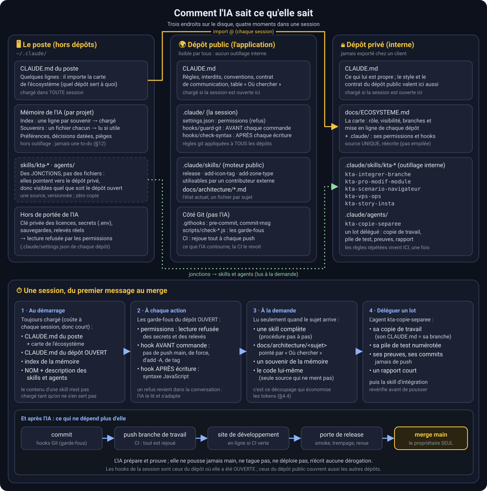

# 🤖 L'IA pour les nuls — version MyKTAMap

> **Comment on travaille avec une IA de code, et pourquoi ça ne part pas en vrille.**
> Guide de méthode, transposable à n'importe quel projet. Il ne décrit **pas** l'application MyKTAMap
> ni son code : il décrit **l'organisation** autour de l'IA (rôles, interdits, garde-fous, vérifications,
> intégration continue, déploiement, audits, documentation). Les encadrés « 📦 Dans ce dépôt » montrent comment
> c'est fait ici, avec les vrais chemins de fichiers, pour qu'une IA qui lit ce document dans le dépôt puisse aller
> vérifier. Lu ailleurs (sur le site de documentation, par exemple), ces chemins désignent des fichiers du dépôt de
> l'application : ils ne sont pas tous publiés, et le document se comprend sans eux.
>
> Rédigé le 16/09/2026 (v1.95.0), mis à jour le 10/10/2026 (v2.13.2 : intégration continue, marque verte,
> déploiement automatique, dépendances, dépôt client, travail en vagues multi-agents) et le 18/10/2026 (schéma
> d'ensemble §4.5, agents dédiés et skill d'intégration). Auteur : KARMA + Claude.

---

## 0. À qui s'adresse ce document, et comment l'utiliser

**À toi, si** tu démarres un projet avec une IA de code (Claude Code, Cursor, Copilot, autre) et que tu n'as
jamais fait de « CI/CD », de « hook Git », d'« audit » ou de « release ». Tout est expliqué depuis zéro,
avec un glossaire en fin de document (§16).

**À ton IA, si** tu préfères lui déléguer : donne-lui ce fichier en entier et la phrase d'amorce du §17.
Elle saura alors quoi mettre en place, dans quel ordre, et pourquoi.

**Ce que tu vas en tirer** : un kit de démarrage (§15) en dix étapes, et surtout la logique derrière.
Aucune étape n'est là par principe : chacune a été ajoutée ici **après un vrai incident**, et le document
les raconte (§14), parce que c'est la partie la plus utile.

---

## 1. Le principe en dix lignes

1. **L'IA est un collaborateur, pas un pilote.** Elle propose, prépare, exécute. L'humain décide.
2. **Ce qui est interdit doit être interdit par une machine**, pas par une phrase. Une règle écrite se
   contourne par oubli ; un blocage technique, non. Et ce que la machine du poste vérifie, une **seconde machine**
   (la CI, §6) le revérifie là où personne ne peut sauter le contrôle.
3. **Chaque garde-fou est né d'un bug réel.** On n'installe pas de contrôle « au cas où » : on installe
   celui qui aurait attrapé le bug d'hier.
4. **Un garde-fou vert qu'on n'a jamais vu rouge ne prouve rien.** On le teste en sabotant le code exprès.
5. **La branche principale est toujours déployable.** On ne merge dessus qu'après une porte de contrôle.
6. **L'IA ne déploie jamais et ne pousse jamais sur la branche principale.** Point. Comme le déploiement est
   devenu automatique (§8.5), « pousser » veut dire « mettre en ligne » : le push reste un geste demandé.
7. **Une version = les docs suivent, le même jour.** Sinon la dette est immédiate, et elle est vérifiée
   au commit.
8. **Toute dérogation est écrite**, avec son motif, le risque accepté et le rattrapage prévu. Jamais en
   silence.
9. **La mémoire de l'IA ne remplace pas le dépôt.** Ce qui doit survivre vit dans le dépôt.
10. **L'IA doit dire ce qui dérange en premier** (test non fait, bug non reproduit, dette créée), pas en
    fin de message. Et une cause s'**affirme** seulement quand on l'a reproduite (§14).

---

## 2. Les rôles

| Acteur | Rôle | Ce qu'il tranche |
|---|---|---|
| **Le propriétaire du projet** (ici : KARMA) | Décide, teste sur appareil réel, merge, met en pause ou relance le déploiement, accorde les dérogations | Tout ce qui est irréversible ou public |
| **L'IA de code** (ici : Claude Code) | Conseille, fait le topo, code sur une branche de travail, écrit les docs, prépare les commits de release, propose des garde-fous | Rien d'irréversible. Elle **propose** une dérogation, ne l'accorde jamais |
| **L'IA intégratrice** (quand on travaille en vagues, §9) | Écrit les missions des agents, fusionne leurs branches, **revérifie elle-même** leur travail, lance la suite complète | Ce qui entre dans la branche de travail. Rien de plus que l'IA de code |
| **Les agents d'une vague** | Chacun code une mission bornée dans sa propre copie de travail, avec sa propre pile de test, et rend un rapport | Rien hors de leur mission |
| **Les garde-fous automatiques** (hooks, scripts, CI) | Vérifient sans fatigue, à chaque édition, à chaque commit et à chaque push | Refusent, ne négocient pas |
| **Le collaborateur externe** (ici : un contributeur, avec sa branche à lui) | Travaille sur sa propre branche | L'IA n'y touche jamais, même en lecture-écriture « pour aider » |

Le point important : **l'IA n'est pas « un simple assistant », c'est un conseiller payé pour voir ce qui
manque**. On lui demande un topo avant de coder, avec des choix numérotés et une recommandation. On attend
d'elle qu'elle contredise une hypothèse fausse dès la première phrase. Le contrat de communication est au §13.

---

## 3. Ce que l'IA peut faire, et ce qu'elle ne peut pas

Il y a **quatre niveaux d'interdiction**, et il faut savoir lequel on utilise pour chaque règle :

| Niveau | Mécanisme | Fiabilité | Exemple ici |
|---|---|---|---|
| 🔴 **Bloqué en dur** | Un hook intercepte la commande **avant** qu'elle s'exécute et la refuse | Totale : l'IA ne peut pas passer outre, même si on le lui demande | `git push` vers `main`, `git push --force`, `git reset --hard`, toute écriture sur la branche du collaborateur |
| 🟠 **Demande de permission** | L'outil s'arrête et demande à l'humain de valider | Haute : l'humain voit chaque occurrence | `git push` vers une branche de travail (qui **déploie** l'environnement de dev, §8.5) |
| 🟡 **Refusé par configuration** | L'outil refuse l'accès à certains fichiers | Haute | Édition de `data/**` (données pures, pas du moteur), lecture des `.env*` (secrets) |
| ⚪ **Règle écrite** | Une phrase dans le fichier de contexte de l'IA | Moyenne : dépend de l'attention de l'IA à ce moment-là | « Ne jamais changer les couleurs de la charte », « toujours passer par telle fonction » |

**Règle de conception** : tout ce qui est **irréversible, public ou destructeur** doit être au niveau 🔴
ou 🟠. Les conventions de code peuvent rester au niveau ⚪, mais dès qu'une convention est violée deux fois,
on lui écrit un script de vérification (§5.3) et elle monte au niveau 🔴.

### 3.1 Tableau des droits de l'IA (tel qu'appliqué ici)

| L'IA a le droit de… | L'IA n'a **pas** le droit de… |
|---|---|
| Lire tout le dépôt sauf les secrets | Lire les fichiers `.env*`, une clé privée, une licence émise |
| Éditer le moteur (code, styles, page, service worker, docs) | Éditer les données (`data/**`) |
| Créer des commits sur une branche de travail, ou sur une branche d'agent dans sa copie de travail (§9) | Pousser sur `main`, forcer un push, réécrire l'historique |
| Pousser sur la branche de travail **quand on le lui demande** (le push déclenche la CI puis la mise en ligne sur dev) | Déployer elle-même, mettre un site en pause ou en retour arrière (gestes du propriétaire, sur le serveur) |
| Lancer les scripts de vérification, les smokes automatisés, les suites de test sur **sa** pile de test | Lancer le script de merge sur `main`, taper une confirmation de porte à la place du propriétaire |
| Préparer une release (bump de version, notes, docs) **quand le propriétaire prépare une mise en prod** | Bumper la version à chaque correctif (§8.2), accorder une dérogation, écrire elle-même une ligne de dérogation |
| Proposer un garde-fou, un audit, une refonte | Coder une fonctionnalité qui relève du dépôt privé « pro » sans validation explicite |
| Stager des fichiers **par chemin explicite** | `git add -A`, `git add .`, `git commit -a` (§14), `git commit --no-verify` |

> **📦 Dans ce dépôt** : les blocages 🔴 sont dans `.claude/hooks/guard-git.js`, les permissions 🟠/🟡 dans
> `.claude/settings.json` (sections `allow` / `ask` / `deny`), les règles ⚪ dans `CLAUDE.md` § « Garde-fous ».

---

## 4. Le fichier de contexte de l'IA (ici : `CLAUDE.md`)

### 4.1 Ce que c'est

C'est le **seul fichier que l'IA lit automatiquement à chaque session**. Tout ce qu'il contient est « su »
par l'IA dès le premier message ; tout ce qu'il ne contient pas doit être trouvé ou redit. Il joue trois
rôles à la fois : **carte d'identité du projet**, **règlement intérieur**, **table d'orientation** vers les
docs détaillées.

### 4.2 Comment l'organiser (l'anatomie qu'on utilise)

| Section | Contenu | Pourquoi |
|---|---|---|
| 🎯 Projet | 5 lignes : quoi, pour qui, stack, environnements, auteur, licence | L'IA ne doit jamais deviner ça |
| 🔒 Frontières critiques | Ce qui ne doit **jamais** entrer dans ce dépôt (ici : le code du dépôt privé « pro ») | La règle la plus coûteuse à violer vient en premier |
| ⚙️ Commandes & validation | Comment on vérifie, ce que rejoue la CI, comment on release, comment on déploie, ce qui est contrôlé au commit | L'IA doit connaître le processus, pas seulement le code |
| 🚨 Garde-fous « NE JAMAIS » | La liste des interdits, avec pour chacun **le mécanisme qui l'impose** | Distinguer 🔴 de ⚪ (§3) |
| 🧭 Conventions | Les règles de code non négociables, courtes, avec le script qui les vérifie | Une convention sans vérificateur est un vœu |
| 🗺️ Où chercher | Un tableau sujet → fichier de doc détaillée | **C'est la section qui économise les tokens** (§4.4) |
| 📝 Style de travail | Topo avant de coder, coder le minimum, recap final structuré | Le propriétaire a des attentes précises : les écrire |
| 🗣️ Contrat de communication | Comment l'IA doit parler (§13) | Sinon l'IA flatte et enterre les mauvaises nouvelles |
| 🆘 Si perdu | Trois étapes : journal, doc du sujet, topo au propriétaire | Un chemin de secours évite les improvisations |

Quand il y a **deux dépôts** (ici community et pro), chacun a son fichier de contexte. Celui du second ne
recopie pas le premier : il dit « le style de travail et le contrat de communication de l'autre valent ici
aussi » et ne garde que ce qui lui est propre. Une règle recopiée à deux endroits finit par diverger.

### 4.3 À quoi il fait appel (ce qu'il pointe sans le contenir)

Le fichier de contexte ne **contient** pas la connaissance : il dit **où elle est**. Ici, il pointe vers :

- **`docs/architecture/<sujet>.md`** : un fichier par sous-système. Lu à la demande, jamais d'office.
  Il décrit l'**état actuel** : on le réécrit, on n'y empile pas l'historique.
- **`docs/BACKLOG.md`** : ce qui reste à faire, avec pour chaque entrée son **niveau de preuve** (§11.3).
  L'IA doit le lire **avant** d'annoncer qu'une fonctionnalité manque.
- **`docs/RELEASE_GATE.md`** : la porte de mise en production (§7).
- **`docs/architecture/gotchas.md`** : les pièges connus, ceux qu'on a payés.
- **`README.md`** : le journal des versions (§11.1).
- **Les compétences (« skills »)** : des procédures pas à pas que l'IA charge **uniquement quand le sujet arrive**
  (seuls leur nom et leur description sont lus au démarrage). Elles vivent dans `.claude/skills/<nom>/SKILL.md`.
  Celles du moteur public restent dans son dépôt (préparer une release, ajouter un type d'icône, ajouter un type de
  zone) ; celles de l'outillage interne vivent dans le dépôt privé (§4.5).
- **Les agents dédiés** : un fichier qui décrit une fois pour toutes un type de mission déléguée (§9.2).
- **La mémoire de l'IA** (§12) : hors dépôt, pour les préférences et décisions.

### 4.4 Économiser les tokens : le fichier de contexte qui **sait où chercher**

Une IA de code paie chaque mot qu'elle lit. Un fichier de contexte de 2 000 lignes est relu **à chaque
session**, souvent pour rien, et il pousse hors de la fenêtre de travail les informations utiles du moment.
Le coût est double : de l'argent, et de l'attention (une IA noyée dans le contexte lit moins bien la fin).

La règle qu'on applique : **le fichier de contexte reste court et sert de table d'orientation ; le détail
est chargé à la demande**.

| Principe | Comment on le fait ici |
|---|---|
| **Le contexte auto-chargé tient en une page** | `CLAUDE.md` est passé d'un monolithe à une version « slim » (v1.29.4) : l'ancien contenu détaillé a été découpé en `docs/architecture/*.md`, et `gotchas.md` en porte l'en-tête « extrait de l'ancien CLAUDE.md, lu à la demande » |
| **Un tableau « Où chercher » plutôt que du contenu** | Sujet → fichier. L'IA lit **un** fichier de 50 Ko au lieu de vingt |
| **Un ordre de lecture en cas de doute** | « Si perdu : 1. journal, 2. doc du sujet, 3. topo » évite qu'elle lise tout |
| **Les procédures rares vivent dans des skills** | Chargées uniquement quand on tape `/release` ou quand le sujet arrive (intégrer une branche, écrire un scénario de test). Au démarrage, seule leur ligne de description coûte |
| **Les consignes répétées vivent dans un agent dédié** | Une mission déléguée ne redit plus les 20 lignes de règles (copie de travail, pile de test, preuves, rapport) : l'agent les porte, la mission ne dit que la tâche |
| **La mémoire a un index d'une ligne par souvenir** | Seul l'index est chargé ; le corps du souvenir n'est lu que s'il est pertinent |
| **Les fichiers de code portent un en-tête** | Chaque module commence par un bloc qui dit ce qu'il fait et ses pièges : l'IA peut lire 40 lignes au lieu de 4 000 |
| **On ne colle pas des fichiers entiers dans la conversation** | On donne le chemin. L'IA lit ce dont elle a besoin, avec `grep` avant `cat` |
| **On sauvegarde les résultats lourds tout de suite** | Le premier audit de modales (juin 2026) a été **perdu** parce que la conversation a été résumée avant qu'on l'écrive dans le dépôt. Depuis : « dès la réception du rapport, déposer dans `docs/audits/` » |
| **Les recherches larges et les chantiers parallèles sont délégués à des sous-agents** | Un agent d'exploration parcourt vingt fichiers et ne rend que la conclusion ; un agent de vague (§9) code sa mission et ne rend que son rapport : la conversation principale ne se remplit pas de listings |

**Le signe que ça dérape** : l'IA relit le même gros fichier plusieurs fois par session, ou le fichier de
contexte dépasse 150 lignes de règles. Dans les deux cas, on découpe et on pointe.

**Le piège inverse** : un tableau « Où chercher » qui ment. Ici, le tableau des garde-fous d'une doc
d'architecture a compté 14 lignes pendant que le hook en câblait 22 (§14). Une table d'orientation se met
à jour **le même jour** que ce qu'elle décrit, sinon elle coûte plus qu'elle ne rapporte.

### 4.5 Le schéma d'ensemble : ce que l'IA lit, d'où, et quand



Trois endroits sur le disque :

| Endroit | Ce qu'il contient | Pourquoi là |
|---|---|---|
| **Le poste** (dossier de l'outil d'IA, hors dépôts) | Un fichier de contexte de quelques lignes qui **importe** la carte de l'écosystème ; la mémoire de l'IA (§12) ; des **liens** (jonctions) vers les skills et agents internes | C'est le seul endroit lu quel que soit le dépôt ouvert |
| **Le dépôt public** | Son fichier de contexte, sa session (`.claude/` : permissions, hooks), les skills du moteur, la doc d'architecture, les garde-fous Git et la CI | Un contributeur externe doit tout y trouver ; **aucun outillage interne** n'y entre |
| **Le dépôt privé** | Son fichier de contexte, la **carte de l'écosystème** (source unique), sa session, les skills et agents de l'outillage interne | Versionné, relu, jamais exporté chez un client |

Quatre moments dans une session :

1. **Au démarrage**, l'IA lit toujours la même chose, et c'est pour ça que ça doit rester court : le fichier de
   contexte du poste et la carte qu'il importe, le fichier de contexte du **dépôt ouvert**, l'index de la mémoire,
   et le **nom + la description** de chaque skill et agent (pas leur contenu).
2. **À chaque action**, les garde-fous du **dépôt où la session a été ouverte** s'appliquent : permissions (lectures
   refusées), hook avant chaque commande, hook après chaque écriture (§5.1).
3. **À la demande**, et seulement quand le sujet arrive : le contenu d'une skill, un fichier de
   `docs/architecture/`, un souvenir, le code.
4. **Pour déléguer**, un agent dédié reçoit sa mission, travaille dans sa copie (§9), puis une skill d'intégration
   ramène son travail et le revérifie.

**Pourquoi des liens plutôt que des copies** : une skill interne recopiée sur le poste diverge du dépôt dès la
première correction. Le lien (une jonction Windows, un lien symbolique ailleurs) garde **une seule source**,
versionnée, et la rend visible depuis n'importe quel dépôt ouvert. Le prix : un nouveau poste doit recréer les
liens (une commande par dossier, écrite dans le fichier de contexte du poste).

> **📦 Dans ce dépôt** : `.claude/settings.json`, `.claude/hooks/`, `.claude/skills/` (moteur public). Les skills
> et l'agent de l'outillage interne, et la carte de l'écosystème, vivent dans le dépôt privé.

---

## 5. Les hooks : deux familles, deux moments

Un **hook** est un petit programme lancé automatiquement à un moment précis. Il ne demande rien à
personne : il vérifie, et si ça ne va pas, il refuse. On en a de deux sortes.

### 5.1 Les hooks côté IA (déclenchés par l'outil de l'IA)

Ils s'exécutent **autour des actions de l'IA**, avant même que Git soit concerné.

| Moment | Ce qu'on y met | Ce que ça attrape |
|---|---|---|
| **Avant une commande** (« PreToolUse ») | Le gardien Git : refuse `push` vers `main`, `push --force`, `reset --hard`, et toute mutation de la branche du collaborateur | L'IA qui « aide » en poussant, ou qui nettoie en perdant du travail non commité |
| **Après une édition de fichier** (« PostToolUse ») | Une vérification de syntaxe sur chaque fichier JavaScript touché | Une parenthèse manquante découverte au démarrage dans le navigateur au lieu de tout de suite |

**Comment ça marche, en une phrase** : le hook reçoit la commande ou le fichier, rend un code de sortie ;
un code d'échec **bloque** l'action et renvoie le message d'erreur à l'IA, qui le lit et s'adapte. Il n'y a
donc pas de « l'IA n'a pas vu » : le refus arrive dans sa conversation.

**Subtilité utile** : le gardien vérifie **sur quel dépôt** il tourne (il lit l'adresse du dépôt distant).
Ainsi la règle « jamais de push sur main » s'applique au dépôt community comme au dépôt pro, chacun avec ses
propres ajouts (le pro interdit aussi de pousser des tags). Par défaut,
en cas de doute, il considère qu'il est sur le dépôt le plus strict.

> **📦 Dans ce dépôt** : `.claude/settings.json` (branchement + permissions), `.claude/hooks/guard-git.js`,
> `.claude/hooks/check-syntax.js`. Ces fichiers sont **versionnés** : un nouveau poste les récupère avec le
> dépôt. Seul `settings.local.json` (réglages personnels) est ignoré par Git.

### 5.2 Les hooks côté Git (déclenchés par un commit)

Ils s'exécutent **au moment de committer**, que le commit vienne de l'IA ou d'un humain. C'est la
différence essentielle : **ils protègent aussi contre les erreurs humaines**.

| Hook | Moment | Ce qu'il fait ici |
|---|---|---|
| **`pre-commit`** | Avant que Git enregistre le commit | Lance **la suite complète des garde-fous** (72 scripts au 10/10/2026). Le premier est l'anti-fuite (§5.4) ; tous sont **bloquants** sauf un |
| **`commit-msg`** | Après la saisie du message, avant l'enregistrement | Le **garde-fou de release** : si le commit change le numéro de version, il vérifie que les trois endroits qui portent la version disent la même chose (non dérogeable) et que les docs ont suivi (dérogeable avec une ligne `Docs-deroge:` dans le message, qui reste dans l'historique). Et le garde-fou « `data/` hors Git » : aucun fichier de données réelles indexé (dérogation `Data-deroge:`) |

**Pourquoi deux hooks et pas un** : `pre-commit` tourne **avant** que le message existe. Seul `commit-msg`
peut lire le message, donc seul lui peut exiger qu'une dérogation y soit **écrite**. C'est ce qui rend la
dérogation archivée : elle est dans l'historique Git pour toujours.

**Activation** (une fois par poste, Git ne l'active pas seul) :

```
git config core.hooksPath .githooks
```

**Contournement** : `git commit --no-verify` saute **tous** les hooks, y compris l'anti-fuite. On ne le fait
pas. Si un garde-fou bloque à tort, on corrige le garde-fou, on ne le saute pas. Et depuis le 08/10/2026, le
contournement ne sert plus à rien : la CI rejoue tout sur GitHub (§6), un commit qui a sauté les hooks y passe au
rouge.

> **📦 Dans ce dépôt** : `.githooks/pre-commit`, `.githooks/commit-msg`, scripts dans `scripts/check-*.js`.
> Chaque appel dans `pre-commit` est précédé d'un commentaire qui raconte **le bug fondateur** du script.

### 5.3 Ce qu'est un bon garde-fou (les règles qu'on s'est données)

1. **Il naît d'un vrai bug.** Le commentaire au-dessus de son appel raconte l'incident, avec la date.
2. **Il est bloquant** sauf mention explicite « advisory » (avertit sans refuser). Ici, un seul est advisory.
3. **Il exécute le vrai code plutôt que de le lire.** Un `grep` vérifie qu'une ligne existe ; charger le
   module et appeler la fonction vérifie qu'elle **marche**. Plusieurs scripts extraient une fonction du
   fichier réel et la rejouent sur des cas connus.
4. **Il est éprouvé en le falsifiant.** Avant de le déclarer utile, on sabote le code (on remet le bug, on
   altère la valeur de référence) et on vérifie qu'il **passe au rouge**. Le journal note « N sabotages
   rougissent » pour chaque nouveau garde-fou. Un vert jamais vu rouge ne prouve rien.
5. **Il ne remplace pas le test sur appareil.** Aucun garde-fou n'exécute l'application dans un navigateur
   avec des yeux humains. C'est le trou que la porte de release (§7) existe pour combler.
6. **Il est listé dans une doc à jour.** Sinon on ne sait plus ce qui est vérifié (§14).
7. **Il tourne aussi en CI, et il le sait.** Tout script ajouté au `pre-commit` est rejoué sur GitHub (§6.3).
   S'il lit « les fichiers indexés », il doit accepter une autre source de liste, sinon il passe à vide là-bas.

### 5.4 Le cas particulier : l'anti-fuite entre deux dépôts

Quand un projet a une version **gratuite** et une version **commerciale** dans deux dépôts (ici « community » et
« pro »), le risque numéro un est qu'un morceau du second se retrouve dans le premier par erreur. La règle ⚪
« ne jamais référencer du code pro » ne suffit pas. On a donc un script, **premier de la suite pré-commit**, qui
refuse tout commit contenant un nom de module, une clé de stockage, un en-tête d'authentification, une clé privée
ou un chemin appartenant au dépôt pro. En local, il n'analyse que les fichiers **stagés** (rapide) ; en CI, les
fichiers des commits reçus. Il connaît une courte liste d'exceptions (le script lui-même, le hook).

La frontière vaut dans l'autre sens aussi, et à un troisième étage : le dépôt pro est **interne** (outillage et
historique qui ne regardent pas les clients), et les clients reçoivent un **troisième dépôt**, produit par export
(§8.7). Chaque
passage d'un dépôt à l'autre a son propre contrôle anti-fuite.

---

## 6. La CI : la seconde machine, que personne ne contourne

**CI** veut dire « intégration continue » : à chaque fois qu'on envoie des commits sur GitHub (un **push**), des
machines de GitHub récupèrent le code et **rejouent les vérifications**. Rien à installer : un fichier de
description dans le dépôt suffit, et GitHub l'exécute.

**Pourquoi on en a eu besoin, alors que les hooks existaient déjà** : un audit CI/CD (08/10/2026) a constaté que
tous les garde-fous ne tournaient **que** dans les hooks du poste. Or un hook local est :
- **facultatif** : un poste où l'on n'a jamais tapé `git config core.hooksPath .githooks` ne lance rien ;
- **contournable** : `--no-verify` saute tout ;
- **absent** de l'éditeur web de GitHub, qui permet de committer depuis un navigateur.

Trois portes ouvertes, et aucune ne laisse de trace. La CI les ferme : elle tourne **sur GitHub**, après le push,
quel que soit le poste ou l'outil qui a fait le commit.

### 6.1 Ce qu'elle rejoue à chaque push

| Étape | Ce qu'elle fait | Pourquoi là |
|---|---|---|
| 1. **Syntaxe** | `node --check` sur tous les fichiers JavaScript | Le filet minimum, en 10 secondes |
| 2. **Commits reçus, un par un** | Pour **chaque** commit du push : « aucun fichier de données réelles » (en lisant **son** message, pour qu'une dérogation `Data-deroge:` reste possible) ; puis l'anti-fuite pro sur tous les fichiers touchés | Un push peut apporter dix commits ; un fichier de données ajouté au 3e puis retiré au 8e est **dans l'historique** même si la tête de branche est propre |
| 3. **Tous les garde-fous du `pre-commit`** | Lance le hook tel quel | Une seule liste à tenir : ajouter un garde-fou au hook l'ajoute à la CI |
| 4. **Marque verte** | Si tout est vert, pose une marque sur le commit (§6.4) | Ce qui déploie et ce qui merge la lisent |
| (à côté) **Tableau de bord** | Lance chaque garde-fou un par un et affiche nom · durée · statut dans le résumé | Voir un garde-fou ralentir. **Indicatif** : il ne peut ni rougir la CI ni retenir un déploiement |

Le dépôt pro a sa propre CI, adaptée à ce qu'il contient : syntaxe, audit de sécurité des dépendances (une faille
élevée = rouge), puis la **suite de tests de l'API** sur une pile de test montée dans GitHub (base de données
comprise), avec le front construit depuis le dépôt community. Elle reçoit une licence de test limitée à
`localhost` et valable 7 jours, à resigner chaque semaine : la clé qui signe les licences ne va **jamais** sur
GitHub.

**Règle d'usage** : une CI rouge se corrige **avant** d'empiler d'autres commits. Empiler sur du rouge, c'est
perdre la trace du commit fautif.

> **📦 Dans ce dépôt** : `.github/workflows/ci.yml` (jobs `garde-fous`, `marquer-vert`, `tableau-garde-fous`),
> `scripts/ci-commits.sh` (étape 2), `scripts/garde-fous-tableau.js` (tableau de bord),
> `docs/architecture/infra-versioning.md` §29bis (état détaillé).

### 6.2 Ce que la CI ne fait pas

- **Elle n'ouvre pas l'application dans un navigateur à chaque push.** Le smoke navigateur (§7, marche 1bis) a son
  propre workflow, lancé **à la main** depuis l'onglet Actions de GitHub (donc lançable depuis un téléphone).
  La suite navigateur du dépôt pro reste locale.
- **Elle ne fait pas l'analyse de qualité SonarQube.** Le serveur Sonar tourne sur le poste (Docker) : une machine
  de GitHub ne peut pas le joindre. C'est le script de merge qui l'appelle (§8.4).
- **Elle ne remplace pas la porte de release.** Elle vérifie ce qu'une machine peut vérifier, à chaque push ; la
  porte ajoute ce que seul un humain voit, une fois par mise en prod.

### 6.3 Le piège : un garde-fou qui lit « l'index » passe à vide en CI

L'**index** (ou « staging area »), c'est la liste des fichiers qu'on s'apprête à committer. En local, un garde-fou
qui demande à Git « quels fichiers sont indexés ? » obtient la bonne liste. **Sur GitHub, rien n'est indexé** : le
code est simplement récupéré. Le même script reçoit une liste vide, ne vérifie rien… et répond « vert ».

C'est le pire défaut possible pour un garde-fou : il **a l'air** de marcher. D'où la règle : un garde-fou qui lit
l'index doit accepter une **autre source** de liste de fichiers. Ici, une variable d'environnement
(`KTA_FICHIERS_CI`) : si elle existe, le script la prend à la place de l'index. L'étape 2 de la CI la remplit avec
les fichiers de chaque commit reçu.

**Pour ajouter un garde-fou** : on l'ajoute au `pre-commit` (il tourne alors en local **et** en CI), et s'il lit
l'index, on lui fait accepter `KTA_FICHIERS_CI`, puis on l'éprouve en CI en poussant exprès un commit fautif sur
une branche d'essai.

### 6.4 La marque verte : une référence plutôt qu'un jeton

Deux outils ont besoin de savoir « ce commit-là a-t-il passé la CI ? » : le **serveur**, qui ne doit mettre en ligne
qu'un commit vert (§8.5), et le **script de merge**, qui ne doit merger qu'un commit vert (§8.4).

La solution naïve est de leur donner un **jeton** d'accès à l'API de GitHub pour qu'ils lisent l'état de la CI.
Problème : un jeton est un secret. Posé sur le serveur, il est exposé à toute intrusion ; sur le poste, il vit dans
le coffre d'identifiants du système, **inaccessible** quand on pilote le poste à distance depuis un téléphone
(session SSH).

La solution retenue : quand la CI est verte, son dernier job **pose une référence Git** sur le commit, comme une
étiquette : `refs/ci/verte/<branche>`. Ce n'est ni une branche ni un tag (elle ne déclenche rien, ne s'affiche
nulle part), elle est **réécrite** à chaque CI verte, et une CI rouge ne la déplace pas. Pour la lire, il suffit
d'un accès Git en lecture (`git ls-remote`), que le serveur et le poste ont déjà. **Zéro secret de plus.**

Conséquence à connaître : la marque désigne **un commit précis**, pas « la branche ». Si la tête de ta branche
locale a bougé (un commit pas encore poussé), elle ne correspond plus à la marque, et les outils refusent (§14).
C'est voulu : on ne livre que ce que la CI a testé, à l'octet près.

### 6.5 Les dépendances : une veille automatique, une mise à jour à la main

Le projet embarque des librairies tierces (carte, ZIP, PDF, captures) **copiées** dans le dépôt : l'application
doit marcher hors ligne, sans outil de construction. Le risque : une faille publiée dans une de ces librairies, et
personne ne le sait.

- **Dependabot** (service gratuit de GitHub) surveille les dépendances et ouvre une **demande de fusion** (PR) par
  mise à jour disponible, vers la branche de travail. La CI la teste ; le propriétaire décide.
- Pour les librairies copiées, il n'y a rien à « installer » : on tient un **manifeste déclaratif** (`lib/package.json`)
  qui dit juste « on embarque telle librairie en telle version ». Dependabot le lit comme un vrai projet.
- **Le piège** : la PR de Dependabot ne modifie **que le manifeste**, pas le fichier embarqué. La fusionner telle
  quelle ferait mentir la veille (« on est à jour » alors que l'ancien fichier tourne). Un garde-fou bloquant
  vérifie donc que trois choses disent la même version : l'en-tête du fichier embarqué, le manifeste, et la table
  lisible `lib/VERSIONS.md`. Tant qu'elles divergent, la CI de la PR est rouge.
- **Mettre à jour une librairie** = dans le même commit : remplacer le fichier par celui du paquet officiel,
  mettre à jour manifeste et table, puis **tester ce qu'elle fait** (un export PDF pour la librairie PDF…) et
  relire ses avis de sécurité. C'est un geste testé, pas un clic.

Le dépôt pro fait la même veille sur les dépendances de son API, avec en plus un audit de sécurité en CI : une
faille de gravité élevée rougit la CI, et on met à jour plutôt que de contourner.

> **📦 Dans ce dépôt** : `.github/dependabot.yml`, `lib/package.json`, `lib/VERSIONS.md` (marche à suivre),
> `scripts/check-libs.js`.

---

## 7. Vérifier avant de livrer : la porte de release

**Pourquoi elle existe** : à un moment du projet, neuf garde-fous automatiques étaient verts en permanence,
et **tous** les bugs trouvés au test manuel étaient passés au travers. Motif unique : aucun script
n'exécute l'application dans un navigateur. On a donc formalisé une porte à quatre marches, **avant tout
merge sur la branche principale**.

| # | Marche | Qui | Dérogeable ? |
|---|---|---|---|
| 1 | **Garde-fous automatiques** : suite pré-commit verte + garde-fou de release + **CI GitHub verte** sur le commit à merger | machine | noyau : non · doc : oui |
| 1bis | **Smoke navigateur automatisé** : un navigateur sans écran démarre l'app, ouvre les écrans principaux, échoue sur toute erreur console, clé de traduction manquante, fichier introuvable ou fenêtre invisible. Lançable en local ou depuis GitHub | machine (30 s) | oui |
| 1ter | **Analyse de qualité SonarQube** (serveur local) sur le **nouveau code** : aucun nouveau bug, aucune nouvelle faille, points sensibles revus, duplication ≤ 3 % | machine | serveur injoignable : oui (tapé) · échec : non |
| 2 | **Smoke test manuel** : 13 points **fixes** (démarrage, chargement, dessin, sauvegarde/restauration, export/réimport, mise à jour, pages annexes…) sur l'environnement de dev, cache vidé. 5 sont « noyau dur » (jamais dérogeables) | humain (~10 min) | par item, sauf 🔒 |
| 3 | **Checkup ciblé** : scénarios destructifs sur les modules touchés par la release, y compris des checkups automatisés par sujet (langues, petite fenêtre, import multiple, dossiers) | humain + IA | par item |
| 4 | **Trempage** : la release vit sur l'environnement de dev pendant l'usage réel, 24 à 48 h | humain | oui (hotfix urgent) |

**Le smoke manuel a une liste fixe, qu'on n'adapte pas par release.** Un item coûte une minute ; en douter
coûte une régression.

**Sonar ne juge que le nouveau code**, et avec une porte qu'on a réglée nous-mêmes : la porte par défaut exige
80 % de couverture par des tests unitaires que ce projet n'a pas, elle refuserait toutes les releases. Un faux
positif se marque dans Sonar **avec un commentaire** qui dit pourquoi — jamais en silence. Et Sonar ne remplace
pas les garde-fous : lui voit les bugs génériques, eux seuls connaissent les règles métier.

### 7.1 Les dérogations : passer sans valider, mais jamais en silence

Un item peut être **invalidable en pratique** (pas de données de test, matériel absent, serveur Sonar éteint).
La porte doit pouvoir s'ouvrir quand même, aux conditions suivantes, **toutes** :

1. **Qui** : le propriétaire seul. L'IA propose, n'accorde jamais, et n'écrit jamais elle-même la ligne de
   dérogation d'un commit : elle s'arrête et demande.
2. **Quoi** : uniquement des items non-🔒. Le noyau dur ne se déroge pas, même en urgence.
3. **Trace** : motif · risque résiduel accepté · plan de rattrapage, dans le relevé de release. Quand c'est un
   script qui demande (Sonar injoignable, CI illisible), on tape `DEROGE` en toutes lettres, puis on le consigne.
4. **Suivi** : une dérogation avec rattrapage devient une entrée du backlog. Sinon elle s'évapore.

**« Pas le temps » n'est pas un motif.** On réduit le périmètre de la release plutôt que de la valider à
moitié.

> **📦 Dans ce dépôt** : `docs/RELEASE_GATE.md` (les marches, la liste des 13 points, le relevé à
> recopier, le retour arrière), `scripts/smoke/` (smoke automatisé + checkups ciblés, `README.md` dedans),
> `.github/workflows/smoke.yml` (smoke lancé depuis GitHub), `scripts/release/sonar-scan.ps1` (marche 1ter).

---

## 8. Versionner et livrer

### 8.1 Les branches

| Branche | Rôle | Qui écrit | Mise en ligne |
|---|---|---|---|
| `main` | **Toujours déployable.** On n'y arrive que par la porte (§7) | Le propriétaire, via le script de merge | Prod, automatiquement (§8.5) |
| Branche de travail (ici `Karma_dev`) | Là où l'IA et le propriétaire travaillent au quotidien | Les deux | Dev, automatiquement |
| Branches d'agents (une par mission, §9) | Le travail d'un agent pendant une vague, dans sa copie de travail | L'agent, puis l'intégrateur qui la fusionne | Jamais : elles ne sont pas poussées |
| Branche du collaborateur | Son espace | Lui seul. L'IA est bloquée en dur | — |

### 8.2 Une version = trois endroits d'accord, et un seul bump par mise en prod

Une application web installable garde une copie d'elle-même dans le navigateur (le « service worker »).
Si on change le code sans changer le nom de cette copie, **la mise à jour n'atteint jamais l'utilisateur**.
Ici la version vit donc à **trois** endroits (le cache, le badge affiché, le fichier de version lu par le
vérificateur de mise à jour), et le garde-fou `commit-msg` refuse tout bump où ils divergent. C'est le seul
contrôle **jamais dérogeable** : un échec ici est invisible et définitif chez l'utilisateur.

**Pas de bump par correctif.** Pendant un temps, chaque correctif montait le numéro : huit versions de dev se sont
empilées pendant que la prod restait sur la même. Depuis, on commite **sans** bump ; le seul bump se fait quand le
propriétaire prépare une mise en prod, juste avant la porte, avec la mise à jour des docs dans le même commit. On
ne redescend jamais un numéro (le vérificateur de mise à jour compare les versions). Conséquence : un même numéro
couvre plusieurs commits sur dev, et seul le **commit** dit ce qui tourne vraiment (§8.5).

### 8.3 Les notes de version pour l'utilisateur

Le fichier de version porte des **notes** lues par l'utilisateur dans l'app. Règle : **1 à 2 phrases, zéro
jargon, uniquement la version courante**, et elles décrivent l'écart **avec la prod**, pas avec la version de dev
précédente (l'utilisateur saute de la prod à la dernière). L'historique vit dans le journal (§11.1), pas là. Une
IA a tendance à y écrire du technique : la règle est dans le fichier de contexte pour ça.

### 8.4 Le merge sur `main` : un script qui vérifie tout, puis demande le reste

Le merge est le geste qui met en prod (puisque la prod se déploie seule depuis `main`). Il est donc confié à un
script, lancé par le propriétaire seul, qui refuse d'aller plus loin au premier échec :

| # | Ce qu'il vérifie | Pourquoi |
|---|---|---|
| 1 | La branche est une branche de travail légitime (ni `main`, ni celle du collaborateur) | On ne merge pas depuis n'importe où |
| 2 | L'**arbre de travail est propre** — hors fichiers de données, qui divergent légitimement en local et ne sont jamais commités | On ne merge pas un travail à moitié commité |
| 3 | Les **trois sources de version** concordent | Le contrôle jamais dérogeable (§8.2) |
| 4 | La **suite complète des garde-fous** est verte | Ceinture et bretelles avec la CI |
| 4bis | La **porte qualité Sonar** est verte sur le nouveau code (serveur éteint : `DEROGE` tapé) | Marche 1ter, que la CI ne peut pas jouer |
| 5 | `main` local est à jour, la branche est **poussée telle quelle** et son commit porte la **marque verte** de la CI (illisible : `DEROGE` tapé) | On ne merge que ce que la CI a testé. Sur un dépôt privé, la « protection de branche » de GitHub est payante : ce contrôle en tient lieu |
| 6 | Il **montre ce qui va partir** (la liste des commits) | Le dernier regard humain |
| 7 | Il **demande de confirmer, en tapant `OUI`**, les marches 2 à 4 de la porte | Aucun script n'exécute l'app dans un navigateur : ce qu'il ne peut pas voir, il le demande |
| 8 | Dernier appel (`MERGE` tapé), puis merge, tag de version et publication — chaque étape vérifiée, un conflit annulé proprement | Un échec au milieu ne doit pas laisser le propriétaire sur `main` sans qu'il le sache |

Un mode `-DryRun` montre toute la séquence sans rien toucher. Répondre « OUI » sans avoir fait les marches ne
trompe que soi-même — c'est écrit en tête du script.

**Piloter depuis un téléphone.** Le propriétaire peut lancer ce script depuis son téléphone, en se connectant à
son poste (SSH). C'est ce qui a imposé la marque verte (§6.4) : dans une session à distance, le coffre
d'identifiants du système n'est pas accessible, un jeton n'aurait pas pu être lu. On n'a **pas** ouvert de
« merge par bouton » sur GitHub : le bouton sauterait Sonar et la confirmation de la porte.

> **📦 Dans ce dépôt** : `scripts/release/merge-main.ps1`, `scripts/release/sonar-scan.ps1`.

### 8.5 Le déploiement automatique

Le **déploiement**, c'est mettre les fichiers sur le serveur qui les sert. Longtemps manuel ici (le propriétaire
lançait un script d'envoi), il est **automatique depuis le 09/10/2026** :

- Sur le serveur, une tâche planifiée (**cron**) se réveille **toutes les 5 minutes**. Pour chaque site, elle
  compare ce qui tourne à la tête de la branche suivie sur GitHub.
- Elle ne déploie que si ce commit porte la **marque verte** (§6.4). Une CI rouge ou en cours : le site reste sur
  son dernier commit vert. Un commit refusé est mémorisé, pour ne pas réessayer en boucle.
- **La branche de travail part sur dev, `main` part sur la prod.** Le site pro suit `main` des deux côtés, et
  exige en plus un **tag de version** sur le dépôt client (qui n'a pas de CI : le tag prouve que l'export est passé
  par sa porte, §8.7).
- C'est **le serveur qui regarde** GitHub, jamais GitHub qui pousse vers le serveur : rien n'est ouvert sur le
  serveur, aucun accès au serveur n'est confié à GitHub, aucun jeton n'est posé dessus.
- Chaque site a un **interrupteur de pause** (menu d'administration du serveur) : pendant une intervention ou un
  retour arrière, la mise à jour automatique est suspendue — sans quoi elle **annulerait** le retour arrière dans
  les cinq minutes.
- Les scripts de déploiement **vivent hors du dépôt** (sur le serveur et le poste du propriétaire) et gardent tous
  leurs contrôles : ils ne touchent jamais au dossier des données réelles, refusent d'écraser un fichier modifié à
  la main, ne publient de la documentation que ce que l'app lit (la doc interne n'est pas servie), écrivent quel
  commit tourne, interrogent le site comme un navigateur après coup, et journalisent chaque passage.

**Ce que ça change pour l'IA** : rien sur ses droits — elle ne déploie toujours pas, ne pousse toujours pas sur
`main`, ne touche pas aux interrupteurs. Mais un push sur la branche de travail **est** une mise en ligne sur dev
cinq minutes plus tard : c'est pour ça qu'il reste au niveau « demande de permission » (§3).

**Savoir ce qui tourne vraiment** : un script du poste, en lecture seule et sans secret, interroge les sites comme
un navigateur (version, cache du service worker, commit en ligne, en-têtes anti-cache, doc interne non servie) et
donne l'écart en commits avec les branches. On le lance avant le smoke manuel : sans lui, on peut tester un dev
resté sur un commit plus ancien sans s'en apercevoir, puisque le numéro de version ne change pas d'un commit à
l'autre.

> **📦 Dans ce dépôt** : `scripts/release/etat-sites.ps1` (ce qui tourne) ; `docs/architecture/infra-versioning.md`
> §85 (déploiement, scripts hors dépôt) ; `ci.yml` › `marquer-vert` (la marque que lit le serveur).

### 8.6 Le retour arrière

Une release passe la porte et casse quand même : on **met le site en pause**, on le remet sur le tag précédent,
on vérifie avec le script d'état, puis on **corrige en avant** avec un numéro de version **supérieur** (réutiliser
le numéro retiré, et le vérificateur de mise à jour ne proposerait rien), on repasse la porte, et on lève la
pause. Le site pro ne se retourne pas par commit (sa base de données a pu migrer) : on restaure la sauvegarde
faite juste avant le déploiement. La procédure complète, avec l'exercice à jouer une fois sur dev, est dans
`docs/RELEASE_GATE.md` § Retour arrière.

### 8.7 Le dépôt pro : interne, et un export pour les clients

Le dépôt pro contient de l'outillage interne (dont celui des licences) et un historique qui ne regardent pas les
clients ; la clé qui signe les licences, elle, ne vit dans aucun dépôt. Il ne se clone **jamais** chez un client
ni sur un serveur. Les clients reçoivent un **troisième dépôt**
(le « dépôt client »), produit par un script d'export :

1. il lit la version au point exporté et **exige la marque verte** de la CI sur ce commit (le dépôt client n'a
   pas de CI : cet export est la seule porte entre la CI du pro et le site pro) ;
2. il exporte une **liste blanche** de dossiers (seuls les fichiers suivis par Git), et y ajoute un README et des
   notes de version écrits pour le client (la section de la version est obligatoire) ;
3. il **refuse** l'export s'il y trouve une clé privée, l'outil de signature, un dossier interne (outils, tests,
   scripts…), une licence émise, ou quoi que ce soit de l'offre hébergée ;
4. il remplace le contenu du clone client, crée **un commit par version** (sans historique) et le tag ; il ne
   pousse pas, c'est le propriétaire qui pousse.

**La branche de test du dépôt client** (`karma-dev`) : un mode `-Dev` exporte la branche de travail du pro vers
cette branche, sans tag ni numéro. Un serveur de test la suit sans merge ; les clients restent sur `main`. C'est
le seul export que l'IA a le droit de lancer et de pousser.

**Les piles de test isolées.** Les tests du pro tournent sur une **pile Docker dédiée** (sa propre base, ses ports),
jamais sur l'instance qu'on utilise à la main : l'outil de test refuse son port. Quand plusieurs agents travaillent
en parallèle (§9), chacun a **sa copie de travail et sa pile numérotée** (`KTA_PILE=n`) : nom de projet, ports et
images en découlent, et un build n'écrase pas celui d'un voisin. L'offre hébergée a en plus une **pile de
plateforme**, qui ne diffère que par sa licence.

> **📦 Côté pro** (dépôt interne, non publié) : `scripts/release/export-backend.ps1`, `scripts/release/merge-main.ps1`,
> `tests/README.md` (piles, `KTA_PILE`, pile de plateforme), `.github/workflows/ci.yml`.

### 8.8 Ce qui est automatisé et ce qui ne l'est pas (récapitulatif)

| Étape | Automatisé ? | Par quoi |
|---|---|---|
| Vérifications au commit | ✅ | Hooks Git (§5.2) |
| Vérifications au push, commit par commit | ✅ | CI GitHub (§6) |
| Cohérence des trois sources de version | ✅ | Garde-fou `commit-msg` |
| Veille des dépendances | ✅ (la PR) · ❌ (la mise à jour, testée à la main) | Dependabot + `check-libs.js` (§6.5) |
| Merge sur `main` | ⚙️ semi : tout ce qu'une machine peut vérifier, puis confirmation **tapée** des marches humaines | `scripts/release/merge-main.ps1` (propriétaire seul) |
| Tag Git + page de release sur GitHub | ✅ | Le script de merge pose le tag ; un workflow crée la page de release au bump sur `main` |
| Image Docker pour l'auto-hébergement | ✅ | Workflow déclenché par le tag, qui **attend la CI verte** du commit taggé |
| Déploiement dev et prod | ✅ toutes les 5 min, CI verte exigée, pause par site | Scripts **hors dépôt** sur le serveur (§8.5) |
| Export vers le dépôt client (pro) | ⚙️ semi : marque verte exigée, push par le propriétaire | `export-backend.ps1` (§8.7) |
| Retour arrière | ❌ manuel, par le propriétaire | Menu d'administration du serveur (§8.6) |
| Smoke manuel, checkup, trempage | ❌ humain | La porte (§7) |

**Pourquoi le déploiement a pu devenir automatique** : il était manuel parce que c'est l'acte le plus visible. Il
est devenu automatique **une fois** que trois choses existaient : une CI qui rejoue tout (§6), une marque verte que
le serveur lit sans secret (§6.4), et un merge sur `main` qui ne passe que par la porte (§8.4). La décision humaine
n'a pas disparu : elle a été **déplacée** au merge. Le script de déploiement complet, lui, existe depuis la classe
de bugs « upload partiel » (un dossier oublié = doc périmée en ligne, clés de traduction « manquantes », page
cassée), vécue trois fois en une semaine.

**Le point 13 du smoke manuel** vérifie justement, **sur le serveur**, que les pages annexes portent la
bonne version : les hooks et la CI lisent le dépôt, jamais le serveur.

---

## 9. Travailler en vagues : plusieurs agents en parallèle

Depuis début octobre 2026, les gros chantiers se font **en vagues** : une IA « intégratrice » découpe le chantier en
missions, lance plusieurs agents IA en parallèle (un par mission), puis intègre leur travail. Ça va beaucoup plus
vite qu'un seul agent… à condition de respecter cinq règles, chacune apprise à la dure.

### 9.1 Une copie de travail et une pile de test par agent

Deux agents qui éditent le **même dossier** se marchent dessus : l'un lance les tests pendant que l'autre a un
fichier à moitié écrit, l'un committe le travail de l'autre. Chaque agent reçoit donc :

- **sa propre copie de travail** : `git worktree` crée un second dossier relié au même dépôt, sur une autre
  branche. Les commits sont partagés, les fichiers ne le sont pas ;
- **sa propre pile de test** quand le projet en a une (§8.7) : sa base, ses ports. Deux suites de tests sur la même
  base se faussent mutuellement les résultats.

Le propriétaire, lui, continue de travailler dans le dossier principal : aucune vague ne le touche.

### 9.2 Une mission écrite, et un contrat quand deux agents codent en parallèle

Chaque agent reçoit une **mission écrite** : quoi faire, dans quelle copie, sur quelle branche, ce qu'il n'a pas le
droit de toucher, comment vérifier, quoi rendre. Une mission orale (« améliore la synchro ») produit un agent qui
déborde sur le voisin.

Quand deux missions se touchent (l'une écrit une fonction, l'autre l'appelle ; l'une crée une table, l'autre la lit),
la mission contient un **contrat** : le nom exact, les paramètres, le format, le code d'erreur. Chacun code contre
le contrat, pas contre le code de l'autre, qui n'existe pas encore. Sans contrat, l'intégration découvre deux
interprétations incompatibles.

Ce qui ne change pas d'une mission à l'autre (créer sa copie, lire les fichiers de contexte, ce qu'il ne faut jamais
lire, sa pile de test, les preuves, le format des commits et du rapport) n'est plus réécrit à chaque fois : un
**agent dédié** le porte (§4.5). La mission ne dit que la tâche, la base de départ et les décisions du propriétaire.
On y gagne des tokens, et surtout plus aucun oubli d'une règle dans une mission écrite à la hâte.

### 9.3 Intégrer, puis tester tout, entre chaque vague

À la fin d'une vague, l'intégratrice fusionne les branches des agents **une par une**, règle les conflits, puis
lance la **suite complète** (pas la suite rapide) avant de lancer la vague suivante. Les vagues sont
**séquentielles** : la vague 2 part de la vague 1 intégrée et testée. Empiler une vague sur une autre non testée,
c'est ne plus savoir laquelle a cassé quoi.

L'intégration a ses conflits **prévisibles**, toujours les mêmes : deux agents qui montent le numéro de version
d'un même module, ajoutent chacun leur scénario à la même liste, ou prennent le même numéro de test ou de
migration. Une **skill d'intégration** les traite de la même façon à chaque fois (la version la plus haute, l'union
des listes, la renumérotation de ce qui n'est pas encore livré) et dit ce qui n'a pas été rejoué. Deux piles de test
qui se disputent un port, c'est aussi un conflit d'intégration : l'outil refuse un numéro de pile qui contredit
celui déjà attribué à une copie, plutôt que de lancer une pile à moitié cassée.

### 9.4 Le rapport de l'agent, et l'intégratrice qui revérifie elle-même

Chaque agent termine par un **rapport court** : ce qui est fait, ce qui ne l'est pas, ce qu'il a testé et comment,
ce dont il n'est pas sûr. L'intégratrice ne le **croit pas sur parole** : elle relit le diff, relance elle-même
les tests annoncés, et vérifie ce que l'outil a **réellement exécuté** (§14 : un lanceur qui n'avait joué qu'un
scénario sur trois a fait croire à des relances réussies). Un rapport d'agent est un constat d'IA : non vérifié,
ce n'est pas un fait (§10.2).

### 9.5 Ce qui ne change pas

Les agents obéissent aux mêmes interdits que l'IA principale (hooks, permissions, pas de `git add -A`, pas de
dérogation), ne poussent pas, et leurs branches ne partent pas en ligne. Ce qui entre dans la branche de travail
passe ensuite par la CI, puis, plus tard, par la porte.

---

## 10. Les audits périodiques

Un audit est une **relecture systématique** d'un aspect du projet, hors du fil des demandes du jour. On en
fait de plusieurs sortes, à cadence irrégulière (à chaque fois qu'un signal l'appelle : incident, palier de
version, sensation de dérive).

| Audit | Question posée | Comment on le fait | Sortie |
|---|---|---|---|
| **Réseau & confidentialité** | Qu'est-ce que l'app envoie sur le réseau, à qui, et comment l'utilisateur peut-il le vérifier lui-même ? | Inventaire de toutes les connexions sortantes, politique de sécurité du navigateur (CSP), procédure de vérification par l'utilisateur, interrupteur de chaque tiers contacté | Une **page de transparence** publique, mise à jour à **chaque version** (contrôlé par le garde-fou de release) |
| **Sécurité (offensive)** | Que peut faire un attaquant contre le serveur ou l'app ? | Audit externe gardé **hors de Git** (un rapport offensif décrit des attaques possibles tant qu'elles ne sont pas corrigées : il ne part ni sur GitHub ni en ligne) | Rapport local, corrections dans le journal |
| **CI/CD** | Les contrôles tournent-ils là où personne ne peut les sauter ? Que met-on en ligne, quand, et comment revient-on en arrière ? | Relecture des hooks, workflows, scripts de merge et de déploiement, puis questions fermées au propriétaire | La CI (§6), la marque verte, Dependabot, le déploiement automatique et sa procédure de retour arrière |
| **Code mort** | Qu'est-ce qui n'est plus appelé nulle part ? | Deux agents IA **indépendants** + un scan des clés de traduction, puis vérification humaine avant toute suppression | Lots de suppression commités un par un ; ce qui est « mort mais gardé exprès » est listé pour ne pas être re-signalé |
| **Ergonomie** | Un utilisateur non développeur s'en sort-il ? Les fonctions de sécurité sont-elles fiables ? | 8 agents IA avec une **persona** (ergonome de métier), lecture du code et de la doc, puis vérification manuelle des bloquants par l'IA principale | Rapport avec bloquants / quick wins / lourds, écarts doc ↔ app, manques vs concurrents ; arbitrage du propriétaire consigné |
| **Fenêtres modales**, **traductions** | Fuites, cycles de vie, clés manquantes, textes en dur | Workflow multi-agents avec **vérification adversariale** (un second agent tente de réfuter chaque constat) | Rapport lisible + fichier brut de tous les constats |
| **Doc ↔ app** | La doc décrit-elle ce que l'app fait vraiment ? | Inclus dans l'audit ergonomie ; plusieurs scripts vérifient en continu la structure de l'aide intégrée, le vocabulaire, la recherche | Écarts corrigés dans la même release |

### 10.1 La règle qui sauve les audits : **archiver immédiatement**

Le premier audit de modales (juin 2026, 153 constats) a été **perdu** : la conversation a été résumée par
l'outil avant que le rapport soit écrit dans le dépôt. Depuis, la procédure est :

1. Lancer l'audit.
2. **Dès réception**, déposer dans `docs/audits/` le rapport lisible **et** le fichier brut de tous les
   constats (fichier, ligne, gravité, verdict).
3. Mettre à jour l'index des audits (date, périmètre, version auditée, constats bruts → confirmés).
4. Committer, indépendamment du sprint de correction.

Le fichier brut permet de suivre fix par fix, de comparer deux audits, et de reprendre un constat sans
relancer le workflow. Un audit **soldé** quitte `docs/` : il reste accessible par un tag Git d'archive, et ses
suites vivent dans le backlog.

### 10.2 Ce que les audits nous ont appris sur l'IA

- **Le taux de faux positifs est réel** : 153 constats bruts → 30 confirmés (20 %) au premier audit ;
  87 → 61 (70 %) au second, une fois la méthode rodée. **Un constat d'IA non vérifié n'est pas un fait.**
- **« Jamais appelé » ne veut pas dire « à appeler ».** Un nettoyage de code mort a **branché** une fonction
  inutilisée « parce que son commentaire disait qu'elle devait l'être » : elle cassait un cache volontaire.
  Révoqué. Vérifier le **design** avant de brancher un nettoyage.
- **Un inventaire de dettes sourcé sur la doc était faux à 30 %** : 3 dettes sur 10 étaient déjà payées.
  Cause : les docs étaient des journaux ajoutés à la suite, où une limitation ancienne est levée plus loin sans
  renvoi. D'où le niveau de preuve sur chaque entrée du backlog (§11.3), et la règle « la doc d'architecture
  décrit l'état actuel, on la réécrit ».
- **Un harnais de test qui mesure trop tôt ne trouve pas un bug, il en fabrique un.** Un script de mesure
  concluait avant qu'un écran d'attente ait disparu : il a inventé une dette de toutes pièces, classée
  sans suite après quinze jours.
- **Une explication plausible n'est pas une cause.** Une CI rouge a été attribuée à une tâche périodique du
  serveur ; c'était une vraie course entre deux envois, et l'utilisateur pouvait la subir (§14).

### 10.3 Et le RGPD, les CGU, le légal ?

Ce dépôt ne fait pas d'« audit RGPD » au sens formel : l'application community est conçue **sans collecte** (tout
reste sur l'appareil de l'utilisateur, aucun compte, aucune télémétrie), ce qui réduit le périmètre RGPD à
sa plus simple expression. Ce qui en tient lieu :

- La **page de transparence réseau** (audit ci-dessus) : c'est la preuve publique et vérifiable de la
  non-collecte, versionnée avec l'app.
- Les **conditions d'utilisation** : un écran légal au premier lancement, dont une copie hors-ligne vit dans
  le dépôt (cadrage bilingue, textes de loi en français). Elles sont là parce que le domaine d'usage
  (sites souterrains) engage la responsabilité de l'utilisateur.
- La **licence** (Creative Commons BY-NC-SA) et la protection juridique du code, documentées dans la doc
  d'architecture sécurité/légal.
- Une **frontière** : ce qui touche à un backend, à des comptes ou à une synchronisation vit dans le dépôt
  privé, avec ses propres obligations. Le dépôt community reste hors de ce périmètre, et l'anti-fuite (§5.4)
  garantit qu'il y reste.

Si ton projet collecte des données (compte, serveur, analytics), le RGPD devient un vrai sujet : registre
des traitements, base légale, durée de conservation, droit d'accès. Demande-le explicitement à ton IA, elle
ne le fera pas d'elle-même.

---

## 11. Documenter (et pourquoi c'est vérifié au commit)

### 11.1 Les quatre axes à chaque version

Une version sans mise à jour de doc est une **dette immédiate**. On a défini quatre axes, et le garde-fou de
release vérifie que trois d'entre eux ont bougé :

| Axe | Contenu | Vérifié au commit ? |
|---|---|---|
| 📱 **In-app** | Doc utilisateur (3 langues), aide intégrée, contexte pour l'assistant IA de l'app | Contexte IA : oui (a bougé) · doc user : les 3 langues doivent avoir les mêmes sections et une longueur comparable (vérifié à chaque commit) ; leur mise à jour à chaque version, non (faux positifs sur les hotfix) |
| 🔒 **Audit** | Page de transparence réseau (Markdown + HTML) et son historique | Oui (en-tête à la bonne version + entrée d'historique) |
| 📖 **Dev** | Journal des versions dans le `README.md` (bloc « version courante » + entrée détaillée) | Oui |
| 🤖 **Archi IA** | Fichier de contexte de l'IA + doc d'architecture du sujet touché | Non (conditionnel par nature) |

### 11.2 Où vit quoi

| Document | Rôle | Règle d'or |
|---|---|---|
| `README.md` | **Journal** des versions, référentiel des modules, conventions | Une entrée par version, **en tête du journal**, jamais en tête de fichier. Chaque entrée raconte : demande, diagnostic (🩸), correction (🩹), garde-fou (🛡️), tests |
| `docs/BACKLOG.md` | **Ce qui reste à faire**, dettes, sujets enterrés | Une entrée soldée est **supprimée**, pas barrée. Le seul état stable est « ouvert » |
| `docs/architecture/<sujet>.md` | Source de vérité technique par sous-système | **L'état actuel, pas l'historique** : on réécrit la partie concernée, on n'empile pas de section par version |
| `docs/architecture/gotchas.md` | Pièges connus, renommages | Chaque piège raconte pourquoi il a survécu si longtemps |
| `docs/audits/` | Rapports d'audit datés + index | Archivés **immédiatement** (§10.1) |
| `docs/applications/` | Docs servies **dans l'app** : user, contexte IA, transparence réseau, CGU, auto-hébergement | Ce sont des pages publiques : jamais de secret, jamais de note de travail. C'est **le seul** dossier de doc livré avec l'app ; le site de documentation n'y ajoute que des docs choisies **une par une** et relues |
| Fichier de contexte de l'IA | Règles + table d'orientation | Court (§4.4) |
| En-tête de chaque module de code | Ce qu'il fait, ses pièges, ses dépendances | 40 lignes qui évitent d'en lire 4 000 |
| Commentaire au-dessus d'un workflow ou d'un script de release | Pourquoi il existe, quel incident, ce qu'il ne fait pas | Un fichier de CI sans commentaire devient intouchable |

### 11.3 Le niveau de preuve (contre la doc qui ment)

Une affirmation ancienne peut être fausse aujourd'hui sans que rien ne le signale. Chaque entrée du backlog porte
donc un tag :

| Tag | Sens |
|---|---|
| ✅ **vérifié** | confirmé dans le **code** à la date indiquée |
| ⚠️ **doc seule** | lu dans une doc, jamais recoupé au code : à vérifier avant d'agir |
| 🔬 **hypothèse** | piste identifiée, non testée |

Et la règle vaut **dans les deux sens** : une dette qui traîne alors qu'elle est soldée fait recommander un
chantier déjà fait. On reclôt le jour même.

### 11.4 Le style du journal (ce qu'on demande à l'IA)

Une entrée de journal n'est pas une liste de fichiers modifiés (Git le sait déjà). Elle raconte, dans
l'ordre : **la demande** telle que formulée, **le diagnostic** (ce qu'on croyait, ce que c'était
vraiment), **la correction**, **le garde-fou ajouté** et le nombre de sabotages qui le font rougir, **ce
qui a été testé et ce qui ne l'a pas été**. Le dernier point est celui que l'IA oublie spontanément : on
l'exige. Le message de commit suit la même logique, en plus court : il dit **la preuve** (« ancien code : 30 échecs
sur 30, corrigé : 30 succès sur 30 »), pas seulement le changement.

---

## 12. La mémoire de l'IA et le dépôt : qui garde quoi

Les outils d'IA récents ont une **mémoire persistante** entre sessions (ici : des fichiers hors dépôt, un
souvenir par fichier, avec un index d'une ligne par souvenir chargé à chaque session). Il faut décider ce
qui y va, sinon elle diverge du dépôt.

| Va dans la **mémoire de l'IA** | Va dans le **dépôt** |
|---|---|
| Les préférences de travail du propriétaire (« topo avant de coder », « jamais `git add -A` ») | Tout ce qui décrit le projet : archi, backlog, journal, pièges |
| Les décisions prises **en connaissance de cause**, avec la date et le pourquoi (« le verrou PIN est temporisé, jamais définitif, ne pas rouvrir sans fait nouveau ») | Les règles qui s'appliquent à **toute** IA et à tout humain (fichier de contexte) |
| Les pièges d'outillage **hors dépôt** (un serveur local qui ressert du code périmé, l'accès au poste depuis le téléphone, l'emplacement des scripts de déploiement) | Tout ce qu'un nouveau poste ou un collaborateur doit récupérer avec `git clone` |
| Un **pointeur** vers le backlog, pas une copie | Le backlog lui-même |

**Leçon vécue** : tenir une liste de « choses à faire » dans la mémoire de l'IA a produit une to-do
parallèle à celle du dépôt, qui rouvrait des sujets déjà soldés. Depuis : la mémoire dit « le backlog vit
dans `docs/BACKLOG.md`, lis-le », et rien d'autre.

---

## 13. Le contrat de communication avec l'IA

C'est écrit dans le fichier de contexte, et ça change tout au quotidien :

1. **Jamais de validation de politesse en ouverture.** Si l'hypothèse est fausse, la première phrase le dit.
2. **Confiance taguée** sur toute affirmation non triviale : `[Certain]` (test exécuté, code lu, doc
   officielle), `[Probable]` (déduction solide), `[Supposition]` (trou comblé, à vérifier).
3. **Pas de flatterie.** « Excellente question », « tu as raison », « absolument » sont bannis.
4. **Désaccord structuré** : « Je ne suis pas d'accord parce que X. À ta place je ferais Y. Le risque, c'est Z. »
5. **La vérité qui dérange en première ligne** : bug non reproduit, test manquant, dette créée, décision
   risquée. Jamais enterrée en fin de recap.
6. **Zéro échauffement.** Première phrase = la chose la plus utile.
7. **Tenir position** face à une contestation sans argument neuf. **Mais** une fois que le propriétaire a
   tranché en connaissance de cause, exécuter sans re-litiger, et consigner le désaccord en une ligne si le
   risque est réel.

Et côté méthode : **topo avant de coder** (choix numérotés + recommandation), **coder le minimum**,
**vérifier les régressions entre modules** avant d'affirmer qu'un fix marche, **recap final** structuré
(cause racine · fix · avant/après · tests faits / non faits).

Le tag `[Certain]` a une exigence précise pour une **cause** de bug : on l'a **reproduite**. « Le test a échoué à
cause de X » reste `[Probable]` tant qu'on n'a pas provoqué l'échec exprès en agissant sur X (§14).

---

## 14. Les erreurs qu'on a faites (et ce qu'elles ont produit)

C'est la section à lire si tu ne lis qu'une seule chose. Chaque garde-fou de ce dépôt a une de ces
histoires derrière lui.

| Incident | Ce qui s'est passé | Ce qu'on a mis en place |
|---|---|---|
| **`git add -A` par l'IA** (14/09/2026) | ~100 Mo de binaires et le travail non commité du propriétaire embarqués dans deux commits. Le propriétaire travaille **en parallèle dans le même arbre** | Règle en mémoire de l'IA : stager par chemins explicites, vérifier l'état avant chaque commit, signaler les fichiers modifiés qu'elle n'a pas touchés. Pour les vagues : une copie de travail par agent (§9.1) |
| **La doc du contexte IA jamais mise à jour** (v1.73.0) | Pendant une version entière, l'assistant IA intégré à l'app répondait « ça n'existe pas » sur deux fonctionnalités livrées | Garde-fou de release `commit-msg` (§5.2) |
| **Un nom de cache oublié** | La mise à jour n'atteignait jamais les utilisateurs | Contrôle des trois sources de version, **jamais dérogeable** |
| **Huit bumps de dev pour une prod immobile** (10/2026) | Chaque correctif montait la version : huit numéros de dev pour une prod restée sur le même, et des notes de version qui décrivaient l'écart avec la version de dev précédente, pas avec ce que l'utilisateur avait | Un seul bump, quand on prépare la prod ; notes écrites par rapport à la prod (§8.2, §8.3) |
| **Neuf garde-fous verts, tous les bugs passés** (v1.76.0) | Aucun script n'exécutait l'app dans un navigateur | Porte de release à 4 marches (§7), puis smoke automatisé |
| **Trois erreurs d'exécution en une semaine** (08/2026) | Variable hors portée, classe CSS fantôme, identifiant supprimé mais encore exporté : la vérification de syntaxe passe, l'app meurt au démarrage | Smoke navigateur automatisé + script qui **charge réellement** les modules et vérifie chaque export annoncé |
| **Des garde-fous qui ne tournaient que sur le poste** (audit du 08/10/2026) | Un poste sans hooks, un `--no-verify` ou un commit depuis l'éditeur web passaient sans aucun contrôle ni trace | La CI rejoue tout à chaque push, commit par commit (§6) |
| **Upload partiel sur le serveur** (3× en une semaine) | Un dossier oublié : doc périmée en ligne, clés de traduction « manquantes » alors que le dépôt était sain | Script de déploiement complet, puis déploiement automatique depuis Git (§8.5) + point 13 du smoke manuel qui vérifie **sur le serveur** |
| **La doc interne servie en ligne** (audit du 09/10/2026) | Un outil de l'app affichait la doc technique ; pour fonctionner, il fallait la déployer, donc la rendre lisible par tous | Outil retiré ; seul `docs/applications/` est livré avec l'app, et un garde-fou refuse le retour d'une lecture de doc interne |
| **Une CI rouge mal expliquée** (10/10/2026) | Un test d'envois simultanés échouait en CI. Première explication, plausible : une tâche périodique du serveur tombait en pleine suite. Correctif commité dans ce sens. Faux : la suite était trop courte pour que la tâche tombe dedans ; c'était une **vraie course** entre deux envois, qu'un utilisateur pouvait subir | **Preuve par reproduction avant d'affirmer une cause** : on a élargi artificiellement la fenêtre (une pause ajoutée exprès, non commitée) — ancien code 30 échecs sur 30, corrigé 30 succès sur 30. Le message du correctif dit que le précédent accusait à tort |
| **Des relances « réussies » qui n'avaient pas eu lieu** (10/2026) | Le lanceur de tests navigateur ne lit que **son premier argument** : `lanceur a b c` ne jouait que `a`, en silence. Des scénarios ont été donnés pour relancés et verts alors qu'ils n'avaient pas tourné | **Vérifier ce que l'outil a VRAIMENT exécuté** (le nombre de scénarios et de contrôles affiché), pas ce qu'on lui a demandé. La syntaxe correcte est une liste séparée par des virgules (`a,b,c`) |
| **Un export refusé « sans raison »** (10/2026) | L'export vers le dépôt client exigeait la marque verte ; un commit local pas encore poussé avait déplacé la tête de branche, qui ne correspondait plus au commit marqué | Comportement voulu, mais à connaître : **la marque verte vise un commit précis** (§6.4). On pousse, on attend la CI, puis on exporte |
| **La déconnexion effaçait des données pas encore sauvegardées** (10/2026) | Se déconnecter vidait l'appareil (sessions, photos) alors que la dernière sauvegarde datait de plusieurs minutes et que des envois attendaient encore | **Toujours sauvegarder avant d'effacer** : sauvegarde et envois tentés d'abord, avec un délai ; si quelque chose ne part pas, une fenêtre le dit, et par défaut on reste connecté. Un scénario de test couvre la déconnexion hors ligne |
| **Table de garde-fous fausse** (09/2026) | La doc en comptait 14 quand le hook en câblait 22 | Règle : la table se met à jour le jour même ; un audit l'a corrigée ; le tableau de bord de la CI lit désormais la liste dans le hook lui-même |
| **Inventaire de dettes faux à 30 %** (08/2026) | Sourcé sur des docs ajoutées à la suite | Niveau de preuve sur chaque entrée (§11.3) |
| **Premier audit perdu** (06/2026) | La conversation a été résumée avant l'archivage | Archiver dès réception (§10.1) |
| **Un nettoyage qui branche une fonction « oubliée »** | Elle cassait un cache volontaire | « Jamais appelé ≠ à appeler » : vérifier le design |
| **Un harnais qui mesure trop tôt** | A inventé une dette inexistante | Le harnais refuse de conclure tant qu'un écran d'attente couvre la page |
| **Une copie locale d'un catalogue** (icônes) | La copie a dérivé deux fois en silence sur plusieurs mois | Une seule source + script qui confronte les deux sens |
| **Un guard qui bloquait à tort** | Le chaînage de deux commandes Git déclenchait un faux positif « force » | Commit et push en commandes séparées ; règle écrite |

Le fil commun des quatre incidents d'octobre : **l'affirmation est arrivée avant la preuve**. Une cause supposée,
une relance supposée, une branche supposée « à jour », une sauvegarde supposée faite. La parade est la même à
chaque fois : faire produire à la machine la preuve de ce qu'on avance.

---

## 15. Démarrer chez toi : le kit en dix étapes

Dans l'ordre. Chaque étape est utile seule ; ne saute pas la première.

1. **Écris le fichier de contexte de l'IA** (une page) : projet, stack, environnements, interdits, où
   chercher, contrat de communication (§4, §13). Demande à ton IA de le rédiger à partir de ce document,
   puis relis-le **toi**.
2. **Décide des branches** : `main` déployable, une branche de travail, et rien d'autre au début.
3. **Installe le gardien Git côté IA** : bloque en dur push sur `main`, push forcé, reset dur (§5.1). Mets
   le push ordinaire en « demande de permission ».
4. **Refuse l'accès aux secrets et aux données** par configuration (§3).
5. **Ajoute la vérification de syntaxe après chaque édition** (§5.1). C'est le filet minimum.
6. **Active les hooks Git** (`core.hooksPath`) avec un `pre-commit` vide, prêt à recevoir ton premier
   garde-fou. Il viendra avec ton premier bug.
7. **Branche une CI qui lance ce même `pre-commit`** à chaque push (§6). Un fichier de workflow d'une trentaine
   de lignes suffit au début. Dès que tu as un garde-fou qui lit l'index, donne-lui une autre source de liste (§6.3).
8. **Définis « une version »** : où vit le numéro, combien d'endroits doivent être d'accord, et fais
   vérifier leur cohérence au commit (§8.2). Bumpe une fois par mise en prod, pas par correctif.
9. **Écris la porte de release** : une liste **fixe** de tests manuels, avec les items non dérogeables
   marqués, et la règle des dérogations (§7). Crée en même temps le journal et le backlog (§11).
10. **Planifie ton premier audit** au premier palier (par exemple à la dixième version) : réseau et
    confidentialité si ton app parle à un serveur, ergonomie sinon. Archive le rapport le jour même (§10).

Ce que tu peux remettre à plus tard : le smoke automatisé (il vaut le coup dès que tu as eu deux bugs de
démarrage), la marque verte et le déploiement automatique (seulement **après** une CI fiable et un merge qui passe
par la porte : automatiser la mise en ligne avant, c'est automatiser les accidents), Dependabot (dès que tu
embarques une librairie), Sonar, les skills, le travail en vagues (§9 : seulement quand un agent seul ne suffit
plus, et jamais sans copie de travail séparée).

Ce que tu ne dois **pas** remettre : les étapes 3, 4, 7 et 9. Ce sont celles qui coûtent le plus cher quand
elles manquent.

---

## 16. Glossaire

| Terme | Ce que ça veut dire ici |
|---|---|
| **Dépôt (repo)** | Le dossier du projet suivi par Git, avec tout son historique |
| **Commit** | Une sauvegarde nommée et datée d'un ensemble de modifications |
| **Stager / index** | Choisir quels fichiers entrent dans le prochain commit ; l'**index** est cette liste. « Par chemin explicite » = en les nommant un par un |
| **Branche** | Une ligne de travail parallèle. `main` est la ligne officielle |
| **Merge** | Ramener une branche dans une autre |
| **Push** | Envoyer ses commits vers le serveur Git (GitHub). **Push forcé** = réécrire ce qui y est déjà (dangereux). Ici, un push déclenche la CI puis la mise en ligne |
| **Reset dur** | Remettre le dossier à l'état d'un commit en **jetant** le travail non sauvegardé |
| **Référence (ref)** | Un nom qui pointe vers un commit. Les branches et les tags en sont ; on peut en créer d'autres, invisibles, comme la marque verte |
| **Tag** | Une référence fixe posée sur un commit, ici un numéro de version (`v2.13.2`) |
| **Copie de travail (worktree)** | Un second dossier relié au même dépôt, sur une autre branche. Les commits sont partagés, les fichiers non : deux agents ne se marchent pas dessus |
| **Hook** | Programme lancé automatiquement à un moment précis (avant une commande, avant un commit…) |
| **`pre-commit` / `commit-msg`** | Les deux moments de hook Git utilisés ici : avant le message, et après |
| **Garde-fou** | Un script qui vérifie une règle précise et refuse le commit si elle est violée |
| **Bloquant / advisory** | Refuse le commit / avertit seulement |
| **Sabotage (éprouver en falsifiant)** | Casser le code exprès pour vérifier que le garde-fou passe au rouge |
| **Régression** | Quelque chose qui marchait et ne marche plus après une modification |
| **Smoke test** | Un test rapide qui vérifie que l'essentiel démarre et fonctionne (« ça ne fume pas ») |
| **Porte de release** | La liste de vérifications à franchir avant de merger sur `main` |
| **Dérogation** | Passer une vérification sans la valider, **avec** motif, risque et rattrapage écrits |
| **Release / bump** | Publier une nouvelle version / augmenter le numéro de version |
| **CI (intégration continue)** | Des machines de GitHub qui, à chaque push, récupèrent le code et rejouent les vérifications. Ici : syntaxe, commits reçus un par un, tous les garde-fous du `pre-commit` |
| **CD (déploiement continu)** | La mise en ligne automatique de ce que la CI a validé. Ici : le serveur regarde toutes les 5 minutes et ne prend qu'un commit marqué vert |
| **Workflow** | Le fichier qui décrit ce que GitHub doit exécuter, et quand (`.github/workflows/*.yml`) |
| **Marque verte** | La référence `refs/ci/verte/<branche>` que la CI pose sur un commit qui a tout passé. Lue sans secret par le serveur et le script de merge |
| **Jeton (token)** | Un mot de passe pour un programme. Ici on évite d'en poser : la marque verte s'en passe |
| **Cron** | Le planificateur de tâches d'un serveur Linux (« toutes les 5 minutes, lance ceci ») |
| **Pause (d'un site)** | L'interrupteur qui suspend la mise à jour automatique d'un site, le temps d'une intervention ou d'un retour arrière |
| **Retour arrière (rollback)** | Remettre en ligne la version précédente quand une release casse |
| **PR (demande de fusion)** | Une proposition de modifications à fusionner, testée par la CI avant décision. Dependabot en ouvre une par mise à jour |
| **Dependabot** | Le service de GitHub qui surveille les librairies et propose leurs mises à jour |
| **Manifeste déclaratif** | Un fichier qui **déclare** les librairies embarquées et leur version, sans rien installer, pour que la veille sache quoi surveiller |
| **SonarQube** | Un outil d'analyse de code qui cherche bugs génériques, failles et duplication. Ici en local, sur le nouveau code seulement |
| **Pile de test** | Une installation complète et jetable (serveur, base de données) réservée aux tests, jamais celle qu'on utilise à la main |
| **Export (vers le dépôt client)** | La copie, sur liste blanche et sans historique, de ce qu'un client a le droit de recevoir |
| **Vague** | Un lot de missions confiées à plusieurs agents en parallèle, intégré puis testé en entier avant le lot suivant |
| **Intégratrice** | L'IA qui écrit les missions d'une vague, fusionne le travail des agents et le revérifie |
| **Contrat (entre agents)** | La description exacte de ce que deux missions parallèles s'échangent (noms, paramètres, formats), écrite avant qu'elles codent |
| **Course (race condition)** | Deux opérations simultanées dont le résultat dépend de laquelle passe la première. Rare, donc difficile à reproduire sans élargir la fenêtre exprès |
| **Déploiement** | Mettre les fichiers sur le serveur qui les sert aux utilisateurs |
| **Service worker / cache** | Le mécanisme qui permet à une app web de fonctionner hors ligne ; il faut renommer son cache à chaque version |
| **Environnement de dev / prod** | Le serveur d'essai / le serveur des vrais utilisateurs |
| **Trempage** | Laisser une version vivre en dev pendant l'usage réel avant de la mettre en prod |
| **Audit** | Relecture systématique d'un aspect (réseau, sécurité, CI/CD, code mort, ergonomie…) |
| **Vérification adversariale** | Un second agent IA tente de réfuter chaque constat du premier |
| **Persona** | Le rôle qu'on fait jouer à un agent IA pour un audit (« ergonome de métier, non développeur ») |
| **Code mort** | Du code que rien n'appelle plus |
| **i18n** | Internationalisation : les textes sortent du code pour aller dans des dictionnaires par langue |
| **Backlog** | La liste de ce qui reste à faire |
| **Dette (technique)** | Un raccourci pris en connaissance de cause, à payer plus tard |
| **Token (IA)** | L'unité de texte facturée à une IA. Tout ce qu'elle lit ou écrit en coûte (à ne pas confondre avec un jeton d'accès) |
| **Fenêtre de contexte / compaction** | La quantité de conversation que l'IA peut garder en tête ; au-delà, l'outil la résume et **des détails se perdent** |
| **Skill** | Une procédure écrite que l'IA charge uniquement quand on l'invoque |
| **Sous-agent** | Une IA secondaire lancée pour une tâche bornée (explorer, auditer, coder une mission), qui ne rend que sa conclusion |
| **RGPD** | Règlement européen sur les données personnelles. Périmètre minimal quand l'app ne collecte rien |
| **CGU** | Conditions générales d'utilisation, acceptées par l'utilisateur au premier lancement |
| **CSP** | Politique de sécurité du navigateur qui liste les seules adresses et les seuls scripts que l'app a le droit d'utiliser |

---

## 17. Amorce à donner à ton IA

Copie-colle ceci en tête de ta première conversation, avec ce document en pièce jointe :

> Tu vas m'aider à organiser mon projet pour travailler avec une IA de code. Lis le document joint en
> entier. Il décrit une méthode éprouvée sur un autre projet : rôles, interdits imposés par des hooks,
> garde-fous nés de bugs réels rejoués par une CI, porte de release, déploiement, audits, documentation,
> économie de tokens, travail en vagues.
> Applique le kit du §15 à mon projet, étape par étape, en commençant par me poser les questions du §4.2
> pour rédiger mon fichier de contexte. Respecte le contrat de communication du §13 dès maintenant :
> pas de flatterie, confiance taguée, la vérité qui dérange en premier, et aucune cause affirmée sans l'avoir
> reproduite. Ne saute aucune des étapes 3, 4, 7 et 9. N'automatise pas la mise en ligne avant que la CI et la
> porte existent. Avant chaque action irréversible, demande-moi.

---

> **📦 Pour retrouver les originaux dans ce dépôt** : `CLAUDE.md` (contexte IA) · `.claude/settings.json` +
> `.claude/hooks/` (hooks côté IA) · `.githooks/` + `scripts/check-*.js` (hooks Git et garde-fous) ·
> `.github/workflows/ci.yml` + `scripts/ci-commits.sh` (CI, marque verte) · `.github/dependabot.yml` +
> `lib/VERSIONS.md` (dépendances) · `docs/RELEASE_GATE.md` (porte, retour arrière) · `scripts/smoke/` (smoke
> automatisé) · `scripts/release/merge-main.ps1` + `sonar-scan.ps1` + `etat-sites.ps1` (merge, qualité, état des
> sites) · `docs/architecture/infra-versioning.md` §29bis (CI), §83-84 (garde-fous, garde-fou de release), §85
> (déploiement, scripts hors dépôt) · `docs/audits/INDEX.md` (audits) · `docs/BACKLOG.md` (backlog) ·
> `docs/applications/NETWORK_AUDIT.md` (transparence réseau) · `docs/applications/CGU.md` (légal).
